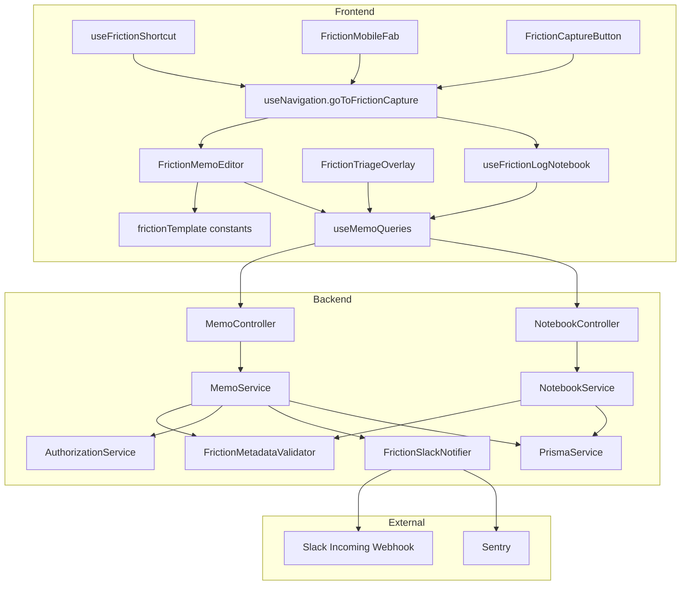
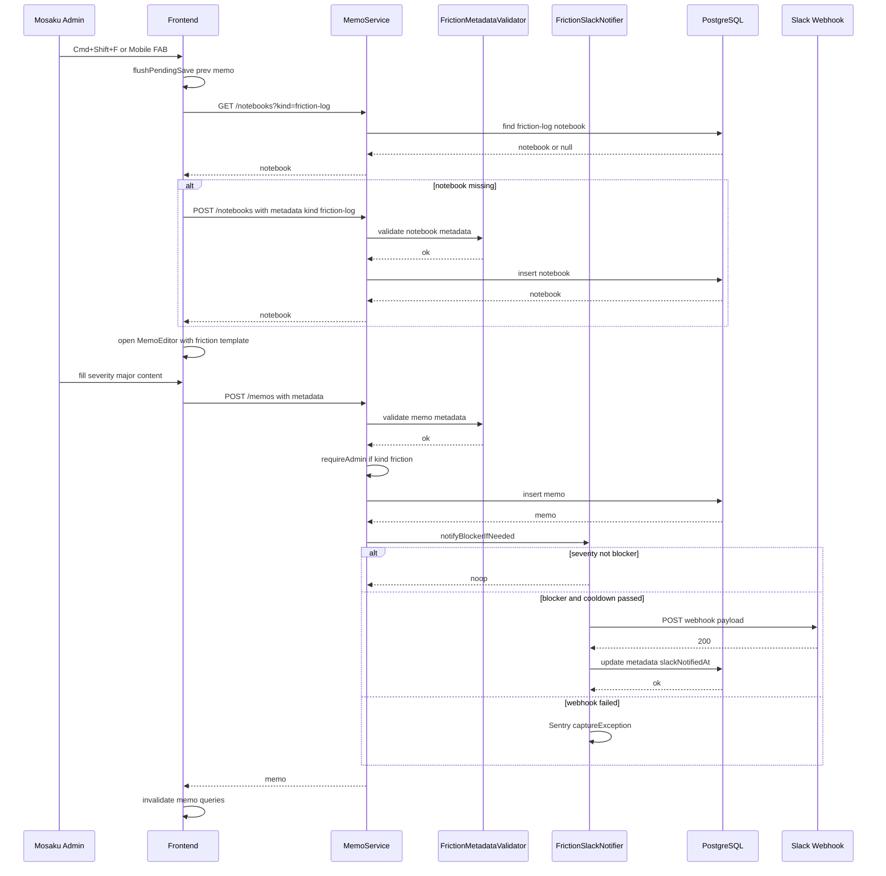
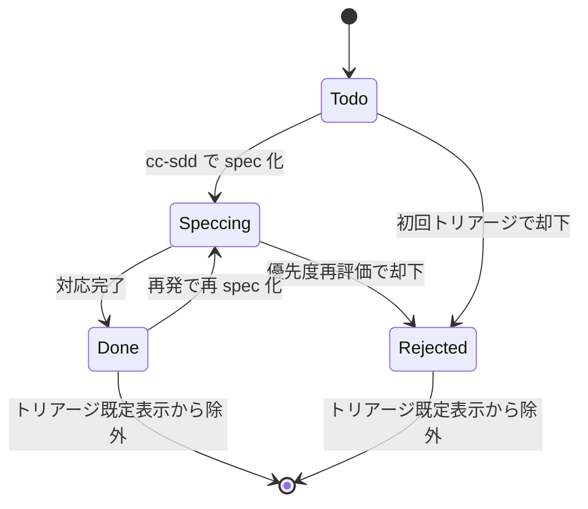
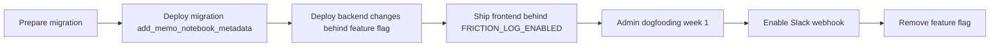

# Technical Design — dogfooding-friction-log

## Overview

**Purpose**: Mosaku 開発者がドッグフーディング期間中に遭遇する摩擦（不便・違和感・バグ・欲しい機能）を Mosaku 内で素早く記録し、週次トリアージで Top3 を選定して cc-sdd の spec 化候補に繋げる運用基盤を提供する。
**Users**: Phase 1（2026-05〜07）時点では `ADMIN` ロールを持つ Mosaku 本人のみが利用し、週 5 時間の開発枠で spec 化対象を絞り込むワークフローで使用する。Phase 3 以降の `user-feedback` 拡張で `USER` ロールへの展開余地を残す。
**Impact**: 既存の `memo` / `notebook` / `tag` ドメインを拡張し、汎用 `metadata Json?` 列 2 本（`Memo.metadata` / `Notebook.metadata`）を追加するのみ。摩擦専用テーブルや新規ドメインモジュールは作らず、API スキーマも既存エンドポイントを再利用する。Slack Incoming Webhook 連携を新設するが、Node.js 22+ 標準 `fetch` で依存を追加しない。

### Goals

- 摩擦発生の瞬間から最短 2 ステップ（ショートカット／FAB → テンプレ付きエディタ）で記録を開始できる UX を提供する。
- 記録されたすべての摩擦に severity・領域タグ・spec 化ステータスを付与し、週次トリアージで Top3 を即座に抽出できる状態を保つ。
- `blocker` 級摩擦のみ Slack に自動通知し、作業中断を正当化する重大摩擦を取りこぼさない。
- `memo` / `notebook` / `tag` の既存 API・DB スキーマを壊さず、将来の `user-feedback` / `sentry-integration` spec に同一データモデルを引き継げる構造を保つ。

### Non-Goals

- 一般 `USER` ロールや未認証ユーザー向けの摩擦受付（`user-feedback` spec へ委譲）。
- Sentry のエラーイベントから摩擦メモを自動生成する仕組み（`sentry-integration` spec へ委譲）。
- AI による摩擦の自動分類・要約・類似検出（Phase 3 以降の AI 連携 spec へ委譲）。
- Slack 以外の外部通知（メール / Discord / Teams 等）への拡張。
- 摩擦メモの全文検索 API 拡張（既存 `/memos/search` を流用）。

## Architecture

### Existing Architecture Analysis

- モノレポ構成: `backend/`（NestJS 11 / Prisma / Node.js 22+）と `frontend/`（React 19 / Vite 6 / TipTap）。
- ドメインは「1 ドメイン = 1 モジュール」で構成。`MemoModule` / `NotebookModule` / `TagModule` が所有権チェック付きの CRUD を提供する。
- 所有権検証は `AuthorizationService.validateOwnership()` に一元化。`BaseOwnableService` が共通ロジックを持つ。
- ADMIN 専用ガード `AdminGuard` が `backend/src/common/guards/admin.guard.ts` に整備済みで、`InvitationController` で運用中。
- フロントエンドは React Query を唯一のサーバー状態源泉、Zustand を UI 状態に限定する方針。`useMemoPalette.ts` に `Cmd/Ctrl + K` 等のグローバルショートカットの前例がある。
- 既存スキーマで JSON メタデータを持つモデルは `Theme.metadata Json? @default("{}")`。同じパターンを Memo / Notebook に拡張する。

### Architecture Pattern & Boundary Map

選定パターン: **Extension over existing domains**。`memo` / `notebook` / `tag` ドメインに最小限のカラム・DTO 拡張を加え、摩擦ログ固有の振る舞いは「FE の小さな facade フック群」と「BE の 2 つの common サービス（`FrictionMetadataValidator` / `FrictionSlackNotifier`）」に閉じ込める。専用ドメインモジュールは作らない。



**Architecture Integration**:

- **Selected pattern**: Extension（既存ドメイン拡張）。新規ドメインなし、1 本のマイグレーションで完結。
- **Domain/feature boundaries**: `memo` / `notebook` / `tag` は既存責務を保ち、摩擦ログ固有ロジックは `FrictionMetadataValidator`（zod バリデータ）と `FrictionSlackNotifier`（Slack 送信）の 2 サービスに閉じ込める。FE では `features/friction-log/` 相当のフック・コンポーネント群にまとめる。
- **Existing patterns preserved**: `AuthorizationService.validateOwnership`、`BaseOwnableService`、`useNavigation`、`useMemoPalette` 型のキーボードリスナー、React Query キー規約、`@sentry/nestjs` 初期化位置、`helmet` / `@nestjs/throttler` / `@nestjs/schedule` の既存構成。
- **New components rationale**: `FrictionMetadataValidator` は JSON カラムに対する zod 境界バリデーション、`FrictionSlackNotifier` は副作用（Webhook POST）を Memo の永続化トランザクションから分離するため必須。FE 側の `useFrictionLogNotebook` は専用 Notebook 解決・自動生成を一元化し、`MemoEditor` から摩擦ログ専用処理を分離する。
- **Steering compliance**: `new JS ライブラリ追加を避ける` / `React Query を唯一の真実の源泉` / `Zustand は UI 状態のみ` / `所有権検証は AuthorizationService` / `Sentry 初期化は最初の import` / すべての既存 steering 原則に準拠する。

### Technology Stack & Alignment

| Layer                    | Choice / Version                                     | Role in Feature                                                                     | Notes                                                                                                   |
| ------------------------ | ---------------------------------------------------- | ----------------------------------------------------------------------------------- | ------------------------------------------------------------------------------------------------------- |
| Frontend / CLI           | React 19 / Vite 6 / TipTap 2 / Zustand / React Query | テンプレ付きエディタ・クイックキャプチャ導線・トリアージオーバーレイ                | 新規 JS ライブラリは追加しない（要件 3.5 / 6.2）                                                        |
| Backend / Services       | NestJS 11 / TypeScript strict / Node.js 22+          | `MemoController` 拡張・`FrictionMetadataValidator` / `FrictionSlackNotifier` 新設   | Slack 送信は Node.js 22 標準 `fetch`。`@nestjs/axios` 等は導入しない                                    |
| Data / Storage           | PostgreSQL（Supabase）/ Prisma ORM                   | `Memo.metadata Json?` / `Notebook.metadata Json?` 追加、マイグレーション 1 本       | `Theme.metadata Json? @default("{}")` の前例を踏襲                                                      |
| Messaging / Events       | Slack Incoming Webhook                               | `blocker` 遷移時に 1 POST を送信（fire-and-forget）                                 | `SLACK_WEBHOOK_URL` 未設定時はノーオペ。失敗時は `@sentry/nestjs` の `Sentry.captureException` のみ記録 |
| Infrastructure / Runtime | Google Cloud Run（BE）/ Vercel（FE）/ Supabase       | 既存インフラを変更せず、環境変数 `SLACK_WEBHOOK_URL` を Cloud Run Secret に追加のみ | Cloud Run 設定は `docs/deployment/` の手順に従って後日追加。インフラ変更は本 spec の実装範囲外          |

詳細な外部 API 仕様・比較検討は `research.md` を参照。

## System Flows

### クイックキャプチャから Slack 通知までのシーケンス



- 編集中メモの `flushPendingSave` は要件 3.3 を満たすために必須。`useAutoSave` を拡張して pending デバウンスを同期フラッシュする API を公開する。
- Slack 送信は `await` するが、内部で例外を握りつぶしてメモ作成 API の 201 応答を遅延させない設計（要件 5.4）。

### 週次トリアージの状態遷移



- `Done` / `Rejected` に遷移したメモはトリアージ既定表示から除外するのみで、ゴミ箱には送らない（要件 4.6）。
- `Speccing` 遷移時に `metadata.specRef` が必須（FE で保存直前に検証）。

## Requirements Traceability

| Requirement | Summary                                                  | Components                                                                   | Interfaces                                          | Flows                        |
| ----------- | -------------------------------------------------------- | ---------------------------------------------------------------------------- | --------------------------------------------------- | ---------------------------- |
| 1.1         | 摩擦ログを専用ノートブック配下のメモで保存               | `MemoService`, `NotebookService`, `useFrictionLogNotebook`                   | `POST /memos`, `POST /notebooks`                    | クイックキャプチャシーケンス |
| 1.2         | 既存 memo/notebook ドメインで完結・専用テーブル禁止      | `MemoService`, `NotebookService`, `Prisma Memo.metadata / Notebook.metadata` | 既存 `CreateMemoDto` 拡張、`CreateNotebookDto` 拡張 | クイックキャプチャシーケンス |
| 1.3         | 未作成時に自動生成または既存選択                         | `useFrictionLogNotebook`, `NotebookService`                                  | `POST /notebooks`                                   | クイックキャプチャシーケンス |
| 1.4         | 所有権・自動保存・ゴミ箱を通常メモと同等に適用           | `MemoService`, `AuthorizationService`, `useAutoSave`                         | `validateOwnership`, `DELETE /memos/:id`            | 共通（CRUD 既存）            |
| 1.5         | 領域タグを既存 Tag ドメインで表現                        | `TagService`, `useTagQueries`, `FrictionTagPresets`                          | `POST /tags`, `POST /memos/:id/tags`                | 共通（CRUD 既存）            |
| 2.1         | 摩擦テンプレートを本文自動挿入                           | `frictionTemplate` constants, `FrictionMemoEditor`                           | `RichTextEditor.setContent`                         | クイックキャプチャシーケンス |
| 2.2         | severity 4 段階をメタデータに保持                        | `FrictionMetadataValidator`, `Memo.metadata`                                 | `FrictionMemoMetadata` zod schema                   | —                            |
| 2.3         | 領域タグ推奨（必須ではない）                             | `FrictionMemoEditor`, `useTagQueries`                                        | `POST /memos/:id/tags`                              | —                            |
| 2.4         | 未設定時は警告表示のみで保存はブロックしない             | `FrictionMemoEditor`, `FrictionMetadataPanel`                                | —                                                   | —                            |
| 2.5         | テンプレートを FE 定数 1 箇所で管理                      | `frictionTemplate` constants                                                 | `getFrictionTemplate(locale)`                       | —                            |
| 3.1         | グローバル導線で 1 アクション遷移                        | `useFrictionShortcut`, `FrictionCaptureButton`                               | `useNavigation.goToFrictionCapture`                 | クイックキャプチャシーケンス |
| 3.2         | テンプレ適用・自動保存 2 秒デバウンス                    | `FrictionMemoEditor`, `useAutoSave`                                          | `useAutoSave({ canSave, isSaving, onSave })`        | クイックキャプチャシーケンス |
| 3.3         | 編集中メモの自動保存完了を待って遷移                     | `useAutoSave.flushPendingSave`（新設）, `useFrictionShortcut`                | `flushPendingSave(): Promise<void>`                 | クイックキャプチャシーケンス |
| 3.4         | モバイル導線を 1 タップで提供                            | `FrictionMobileFab`, `MobileLayout`                                          | —                                                   | —                            |
| 3.5         | 新規 JS ライブラリなしで完結                             | FE 全般                                                                      | —                                                   | —                            |
| 4.1         | severity/発生日時/spec ステータスで整理                  | `FrictionTriageOverlay`, `useFrictionMemos`                                  | `useFrictionMemos(filter)`                          | 状態遷移図                   |
| 4.2         | spec 化ステータス 4 値をメタデータ保持                   | `FrictionMetadataValidator`, `Memo.metadata`                                 | `FrictionMemoMetadata` zod schema                   | 状態遷移図                   |
| 4.3         | spec 名/参照を本文末尾セクションに記録                   | `FrictionMemoEditor`, `frictionTemplate`                                     | `appendSpecReferenceSection(content, specRef)`      | —                            |
| 4.4         | トリアージ優先表示条件（過去7日・blocker/major・未着手） | `FrictionTriageOverlay`, `useFrictionMemos`                                  | `useFrictionMemos({ mode: 'triage' })`              | 状態遷移図                   |
| 4.5         | 同種摩擦件数を表示                                       | `FrictionCountBadge`, `useFrictionMemos`                                     | `aggregateBy(areaTag, severity)`                    | —                            |
| 4.6         | 対応完了メモは削除せず既定表示から除外                   | `FrictionTriageOverlay`, `useFrictionMemos`                                  | `filterDisplayable(metadata)`                       | 状態遷移図                   |
| 5.1         | SLACK_WEBHOOK_URL 有効時のみ通知機能を有効化             | `ConfigService`, `FrictionSlackNotifier`                                     | `ConfigService.slackWebhookUrl`                     | クイックキャプチャシーケンス |
| 5.2         | blocker 遷移時にタイトル等をペイロード送信               | `FrictionSlackNotifier`                                                      | `notifyBlockerIfNeeded(memo, user)`                 | クイックキャプチャシーケンス |
| 5.3         | URL 未設定時はスキップし保存は正常完了                   | `FrictionSlackNotifier`                                                      | 早期 return                                         | クイックキャプチャシーケンス |
| 5.4         | 送信失敗は保存をロールバックせず Sentry 送信             | `FrictionSlackNotifier`                                                      | try/catch + `Sentry.captureException`               | クイックキャプチャシーケンス |
| 5.5         | 24 時間以内の同一メモ重複送信を禁止                      | `FrictionSlackNotifier`, `Memo.metadata.slackNotifiedAt`                     | `isCooldownPassed(metadata)`                        | クイックキャプチャシーケンス |
| 6.1         | 通常メモ操作と同等レイテンシを維持                       | BE / FE 全般                                                                 | —                                                   | —                            |
| 6.2         | 新規依存ライブラリ追加を避ける                           | BE / FE 全般                                                                 | —                                                   | —                            |
| 6.3         | 将来の user-feedback 拡張で同一スキーマ流用              | `FrictionMetadataValidator`（discriminated union）, `metadata.recorderRole`  | `FrictionMemoMetadataSchema` discriminated union    | —                            |
| 6.4         | ADMIN ロール限定導線                                     | `MemoService.requireAdminForFriction`, `useCurrentUserRole`                  | `AuthorizationService.requireAdmin`                 | クイックキャプチャシーケンス |
| 6.5         | 非スコープの明示                                         | design.md の Non-Goals                                                       | —                                                   | —                            |
| 6.6         | 他 spec との境界を手動記録側に限定                       | design.md の Non-Goals, `FrictionMetadataValidator`                          | —                                                   | —                            |

## Components and Interfaces

### Summary

| Component                     | Domain/Layer    | Intent                                                                              | Req Coverage                           | Key Dependencies (P0/P1)                                                                    | Contracts      |
| ----------------------------- | --------------- | ----------------------------------------------------------------------------------- | -------------------------------------- | ------------------------------------------------------------------------------------------- | -------------- |
| `FrictionMetadataValidator`   | BE / common     | `Memo.metadata` / `Notebook.metadata` の zod 検証とナロー変換                       | 2.2, 2.4, 4.2, 6.3                     | `zod` (P0)                                                                                  | Service        |
| `FrictionSlackNotifier`       | BE / common     | `blocker` 遷移時 Slack Webhook 送信と重複抑制・失敗ハンドリング                     | 5.1, 5.2, 5.3, 5.4, 5.5                | `ConfigService` (P0), `PrismaService` (P0), `@sentry/nestjs` (P1), Node.js fetch (P0)       | Service, Event |
| `MemoService` (拡張)          | BE / memo       | metadata バリデーション、ADMIN ゲート、Slack 通知フック                             | 1.1, 1.2, 1.4, 2.2, 4.2, 5.2, 5.5, 6.4 | `FrictionMetadataValidator` (P0), `FrictionSlackNotifier` (P0), `AuthorizationService` (P0) | Service, API   |
| `NotebookService` (拡張)      | BE / notebook   | Notebook の `metadata.kind = 'friction-log'` 受容と一意性保証                       | 1.1, 1.2, 1.3                          | `FrictionMetadataValidator` (P0), `AuthorizationService` (P0)                               | Service, API   |
| `AuthorizationService` (拡張) | BE / common     | `requireAdmin(user)` ヘルパ追加                                                     | 6.4                                    | —                                                                                           | Service        |
| `ConfigService` (拡張)        | BE / config     | `slackWebhookUrl` getter 追加                                                       | 5.1                                    | —                                                                                           | Service        |
| `Prisma Migration`            | BE / data       | `Memo.metadata Json?` / `Notebook.metadata Json?` 列追加                            | 1.2, 2.2, 4.2, 5.5                     | Prisma CLI (P0)                                                                             | Batch          |
| `useFrictionShortcut`         | FE / hooks      | `Cmd/Ctrl + Shift + F` リスナー + `useNavigation` 呼び出し                          | 3.1, 3.3                               | `useNavigation` (P0), `useAutoSave.flushPendingSave` (P0)                                   | State          |
| `useFrictionLogNotebook`      | FE / hooks      | 摩擦ログ専用 Notebook の ID 解決と自動生成                                          | 1.3, 3.1                               | `useNotebookQueries` (P0), `useCreateNotebook` (P0)                                         | State          |
| `useFrictionMemos`            | FE / hooks      | 摩擦ログ Notebook 配下メモの取得・絞り込み・集計                                    | 4.1, 4.4, 4.5, 4.6                     | `useMemos` (P0), React Query (P0)                                                           | State          |
| `useAutoSave` (拡張)          | FE / hooks      | `flushPendingSave()` を公開                                                         | 3.3                                    | —                                                                                           | Service        |
| `useCurrentUserRole`          | FE / hooks      | 現在ユーザーが ADMIN か判定                                                         | 6.4                                    | 既存認証ストア (P0)                                                                         | State          |
| `useNavigation` (拡張)        | FE / hooks      | `goToFrictionCapture()` 追加                                                        | 3.1                                    | `useFrictionLogNotebook` (P0), `useViewStore` (P0)                                          | State          |
| `FrictionMemoEditor`          | FE / components | MemoEditor 派生。テンプレ初期挿入 + `FrictionMetadataPanel` 統合                    | 2.1, 2.3, 2.4, 2.5, 3.2, 4.3           | `MemoEditor` (P0), `frictionTemplate` (P0)                                                  | UI             |
| `FrictionMetadataPanel`       | FE / components | severity / specStatus / specRef / templateVersion を編集する UI                     | 2.2, 2.4, 4.2                          | `useUpdateMemo` (P0)                                                                        | UI             |
| `FrictionCaptureButton`       | FE / components | ヘッダー内のアイコン導線。ADMIN のみ表示                                            | 3.1, 6.4                               | `useNavigation` (P0), `useCurrentUserRole` (P0)                                             | UI             |
| `FrictionMobileFab`           | FE / components | モバイル用 FAB。ADMIN のみ表示                                                      | 3.4, 6.4                               | `useNavigation` (P0), `useCurrentUserRole` (P0)                                             | UI             |
| `FrictionTriageOverlay`       | FE / components | Notebook 詳細ビュー上に重ねるフィルタ・並び替えバー                                 | 4.1, 4.4                               | `useFrictionMemos` (P0)                                                                     | UI             |
| `FrictionCountBadge`          | FE / components | 同種摩擦件数バッジ                                                                  | 4.5                                    | `useFrictionMemos` (P0)                                                                     | UI             |
| `frictionTemplate` constants  | FE / constants  | テンプレート本文・spec 参照セクション生成                                           | 2.1, 2.5, 4.3                          | —                                                                                           | —              |
| `FrictionTagPresets`          | FE / constants  | 領域タグ初期セット（`area:editor` / `area:theme` / `area:auth` / `area:mobile` 等） | 1.5, 2.3                               | —                                                                                           | —              |

UI 専用コンポーネント（`FrictionCaptureButton` / `FrictionMobileFab` / `FrictionTriageOverlay` / `FrictionCountBadge`）は新規の境界を導入しないため Implementation Notes のみ。残る詳細ブロックは新規契約を持つコンポーネントに限定する。

### Backend / Common

#### FrictionMetadataValidator

| Field        | Detail                                                                           |
| ------------ | -------------------------------------------------------------------------------- |
| Intent       | `Memo.metadata` / `Notebook.metadata` を安全な判別共用体へ変換する境界バリデータ |
| Requirements | 2.2, 2.4, 4.2, 6.3                                                               |

**Responsibilities & Constraints**

- `Memo.metadata` / `Notebook.metadata` が未指定（`null`）の場合は `null` をそのまま返す。
- 指定された場合は zod の `discriminatedUnion('kind', [...])` でパースし、未知の `kind` や欠損フィールドは `ValidationException` を投げる。
- `metadata.kind === 'friction'` のとき `severity` と `specStatus` が必須。`slackNotifiedAt` は任意の ISO-8601 文字列。
- `recorderRole` は `'admin' | 'user'` を初版で受け入れ、書き込み時は `MemoService` が現在ユーザーのロールと突き合わせる。
- バリデータ自体はステートレス。DB・外部サービスに依存しない。

**Dependencies**

- Inbound: `MemoService`（P0）, `NotebookService`（P0）
- Outbound: —
- External: `zod`（P0）— 既存プロジェクト依存、新規追加なし

**Contracts**: Service [x]

##### Service Interface

```typescript
type FrictionSeverity = 'blocker' | 'major' | 'minor' | 'nice-to-have';
type FrictionSpecStatus = 'todo' | 'speccing' | 'done' | 'rejected';
type FrictionRecorderRole = 'admin' | 'user';

interface FrictionMemoMetadata {
	kind: 'friction';
	severity: FrictionSeverity;
	specStatus: FrictionSpecStatus;
	specRef?: string;
	slackNotifiedAt?: string;
	recorderRole: FrictionRecorderRole;
	templateVersion: number;
}

interface FrictionLogNotebookMetadata {
	kind: 'friction-log';
}

type MemoMetadata = FrictionMemoMetadata | null;
type NotebookMetadata = FrictionLogNotebookMetadata | null;

interface FrictionMetadataValidator {
	parseMemoMetadata(raw: unknown): MemoMetadata;
	parseNotebookMetadata(raw: unknown): NotebookMetadata;
	isFrictionMemoMetadata(meta: MemoMetadata): meta is FrictionMemoMetadata;
	isFrictionLogNotebook(meta: NotebookMetadata): meta is FrictionLogNotebookMetadata;
}
```

- **Preconditions**: 入力は `unknown`。`JSON.parse` 済みの値を期待。
- **Postconditions**: 成功時は正規化された判別共用体を返す。失敗時は `BadRequestException`（NestJS 標準）を投げる。
- **Invariants**: `FrictionMemoMetadata.recorderRole` は呼び出し元が `MemoService` で再検証する（書き込みユーザーロールと一致すべき）。

**Implementation Notes**

- Integration: `MemoService` / `NotebookService` の create / update で一箇所だけ `parse*Metadata` を呼ぶ。DTO 層で直接 zod を叩かないことで FE から来る生値を「サービス層 1 箇所で正規化」する方針に統一。
- Validation: zod の `strict()` モードを使い、未知プロパティ混入時は 400 応答。
- Risks: zod スキーマ変更時に既存メモの読み出しが壊れないよう、`safeParse` 相当のフォールバック用メソッド `parseMemoMetadataLoose` を用意し、読み出し専用経路（`findOne` / `findAll`）では寛容にする。

#### FrictionSlackNotifier

| Field        | Detail                                                                                     |
| ------------ | ------------------------------------------------------------------------------------------ |
| Intent       | `blocker` 遷移検知・Slack Webhook POST・重複抑制・失敗時の Sentry 記録を担う副作用サービス |
| Requirements | 5.1, 5.2, 5.3, 5.4, 5.5                                                                    |

**Responsibilities & Constraints**

- `SLACK_WEBHOOK_URL` 未設定時は `notifyBlockerIfNeeded` を早期 `return`（要件 5.3）。
- `metadata.severity === 'blocker'` かつ旧 `metadata.severity !== 'blocker'` または新規作成時のみ送信対象とする（要件 5.2）。
- 同一メモに対し `metadata.slackNotifiedAt` が 24 時間以内なら送信しない（要件 5.5）。
- 送信成功後に `MemoService` を通じて `metadata.slackNotifiedAt` を ISO-8601 現在時刻で更新。書き込み失敗は Sentry に送信する（メモ本体の成功レスポンスは維持）。
- 送信失敗時は `Sentry.captureException` のみ実行。例外は呼び出し元に伝播させない（要件 5.4）。

**Dependencies**

- Inbound: `MemoService`（P0）
- Outbound: `PrismaService`（P0）— `slackNotifiedAt` 更新のみ
- External: Slack Incoming Webhook（P0）, `@sentry/nestjs`（P1）, Node.js 22 `fetch`（P0）

**Contracts**: Service [x] / Event [x]

##### Service Interface

```typescript
interface FrictionBlockerPayload {
	memoId: string;
	title: string;
	areaTags: string[];
	summary: string;
	deepLink: string;
	triggeredAt: string;
}

interface FrictionSlackNotifier {
	notifyBlockerIfNeeded(params: {
		memo: { id: string; title: string; content: string };
		previousMetadata: FrictionMemoMetadata | null;
		nextMetadata: FrictionMemoMetadata;
		areaTags: string[];
		recorderId: string;
	}): Promise<void>;
}
```

- **Preconditions**: `nextMetadata.kind === 'friction'`。呼び出し元は ADMIN ガード通過済み。
- **Postconditions**: 送信条件を満たした場合のみ Slack に POST。失敗は例外として投げない。
- **Invariants**: 同一メモの重複送信禁止（24h クールダウン）。

##### Event Contract

- **Published events**: Slack Incoming Webhook（external、一方向 HTTP POST）
- **Subscribed events**: なし
- **Ordering / delivery guarantees**: best-effort。冪等性は `metadata.slackNotifiedAt` で保証。

##### API Contract (Slack payload)

| Method | Endpoint               | Request         | Response | Errors                    |
| ------ | ---------------------- | --------------- | -------- | ------------------------- |
| POST   | `${SLACK_WEBHOOK_URL}` | Slack text JSON | 200 OK   | 4xx/5xx → Sentry 送信のみ |

ペイロード概要:

```json
{
	"text": "[blocker] <メモタイトル>",
	"blocks": [
		{
			"type": "section",
			"text": { "type": "mrkdwn", "text": "領域: area:editor, 要約: ..., リンク: <deepLink>" }
		}
	]
}
```

**Implementation Notes**

- Integration: `MemoService.create` / `MemoService.update` の最終段で `await notifier.notifyBlockerIfNeeded(...)` を呼ぶ。`await` するが内部で握りつぶすため API レスポンスは遅延しない。
- Validation: `deepLink` は `ConfigService.frontendUrl + '/memos/' + memo.id` で生成し、`summary` は本文先頭 140 文字（HTML タグ除去後）。
- Risks: Slack レート制限（1 秒あたり約 1 POST）を超える心配は実質ないが、テストで 429 応答時の Sentry 記録を検証する。Webhook URL の漏洩リスクは Cloud Run Secret Manager 管理で既存ポリシーに従う。

### Backend / Memo

#### MemoService (extended)

| Field        | Detail                                                                                         |
| ------------ | ---------------------------------------------------------------------------------------------- |
| Intent       | 既存 CRUD を保ちつつ、`metadata` 書き込み経路に zod 検証・ADMIN ゲート・Slack 通知フックを追加 |
| Requirements | 1.1, 1.2, 1.4, 2.2, 4.2, 5.2, 5.5, 6.4                                                         |

**Responsibilities & Constraints**

- `create` / `update` で `metadata` 指定があれば `FrictionMetadataValidator.parseMemoMetadata` を通す。
- `parsed?.kind === 'friction'` なら `AuthorizationService.requireAdmin(user)` を呼び、USER ロールは 403。
- `parsed?.recorderRole` は `'admin'`（Phase 1）を強制。将来の user-feedback で `'user'` を解禁する余地を残す。
- 書き込み後、`FrictionSlackNotifier.notifyBlockerIfNeeded` に旧/新 metadata を渡す。
- 所有権・ゴミ箱・自動保存の既存挙動は維持（要件 1.4）。

**Dependencies**

- Inbound: `MemoController`（P0）
- Outbound: `PrismaService`（P0）, `AuthorizationService`（P0）, `FrictionMetadataValidator`（P0）, `FrictionSlackNotifier`（P0）
- External: —

**Contracts**: Service [x] / API [x]

##### API Contract

| Method | Endpoint     | Request                               | Response            | Errors                                                                   |
| ------ | ------------ | ------------------------------------- | ------------------- | ------------------------------------------------------------------------ |
| POST   | `/memos`     | `CreateMemoDto` + optional `metadata` | `MemoWithRelations` | 400 metadata 不正, 403 USER が friction metadata 投稿, 404 notebook 不在 |
| PATCH  | `/memos/:id` | `UpdateMemoDto` + optional `metadata` | `MemoWithRelations` | 400, 403, 404 同上                                                       |

DTO 変更:

```typescript
class CreateMemoDto {
	title: string;
	content: string;
	notebookId?: string;
	metadata?: unknown;
}

class UpdateMemoDto {
	title?: string;
	content?: string;
	notebookId?: string;
	metadata?: unknown;
}
```

`metadata` は `unknown` として受け取り、サービス層で `FrictionMetadataValidator` が正規化する。

**Implementation Notes**

- Integration: 既存 `create` / `update` メソッドのトランザクション境界を変えない。Slack 送信はコミット後に呼ぶ（`await prisma.memo.create` 後）。
- Validation: `metadata` が空文字や `undefined` の場合は `null` と同等に扱う（明示的に `null` を渡せば既存値を消去）。
- Risks: 既存ユニットテスト（`memo.service.spec.ts`）の破壊的変更を避けるため、`metadata` 未指定パスは現行と完全に同一挙動であることをテストで固定する。

### Backend / Notebook

#### NotebookService (extended)

| Field        | Detail                                                                            |
| ------------ | --------------------------------------------------------------------------------- |
| Intent       | Notebook に `metadata.kind = 'friction-log'` を受容し、ユーザー単位で一意性を保証 |
| Requirements | 1.1, 1.2, 1.3                                                                     |

**Responsibilities & Constraints**

- `create` / `update` で `metadata` を zod 検証。`kind: 'friction-log'` は 1 ユーザーあたり最大 1 つの Notebook に限定（DB レベルの部分ユニーク索引 or サービス層チェック）。
- 摩擦ログ Notebook の所有権検証は既存 `AuthorizationService.validateOwnership` を使用。
- `FrictionMetadataValidator` で検証。Notebook 側に severity などは持たない。

**Dependencies**

- Inbound: `NotebookController`（P0）
- Outbound: `PrismaService`（P0）, `AuthorizationService`（P0）, `FrictionMetadataValidator`（P0）

**Contracts**: Service [x] / API [x]

##### API Contract

| Method | Endpoint         | Request                                   | Response   | Errors                                                                                     |
| ------ | ---------------- | ----------------------------------------- | ---------- | ------------------------------------------------------------------------------------------ |
| POST   | `/notebooks`     | `CreateNotebookDto` + optional `metadata` | `Notebook` | 400 metadata 不正, 409 既に friction-log Notebook が存在, 403 ADMIN 外の friction-log 作成 |
| PATCH  | `/notebooks/:id` | `UpdateNotebookDto` + optional `metadata` | `Notebook` | 400, 403, 404                                                                              |

**Implementation Notes**

- Integration: 一意性は `Notebook` テーブルに `WHERE metadata ->> 'kind' = 'friction-log'` の部分ユニーク索引を貼るか、サービス層でトランザクション内の count チェック。今回は**サービス層チェック**を採用（Prisma での raw 部分ユニーク索引は `@@index` で表現しづらく、マイグレーションが複雑になるため）。
- Validation: `FrictionMetadataValidator` で `kind` を検証。ADMIN ゲートは `MemoService` と同じ `requireAdmin` 呼び出し。
- Risks: 同時 2 POST で二重生成の恐れがあるため、サービス層でアドバイザリロック（`SELECT ... FOR UPDATE`）を検討。初版はユーザーが 1 人しかいない Phase 1 のため、楽観的ロック（作成後に `count > 1` なら後勝ちを削除）で十分。

### Backend / Common (AuthorizationService extension)

#### AuthorizationService.requireAdmin

| Field        | Detail                                                           |
| ------------ | ---------------------------------------------------------------- |
| Intent       | ADMIN ロール強制を「ガード」ではなく「サービスヘルパ」として提供 |
| Requirements | 6.4                                                              |

**Responsibilities & Constraints**

- 入力が `{ role: 'ADMIN' }` でなければ `ForbiddenException`（`ERROR_CODES.AUTHZ.ADMIN_ONLY`）を投げる。
- 既存 `AdminGuard` と動作互換。

**Contracts**: Service [x]

##### Service Interface

```typescript
interface AuthorizationService {
	validateOwnership<T extends OwnableEntity>(
		entity: T | null,
		userId: string,
		entityName: string,
	): T;
	validateExistence<T>(entity: T | null, entityName: string): T;
	validateBulkOwnership<T extends OwnableEntity>(
		entities: T[],
		userId: string,
		entityName: string,
	): T[];
	requireAdmin(user: Pick<AuthenticatedUser, 'role'>): void;
}
```

**Implementation Notes**

- Integration: 既存の `AdminGuard` は維持。`MemoService` / `NotebookService` の内部ロジック用に `requireAdmin` を追加。
- Validation: `ERROR_CODES.AUTHZ.ADMIN_ONLY` を流用。
- Risks: なし。純粋関数的ヘルパ。

### Frontend / Shared Hooks

#### useFrictionShortcut

| Field        | Detail                                                                            |
| ------------ | --------------------------------------------------------------------------------- |
| Intent       | `Cmd/Ctrl + Shift + F` を監視し、未保存編集をフラッシュした上で摩擦ログ画面へ遷移 |
| Requirements | 3.1, 3.3                                                                          |

**Responsibilities & Constraints**

- `window.keydown` リスナーを `useEffect` で登録・解除（`useMemoPalette` と同パターン）。
- ADMIN でない場合はリスナー自体を登録しない（UX 上の明示的ガード、要件 6.4）。
- トリガー時は現在フォーカス中の編集コンポーネントの `useAutoSave.flushPendingSave` を呼び、成功を待ってから `useNavigation.goToFrictionCapture()` を実行する。

**Dependencies**

- Inbound: `App.tsx` 相当のルート（P0）
- Outbound: `useNavigation`（P0）, `useAutoSave.flushPendingSave`（P0）, `useCurrentUserRole`（P0）

**Contracts**: State [x]

##### Service Interface

```typescript
interface UseFrictionShortcutOptions {
	flushPendingSave?: () => Promise<void>;
}

type UseFrictionShortcut = (options?: UseFrictionShortcutOptions) => void;
```

**Implementation Notes**

- Integration: `DesktopLayout` / `MobileLayout` のルート付近で 1 度だけ呼ぶ。二重登録を避ける。
- Validation: IME 変換中（`e.isComposing`）は無視。
- Risks: エディタ内で `Ctrl + Shift + F` を他機能に使う TipTap 拡張が追加された場合に衝突する恐れ。衝突時は `event.target` がエディタ内なら無視する分岐を入れる。

#### useFrictionLogNotebook

| Field        | Detail                                                                                        |
| ------------ | --------------------------------------------------------------------------------------------- |
| Intent       | `metadata.kind === 'friction-log'` の Notebook を解決し、未作成なら自動生成する facade フック |
| Requirements | 1.3, 3.1                                                                                      |

**Responsibilities & Constraints**

- `useNotebooks()` の結果をクライアント側でフィルタして該当 Notebook を返す（サーバー側フィルタは初版では導入せず、小規模データを前提）。
- 存在しない場合、`useCreateNotebook` を用いて `{ name: 'Friction Log', metadata: { kind: 'friction-log' } }` で新規作成。
- 作成中のローディング・エラーを React Query の `status` として公開し、UI で `Loading...` / `Retry` を描画できるようにする。

**Dependencies**

- Inbound: `useNavigation`（P0）, `useFrictionMemos`（P0）, `FrictionTriageOverlay`（P0）
- Outbound: `useNotebooks`（P0）, `useCreateNotebook`（P0）

**Contracts**: State [x]

##### Service Interface

```typescript
interface FrictionLogNotebookState {
	notebook: NotebookWithMetadata | null;
	isLoading: boolean;
	error: Error | null;
	ensureNotebook: () => Promise<NotebookWithMetadata>;
}

type UseFrictionLogNotebook = () => FrictionLogNotebookState;
```

**Implementation Notes**

- Integration: `useNavigation.goToFrictionCapture` は内部で `ensureNotebook()` を await してから画面遷移。
- Validation: クライアント側でも「`metadata.kind === 'friction-log'` が 0 または 1」を想定。複数検出時は最古のものを採用し、Sentry にイベント送信（BE の一意性破れを可視化）。
- Risks: オフライン時に `ensureNotebook` が失敗する。`FrictionMemoEditor` が「摩擦ログ Notebook を準備できません」のフォールバック表示を用意。

#### useFrictionMemos

| Field        | Detail                                                                                                |
| ------------ | ----------------------------------------------------------------------------------------------------- |
| Intent       | 摩擦ログ Notebook 配下のメモを React Query キャッシュから導出し、トリアージ向けに絞り込み・集計を行う |
| Requirements | 4.1, 4.4, 4.5, 4.6                                                                                    |

**Responsibilities & Constraints**

- `useMemos()` の既存クエリをベースに、クライアント側で `notebookId === frictionLogNotebook.id && metadata?.kind === 'friction'` のメモのみを抽出。
- `mode: 'triage' | 'all'` の切り替えに応じて、`triage` では「過去 7 日・`todo` ステータス・`blocker/major`」を上位に並べる。
- 集計ヘルパ `aggregateByAreaSeverity(memos)` を提供し、`FrictionCountBadge` が利用。

**Dependencies**

- Inbound: `FrictionTriageOverlay`（P0）, `FrictionCountBadge`（P1）
- Outbound: `useMemos`（P0）, `useFrictionLogNotebook`（P0）

**Contracts**: State [x]

##### Service Interface

```typescript
interface UseFrictionMemosParams {
	mode?: 'all' | 'triage';
}

interface FrictionMemosView {
	memos: FrictionMemoView[];
	totals: Record<string, number>;
	isLoading: boolean;
	error: Error | null;
}

interface FrictionMemoView {
	id: string;
	title: string;
	severity: FrictionSeverity;
	specStatus: FrictionSpecStatus;
	specRef?: string;
	areaTags: string[];
	createdAt: string;
	updatedAt: string;
	siblingCount: number;
}

type UseFrictionMemos = (params?: UseFrictionMemosParams) => FrictionMemosView;
```

**Implementation Notes**

- Integration: 集計ロジックは純粋関数として `utils/frictionAggregation.ts` に切り出し、ユニットテストを書く。
- Validation: `metadata` が不正な値の場合は `useFrictionMemos` が警告ログを出し、該当メモを「深刻度 未設定」として表示（要件 2.4 と整合）。
- Risks: Notebook 内メモが数百〜数千件になった場合、クライアント集計がパフォーマンス懸念になる。Phase 1 は同一人物の運用で最大数百件と想定し許容。スケール時は BE に集計 API を追加する拡張余地。

#### useAutoSave (extended)

| Field        | Detail                                                                  |
| ------------ | ----------------------------------------------------------------------- |
| Intent       | 既存の 2 秒デバウンスを保ちつつ、明示的な `flushPendingSave` を提供する |
| Requirements | 3.3                                                                     |

**Responsibilities & Constraints**

- 現行の `cancelDebounce` / `saveStatus` / `scheduleAutoSave` は変更しない。
- `flushPendingSave(): Promise<void>` を追加。保留中のデバウンスタイマを即座に発火して `onSave` を await し、その成功/失敗を返す。
- 保留がなければ即座に解決。

**Dependencies**

- Inbound: `useFrictionShortcut`（P0）, 既存 `MemoEditor`（P1）
- Outbound: 既存 `onSave` 呼び出し元

**Contracts**: Service [x]

##### Service Interface

```typescript
interface UseAutoSaveApi {
	saveStatus: 'idle' | 'pending' | 'saving' | 'saved' | 'error';
	scheduleAutoSave: () => void;
	cancelDebounce: () => void;
	flushPendingSave: () => Promise<void>;
}
```

**Implementation Notes**

- Integration: 既存テスト（`useAutoSave.test.ts`）に `flushPendingSave` のユニットテストを 3 ケース追加（保留なし即解決、保留ありで成功、保留ありで失敗）。
- Validation: `flushPendingSave` は二重呼び出し時に直近の Promise を再利用してレースを防ぐ。
- Risks: デバウンスタイマと flush の競合で `onSave` が二重呼ばれないよう、`inFlight` フラグで同期する必要あり。

### Frontend / Components (Implementation Notes Only)

- **FrictionMemoEditor**: `MemoEditor` を薄くラップし、`isCreate && isFrictionLogNotebook(notebook)` のとき `frictionTemplate.initialContent({ templateVersion })` を初期 `content` に流し込む。保存ペイロードの `metadata` に `FrictionMetadataPanel` の現在値を乗せる。要件 2.1 / 2.5 / 3.2 / 4.3。
- **FrictionMetadataPanel**: severity（radio）、specStatus（select）、specRef（テキスト）、templateVersion（read-only）の編集 UI。未設定時に inline warning を出す（要件 2.4）。
- **FrictionCaptureButton / FrictionMobileFab**: `useCurrentUserRole() === 'ADMIN'` のときのみ描画。`onClick` で `useNavigation.goToFrictionCapture()` を呼ぶ。`FrictionMobileFab` は `position: fixed; right: 16px; bottom: calc(safe-area + toolbar + 16px)` で既存ツールバーと干渉しない配置。要件 3.1 / 3.4 / 6.4。
- **FrictionTriageOverlay**: Notebook 詳細ビューで `notebook.metadata?.kind === 'friction-log'` の場合のみマウント。フィルタバー（severity / specStatus / 期間）+ ソート（更新日 / 深刻度）+ 件数バッジを描画。要件 4.1 / 4.4 / 4.5。
- **FrictionCountBadge**: `useFrictionMemos` の `siblingCount` を表示。領域タグ × severity の組み合わせごとに Tooltip で内訳を見せる。要件 4.5。

### Frontend / Constants

- **frictionTemplate**: `getFrictionTemplate(locale: 'ja' | 'en'): { html: string; templateVersion: number }`。HTML で TipTap `setContent` に流し込める形式。セクション: 発生日時 / 現象 / 期待動作 / 深刻度 / 領域タグ / 再現手順 / spec 参照。`appendSpecReferenceSection(content: string, specRef: string): string` で本文末尾に spec 参照を追記。要件 2.1 / 2.5 / 4.3。
- **FrictionTagPresets**: `['area:editor', 'area:theme', 'area:auth', 'area:mobile', 'area:notebook', 'area:trash', 'area:infra']` の初期プリセット名配列。初回摩擦メモ保存時に未作成のタグのみ `useTagQueries.create` で作成する helper を同梱。要件 1.5 / 2.3。

## Data Models

### Domain Model

- **集約 / 境界**: `Memo` と `Notebook` が既存の集約。摩擦ログは「Notebook 集約配下の Memo エンティティに metadata VO を付与した特殊ケース」として扱う。
- **エンティティ / VO**:
  - `Memo` (既存) — `metadata: FrictionMemoMetadata | null` を保持
  - `Notebook` (既存) — `metadata: FrictionLogNotebookMetadata | null` を保持
  - `FrictionMemoMetadata` (新規 VO) — severity / specStatus / specRef / slackNotifiedAt / recorderRole / templateVersion
  - `FrictionLogNotebookMetadata` (新規 VO) — kind のみ
- **ドメインイベント**: `FrictionBlockerEscalated`（内部）— severity が `blocker` に遷移したときに `FrictionSlackNotifier` が反応。NestJS EventEmitter ではなくサービス直接呼び出しで表現（簡潔性優先）。
- **不変条件**:
  - `Notebook.metadata.kind === 'friction-log'` の Notebook は 1 ユーザーあたり最大 1 つ。
  - `Memo.metadata.kind === 'friction'` のメモは `Notebook.metadata.kind === 'friction-log'` の Notebook 配下にあるべき（FE で強制、BE は Warning のみ）。
  - `Memo.metadata.slackNotifiedAt` は `Memo.metadata.severity` が一度でも `blocker` に遷移したときのみ設定される。

### Logical Data Model

- `Memo` テーブルに `metadata Json?` 列を追加。デフォルト `NULL`。
- `Notebook` テーブルに `metadata Json?` 列を追加。デフォルト `NULL`。
- PostgreSQL の `jsonb` としてインデックス最適化可能だが、初版は通常 `json` で十分（Prisma の `Json?` は Postgres 側で `jsonb` にマッピング）。
- 参照整合性: 追加のリレーションなし。既存 FK を維持。
- 時間的側面: `metadata.slackNotifiedAt` を ISO-8601 文字列で保持。`createdAt` / `updatedAt` は既存列を使用。

### Physical Data Model

**Migration**:

```sql
ALTER TABLE "memos" ADD COLUMN "metadata" JSONB;
ALTER TABLE "notebooks" ADD COLUMN "metadata" JSONB;
```

- Prisma 定義:

  ```prisma
  model Memo {
    // 既存フィールドは変更しない
    metadata  Json?
  }

  model Notebook {
    metadata  Json?
  }
  ```

- インデックス: 初版では追加しない（データ量が小さいため）。Phase 2 以降で `metadata->>'kind'` の部分式インデックスを検討。
- パーティショニング: 不要。

### Data Contracts & Integration

- **API Data Transfer**:
  - `CreateMemoDto` / `UpdateMemoDto` / `CreateNotebookDto` / `UpdateNotebookDto` に `metadata?: unknown` を追加。
  - サービス層で `FrictionMetadataValidator` により判別共用体へ正規化。
  - レスポンスはそのまま `metadata: FrictionMemoMetadata | null` として返却。FE の型は `frontend/src/types/memo.ts` / `types/notebook.ts` に拡張して共有。
- **Event Schemas**: Slack Webhook ペイロード（`FrictionBlockerPayload`）は実質外部契約。Slack 側の `text` / `blocks` 仕様に従う。
- **Cross-Service Data Management**: Slack 側の永続化は Mosaku の責務外。通知は冪等ではないが、Mosaku 側で `slackNotifiedAt` を真実の源泉とする。

## Error Handling

### Error Strategy

- **境界バリデーション**: `FrictionMetadataValidator` がサービス層で一元的に zod 検証。失敗は `BadRequestException`（400）として FE に返却。
- **ロール制御**: `MemoService` / `NotebookService` で `metadata.kind === 'friction'|'friction-log'` を検知した瞬間に `requireAdmin` を実行。失敗は `ForbiddenException`（403, `ERROR_CODES.AUTHZ.ADMIN_ONLY`）。
- **外部通知失敗**: `FrictionSlackNotifier` は try/catch で失敗を握り潰し、`Sentry.captureException` に投げる。メモ本体のレスポンスには影響させない。
- **重複送信**: `metadata.slackNotifiedAt` が 24h 以内なら早期 `return` で ok 扱い。Sentry への記録は行わない（ノイズ回避）。
- **オフライン/ネットワーク**: FE は React Query の標準リトライに任せ、`FrictionMemoEditor` 側で `useAutoSave.saveStatus === 'error'` 時にインラインエラーを表示（要件 1.4 の自動保存既存パターン）。

### Error Categories and Responses

- **User Errors (4xx)**:
  - `400`: metadata 不正（zod 失敗）、severity 未知値 → FE はフィールド単位でハイライト
  - `403`: USER ロールが friction metadata を POST → FE は「ADMIN のみの機能です」を表示しショートカットを無効化
  - `404`: 摩擦ログ Notebook が他ユーザー所有 → 既存 AuthorizationService の応答を流用
  - `409`: friction-log Notebook 二重生成 → `useFrictionLogNotebook` が既存分を取得し直して回復
- **System Errors (5xx)**:
  - Slack Webhook 5xx → Sentry のみ、保存は成功
  - Prisma 書き込み失敗 → NestJS 標準 500。FE は「保存できませんでした」を表示
- **Business Logic Errors (422)**: 今回は利用しない。全て 400/403 で表現。

### Monitoring

- Sentry:
  - `FrictionSlackNotifier` の失敗を `tag: 'friction.slack'` 付きで送信
  - 複数 friction-log Notebook を検出した場合に `tag: 'friction.notebook.duplicate'` で送信
- Logging: `backend/src/common/logger` の既存 logger を利用し、`metadata.kind` の推移を debug レベルで記録。
- Health Monitoring: 新規ヘルスチェックなし。既存 `/healthz`（あれば）を維持。

## Testing Strategy

### Unit Tests

1. `FrictionMetadataValidator.parseMemoMetadata` が `kind: 'friction'` / `null` / 不正値（未知 kind、severity 欠損、slackNotifiedAt が非 ISO-8601）の各ケースで期待通りに動作する。
2. `FrictionSlackNotifier.notifyBlockerIfNeeded` が (a) webhook 未設定 → 無送信, (b) severity=blocker 遷移 → POST + `slackNotifiedAt` 更新, (c) 24h クールダウン中 → 無送信, (d) webhook 5xx → Sentry 送信のみ、を満たす。
3. `MemoService.create` が ADMIN 以外の friction metadata を 403 で拒否する。
4. `AuthorizationService.requireAdmin` が ADMIN 以外で `ERROR_CODES.AUTHZ.ADMIN_ONLY` を投げる。
5. FE `useAutoSave.flushPendingSave` が「保留なしで即解決」「保留ありで成功を待つ」「保留ありで失敗を伝播」の 3 動作を提供する。

### Integration Tests

1. `POST /notebooks` に `metadata.kind: 'friction-log'` を ADMIN ユーザーで送信 → 作成成功。同じ ADMIN で 2 回目 → 409。
2. `POST /memos` で friction metadata を ADMIN で送信 → 作成成功し、Slack Webhook のモックが 1 回呼ばれる。
3. 同じメモを短時間で 2 回 `PATCH /memos/:id` し severity を `major` → `blocker` → `major` → `blocker` と振っても、Slack Webhook は 1 回しか呼ばれない。
4. USER ロールで friction metadata を `POST /memos` → 403 応答。
5. `GET /memos` で friction-log Notebook 配下のメモを取得 → レスポンスに `metadata` が含まれる。

### E2E / UI Tests (Playwright)

1. ADMIN ログイン → `Cmd+Shift+F` → 摩擦ログ Notebook 自動生成 → テンプレート付きエディタ表示 → severity=blocker 入力・保存 → 一覧に反映される。
2. ADMIN 未ログイン（USER）→ `Cmd+Shift+F` → 何も起きない（ボタンも非表示）。
3. モバイルビュー → FAB タップ → 摩擦ログエディタが開く。
4. トリアージモード → `過去 7 日・todo・blocker/major` のみ表示、`done` メモは既定表示から除外され、フィルタ解除で再表示できる。
5. spec 化ステータスを `speccing` に変更すると spec 参照セクションが本文末尾に挿入される（または編集可能になる）。

### Performance / Load (optional)

- 単一メモの `POST /memos`（friction metadata 付き）のレイテンシが、通常メモ POST の p95 と同等であること（要件 6.1）。
- 摩擦ログ Notebook に 500 件のメモがある状態で `useFrictionMemos` の初回描画が 200ms 以内（Chrome DevTools CPU 4x throttle）で完了すること。

## Security Considerations

- **Webhook URL の秘匿**: `SLACK_WEBHOOK_URL` は Cloud Run Secret Manager に格納（既存 `JWT_SECRET` と同じ運用）。ログ出力に URL を含めない。
- **ロール制御**: `MemoService.requireAdminForFriction` のテストで「USER が metadata を偽装」ケースを 403 で封じる。
- **入力検証**: `FrictionMetadataValidator` の `zod.strict()` により未知プロパティの混入（XSS 的な `__proto__` など）を拒否。
- **Deep Link**: Slack 通知に含める URL は `ConfigService.frontendUrl` のみを信頼するホワイトリスト方式。
- **ADMIN 以外の情報漏洩防止**: `metadata` フィールドは所有者のみが取得可能（既存所有権チェックが適用されるため追加実装不要）。

## Performance & Scalability

- 記録 UX レイテンシ目標: `POST /memos`（friction metadata 付き）が p95 < 250ms（通常メモの既存目標と同等、要件 6.1）。
- トリアージビューのクライアント集計: 500 件まで線形計算で十分。Phase 2 以降に 1000 件を超えた段階で BE 集計 API を検討。
- Slack Webhook: リトライなしの 1 発送信。失敗しても UX には影響しない。
- データ量: `metadata` JSON の平均サイズは ~300 bytes（6 フィールド）程度を想定。Memo レコードの総容量増加は ~1%未満。

## Migration Strategy



- **Phase 1 (Schema)**: `npx prisma migrate dev --name add_memo_notebook_metadata` を開発環境で実行。本番は Cloud Run デプロイ前に `prisma migrate deploy`。既存メモ・ノートブックは `metadata = NULL` で残り、読み出しは後方互換。
- **Phase 2 (Backend)**: `FrictionMetadataValidator` / `FrictionSlackNotifier` / `MemoService` / `NotebookService` 拡張をデプロイ。`SLACK_WEBHOOK_URL` 未設定なら通知は無効。
- **Phase 3 (Frontend)**: `FRICTION_LOG_ENABLED` という FE 機能フラグ（`frontend/src/constants/features.ts`）を `true` にしたビルドで配信。ADMIN ユーザーのみ UI 表示。
- **Phase 4 (Rollback)**: 問題発生時はまず FE 機能フラグを `false` にリリースし UI を隠す。BE は `metadata` カラムを空のまま運用すれば従来通り動く。マイグレーション自体のロールバックは `ALTER TABLE ... DROP COLUMN metadata` で可能だが、Phase 5 以降のデータ損失に注意。
- **Validation checkpoints**: (a) マイグレーション後に既存メモの `GET /memos` が壊れない, (b) ADMIN アカウントで摩擦ログ Notebook の 1 意性が保たれる, (c) Slack 通知のダミー送信テストで 2xx 応答を受け取る。

## Supporting References

詳細な代替案検討と外部ソースは `.kiro/specs/dogfooding-friction-log/research.md` を参照。主なトピック:

- `Theme.metadata` 前例の踏襲理由（Architecture Pattern Evaluation セクション）
- Slack Incoming Webhook と Node.js 22 `fetch` の相性検証（Research Log）
- ADMIN ガードを「ルート単位」ではなく「サービス層」に置く判断の背景（Design Decisions）
