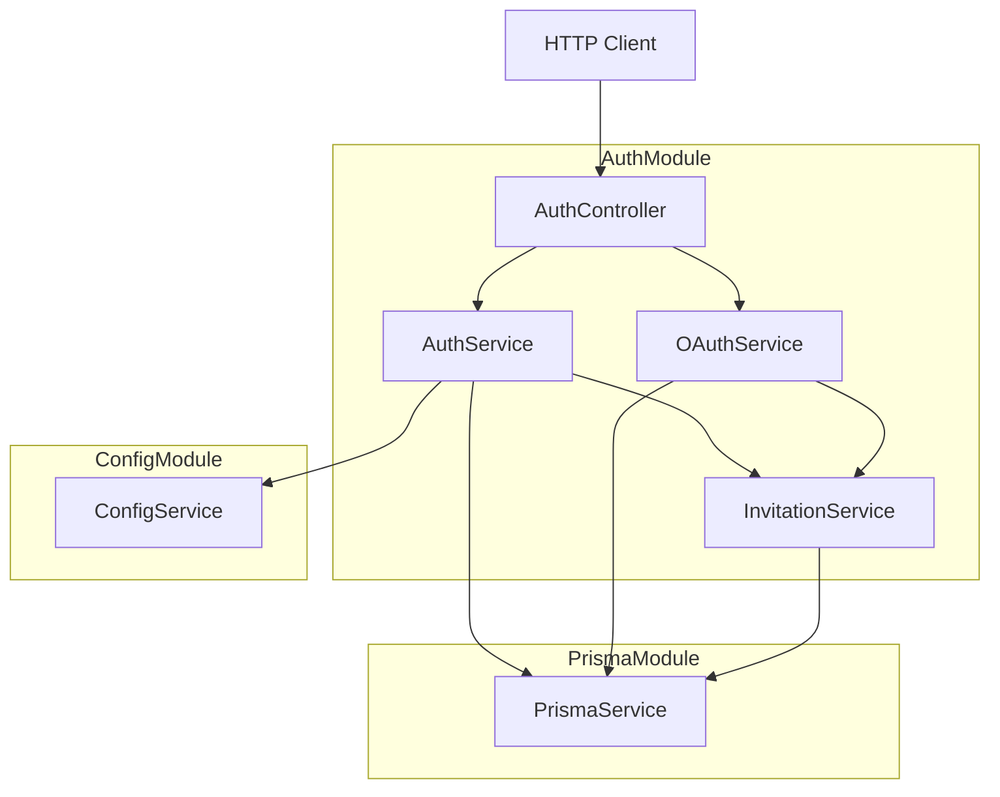
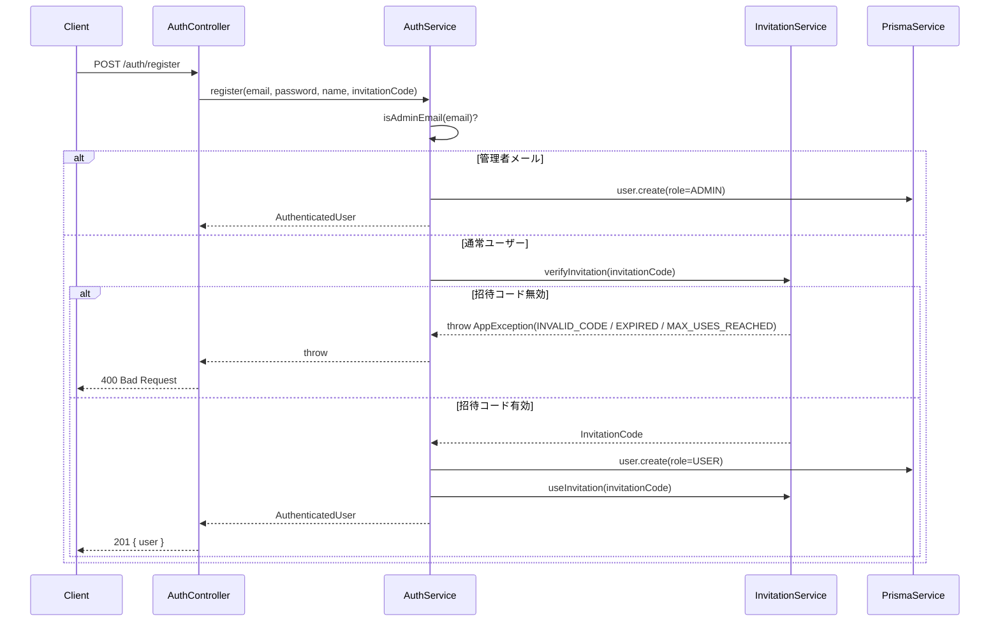

# Technical Design: auth-register-invitation-refactor

## Overview

本リファクタリングは、`AuthController.register` に直接実装されている招待コード検証ロジックを `AuthService.register` に移動し、`OAuthService` が採用しているサービス層責務パターンに統一することを目的とする。

**Purpose**: 招待コード検証をサービス層に一元化することで、コントローラーの責務をリクエスト処理・レスポンス整形に限定し、ビジネスロジックのテスト容易性と保守性を向上させる。

**Users**: バックエンド開発者。エンドユーザーへの動作変化はなく、API の入出力インターフェースは変更しない。

**Impact**: `AuthController.register` から招待ロジックが除去され、`AuthService.register` に移動する。`AuthModule` は既存の `InvitationService` 直接プロバイダ登録を維持しつつ、`AuthService` コンストラクタに `InvitationService` を追加する。

### Goals

- `AuthService.register` が招待コード検証・使用回数インクリメントを内部で完結させる
- `AuthController.register` が `InvitationService` を直接呼び出さない構造にする
- `OAuthService` と同一のサービス層責務パターンに統一する
- 全シナリオを `AuthService` 単体テストでカバーする

### Non-Goals

- API エンドポイントのインターフェース変更（`POST /auth/register` の入出力は変更しない）
- `InvitationModule` と `AuthModule` の循環依存の根本解消（将来課題）
- フロントエンドへの変更
- 招待コード機能そのものの変更

## Architecture

### Existing Architecture Analysis

現在の実装は以下の責務分担になっている：

- `AuthController.register`: 招待コード検証 (`verifyInvitation`) → ユーザー作成委譲 (`authService.register`) → 招待コード使用 (`useInvitation`) を直接実行
- `AuthService.register`: `_invitationCode` パラメータを受け取るが未使用。ユーザー作成のみ担当
- `OAuthService.handleOAuthRegistrationWithInvitation`: 招待コード検証・使用をサービス層内で完結

`InvitationModule` はすでに `AuthModule` をインポートしている。これにより `AuthModule` が `InvitationModule` を `imports` 配列に追加すると循環依存が発生する。現在の `AuthModule` はこれを回避するため `InvitationService` を `providers` に直接登録している。本リファクタリングではこのパターンを維持する（詳細: `research.md` — 循環依存リスクの調査）。

### Architecture Pattern & Boundary Map



**Architecture Integration**:

- **Selected pattern**: サービス層責務集約パターン（コントローラーはリクエスト/レスポンス変換のみ）
- **Domain/feature boundaries**: 招待コード検証ロジックは `AuthService` に収容し、コントローラーからアクセスしない
- **Existing patterns preserved**: `InvitationService` の直接プロバイダ登録（`AuthModule.providers`）を維持。`OAuthService` の招待検証パターンと同一の設計
- **New components rationale**: 新規コンポーネントなし。既存コンポーネントの責務を再配置する
- **Steering compliance**: 「コントローラーはリクエスト/レスポンス処理のみ」「サービス層でビジネスロジックを完結」の原則に準拠

### Technology Stack

| Layer              | Choice / Version        | Role in Feature              | Notes                    |
| ------------------ | ----------------------- | ---------------------------- | ------------------------ |
| Backend / Services | NestJS 11 / TypeScript  | DI・モジュール管理           | 既存スタック             |
| Backend / Services | Jest                    | 単体テスト                   | 既存テストフレームワーク |
| Data / Storage     | Prisma ORM + PostgreSQL | ユーザー・招待コードの永続化 | スキーマ変更なし         |

## System Flows

### 招待コード付きユーザー登録フロー（リファクタリング後）



**Key Decisions**:

- `useInvitation` はユーザー作成成功後にのみ呼び出す。Prisma の `create` が例外をスローした場合は `useInvitation` が呼ばれない
- 管理者メールのチェックは招待コード検証より前に行う

## Requirements Traceability

| Requirement | Summary                                                                | Components                     | Interfaces                                                | Flows                                 |
| ----------- | ---------------------------------------------------------------------- | ------------------------------ | --------------------------------------------------------- | ------------------------------------- |
| 1.1         | `AuthService.register` が `verifyInvitation` を呼び出す                | AuthService                    | `AuthService.register`                                    | 登録フロー: verifyInvitation ステップ |
| 1.2         | 検証成功後にユーザー作成と `useInvitation` を呼び出す                  | AuthService, InvitationService | `AuthService.register`, `InvitationService.useInvitation` | 登録フロー: useInvitation ステップ    |
| 1.3         | 無効コードの場合はユーザー作成をスキップしてエラースロー               | AuthService, InvitationService | `AuthService.register`                                    | 登録フロー: 招待コード無効分岐        |
| 1.4         | `INVALID_CODE` / `EXPIRED` / `MAX_USES_REACHED` エラーコードで例外発生 | InvitationService              | `InvitationService.verifyInvitation`                      | 登録フロー: エラー応答                |
| 1.5         | 管理者メールの場合は招待コード検証をスキップして `ADMIN` ロールで作成  | AuthService, ConfigService     | `AuthService.register`                                    | 登録フロー: 管理者分岐                |
| 2.1         | `InvitationService` が DI 解決可能な状態を維持する                     | AuthModule                     | `AuthModule.providers`                                    | —                                     |
| 2.2         | `AuthService` コンストラクタで `InvitationService` を受け取る          | AuthService                    | `AuthService` constructor                                 | —                                     |
| 2.3         | 既存依存（`JwtTokenService`・`ConfigService`・`PrismaService`）を維持  | AuthModule                     | `AuthModule.providers`                                    | —                                     |
| 3.1         | `AuthController.register` が `AuthService.register` のみ呼び出す       | AuthController                 | `AuthController.register`                                 | 登録フロー: コントローラー部分        |
| 3.2         | `AuthController` から `InvitationService` への直接依存を排除           | AuthController                 | `AuthController` constructor                              | —                                     |
| 3.3         | `AuthService.register` のエラーをクライアントに伝播                    | AuthController                 | `AuthController.register`                                 | 登録フロー: エラー伝播                |
| 4.1         | 有効/無効/期限切れ/使用上限超過の各シナリオをテスト                    | AuthService spec               | `AuthService.register`                                    | —                                     |
| 4.2         | 管理者メールで招待コードなし登録のテスト                               | AuthService spec               | `AuthService.register`                                    | —                                     |
| 4.3         | `verifyInvitation` と `useInvitation` の呼び出し順序検証               | AuthService spec               | `InvitationService` mock                                  | —                                     |
| 4.4         | ユーザー作成失敗時の `useInvitation` 非呼び出し保証                    | AuthService spec               | `InvitationService` mock                                  | —                                     |

## Components and Interfaces

### Summary

| Component        | Domain/Layer         | Intent                                                  | Req Coverage                 | Key Dependencies (P0/P1)                                       | Contracts |
| ---------------- | -------------------- | ------------------------------------------------------- | ---------------------------- | -------------------------------------------------------------- | --------- |
| AuthService      | Backend / Service    | 招待コード検証とユーザー作成を一元処理                  | 1.1, 1.2, 1.3, 1.4, 1.5, 2.2 | InvitationService (P0), PrismaService (P0), ConfigService (P0) | Service   |
| AuthController   | Backend / Controller | リクエスト受付・レスポンス整形のみ担当                  | 3.1, 3.2, 3.3                | AuthService (P0)                                               | API       |
| AuthModule       | Backend / Module     | DI コンテナ設定。InvitationService を直接プロバイダ登録 | 2.1, 2.3                     | InvitationService (P0)                                         | —         |
| AuthService spec | Backend / Test       | AuthService の単体テストカバレッジ                      | 4.1, 4.2, 4.3, 4.4           | InvitationService mock (P0)                                    | —         |

---

### Backend / Service

#### AuthService

| Field        | Detail                                                                |
| ------------ | --------------------------------------------------------------------- |
| Intent       | メール/パスワード登録において招待コード検証とユーザー作成を完結させる |
| Requirements | 1.1, 1.2, 1.3, 1.4, 1.5, 2.2                                          |

**Responsibilities & Constraints**

- 管理者メールの場合は招待コード検証をスキップし `ADMIN` ロールでユーザーを作成する
- 通常ユーザーの場合は `InvitationService.verifyInvitation` → `prisma.user.create` → `InvitationService.useInvitation` の順で処理する
- `prisma.user.create` が失敗した場合は `useInvitation` を呼び出さない
- メールの重複チェックは引き続き `register` 内で行う

**Dependencies**

- Inbound: `AuthController` — `register` を呼び出す (P0)
- Outbound: `InvitationService.verifyInvitation` — 招待コード有効性検証 (P0)
- Outbound: `InvitationService.useInvitation` — 招待コード使用回数インクリメント (P0)
- Outbound: `PrismaService.user.create` — ユーザー永続化 (P0)
- Outbound: `ConfigService.isAdminEmail` — 管理者メール判定 (P0)

**Contracts**: Service [x]

##### Service Interface

```typescript
interface AuthServiceRegister {
	register(
		email: string,
		password: string,
		name?: string,
		invitationCode?: string,
	): Promise<AuthenticatedUser>;
}
```

- Preconditions:
  - `email` が未登録であること
  - `invitationCode` が有効であること（管理者メールの場合を除く）
- Postconditions:
  - ユーザーが作成され `AuthenticatedUser`（パスワードフィールド除外）を返す
  - 通常ユーザーの場合、招待コードの `usedCount` がインクリメントされる
- Invariants:
  - `useInvitation` はユーザー作成成功後にのみ呼ばれる
  - 管理者メールの場合は `InvitationService` が呼ばれない

**Implementation Notes**

- Integration: `AuthService` コンストラクタに `InvitationService` を追加（循環依存なし。`AuthModule.providers` に既に登録済み）
- Validation: `invitationCode` が渡されかつ非管理者の場合のみ検証を実行。`invitationCode` が `undefined` の場合は `verifyInvitation` をスキップする（管理者メール以外では招待コードは必須であり、バリデーションは DTO レイヤーで保証される）
- Risks: `useInvitation` 内部で再度 `verifyInvitation` を呼び出しているため、二重検証が発生するが許容範囲（`InvitationService.useInvitation` の実装による）

---

#### AuthController

| Field        | Detail                                                           |
| ------------ | ---------------------------------------------------------------- |
| Intent       | `POST /auth/register` のリクエスト受付・レスポンス整形のみを担う |
| Requirements | 3.1, 3.2, 3.3                                                    |

**Responsibilities & Constraints**

- `InvitationService` をコンストラクタ注入しない（`register` エンドポイントから依存を除去）
- `authService.register(email, password, name, invitationCode)` を呼び出すのみ
- `AuthService` からスローされた例外をキャッチして `throwBadRequest` で再スローする

**Dependencies**

- Inbound: HTTP Client — `POST /auth/register` (P0)
- Outbound: `AuthService.register` — 登録処理委譲 (P0)

**Contracts**: API [x]

##### API Contract

| Method | Endpoint       | Request           | Response                                       | Errors                                                                 |
| ------ | -------------- | ----------------- | ---------------------------------------------- | ---------------------------------------------------------------------- |
| POST   | /auth/register | `RegisterUserDto` | `{ message: string, user: AuthenticatedUser }` | 400 (INVALID_CODE / EXPIRED / MAX_USES_REACHED / EMAIL_ALREADY_EXISTS) |

**Implementation Notes**

- Integration: コンストラクタから `InvitationService` の注入を削除する
- Validation: DTO バリデーションは `RegisterUserDto` の `class-validator` デコレータが担う（変更なし）
- Risks: `AuthController.register` のエラーハンドリングで `throwBadRequest` を使用しているため、`AuthService` からの `AppException` がラップされて元のエラーコードが失われる可能性がある。エラー伝播の実装時に確認すること

---

#### AuthModule

| Field        | Detail                                                                                   |
| ------------ | ---------------------------------------------------------------------------------------- |
| Intent       | `InvitationService` を直接プロバイダ登録することで循環依存を回避しつつ DI 解決を保証する |
| Requirements | 2.1, 2.3                                                                                 |

**Responsibilities & Constraints**

- `InvitationModule` を `imports` に追加しない（`InvitationModule → AuthModule` の依存があるため循環依存になる）
- `InvitationService` を `providers` 配列に引き続き直接登録する
- 既存の `JwtTokenService`・`ConfigService`・`PrismaService` の依存関係は変更しない

**Implementation Notes**

- Integration: `AuthModule.providers` への `InvitationService` 直接登録は既に実施済み。変更不要
- Validation: `AuthService` コンストラクタへの追加のみで DI は自動解決される
- Risks: `InvitationService` が `AuthModule.providers` に直接登録されているためモジュール境界が曖昧。将来的な循環依存解消は `research.md` のリスクセクションを参照

---

### Backend / Test

#### AuthService spec（`auth.service.spec.ts`）

| Field        | Detail                                                              |
| ------------ | ------------------------------------------------------------------- |
| Intent       | `AuthService.register` の招待コード検証シナリオを網羅的にテストする |
| Requirements | 4.1, 4.2, 4.3, 4.4                                                  |

**Responsibilities & Constraints**

- `InvitationService` を `jest.fn()` でモックし、`mockInvitationService` として `TestingModule` に登録する
- `verifyInvitation` と `useInvitation` の呼び出し順序と条件を検証する
- `prisma.user.create` が失敗した場合に `useInvitation` が呼ばれないことを検証する

**Test Scenarios**

```typescript
interface MockInvitationService {
	verifyInvitation: jest.Mock<Promise<InvitationCode>, [string]>;
	useInvitation: jest.Mock<Promise<InvitationCode>, [string]>;
}
```

| シナリオ                                        | 前提条件                                                        | 期待結果                                            |
| ----------------------------------------------- | --------------------------------------------------------------- | --------------------------------------------------- |
| 有効な招待コードで正常登録                      | `verifyInvitation` が成功、`user.create` が成功                 | ユーザー作成・`useInvitation` 呼び出し              |
| 無効な招待コード（`INVALID_CODE`）              | `verifyInvitation` が `AppException(INVALID_CODE)` をスロー     | `user.create` 非呼び出し・例外伝播                  |
| 期限切れ招待コード（`EXPIRED`）                 | `verifyInvitation` が `AppException(EXPIRED)` をスロー          | `user.create` 非呼び出し・例外伝播                  |
| 使用上限超過（`MAX_USES_REACHED`）              | `verifyInvitation` が `AppException(MAX_USES_REACHED)` をスロー | `user.create` 非呼び出し・例外伝播                  |
| 管理者メールで登録（招待コードなし）            | `isAdminEmail` が `true` を返す                                 | `verifyInvitation` 非呼び出し・`ADMIN` ロールで作成 |
| ユーザー作成失敗時の `useInvitation` 非呼び出し | `verifyInvitation` が成功・`user.create` が例外スロー           | `useInvitation` 非呼び出し                          |

**Implementation Notes**

- Integration: `TestingModule.providers` に `{ provide: InvitationService, useValue: mockInvitationService }` を追加
- Validation: `jest.mock` ではなく `jest.fn()` によるモックでコンストラクタ注入を利用する（既存テストパターンと一致）
- Risks: `useInvitation` 内部で `verifyInvitation` を再呼び出しするため、モックの設定に注意が必要

## Error Handling

### Error Strategy

`AuthService.register` は `InvitationService.verifyInvitation` がスローする `AppException` をキャッチせず、そのままコントローラーへ伝播させる。コントローラーは既存の `catch (error)` ブロックでキャッチして `throwBadRequest` でラップする。

### Error Categories and Responses

**Business Logic Errors (400)**:

| エラーコード                  | スロー元                             | 説明                         |
| ----------------------------- | ------------------------------------ | ---------------------------- |
| `INVITATION.INVALID_CODE`     | `InvitationService.verifyInvitation` | 招待コードが存在しない       |
| `INVITATION.EXPIRED`          | `InvitationService.verifyInvitation` | 招待コードが期限切れ         |
| `INVITATION.MAX_USES_REACHED` | `InvitationService.verifyInvitation` | 招待コードの使用上限超過     |
| `AUTH.EMAIL_ALREADY_EXISTS`   | `AuthService.register`               | メールアドレスが既に登録済み |

**注意**: `AuthController.register` の `catch` ブロックが `AppException` を `throwBadRequest(ERROR_CODES.VALIDATION.INVALID_INPUT, message)` でラップするため、元のエラーコードがメッセージ文字列として伝わる形になる。実装時にエラー伝播の挙動を確認すること（Requirement 3.3）。

## Testing Strategy

### Unit Tests（`auth.service.spec.ts`）

- `register` — 有効な招待コードでユーザー作成成功と `useInvitation` 呼び出しを検証
- `register` — 無効コード（`INVALID_CODE`）でユーザー作成をスキップし例外を伝播させることを検証
- `register` — 期限切れコード（`EXPIRED`）のエラーを検証
- `register` — 使用上限超過（`MAX_USES_REACHED`）のエラーを検証
- `register` — 管理者メールで招待コード検証をスキップして `ADMIN` ロールで作成することを検証
- `register` — ユーザー作成失敗時に `useInvitation` が呼ばれないことを検証

### Integration Tests

- 既存 `AuthController` spec の `register` テストが `InvitationService` 呼び出しを含まないことを確認（コントローラー責務の縮小を検証）

## Security Considerations

本リファクタリングはロジックの配置変更のみであり、招待コード検証の実行タイミング・条件は変わらない。セキュリティ上の変更はない。管理者メールのスキップロジックは既存の `OAuthService` と同一パターンであり、追加のリスクはない。
