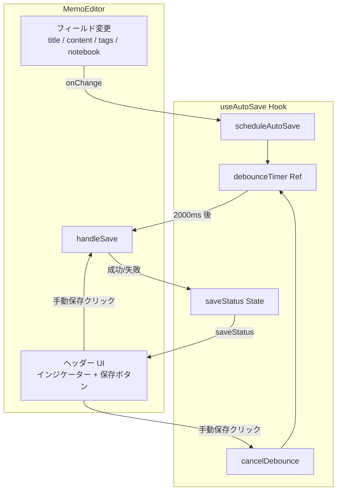
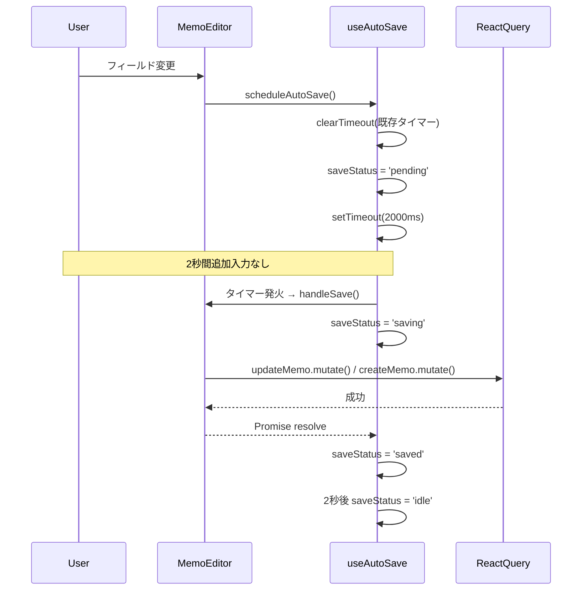
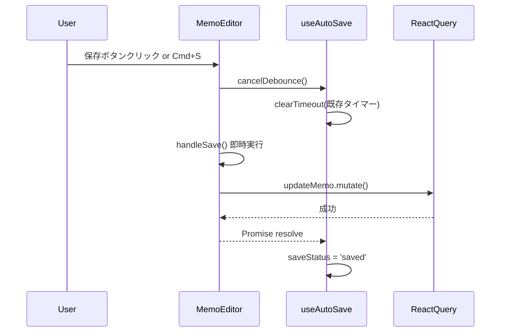

# Design Document: auto-save

## Overview

`MemoEditor` において、ユーザーが編集を止めてから2秒後に自動でサーバーへ保存するデバウンス機能を追加する。保存状態（未保存・保存中・保存済み・エラー）をヘッダーのインジケーターで常時フィードバックし、手動保存ボタンおよび Cmd+S ショートカットは引き続き利用可能とする。

本機能はフロントエンドのみで完結する。バックエンド API・DB スキーマへの変更はない。

### Goals

- 編集停止2秒後の自動サーバー保存によりデータ損失リスクを排除する
- 保存状態の4状態インジケーターでユーザーに常時フィードバックを提供する
- 手動保存（ボタン・Cmd+S）との共存を維持する
- `MemoEditor` のさらなる肥大化を防ぐため、デバウンスロジックをカスタムフックに分離する

### Non-Goals

- バックエンド側の変更（エンドポイント追加・スキーマ変更）
- オフライン対応・ローカルキャッシュへの保存
- 競合解決（同一メモの複数タブ同時編集）
- デバウンス時間のユーザー設定化

---

## Requirements Traceability

| Requirement | Summary                                    | Components                                     | Flows            |
| ----------- | ------------------------------------------ | ---------------------------------------------- | ---------------- |
| 1.1〜1.4    | フィールド変更でデバウンスタイマーリセット | `useAutoSave.scheduleAutoSave()`               | Debounce Flow    |
| 1.5         | デバウンス待機時間 2000ms                  | `useAutoSave` (DEBOUNCE_MS 定数)               | —                |
| 2.1〜2.4    | 保存状態インジケーター表示                 | `MemoEditor` ヘッダー UI                       | —                |
| 3.1〜3.5    | 手動保存ボタン・Cmd+S                      | `MemoEditor` (`cancelDebounce` → `handleSave`) | Manual Save Flow |
| 4.1〜4.2    | 変更なし・空コンテンツ時はスキップ         | `useAutoSave` (`canSave` ガード)               | —                |
| 4.3         | 保存中の重複リクエスト防止                 | `useAutoSave` (`isSaving` ガード)              | —                |
| 4.4         | アンマウント時タイマークリーンアップ       | `useAutoSave` (useEffect cleanup)              | —                |

---

## Architecture

### Existing Architecture Analysis

- `MemoEditor` は `handleSave`（`useCallback`）で create / edit 両モードの保存ロジックを持つ
- `hasChanges` boolean で変更有無を管理
- `createMemo.isPending || updateMemo.isPending` で保存中判定が可能
- create モード自動保存後は重複作成防止のため edit モードへ遷移させる必要がある（詳細は `research.md`）

### Architecture Pattern & Boundary Map



- **選択パターン**: カスタムフック抽出（`useThemeCSS`・`useAppInit` と同パターン）
- **新規境界**: `useAutoSave` フック（デバウンス・状態管理）
- **変更境界**: `MemoEditor`（フック統合・create 後の edit 遷移・UI 更新）
- **Steering 準拠**: Zustand は UI 状態（`selectedMemoId`・`currentView`）のみ管理。サーバーデータは React Query ミューテーションを直接呼び出す

### Technology Stack

| Layer           | Choice                              | Role                                    |
| --------------- | ----------------------------------- | --------------------------------------- |
| Frontend Hook   | React 19 `useRef` + `setTimeout`    | デバウンスタイマー管理                  |
| Frontend State  | React `useState`                    | `saveStatus` 管理                       |
| Server Mutation | React Query `useMutation`           | 既存 `createMemo` / `updateMemo` を流用 |
| Navigation      | `useMemoDataStore` / `useViewStore` | create→edit 遷移                        |

---

## System Flows

### Debounce Auto-Save Flow



### Manual Save Flow



**Key Decision**: 手動保存時は `cancelDebounce()` を先に呼び出すことで、デバウンスタイマーと手動保存の二重リクエストを防ぐ。

---

## Components and Interfaces

| Component     | Layer        | Intent                                | Req Coverage       | Key Dependencies                                  |
| ------------- | ------------ | ------------------------------------- | ------------------ | ------------------------------------------------- |
| `useAutoSave` | Hook         | デバウンス・SaveStatus 管理           | 1.1〜1.5, 4.1〜4.4 | `setTimeout` / `useRef` / `useState`              |
| `MemoEditor`  | UI Component | フック統合・UI 更新・create→edit 遷移 | 2.1〜2.4, 3.1〜3.5 | `useAutoSave`, `useMemoDataStore`, `useViewStore` |

### Hooks Layer

#### `useAutoSave`

| Field        | Detail                                                   |
| ------------ | -------------------------------------------------------- |
| Intent       | デバウンスタイマー管理と SaveStatus の状態機械を提供する |
| Requirements | 1.1, 1.2, 1.3, 1.4, 1.5, 4.1, 4.2, 4.3, 4.4              |

**Responsibilities & Constraints**

- デバウンス待機中の `saveStatus = 'pending'` 管理
- タイマー発火時の `canSave` / `isSaving` ガードチェック
- `saved` 状態の2秒後自動リセット
- コンポーネントアンマウント時の `clearTimeout` cleanup

**Dependencies**

- External: `React.useRef`, `React.useState`, `React.useEffect` — タイマーと状態管理 (P0)

**Contracts**: Service [x] / State [x]

##### Service Interface

```typescript
type SaveStatus = 'idle' | 'pending' | 'saving' | 'saved' | 'error';

interface UseAutoSaveOptions {
	/** hasChanges && (title または content が非空) */
	canSave: boolean;
	/** createMemo.isPending || updateMemo.isPending */
	isSaving: boolean;
	/** 保存処理本体。resolve で成功、reject で失敗 */
	onSave: () => Promise<void>;
	/** デバウンス待機時間（ms）。デフォルト 2000 */
	debounceMs?: number;
}

interface UseAutoSaveReturn {
	saveStatus: SaveStatus;
	/** フィールド変更のたびに呼び出す。タイマーをリセットし pending に遷移 */
	scheduleAutoSave: () => void;
	/** 手動保存前に呼び出す。実行中のタイマーをキャンセル */
	cancelDebounce: () => void;
}

declare function useAutoSave(options: UseAutoSaveOptions): UseAutoSaveReturn;
```

- Preconditions: `onSave` は冪等な非同期関数であること
- Postconditions: アンマウント後にタイマーが発火しないこと
- Invariants: `saveStatus === 'saving'` 中は `scheduleAutoSave` が新たなタイマーを設定しても発火しない

##### State Management

- **State model**: `SaveStatus` の状態遷移

```
idle ──[scheduleAutoSave + hasChanges]──► pending
pending ──[タイマー発火 + canSave]────────► saving
pending ──[canSave = false]────────────── idle
saving ──[onSave resolve]────────────────► saved
saving ──[onSave reject]─────────────────► error
saved ──[2秒後]──────────────────────────► idle
error ──[scheduleAutoSave]───────────────► pending
```

- **Persistence**: なし（コンポーネントローカル）
- **Concurrency**: `isSaving = true` 中はタイマー発火をスキップすることで重複防止

**Implementation Notes**

- Integration: `MemoEditor` の各 `onChange` ハンドラー末尾で `scheduleAutoSave()` を呼び出す。`memo` prop 変更時（メモ切り替え）は `useEffect([memo])` で `cancelDebounce()` を呼び出しタイマーをリセット
- Validation: タイマー発火時に `canSave` を再評価することで、タイマー起動後にコンテンツが空になったケースに対応
- Risks: `onSave` の参照が `useCallback` 依存配列の変化で毎レンダリング変わる場合、`useRef` でラップして最新の関数を保持する

### UI Layer

#### `MemoEditor`（変更箇所）

`useAutoSave` フックを統合し、以下の変更を加える（新規境界なし、詳細ブロック不要）。

- `useAutoSave({ canSave, isSaving, onSave: handleSave })` を呼び出す
- 各フィールド（title / content / tags / notebook）の onChange で `scheduleAutoSave()` を追加呼び出し
- 手動保存ボタン・Cmd+S の `handleSave` 呼び出し前に `cancelDebounce()` を実行
- `handleSave` の create 成功コールバック内で `useMemoDataStore.getState().setSelectedMemoId(result.id)` + `useViewStore.getState().setCurrentView('edit')` を呼び出し edit モードへ遷移
- ヘッダーの保存状態表示を `saveStatus` に基づく4状態インジケーターへ更新

**保存状態インジケーター表示定義**:

| saveStatus | 表示テキスト                    | スタイル       |
| ---------- | ------------------------------- | -------------- |
| `idle`     | （非表示）                      | —              |
| `pending`  | 未保存                          | text-gray-400  |
| `saving`   | 保存中...                       | text-blue-400  |
| `saved`    | 保存済み                        | text-green-500 |
| `error`    | 保存失敗 — 手動保存してください | text-red-500   |

---

## Error Handling

### Error Strategy

自動保存の失敗はデータ損失に直結しないため、ユーザーを遮断するモーダルではなくインジケーター表示で対処する。

### Error Categories and Responses

| エラー種別           | 発生条件       | 対応                                                                        |
| -------------------- | -------------- | --------------------------------------------------------------------------- |
| ネットワークエラー   | API 到達不能   | `saveStatus = 'error'`、インジケーターに「保存失敗 — 手動保存してください」 |
| 認証エラー (401)     | JWT 期限切れ   | 既存の `apiClient` が throw する Error を `onSave` reject としてキャッチ    |
| サーバーエラー (5xx) | Cloud Run 障害 | 同上。エラー内容は `logger.error` へ記録                                    |

`alert()` は使用しない（audit C-1 の方針と整合）。

---

## Testing Strategy

自動保存ロジックはカスタムフックに分離されるため、ユニットテストが容易になる。

- **Unit Tests — `useAutoSave`**:
  - `scheduleAutoSave()` 呼び出し後に `saveStatus === 'pending'` になること
  - 2000ms 後（jest fake timers）に `onSave` が呼ばれること
  - `canSave = false` の場合 `onSave` が呼ばれないこと
  - `isSaving = true` の場合タイマー発火時にスキップされること
  - `cancelDebounce()` 後にタイマーが発火しないこと
  - アンマウント後にタイマーが発火しないこと
  - `onSave` reject 時に `saveStatus === 'error'` になること

- **Integration Tests — `MemoEditor`**:
  - title 変更後2秒で `updateMemo` が呼ばれること（fake timers）
  - 手動保存ボタンクリックで即時 `updateMemo` が呼ばれること
  - create モード自動保存後に `createMemo` が1回だけ呼ばれ edit モードへ遷移すること
