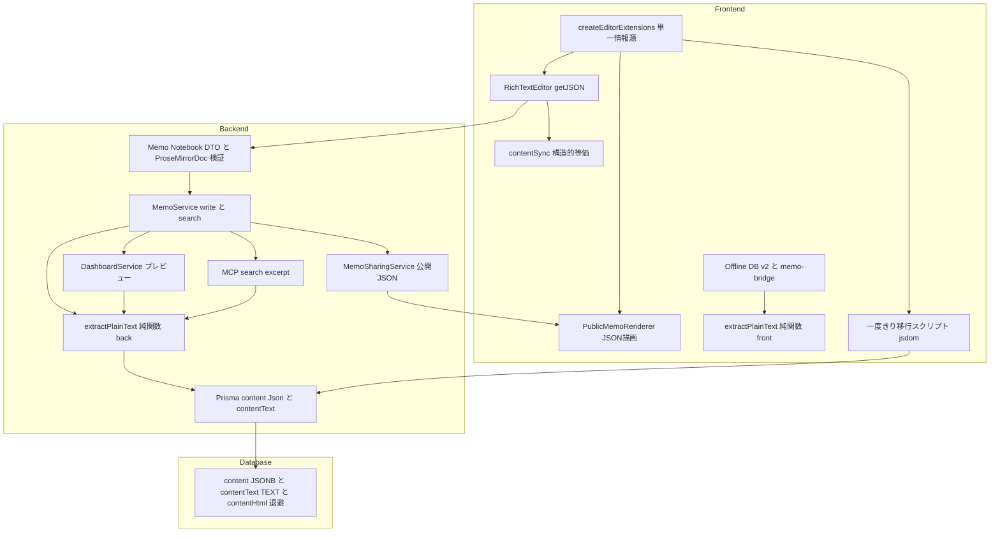
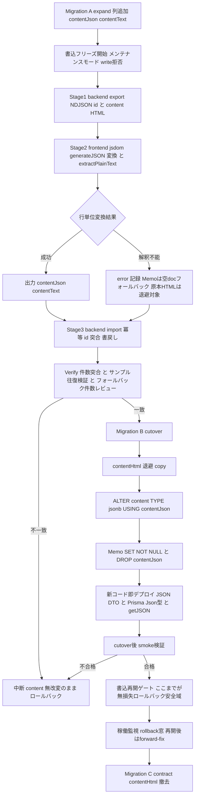
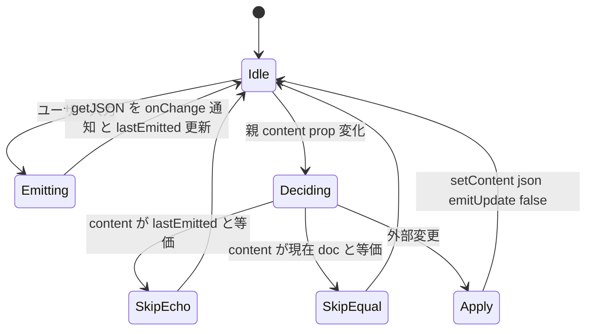

# Technical Design — content-jsonb-migration

## Overview

本機能は、メモ・ノートブック本文（`content`）の保存形式を **HTML 文字列（Prisma `String`）から ProseMirror/TipTap の構造化 JSON（Prisma `Json` / PostgreSQL JSONB）へ移行**する、データ移行を伴うフルスタックのフォーマット変更である。エディタは `editor.getHTML()` ではなく `editor.getJSON()` を保存し、公開ビューは JSON から描画し、DB カラムは JSONB 化する。

**Users**: Mosaku の全ユーザー（本文の作成・編集・公開・検索）と開発者（構造化データを土台とした将来の部分更新・ブロック操作）。既存の書き味・自動保存・公開共有・本文面テーマ・検索体験は移行前後で不変に保つ。

**Impact**: `Memo.content` / `Notebook.content` の物理型が変わり、フロント入出力・DTO/API・公開描画・検索・オフラインキャッシュ・プレビュー生成が JSON 対応へ横断的に変わる。最大の制約は **既存本文のデータロスゼロ・ロールバック可能**（Req7）であり、これを退避列 + 段階マイグレーション + 検証で構造的に担保する。

### Goals

- `content` を JSONB 化し、既存本文をロスレス・冪等・ロールバック可能に移行する（1.x / 2.x / 7.x）。
- エディタ・公開ビュー・DTO/API を ProseMirror JSON 入出力へ切り替える（3.x / 4.x / 5.x）。
- 本文テキスト検索を JSON 化後も現行同等で維持する（6.x）。
- 自動保存・テーマ・他ドメイン・実行時バンドルを非回帰に保つ（8.x）。

### Non-Goals

- 本文検索の刷新（`tsvector` 全文検索・ランキング）。現行同等維持まで。
- ブロック単位の部分更新 API の新設。土台確保まで。
- エディタ拡張（ノード/マーク）の追加・変更。フォーマット切替に限定。
- `content` 以外のドメイン（タグ・テーマ・招待・認証・ゴミ箱）の挙動変更。
- 段階移行のデュアルリード機構。ビッグバン移行を採用し導入しない（根拠は System Flows / research.md）。

## Requirements Traceability

| Requirement   | Summary                                                                 | Components                                                  | Interfaces                                            | Flows            |
| ------------- | ----------------------------------------------------------------------- | ----------------------------------------------------------- | ----------------------------------------------------- | ---------------- |
| 1.1, 1.2, 1.5 | content を JSONB 型（Memo NOT NULL / Notebook NULL 許容）で型安全参照   | Prisma Schema, ProseMirror Types                            | `Memo.content: Json`, `ProseMirrorDoc`                | —                |
| 1.3, 1.4      | in-place 型変換・drop→add 回避・ロールバック可能                        | Migration A/B/C                                             | `ALTER COLUMN ... USING contentJson`, down            | Migration Flow   |
| 2.1–2.7       | 既存 HTML を拡張一致でロスレス・冪等・空/NULL/不能行処理                | Content Migration Pipeline                                  | Batch Contract                                        | Migration Flow   |
| 3.1–3.6       | エディタの JSON 入出力・自己エコー・構造的等価・空 doc・往復一致        | RichTextEditor, contentSync                                 | `decideContentSync`, `onChange(JSONContent)`          | Editor Sync Flow |
| 4.1–4.6       | DTO/API の JSON 受理・永続化・不正 400・last-write-wins 維持・JSON 返却 | Memo/Notebook DTO, Validator, MemoService                   | `CreateMemoDto.content: ProseMirrorDoc`, API Contract | Write-path Flow  |
| 5.1–5.5       | 公開ビューの JSON 描画・生 HTML 不使用・テーマ/rel 維持                 | PublicMemoRenderer, MemoSharingService                      | `PublicMemoView.content: ProseMirrorDoc`              | —                |
| 6.1–6.4       | JSON 化後の本文テキスト検索・キー名誤ヒット回避・契約維持               | contentText 列, extractPlainText, MemoService.search        | `search(q)`, `contains: contentText`                  | Write-path Flow  |
| 7.1–7.5       | 件数/本文突合・中断ロールバック・dry-run・データロスゼロ                | Migration Pipeline, Verify Step                             | Batch Contract, retention column                      | Migration Flow   |
| 8.1–8.5       | 実行時バンドル不変・自動保存/テーマ非回帰・プレビュー/IDB/テスト追従    | extractPlainText, DashboardService, MCP Tool, Offline DB v2 | `contentText` preview, `OFFLINE_DB_VERSION=2`         | —                |

## Architecture

### Existing Architecture Analysis

- **共有拡張ファクトリ**: `createEditorExtensions.ts` が編集（`RichTextEditor`）・公開（`PublicMemoRenderer`）の**単一情報源**。変換スキーマもここに一致させる（Req2.2 / 3 / 5）。
- **公開描画は既に安全**: `PublicMemoRenderer` は `dangerouslySetInnerHTML` を使わず TipTap 描画（生 HTML 注入ゼロ）。Req5.3 は現状達成済で、改修は型と等価判定が中心。
- **自動保存は content 型非依存**: `useAutoSave`（5 状態・2 秒）と last-write-wins（`clientUpdatedAt` ベース、`memo.service.ts:155`）は型に依存せず、Req8.2 / 4.5 の維持は容易。
- **文字列前提の分散**: 検索 4 層（DB `contains` `memo.service.ts:197/247` / offline `repository.ts` / `memo-bridge.ts` / MCP `search-memos.tool.ts:46`）＋プレビュー 2 層（`dashboard.service.ts:49` / MCP excerpt）が HTML 文字列を slice/strip。JSON 化で全破綻するため単一抽出ロジックへ集約する。
- **モノレポ境界**: TipTap/ProseMirror は frontend のみ、backend は依存ゼロ（確認済）。Prisma は backend のみ。この境界を移行設計で尊重する。
- **不変則（steering）**: React Query 単一真実源 / `apiClient` 経由 / `AuthorizationService.validateOwnership` 一元化 / グローバル JWT Guard + `@Public()` を維持。

### Architecture Pattern & Boundary Map

**Selected pattern**: expand-migrate-contract（段階スキーマ移行）+ 抽出純関数のユーティリティ分離。gap-analysis §9 の 2 大決定（決定1: 変換の二分割・front 変換 / back 非依存、決定2: 検索用テキスト列維持）を骨格とする。



**Architecture Integration**:

- **Selected pattern**: expand-migrate-contract で `content` を drop→add せず in-place 型変換（Req1.3）、退避列 `contentHtml` で down 可能（Req1.4 / 7）。
- **Domain/feature boundaries**: 「一度きりの HTML→JSON 変換」は frontend（jsdom + 拡張）、「恒久の JSON→text 抽出」は TipTap 非依存の純関数を各層配置。backend に TipTap を足さない（Req8.1）。
- **Existing patterns preserved**: 共有拡張ファクトリ単一情報源、公開の生 HTML 不使用、自動保存 5 状態・2 秒、last-write-wins、`validateOwnership`、`apiClient` / React Query。
- **New components rationale**: `extractPlainText`（検索/プレビュー分散の単一化）、`ProseMirrorDoc` 型 + DTO バリデータ（型安全な JSON 受理・400）、移行パイプライン（データロスゼロの中核）、`contentText` 列（JSONB 検索の代替経路）。
- **Steering compliance**: `any` 不使用（tech.md）/ ドメインモジュール構成（structure.md）/ 品質モデル（RED 承認 → GREEN → 敵対レビュー）。

### Technology Stack

| Layer               | Choice / Version                                  | Role in Feature                          | Notes                                                                                              |
| ------------------- | ------------------------------------------------- | ---------------------------------------- | -------------------------------------------------------------------------------------------------- |
| Frontend            | React 19 + `@tiptap/react` 3.22.2                 | エディタ JSON 入出力・公開描画           | `content` を HTML→JSONContent へ。`useEditor({content})` は JSON 受理                              |
| Frontend (dev only) | `@tiptap/html`（新規 devDependency）+ `jsdom` ^29 | 一度きり HTML→JSON 変換                  | 実行時バンドル不変（Req8.1）。既存 vitest jsdom 環境で実行。`/server` 経路は既知不具合のため不採用 |
| Frontend            | `idb` ^8                                          | Offline cache v2（content: JSONContent） | `OFFLINE_DB_VERSION` 1→2、`memos` 再構築許容                                                       |
| Backend             | NestJS 11 + `class-validator`                     | DTO を ProseMirrorDoc 検証へ             | `@IsString` を撤去し構造 shape 検証を追加。TipTap 依存は足さない                                   |
| Backend             | Prisma ORM + `@prisma/client`                     | `content: Json` 型安全参照・書込         | `Prisma.InputJsonValue` で書込、`SET NOT NULL`(Memo)                                               |
| Data                | PostgreSQL JSONB（Supabase）                      | 構造化本文の保存                         | 移行は `DIRECT_URL`(5432)。`content` / `contentText` / `contentHtml`(退避)                         |

新規実行時依存はゼロ。`@tiptap/html` は移行スクリプト専用の devDependency として追加する（Req8.1 遵守）。

## System Flows

### Migration Flow（データロスゼロの中核 / Req1.3, 2.x, 7.x）



**Key decisions**:

- **Dry-run**: Stage2 で停止すれば書込ゼロで変換のみ検証（Req7.5）。
- **冪等**: Stage3 は id キーの upsert で再実行安全（Req2.7）。
- **ロールバックトリガと安全域**: Verify 不一致は cutover 中止（`content` 無改変）。cutover 後〜**書込再開ゲート前**は down（`content TYPE text USING contentHtml`）で原本 HTML を無損失復元。**書込再開後**は `contentHtml` 凍結のため down が再開後編集を失う → forward-fix を第一とする（詳細は Migration Strategy）。（Req1.4 / 7.2 / 7.3）
- **ビッグバン採用**: 対象行数が小さく TipTap が JSON/HTML 双方描画可のため、デュアルリードを設けず単一トランザクション cutover とする。**安全性は移行中の書込フリーズ窓（export〜書込再開ゲート）に全面依存**（詳細は Migration Strategy / Rollout Runbook）。Req7.4 は条件節のため非採用で無矛盾。

### Editor Sync Flow（Req3.x）



**Key decisions**: 自己エコー判定は「実際に emit した JSON 参照」で行い、外部変更判定のみキー順非依存 deep-equal を使う。input rule 巻き戻し（3.3）と保存ループ防止（8.2）の不変条件を維持。

### Write-path Flow（Req4.x / 6.x）

保存リクエスト（JSON content）→ DTO で ProseMirrorDoc shape 検証（不正は 400 / Req4.4）→ `extractPlainText(content)` で `contentText` 生成 → Prisma で `content`(JSONB) + `contentText` を同時永続化（Req4.3 / 6.1）→ 取得 API は `content` を JSON 値で返却（Req4.6 / 5.1）。検索は `contains` を `contentText` へ向ける（Req6.2 / 6.3）。`clientUpdatedAt` の last-write-wins 比較は不変（Req4.5）。

## Components and Interfaces

| Component                     | Domain/Layer               | Intent                            | Req Coverage  | Key Dependencies                                   | Contracts      |
| ----------------------------- | -------------------------- | --------------------------------- | ------------- | -------------------------------------------------- | -------------- |
| ProseMirror Types & Validator | Shared/Backend             | JSON content の型と shape 検証    | 1.5, 4.1, 4.4 | class-validator (P0)                               | Service, State |
| extractPlainText              | Shared (front/back 各配置) | JSON→可読テキスト純関数           | 6.2, 6.3, 8.1 | なし (P0)                                          | Service        |
| Content Migration Pipeline    | Tooling                    | 一度きり HTML→JSON 移行           | 2.x, 7.x      | createEditorExtensions, jsdom, Prisma (P0)         | Batch          |
| Prisma Schema & Migrations    | Data                       | content JSONB 化・退避列・down    | 1.1–1.4       | Prisma (P0)                                        | State          |
| RichTextEditor                | Frontend                   | JSON 入出力エディタ               | 3.1–3.6       | createEditorExtensions (P0), contentSync (P0)      | State          |
| contentSync                   | Frontend                   | 自己エコー/外部変更分離           | 3.3, 3.4      | deepEqual (P0)                                     | Service        |
| PublicMemoRenderer            | Frontend                   | 公開 JSON 描画                    | 5.2–5.5       | createEditorExtensions (P0)                        | State          |
| Editor Hosts                  | Frontend                   | content state を JSON 化          | 3.2, 3.5      | RichTextEditor (P0), useAutoSave (P1)              | State          |
| Offline Layer v2              | Frontend                   | cache/pending の JSON 対応        | 8.1, 8.3      | idb (P0), extractPlainText (P1)                    | State, Batch   |
| Memo/Notebook DTO & Service   | Backend                    | JSON 受理・永続化・検索           | 4.1–4.6, 6.x  | Validator (P0), extractPlainText (P0), Prisma (P0) | Service, API   |
| MemoSharingService            | Backend                    | 公開メモを JSON で返す            | 5.1           | Prisma (P0)                                        | Service        |
| DashboardService & MCP Tool   | Backend                    | プレビュー/excerpt を text 由来へ | 8.1           | extractPlainText or contentText (P0)               | Service        |

以下、新境界を導入するコンポーネントのみ詳細ブロックを置く。

### Shared / Backend

#### ProseMirror Types & Validator

| Field        | Detail                                              |
| ------------ | --------------------------------------------------- |
| Intent       | JSON content の型安全表現と DTO 境界での shape 検証 |
| Requirements | 1.5, 4.1, 4.4                                       |

**Responsibilities & Constraints**

- `ProseMirrorDoc` を `any` 不使用で定義し、`content` の型を全層で共有。
- backend は TipTap schema を持たないため、**完全な node/mark 妥当性検証は行わず** `type: 'doc'` とノードの浅い shape を検証（Req4.4 の 400 を満たす最小境界）。完全性はエディタ側が保証する。

**Dependencies**

- Inbound: Memo/Notebook DTO — content 検証に使用（P0）
- External: `class-validator` — カスタムバリデータ実装（P0）

**Contracts**: Service [x] / State [x]

##### Service Interface

```typescript
export interface ProseMirrorMark {
	type: string;
	attrs?: Record<string, unknown>;
}

export interface ProseMirrorNode {
	type: string;
	attrs?: Record<string, unknown>;
	content?: ProseMirrorNode[];
	marks?: ProseMirrorMark[];
	text?: string;
}

export interface ProseMirrorDoc extends ProseMirrorNode {
	type: 'doc';
	content?: ProseMirrorNode[];
}

// class-validator カスタムデコレータ
export function IsProseMirrorDoc(): PropertyDecorator;

// 純粋述語（バリデータ内部と移行検証で共用）
export function isProseMirrorDoc(value: unknown): value is ProseMirrorDoc;
export function isEmptyDoc(doc: ProseMirrorDoc): boolean;
export function createEmptyDoc(): ProseMirrorDoc; // { type:'doc', content:[{type:'paragraph'}] }
```

- Preconditions: 入力は JSON パース済みの `unknown`。
- Postconditions: `type==='doc'` かつ `content` が配列（存在時）で各要素が `type: string` を持つときのみ true。
- Invariants: `any` を介在させない。ネスト検証は 1 段（`content` 要素の `type` 有無）に限定し、TipTap schema を要求しない。

**Implementation Notes**

- Integration: `CreateMemoDto` / `UpdateMemoDto` / `Create|UpdateNotebookDto` の `content` に付与。Notebook は `null` 許容（Req4.2）。
- Validation: 非オブジェクト・`type!=='doc'` は 400（Req4.4）。空 doc は許可（Req3.5）。
- Risks: 浅い検証のため不正マーク等は透過し得る → エディタ/移行が正規化。境界を design に明記済み。

#### extractPlainText（JSON→可読テキスト純関数）

| Field        | Detail                                                                                 |
| ------------ | -------------------------------------------------------------------------------------- |
| Intent       | ProseMirror JSON から text ノード値のみを連結した検索/プレビュー用プレーンテキスト生成 |
| Requirements | 6.2, 6.3, 8.1                                                                          |

**Responsibilities & Constraints**

- `content` を再帰走査し `text` 値のみ連結。ブロックノード境界で単一空白を挿入し語の融合を防ぐ。`type`/`attrs`/キー名は一切含めない（Req6.3）。
- DOM/TipTap 非依存の純関数。backend `common/utils` と frontend `utils` に**各配置**（共有パッケージ新設せず）。両実装は共通ゴールデンテストベクタで出力一致を保証。

**Dependencies**

- Inbound(back): MemoService(write/search), DashboardService, MCP Tool（P0）
- Inbound(front): memo-bridge / repository searchableText 生成（P1）
- External: なし（P0）

**Contracts**: Service [x]

##### Service Interface

```typescript
// backend/src/common/utils/prosemirror-text.ts
// frontend/src/utils/editor/prosemirrorText.ts（同一仕様・別実装）
export function extractPlainText(content: ProseMirrorDoc | null | undefined): string;
```

- Preconditions: `content` は ProseMirrorDoc または null/undefined。
- Postconditions: text ノードを文書順で連結・trim した文字列。null/空 doc は空文字。
- Invariants: 構造キー名を出力に含めない。同一入力で決定的（Req2.7 の冪等性に寄与）。

**Implementation Notes**

- Integration: backend は create/update で `contentText` を生成、`dashboard` プレビューと MCP excerpt も本結果（または `contentText` 列）を slice。
- Validation: ゴールデンベクタ（見出し/リスト/チェック/コード/引用/リンク/装飾の混在 doc）で front/back の一致を検証。
- Risks: front/back ドリフト → 共通ベクタで CI 検証。

#### Content Migration Pipeline

| Field        | Detail                                                             |
| ------------ | ------------------------------------------------------------------ |
| Intent       | 既存 HTML を拡張一致でロスレス・冪等・ロールバック可能に JSON 移行 |
| Requirements | 2.1–2.7, 7.1–7.5                                                   |

**Responsibilities & Constraints**

- 3 ステージ（backend export → frontend 変換 → backend import）で実行。変換は `createEditorExtensions` + jsdom + `@tiptap/html` の `generateJSON`（Req2.2）。
- 空相当 HTML→空 doc（2.4）、Notebook NULL 維持（2.5）、解釈不能行は error 記録し元データ非破壊で継続（2.6）、id 突合で冪等（2.7）。

**Dependencies**

- Inbound: 運用者が手動実行（一度きり）
- Outbound: Prisma（export/import）（P0）、`createEditorExtensions`（P0）、jsdom（P0）
- External: `@tiptap/html`（devDependency）（P0）

**Contracts**: Batch [x]

##### Batch / Job Contract

- **Trigger**: 手動実行（maintenance window）。Stage2 単独で dry-run（書込なし / 7.5）。
- **Input / validation**: Stage1 は `memos` / `notebooks` の `{id, content}` を NDJSON export（Memo は必須、Notebook は `content=null` を保持）。
- **Output / destination**: Stage2 は `{id, contentJson, contentText, error?}` を出力。Stage3 は `contentJson`/`contentText` を対象行へ書戻し。
- **Idempotency & recovery**: id キーで再実行安全。失敗行（解釈不能）は error レポートに集約し、**Memo は `createEmptyDoc()` を空 doc フォールバック**（原本 HTML は cutover 時 `contentHtml` へ退避）することで NOT NULL cutover を塞がない（Req2.6 × 1.1 の両立 / 詳細は Migration Strategy）。`content`(HTML 原本) は cutover まで無改変。件数突合レポート（移行前後件数・変換成功/失敗数・フォールバック件数）を出力（7.1）。

**Implementation Notes**

- Integration: 中間 NDJSON は scratch 領域。Stage3 は `contentJson`/`contentText` staging 列へ書く（`content` は触らない）。
- Validation: サンプリング往復検証（generate→render 相当）で代表構造の情報欠落ゼロを確認（2.3）。
- Risks: 変換忠実度 → `saveRoundTrip` の JSON 版フィクスチャで early 検証。

#### Prisma Schema & Migrations

| Field        | Detail                                                  |
| ------------ | ------------------------------------------------------- |
| Intent       | content を JSONB 化しつつ drop→add せず down 可能に保つ |
| Requirements | 1.1, 1.2, 1.3, 1.4                                      |

**Contracts**: State [x]

##### State Management

- **State model（最終形）**: `Memo.content Json`(NOT NULL) / `Notebook.content Json?` / 両者に `contentText String?`。移行期のみ `contentJson Json?`(staging) と `contentHtml String?`(退避)。
- **Persistence & consistency**: cutover は単一トランザクションで `ALTER COLUMN content TYPE jsonb USING contentJson` → Memo `SET NOT NULL` → `DROP COLUMN contentJson`。`content` は in-place ALTER のみで drop→add しない（1.3）。
- **Concurrency strategy**: maintenance window 内で実施。down は `ALTER COLUMN content TYPE text USING contentHtml`（1.4）。`contentHtml` は rollback ウィンドウ後に Migration C で撤去。

**Implementation Notes**

- Integration: Migration A（expand・additive）/ B（cutover）/ C（contract）を分割。B の down が原本復元経路。
- Validation: `SET NOT NULL`(Memo) は全行 `contentJson` 非 NULL を前提（verify 済のみ実行）。**解釈不能 Memo は空 doc フォールバックで非 NULL を担保**（原本は `contentHtml` 退避 / Migration Strategy 参照）。Notebook は NULL 許容維持（1.2 / 2.5）。
- Risks: Supabase 実行は `DIRECT_URL`(5432)。`content::jsonb` 相当の在り方は「事前充填した `contentJson` を USING 参照」で Req1.3 文面と整合（validate-design で最終確認）。

### Frontend

#### RichTextEditor（JSON 入出力）

| Field        | Detail                                       |
| ------------ | -------------------------------------------- |
| Intent       | getHTML→getJSON へ切替し JSON content を同期 |
| Requirements | 3.1, 3.2, 3.3, 3.5, 3.6                      |

**Contracts**: State [x]

##### State Management

- **State model**: props `content: JSONContent`、`onChange: (content: JSONContent) => void`。`onUpdate` で `editor.getJSON()` を emit（HTML を通知しない / 3.1）。
- **Persistence & consistency**: 自己エコー参照 `lastEmittedRef` を JSONContent 化。外部変更時のみ `setContent(json, { emitUpdate: false })`（3.2）。新規は `createEmptyDoc()` 初期値（3.5）。
- **Concurrency strategy**: `contentSync` 判定で input rule 巻き戻し防止（3.3）とラウンドトリップ一致（3.6）。

**Implementation Notes**

- Integration: `useEditor({ content })` は JSONContent を受理。ツールバー・focus/blur は不変。
- Validation: `saveRoundTrip` を JSON 版へ。
- Risks: `JSONContent` は TipTap 型（`@tiptap/react`）を利用し `any` を避ける。

#### contentSync（構造的等価判定）

| Field        | Detail                                      |
| ------------ | ------------------------------------------- |
| Intent       | 自己エコー/外部変更を JSON 構造的等価で分離 |
| Requirements | 3.3, 3.4                                    |

**Contracts**: Service [x]

##### Service Interface

```typescript
export type ContentSyncDecision = 'skip-echo' | 'skip-equal' | 'apply';

export interface ContentSyncInput {
	content: JSONContent; // 親から渡る最新 content
	lastEmitted: JSONContent; // 直近 emit した JSON（自己エコー真実源泉）
	currentJson: JSONContent; // editor.getJSON()
}

export function decideContentSync(input: ContentSyncInput): ContentSyncDecision;
// 内部で使用するキー順非依存 deep-equal
export function isJsonContentEqual(a: JSONContent, b: JSONContent): boolean;
```

- Preconditions: 3 値とも JSONContent。
- Postconditions: `content≡lastEmitted`→`skip-echo`、`content≡currentJson`→`skip-equal`、他→`apply`。等価はキー順非依存 deep-equal（3.4）。
- Invariants: `JSON.stringify` 比較を用いない。echo を等価より優先。

**Implementation Notes**

- Integration: `RichTextEditor` の同期 effect から呼ぶ。現行アルゴリズムを JSON 化しただけで不変条件は同一。
- Risks: deep-equal は小関数を自前実装（配列順は意味を持つため順序保持、オブジェクトはキー集合比較）。

#### PublicMemoRenderer / Editor Hosts / Offline Layer v2（Summary + Note）

- **PublicMemoRenderer**: props `content: JSONContent`。`createEditorExtensions({ editable:false })` に JSON を渡すのみ。生 HTML 不使用は現状維持（5.2/5.3）、rel 属性とテーマ `.memo-content`/`prose` はファクトリ継承で不変（5.4/5.5）。**Implementation Note**: `PublicMemoView.content` / `PublicMemoResponseDto.content` を `ProseMirrorDoc` へ型変更。
- **Editor Hosts（MemoEditor / NotebookEditor）**: `useState<string>` → `useState<JSONContent>`。空判定は `content.trim()` から `isEmptyDoc(content)` へ。`onChange`→setState→autosave の流れと `useAutoSave`（5 状態・2 秒 / 8.2）は不変。
- **Offline Layer v2**: `OFFLINE_DB_VERSION` 1→2。`CachedMemoRecord.content` / `PendingOperationPatch.content` を JSONContent 化。`searchableText` は `extractPlainText(jsonContent)` で再生成（`stripHtml`/`stripTagsForSearch` を置換）。`memos` は server 再取得で再構築（データロス無し）。**Open Question**: v1 に残る未送信 pending（旧 HTML content）はデプロイ前 drain を運用手順化、残存は破棄（server 本文は無傷）。

### Backend

#### Memo / Notebook DTO & Service（JSON 受理・永続化・検索）

| Field        | Detail                                                       |
| ------------ | ------------------------------------------------------------ |
| Intent       | JSON content の受理・contentText 生成・JSONB 検索・JSON 返却 |
| Requirements | 4.1–4.6, 6.1–6.4                                             |

**Contracts**: Service [x] / API [x]

##### API Contract

| Method | Endpoint             | Request                                           | Response                                        | Errors             |
| ------ | -------------------- | ------------------------------------------------- | ----------------------------------------------- | ------------------ |
| POST   | /memos               | `{ title, content: ProseMirrorDoc, notebookId? }` | Memo(content: JSON)                             | 400, 401           |
| PATCH  | /memos/:id           | `{ content?: ProseMirrorDoc, clientUpdatedAt? }`  | Memo(content: JSON)                             | 400, 401, 403, 409 |
| GET    | /memos/search        | `q, tagIds?, page?`                               | Memo[](content: JSON)                           | 401                |
| GET    | /public/memos/:token | —                                                 | `{ title, content: ProseMirrorDoc, updatedAt }` | 404                |

##### Service Interface

```typescript
// create/update 時に contentText を同時生成（単一経路強制）
interface MemoWritePayload {
	title?: string;
	content?: ProseMirrorDoc; // Prisma へは InputJsonValue として渡す
	notebookId?: string | null;
}
// 内部: contentText = extractPlainText(content)
// search: where.OR = [{ title contains }, { contentText contains }]
```

- Preconditions: DTO 検証通過済（不正 JSON は 400 / 4.4）。
- Postconditions: `content`(JSONB) と `contentText` を原子的に永続化（4.3 / 6.1）。取得は `content` を JSON 値で返す（4.6）。
- Invariants: `clientUpdatedAt` の last-write-wins 比較（`getTime()` 正規化）は不変（4.5）。`/memos/search(/paginated)` の入出力契約（`q`・タグ・ページネーション）維持（6.4）。検索対象は `contentText` に限定しキー名誤ヒットを排除（6.3）。

**Implementation Notes**

- Integration: `Prisma.MemoUncheckedCreateInput.content` は `InputJsonValue`。`content: { contains }` を `contentText: { contains }` へ置換（`memo.service.ts:197/247`）。Notebook サービスも content を JSON 化、`contentText` は任意（Notebook 本文検索は現状未提供）。
- Validation: 型は `ProseMirrorDoc`（`any` 不使用 / 1.5）。
- Risks: 書込経路（create/update/移行/offline sync）での `contentText` 更新漏れ → `extractPlainText` 単一経由を強制しテストで担保。

#### DashboardService & MCP Search Tool（プレビュー / excerpt）

- **DashboardService**: `getRecentMemos` の `m.content.slice(0,100)` を `contentText` の slice へ（select に `contentText` 追加）。`contentPreview` の契約は不変（8.1）。
- **MCP Search Tool**: excerpt `Array.from(memo.content).slice(0,300)` を `contentText` slice へ（`EXCERPT_MAX_CHARS` 維持）。既存ドメインサービス直呼び・スコープ検査は不変。

## Data Models

### Domain Model

- **Aggregate**: `Memo`（本文所有の集約根）/ `Notebook`（本文任意保持）。`content` は集約内の値オブジェクト（ProseMirror ドキュメント）。
- **Invariants**: Memo.content は常に有効な ProseMirror doc（空でも `doc`）/ Notebook.content は doc または NULL / `contentText` は `content` から決定的に導出される派生値。

### Logical / Physical Data Model

**memos テーブル（最終形）**

| Column               | Type  | Null     | Note                                                           |
| -------------------- | ----- | -------- | -------------------------------------------------------------- |
| content              | JSONB | NOT NULL | ProseMirror doc（1.1）                                         |
| contentText          | TEXT  | NULL 可  | 検索/プレビュー派生値（空 doc→空文字）。`contains` 対象（6.x） |
| (移行期) contentJson | JSONB | NULL     | staging。cutover 後 DROP                                       |
| (移行期) contentHtml | TEXT  | NULL     | 原本 HTML 退避。down 経路。Migration C で撤去                  |

**notebooks テーブル（最終形）**: `content JSONB NULL`（1.2）、`contentText TEXT NULL`（任意）。

- **Indexes**: 既存 `@@index([userId, trashedAt, updatedAt])` を維持。`contentText` への索引は現行 `contains`（部分一致）が seq scan 前提のため**新設しない**（検索刷新＝非スコープを侵さない）。
- **Referential integrity / temporal**: `content`/`contentText` はローカル属性でリレーション影響なし。`updatedAt` の `@updatedAt` は不変。

### Data Contracts & Integration

- **API Data Transfer**: request/response の `content` は ProseMirror doc（JSON）。文字列直列化しない（4.6 / 5.1）。serialization は JSON。
- **Offline snapshot**: `ServerMemoSnapshot.content` / `CachedMemoRecord.content` を JSONContent 化。`searchableText` は `extractPlainText` 由来。
- **Cross-layer consistency**: `contentText` は eventual ではなく**書込時同期**（同一トランザクション/同一 upsert）で `content` と一致させる。

## Error Handling

### Error Strategy

- **入力境界（4xx）**: DTO の ProseMirrorDoc shape 検証失敗 → 400（field-level）。所有権違反 → 403（`validateOwnership`）。last-write-wins 競合 → 409（`details.current` 同梱、現行踏襲 / 4.5）。
- **移行（batch）**: 解釈不能行は throw せず error レポートへ集約し継続（2.6）。verify 不一致は cutover を実行せず中断（fail-fast / 7.2）。
- **描画**: 未変換/破損 JSON はエディタが空 doc 相当で描画（graceful degradation）。生 HTML 注入は行わない（5.3）。

### Monitoring

- 移行は件数突合・成功/失敗数・失敗 id をレポート出力（7.1）。API バリデーション 400 と 409 は既存の例外フィルタ経由。Sentry `feature_area: 'memo'` タグ運用は不変。

## Testing Strategy

### Unit Tests

- `extractPlainText`: 見出し/リスト/チェック/コード/引用/リンク/装飾混在 doc の text 抽出、キー名非混入、front/back ゴールデンベクタ一致（6.3 / 8.1）。
- `decideContentSync` + `isJsonContentEqual`: echo/equal/apply の分岐、キー順違いでの等価判定（3.3 / 3.4）。
- `isProseMirrorDoc` / `IsProseMirrorDoc`: 正常 doc 受理・非 doc/非オブジェクト 400（4.1 / 4.4）、空 doc 許可（3.5）。
- Migration 変換関数: 空相当 HTML→空 doc（2.4）、Notebook NULL 維持（2.5）、解釈不能行の error 記録（2.6）、冪等（2.7）。

### Integration Tests

- Write-path: create/update で `content`(JSONB) と `contentText` が同時永続化され取得は JSON 返却（4.3 / 4.6 / 6.1）。
- Search: `contentText` 部分一致で本文ヒット、キー名（`paragraph` 等）で誤ヒットしない、`/memos/search(/paginated)` 契約維持（6.2 / 6.3 / 6.4）。
- last-write-wins: `clientUpdatedAt` 比較の 409 が JSON 化後も不変（4.5）。
- Migration E2E（dry-run + import + verify）: 件数突合・往復忠実度・冪等再実行（2.3 / 2.7 / 7.1 / 7.5）。

### E2E / UI Tests

- 公開ビュー: JSON から描画・生 HTML 不使用・`.memo-content`/`prose` とテーマ適用・rel 属性（5.2–5.5 / 8.4）。
- 自動保存: 5 状態・編集停止 2 秒保存が JSON 入出力で不変（8.2）。
- ラウンドトリップ: 編集→保存→再取得→描画で内容一致（3.6）。

## Security Considerations

- **XSS 面**: 公開/編集とも TipTap 描画で生 HTML 注入を用いない（5.3）。JSON→text 抽出は text 値のみで HTML を生成しない。リンクは共有ファクトリで `protocols: http/https/mailto` に限定し `rel="noopener noreferrer nofollow"` を継承（5.5）。
- **入力検証**: backend は shape 検証まで（完全 schema 検証はエディタ側）。巨大/深いネスト JSON への上限は既存 body size 制限に委ねる（本 spec では新規制限を設けない）。
- **認可**: `AuthorizationService.validateOwnership` と JWT Guard は不変（8.3）。

## Migration Strategy

`System Flows / Migration Flow` の図に集約。要点:

- **Phase 分割**: A(expand・additive) → 変換パイプライン(3 stage・dry-run 可) → Verify → B(cutover・in-place ALTER) → 新コードデプロイ → cutover 後 smoke 検証 → 書込再開ゲート → 稼働監視 → C(contract・退避列撤去)。

### Rollout Runbook（書込フリーズ窓 / Req7.2・7.3・1.3・4.5）

ビッグバン移行の安全性は「移行中に `content` への書込が無い」ことに全面依存する。以下を単一のフリーズ窓として運用する。

- **フリーズ窓の境界**: **開始 = Stage1 export 直前にアプリを書込停止**（メンテナンスモード / write エンドポイントを 503）、**終了 = cutover 後 smoke 検証合格による「書込再開ゲート」通過**。窓内は create / update / 自動保存 / offline sync の書込を一切受理しない。
- **PWA offline 同期**: 窓内は backend が書込を拒否するため offline pending は再開後に処理。旧 HTML 形式の未送信 pending は Offline Layer v2 の drain 手順（デプロイ前 drain・残存破棄）に従う（server 本文は無傷）。
- **デプロイ順序（列型とアプリ型の skew 最小化）**: ①Migration A(expand) は additive のためフリーズ前に事前適用可 → ②フリーズ → ③export / 変換 / verify → ④Migration B(cutover) で `content` を JSONB 化 → **⑤直後にバックエンド新コード（JSON DTO / Prisma `Json` 型）＋フロント新コード（`getJSON`）をデプロイ** → ⑥smoke 検証 → ⑦書込再開。列 cutover とアプリ型切替を隣接させ、JSONB 列を旧 String 型クライアントで読む skew 窓を作らない。
- **窓の長さ**: 招待制で対象行数が小さく maintenance window 内で短時間完了を前提（大規模化時はバッチ分割を再検討）。

### 変換不能行ポリシー（Req2.6 × Req1.1 の両立）

Req2.6（解釈不能行は error 記録し継続）と Memo の `SET NOT NULL`(Req1.1) が衝突しないよう、cutover ゲートを塞がない確定ポリシーを置く。

- **Memo（NOT NULL）**: generateJSON が解釈不能な行は **`createEmptyDoc()` を `contentJson` に充填してフォールバック**し、**原本 HTML は cutover 時 `contentHtml` に退避**して保持する。これにより `contentJson` 全行非 NULL を満たし cutover をブロックせず、原本も失わない（down で復元可能）。
- **運用ゲート**: 空 doc フォールバックは表示上の情報欠落となるため、失敗 id を error レポートに集約し **cutover 前に運用者がレビュー**。フォールバック件数が閾値超過なら cutover を保留し手動修復（HTML 修正 / 再変換）を回す。
- **Notebook（NULL 許容）**: 解釈不能行は NULL 維持でよく NOT NULL ゲート対象外（Req2.5）。

### Rollback triggers と安全域（Req7.2・7.3）

- **cutover 前**: Verify の件数不一致・変換不整合 → cutover 中止（`content` 無改変で原本保持）。
- **cutover 後〜書込再開ゲート前（無損失安全域）**: down（`content TYPE text USING contentHtml`）で原本 HTML を完全復元。フリーズ窓内のため post-cutover 編集が無く `contentHtml` と乖離しない。
- **書込再開後**: `contentHtml` は cutover 時点で凍結され再開後の編集を含まないため、down による巻き戻しは**再開後編集を失う**。よって再開後の重大障害は **forward-fix（前進修正）を第一方針**とし、down は再開後編集消失を許容する最終手段とする。この性質ゆえ **書込再開ゲート（smoke 検証）で致命不具合を出し切る**ことを必須とする。

### Validation checkpoints / データロスゼロ根拠

- **Checkpoints**: 移行前後件数、変換成功 / 失敗数、**空 doc フォールバック件数レビュー**、サンプル往復忠実度、`SET NOT NULL` 前の `contentJson` 全行非 NULL 確認、cutover 後 smoke 検証。
- **データロスゼロ根拠**: 原本 HTML は変換中 `content` に無改変で残り、cutover 時 `contentHtml` へ退避、C まで保持（7.3）。解釈不能行も原本 HTML は `contentHtml` に退避され復元可能。

## Supporting References

- `ProseMirrorDoc` / `extractPlainText` の詳細仕様と front/back ゴールデンベクタは実装時に `common/utils` / `utils/editor` へ配置。
- 変換手段（`@tiptap/html` の import 経路・jsdom 実行）と Req1.3 文面整合の一次調査は `research.md`（Research Log / Design Decisions）を参照。
- 現状資産マップ・§9 確定方針は `gap-analysis.md` を参照。
