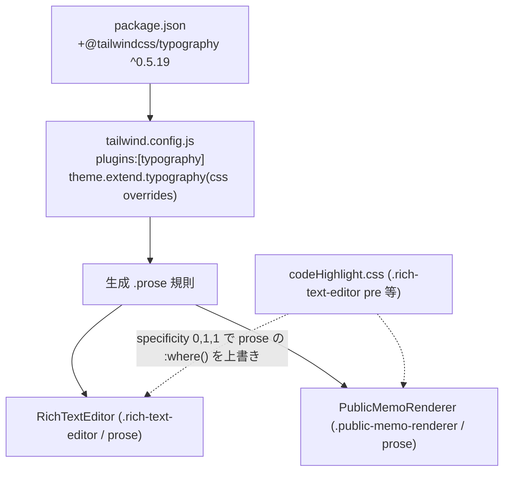

# Technical Design: editor-prose-typography

## Overview

本機能は、WYSIWYG エディタ（`RichTextEditor`）と公開メモビュー（`PublicMemoRenderer`）でブロック要素（見出し H1〜H3・箇条書き・番号付きリスト・引用ブロック）が視覚的に崩れる問題を解消する。両コンポーネントは既に同一の `prose ...` クラスと共有拡張（`createEditorExtensions`）を使用しているが、`@tailwindcss/typography` プラグインが未導入のため `prose` クラスが一切スタイルを生成していない。

**Purpose**: 書き手にはブロックが入力した瞬間に視覚で区別でき、読み手（共有メモ閲覧者）には書き手の意図どおりの構造で届く状態を提供する。
**Users**: メモを書く全ユーザー、公開メモを開く未ログイン閲覧者。
**Impact**: ビルド設定（`tailwind.config.js` / `package.json`）にプラグインと typography カスタマイズを追加するのみ。React コンポーネントの構造・保存 HTML・拡張構成は変更しない。

### Goals

- `@tailwindcss/typography` を導入し、`prose` を実体化してブロック要素を視覚化する。
- editor / public で対称な見た目を担保する（同一 `prose` クラス + 一箇所の typography 設定）。
- 既存のコードハイライト・タスクリスト・インライン装飾を壊さない。
- 「実描画の崩れ」を検知する視覚検証テストを追加する。

### Non-Goals

- ブロック要素の保存 HTML 構造・input rules・スラッシュコマンド・自動保存の変更（非回帰の対象）。
- 本文幅を読みやすい固定幅に制限する UX 改善（`maxWidth:'none'` で現行維持。将来別 spec）。
- テーマごとに prose 配色を CSS 変数追従させる仕組み（現状エディタ面を暗くするテーマが無いため対象外）。

## Architecture

### Existing Architecture Analysis

- editor: `RichTextEditor.tsx:73` が `editorProps.attributes.class` に `prose prose-sm sm:prose-base lg:prose-lg xl:prose-xl mx-auto focus:outline-none min-h-full p-4 text-gray-900` を付与。ラッパは `.rich-text-editor`。
- public: `PublicMemoRenderer.tsx:17` が同等の `prose ...` クラス（読み取り専用修飾付き）を付与。ラッパは `.public-memo-renderer`。
- コードハイライト: `codeHighlight.css`（`createEditorExtensions.ts:9` で import）が `.rich-text-editor pre` / `.public-memo-renderer pre` 等にスコープ。グローバル汚染なし。
- ビルド: `tailwind.config.js` は `plugins: []`、`theme.extend: {}`。`index.css` は v3 形式。

### Architecture Pattern & Boundary Map

- **Selected pattern**: ビルド時スタイル注入（Tailwind プラグイン）+ 設定一元化。新規ランタイムコンポーネントは作らない。
- **Domain/feature boundaries**: スタイル生成は Tailwind 設定（`tailwind.config.js`）に閉じる。hljs トークン配色は引き続き `codeHighlight.css`。editor/public のクラスは据え置き。
- **Existing patterns preserved**: 「スコープ CSS で衝突回避」（codeHighlight.css）、editor↔public の拡張共有（createEditorExtensions）。
- **Steering compliance**: テーマは CSS ファイル管理の原則を侵さない（prose は要素タイポグラフィのみ、テーマの色変数は不変）。型安全（設定ファイルは TS 型 `Config` 準拠）。

### Technology Stack

| Layer          | Choice / Version                                     | Role in Feature                            | Notes                                                             |
| -------------- | ---------------------------------------------------- | ------------------------------------------ | ----------------------------------------------------------------- |
| Frontend build | `@tailwindcss/typography` `^0.5.19`（devDependency） | `prose` クラスのブロック要素スタイルを生成 | peer `tailwindcss >=3.0.0`、現行 v3.4.17 互換（research Topic 1） |
| Frontend build | `tailwind.config.js`（`theme.extend.typography`）    | prose 既定の副作用を無効化し対称適用       | バッククォート/コード配色/taskList バレット/max-width             |
| Frontend test  | Vitest + Playwright                                  | 回帰ガード + 実描画 computed style 検証    | research Topic 3                                                  |

## Requirements Traceability

| Requirement | Summary                                                        | Components                                     | 実現方法                                                              |
| ----------- | -------------------------------------------------------------- | ---------------------------------------------- | --------------------------------------------------------------------- |
| 1.1–1.4     | typography プラグイン有効化・v3 互換・既存設定非破壊           | `package.json`, `tailwind.config.js`           | `^0.5.19` 追加、`plugins:[typography]`、`content`/`darkMode` 据え置き |
| 2.1–2.5     | エディタで H1-3/箇条書き/番号/引用が視覚区別、全生成経路で等価 | `RichTextEditor`（class 据え置き）+ 生成 prose | プラグイン有効化で自動適用。ノード種別が同じなら経路非依存            |
| 3.1–3.3     | 公開ビューが editor と一致、読み取り専用維持                   | `PublicMemoRenderer`（class 据え置き）         | 同一 `prose` クラス + 同一 typography 設定で対称                      |
| 4.1         | コードブロックハイライト維持・非競合                           | `codeHighlight.css`, typography `css`          | specificity で codeHighlight 優先 + prose の `pre/code` を無効化      |
| 4.2         | タスクリスト維持                                               | typography `css`（`ul[data-type=taskList]`）   | バレット/インデントを抑止                                             |
| 4.3         | インライン装飾維持                                             | 既存 marks                                     | prose はインライン装飾を阻害しない                                    |
| 4.4         | 競合時は既存専用 CSS 優先                                      | typography `css`                               | prose 既定を `unset`/`none` 化して codeHighlight を勝たせる           |
| 5.1–5.3     | テーマ・可読性両立                                             | typography `css`（色トークン）                 | 本文 `text-gray-900` 維持、見出し/リンク色を地色と整合                |
| 6.1–6.4     | 非回帰 + 視覚検証（editor/public 対称）                        | Vitest, Playwright                             | 既存 747 維持 + プラグイン回帰ガード + 実描画検証                     |

## Components and Interfaces

| Component                           | Domain/Layer | Intent                                    | Req Coverage | Key Dependencies             | Contracts    |
| ----------------------------------- | ------------ | ----------------------------------------- | ------------ | ---------------------------- | ------------ |
| tailwind.config.js                  | Build config | typography 登録 + prose override 一元定義 | 1,2,3,4,5    | @tailwindcss/typography (P0) | State(build) |
| package.json                        | Build config | 依存追加                                  | 1            | npm                          | —            |
| RichTextEditor / PublicMemoRenderer | UI           | 既存 `prose` クラス保持（変更なし）       | 2,3          | 生成 prose CSS (P0)          | —            |
| codeHighlight.css                   | Style        | コード配色維持（変更なし）                | 4            | —                            | —            |
| 視覚検証テスト                      | Test         | プラグイン回帰ガード + 実描画検証         | 6            | Vitest, Playwright           | —            |

### Build config

#### tailwind.config.js

| Field        | Detail                                                             |
| ------------ | ------------------------------------------------------------------ |
| Intent       | typography プラグイン登録と prose 既定副作用の無効化を一箇所で行う |
| Requirements | 1.1, 1.4, 4.1, 4.2, 4.4, 5.1, 5.2                                  |

**Responsibilities & Constraints**

- `plugins` に typography を追加。`content` グロブ・`darkMode:'class'`・`theme.extend`（既存）は不変。
- `theme.extend.typography` に **単一の override セット**を定義（DEFAULT）。editor/public は同一 `prose` クラスのため対称適用される。

**override の意図（HOW は実装で確定、WHAT を規定）**

- inline `code` のバッククォート擬似要素（`code::before` / `code::after`）の `content` を無効化する。
- `pre` および `pre code` の prose 既定（背景・文字色・余白）を無効化し、`codeHighlight.css` の配色を阻害しないようにする。
- `ul[data-type="taskList"]`（および配下 `li`）の list-style / 行頭インデントを抑止し、チェックボックス表示と二重化しないようにする。
- `maxWidth` を `none` にし、本文幅の中央寄せ制限を無効化（現行レイアウト維持）。
- 本文色は `text-gray-900`（クラス側）を尊重。見出し・リンクの色トークンを地色と衝突しない値に整える。

**Contracts**: State [x]（ビルド生成物） — 型は `import('tailwindcss').Config` に準拠（`any` 不使用）。

**Implementation Notes**

- ESM 設定（`export default`）のため `import typography from '@tailwindcss/typography'` を使用。
- override は editor 専用・public 専用に分けず DEFAULT に集約（Req3 の対称性を構造で担保）。

## Error Handling

本機能はビルド時スタイル生成のみでランタイム分岐を持たない。想定する失敗は次の2系統に限定:

- **ビルド失敗（依存欠落/設定不正）**: typography 未インストールや `plugins` 記述ミスでビルドエラー → CI（型チェック/ビルド）と pre-push で検知。ローカルは Docker コンテナ内 `npm install` 必須（既知の運用注意）。
- **視覚回帰（prose 無効化の再発）**: プラグインが将来外れると再びプレーン表示へ退行 → 6 の回帰ガード + Playwright 実描画検証で検知。

## Testing Strategy

### Unit / 回帰ガード（Vitest）

- `tailwind.config.js` の `plugins` に typography が登録されていることを検証（設定オブジェクトを import して assert）。
- `RichTextEditor` / `PublicMemoRenderer` のレンダリング要素が `prose` クラスを保持していること（クラス撤去回帰の防止）。

### E2E / 実描画検証（Playwright、実バックエンド/実描画）

- エディタで `# 見出し` / `- リスト` / `1. 番号` / `> 引用` を入力後、computed style を検証:
  - 見出し（h1/h2）の `font-size` が段落（p）より大きい。
  - `ul` / `ol` の `list-style-type` が `none` 以外（バレット/番号が出る）。
  - `blockquote` に左罫線または左パディングが付与される。
- 公開メモビュー（`/p/:token` もしくは PublicMemoRenderer）でも同一保存 HTML に対し上記が成立すること（editor と対称、Req3.2/6.4）。
- コードブロックがハイライト（`.hljs-*`）かつ `pre` 背景が `codeHighlight.css` の値であること（Req4.1 非競合）。
- タスクリスト項目にバレットが出ないこと（Req4.2）。

### 非回帰

- 既存 frontend full suite（現状 747 件）が全て成功すること（Req6.1）。

## Supporting References

- gap-analysis.md（現状調査・衝突リスク・アプローチ比較）
- research.md（バージョン互換・specificity 検証・設計判断3点の根拠）
