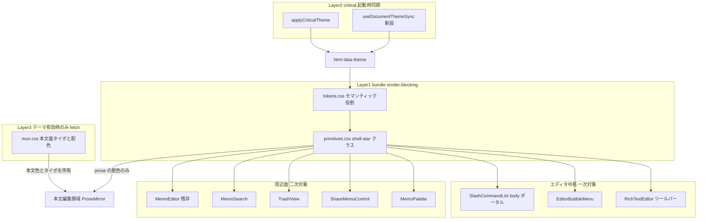
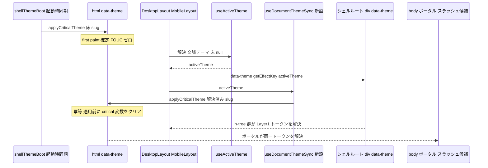
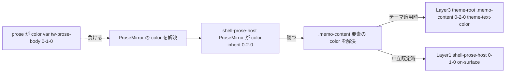
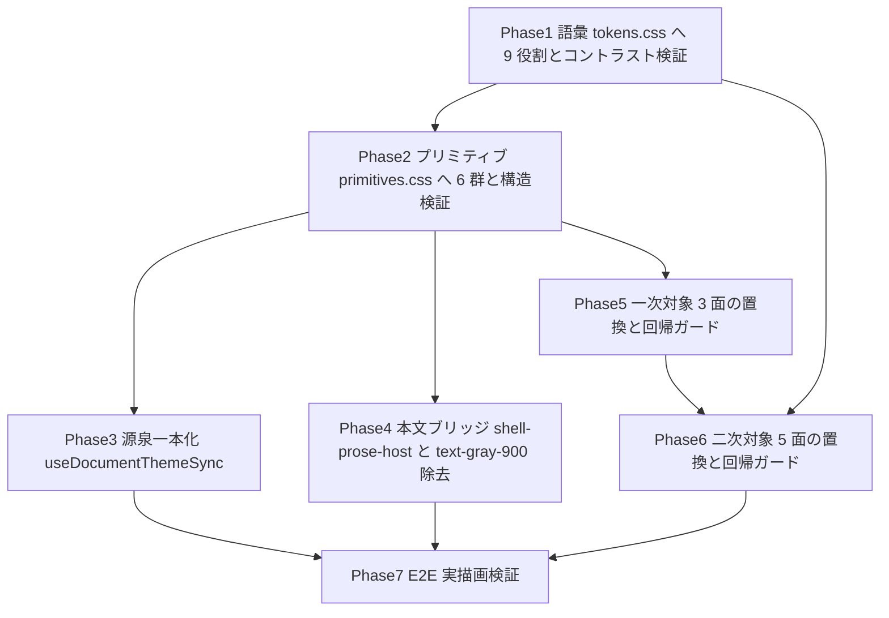

# Technical Design Document — editor-surface-tokenization

## Overview

**Purpose**: 本機能は、theme-immersive-world で確立した shell トークン層（Layer①）をエディタ面へ縦展開し、「読むとき」と「書くとき」で世界観が途切れない編集体験を Mosaku ユーザーへ届ける。現状、森テーマで編集画面を開くとツールバー・浮遊面・本文が生の Tailwind 配色（`bg-white` / `text-gray-700` / `bg-blue-500` / `text-gray-900`）で深緑の世界にフタをしている。本設計はそのフタを外す。

**Users**: メモを書く全ユーザーが、テーマ適用下の編集画面で恩恵を受ける。加えて Mosaku 開発者は、後続の横展開スペックが「トークンに値を与えるだけ」で 4 テーマ全部のエディタ面へ世界観を波及させられる基盤を得る。

**Impact**: 単なる色の置換ではなく、**トークン語彙の拡張**として解決する。(1) 押下（トグル）状態のプリミティブ、(2) 浮遊面（ポップオーバー）の面プリミティブ、(3) `@tailwindcss/typography` の `prose-*` による本文色上書きの解消、(4) 破壊／成功という意味色の役割追加、の 4 点で Layer① の語彙を拡げ、対象 8 ファイル 164 箇所の生カラーリテラルを `var(--token)` 経由へ置換する。あわせて、body ポータルへ出るスラッシュ候補だけが別のテーマ源泉を見ている構造欠陥（横展開時に顕在化する時限バグ）を塞ぐ。

### Goals

- エディタ中核 3 面（ツールバー / バブルメニュー / スラッシュ候補）と周辺 5 面から生の Tailwind 配色ユーティリティを **0 件**にする（1.1, 1.2, 1.4, 8.5）
- 押下・ホバー・無効・選択の 4 状態を theme-neutral な質感プリミティブとして質感層に備え、色だけに依存しない状態伝達を成立させる（2.1–2.6, 3.3, 6.4）
- 本文編集領域の文字色をテーマ由来に戻し、編集モードと表示モードの配色の断絶を消す（4.1–4.6）
- Layer①（操作面）と Layer③（本文面）の責務境界を、機械検証可能な形で確定する（5.1–5.6）
- 森テーマ・中立既定の双方で WCAG AA を機械検証で保証する（6.1, 6.2）
- コンポーネント／プリミティブにテーマ名を書かず、後続スペックが値を与えるだけで 4 テーマへ波及する構造を維持する（7.1–7.6）

### Non-Goals

- **本文面のタイポグラフィ定義**（`.memo-content` 配下の字階層・マージン・行間）— Layer③ のテーマ CSS に残す（1.5, 4.5, 5.2）
- **エディタの機能追加・レイアウト変更・情報設計の変更** — 配色・状態表現・面の質感に限定する（1.6, 8.3）
- **umi / yoru / asa へのトークン値供給** — 本スペックは「参照する側」の整備に徹し、値実装は後続の横展開スペックが担う（7.3）
- **`editor/codeHighlight.css` のトークン化** — 生カラーリテラル 13 個を持つが、requirements が名指ししておらず、hljs トークン種別ごとに 10 色超の独立した語彙を要する。既知の残件として後続スペックへ送る（Open Questions 参照）
- **バックエンド／DB スキーマの変更** — テーマの実体は CSS 本体＋メタデータのまま（8.7）
- **エディタ意味色パレット（`--editor-text-*` / `--editor-marker-*` / `--editor-callout-*`）の値変更** — テーマ非依存の自己完結値として維持する（3.6）

---

## Architecture

### Existing Architecture Analysis

Mosaku のテーマは 3 層で構成され、それぞれ**到達範囲**が異なる。本設計の全ての判断はこの到達範囲から導かれる。

| 層         | 実体                                                                                                                             | 適用点                                                               | 配信                                                        | 到達範囲                           |
| ---------- | -------------------------------------------------------------------------------------------------------------------------------- | -------------------------------------------------------------------- | ----------------------------------------------------------- | ---------------------------------- |
| **Layer①** | `src/themes/shell/tokens.css`（`:root` 中立 ＋ `[data-theme='mori']`）<br>`src/themes/shell/primitives.css`（`.shell-*` クラス） | `<html data-theme>` ＋ シェルルート div                              | `index.css` から `@import`（バンドル同梱・render-blocking） | **文書全体（body ポータル含む）**  |
| **Layer②** | `themes/shell/shellThemeCritical.ts` → `applyCriticalTheme(slug)`                                                                | `<html>` へ `data-theme` ＋ critical 変数をインライン                | 起動時同期（FOUC ゼロ）                                     | 同上                               |
| **Layer③** | `public/themes/{name}/{name}.css`                                                                                                | `useThemeCSS` が `.theme-root` → `[data-theme-id="<id>"]` へ書換注入 | 当該テーマ有効時のみ fetch                                  | **`.theme-root` サブツリー内のみ** |

**維持すべき既存パターン**:

- 「面側にトークンを当て、汎用 HTML 要素の文字色を要素型セレクタで直接上書きしない」— 過去の `.theme-root button` によるヘッダー文字消失ロールバックを構造的に防ぐ契約（5.6）
- 全ての `--surface*` に AA を満たす `--on-surface*` をペアで定義する（7.6）
- 役割名は 4 テーマ共通、値だけ差し替えで相乗りする（7.1, 7.2）
- 重量物（テクスチャ画像・data-URI・テーマ固有装飾）は Layer① に置かない（5.5, 8.2）

**対象 4 面の DOM 位置**（本設計の決定的な前提。詳細な検証は `research.md` R-1 / R-2）:

| 面                                   | マウント位置                                                                 | Layer① | Layer③ | 帰結                                                 |
| ------------------------------------ | ---------------------------------------------------------------------------- | :----: | :----: | ---------------------------------------------------- |
| ツールバー（`RichTextEditor`）       | `.rich-text-editor` 内 ＝ `.memo-content` 内                                 |   ○    |   ○    | 両層が届く。Layer① が `color` を持ち切る契約が必要   |
| バブルメニュー（`EditorBubbleMenu`） | `view.dom.parentElement` へ `appendChild`（`appendTo` 未指定）＝ **in-tree** |   ○    |   ○    | 同上                                                 |
| スラッシュ候補（`SlashCommandList`） | tippy `appendTo: () => document.body` ＝ **`.theme-root` の外**              |   ○    |   ✕    | **Layer① 一択が物理的に確定**（5.1 を追認）          |
| メモパレット（`MemoPalette`）        | シェルルート div 内・`.memo-content` 外                                      |   ○    |   △    | `.memo-content` セレクタが当たらず Layer① のみで完結 |

**解消すべき技術的負債**: 上表のスラッシュ候補は `<html data-theme>`（localStorage シェル床）を見るが、in-tree 群はシェルルート div の `data-theme={getEffectKey(useActiveTheme())}`（文脈テーマ優先）を見る。**両者の解決結果が食い違う**。現在は umi/yoru/asa に値が無いため双方とも中立へ落ちて症状が出ないが、横展開スペックが値を入れた瞬間に「ポップオーバーだけ別テーマ」が顕在化する。「相乗り基盤」を名乗る本スペックで塞ぐ。

### Architecture Pattern & Boundary Map

**Selected pattern**: **Semantic Token Layer ＋ Theme-neutral Primitive Layer**（Layer① 語彙の最小拡張 ＋ コンポーネントの in-place 置換）。

エディタ専用の新レイヤーを作る案は Req1.3（面ごとの専用クラスを新設しない）と Req5.3（同一プロパティの二重定義禁止）が明示的に禁じる。既存プリミティブだけで押し切る案は Req2.1 / 2.6 / 3.2 を充足できない。詳細な比較は `research.md` の Architecture Pattern Evaluation を参照。



**Architecture Integration**:

- **ドメイン境界**: 「操作面」（ツールバー・浮遊面・周辺面）は Layer① が配色と質感を**持ち切る**。「本文面」（`.memo-content` 配下）は Layer③ が配色とタイポグラフィを**持ち切る**。Layer① が本文面に対して行うのは prose 組み込みパレットの**脱色**のみで、色を決めない（Decision 5）。
- **既存パターンの保存**: トークン語彙の役割名・`.shell-*` 命名・「トップレベルセレクタは `.shell-*` / `.app-shell` のみ」というプリミティブ層の不変則をそのまま継承する。新プリミティブは `primitives.css` に置いた瞬間に既存の機械ガード（リテラル禁止・セレクタ制限）の下に入る。
- **新規コンポーネントの根拠**: 新設するのは `useDocumentThemeSync` フック 1 本のみ。body ポータルと in-tree のテーマ源泉を一本化するために必要（Decision 1）。それ以外は既存ファイルへの追記と className の置換に留める。
- **Steering 準拠**: 「テーマは CSS ファイル管理・DB にはメタデータのみ」「テーマエフェクト用の新規 JS ライブラリを追加しない」「サーバー状態の真実の源泉は React Query」を全て維持する。Zustand（`useShellThemeStore`）が保持するのは「どのテーマを選んだか」という UI 選択のみで不変。

### Technology Stack & Alignment

| Layer                  | Choice / Version                             | Role in Feature                                                                                                 | Notes                                                                                                                     |
| ---------------------- | -------------------------------------------- | --------------------------------------------------------------------------------------------------------------- | ------------------------------------------------------------------------------------------------------------------------- |
| Frontend — スタイル    | Tailwind CSS 3 ＋ CSS Custom Properties      | 生の配色ユーティリティを `var(--token)` 経由へ置換。レイアウト系ユーティリティ（`flex` / `gap` / `px-*`）は温存 | 新規依存なし                                                                                                              |
| Frontend — 本文タイポ  | `@tailwindcss/typography` ^0.5.19            | `prose` の組み込みパレットを `--tw-prose-*: currentColor` で脱色                                                | `.prose` は `color: var(--tw-prose-body)` を持つ（`src/styles.js:1413`）。実効詳細度は `.prose :where(h1)` で (0,1,1)     |
| Frontend — エディタ    | `@tiptap/react` 3.22.2 / `@tiptap/pm` 3.23.4 | `BubbleMenu` は `appendTo` 未指定で in-tree にマウント                                                          | バージョン据え置き。`appendTo` は渡さない（現状維持）                                                                     |
| Frontend — 浮遊面配置  | `tippy.js` ^6.3.7                            | スラッシュ候補を body ポータルへ配置                                                                            | `tippy.js/dist/tippy.css` は未 import。`.tippy-box` に既定の地色が無く、見た目は `SlashCommandList` の div が 100% 決める |
| Frontend — テスト      | Vitest ＋ Testing Library / Playwright       | 構造ガード（className / CSS パターン）とコントラスト機械検証はユニット、実描画は E2E                            | 既存 `contrast.ts` / `display-mode-theme.spec.ts` を再利用                                                                |
| Backend / Data / Infra | —                                            | **変更なし**                                                                                                    | 8.7                                                                                                                       |

**新規依存**: なし（8.2）。

---

## System Flows

### トークン解決フロー（テーマ源泉の一本化）

現状の欠陥と修正後の解決経路。`useDocumentThemeSync` の追加により、in-tree と body ポータルが**同一の解決結果**を見る。



**フローレベルの決定**:

- 起動時の同期適用（`shellThemeBoot`）は**先に走り無改変**。`useDocumentThemeSync` は post-mount の再整合に徹するため FOUC ゼロ設計に影響しない。
- `applyCriticalTheme` は適用前に critical 変数と `background-color` を必ず `removeProperty` する冪等関数のため、同一 slug での再呼び出しに副作用がない。
- 文脈テーマが有効な状態で床を切り替えると `setShellTheme` → `applyCriticalTheme(床)` の直後に本フローが文脈 slug で上書きする。状態は必ず収束するが `<html>` 背景が最大 1 フレームちらつく（Risks 参照）。

### 本文編集面の色解決フロー

`text-gray-900` 除去後、テーマ有無で色の所有者が切り替わる経路。



**キーとなる決定**: `.ProseMirror` に `color: var(--on-surface)` を**直接**書く案は不採用。子への直接指定はテーマ適用時も Layer① に本文色を握らせ、Layer③ の `--theme-text-color` を永久に無効化する。mori では両者がほぼ同値（`#e8f6ee` vs `#e7f5ec`）のため症状が出ず気づけない。`color: inherit` は「親に従う」の明示であり、`.prose` の直接指定を打ち消す目的でのみ使う。

---

## Requirements Traceability

| Requirement | Summary                                    | Components                                                           | Interfaces                                                                         | Flows              |
| ----------- | ------------------------------------------ | -------------------------------------------------------------------- | ---------------------------------------------------------------------------------- | ------------------ |
| 1.1         | 一次対象＝エディタ中核 3 面                | RichTextEditor / EditorBubbleMenu / SlashCommandList                 | `.shell-button` / `.shell-popover`                                                 | —                  |
| 1.2         | 二次対象＝浮遊面と周辺 5 面                | MemoPalette / ShareMemoControl / TrashView / MemoSearch / MemoEditor | 同一トークン語彙                                                                   | —                  |
| 1.3         | 面ごとの専用クラスを新設しない             | Quality Primitives                                                   | `.shell-*` のみ                                                                    | —                  |
| 1.4         | 生 Tailwind 残存でテスト失敗               | Editor Surface Literal Guard / Editor Surface Guard Tests            | ソース走査（全網羅）＋ className 検査（要素単位）                                  | —                  |
| 1.5         | 本文タイポは Layer③ 残置                   | Layer③ mori.css                                                      | `.theme-root .memo-content`                                                        | 本文編集面の色解決 |
| 1.6         | 機能・レイアウト・情報設計を変更しない     | 全対象コンポーネント                                                 | className 置換のみ                                                                 | —                  |
| 2.1         | 押下状態を質感プリミティブとして備える     | Quality Primitives                                                   | `.shell-button[aria-pressed='true']`                                               | —                  |
| 2.2         | 押下を状態トークンで描画・リテラル不使用   | Quality Primitives / Token Contract                                  | `--state-selected` / `--on-state-selected`                                         | —                  |
| 2.3         | `aria-pressed` を伴わせる                  | RichTextEditor / EditorBubbleMenu / SlashCommandList                 | `aria-pressed` 属性                                                                | —                  |
| 2.4         | ON と OFF の識別可能な視覚差               | Quality Primitives                                                   | 地・文字・境界・字幅の 4 軸                                                        | —                  |
| 2.5         | ホバーが押下と同一の見た目にならない       | Quality Primitives                                                   | `:not([aria-pressed='true']):hover`                                                | —                  |
| 2.6         | 無効時も判読可能な最小コントラスト         | Quality Primitives                                                   | `.shell-button:disabled`                                                           | —                  |
| 3.1         | 浮遊面を既存語彙で解決する面プリミティブ   | Quality Primitives                                                   | `.shell-popover`                                                                   | —                  |
| 3.2         | 下地と識別できる奥行きと境界               | Quality Primitives                                                   | `--elevation-3` / `--outline`                                                      | —                  |
| 3.3         | 選択中候補を状態トークンで示す             | Quality Primitives / SlashCommandList / MemoPalette                  | `role="listbox"` ＋ `role="option"` ＋ `.shell-popover-item[aria-selected='true']` | —                  |
| 3.4         | 補助テキストを低強調トークンで描画         | Quality Primitives                                                   | `.shell-text-muted` / `--on-surface-variant`                                       | —                  |
| 3.5         | 表示条件とキーボード操作を変更しない       | EditorBubbleMenu / SlashCommandList / suggestion                     | `shouldShow` / `useImperativeHandle` 不変                                          | —                  |
| 3.6         | スウォッチ値はテーマ非依存を維持           | SlashCommandList / EditorBubbleMenu                                  | `swatchColorVar` 不変・枠のみトークン化                                            | —                  |
| 4.1         | 本文の文字色をテーマ由来にする             | Prose Bridge / RichTextEditor                                        | `.shell-prose-host`                                                                | 本文編集面の色解決 |
| 4.2         | prose 既定色が上書きしない状態を保証       | Prose Bridge                                                         | `--tw-prose-*: currentColor`                                                       | 本文編集面の色解決 |
| 4.3         | 見出し・引用・リンク等も本文色に追随       | Prose Bridge                                                         | `--tw-prose-headings` ほか                                                         | 本文編集面の色解決 |
| 4.4         | 非テーマ時は実装前と同等の中立配色         | Prose Bridge / Token Contract                                        | `--on-surface: #111827`                                                            | 本文編集面の色解決 |
| 4.5         | 字階層は Layer③ に従う                     | Layer③ mori.css                                                      | `.theme-root .memo-content`                                                        | —                  |
| 4.6         | 編集⇄表示モードで同一系統の色              | Prose Bridge                                                         | `.display-mode-content .ProseMirror` と対称                                        | 本文編集面の色解決 |
| 5.1         | 操作面の配色と質感は Layer①                | Quality Primitives                                                   | `.shell-*`                                                                         | —                  |
| 5.2         | 本文面の配色とタイポは Layer③              | Layer③ mori.css                                                      | `.theme-root .memo-content`                                                        | 本文編集面の色解決 |
| 5.3         | 同一プロパティを両層で定義しない           | Layer Boundary Guard Test                                            | mori.css の `.shell-` 不在検査                                                     | —                  |
| 5.4         | 新しい色は語彙へ役割として追加             | Token Contract                                                       | `--danger` / `--success` 系                                                        | —                  |
| 5.5         | Layer① から重量物を排除                    | Layer Weight Guard Test                                              | data-URI / url / @font-face 不在検査                                               | —                  |
| 5.6         | クラスセレクタで構成・要素型で上書きしない | Quality Primitives                                                   | 既存トップレベルセレクタ検査                                                       | —                  |
| 6.1         | AA コントラストを保つ                      | Token Contract / Contrast Tests                                      | `contrast.ts`                                                                      | —                  |
| 6.2         | 半透明の worst-case 合成を機械検証         | Contrast Tests                                                       | 白床合成                                                                           | —                  |
| 6.3         | フォーカスリングを提示                     | Quality Primitives                                                   | `:focus-visible` / `--focus-ring`                                                  | —                  |
| 6.4         | 状態を色のみで伝達しない                   | Quality Primitives / 各コンポーネント                                | `aria-pressed` / `aria-selected` / `font-weight` / `disabled`                      | —                  |
| 6.5         | reduced-motion でモーション停止            | Quality Primitives                                                   | reduced-motion ブロック                                                            | —                  |
| 6.6         | アクセシブルネームを後退させない           | 各コンポーネント                                                     | `role` / `aria-label` 不変                                                         | —                  |
| 7.1         | 4 テーマ共通の役割名で解決                 | Token Contract                                                       | 役割名のみ                                                                         | トークン解決       |
| 7.2         | 値供給だけでコード変更なく波及             | Token Contract / useDocumentThemeSync                                | `[data-theme='<slug>']`                                                            | トークン解決       |
| 7.3         | 値実装は mori と `:root` に限定            | Token Contract                                                       | placeholder コメント維持                                                           | —                  |
| 7.4         | 明暗反転耐性のある契約                     | Token Contract                                                       | 役割定義                                                                           | —                  |
| 7.5         | テーマ名をコード側に書かない               | 全コンポーネント / Quality Primitives                                | theme-neutral 検査                                                                 | —                  |
| 7.6         | 面と前景を可読ペアで定義                   | Token Contract / Contrast Tests                                      | `--x` / `--on-x` 対                                                                | —                  |
| 8.1         | 非テーマ時に中立配色を維持                 | Token Contract                                                       | `:root` 既定値                                                                     | 本文編集面の色解決 |
| 8.2         | 外部 JS 追加ゼロ・バンドル不増             | Layer Weight Guard Test                                              | 3 条件の機械検証                                                                   | —                  |
| 8.3         | 既存挙動を変更しない                       | 全対象コンポーネント                                                 | className 置換のみ                                                                 | —                  |
| 8.4         | backend 非依存 E2E で実描画検証            | editor-surface-theme E2E                                             | `getComputedStyle`                                                                 | —                  |
| 8.5         | 直書き回帰でテスト失敗                     | Editor Surface Guard Tests                                           | 否定アサーション                                                                   | —                  |
| 8.6         | 既存テストを全緑で維持                     | 全テスト                                                             | —                                                                                  | —                  |
| 8.7         | BE / DB を変更しない                       | —                                                                    | —                                                                                  | —                  |

---

## Components and Interfaces

| Component                | Domain / Layer          | Intent                                                                                                    | Req Coverage                                           | Key Dependencies                                   | Contracts      |
| ------------------------ | ----------------------- | --------------------------------------------------------------------------------------------------------- | ------------------------------------------------------ | -------------------------------------------------- | -------------- |
| **Shell Token Contract** | Layer① / tokens.css     | 破壊・成功・暗幕の意味役割を語彙へ追加し、4 テーマ共通の役割名で解決させる                                | 5.4, 6.1, 6.2, 7.1–7.6, 8.1                            | —                                                  | State          |
| **Quality Primitives**   | Layer① / primitives.css | 押下・無効・浮遊面・候補行・暗幕・本文ブリッジを theme-neutral な構造クラスとして提供                     | 1.3, 2.1–2.6, 3.1–3.4, 4.1–4.4, 5.1, 5.5, 5.6, 6.3–6.5 | Shell Token Contract (P0)                          | State          |
| **useDocumentThemeSync** | Layer② / hooks          | 解決済みテーマを `<html data-theme>` へ再適用し、in-tree と body ポータルのテーマ源泉を一本化             | 3.1, 7.2                                               | `useActiveTheme` (P0), `applyCriticalTheme` (P0)   | Service, State |
| **RichTextEditor**       | エディタ中核            | ツールバー 8 ボタンをトークン駆動へ置換し、`aria-pressed` を付与。ProseMirror から `text-gray-900` を除去 | 1.1, 2.2–2.5, 4.1, 6.6, 8.3                            | Quality Primitives (P0)                            | —              |
| **EditorBubbleMenu**     | エディタ中核            | `SWATCH_BUTTON_CLASS` とフローティング面をトークン駆動へ置換                                              | 1.1, 2.2–2.5, 3.1, 3.6, 6.6, 8.3                       | Quality Primitives (P0)                            | —              |
| **SlashCommandList**     | エディタ中核            | 浮遊面・候補行・補助テキストをトークン駆動へ置換し、選択状態を `aria-selected` で伝達                     | 1.1, 3.1–3.4, 3.6, 6.4, 8.3                            | Quality Primitives (P0)                            | —              |
| **Peripheral Surfaces**  | 周辺面                  | MemoPalette / ShareMemoControl / TrashView / MemoSearch / MemoEditor の残存直書きを同一語彙で解決         | 1.2, 1.3, 6.1, 6.4                                     | Quality Primitives (P0), Shell Token Contract (P0) | —              |
| **Prose Bridge**         | Layer① ↔ Layer③ 境界    | 本文編集面の色所有権を Layer③ に残したまま、prose 組み込みパレットを脱色し中立フォールバックを固定        | 4.1–4.4, 4.6, 5.2, 5.3                                 | Quality Primitives (P0), Layer③ mori.css (P1)      | State          |
| **Quality Gate Tests**   | 検証                    | 生 Tailwind 残存・層の越境・重量物混入・コントラスト・実描画を機械検証                                    | 1.4, 5.3, 5.5, 6.1, 6.2, 8.2, 8.4–8.6                  | `contrast.ts` (P0)                                 | —              |

---

### Layer① — Token & Primitive Layer

#### Shell Token Contract（`tokens.css`）

| Field        | Detail                                                                             |
| ------------ | ---------------------------------------------------------------------------------- |
| Intent       | エディタ面と周辺面が必要とする意味役割を、4 テーマ共通の役割名として語彙へ追加する |
| Requirements | 5.4, 6.1, 6.2, 7.1, 7.2, 7.3, 7.4, 7.6, 8.1                                        |

**Responsibilities & Constraints**

- 色トークンの**単一の源泉**であり続ける。コンポーネント・プリミティブ・Layer③ に個別の色を持たせない。
- 値の実装は `:root`（中立既定）と `[data-theme='mori']` に**限定**する。umi / yoru / asa は placeholder コメントのまま維持する（7.3）。
- 全ての面役割に、AA を満たす前景役割をペアで定義する（7.6）。
- 明テーマ（朝）でも暗テーマ（森・海・夜）でも成立する役割定義とする（7.4）。既定値の明暗を役割名に埋め込まない。

**Dependencies**: なし（語彙の最下層）。

**Contracts**: State [x]

##### State Management

**追加する役割（9 本）**

| 役割                     | 意味                                                                      | 使用条件                                            |
| ------------------------ | ------------------------------------------------------------------------- | --------------------------------------------------- |
| `--danger`               | 破壊操作の中核色。ソリッド面の地、境界色、**面の上のテキスト色**の 3 用途 | テキストとして使う場合は `--surface` 系の面の上のみ |
| `--on-danger`            | `--danger` をソリッド面として使ったときの前景文字                         | —                                                   |
| `--danger-container`     | 破壊の淡色コンテナ（エラートースト・破壊操作のホバー層）                  | —                                                   |
| `--on-danger-container`  | `--danger-container` 上の前景文字                                         | —                                                   |
| `--success`              | 成功／公開中の中核色。用途は `--danger` と同型                            | 同上                                                |
| `--on-success`           | `--success` をソリッド面として使ったときの前景文字                        | —                                                   |
| `--success-container`    | 成功の淡色コンテナ（ステータスピル・成功トースト）                        | —                                                   |
| `--on-success-container` | `--success-container` 上の前景文字                                        | —                                                   |
| `--scrim`                | モーダル背後の暗幕。前景を持たない非テキスト面のため対を作らない          | —                                                   |

**決定値**

| 役割                                             | `:root`（中立）       | `[data-theme='mori']`                |
| ------------------------------------------------ | --------------------- | ------------------------------------ |
| `--danger` / `--on-danger`                       | `#dc2626` / `#ffffff` | `#fecaca` / `#2b0a0a`                |
| `--danger-container` / `--on-danger-container`   | `#fef2f2` / `#991b1b` | `rgba(69, 10, 10, 0.88)` / `#fecaca` |
| `--success` / `--on-success`                     | `#15803d` / `#ffffff` | `#a7f3d0` / `#04230f`                |
| `--success-container` / `--on-success-container` | `#dcfce7` / `#166534` | `rgba(6, 78, 59, 0.88)` / `#a7f3d0`  |
| `--scrim`                                        | `rgba(0, 0, 0, 0.5)`  | `rgba(3, 18, 10, 0.62)`              |

**不変則（機械検証の対象）**

- **前提条件**: `--danger` / `--success` を**テキスト色**として使えるのは `--surface` / `--surface-variant` 系の面の上だけ。アプリ床の直上に置くと mori の白床 worst-case で 1.45 / 1.28 まで落ちる。対象コンポーネントのルート面を `.shell-surface` 系でトークン化することが本役割の使用前提となる。
- **事後条件**: 全ペアが通常床（`--shell-base-bg`）と worst-case 白床（`#ffffff`）の両端合成で AA を満たす。container は「アプリ床の直上 / `--surface` の上」× 「通常床 / 白床」の 4 経路すべてで検証する。
- 中立値は現行 Tailwind との差分を最小化しつつ AA を満たす階調を選んでいる（`bg-red-500` 3.76 → 4.83、`bg-green-500` 2.28 → 5.02）。可読性は改善方向であり 8.1「後退させない」に適合する。

**Implementation Notes**

- Integration: 既存の `[data-theme='mori']` ブロックへ追記し、umi / yoru / asa の placeholder コメントは現状のまま残す。
- Validation: `tokens.contrast.test.ts` に新役割ぶんの検証を追記する。container は 4 経路合成のヘルパを新設する。
- Risks: 役割数の増加で横展開スペックの実装負荷が上がる。役割ごとに「どの用途で使うか」を tokens.css のコメントで明示し、値決めの指針を残す。

#### Quality Primitives（`primitives.css`）

| Field        | Detail                                                                                                  |
| ------------ | ------------------------------------------------------------------------------------------------------- |
| Intent       | エディタ面が必要とする状態表現・面表現を、トークンを読むだけの theme-neutral な構造クラスとして提供する |
| Requirements | 1.3, 2.1, 2.2, 2.4, 2.5, 2.6, 3.1, 3.2, 3.3, 3.4, 4.1, 4.2, 4.3, 4.4, 5.1, 5.5, 5.6, 6.3, 6.4, 6.5      |

**Responsibilities & Constraints**

- 生の色リテラル（`#hex` / `rgb()` / `rgba()`）を一切持たない。色は `var(--token)` 経由のみ（5.5, 5.6）。
- トップレベルセレクタは `.shell-*` / `.app-shell` のみ。要素型セレクタで汎用 HTML 要素の文字色を上書きしない（5.6）。
- テーマ名（`mori` 等）を記述しない（7.5）。
- 面ごとの専用クラスを作らず、既存クラスの状態セレクタと汎用プリミティブで解決する（1.3）。

**Dependencies**

- Outbound: Shell Token Contract — 全ての色・奥行き・余白・タイポの解決元（P0）

**Contracts**: State [x]

##### State Management

**追加する定義（5 群）**

| #   | セレクタ                                                                                                                                                       | 読むトークン                                                                                                                                                                              | 目的                                                                                                                                                                   |
| --- | -------------------------------------------------------------------------------------------------------------------------------------------------------------- | ----------------------------------------------------------------------------------------------------------------------------------------------------------------------------------------- | ---------------------------------------------------------------------------------------------------------------------------------------------------------------------- |
| 1   | `.shell-button[aria-pressed='true']`<br>`.shell-button-primary[aria-pressed='true']`                                                                           | `--state-selected` / `--on-state-selected` / `--accent`                                                                                                                                   | 押下（ON）状態。`font-weight: 600` を併せて形状の手がかりを与える（2.1, 2.2, 2.4, 6.4）                                                                                |
| 2   | `.shell-button:not([aria-pressed='true']):hover`<br>（既存 `:hover` を置換）                                                                                   | `--state-hover`                                                                                                                                                                           | ホバーは非押下時のみ。押下中のホバーで ON 表現を壊さない（2.5）                                                                                                        |
| 3   | `.shell-button:disabled`<br>`.shell-button-primary:disabled`                                                                                                   | `--on-surface-variant` / `--surface-variant` / `--outline`                                                                                                                                | 無効状態。**`opacity` を使わず前景色の切替**で表現し、`cursor: not-allowed` を併用（2.6, 6.4）                                                                         |
| 4   | `.shell-popover`<br>`.shell-popover-item`<br>`.shell-popover-item:hover`<br>`.shell-popover-item[aria-selected='true']`<br>`.shell-popover-item:focus-visible` | `--surface` / `--on-surface` / `--outline` / `--elevation-3` / `--surface-backdrop` / `--surface-texture` / `--state-hover` / `--state-selected` / `--on-state-selected` / `--focus-ring` | 浮遊面と候補行。`.shell-panel` の派生で `--elevation-3` を持つ。**面の質感のみを所有し、`max-height` / `overflow` / 寸法は持たない**（次項参照）（3.1, 3.2, 3.3, 6.3） |
| 5   | `.shell-scrim`                                                                                                                                                 | `--scrim`                                                                                                                                                                                 | モーダル背後の暗幕（3.2）                                                                                                                                              |
| 6   | `.shell-prose-host`<br>`.shell-prose-host .ProseMirror`                                                                                                        | `--on-surface` ＋ `--tw-prose-*` の脱色                                                                                                                                                   | 本文編集面のブリッジ。詳細は Prose Bridge を参照（4.1–4.4）                                                                                                            |

**面の質感とレイアウトの分離（1.3, 1.6, 3.1, 8.3）**

`.shell-popover` は構造の異なる 4 面（スラッシュ候補＝縦スクロールリスト / バブルメニュー＝横並びツールバー / メモパレット＝モーダルパネル / 共有メニュー＝ドロップダウン）へ当たる。したがって本プリミティブが所有するのは**面の質感だけ**とし、スクロールと寸法は各面のレイアウトユーティリティに残す。

| 所有者                                              | 宣言                                                                                                                                  |
| --------------------------------------------------- | ------------------------------------------------------------------------------------------------------------------------------------- |
| `.shell-popover`（プリミティブ）                    | `background-color` / `background-image` / `color` / `border` / `border-radius` / `box-shadow: var(--elevation-3)` / `backdrop-filter` |
| 各コンポーネント（Tailwind ユーティリティ据え置き） | `max-height` / `overflow` / `width` / `padding` / `flex` 系                                                                           |

**この分離が必要な理由**: `MemoPalette` のパネルは「外殻 `overflow-hidden`（高さ制約なし）＋ 内側リスト `max-h-96 overflow-y-auto` ＋ フッター」の二段構造である。プリミティブが `max-height: 20rem` を持つと外殻が内側リストより低くなり、**フッター（件数・キーバインド表示）がスクロールしないと見えなくなり、入れ子スクロールが発生する**。バブルメニューも横並びツールバーであり縦スクロール容器化は不要。スクロールを各面に残す方針は、本設計が一貫して採る「レイアウト系ユーティリティは温存する」原則（1.6）と一致し、配色ガードの正規表現にも抵触しない。

**候補行の選択状態と ARIA ロール（2.3, 3.3, 6.4, 6.6）**

`.shell-popover-item[aria-selected='true']` が状態表現を担うため、`aria-selected` が **ARIA 仕様上有効な要素にのみ**付くことをコンポーネント側の契約とする。`aria-selected` をサポートするロールは `option` / `row` / `tab` / `treeitem` 等であり、`<button>` の暗黙ロール（`button`）およびロール未指定の `<div>` は**サポートしない**。無効な属性は支援技術へ状態を伝えず、`role-supports-aria-props` / axe の検査対象にもなる。

| 面                                       | コンテナ                               | 行                                                               |
| ---------------------------------------- | -------------------------------------- | ---------------------------------------------------------------- |
| `SlashCommandList`                       | `role="listbox"`                       | `<button role="option" aria-selected={index === selectedIndex}>` |
| `MemoPalette`（ノートブック行 / メモ行） | リストラッパー div へ `role="listbox"` | 行 div へ `role="option"` ＋ `aria-selected`                     |

ロールの付与はアクセシブルネームを変更せず、キーボード操作（`useImperativeHandle(onKeyDown)` / パレットの上下移動）にも触れないため 3.5 / 6.6 に適合する。「← コマンドへ戻る」ボタンは候補ではないため `role="option"` を付けず、`aria-selected` も持たない（選択インデックスの対象外という現行挙動と一致）。

**押下状態の設計根拠（2.4, 2.5, 6.4）**

mori の `--state-hover`（alpha 0.10）と `--state-selected`（alpha 0.18）を `--surface` 上に合成した実測コントラストは **1.281 vs 1.605**、両者の相互比は **1.253**。**地の差だけでは識別不能に近い**。したがって押下は 5 軸を同時に変える。

| 軸   | OFF                    | ON                                      |
| ---- | ---------------------- | --------------------------------------- |
| 地   | `--surface-variant`    | `--state-selected`                      |
| 文字 | `--on-surface`         | `--on-state-selected`                   |
| 境界 | `--outline`            | `--accent`                              |
| 字幅 | 既定                   | `600`（形状の手がかり）                 |
| 属性 | `aria-pressed="false"` | `aria-pressed="true"`（属性の手がかり） |

`--on-state-selected`（`#f0fdf4`）の押下面上コントラストは白床 worst-case で **4.72:1** ＝ AA 成立。

**無効状態の設計根拠（2.6）**

現行の `disabled:opacity-50` は mori の白床 worst-case で **2.86:1**。opacity 0.7 まで上げても 4.02 で AA 未達（実測は `research.md` R-5）。半透明 surface（alpha 0.74）に opacity を重ねると生きた背景の最明値が二重に透け、実効コントラストが崩壊する。前景色を `--on-surface-variant` へ切り替える案は合成が 1 段で済み **5.14:1** で成立する。

**Implementation Notes**

- Integration: 新クラス（`.shell-popover` / `.shell-popover-item` / `.shell-scrim` / `.shell-prose-host`）と `.shell-button` の新状態を、既存の reduced-motion ブロック（`primitives.css` 末尾）へ**必ず追記**する（6.5）。
- Validation: `primitives.css.test.ts` に (a) 新クラスの存在、(b) 押下・無効・浮遊面が読むトークン、(c) 新クラスが reduced-motion ブロックに列挙されていること、(d) `.shell-button:disabled` が `opacity` を使わないこと、を追加する。既存の「リテラル禁止」「トップレベルセレクタ制限」は追記した瞬間に自動適用される。
- Risks: `font-weight: 600` の押下表現でツールバーにレイアウトシフトが出る可能性。対象は固定幅を持たない小型トグル（ツールバー 8・コールアウト種別 3）に限定されることを確認済み。目立つ場合は実装時に調整する。

#### Prose Bridge（`primitives.css` の一部）

| Field        | Detail                                                                                                         |
| ------------ | -------------------------------------------------------------------------------------------------------------- |
| Intent       | 本文編集面の色所有権を Layer③ に残したまま、prose の組み込みパレットを脱色し、中立時の着地先を現行値に固定する |
| Requirements | 4.1, 4.2, 4.3, 4.4, 4.6, 5.2, 5.3                                                                              |

**Responsibilities & Constraints**

- **色を決めない**。Layer① が本文面に対して行うのは、`@tailwindcss/typography` がハードコードで持つパレット（slate-700 / slate-900 等）を `currentColor` へ寄せる**脱色**のみ。テーマ適用時の本文色は Layer③ が所有し続ける（5.2, 5.3）。
- 中立既定時のみ、`--on-surface` によって現行 `text-gray-900`（`#111827`）と**完全一致**する色を供給する（4.4, 8.1）。

**Dependencies**

- Inbound: MemoEditor / NotebookEditor — `.memo-content` ラッパー div へ `.shell-prose-host` を併記（P0）
- Outbound: Shell Token Contract — `--on-surface`（P0）
- External: `@tailwindcss/typography` ^0.5.19 — `.prose` が `color: var(--tw-prose-body)` を持つ前提（P0）

**Contracts**: State [x]

##### State Management

**構造と詳細度**

| セレクタ                                            | 詳細度  | 宣言                                | 役割                                                                    |
| --------------------------------------------------- | ------- | ----------------------------------- | ----------------------------------------------------------------------- |
| `.shell-prose-host`                                 | (0,1,0) | `color: var(--on-surface)`          | 中立時の着地先を `#111827` に固定。テーマ時は Layer③ に負ける           |
| `[data-theme-id="<id>"] .memo-content`（Layer③）    | (0,2,0) | `color: var(--theme-text-color)`    | **テーマ時の本文色の所有者**                                            |
| `.shell-prose-host .ProseMirror`                    | (0,2,0) | `color: inherit`                    | `.prose` の (0,1,0) を打ち消し、親から継承させる                        |
| `.prose`（typography）                              | (0,1,0) | `color: var(--tw-prose-body)`       | 打ち消される                                                            |
| `.shell-prose-host .ProseMirror`                    | (0,2,0) | `--tw-prose-*: currentColor`        | 見出し・引用・リンク・リスト記号・区切り線を本文色系統へ寄せる（4.3）   |
| `[data-theme-id="<id>"] .memo-content h1`（Layer③） | (0,2,1) | `color: var(--theme-heading-color)` | `.prose :where(h1)` の (0,1,1) に勝つ ＝ **テーマ時の見出し色の所有者** |

**Req5.3 との整合**: `--tw-prose-*: currentColor` は色の**定義ではなく脱色**である。テーマ適用時は Layer③ の (0,2,1) が勝ち、Layer① の宣言は見出し色を決めない。中立時は Layer③ が不在のため脱色が効き、見出しが本文と同じ色系統になる（これは 4.3 の要求そのもの）。したがって「同一の視覚プロパティを両層で定義する」状態は成立しない。

**設定する `--tw-prose-*`**（`.display-mode-content .ProseMirror` と対称・4.6）:
`body` / `headings` / `lead` / `links` / `bold` / `counters` / `bullets` / `quotes` / `captions` は `currentColor`、`hr` / `quote-borders` / `th-borders` / `td-borders` は `color-mix(in srgb, currentColor <N>%, transparent)`。

**Implementation Notes**

- Integration: `RichTextEditor.tsx` の `editorProps.attributes.class` から **`text-gray-900` のみ**を除去する。`prose prose-sm sm:prose-base lg:prose-lg xl:prose-xl mx-auto focus:outline-none min-h-full p-4` は**温存**する（既存 `RichTextEditor.test.tsx` が prose 系クラスの存在をアサートしているため）。`.memo-content` を持つ 2 箇所（`MemoEditor.tsx` / `NotebookEditor.tsx`）へ `.shell-prose-host` を併記する。
- Validation: E2E で中立時の `.ProseMirror` の computed `color` が `rgb(17, 24, 39)` であること、mori 適用時にテーマ文字色へ解決されることを検証する。
- Risks: `.ProseMirror` に `color: var(--on-surface)` を直接書く実装ミスは、mori で `--on-surface`（`#e8f6ee`）と `--theme-text-color`（`#e7f5ec`）がほぼ同値のため**症状が出ず気づけない**。`primitives.css.test.ts` で「`.shell-prose-host .ProseMirror` の `color` は `inherit` のみ」を機械検証して封じる。

---

### Layer② — Theme Source Unification

#### useDocumentThemeSync

| Field        | Detail                                                                                                              |
| ------------ | ------------------------------------------------------------------------------------------------------------------- |
| Intent       | 解決済みテーマを `<html data-theme>` へ再適用し、in-tree 要素と body ポータルが同一トークンを解決する状態を保証する |
| Requirements | 3.1, 7.2                                                                                                            |

**Responsibilities & Constraints**

- **post-mount の再整合に徹する**。起動時の同期適用（`shellThemeBoot`）には触れず、FOUC ゼロ設計を無改変で維持する。
- `<html data-theme>` の**唯一のランタイム調停者**となる。`useShellThemeStore.setShellTheme` は床切替時の即時反映を続けるが、最終的な値は本フックが解決済みテーマで確定させる。
- テーマ名をハードコードしない。`getEffectKey` が返す slug をそのまま渡す（7.5）。

**Dependencies**

- Inbound: `DesktopLayout` / `MobileLayout` — `useThemeCSS(activeTheme)` の直後で呼ぶ（P0）
- Outbound: `useActiveTheme` — 解決済みテーマの供給元（P0）
- Outbound: `applyCriticalTheme`（`shellThemeCritical.ts`）— `<html>` への適用（P0）

**Contracts**: Service [x] / State [x]

##### Service Interface

```typescript
import type { ActiveTheme } from './useActiveTheme';

/**
 * 解決済みテーマ（文脈テーマ → シェル床 → null）を <html data-theme> へ反映し、
 * in-tree 要素と body ポータルのトークン解決結果を一致させる。
 *
 * 起動時の同期適用（shellThemeBoot）より後に走る post-mount の再整合であり、
 * FOUC ゼロ設計には影響しない。applyCriticalTheme が冪等なため再実行は安全。
 */
export function useDocumentThemeSync(activeTheme: ActiveTheme | null): void;
```

- **Preconditions**: `document.documentElement` が存在する（SSR なし・CSR 前提）。存在しない場合 `applyCriticalTheme` が無害に early return する。
- **Postconditions**: `activeTheme` が非 null かつ有効な `effectKey` を持つ場合、`<html data-theme>` はその slug と等しい。それ以外の場合、`data-theme` 属性は除去され critical 変数もクリアされる。
- **Invariants**: シェルルート div の `data-theme` と `<html data-theme>` は常に同一の解決結果を指す。

##### State Management

- **State model**: 状態を持たない。`activeTheme` の変化を副作用として `<html>` へ写す純粋な同期フック。
- **Persistence & consistency**: 永続化しない。localStorage への書き込みは `useShellThemeStore` の責務のまま。
- **Concurrency strategy**: `applyCriticalTheme` は適用前に `CRITICAL_VAR_KEYS` と `background-color` を必ず `removeProperty` する冪等関数のため、床切替と文脈切替が近接しても最終状態は必ず収束する。

**Implementation Notes**

- Integration: `DesktopLayout.tsx` / `MobileLayout.tsx` の `useThemeCSS(activeTheme)` の直後に 1 行追加する。それ以外の呼び出し元を作らない（調停者を一本化するため）。
- Validation: ユニットテストで「文脈テーマが床より優先される」「`null` で `data-theme` が除去される」「同一 slug の再適用が冪等」を固定する。値未実装テーマ（umi）で `data-theme` は付くが critical 変数が空になり `:root` へフォールバックすることも併せて検証する。
- Risks: 文脈テーマが有効な状態で床を切り替えると、`applyCriticalTheme(床)` の直後に本フックが文脈 slug で上書きするため `<html>` 背景が最大 1 フレームちらつく。状態は必ず収束するため実害は視認困難だが、既知の挙動として記録する。

---

### エディタ中核（一次対象）

いずれも新しい境界を導入しない presentational コンポーネントのため、要約行と実装ノートで扱う。**共通契約**: className の置換と ARIA 属性の付与のみを行い、ロジック・DOM 構造・イベントハンドラ・props を変更しない（1.6, 3.5, 8.3）。

#### RichTextEditor（1.1, 2.2–2.5, 4.1, 6.6, 8.3）

- ツールバー 8 ボタン（太字 / 斜体 / 取消線 / H1 / H2 / ・リスト / 1.リスト / 引用）は完全同型のため、**共通ヘルパへ抽出**して 1 箇所で `.shell-button` ＋ `aria-pressed={editor.isActive(...)}` を組み立てる。生の三項演算による配色分岐（`bg-blue-500 text-white` / `bg-white text-gray-700 border border-gray-300`）は消滅し、状態表現は CSS 側（`[aria-pressed='true']`）へ移る。
- `disabled` 属性は現行どおり `editor.can()...` から与える。`disabled:opacity-50` は削除し、`.shell-button:disabled` に委ねる。
- ツールバー境界 `border-b border-gray-200` → `border-b` ＋ トークン境界（`.shell-surface` の下端境界として `--outline` を読む形）へ置換する。
- `editorProps.attributes.class` から `text-gray-900` のみを除去（Prose Bridge 参照）。
- サイズ・余白のユーティリティ（`px-3 py-1 text-sm rounded` / `flex space-x-1`）は温存する（レイアウト不変・1.6）。

#### EditorBubbleMenu（1.1, 2.2–2.5, 3.1, 3.6, 6.6, 8.3）

- `SWATCH_BUTTON_CLASS` 定数 1 本の書き換えで 27 ボタンが片付く。`bg-white text-gray-700 border border-gray-300 hover:bg-blue-500 hover:text-white` → `.shell-button`。
- `BubbleMenu` の `className`（`bg-white p-1 shadow-lg border border-gray-200`）→ `.shell-popover`。in-tree にマウントされるが、面としての契約は浮遊面と同一のため同じプリミティブを使う（1.3）。
- コールアウト種別ボタンは既に `aria-pressed={context.calloutVariant === v.name}` を持つ。**先例として維持**し、押下表現が CSS 側で自動的に立ち上がる。
- `shouldShow` / `useEditorState` の selector / `role="group"` / `aria-label` は一切変更しない（3.5, 6.6）。
- スウォッチが示す `--editor-text-*` / `--editor-marker-*` の値自体はテーマ非依存の自己完結値として不変（3.6）。

#### SlashCommandList（1.1, 3.1–3.4, 3.6, 6.4, 8.3）

- ルート div（`border rounded-lg shadow-lg bg-white overflow-hidden max-h-80 overflow-y-auto`）→ 配色ユーティリティのみ `.shell-popover` へ置換し、**`max-h-80 overflow-y-auto` はレイアウトユーティリティとして据え置く**（面の質感とレイアウトの分離）。あわせてルート div へ `role="listbox"` を付与する。
- 候補行（`hover:bg-blue-50` ＋ 選択時 `bg-blue-50`）→ `.shell-popover-item` ＋ **`role="option"` ＋ `aria-selected={index === selectedIndex}`**。現在は選択状態が色だけで伝達されており支援技術へ届いていない。`<button>` の暗黙ロールは `aria-selected` をサポートしないため、`role="option"`（親は `role="listbox"`）とセットで付与することが必須の契約である。これにより 6.4 を満たすと同時に、CSS 側の `[aria-selected='true']` が状態表現を担う。
- 「← コマンドへ戻る」ボタン（`text-gray-500 border-b hover:bg-gray-50`）→ `.shell-popover-item` ＋ `.shell-text-muted`。
- 候補タイトル `text-gray-900` → プリミティブの `--on-surface` を継承（宣言を削除）。説明文 `text-xs text-gray-500` / 空状態メッセージ `text-sm text-gray-500` → `.shell-text-muted`（3.4）。
- スウォッチ枠 `border-gray-300` → `--outline`。スウォッチの `backgroundColor: var(${item.swatchColorVar})` は**不変**（3.6）。
- `useImperativeHandle(onKeyDown)` の上下移動・Enter 確定・候補なし時の素通しは一切変更しない（3.5）。

##### 補足: body ポータル面の位置づけ

`tippy.js/dist/tippy.css` はリポジトリのどこからも import されていないため `.tippy-box` に既定の地色が無く、浮遊面の見た目は `SlashCommandList` 自身の div が 100% 決めている。**tippy 側へのスタイル注入は不要**であり、`.shell-popover` の適用だけで面が完成する。

---

### 周辺面（二次対象）

いずれも presentational。一次対象と**同一のトークン語彙・質感プリミティブ**で解決し、面ごとの専用クラスを新設しない（1.2, 1.3）。

| Component              | 置換方針                                                                                                                                                                                                                                                                                                                                                                                                                                                                                                                                                                                                                                | 使用する語彙                                                                        |
| ---------------------- | --------------------------------------------------------------------------------------------------------------------------------------------------------------------------------------------------------------------------------------------------------------------------------------------------------------------------------------------------------------------------------------------------------------------------------------------------------------------------------------------------------------------------------------------------------------------------------------------------------------------------------------- | ----------------------------------------------------------------------------------- |
| **MemoPalette**        | 暗幕 `bg-black bg-opacity-50` → `.shell-scrim`。パネル `bg-white rounded-lg shadow-2xl` → `.shell-popover`（**外殻の `overflow-hidden` と内側リストの `max-h-96 overflow-y-auto` は据え置き**。プリミティブが高さを持たない前提であり、持つとフッターが切れて入れ子スクロールになる）。検索入力 → `.shell-field`。ノートブック行／メモ行 → `.shell-popover-item` ＋ `role="option"`（リストラッパーへ `role="listbox"`）＋ `aria-selected`。フッター `bg-gray-50 text-gray-500` → `.shell-surface` ＋ `.shell-text-muted`。`kbd` の `bg-white border` → `.shell-button`（非対話だが面の質感として同一）                                 | `--scrim` / `--surface` / `--outline` / `--state-selected` / `--on-surface-variant` |
| **ShareMemoControl**   | 「公開する」`bg-green-500 text-white` → `.shell-button-primary`（**primary action** であり success ではない）。「公開中」ピル `bg-green-100 text-green-800` → `--success-container` / `--on-success-container`。「共有」`border-green-500 text-green-700` → `.shell-button` ＋ 境界に `--success`。メニュー面 `bg-white border-gray-200 shadow-lg` → `.shell-popover`、項目 → `.shell-popover-item`。「公開解除」`text-red-600 hover:bg-red-50` → `--danger` テキスト ＋ ホバー `--danger-container`。トースト `bg-green-50/red-50 border-green-300/red-300 text-green-800/red-800` → `--success-container` / `--danger-container` の対 | `--accent` / `--success` 系 / `--danger` 系 / `--surface`                           |
| **TrashView**          | ルート面 → `.shell-surface`（`--danger` をテキスト色として使う前提条件を満たすため**必須**）。ヘッダー境界 `border-gray-200` → `--outline`。「全て削除」`text-red-600 border-red-300 hover:bg-red-50` → `--danger` ＋ ホバー `--danger-container`。復元アイコン `text-blue-600 hover:bg-blue-50` → `--accent` ＋ `--state-hover`。削除アイコン `text-red-500` → `--danger`。期限警告 `text-red-500` → `--danger`。リスト行 `divide-gray-100 hover:bg-gray-50` → `--outline` ＋ `--state-hover`。件数・空状態 `text-gray-500/400` → `.shell-text-muted`                                                                                  | `--danger` 系 / `--accent` / `--state-hover` / `--on-surface-variant`               |
| **MemoSearch**         | 入力 1 本に集約。`border-gray-300 bg-white text-gray-900 placeholder-gray-500 focus:ring-blue-500 focus:border-blue-500` → `.shell-field`（`::placeholder` と `:focus-visible` はプリミティブが持つ）。アイコン `text-gray-400` → `--on-surface-variant`。コンテナ境界 `border-gray-200` → `--outline`                                                                                                                                                                                                                                                                                                                                  | `--surface` / `--outline` / `--focus-ring` / `--on-surface-variant`                 |
| **MemoEditor**（残存） | ヘッダー境界 `border-gray-200` → `--outline`。保存 `bg-blue-500 text-white hover:bg-blue-600` → `.shell-button-primary`。削除 `bg-red-500 text-white hover:bg-red-600` → `--danger` / `--on-danger`。タグ表示 `text-gray-600` → `.shell-text-muted`。タイトル入力 `placeholder-gray-400` → `.shell-field` の `::placeholder` 契約へ寄せる。`.memo-content` ラッパーへ `.shell-prose-host` を併記。`display-mode-button` は既に `.shell-button` 済み（変更なし）                                                                                                                                                                         | `--accent` / `--danger` / `--outline` / `--on-surface-variant`                      |

**Implementation Notes**

- Integration: `NotebookEditor.tsx` も `.memo-content` ラッパーを持つため、`.shell-prose-host` の併記対象に含める（2 箇所）。
- Validation: **`MemoPalette` / `MemoSearch` / `TrashView` には既存ユニットテストが存在しない**。トークン化と同一タスク内で `Header.test.tsx` パターンの回帰ガードを新規作成する（Risks 参照）。
- Risks: `--danger` / `--success` をテキスト色として使う面は、ルートが `.shell-surface` 系でトークン化されていることが AA 成立の前提条件。TrashView のルート面のトークン化を省略すると mori の白床 worst-case で 1.45:1 まで落ちる。

---

## Data Models

本機能は永続データを持たない（8.7）。設計上のデータモデルは**トークン語彙**であり、その構造と不変則は Shell Token Contract に記載済み。ここでは語彙全体の構成のみ示す。

### Token Vocabulary（役割の全体像）

| カテゴリ         | 既存役割                                                                                                    | 本スペックの追加                                                                                                                                                       |
| ---------------- | ----------------------------------------------------------------------------------------------------------- | ---------------------------------------------------------------------------------------------------------------------------------------------------------------------- |
| 面               | `--surface` / `--on-surface` / `--surface-variant` / `--on-surface-variant`                                 | —                                                                                                                                                                      |
| 境界・強調       | `--outline` / `--accent` / `--on-accent`                                                                    | —                                                                                                                                                                      |
| 状態             | `--state-hover` / `--state-selected` / `--on-state-selected` / `--focus-ring`                               | —                                                                                                                                                                      |
| 意味色           | —                                                                                                           | **`--danger` / `--on-danger` / `--danger-container` / `--on-danger-container`**<br>**`--success` / `--on-success` / `--success-container` / `--on-success-container`** |
| 遮蔽             | —                                                                                                           | **`--scrim`**                                                                                                                                                          |
| 床・奥行き・質感 | `--shell-base-bg` / `--app-shell-bg` / `--elevation-1..3` / `--surface-texture` / `--surface-backdrop`      | —                                                                                                                                                                      |
| 余白・タイポ     | `--shell-space-1..6` / `--shell-font` / `--shell-text-*` / `--shell-line-height` / `--shell-letter-spacing` | —                                                                                                                                                                      |
| 編集意味色       | `--editor-text-*` / `--editor-marker-*` / `--editor-callout-*`                                              | — （テーマ非依存の自己完結値として不変・3.6）                                                                                                                          |

**参照整合性**: 全ての `--x` 面役割は対応する `--on-x` 前景役割を持つ（`--scrim` を除く。前景を載せない非テキスト面のため）。この不変則は `tokens.contrast.test.ts` が機械検証する（7.6）。

**バージョニング**: 役割名は 4 テーマ共通の契約であり、削除・改名は横展開スペックとの破壊的変更になる。追加のみを行う（7.1, 7.2）。

---

## Error Handling

CSS 層にランタイム例外は存在しないため、本節は**フォールバック戦略**を扱う。

### Error Strategy

| 失敗モード                                          | 検出                                   | 挙動                                                                                         |
| --------------------------------------------------- | -------------------------------------- | -------------------------------------------------------------------------------------------- |
| テーマに役割の値が未実装（umi / yoru / asa）        | —                                      | `:root` の中立既定値へ自動フォールバック。`var()` の連鎖解決により追加コード不要（7.3, 8.1） |
| `data-theme` 未設定（テーマ未選択・公開ビュー）     | —                                      | `:root` 既定値で描画。実装前と同等の中立配色（白面・暗文字・青アクセント）（4.4, 8.1）       |
| `localStorage` 利用不可（プライベートモード等）     | `readPersistedShellTheme` の try/catch | 例外を投げず `null` を返し中立既定へ。既存挙動を維持                                         |
| `getEffectKey` が `undefined`（未知の `effectKey`） | `VALID_EFFECT_KEYS` 検査               | `<html data-theme>` を除去し中立へ。シェルルート div の既存挙動と一致                        |
| `document` 不在                                     | `applyCriticalTheme` の early return   | 無害に何もしない                                                                             |

### Monitoring

新規の監視ポイントは追加しない。配色の破綻は Sentry では捕捉できない性質のため、**機械検証（Quality Gate Tests）が唯一の防波堤**となる。この点は Testing Strategy の設計意図として重要である。

---

## Testing Strategy

「正しさをコードの外に・先に書く」（`.kiro/steering/quality.md`）に従い、承認された requirements を機械化する。

### Unit Tests — トークンとプリミティブの構造契約

1. **`tokens.contrast.test.ts`（拡張）**: 新 9 役割について、`:root` と `[data-theme='mori']` の両方でペアの AA を検証する。container は「アプリ床の直上 / `--surface` の上」×「通常床 `--shell-base-bg` / worst-case 白床 `#ffffff`」の **4 経路すべて**で AA を満たすことを検証する（6.1, 6.2, 7.6）。
2. **`primitives.css.test.ts`（拡張）**: 新クラス（`.shell-popover` / `.shell-popover-item` / `.shell-scrim` / `.shell-prose-host`）と新状態（`[aria-pressed='true']` / `:disabled`）の存在、読むトークン、**`:disabled` が `opacity` を使わないこと**、**`.shell-popover` が `max-height` / `overflow` / 寸法を宣言しないこと**（面の質感とレイアウトの分離・1.6, 8.3）、新クラスが reduced-motion ブロックに列挙されていること（6.5）、`.shell-prose-host .ProseMirror` の `color` が `inherit` のみであること（Layer③ の本文色所有を守る）を検証する（2.1, 2.6, 3.1, 5.5, 5.6）。
3. **Layer Boundary Guard（新規）**: `public/themes/mori/mori.css` が `.shell-` で始まるセレクタを**持たない**ことを検証し、Layer③ 側からの越境を機械的に封じる（5.3）。
4. **Layer Weight Guard（新規）**: `tokens.css` / `primitives.css` が `data:` URI / `url(` / `@font-face` を含まないことを検証する。あわせて `frontend/package.json` の `dependencies` に新規追加が無いことを固定する（5.5, 8.2）。
5. **`useDocumentThemeSync.test.ts`（新規）**: 「文脈テーマが床より優先される」「`null` で `data-theme` が除去される」「同一 slug の再適用が冪等」「値未実装テーマで属性は付くが critical 変数は空」を検証する（3.1, 7.2）。
6. **Editor Surface Literal Guard（新規・ソース走査）**: 対象 8 ファイルの**ソースを直接読み**、生の Tailwind 配色ユーティリティ（`/\b(bg|text|border|divide|placeholder|ring)-(white|black|gray|blue|red|green|yellow|indigo|slate)(-\d{2,3})?\b/`）のマッチが **0 件**であることを検証する（1.4, 8.5）。

   **このテストが必要な理由**: 後述の Integration Tests はレンダーされた要素の `className` を検査するため、既定のレンダー経路に現れない分岐（`ShareMemoControl` のトースト・「公開中」ピル、`TrashView` の空状態・期限警告、`MemoPalette` のノートブックモード／空状態、`SlashCommandList` の空状態・「← コマンドへ戻る」）を取りこぼす。Req1.4 は「**ファイル**に残存したらテストを失敗させる」を要求しており、レンダー経路に依存しないソース走査でしか機械的に保証できない。`text-gray-900` のように `editorProps.attributes.class` の文字列内に埋まる値も同時に捕捉できる。手法は既存の Layer Boundary Guard / Layer Weight Guard（CSS のファイル内容検査）と同一で、追加コストは小さい。

   実装時の注意: レイアウト・寸法ユーティリティ（`max-h-*` / `overflow-*` / `px-*` / `flex`）は据え置き対象であり、正規表現の対象に含めない。

### Integration Tests — コンポーネントの回帰ガード

対象 8 ファイルそれぞれに `Header.test.tsx` パターンのガードを置く。**`MemoPalette` / `MemoSearch` / `TrashView` は既存テストが存在しないため新規作成**する。

1. 各対象要素が期待する `.shell-*` クラスを持つ（肯定）
2. 各対象要素の `className` が生の Tailwind 配色パターン（`/bg-white|bg-blue-\d|bg-red-\d|bg-green-\d|text-gray-\d|border-gray-\d|bg-black/`）に**一致しない**（否定）。ファイル全体の網羅は Editor Surface Literal Guard（ソース走査）が担い、本アサーションは「その要素が正しいクラスで塗られている」ことを要素単位で固定する補完的な位置づけとする（1.4, 8.5）
3. ツールバー 8 ボタンが `aria-pressed` を持ち、スラッシュ候補行が `role="option"` ＋ `aria-selected` を（親が `role="listbox"` を）持つ。`aria-selected` が `role="option"` を伴わない要素へ付いていないことも併せて固定する（2.3, 3.3, 6.4）
4. 既存のアクセシブルネーム（ボタンラベル・`role="group"` / `role="menu"` / `aria-label`）が後退していない（6.6）
5. `RichTextEditor` の `editorProps.attributes.class` が `prose` 系文字列を温存し、`text-gray-900` を含まない（4.1, 8.6）

### E2E Tests — 実描画の検証（`e2e/editor-surface-theme.spec.ts` 新規）

`display-mode-theme.spec.ts` のバックエンド全面モック（`page.route` ＋ 有効期限が未来の `FAKE_JWT` ＋ `/auth/refresh` の `{ accessToken, user }`）と、`slash-command.spec.ts` の操作手順を**合成**する。バックエンド不要（8.4）。

1. **ツールバー**: 森テーマ適用下でボタンの computed `background-color` / `color` が mori トークン値へ解決され、Tailwind 直書き値（`rgb(255, 255, 255)` / `rgb(55, 65, 81)` / `rgb(59, 130, 246)`）**でない**ことを検証する（8.4, 8.5）
2. **押下状態**: 太字ボタンをクリックし `aria-pressed="true"` になった後、背景・文字・境界が非押下時と異なる値へ解決されることを検証する（2.4, 2.5）
3. **スラッシュ候補（body ポータル）**: `/` を入力して候補を開き、`.slash-command-list` の computed `background-color` が `rgb(255, 255, 255)` でなく mori の `--surface` 系へ解決されることを検証する。**テーマ源泉の一本化（G-1）が効いていることの実証点**（3.1, 3.2, 7.2）
4. **本文編集面**: `.ProseMirror` の computed `color` が mori のテーマ文字色へ解決され、`rgb(17, 24, 39)`（gray-900）**でない**ことを検証する。あわせて表示モードの `.display-mode-content .ProseMirror` と同一系統であることを確認する（4.1, 4.6）
5. **中立フォールバック**: テーマ未設定で開いたとき `.ProseMirror` の computed `color` が `rgb(17, 24, 39)` へ解決されることを検証する（4.4, 8.1）
6. **スクリーンショット**（目視用・`test-results/` は gitignore 済み）

**E2E の対象外**: バブルメニューは `shouldShow` がテキスト選択を要求し、Playwright での ProseMirror 座標依存の選択操作が不安定になりやすい。同一の共有クラス（`.shell-button` / `.shell-popover`）を使うため、Integration Tests の className アサーションで回帰を捕まえる（`research.md` R-7）。

### 既存テストの維持（8.6）

- `RichTextEditor.test.tsx` は `prose` / `prose-sm` / `sm:prose-base` / `lg:prose-lg` / `xl:prose-xl` の存在をアサートしている。`text-gray-900` のみを除去し prose 系文字列を温存する契約を守る。
- `EditorBubbleMenu.test.tsx` / `SlashCommandList.test.tsx` / `MemoEditor.test.tsx` / `ShareMemoControl.test.tsx` に配色のアサーションは無く、className 置換の影響を受けない。
- `primitives.css.test.ts` の既存検査（リテラル禁止・トップレベルセレクタ制限）は新クラス追加後も通過する必要がある。`.shell-popover-item[aria-selected='true']` / `.shell-prose-host .ProseMirror` はいずれも `.shell-` で始まるため通過する。

---

## Performance & Scalability

Req8.2「外部 JS ライブラリを新規追加せず、非森ユーザーの初期バンドルサイズを増加させない」は、Layer① が全ユーザーへ配られる以上、文字どおりの「バイト数不増」としては達成不能である。theme-immersive-world の運用解釈（`tokens.css` / `primitives.css` 冒頭コメント）に従い、次の **3 条件へ翻訳して機械検証する**。

| #   | 測定可能な定義                                                                                    | 検証手段                                                                         |
| --- | ------------------------------------------------------------------------------------------------- | -------------------------------------------------------------------------------- |
| 1   | 新規 JS 依存ゼロ                                                                                  | `frontend/package.json` の `dependencies` 差分検査（Layer Weight Guard）         |
| 2   | Layer① への追加は色・状態・構造の宣言のみ（`data:` URI / `url(` / `@font-face` / 画像を含まない） | `tokens.css` / `primitives.css` のパターン検査（Layer Weight Guard）             |
| 3   | 非森テーマで追加ネットワークリクエストゼロ                                                        | Layer③ の fetch 契約（`useThemeCSS` が当該テーマ有効時のみ fetch）を無改変で維持 |

CSS の増分は 9 トークン役割 × 2 テーマ ＋ プリミティブ 6 群であり、いずれも宣言のみで数 KB 未満に収まる。テーマエフェクトのコード分割（`themeEffectRegistry` の動的 import）には一切触れない。

---

## Migration Strategy

DB マイグレーションは不要。実装順序のみ規定する。**依存の向きは「語彙 → プリミティブ → コンポーネント → 検証」**であり、この順を守ることで各段階が独立して緑を保てる。



**並行実行の余地**: Phase3（源泉一本化）と Phase4（本文ブリッジ）は互いに独立しており、Phase2 完了後に並行して進められる。Phase5 と Phase6 はファイル集合が重ならないため、Phase2 完了後に並行可能（Phase6 は Phase1 の意味色役割にも依存する）。

**ロールバックのトリガー**: 各 Phase 完了時点で既存 1151 テストが緑でない場合、その Phase の変更を戻す。Phase3 は `<html data-theme>` の書き込み経路に触れる唯一の Phase であり、リグレッションが疑われる場合は最初に切り離す候補とする。

**検証チェックポイント**: 対象ファイルの生 Tailwind 配色ユーティリティ残存数（着手時点の実測＝ 8 ファイル合計 **164**）を **Editor Surface Literal Guard（ソース走査テスト）で機械計測**し、Phase6 完了時点で **0** になることを確認する。手動での目視カウントに依存しない。Phase5 / Phase6 の途中経過では対象ファイルを段階的にガードへ登録し、登録済みファイルは常に 0 を維持する。

---

## Open Questions / Known Remnants

| #   | 項目                                                                              | 状態         | 扱い                                                                                                                                                                                                                                                                                                                                                                                                                                                                                                             |
| --- | --------------------------------------------------------------------------------- | ------------ | ---------------------------------------------------------------------------------------------------------------------------------------------------------------------------------------------------------------------------------------------------------------------------------------------------------------------------------------------------------------------------------------------------------------------------------------------------------------------------------------------------------------- |
| 1   | **`editor/codeHighlight.css`（生カラーリテラル 13 個 / `var()` 0 個）**           | 既知の残件   | **スコープ外**。requirements が名指ししておらず、コードブロックは `.memo-content` 配下の本文面（1.5 が Layer③ に割り当てる領域）。hljs のトークン種別（comment / keyword / string / number / title / attr / built_in / addition / deletion 等）ごとに 10 色超の独立した語彙を要し、本スペックの 9 役割にさらに積むと語彙設計が破綻する。**森テーマでコードブロックだけ配色が浮く**ことを既知の劣化として受け入れ、後続スペックへ送る。`callout.css`（`var()` 4 / 生 0）・`table.css`（両方 0）は健全のため対象外 |
| 2   | mori の `--accent`（`#86efac`）と `--success`（`#a7f3d0`）が近似色（相互比 1.09） | 設計上の許容 | 森は緑の世界であり、accent と success が同系色になるのは避けられない。両者はテキストラベル（「保存」「公開する」「公開中」）を伴い、かつ異なる UI 文脈に現れるため 6.4 は満たす。横展開スペックで umi / yoru / asa の値を決める際は、accent と success の色相を分ける余地がある                                                                                                                                                                                                                                  |
| 3   | 床切替時の `<html>` 背景の 1 フレームちらつき                                     | 既知の挙動   | `applyCriticalTheme` の冪等性で状態は必ず収束する。視認困難であり、修正のために FOUC ゼロ設計へ手を入れるコストに見合わない                                                                                                                                                                                                                                                                                                                                                                                      |
| 4   | 押下表現の `font-weight: 600` によるレイアウトシフト                              | 実装時に確認 | 対象は固定幅を持たない小型トグル（ツールバー 8・コールアウト種別 3）に限定される。目立つ場合は実装時に調整する                                                                                                                                                                                                                                                                                                                                                                                                   |
| 5   | **スラッシュ候補の `aria-activedescendant` 未対応**                               | 既知の残件   | `role="listbox"` ＋ `role="option"` ＋ `aria-selected` により選択状態は DOM 上正しく表現されるが、スラッシュ候補はフォーカスがエディタ（ProseMirror）に留まる combobox-popup 型のため、読み上げまで届けるには編集領域側の `aria-activedescendant` 連携が要る。本スペックの Req6.4（色のみで伝達しない＝属性の手がかり）は満たすが、完全な読み上げ体験は**スコープ外**とし、エディタの ARIA 設計を扱う後続スペックへ送る。ロール付与は前進であり後退は生じない（6.6）                                             |

---

## Risks

| #   | Risk                                                                                                                                                                    | Mitigation                                                                                                                                                                                                                  |
| --- | ----------------------------------------------------------------------------------------------------------------------------------------------------------------------- | --------------------------------------------------------------------------------------------------------------------------------------------------------------------------------------------------------------------------- |
| 1   | `MemoPalette` / `MemoSearch` / `TrashView` に既存ユニットテストが無く、安全網なしの改修になる                                                                           | 3 ファイルぶんの回帰ガードを**トークン化と同一タスク内で新規作成**する。テスト作成をトークン化の後工程に回さない                                                                                                            |
| 2   | `RichTextEditor.test.tsx` が `prose` 系クラス文字列に依存しており className 書換で落ちる                                                                                | `text-gray-900` のみを除去し prose 系文字列を温存する契約を Prose Bridge の実装ノートに明記済み                                                                                                                             |
| 3   | `--danger` / `--success` をアプリ床の直上のテキストに使うと mori 白床で AA を割る（1.45 / 1.28）                                                                        | トークン契約に「`--surface` 系の面の上でのみ有効」を前提条件として明記。TrashView 等のルート面を `.shell-surface` でトークン化することを実装条件に含める                                                                    |
| 4   | `.ProseMirror` に `color` を直接書く実装ミスが Layer③ を殺すが、mori では両者がほぼ同値のため症状が出ず気づけない                                                       | `primitives.css.test.ts` で「`.shell-prose-host .ProseMirror` の `color` は `inherit` のみ」を機械検証して封じる                                                                                                            |
| 5   | 新プリミティブを reduced-motion ブロックへ追記し忘れる（6.5）                                                                                                           | `primitives.css.test.ts` に「新クラスが reduced-motion ブロックに列挙されている」検査を追加する                                                                                                                             |
| 6   | Layer③（`mori.css`）側に後から `.shell-*` の色定義が足され 5.3 が破られる                                                                                               | Layer Boundary Guard で `mori.css` に `.shell-` セレクタが無いことを機械検証する                                                                                                                                            |
| 7   | `useDocumentThemeSync` の追加が theme-immersive-world の FOUC ゼロ設計へ波及する                                                                                        | 起動時の同期適用（`shellThemeBoot`）には触れず post-mount の再整合に徹する。`applyCriticalTheme` の冪等性が安全弁。Phase3 として独立させ、疑わしい場合に最初に切り離せる構成にする                                          |
| 8   | `.shell-popover` に `max-height` / `overflow` を持たせてしまい、`MemoPalette` のフッターが切れて入れ子スクロールが発生する（構造の異なる 4 面へ同じクラスを当てるため） | プリミティブの所有範囲を「面の質感のみ」と明文化（Quality Primitives「面の質感とレイアウトの分離」）。`primitives.css.test.ts` に「`.shell-popover` が `max-height` / `overflow` を宣言しない」検査を追加して機械的に封じる |
| 9   | `aria-selected` を `<button>`（暗黙 role=button）やロール未指定の `<div>` へ付け、ARIA 上無効な属性になる（支援技術へ状態が届かず、CSS の状態表現も空振りする）         | `role="listbox"` / `role="option"` とセットで付与することをコンポーネント契約として明文化。Integration Tests で「`aria-selected` を持つ要素は必ず `role="option"` を持つ」を固定する                                        |

---

## Supporting References

詳細な調査記録・コントラスト実測値・詳細度の勝敗検証・アーキテクチャ選択肢の比較は `research.md` を参照する。本設計の全ての決定と契約は本ドキュメント内で自己完結している。

- `research.md` R-1 — tiptap v3 `BubbleMenu` の DOM マウント位置（in-tree であることの一次資料）
- `research.md` R-2 — テーマ源泉の二重化の再現条件と修正コストの評価
- `research.md` R-3 — `--tw-prose-headings` と Layer③ 見出し色の詳細度勝敗
- `research.md` R-5 — `disabled` 表現の実効コントラスト実測表
- `research.md` Decision 4 — 意味色 9 役割の決定値と 4 経路合成の実測値
- `.kiro/specs/editor-surface-tokenization/gap-analysis.md` — 本設計の出発点となった実装ギャップ分析
