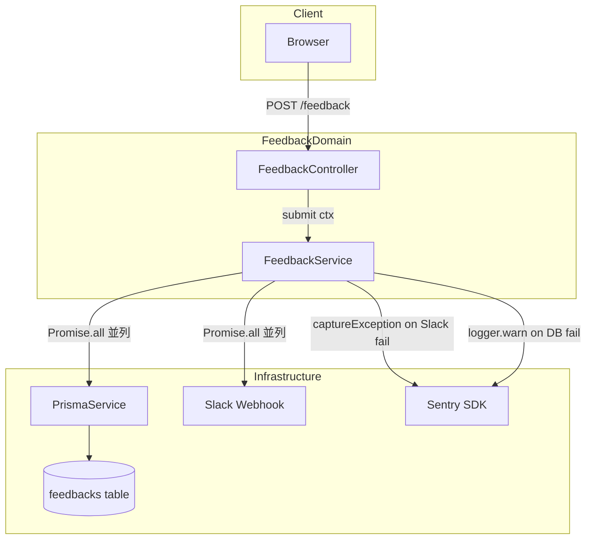
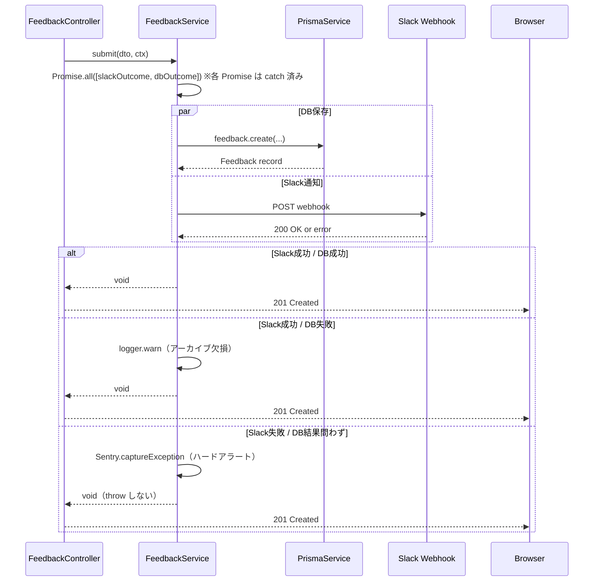
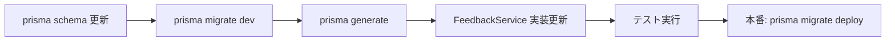

# Technical Design — feedback-db-persistence

## Overview

本機能は、既存のフィードバック提出フロー（Slack Webhook 通知）に、PostgreSQL（Supabase）への永続化を追加する拡張である。ユーザーが `POST /feedback` を呼び出すと、Slack 通知と DB 保存が並列実行され（catch ラップした各 Promise を `Promise.all` で待ち合わせ）、いずれかが失敗しても独立したエラーハンドリングによってサービスの継続性が保たれる。

Slack 通知を**必須レッグ**（運用上フィードバックに気づくための主経路）、DB 保存を**補助レッグ**（検索・集計用のアーカイブ）と位置づける。どちらの失敗も呼び出し元へ throw せず応答は 201 を維持するが、監視の重みを変える：Slack 失敗は `Sentry.captureException` でハードアラート、DB 失敗は `logger.warn` のみ。よって本機能の副作用に起因する HTTP 500 は発生しない。

### Goals

- フィードバックを `feedbacks` テーブルへ best-effort で永続化し、将来の管理画面・傾向分析の基盤を整備する（DB は補助レッグ）
- Slack 通知（必須レッグ）の失敗を Sentry で確実に検知できる設計にする
- DB 保存失敗・Slack 失敗のいずれもユーザーの送信を失敗（500）にせず、201 を維持する
- 既存テストが壊れず、新しい保存ロジックをユニットテストで検証できる設計にする

### Non-Goals

- 管理画面・フィードバック閲覧 API の実装（本機能は保存基盤のみ）
- フィードバックの編集・削除
- Slack 以外の通知チャンネル追加

---

## Architecture

### Existing Architecture Analysis

現在の `FeedbackController → FeedbackService` フローは以下の通り:

- `FeedbackService` の依存は `ConfigService` のみ
- `submit(dto, sender: { name; email })` は Slack Webhook へのみ送信し `void` を返す
- Slack URL 未設定時は早期 return
- Slack 失敗時は `Sentry.captureException` で記録し例外を飲み込む（呼び出し元には伝播しない）

本機能では以下を変更する:

- `FeedbackModule` に `PrismaModule` を追加 import
- `FeedbackService` に `PrismaService` を注入
- `submit()` のコンテキスト引数を `FeedbackSubmitContext`（`userId` 追加）に変更
- Slack 通知を `private sendToSlack()` に抽出し、DB 保存との並列実行に対応

### Architecture Pattern & Boundary Map



**Architecture Integration**:

- **選択パターン**: 並列副作用 + 独立エラーハンドリング（catch ラップ済み Promise を `Promise.all` で待ち合わせ。各 Promise が自分の結果を named outcome で運び、配列順序に依存しない）
- **ドメイン境界**: feedback ドメイン内で完結。他ドメインへの依存なし
- **保持パターン**: グローバル JWT Guard・`PrismaModule` import パターン・Sentry タグ契約（`feature_area: 'system'`）
- **新規コンポーネント**: Prisma `Feedback` モデル（`feedbacks` テーブル）のみ
- **Steering 準拠**: API コールは `PrismaService` 経由。直接 `PrismaClient` 利用禁止。エラー監視は Sentry

### Technology Stack

| Layer          | Choice / Version                   | Role in Feature             | Notes                     |
| -------------- | ---------------------------------- | --------------------------- | ------------------------- |
| Backend        | NestJS 11 / TypeScript             | FeedbackService 拡張        | 既存                      |
| Data / Storage | Prisma ORM + PostgreSQL (Supabase) | feedbacks テーブルへの CRUD | Feedback モデルを新規追加 |
| Infrastructure | @sentry/nestjs                     | DB 失敗時の例外補足         | 既存 Sentry 統合を流用    |

---

## System Flows



> どちらのレッグの失敗でも例外は throw せず 201 を返す。違いは監視の重み：Slack（必須）失敗は `Sentry.captureException`、DB（補助）失敗は `logger.warn`。Slack URL 未設定時は `sendToSlack()` が即座に resolve する（失敗扱いにしない）。本機能の副作用に起因する 500 は発生しない。

---

## Requirements Traceability

| Requirement | Summary                                                      | Components         | Interfaces                                          | Flows              |
| ----------- | ------------------------------------------------------------ | ------------------ | --------------------------------------------------- | ------------------ |
| 1.1         | Feedback モデルに id・userId・category・message・createdAt   | Feedback モデル    | Prisma スキーマ                                     | —                  |
| 1.2         | userId は User への必須 FK                                   | Feedback モデル    | Prisma スキーマ                                     | —                  |
| 1.3         | @@map("feedbacks") でテーブル名を指定                        | Feedback モデル    | Prisma スキーマ                                     | —                  |
| 1.4         | User 削除時カスケード削除                                    | Feedback モデル    | onDelete: Cascade                                   | —                  |
| 1.5         | createdAt に @default(now())                                 | Feedback モデル    | Prisma スキーマ                                     | —                  |
| 2.1         | POST /feedback で feedbacks テーブルへ保存                   | FeedbackService    | prisma.feedback.create                              | DB保存フロー       |
| 2.2         | 保存レコードに userId・category・message を含む              | FeedbackService    | FeedbackSubmitContext                               | DB保存フロー       |
| 2.3         | DB 保存成功時に 201 を返す                                   | FeedbackController | submit() void return                                | DB保存フロー       |
| 2.4         | Slack と DB を並列実行（allSettled 相当）※                   | FeedbackService    | sendToSlack() / prisma.create()                     | シーケンス図全体   |
| 3.1         | DB 失敗時も Slack 通知を継続し 201（DB 失敗は logger.warn）  | FeedbackService    | dbOutcome のエラー分岐                              | DB失敗分岐         |
| 3.2         | Slack 失敗時も DB 保存を継続し 201、Slack 失敗を Sentry 送信 | FeedbackService    | slackOutcome のエラー分岐 + Sentry.captureException | Slack失敗分岐      |
| 3.3         | Slack 失敗は Sentry、DB 失敗は logger.warn                   | FeedbackService    | Sentry / Logger                                     | エラーハンドリング |
| 3.4         | Slack URL 未設定時は DB 保存のみ（Slack 失敗扱いにしない）   | FeedbackService    | sendToSlack() early resolve                         | —                  |
| 4.1         | message 空/超過→400、DB 保存なし                             | CreateFeedbackDto  | @IsNotEmpty / @MaxLength(1000)                      | —                  |
| 4.2         | category 不正→400、DB 保存なし                               | CreateFeedbackDto  | @IsEnum(FeedbackCategory)                           | —                  |
| 4.3         | 未認証→401、DB 保存なし                                      | JWT Guard (global) | JwtAuthGuard                                        | —                  |
| 4.4         | レート超過→429、DB 保存なし                                  | FeedbackController | @Throttle({ limit: 3, ttl: 60000 })                 | —                  |
| 5.1         | PrismaService を DI で受け取りモック可能                     | FeedbackService    | constructor injection                               | —                  |
| 5.2         | Slack成功・DB成功→void                                       | FeedbackService    | submit() return type                                | —                  |
| 5.3         | DB失敗（Slack成功）→例外なし void、logger.warn               | FeedbackService    | dbOutcome 分岐                                      | —                  |
| 5.4         | Slack失敗→例外なし void、Sentry 記録のみ                     | FeedbackService    | slackOutcome 分岐                                   | —                  |

> ※ 要件 2.4 は `Promise.allSettled` を例示するが、本設計では「各 Promise を `.then(onFulfilled, onRejected)` で catch ラップし `Promise.all` で待ち合わせる」方式を採用する。両者は「全 Promise の完了を待ち、いずれの失敗も他方をキャンセルせず、待ち合わせ自体は reject しない」という点で**意味的に等価**であり、加えて結果を named outcome に束縛することで配列順序への依存を排除できる（#1 対策）。要件の挙動的意図は満たすため再承認は不要と判断。

---

## Components and Interfaces

| Component                | Domain / Layer       | Intent                                                                                    | Req Coverage | Key Dependencies                       | Contracts |
| ------------------------ | -------------------- | ----------------------------------------------------------------------------------------- | ------------ | -------------------------------------- | --------- |
| FeedbackService          | Backend / Service    | Slack（必須）+ DB（補助）への並列提出と独立エラーハンドリング（throw せず監視重みで区別） | 2, 3, 5      | PrismaService (P0), ConfigService (P1) | Service   |
| FeedbackController       | Backend / Controller | HTTP ハンドリングと FeedbackService への委譲                                              | 2.3, 4       | FeedbackService (P0)                   | API       |
| FeedbackModule           | Backend / Module     | FeedbackDomain の DI 構成                                                                 | 5.1          | PrismaModule (P0)                      | —         |
| Feedback (Prisma モデル) | Data / Schema        | feedbacks テーブルのスキーマ定義                                                          | 1            | User モデル (P0)                       | State     |
| CreateFeedbackDto        | Backend / DTO        | リクエストのバリデーション                                                                | 4.1, 4.2     | class-validator                        | —         |

### Backend / Service

#### FeedbackService

| Field        | Detail                                                                                    |
| ------------ | ----------------------------------------------------------------------------------------- |
| Intent       | Slack 通知（必須）と DB 保存（補助）を並列実行し、どちらも throw せず監視の重みで区別する |
| Requirements | 2.1, 2.2, 2.4, 3.1, 3.2, 3.3, 3.4, 5.1–5.4                                                |

**Responsibilities & Constraints**

- `submit()` で Slack 通知（必須）と DB 保存（補助）を並列実行（catch ラップ済み Promise を `Promise.all` で待ち合わせ、named outcome で結果を判定）
- Slack 失敗時は `Sentry.captureException`（`feature_area: 'system'`）でハードアラート。**throw しない**
- DB 失敗は `logger.warn` のみ。**throw しない**
- いずれの副作用失敗でも `submit()` は `void` で resolve し、コントローラーは 201 を返す
- `PrismaService` を constructor injection で受け取る（モック置換可能）

**Dependencies**

- Inbound: FeedbackController — submit 呼び出し（P0）
- Outbound: PrismaService — `feedback.create()` DB 保存（P0）
- Outbound: ConfigService — Slack Webhook URL 取得（P1）
- External: Slack Webhook — HTTP POST 通知（P1）
- External: Sentry SDK — 例外補足（P1）

**Contracts**: Service [x] / API [ ] / Event [ ] / Batch [ ] / State [ ]

##### Service Interface

```typescript
interface FeedbackSubmitContext {
	userId: string;
	name: string;
	email: string;
}

interface FeedbackServiceInterface {
	submit(
		dto: { category: FeedbackCategory; message: string },
		context: FeedbackSubmitContext,
	): Promise<void>;
}
```

- Preconditions: `dto.category` が `FeedbackCategory` 列挙値のいずれか、`dto.message` が 1〜1000 文字、`context.userId` が有効なユーザー ID
- Postconditions: DB 保存成功時は `feedbacks` レコードが作成される。**Slack 失敗・DB 失敗のいずれも例外を throw せず `void` で resolve する**（必須レッグの Slack 失敗は Sentry で、補助レッグの DB 失敗は `logger.warn` で記録するのみ）。よって本サービス起因の 500 は発生しない
- Invariants: Slack 失敗と DB 失敗は独立して処理される。どちらの失敗も他方の処理をキャンセルせず、また応答（201）にも影響しない

**Implementation Notes**

- `sendToSlack(dto, context)` を private メソッドに抽出し、URL 未設定時は `Promise.resolve()` を返す（早期 resolve）
- **並列実行は維持しつつ、配列順序への依存を排除する**。各 Promise を「自分の結果を名前付きで運ぶ outcome オブジェクト」に `.then(onFulfilled, onRejected)` でラップしてから `Promise.all` する。こうすると配列の並び順を入れ替えても Slack の結果は常に `slackOutcome` に紐づくため、要件の「インデックス取り違えで Slack 失敗（必須レッグ）が warn に降格される」致命的バグが構造的に発生しなくなる。

  ```typescript
  // Slack は必須・DB は補助。それぞれ独立に settle させ、結果を named outcome に束縛する
  const slackOutcome = this.sendToSlack(dto, ctx).then(
  	() => ({ ok: true as const }),
  	(error: unknown) => ({ ok: false as const, error }),
  );
  const dbOutcome = this.prisma.feedback
  	.create({
  		data: {
  			userId: ctx.userId,
  			category: dto.category as PrismaFeedbackCategory,
  			message: dto.message,
  		},
  	})
  	.then(
  		() => ({ ok: true as const }),
  		(error: unknown) => ({ ok: false as const, error }),
  	);

  // 両者はすでに catch 済みなので Promise.all は reject しない（並列性は allSettled と等価）
  const [slack, db] = await Promise.all([slackOutcome, dbOutcome]);

  // Slack（必須）失敗 → Sentry でハードアラート。ただし throw はせず 201 を維持
  if (!slack.ok) {
  	Sentry.captureException(slack.error, { tags: { feature_area: 'system' } });
  }
  // DB（補助）失敗 → logger.warn のみ。アーカイブ欠損は Slack 通知が飛んでいるため気づける
  if (!db.ok) {
  	this.logger.warn('フィードバックの DB 保存に失敗しました', db.error);
  }
  // いずれも throw しないため submit() は常に void で resolve（コントローラーは 201 を返す）
  ```

- Slack 失敗時は `Sentry.captureException` に `{ feature_area: 'system' }` タグを付与してハードアラート。DB 失敗は `logger.warn` のみ。**どちらの失敗でも throw しない**

> **設計判断（#4 / 優先度反転）**: Slack 通知を**必須レッグ**、DB 保存を**補助レッグ**とする。理由は「日々フィードバックに気づいて対応する経路は Slack であり、通知の取りこぼしが最も痛い。DB は検索・集計用のアーカイブで、書き込み失敗してもユーザーの送信を失敗扱いにする必要はない」ため。Slack と DB は `Promise.all`（catch ラップ済み）で**並列実行**する（レイテンシは Slack の 5 秒タイムアウトが支配的で直列との差は僅少だが、形を踏襲）。**本機能は副作用失敗で 500 を返さない**：Slack 失敗は Sentry でチームに気づかせ、DB 失敗は warn で記録するのみ。トレードオフとして「Slack には通知されたが DB アーカイブには無いフィードバック」が DB 障害時に発生しうることを許容する。

> **#2 注意 — `sendToSlack()` は失敗時に必ず throw すること**: 既存実装（`feedback.service.ts`）は fetch 失敗を内部 `try/catch` で握りつぶし `Sentry.captureException` していたが、新設計では `slackOutcome` の reject 分岐で捕捉して Sentry へ送るため、**内部の `try/catch` と Sentry 送信を削除し、エラーを呼び出し元へ伝播させる**（Sentry 送信は `submit()` 側の `!slack.ok` 分岐に一本化）。`try` を残したまま抽出すると `slackOutcome` が常に `ok: true` となり Sentry アラート分岐がデッドコード化する。`clearTimeout` のための `finally` のみ残す。

> **#3 注意 — fetch の HTTP エラーを検知すること**: `fetch` はネットワーク断・タイムアウト（AbortError）でしか reject しないため、Slack が HTTP 4xx/5xx を返しても `await fetch` は resolve してしまう。`sendToSlack()` 内で **`if (!res.ok) throw new Error(...)` を追加**し、Slack 側のエラーレスポンスも失敗として（必須レッグなので）Sentry アラートに乗せること。

### Backend / Controller

#### FeedbackController

| Field        | Detail                                                                       |
| ------------ | ---------------------------------------------------------------------------- |
| Intent       | HTTP リクエストを受け取り userId を含むコンテキストを FeedbackService に渡す |
| Requirements | 2.3, 4.1, 4.2, 4.3, 4.4                                                      |

**Responsibilities & Constraints**

- `req.user.id` を `context.userId` として `submit()` に渡す
- バリデーション（DTO）とレート制限（`@Throttle`）は既存の実装を維持
- JWT Guard はグローバル適用済み（要件 4.3 をコードレスで充足）

**Contracts**: Service [ ] / API [x] / Event [ ] / Batch [ ] / State [ ]

##### API Contract

| Method | Endpoint  | Request           | Response | Errors                                                                                    |
| ------ | --------- | ----------------- | -------- | ----------------------------------------------------------------------------------------- |
| POST   | /feedback | CreateFeedbackDto | 201 void | 400 (validation), 401 (auth), 429 (rate limit) ※副作用失敗（Slack/DB）では 500 を返さない |

**Implementation Notes**

- `submit()` 呼び出しを `{ userId: req.user.id, name: user.name ?? '', email: user.email }` に変更
- `feedback.controller.spec.ts` のアサーションを `userId` 追加後の期待値に更新する必要あり

### Backend / Module

#### FeedbackModule

| Field        | Detail                                          |
| ------------ | ----------------------------------------------- |
| Intent       | FeedbackDomain の DI 構成に PrismaModule を追加 |
| Requirements | 5.1                                             |

**Implementation Notes**

- `imports: [PrismaModule]` を追加するだけで完結。`ConfigModule` はグローバル設定済みのため追加不要

---

## Data Models

### Domain Model

`Feedback` は `User` の所有物であり、ユーザーが提出したフィードバック1件を表す値オブジェクト相当のエンティティ。編集・削除は本フェーズのスコープ外。User 削除時はカスケード削除される。

### Logical Data Model

```
User (1) ──── (N) Feedback
  id: String              id: String (cuid)
  email: String           userId: String (FK → User.id)
  ...                     category: FeedbackCategory
                          message: String (1–1000 chars)
                          createdAt: DateTime
```

- `userId` は `NOT NULL`、`User.id` への外部キー
- `onDelete: Cascade` により User 削除時に関連 Feedback を自動削除
- `createdAt` はサーバー側で `now()` を自動付与（クライアント指定不可）

### Physical Data Model

```prisma
enum FeedbackCategory {
  bug
  improvement
  other
}

model Feedback {
  id        String           @id @default(cuid())
  userId    String           @map("user_id")
  category  FeedbackCategory
  message   String
  createdAt DateTime         @default(now()) @map("created_at")
  user      User             @relation(fields: [userId], references: [id], onDelete: Cascade)

  @@map("feedbacks")
}
```

> **注意**: プロジェクト全体の ID 規約は `cuid()` であるため、要件 1.1 の「UUID」は `cuid()` で代替する。Prisma が生成する cuid は一意性・衝突耐性の点で UUID と同等の用途を果たす。

> **実装時の注意 — FeedbackCategory 型の命名衝突**: Prisma が `@prisma/client` に同名の `FeedbackCategory` 型を生成するため、`FeedbackService` では以下のようにエイリアスインポートして型互換を担保すること。TypeScript の string enum は `'bug' | 'improvement' | 'other'` に直接代入不可（nominal 型）なので型アサーションが必要。
>
> ```typescript
> import { FeedbackCategory as PrismaFeedbackCategory } from '@prisma/client';
> // ...
> this.prisma.feedback.create({
> 	data: {
> 		userId: ctx.userId,
> 		category: dto.category as PrismaFeedbackCategory,
> 		message: dto.message,
> 	},
> });
> ```

**User モデルへの追記**:

```prisma
model User {
  ...
  feedbacks  Feedback[]
}
```

**インデックス戦略**: 現フェーズでは追加インデックス不要。管理画面でのユーザー別・期間別フィルタリングが必要になった段階で `@@index([userId])` / `@@index([createdAt])` を検討する。

### Data Contracts & Integration

**API Request Payload**（既存 DTO、変更なし）:

```typescript
interface CreateFeedbackDto {
	category: 'bug' | 'improvement' | 'other';
	message: string; // 1–1000 文字
}
```

**DB Insert Payload**:

```typescript
interface FeedbackCreateInput {
	userId: string;
	category: FeedbackCategory;
	message: string;
}
```

---

## Error Handling

### Error Strategy

Slack 通知は運用上フィードバックに気づくための**必須レッグ**であり、失敗時は `Sentry.captureException` でハードアラートを上げてチームに即時通知する。DB 保存は検索・集計用の**補助レッグ**であり、失敗は `logger.warn` で記録するのみ。**どちらの失敗も呼び出し元へ throw せず 201 を維持する**（副作用失敗で 500 は返さない）。ユーザーの送信を失敗扱いにしないことで再送による DB 二重保存も防ぐ。

### Error Categories and Responses

**User Errors (4xx)**:

| Status | Condition                | Handler                                             |
| ------ | ------------------------ | --------------------------------------------------- |
| 400    | message 空 / 1000 文字超 | `CreateFeedbackDto` の `@IsNotEmpty` / `@MaxLength` |
| 400    | category が enum 外      | `CreateFeedbackDto` の `@IsEnum`                    |
| 401    | 未認証リクエスト         | グローバル JWT Guard                                |
| 429    | 1分3件超過               | `@Throttle({ limit: 3, ttl: 60000 })`               |

**System Errors (5xx)**: なし。本機能の副作用（Slack 通知・DB 保存）の失敗では 500 を返さず、常に 201 を返す。

**副作用失敗（非エラー応答、いずれも 201）**:

| 失敗レッグ         | 重み           | Handler                                                                              |
| ------------------ | -------------- | ------------------------------------------------------------------------------------ |
| Slack 通知（必須） | ハードアラート | `Sentry.captureException(err, { tags: { feature_area: 'system' } })`（throw しない） |
| DB 保存（補助）    | ソフト記録     | `this.logger.warn('フィードバックの DB 保存に失敗しました', reason)`                 |

### Monitoring

- Slack 失敗: `Sentry.captureException` に `feature_area: 'system'` タグを付与（既存タグ契約準拠）。**必須レッグなのでチームが確実に気づける**
- DB 失敗: `this.logger.warn('フィードバックの DB 保存に失敗しました', reason)` で記録（補助レッグ。Slack 通知が飛んでいるためフィードバック自体は気づける。Sentry ノイズ削減のため warn のみ）
- 正常系: 追加ロギング不要（Sentry トレースで確認可能）

---

## Testing Strategy

### Unit Tests（FeedbackService）

1. Slack 成功・DB 成功 → `void` を返す（throw なし）
2. DB 失敗・Slack 成功 → `logger.warn` が呼ばれ、`Sentry.captureException` は呼ばれず、例外も throw されず `void` を返す
3. Slack 失敗・DB 成功 → `Sentry.captureException` が `feature_area: 'system'` で呼ばれ、`logger.warn`（DB 用）は呼ばれず、**例外は throw されず `void` を返す**
4. Slack URL 未設定 → DB 保存のみ実行され、Slack fetch が呼ばれず、Slack 失敗扱い（Sentry）にもならない
5. DB 成功時に `userId`・`category`・`message` が正しい値で `prisma.feedback.create` に渡される
6. **（#1 回帰）Slack 失敗・DB 成功 → Slack の失敗が `logger.warn` に降格されず、`Sentry.captureException` が呼ばれること**（named outcome により配列順序に依存せず Slack 失敗が必須レッグとして正しく扱われることの担保）
7. **（#1 回帰）DB 失敗・Slack 成功 → DB の失敗が Sentry に昇格せず `logger.warn` のみで `void` を返すこと**（6 と対で、両副作用の重み付けが入れ替わらないことを確認）
8. **（#3 回帰）Slack が HTTP 4xx/5xx（`res.ok === false`）を返した場合 → `sendToSlack()` が throw し `Sentry.captureException` が呼ばれること**（fetch がネットワーク断以外でも失敗検知できることの担保）
9. **（#2 回帰）Slack fetch が reject（ネットワーク断・AbortError）した場合に `sendToSlack()` がエラーを握りつぶさず伝播し、`Sentry.captureException` が呼ばれること**

### Unit Tests（FeedbackController）

1. `req.user.id` が `context.userId` として `submit()` に渡されること
2. `req.user.name` が `undefined` のとき `name: ''` にフォールバックすること

### Integration Tests

1. `POST /feedback` で feedbacks テーブルにレコードが作成される（E2E）
2. Slack Webhook URL 未設定環境で `POST /feedback` が 201 を返す

### Migration Tests

1. `npx prisma migrate dev` が成功すること
2. `feedbacks` テーブルが作成され、FK 制約が有効なこと

---

## Migration Strategy



- **ロールバックトリガー**: `feedbacks` テーブル作成失敗または FK 制約エラー
- **ダウンタイム**: なし（新規テーブル追加のみ）
- **検証チェックポイント**: `prisma migrate status` でマイグレーション適用済みを確認後にデプロイ
