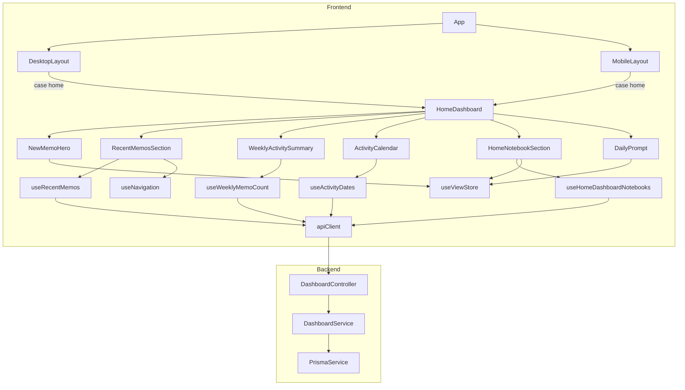
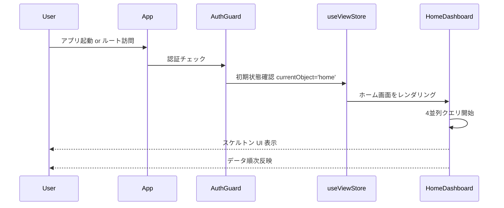
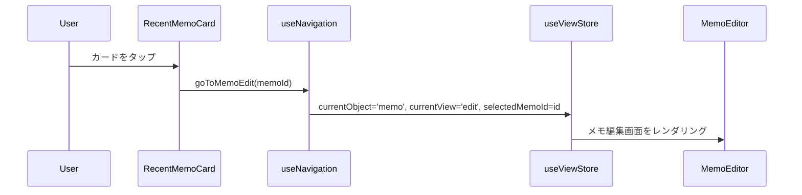

# Technical Design — home-dashboard

## Overview

ホーム画面（ランチャー＋ダッシュボード）機能は、認証済みユーザーが mosaku を開いたときに最初に迎える画面を提供する。「新規メモを書く」「前のメモに追記する」という2大ユースケースを1アクションで満たすプル型ナビゲーションと、今週の活動サマリー・書いた日カレンダー・ノートブック一覧・今日のお題を俯瞰できるダッシュボード機能を組み合わせる。

既存の `useViewStore` ビューシステムを最小差分で拡張し、新規 `DashboardModule`（バックエンド）と `useHomeDashboardQueries`（フロントエンド）を追加することで実現する。既存エンドポイント・ストア・コンポーネントへの破壊的変更は行わない。

### Goals

- 「新しいメモを書く」「直近のメモに追記する」を1アクションで完了できる起動体験
- セクションごとの独立ローディング・エラー処理による堅牢なダッシュボード
- 既存レイアウト・ナビゲーション設計との一貫した統合

### Non-Goals

- プッシュ通知・バッジなどの通知機能
- メモ本文の編集機能（ホーム画面上での inline 編集）
- 活動カレンダーの過去月への遡り操作
- 今日のお題のサーバーサイド管理・パーソナライズ

---

## Requirements Traceability

| Requirement | Summary                                        | Components                                          | Interfaces                       | Flows                 |
| ----------- | ---------------------------------------------- | --------------------------------------------------- | -------------------------------- | --------------------- |
| 1.1         | 認証済み起動時にホーム画面を最初に表示         | `useViewStore`（初期状態変更）、`HomeDashboard`     | `goToHome()`                     | App 初期化フロー      |
| 1.2         | テーマ CSS 変数に従ったスタイル                | `HomeDashboard`（既存 `theme-root` クラス適用）     | —                                | —                     |
| 1.3         | デスクトップ・モバイル両対応                   | `DesktopLayout`、`MobileLayout`（case 'home' 追加） | —                                | —                     |
| 1.4         | ローディング中スケルトン UI                    | 各セクションコンポーネント                          | React Query `isLoading`          | —                     |
| 1.5         | セクション独立エラー                           | 各セクションコンポーネント                          | 独立 `useQuery`                  | —                     |
| 2.1         | 新規メモ CTA を最上部に強調表示                | `NewMemoHero`                                       | —                                | —                     |
| 2.2         | CTA タップで新規メモ作成画面へ遷移             | `NewMemoHero`                                       | `goToMemoCreate()`               | ホーム → 新規メモ     |
| 2.3         | CTA は1タップで到達できる位置                  | `NewMemoHero`（画面最上部固定）                     | —                                | —                     |
| 3.1         | 直近5件を横スクロールカード表示                | `RecentMemosSection`、`RecentMemoCard`              | `useRecentMemos()`               | —                     |
| 3.2         | カードタップでメモ編集画面へ遷移               | `RecentMemoCard`                                    | `goToMemoEdit(id)`               | ホーム → メモ編集     |
| 3.3         | タイトル/冒頭テキスト + 最終更新日時           | `RecentMemoCard`                                    | `RecentMemoDto`                  | —                     |
| 3.4         | React Query 経由で取得、Zustand へのコピーなし | `useRecentMemos()`                                  | `GET /dashboard/recent-memos`    | —                     |
| 3.5         | 0件時に空状態 + 新規作成誘導                   | `RecentMemosSection`                                | —                                | —                     |
| 4.1         | 今週に作成または更新したメモ件数を表示         | `WeeklyActivitySummary`                             | `useWeeklyMemoCount()`           | —                     |
| 4.2         | 「今週 N個 書いたよ」形式の文言                | `WeeklyActivitySummary`                             | `WeeklyCountDto`                 | —                     |
| 4.3         | React Query 経由で取得                         | `useWeeklyMemoCount()`                              | `GET /dashboard/weekly-count`    | —                     |
| 4.4         | 0件時にプレッシャーを与えない空状態            | `WeeklyActivitySummary`                             | —                                | —                     |
| 5.1         | 直近期間を週グリッド + 書いた日ドット表示      | `ActivityCalendar`                                  | `useActivityDates()`             | —                     |
| 5.2         | React Query 経由で書いた日を取得               | `useActivityDates()`                                | `GET /dashboard/activity-dates`  | —                     |
| 5.3         | ストリーク強調表現を使用しない                 | `ActivityCalendar`（中立デザイン）                  | —                                | —                     |
| 5.4         | createdAt / updatedAt のいずれかを使用         | `DashboardService.getActivityDates()`               | —                                | —                     |
| 6.1         | 件数付きノートブック一覧を表示                 | `HomeNotebookSection`                               | `useHomeDashboardNotebooks()`    | —                     |
| 6.2         | ノートブックタップでメモ一覧へ遷移             | `HomeNotebookSection`                               | `goToMemosForNotebook(id)`       | ホーム → ノートブック |
| 6.3         | React Query 経由で取得、Zustand へのコピーなし | `useHomeDashboardNotebooks()`                       | `GET /dashboard/notebooks`       | —                     |
| 6.4         | 0件時にノートブック作成誘導を表示              | `HomeNotebookSection`                               | —                                | —                     |
| 7.1         | お題セクションを画面下部・小サイズで表示       | `DailyPrompt`                                       | —                                | —                     |
| 7.2         | 静的リストからランダムに1件選択                | `DailyPrompt`（`constants/dailyPrompts.ts`）        | —                                | —                     |
| 7.3         | お題タップで初期入力付き新規メモ作成へ         | `DailyPrompt`                                       | `goToMemoCreate(initialContent)` | ホーム → 新規メモ     |
| 7.4         | 失敗時（空リスト等）はセクション非表示         | `DailyPrompt`                                       | —                                | —                     |

---

## Architecture

### Existing Architecture Analysis

- `useViewStore` の `currentObject: ObjectType` + `currentView: ViewType` の組み合わせが画面遷移の唯一の状態源泉
- `DesktopLayout` / `MobileLayout` の `renderMainContent()` が switch 文でビューを切り替える
- 初期状態は `currentObject: 'memo', currentView: 'create'`（新規メモ作成画面からスタート）
- フロントエンドのサーバー状態は React Query が管理し、Zustand はUI状態（表示モード・選択中ID）専用
- バックエンドはドメインモジュール構造（`MemoModule`, `NotebookModule` 等）。横断的集計は既存モジュールを汚さない新規 `DashboardModule` に追加する

### Architecture Pattern & Boundary Map



**Architecture Integration**:

- 選択パターン: 既存ビューシステムへの最小差分拡張（`ObjectType` に `'home'` 追加）
- ドメイン境界: `DashboardModule` がメモ・ノートブック集計を一元担当。既存 `MemoModule` / `NotebookModule` は変更しない
- 既存パターン: React Query サーバー状態 / Zustand UI状態 / `apiClient` 経由呼び出し をすべて維持
- 新規コンポーネント: `HomeDashboard` とその配下セクション（6コンポーネント）、`DashboardModule`（バックエンド）、`useHomeDashboardQueries`（フックファイル1本）

### Technology Stack

| Layer                   | Choice / Version               | Role in Feature                                          | Notes                                    |
| ----------------------- | ------------------------------ | -------------------------------------------------------- | ---------------------------------------- |
| Frontend / UI           | React 19, Tailwind CSS 3       | `HomeDashboard` + セクションコンポーネント実装           | 既存スタック踏襲                         |
| Frontend / State        | Zustand（`useViewStore` 拡張） | `currentObject: 'home'` と `goToHome()` を追加           | Zustand へのサーバーデータコピー禁止     |
| Frontend / Server State | @tanstack/react-query          | `useHomeDashboardQueries.ts` で4フック定義・並列フェッチ | `queryKeys.dashboard.*` を追加           |
| Backend / API           | NestJS 11                      | `DashboardController`（4エンドポイント）                 | 新規 `DashboardModule`                   |
| Backend / DB            | Prisma ORM + PostgreSQL        | `DashboardService`（集計クエリ）                         | `_count`, `where updatedAt >= weekStart` |

---

## System Flows

### ホーム画面への初期ナビゲーション



### ホーム → メモ編集フロー



---

## Components and Interfaces

### Summary

| Component                 | Layer               | Intent                                  | Req Coverage            | Key Dependencies                     | Contracts |
| ------------------------- | ------------------- | --------------------------------------- | ----------------------- | ------------------------------------ | --------- |
| `HomeDashboard`           | UI Container        | ホーム画面の全セクションを統括          | 1.1, 1.2, 1.3, 1.4, 1.5 | `useViewStore`（P0）                 | State     |
| `NewMemoHero`             | UI                  | 新規メモ作成 CTA（画面最上部）          | 2.1, 2.2, 2.3           | `useNavigation`（P0）                | —         |
| `RecentMemosSection`      | UI                  | 直近5件メモ横スクロール                 | 3.1, 3.2, 3.3, 3.4, 3.5 | `useRecentMemos`（P0）               | —         |
| `RecentMemoCard`          | UI (presentational) | 1メモカードの表示                       | 3.3                     | —                                    | —         |
| `WeeklyActivitySummary`   | UI                  | 今週の件数テキスト表示                  | 4.1, 4.2, 4.3, 4.4      | `useWeeklyMemoCount`（P0）           | —         |
| `ActivityCalendar`        | UI                  | 書いた日ドット週グリッド                | 5.1, 5.2, 5.3, 5.4      | `useActivityDates`（P0）             | —         |
| `HomeNotebookSection`     | UI                  | 件数付きノートブック一覧                | 6.1, 6.2, 6.3, 6.4      | `useHomeDashboardNotebooks`（P0）    | —         |
| `DailyPrompt`             | UI                  | 今日のお題セクション                    | 7.1, 7.2, 7.3, 7.4      | `constants/dailyPrompts`（P1）       | —         |
| `useHomeDashboardQueries` | Hook                | ダッシュボード用 React Query 4フック    | 3.4, 4.3, 5.2, 6.3      | `apiClient`（P0）、`queryKeys`（P0） | Service   |
| `DashboardController`     | Backend             | 4つの集計エンドポイント                 | 3.4, 4.3, 5.2, 6.3      | `DashboardService`（P0）             | API       |
| `DashboardService`        | Backend             | Prisma 集計クエリのビジネスロジック     | 3.4, 4.3, 5.2, 6.3      | `PrismaService`（P0）                | Service   |
| `useViewStore`（拡張）    | Store               | `'home'` ObjectType + `goToHome()` 追加 | 1.1                     | —                                    | State     |

---

### Backend Layer

#### DashboardService

| Field        | Detail                                                         |
| ------------ | -------------------------------------------------------------- |
| Intent       | メモ・ノートブックにまたがるダッシュボード集計クエリを担当する |
| Requirements | 3.4, 4.3, 5.2, 6.3                                             |

**Responsibilities & Constraints**

- ユーザーに属するメモ・ノートブックのみを集計する（所有権フィルタ必須）
- `trashedAt IS NULL` のメモのみを対象とする（ゴミ箱メモを除外）
- 週の境界計算は JST（UTC+9）固定で行う

**Dependencies**

- Inbound: `DashboardController` — エンドポイント経由で呼び出し（P0）
- Outbound: `PrismaService` — DB クエリ（P0）

**Contracts**: Service [x] / API [ ] / Event [ ] / Batch [ ] / State [ ]

##### Service Interface

```typescript
interface RecentMemoDto {
	id: string;
	title: string;
	contentPreview: string;
	updatedAt: string;
}

interface WeeklyCountDto {
	count: number;
	weekStart: string;
	weekEnd: string;
}

interface ActivityDatesDto {
	dates: string[];
}

interface NotebookWithMemoCountDto {
	id: string;
	name: string | null;
	memoCount: number;
}

interface DashboardService {
	getRecentMemos(userId: string, limit: number): Promise<RecentMemoDto[]>;
	getWeeklyMemoCount(userId: string): Promise<WeeklyCountDto>;
	getActivityDates(userId: string, from: string, to: string): Promise<ActivityDatesDto>;
	getNotebooksWithMemoCount(userId: string): Promise<NotebookWithMemoCountDto[]>;
}
```

- Preconditions: `userId` は認証済みユーザーの ID（JWT から取得）。`from`/`to` は `YYYY-MM-DD` 形式
- Postconditions: ゴミ箱メモ（`trashedAt IS NOT NULL`）を除外した結果を返す
- Invariants: `_count.memos` は `trashedAt IS NULL` のメモのみをカウントする

**Implementation Notes**

- `getRecentMemos`: `ORDER BY updatedAt DESC LIMIT 5`。`content` は先頭100文字を `contentPreview` として返す
- `getWeeklyMemoCount`: 週の月曜0時〜日曜24時（JST）で `updatedAt >= weekStart AND updatedAt < weekEnd` を集計
- `getActivityDates`: `from`〜`to` の範囲で `createdAt` または `updatedAt` の日付（`YYYY-MM-DD` in JST）を重複排除して返す
- `getNotebooksWithMemoCount`: Prisma `_count: { memos: true }` と `where: { memos: { trashedAt: null } }` を組み合わせて件数集計

---

#### DashboardController

| Field        | Detail                                              |
| ------------ | --------------------------------------------------- |
| Intent       | ダッシュボード専用の 4 集計エンドポイントを提供する |
| Requirements | 3.4, 4.3, 5.2, 6.3                                  |

**Responsibilities & Constraints**

- グローバル JWT Guard による認証保護（`@Public()` を付与しない）
- バリデーション済みリクエストを `DashboardService` に転送し、レスポンスをそのまま返す

**Contracts**: Service [ ] / API [x] / Event [ ] / Batch [ ] / State [ ]

##### API Contract

| Method | Endpoint                                                  | Request                   | Response                     | Errors   |
| ------ | --------------------------------------------------------- | ------------------------- | ---------------------------- | -------- |
| GET    | `/dashboard/recent-memos`                                 | —                         | `RecentMemoDto[]`            | 401      |
| GET    | `/dashboard/weekly-count`                                 | —                         | `WeeklyCountDto`             | 401      |
| GET    | `/dashboard/activity-dates?from=YYYY-MM-DD&to=YYYY-MM-DD` | `from`, `to` query string | `ActivityDatesDto`           | 400, 401 |
| GET    | `/dashboard/notebooks`                                    | —                         | `NotebookWithMemoCountDto[]` | 401      |

---

### Frontend Hook Layer

#### useHomeDashboardQueries

| Field        | Detail                                             |
| ------------ | -------------------------------------------------- |
| Intent       | ホーム画面用4クエリを提供する React Query フック群 |
| Requirements | 3.4, 4.3, 5.2, 6.3                                 |

**Responsibilities & Constraints**

- サーバー状態は Zustand にコピーしない
- 各フックは独立して `isLoading`, `isError`, `data` を返す

**Dependencies**

- Inbound: `HomeDashboard` 配下の各セクションコンポーネント（P0）
- Outbound: `apiClient`（P0）、`queryKeys.dashboard.*`（P0）

**Contracts**: Service [x] / API [ ] / Event [ ] / Batch [ ] / State [ ]

##### Service Interface

```typescript
export function useRecentMemos(): UseQueryResult<RecentMemoDto[], ApiError>;

export function useWeeklyMemoCount(): UseQueryResult<WeeklyCountDto, ApiError>;

export function useActivityDates(
	from: string,
	to: string,
): UseQueryResult<ActivityDatesDto, ApiError>;

export function useHomeDashboardNotebooks(): UseQueryResult<NotebookWithMemoCountDto[], ApiError>;
```

**Implementation Notes**

- `queryKeys.dashboard` に以下を追加: `recentMemos()`, `weeklyCount()`, `activityDates(from, to)`, `notebooks()`
- `staleTime`: 5分（`ENTITY_CACHE_CONFIG` の既存設定に準拠）
- `useActivityDates` の `from`/`to` はコンポーネント側で直近35日分を計算して渡す

---

### Frontend Store Layer

#### useViewStore（拡張）

| Field        | Detail                                                                                 |
| ------------ | -------------------------------------------------------------------------------------- |
| Intent       | `'home'` ObjectType と `goToHome()` アクションを追加し、初期状態をホーム画面に変更する |
| Requirements | 1.1                                                                                    |

**Contracts**: Service [ ] / API [ ] / Event [ ] / Batch [ ] / State [x]

##### State Management

```typescript
// types/memo.ts への追加
export type ObjectType = 'memo' | 'notebook' | 'tag' | 'theme' | 'home';

// useViewStore.ts への追加
interface ViewState {
  // ...既存フィールド...
  goToHome: () => void;
}

// 初期状態変更
currentObject: 'home',
currentView: 'list',

// 追加アクション
goToHome: () => set({ currentObject: 'home', currentView: 'list', isEditing: false }),
```

- State model: `currentObject: 'home'` でホーム画面を表す。`currentView` は任意（ホームは単一ビュー）
- Persistence: Zustand デフォルト（永続化なし）
- Concurrency: 既存パターン踏襲

---

### Frontend UI Layer

#### HomeDashboard

| Field        | Detail                                                           |
| ------------ | ---------------------------------------------------------------- |
| Intent       | ホーム画面の全セクションを縦積みで構成するコンテナコンポーネント |
| Requirements | 1.1, 1.2, 1.3, 1.4, 1.5                                          |

**Responsibilities & Constraints**

- テーマ CSS 変数の適用（既存 `theme-root` クラスはレイアウト側で適用済みのため追加不要）
- セクション間にスクロール可能な縦レイアウトを提供する
- 各セクションは独立してローディング・エラーを表示する（`HomeDashboard` 自体はエラーバウンダリを持たない）

**Implementation Notes**

- `frontend/src/components/home/HomeDashboard.tsx` に配置
- 配下コンポーネント: `NewMemoHero`, `RecentMemosSection`, `WeeklyActivitySummary`, `ActivityCalendar`, `HomeNotebookSection`, `DailyPrompt`

---

#### NewMemoHero（presentational）

| Field        | Detail                                             |
| ------------ | -------------------------------------------------- |
| Intent       | 「新しいメモを書く」CTA を画面最上部に強調表示する |
| Requirements | 2.1, 2.2, 2.3                                      |

**Implementation Notes**

- `onClick` で `useNavigation().goToMemoCreate()` を呼び出す
- ボタンはテーマ `--primary-color` CSS 変数を使用して強調スタイルを適用

---

#### RecentMemosSection

| Field        | Detail                                                              |
| ------------ | ------------------------------------------------------------------- |
| Intent       | 直近5件メモを横スクロールカードで表示し、タップで編集画面へ遷移する |
| Requirements | 3.1, 3.2, 3.3, 3.4, 3.5                                             |

**Implementation Notes**

- `useRecentMemos()` の `isLoading` 中はスケルトンカード（幅固定の灰色矩形）を3枚表示
- `data` が空配列の場合は「まだメモがありません」＋`NewMemoHero` へのインラインリンクを表示
- 各カードタップで `useNavigation().goToMemoEdit(memo.id)` を呼び出す

---

#### RecentMemoCard（presentational）

| Field        | Detail                                                      |
| ------------ | ----------------------------------------------------------- |
| Intent       | タイトル・冒頭テキスト・最終更新日時を表示する1件分のカード |
| Requirements | 3.3                                                         |

**Extends**: 共通カード基底 Props（`id`, `title`, `contentPreview`, `updatedAt`, `onClick`）

---

#### WeeklyActivitySummary（presentational）

| Field        | Detail                                                  |
| ------------ | ------------------------------------------------------- |
| Intent       | 今週書いたメモ件数を「今週 N個 書いたよ」形式で表示する |
| Requirements | 4.1, 4.2, 4.3, 4.4                                      |

**Implementation Notes**

- `useWeeklyMemoCount()` の `isLoading` 中はテキストスケルトンを表示
- `count === 0` の場合は「今週はまだ書いていないよ」など強制感のない文言を使用

---

#### ActivityCalendar

| Field        | Detail                                                         |
| ------------ | -------------------------------------------------------------- |
| Intent       | 直近35日間の書いた日をドット付きの週グリッドで中立的に表示する |
| Requirements | 5.1, 5.2, 5.3, 5.4                                             |

**Implementation Notes**

- `useActivityDates(from, to)` を呼び出す。`from`/`to` はマウント時に直近35日（当日 - 34日 〜 当日）を計算
- CSS Grid（7列 × 5行）でカレンダーグリッドを実装。アクティブ日はドット（小円）でマーク
- 炎アイコン・連続日数・色による強調表現は使用しない（灰色系の単色ドット）

---

#### HomeNotebookSection

| Field        | Detail                                                                         |
| ------------ | ------------------------------------------------------------------------------ |
| Intent       | 件数付きノートブック一覧を表示し、タップで該当ノートブックのメモ一覧へ遷移する |
| Requirements | 6.1, 6.2, 6.3, 6.4                                                             |

**Implementation Notes**

- `useHomeDashboardNotebooks()` を使用
- 各項目タップで `useViewStore().goToMemosForNotebook(notebook.id)` を呼び出す
- 0件時は「ノートブックがありません」＋ノートブック作成ナビゲーションへのリンクを表示

---

#### DailyPrompt（presentational）

| Field        | Detail                                                                             |
| ------------ | ---------------------------------------------------------------------------------- |
| Intent       | 今日のお題を画面下部に小サイズで表示し、タップで初期入力付き新規メモ作成へ遷移する |
| Requirements | 7.1, 7.2, 7.3, 7.4                                                                 |

**Implementation Notes**

- `constants/dailyPrompts.ts` の静的配列から日付シード（`YYYY-MM-DD` の数値ハッシュ）で1件選択
- 配列が空または選択が `undefined` の場合はコンポーネントを `null` 返しで非表示
- タップ時: `goToMemoCreate()` を呼び出し、選択したお題テキストを初期 `title` に設定する方式は `MemoEditor` の初期値 Props で受け取る（`MemoEditor` の既存 `isCreate` Props に追加として `initialTitle?: string` を検討するが、実装タスクで確定）

---

## Data Models

### Domain Model

- **DashboardAggregate**: ユーザー1名のダッシュボード表示用集計。集計対象は `Memo`（`trashedAt IS NULL`）と `Notebook`。トランザクション境界は持たない（読み取り専用）
- **ActivityDate**: メモの `createdAt` / `updatedAt` を JST 換算した `YYYY-MM-DD` 文字列。ユニーク日付の集合

### Logical Data Model

既存の `Memo` / `Notebook` エンティティを読み取り専用で集計する。スキーマ変更なし。

- `Memo`: `id`, `title`, `content`, `createdAt`, `updatedAt`, `trashedAt`, `userId`（既存）
- `Notebook`: `id`, `name`, `userId`（既存）、`memos` リレーション経由で件数取得

### Data Contracts & Integration

**API Data Transfer**

```typescript
// GET /dashboard/recent-memos
type RecentMemoDto = {
	id: string;
	title: string;
	contentPreview: string; // content 先頭 100 文字
	updatedAt: string; // ISO 8601
};

// GET /dashboard/weekly-count
type WeeklyCountDto = {
	count: number;
	weekStart: string; // YYYY-MM-DD (JST 月曜)
	weekEnd: string; // YYYY-MM-DD (JST 日曜)
};

// GET /dashboard/activity-dates?from=YYYY-MM-DD&to=YYYY-MM-DD
type ActivityDatesDto = {
	dates: string[]; // YYYY-MM-DD[] (JST), 重複なし昇順
};

// GET /dashboard/notebooks
type NotebookWithMemoCountDto = {
	id: string;
	name: string | null;
	memoCount: number;
};
```

- バリデーション: `from`/`to` クエリパラメータは `YYYY-MM-DD` 形式を `class-validator` で検証
- シリアライゼーション: JSON。日付は ISO 文字列（フロントエンドで `new Date()` 変換）

---

## Error Handling

### Error Strategy

各セクションが独立した React Query `useQuery` を持つため、1セクションのエラーが他セクションに伝播しない（1.5 の実現）。セクションコンポーネントは `isError` フラグを参照してエラーメッセージと再試行ボタンをインライン表示する。

### Error Categories and Responses

**User Errors (4xx)**:

- 401 Unauthorized → `AuthGuard` がログイン画面へリダイレクト（既存機構）

**System Errors (5xx)**:

- 各セクションが `isError === true` のとき「データを取得できませんでした（再試行）」を表示
- 他のセクションは正常表示を維持する

**Business Logic**:

- `DailyPrompt`: 静的配列なのでランタイムエラーは発生しない。配列空の場合は `null` 返しで非表示

### Monitoring

- Sentry `feature_area` タグ: 既存 enum に `'dashboard'` を追加（`dashboard` が該当する Sentry 構造化タグ契約に従う）
- バックエンドエラーは NestJS 例外フィルタ経由で Sentry に自動送信（既存設定）

---

## Testing Strategy

### Unit Tests

- `DashboardService.getRecentMemos()`: 件数制限・`trashedAt` 除外・降順ソートの確認
- `DashboardService.getWeeklyMemoCount()`: 週境界（月曜0時〜日曜23:59 JST）の確認・0件ケース
- `DashboardService.getActivityDates()`: `createdAt`/`updatedAt` 両方から日付抽出・重複排除・昇順
- `DashboardService.getNotebooksWithMemoCount()`: `trashedAt IS NULL` メモのみカウント
- `useHomeDashboardQueries`: 各フックが正しいエンドポイントを呼び出すことのモックテスト

### Integration Tests

- `GET /dashboard/recent-memos` → 認証なし(401)、認証あり(200)、他ユーザーのメモが含まれない
- `GET /dashboard/weekly-count` → 今週外のメモが件数に含まれない
- `GET /dashboard/activity-dates` → `from`/`to` バリデーション（400）、範囲内の日付のみ返却

### E2E Tests

- ログイン後にホーム画面が表示される（`currentObject === 'home'`）
- 「新しいメモを書く」CTA タップで新規メモ画面に遷移する
- 直近メモカードタップで対応するメモの編集画面に遷移する
- 各セクションが独立してロード・エラー表示する（1セクションをモック失敗させて他に影響がないことを確認）

---

## Security Considerations

- 全エンドポイントはグローバル JWT Guard で保護（`@Public()` 付与なし）
- `DashboardService` は全クエリに `userId` フィルタを含め、他ユーザーのデータが混入しないことを保証する
- `contentPreview` は先頭100文字切り出し前に XSS サニタイズは不要（表示はテキストノードで行う）
