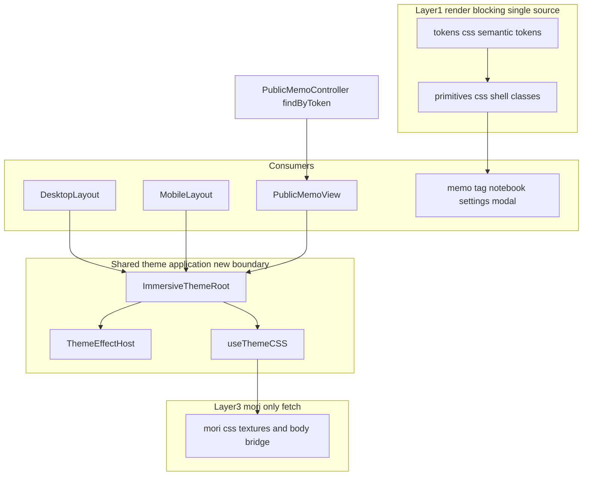
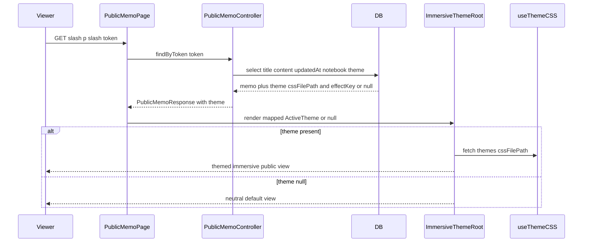
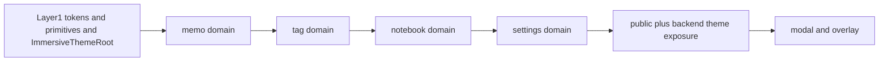

# Technical Design — immersive-world-full

## Overview

**Purpose**: 先行スペック **theme-immersive-world** が玄関（メモ一覧・ホーム・ヘッダー）に確立した「セマンティックトークン契約（`--shell-*`）＋質感 primitive 層（`.shell-*`）＋森リッチパック（Layer③）」を、**玄関を出た先の全域**（memo編集・tag・notebook・settings・public・modal/overlay）へ展開し、没入を地続きにする。

**Users**: 森テーマ有効時の Mosaku ユーザー（編集・整理・設定の各画面）と、公開メモを受け取る無認証の閲覧者。両者が「白い既製品 UI の島」で世界を断絶されずに済む。

**Impact**: 現状、玄関だけが `.shell-*` トークン駆動で、その先は生 Tailwind リテラルの島が残る。本設計は (G1) 約25の残存コンポーネントをトークン駆動へ寄せ、(G2) 三役タイポ（display/mono/body）を全域へ、(G3) 編集的構造装置（`.shell-eyebrow`/`.shell-chip`/番号付きセクション）を primitive として追加する。あわせて公開ビューへテーマ適用スタックを共有化し、backend 公開読み取りへ**非機密のテーマ識別子のみ**を最小追加する。

### Goals

- 対象全ドメインの面・文字・境界を生 Tailwind リテラルから `.shell-*` primitive＋トークン駆動へ寄せ、要素型セレクタを使わずに没入を連続させる（G1）。
- 三役タイポ（`--shell-font-display`/`--shell-font-mono`/`--shell-font-body`）を全域へ適用し、mono をラベル/データ語彙として新規導入する（G2）。
- `.shell-eyebrow`/`.shell-chip`/番号付きセクションを theme-neutral な primitive として追加する（G3）。
- 公開ビューをコンテンツ（notebook 経由）のテーマで没入描画する（R4）。
- 全新規面で WCAG AA を維持し、非森・中立既定の見た目とバンドル軽量性を回帰させない（R7 / R8）。

### Non-Goals

- 旧 `.theme-root` 系統の一本化（**G4**）。本設計は 2 系統を「ブリッジ」して連続させるに留め、統合はしない。
- umi/yoru/asa のトークン値実装と全体没入（**G5**）。受け皿は theme-neutral 構造として保つ。
- auth/login・home（玄関）ドメインの再設計（別スペック login-visual-redesign の領域）。
- content-jsonb-migration（併走スペック）。presentation は直交だが着手時期を調整する。

## Architecture

### Existing Architecture Analysis

- **3 層の CSS 分割（先行スペックで確立・継承する不変則）**:
  - **Layer①**（`src/themes/shell/{tokens,primitives}.css`、`index.css` から `@import`、render-blocking）＝色/構造トークンの**単一の源泉**と `.shell-*` primitive。`:root` 中立既定＋`[data-theme='mori']` 値。
  - **Layer③**（`public/themes/mori/mori.css`、`useThemeCSS` が mori 有効時のみ fetch）＝重量テクスチャ（多層グラデ・data-URI noise）＋旧 `.theme-root .memo-content` 本文面。
- **テーマ適用スタック**は `DesktopLayout`/`MobileLayout` が重複保有: ルートに `.app-shell` ＋（テーマ時）`.theme-root` ＋ `data-theme={getEffectKey(activeTheme)}` ＋ `data-theme-id` を付与し、`<ThemeEffectHost theme>` で生きた背景を、`useThemeCSS(activeTheme)` で Layer③ を供給。
- **テーマ解決**: `useActiveTheme()` が `notebook/memo のテーマ → shell 床（localStorage）→ null` で解決。メモのテーマは `memo.notebook.theme` の単一経路（Memo に直 `themeId` 無し）。
- **エディタ本文**: `createEditorExtensions.ts` を編集（`RichTextEditor`）と公開（`PublicMemoRenderer`）が共有＝本文レンダリングは既に一致（R4.4 の素地）。
- **公開ページ**: `/p/:token` は App 直下ルートで**テーマ適用スタック外**。生 Tailwind のみで、テーマ情報も受け取っていない。
- **維持すべき統合点**: 玄関の非破壊テスト（`shellImmersionRouting`/`NonDestructive`）、コントラスト検証（`tokens.contrast.test.ts`）、公開の観測性/レート制限/認証境界の不変則（`memo-public-isolation.invariants.spec.ts`）。

### Architecture Pattern & Boundary Map

**Selected pattern**: ハイブリッド（大半 Extend＋欠落のみ New）。G1/G2/G3 は Layer①/③ の拡張と `.shell-*` 適用で吸収し、R3（scrim/overlay primitive）と R4（公開テーマ適用の共有化＋backend 最小露出）だけ新規境界を作る。



**Architecture Integration**:

- **Domain/feature boundaries**: 色の源泉は Layer① に一本化（生リテラル禁止）。質感テクスチャは Layer③。テーマ適用の副作用（DOM 属性・CSS fetch・エフェクト mount）は `ImmersiveThemeRoot` に集約。ドメインコンポーネントは `.shell-*` を付けるだけ。
- **Existing patterns preserved**: 3 層分割、`data-theme` 属性＋クラス選択子（要素型セレクタ不使用）、`useThemeCSS` の mori 限定 fetch、`ThemeEffectHost` の 4 条件自動停止。
- **New components rationale**: `ImmersiveThemeRoot`＝レイアウト重複の解消＋公開への同スタック適用（R4）。`.shell-scrim`/`.shell-overlay`＋`--scrim`＝オーバーレイ没入の住処（R3）。
- **Steering compliance**: テーマは CSS＋メタデータのまま（DB スキーマ不変）、外部 JS ライブラリ追加ゼロ、React Query が公開ペイロードの真実源。

### Technology Stack

| Layer             | Choice / Version                                 | Role in Feature                                             | Notes                                         |
| ----------------- | ------------------------------------------------ | ----------------------------------------------------------- | --------------------------------------------- |
| Frontend（CSS）   | Tailwind CSS 3 ＋ 素の CSS 変数                  | Layer①/③ のトークン・primitive・三役タイポ・scrim           | 新規ライブラリ無し（R8.2）                    |
| Frontend（React） | React 19                                         | `ImmersiveThemeRoot` 共有コンポーネント、公開テーマ写像     | 既存 `useThemeCSS`/`ThemeEffectHost` を再利用 |
| Backend（NestJS） | NestJS 11 ＋ Prisma                              | `findByToken` の select 拡張＋公開 DTO へ非機密テーマ識別子 | **DB スキーマ不変**、読み取り経路のみ拡張     |
| Data / Storage    | PostgreSQL（既存 `Notebook.theme` リレーション） | 追加スキーマ無し。既存テーマ関連を公開読み取りで参照        | —                                             |

## System Flows

### 公開ビューのテーマ適用フロー（R4）



**Key decisions**: テーマ未紐付け（null）時は中立既定へフォールバック（R4.3）。Layer③ の fetch は theme present かつ `cssFilePath` 有りのときのみ＝非森/無テーマの公開閲覧者へ重量リソースを配らない（R8.5）。

## Requirements Traceability

| Requirement | Summary                                                                | Components                                    | Interfaces                                                | Flows                |
| ----------- | ---------------------------------------------------------------------- | --------------------------------------------- | --------------------------------------------------------- | -------------------- |
| 1.1–1.5     | 全ドメインのトークン駆動化・生Tailwind排除・要素型セレクタ不使用       | Quality Primitives 拡張、Domain Migrations    | `.shell-*` class contract                                 | —                    |
| 2.1–2.3     | 玄関〜本文〜設定の没入連続・半透明surface・FOUC無し                    | ImmersiveThemeRoot、Domain Migrations         | `.app-shell`/`--surface-backdrop`、Layer① render-blocking | —                    |
| 2.4         | 本文面↔シェル面の連続                                                  | Layer③ Body Bridge                            | `--theme-*` ← shell トークン                              | —                    |
| 3.1–3.4     | モーダル/オーバーレイの没入・非破壊                                    | Overlay Primitives、Overlay Migrations        | `.shell-scrim`/`.shell-overlay`/`--scrim`                 | —                    |
| 4.1         | 公開をコンテンツのテーマで描画                                         | Public Theme Exposure、PublicMemoView Theming | `PublicMemoResponse.theme`、ImmersiveThemeRoot            | 公開テーマ適用フロー |
| 4.2         | 公開シェル面のトークン駆動化                                           | Domain Migrations（public）                   | `.shell-*`                                                | —                    |
| 4.3         | テーマ未紐付け時の中立フォールバック                                   | PublicMemoView Theming                        | ImmersiveThemeRoot（null 分岐）                           | 公開テーマ適用フロー |
| 4.4         | 編集=公開で本文スタイル同一                                            | 既存 `createEditorExtensions` 共有            | Editor factory                                            | —                    |
| 5.1–5.6     | 三役タイポの確立と全域適用・中立フォールバック・可読性維持             | Token Contract 拡張、Quality Primitives 拡張  | `--shell-font-display/mono/body`                          | —                    |
| 6.1–6.5     | `.shell-eyebrow`/`.shell-chip`/番号付きセクションの追加・theme-neutral | Quality Primitives 拡張                       | primitive class contract                                  | —                    |
| 7.1–7.4     | AA コントラスト・要素型セレクタ禁止のテスト担保                        | Testing Strategy                              | `tokens.contrast.test.ts`/禁止セレクタテスト              | —                    |
| 8.1–8.6     | 非干渉・軽量・DB不変・G4/G5非対象                                      | 全層（制約）                                  | Layer 分割・mori 限定 fetch                               | —                    |

## Components and Interfaces

| Component               | Domain/Layer | Intent                                          | Req Coverage      | Key Dependencies                                      | Contracts          |
| ----------------------- | ------------ | ----------------------------------------------- | ----------------- | ----------------------------------------------------- | ------------------ |
| Token Contract 拡張     | Layer① CSS   | 三役タイポ・scrim トークン追加                  | 5.1, 3.2, 8.1     | tokens.css（既存）                                    | State（CSS 変数）  |
| Quality Primitives 拡張 | Layer① CSS   | eyebrow/chip/番号/label/data/scrim/overlay 追加 | 6.1–6.5, 3.1, 5.3 | primitives.css（既存）                                | State（CSS class） |
| Layer③ Body Bridge      | Layer③ CSS   | `--theme-*` を shell トークンへブリッジ         | 2.4, 5.2          | mori.css（既存）、Token 拡張（P0）                    | State（CSS 変数）  |
| ImmersiveThemeRoot      | FE 共有      | テーマ適用スタックの共有化                      | 2.1, 4.1, 4.3     | useThemeCSS/ThemeEffectHost（P0）、getEffectKey（P0） | State              |
| Domain Migrations       | FE UI        | 生Tailwind→`.shell-*` 置換                      | 1.1–1.5, 2.x, 4.2 | Primitives 拡張（P0）                                 | —                  |
| Overlay Migrations      | FE UI        | オーバーレイへ scrim/overlay 適用               | 3.1–3.4           | Overlay Primitives（P0）                              | —                  |
| Public Theme Exposure   | BE           | 公開読み取りへ非機密テーマ識別子追加            | 4.1               | memo-sharing.service（P0）                            | Service, API       |
| PublicMemoView Theming  | FE           | 公開ペイロードのテーマで没入                    | 4.1, 4.3, 4.4     | ImmersiveThemeRoot（P0）、Public Theme Exposure（P0） | State              |

### Layer① CSS（Token & Primitive 拡張）

#### Token Contract 拡張（tokens.css）

| Field        | Detail                                                              |
| ------------ | ------------------------------------------------------------------- |
| Intent       | 三役タイポとスクリムのセマンティックトークンを追加（中立＋mori 値） |
| Requirements | 5.1, 3.2, 8.1                                                       |

**Responsibilities & Constraints**

- `--shell-font-display`（見出し/署名）・`--shell-font-mono`（ラベル/データ）・`--shell-font-body`（本文）を `:root` と `[data-theme='mori']` に定義。`--shell-font` は `var(--shell-font-body)` エイリアスとして残し既存参照を非破壊に保つ（回帰ゼロ）。
- 中立既定は三役ともシステムフォント基調（`--shell-font-mono` のみ monospace）。mori は display=游明朝、body=現行 `--shell-font` 値継承、mono=monospace（5.5）。
- `--scrim`（オーバーレイ背後の暗幕濃度）を中立（従来相当の半透明黒）＋mori（生きた世界と調和する濃度）で定義。前景パネル可読性の下限を保つ濃度に固定（3.2）。
- 生リテラルは tokens.css のみが所有し、色の単一源泉を維持（8.1）。

**Contracts**: State [x]（CSS 変数）

##### State Management

- State model: CSS カスタムプロパティ。`:root`（中立）→ `[data-theme='mori']`（上書き）のカスケード。
- Persistence & consistency: 静的 CSS（Layer①、render-blocking）。値の正しさは `tokens.contrast.test.ts` が機械検証。

**Implementation Notes**

- Integration: 既存 `--shell-font` を消さずエイリアス化。umi/yoru/asa の placeholder コメントに三役/scrim の受け皿を明記（6.5 / 8.4）。
- Validation: 中立既定で三役が system 基調へ落ちることをテスト固定（5.5）。scrim×前景のコントラスト検証（3.3, 7.1）。
- Risks: `--shell-font` 二重語彙の一時併存 → 将来 body へ整理。

#### Quality Primitives 拡張（primitives.css）

| Field        | Detail                                                                      |
| ------------ | --------------------------------------------------------------------------- |
| Intent       | 編集的構造装置とオーバーレイ primitive を theme-neutral な class として追加 |
| Requirements | 6.1–6.5, 3.1, 5.3                                                           |

**Responsibilities & Constraints**

- `.shell-eyebrow`＝見出し上のアイブロー（mono 役・`--on-surface-variant`・字間広め・小サイズ）。
- `.shell-chip`＝状態ピル（mono 役・トークン駆動 bg/border、下書き/保存済み/エラーを背景と区別可能なコントラストで、3.3）。状態バリアントは `--accent`/`--state-*`/`--on-surface-variant` で解決。
- 番号付きセクション＝`.shell-section` ＋ CSS counter か `.shell-section-number`（mono・accent）。生リテラル不使用。
- `.shell-label`/`.shell-data`＝ラベル/データ値へ mono 役を割り当てる語彙（5.3）。
- `.shell-scrim`＝`--scrim` を読む暗幕面（backdrop 可）。`.shell-overlay`＝前景パネル（`.shell-panel` 相当＋オーバーレイ用 elevation）。
- トップレベルセレクタは `.shell-*` クラスのみ。彩色は必ず `var(--token)` 経由（1.3, 6.2）。中立既定で破綻せず描画（6.4）。

**Contracts**: State [x]（CSS class）

**Implementation Notes**

- Integration: reduced-motion では transition のみ停止し静的質感は維持（先行の 4.6 継承）。
- Validation: 禁止セレクタ（要素型）不使用の静的テスト、新 primitive のコントラストテスト（7.4）。
- Risks: chip 状態色の AA — worst-case（白床合成）で検証（7.2）。

### Layer③ CSS

#### Layer③ Body Bridge（mori.css）

| Field        | Detail                                                                                     |
| ------------ | ------------------------------------------------------------------------------------------ |
| Intent       | 旧 `.theme-root` 本文面の `--theme-*` を shell トークン由来へブリッジし本文↔シェルを連続化 |
| Requirements | 2.4, 5.2                                                                                   |

**Responsibilities & Constraints**

- `.theme-root` 内の `--theme-text-color`/`--theme-heading-color`/`--theme-accent-color`/`--theme-border-color` を `var(--on-surface)`/`var(--on-surface)`（見出しは強調）/`var(--accent)`/`var(--outline)` へブリッジ。`--theme-font-family` は `var(--shell-font-display)` を軸に。
- `.theme-root .memo-content code` の monospace を `var(--shell-font-mono)` に寄せて三役と一致（5.3）。
- `.theme-root` セレクタ体系自体は温存＝G4 一本化には踏み込まない（8.4）。重量テクスチャ（Layer③ の noise/グラデ）は現状維持。

**Contracts**: State [x]（CSS 変数）

**Implementation Notes**

- Integration: 現行ハードコード（`#e7f5ec`）は shell `--on-surface`（`#e8f6ee`）とほぼ同値で回帰最小。
- Validation: `mori.css.test.ts` にブリッジ後の期待値、本文面の白床 worst-case コントラスト（2.4, 7.2）。
- Risks: 本文面は scrim を挟まず生きた背景に近い → ブリッジ後のコントラスト下限を要検証。

### Frontend 共有

#### ImmersiveThemeRoot

| Field        | Detail                                                                                                             |
| ------------ | ------------------------------------------------------------------------------------------------------------------ |
| Intent       | テーマ適用スタック（DOM 属性＋Layer③ fetch＋エフェクト mount）を単一コンポーネントへ集約し、レイアウトと公開で共有 |
| Requirements | 2.1, 4.1, 4.3                                                                                                      |

**Responsibilities & Constraints**

- `activeTheme: ActiveTheme | null` を受け、ルート要素へ `className`（`app-shell` ＋ theme 時 `theme-root`）・`data-theme={getEffectKey(theme)}`・`data-theme-id={theme?.id}` を付与。
- 内部で `useThemeCSS(theme)` を呼び Layer③ を mori 限定 fetch、`<ThemeEffectHost theme>` を mount（4 条件自動停止は既存挙動を継承）。
- テーマ null 時は中立既定（現行の見た目）で描画（4.3, 7.1）。behavior-preserving：現行 `DesktopLayout`/`MobileLayout` の属性・mount と同一の出力を保つ。

**Dependencies**

- Outbound: `useThemeCSS` — Layer③ fetch（P0）。`ThemeEffectHost` — 生きた背景 mount（P0）。`getEffectKey`（`types/theme.ts`）— slug 導出（P0）。
- Inbound: `DesktopLayout`/`MobileLayout`/`PublicMemoView` — ルート適用（P0）。

**Contracts**: State [x]

##### State Management

- State model: props 駆動の presentational ラッパ（内部で副作用フックを呼ぶ）。サーバー状態は保持しない。
- Concurrency strategy: 既存フックの挙動を変えない（追加の状態を持たない）。

**Implementation Notes**

- Integration: 既存レイアウトからテーマ適用ブロックを本コンポーネントへ移設（重複解消）。`shellImmersionRouting`/`NonDestructive`/`MobileLayout` テストで属性/mount の同一性を担保。
- Validation: 抽出前後で `data-theme`/`theme-root`/`data-theme-id` が一致すること、null 時に属性非付与であること。
- Risks: レイアウト回帰 → 抽出は無挙動変更に限定し、差分は属性同一性テストで固定。

#### PublicMemoView Theming

| Field        | Detail                                                                          |
| ------------ | ------------------------------------------------------------------------------- |
| Intent       | 公開ペイロードのテーマを `ActiveTheme` へ写して `ImmersiveThemeRoot` で没入描画 |
| Requirements | 4.1, 4.3, 4.4                                                                   |

**Responsibilities & Constraints**

- API の `PublicMemoResponse.theme`（`{ cssFilePath, metadata } | null`）を `ActiveTheme`（`{ id?, name, styles, cssFilePath, metadata }`）へ写像し `ImmersiveThemeRoot` に渡す。
- 公開シェル面（ヘッダー/コンテナ/フッター）は `.shell-*` で彩色（4.2、Domain Migration と一体）。本文は既存 `PublicMemoRenderer`＝共有ファクトリで編集と同一（4.4）。
- テーマ null は中立フォールバック（4.3）。

**Contracts**: State [x]

**Implementation Notes**

- Integration: 公開は無認証・無ストア。テーマは props（API 由来）のみで持ち込み、`useActiveTheme`（ストア依存）は使わない。
- Validation: テーマ有りで `data-theme` 付与＋Layer③ fetch、null で中立、本文が編集と同一 DOM。
- Risks: 公開での `ThemeEffectHost`（生きた背景）採否 → Open Question（下記）。

### Backend

#### Public Theme Exposure（memo-sharing.service / public DTO）

| Field        | Detail                                                                               |
| ------------ | ------------------------------------------------------------------------------------ |
| Intent       | 公開読み取りに非機密のテーマ識別子（`cssFilePath` + `metadata.effectKey`）のみを追加 |
| Requirements | 4.1                                                                                  |

**Responsibilities & Constraints**

- `findByToken` の select を拡張し、`notebook.theme` の `{ cssFilePath, metadata }` を取得。effective theme = `memo.notebook.theme`（単一経路）。
- 露出は公開静的アセット識別子のみ。ユーザー id / userId / OAuth 等の機密は追加しない。DB スキーマ変更なし（8.3 微修正の範囲）。
- 観測性の不変則（`memo-public-isolation.invariants.spec.ts`：feature_area/route/サンプリング/レート制限/helmet/@Public+GET）は不変。

**Contracts**: Service [x] / API [x]

##### Service Interface

```typescript
interface PublicMemoTheme {
	cssFilePath: string | null;
	metadata: ThemeMetadata | null; // effectKey 等の非機密メタのみ
}

interface PublicMemoView {
	title: string;
	content: string;
	updatedAt: Date;
	theme: PublicMemoTheme | null; // notebook 未設定/未テーマ時は null
}

interface MemoSharingService {
	findByToken(token: string): Promise<PublicMemoView>;
}
```

- Preconditions: `token` に一致する未 trashed の公開メモが存在。
- Postconditions: `theme` は notebook にテーマ紐付けがある場合のみ非 null。機密フィールドを含まない。
- Invariants: 公開レスポンスの形状は `memo-public-schema.spec.ts` が固定。

##### API Contract

| Method | Endpoint             | Request       | Response                                                | Errors   |
| ------ | -------------------- | ------------- | ------------------------------------------------------- | -------- |
| GET    | /memos/public/:token | token（path） | PublicMemoResponse（title, content, updatedAt, theme?） | 404, 429 |

**Implementation Notes**

- Integration: フロント型 `PublicMemoResponseDto` に `theme?: PublicMemoTheme | null` を追加。
- Validation: `memo-public-schema.spec.ts` に nullable theme の assertion を追加。`memo-sharing.service.spec.ts` で notebook 経由テーマ解決と機密非露出を検証。
- Risks: 将来 memo 直テーマ導入時は解決式を拡張（現状は notebook 単一経路）。

### Frontend UI（Domain & Overlay Migrations — summary only）

以下は新境界を作らない presentational な移行（生 Tailwind → `.shell-*`＋トークン）。ドメイン単位・1 Todo=1 Commit で刻む。

- **memo**: `MemoEditor`・`MemoList`・`MemoSearch`・`MemoPalette`・`TrashView`・`ShareMemoControl`（1.1–1.5, 2.1, 2.4）。本文面は Layer③ Body Bridge が担当。
- **tag**: `TagForm`・`TagInput`・`TagFilter`・`TagSelector`・`TagManager`・`TagChip`・`TagDisplay`（1.1–1.5）。`TagChip` は `.shell-chip` を活用。
- **notebook**: `NotebookList`・`NotebookEditor`（1.1–1.5, 2.1）。
- **settings**: `SettingsPage`・`InvitationCard`・`PublicMemosCard`（1.1–1.5, 2.1）。
- **public shell**: `PublicMemoPage`・`PublicMemoView`（4.2）＝ローディング/エラー面も `.shell-*` 化。
- **Overlay Migrations**: `FeedbackModal`・`SyncToast`・`FocusMemoOverlay`・`TagDropdownIcon`（3.1–3.4）＝`.shell-scrim`/`.shell-overlay`/`.shell-chip` を className 追加のみで適用。開閉・フォーカストラップ・閉じる操作のロジックは無改変（3.4）。

**Implementation Note（共通）**: 生カラーリテラルの彩色は全廃し `.shell-*`＋トークンへ。既存トークンで表せない面は生リテラルを足さず Token/Primitive 語彙を拡張（1.4）。イベントハンドラ・ナビ導線・フォーム送信は無改変（1.5, 8.6）。

## Data Models

本設計の唯一のデータ契約変更は**公開読み取りレスポンスへのテーマ追加**（DB スキーマ不変）。

### Data Contracts & Integration

**API Data Transfer（公開メモ）**

- Response 追加フィールド: `theme?: { cssFilePath: string | null; metadata: ThemeMetadata | null } | null`。
- Serialization: JSON。既存 `{ title, content, updatedAt }` に後方互換で追加（クライアント旧版は無視可能）。
- Validation: `theme` は notebook 経由でのみ非 null。機密フィールドを含まないことを schema テストで固定。

**既存スキーマ（参照のみ・不変）**: `Notebook.themeId → Theme`。`Theme.{ cssFilePath, metadata }` を公開読み取りで select する。`Theme.styles`・所有者情報等は公開に含めない。

## Error Handling

### Error Strategy

- **公開テーマ未紐付け（theme=null）**: 中立既定へフォールバック（4.3）。エラーではなく正常系。
- **Layer③ fetch 失敗**: `useThemeCSS` の既存 `logger.error` ＋トークン（Layer①）のみで描画継続（テクスチャ無しでも色/タイポは成立）。没入は劣化するが可読性は保つ（graceful degradation）。
- **公開メモ不存在/非公開**: 既存 404 面（`.shell-*` 化して中立で可読、7.1）。

### Monitoring

- 公開読み取りの観測性（Sentry `feature_area=memo`/route/サンプリング）は既存不変則を維持（新タグ・新経路を作らない）。

## Testing Strategy

### Unit Tests

- `tokens.contrast.test.ts` 拡張: 三役タイポ適用面・`.shell-chip` 状態色・`--scrim` 上の前景テキストの AA（白床 worst-case、7.1/7.2）。
- 禁止セレクタ静的テスト: 対象ドメイン/新 primitive が要素型セレクタで配色しないこと（1.3, 7.4）。
- `mori.css.test.ts` 拡張: Body Bridge 変数（`--theme-*` ← shell トークン）の期待値（2.4）。
- 三役フォールバック: `data-theme` 未設定で display/mono/body が system 基調（5.5）。

### Integration Tests

- `ImmersiveThemeRoot` 抽出の非破壊: `shellImmersionRouting`/`NonDestructive`/`MobileLayout` で `data-theme`/`theme-root`/`data-theme-id`・エフェクト mount の同一性（2.1）。
- 公開テーマ適用: theme 有りで `data-theme` 付与＋Layer③ fetch、null で中立（4.1, 4.3）。
- backend `memo-sharing.service.spec.ts`: notebook 経由テーマ解決・機密非露出（4.1）。`memo-public-schema.spec.ts`: nullable theme の形状固定。

### E2E/UI Tests

- 公開ページ（森テーマ紐付けメモ）が没入描画され、本文が編集と同一スタイルで表示される（4.1, 4.4）。
- モーダル/ドロップダウン/トーストが scrim＋overlay で開き、フォーカストラップ・閉じる操作が従来通り動く（3.1, 3.4）。

## Security Considerations

- **公開露出の最小化**: 追加露出は `cssFilePath`（公開静的パス）と `metadata.effectKey`（slug）のみ。`memo-public-schema.spec.ts` で形状を固定し、`Theme.styles` や所有者情報の漏洩を防ぐ。
- **境界不変則の維持**: `@Public()`＋GET 限定・IP 60req/分の `@Throttle`・helmet・Sentry 5 タグ契約を破壊しない（`memo-public-isolation.invariants.spec.ts` は無影響）。

## Migration Strategy

段階適用（ドメイン単位・1 Todo=1 Commit）。public 着手前に基盤（Token/Primitive/ImmersiveThemeRoot/backend 露出）を整える。



- **Rollback triggers**: いずれかのドメインで AA 割れ・要素型セレクタ混入・非破壊テスト赤 → 当該コミット単位で revert（1 Todo=1 Commit が rollback 境界）。
- **Validation checkpoints**: 各ドメイン完了時にコントラスト/禁止セレクタ/非破壊テスト緑。非森・中立の視覚回帰ゼロ（8.1）。
- **content-jsonb-migration 調整**: memo ドメイン着手前に `prosemirrorText.ts`/`contentSync.ts` の cutover 状況を確認し、`.memo-content` の DOM/クラス安定を前提化。

## Open Questions / Risks

- **公開での生きた背景（`ThemeEffectHost`）採否**: 無認証・軽量性の観点で、公開はパレット＋テクスチャ止まりにするか、生きた背景まで出すか。既定は「出す（4 条件自動停止は既存どおり作用）」を推奨だが、実装時に体感と負荷で確定。
- **`--shell-font` 二重語彙の整理時期**: 本スペックは body エイリアスで併存維持。将来 body へ寄せる整理は G4/G5 系の後続で。
