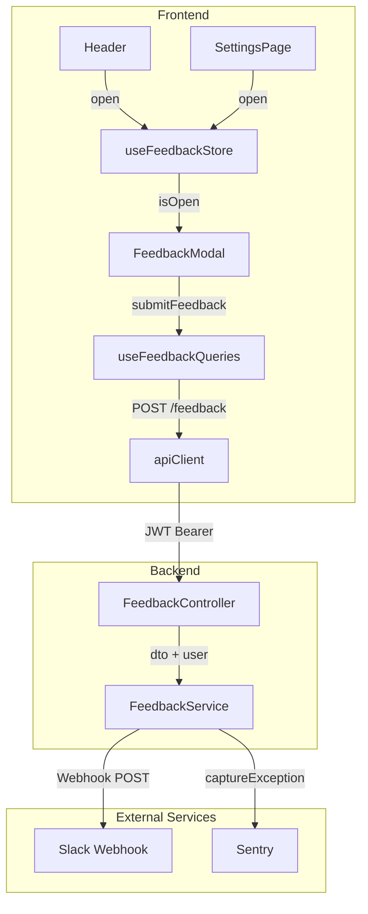
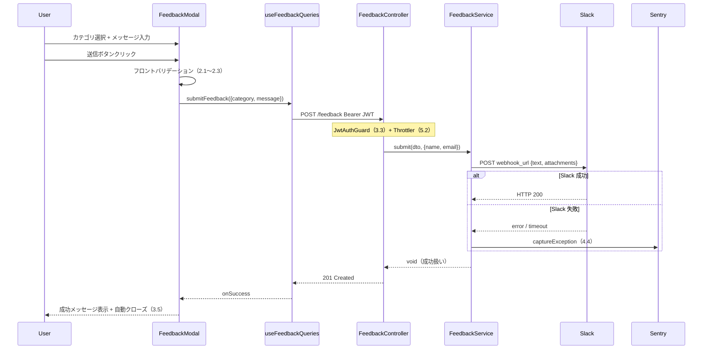

# Technical Design Document — in-app-feedback

## Overview

アプリ内フィードバック機能は、ログイン済みユーザーがモーダルダイアログからカテゴリ付きのフィードバックを送信できる仕組みを提供する。送信されたフィードバックはバックエンドを経由して Slack `#feedback` チャンネルにリアルタイム通知され、開発者・運営が即時確認できる。

DB への永続化は行わず、Slack Webhook への fire-and-forget 送信のみで実装する。Prisma スキーマ変更ゼロで 6 月末の限定公開に向けた最小実装を実現する。Slack 障害時はユーザー体験を損なわずエラーを Sentry に記録する。

### Goals

- ヘッダーおよび設定ページからワンクリックでフィードバックフォームを開けること
- カテゴリ（不具合 / 改善要望 / その他）+ メッセージを安全に送信できること
- Slack `#feedback` チャンネルにカテゴリ別絵文字・色付きでリアルタイム通知されること
- JWT 認証・レート制限でスパムを防止すること

### Non-Goals

- フィードバックの DB 永続化・管理画面（Phase 2 以降）
- 未認証ユーザーへのフィードバックフォーム提供
- 画像・ファイル添付
- フィードバックへの返信・ステータス管理

---

## Requirements Traceability

| Requirement | Summary                                             | Components                                    | Interfaces                      | Flows |
| ----------- | --------------------------------------------------- | --------------------------------------------- | ------------------------------- | ----- |
| 1.1         | ヘッダーボタンでモーダル表示                        | Header, FeedbackModal, useFeedbackStore       | `FeedbackStore.open()`          | F1    |
| 1.2         | 設定ページからモーダル表示                          | SettingsPage, FeedbackModal, useFeedbackStore | `FeedbackStore.open()`          | F1    |
| 1.3         | カテゴリ選択 + メッセージ入力フォーム               | FeedbackModal                                 | `FeedbackModalProps`            | —     |
| 1.4         | デフォルトはカテゴリ未選択                          | FeedbackModal                                 | —                               | —     |
| 1.5         | 閉じてフォームリセット                              | FeedbackModal, useFeedbackStore               | `FeedbackStore.close()`         | —     |
| 2.1         | カテゴリ必須バリデーション                          | FeedbackModal                                 | —                               | —     |
| 2.2         | メッセージ必須バリデーション                        | FeedbackModal                                 | —                               | —     |
| 2.3         | メッセージ 1000 文字上限                            | FeedbackModal, CreateFeedbackDto              | `@MaxLength(1000)`              | —     |
| 2.4         | 文字数リアルタイム表示                              | FeedbackModal                                 | —                               | —     |
| 2.5         | エラー箇所ハイライト                                | FeedbackModal                                 | —                               | —     |
| 3.1         | POST /feedback 送信                                 | useFeedbackQueries, apiClient                 | `SubmitFeedbackDto`             | F1    |
| 3.2         | JWT から送信者情報自動付与                          | FeedbackController, FeedbackService           | `AuthenticatedRequest`          | F1    |
| 3.3         | 未認証 401 拒否                                     | FeedbackController (JwtAuthGuard global)      | —                               | —     |
| 3.4         | 送信中ローディング + 重複送信防止                   | FeedbackModal, useFeedbackQueries             | `isSubmitting`                  | F1    |
| 3.5         | 送信成功後メッセージ + 自動クローズ                 | FeedbackModal, useFeedbackQueries             | `onSuccess` callback            | F1    |
| 4.1         | Slack Webhook 通知送信                              | FeedbackService                               | `SlackNotifier`                 | F1    |
| 4.2         | 通知にカテゴリ・メッセージ・送信者・日時（JST）含む | FeedbackService                               | `SlackPayload`                  | —     |
| 4.3         | カテゴリ別絵文字・色                                | FeedbackService                               | `CATEGORY_SLACK_CONFIG`         | —     |
| 4.4         | Slack 失敗時 Sentry 記録、クライアントには成功返却  | FeedbackService                               | `Sentry.captureException`       | F1    |
| 4.5         | Webhook URL を環境変数で管理                        | FeedbackService, ConfigService                | `SLACK_FEEDBACK_WEBHOOK_URL`    | —     |
| 5.1         | グローバル JWT Guard で保護                         | FeedbackController                            | JwtAuthGuard (global APP_GUARD) | —     |
| 5.2         | Throttler で過剰リクエスト制限                      | FeedbackController                            | `@Throttle` decorator           | —     |
| 5.3         | 429 時フロントエンドエラー表示                      | FeedbackModal, useFeedbackQueries             | `ApiError` handling             | —     |
| 5.4         | バックエンド DTO バリデーション                     | CreateFeedbackDto                             | `class-validator`               | —     |

---

## Architecture

### Architecture Pattern & Boundary Map



**Architecture Integration**:

- 選択パターン: 薄い Extension パターン。既存の NestJS ドメインモジュール構成（`feedback/` ディレクトリ）に新規モジュールを追加
- ドメイン境界: `feedback` は他ドメイン（`memo`, `notebook`）に依存しない独立モジュール
- 既存パターン保持: グローバル JWT Guard 保護・`@Throttle` デコレータによるレート制限上書き・React Query mutation + Zustand UI state パターン
- Prisma スキーマ変更なし（DB 永続化なし）

### Technology Stack

| Layer                   | Choice / Version            | Role in Feature                     | Notes                       |
| ----------------------- | --------------------------- | ----------------------------------- | --------------------------- |
| Frontend / UI           | React 19, Tailwind CSS 3    | FeedbackModal, Header 修正          | 新規コンポーネント追加      |
| Frontend / State        | Zustand (既存)              | useFeedbackStore — isOpen 管理      | UI state のみ               |
| Frontend / Server State | TanStack React Query (既存) | useFeedbackQueries — mutation       | サーバー状態はここのみ      |
| Backend / API           | NestJS 11 (既存)            | FeedbackController, FeedbackService | 新規ドメインモジュール      |
| Backend / Validation    | class-validator (既存)      | CreateFeedbackDto                   | 追加依存なし                |
| Backend / Rate Limit    | @nestjs/throttler (既存)    | @Throttle decorator                 | 3 req/min の上書き          |
| External / Messaging    | Slack Incoming Webhooks     | Slack 通知送信                      | Node.js fetch, 新規依存なし |
| Observability           | @sentry/nestjs (既存)       | Slack 失敗キャプチャ                | feature_area: 'system'      |

---

## System Flows

### F1: フィードバック送信フロー



Slack 失敗は透過的に処理されユーザーに影響しない。フロントバリデーションはエラー箇所ハイライトを表示したまま送信を中断する（2.1〜2.5）。

---

## Components and Interfaces

### Components Summary

| Component             | Layer                   | Intent                             | Req Coverage                          | Key Dependencies                        | Contracts             |
| --------------------- | ----------------------- | ---------------------------------- | ------------------------------------- | --------------------------------------- | --------------------- |
| `FeedbackModal`       | Frontend / UI           | フォーム表示・バリデーション・送信 | 1.3, 1.4, 1.5, 2.1–2.5, 3.4, 3.5, 5.3 | useFeedbackQueries (P0)                 | State, (API via hook) |
| `useFeedbackStore`    | Frontend / State        | モーダル開閉状態管理               | 1.1, 1.2, 1.5                         | —                                       | State                 |
| `useFeedbackQueries`  | Frontend / Server State | フィードバック送信 mutation        | 3.1, 3.4, 3.5, 5.3                    | apiClient (P0)                          | Service, API          |
| `Header` (修正)       | Frontend / UI           | フィードバックボタン追加           | 1.1                                   | useFeedbackStore (P0)                   | —                     |
| `SettingsPage` (修正) | Frontend / UI           | フィードバックセクション追加       | 1.2                                   | useFeedbackStore (P0)                   | —                     |
| `FeedbackController`  | Backend / API           | HTTP エンドポイント定義・認証      | 3.1, 3.2, 3.3, 5.1, 5.2, 5.4          | FeedbackService (P0), JwtAuthGuard (P0) | API                   |
| `FeedbackService`     | Backend / Domain        | Slack 通知・送信者情報付与         | 3.2, 4.1–4.5                          | ConfigService (P0), Sentry (P1)         | Service               |
| `CreateFeedbackDto`   | Backend / DTO           | リクエスト型定義・バリデーション   | 2.3, 5.4                              | class-validator (P0)                    | —                     |
| `FeedbackModule`      | Backend / Module        | NestJS 依存注入コンテナ            | —                                     | AppModule (P0)                          | —                     |

---

### Frontend / UI

#### `FeedbackModal`

| Field        | Detail                                                                                  |
| ------------ | --------------------------------------------------------------------------------------- |
| Intent       | フィードバックフォームのモーダルダイアログ。バリデーション・送信・成功/エラー表示を内包 |
| Requirements | 1.3, 1.4, 1.5, 2.1, 2.2, 2.3, 2.4, 2.5, 3.4, 3.5, 5.3                                   |

**Responsibilities & Constraints**

- カテゴリ（未選択 / bug / improvement / other）とメッセージ（最大 1000 文字）の入力フォームを提供
- フロントエンドバリデーションを実行し、エラー箇所をハイライト表示したまま送信を止める
- 送信中は送信ボタンをローディング状態にして重複送信を防ぐ
- 送信成功後に成功メッセージを表示してモーダルを自動クローズ（`useFeedbackStore.close()` 呼び出し）
- モーダル外クリックまたは閉じるボタンでフォームをリセットしてクローズ

**Dependencies**

- Inbound: `useFeedbackStore` — `isOpen`, `close()` を受け取る (P0)
- Outbound: `useFeedbackQueries.submitFeedback` — 送信 mutation (P0)

**Contracts**: State [ ✓ ] / API [ ] / Event [ ] / Batch [ ] / Service [ ]

##### State Management

- State model: ローカル `useState` で `category`, `message`, `errors`, `showSuccess` を管理
- フォームリセットはクローズ時（`onClose` コールバック内）に実行
- `isSubmitting` は `useFeedbackQueries` から取得し、`useState` を持たない

##### Props Interface

```typescript
type FeedbackCategory = 'bug' | 'improvement' | 'other';

interface FeedbackFormState {
	category: FeedbackCategory | null;
	message: string;
}

interface FeedbackFormErrors {
	category?: string;
	message?: string;
}

interface FeedbackModalProps {
	isOpen: boolean;
	onClose(): void;
}
```

**Implementation Notes**

- `isOpen` が `false` のときは `null` を返してレンダリングをスキップ（アンマウントでフォームリセット）
- backdrop (`div.fixed.inset-0`) + `dialog` 相当の `div` で実装。ESC キー押下で `onClose()` を呼ぶ
- 文字数カウンター: `{message.length} / 1000` をリアルタイム表示（2.4）
- `ApiError` の status が `429` のとき、レート制限エラーメッセージを表示（5.3）

---

#### `Header` (修正)

- 既存 `Header.tsx` のドロップダウンメニューにフィードバックボタンを追加
- `useFeedbackStore().open()` を呼び出すだけ。モーダル自体は `App.tsx` でマウント済み

#### `SettingsPage` (修正)

- 既存 `SettingsPage.tsx` に「フィードバック」セクションを追加
- ボタンクリックで `useFeedbackStore().open()` を呼び出す

---

### Frontend / State

#### `useFeedbackStore`

| Field        | Detail                                            |
| ------------ | ------------------------------------------------- |
| Intent       | フィードバックモーダルの開閉状態を Zustand で管理 |
| Requirements | 1.1, 1.2, 1.5                                     |

**Contracts**: State [ ✓ ]

##### State Management

- State model: `isOpen: boolean`（デフォルト `false`）
- Persistence: セッションのみ（永続化なし）
- Concurrency strategy: Zustand が同期的に状態更新するため競合なし

```typescript
interface FeedbackStore {
	isOpen: boolean;
	open(): void;
	close(): void;
}
```

---

### Frontend / Server State

#### `useFeedbackQueries`

| Field        | Detail                                            |
| ------------ | ------------------------------------------------- |
| Intent       | フィードバック送信 mutation を React Query で管理 |
| Requirements | 3.1, 3.4, 3.5, 5.3                                |

**Dependencies**

- Outbound: `apiClient.submitFeedback` — HTTP POST (P0)

**Contracts**: Service [ ✓ ] / API [ ✓ ]

##### Service Interface

```typescript
interface SubmitFeedbackDto {
	category: FeedbackCategory;
	message: string;
}

interface UseFeedbackQueriesResult {
	submitFeedback(dto: SubmitFeedbackDto): Promise<void>;
	isSubmitting: boolean;
}
```

- Preconditions: `category` が有効な enum 値、`message` が 1〜1000 文字
- Postconditions: 成功時に `onSuccess` コールバックが呼ばれる
- Invariants: `isSubmitting` が `true` の間は追加の `submitFeedback` 呼び出しを UI でブロック

**Implementation Notes**

- `useMutation` を使用。`queryClient.invalidateQueries` は不要（フィードバックにはキャッシュなし）
- `onSuccess` / `onError` で `FeedbackModal` に状態を通知する設計は、呼び出し側で `mutateAsync` + try/catch を使う
- `ApiError.status === 429` を catch してレート制限エラーとして区別する

---

### Backend / API

#### `FeedbackController`

| Field        | Detail                                                                            |
| ------------ | --------------------------------------------------------------------------------- |
| Intent       | `POST /feedback` エンドポイント定義。JWT 認証・Throttle・DTO バリデーションを担う |
| Requirements | 3.1, 3.2, 3.3, 5.1, 5.2, 5.4                                                      |

**Dependencies**

- Inbound: グローバル JwtAuthGuard — 認証（P0）
- Inbound: グローバル ThrottlerGuard + `@Throttle` — レート制限（P0）
- Outbound: `FeedbackService.submit()` (P0)

**Contracts**: API [ ✓ ]

##### API Contract

| Method | Endpoint  | Request             | Response        | Errors        |
| ------ | --------- | ------------------- | --------------- | ------------- |
| POST   | /feedback | `CreateFeedbackDto` | 201 (body なし) | 400, 401, 429 |

- 認証: グローバル `JwtAuthGuard`。`@Public()` デコレータは付与しない（5.1）
- レート制限: `@Throttle({ default: { limit: 3, ttl: 60000 } })` で 1 分間 3 回に上書き（5.2）
- `req.user` から `{ id, name, email }` を取得して `FeedbackService.submit()` に渡す（3.2）

---

### Backend / Domain

#### `FeedbackService`

| Field        | Detail                                             |
| ------------ | -------------------------------------------------- |
| Intent       | Slack Webhook 通知送信・送信者情報付与・エラー隔離 |
| Requirements | 3.2, 4.1, 4.2, 4.3, 4.4, 4.5                       |

**Dependencies**

- Inbound: `FeedbackController` — dto + user (P0)
- External: Slack Incoming Webhooks — 通知送信 (P1, Slack 障害時も動作継続)
- External: Sentry — `captureException` (P1, オプショナル)

**Contracts**: Service [ ✓ ]

##### Service Interface

```typescript
type FeedbackCategory = 'bug' | 'improvement' | 'other';

interface FeedbackSender {
	name: string;
	email: string;
}

interface FeedbackService {
	submit(
		dto: { category: FeedbackCategory; message: string },
		sender: FeedbackSender,
	): Promise<void>;
}
```

- Preconditions: `dto.category` が有効な enum 値、`dto.message` が 1〜1000 文字、`sender.email` が非空
- Postconditions: Slack 通知が試行される。成功・失敗にかかわらず `void` を返す
- Invariants: Slack 呼び出し失敗時も例外を上位に伝播しない（Sentry に記録して握りつぶす）

**Slack ペイロード仕様**

カテゴリ別設定（`CATEGORY_SLACK_CONFIG`）:

| Category      | 表示名   | 絵文字 | Attachment color |
| ------------- | -------- | ------ | ---------------- |
| `bug`         | 不具合   | 🔴     | `#FF0000`        |
| `improvement` | 改善要望 | 🟡     | `#FFC107`        |
| `other`       | その他   | 🔵     | `#2196F3`        |

Slack Webhook POST ペイロード構造:

```typescript
interface SlackAttachment {
	color: string;
	fields: Array<{
		title: string;
		value: string;
		short: boolean;
	}>;
}

interface SlackPayload {
	text: string; // e.g. "🔴 不具合 が届きました"
	attachments: SlackAttachment[];
}
```

フィールド: カテゴリ / メッセージ / 送信者名 / メールアドレス / 送信日時（JST `toLocaleString('ja-JP', {timeZone: 'Asia/Tokyo'})`）

**Implementation Notes**

- `SLACK_FEEDBACK_WEBHOOK_URL` が空の場合は警告ログを出して Slack 送信をスキップ（起動は継続）
- Slack への `fetch` は try/catch で囲み、失敗時に `Sentry.captureException(err, { tags: { feature_area: 'system' } })` を呼んでから `return`（4.4）
- タイムアウトは 5 秒（`AbortController` + `signal`）。タイムアウトも Sentry に記録

---

### Backend / DTO

#### `CreateFeedbackDto`

```typescript
import { IsEnum, IsString, IsNotEmpty, MaxLength } from 'class-validator';

enum FeedbackCategory {
	Bug = 'bug',
	Improvement = 'improvement',
	Other = 'other',
}

class CreateFeedbackDto {
	@IsEnum(FeedbackCategory)
	category: FeedbackCategory;

	@IsString()
	@IsNotEmpty()
	@MaxLength(1000)
	message: string;
}
```

---

## Data Models

### Domain Model

フィードバックは DB に永続化しない。集約ルートは存在せず、送信リクエスト単位で完結するステートレスな操作として扱う。

### Data Contracts & Integration

**API Data Transfer**

- Request: `{ category: 'bug' | 'improvement' | 'other', message: string }`
- Response: 201 No Content
- Validation: `class-validator` による DTO バリデーション（バックエンド）+ フロントエンド独自バリデーション（カテゴリ選択確認・文字数チェック）

**Cross-Service Data Management**

- Slack Webhook は冪等でない（同一メッセージが複数回送信される可能性がある）。Throttler がフロントからの重複送信を制限するが、ネットワーク再送レベルの冪等性は保証しない。MVP スコープではこれを許容する。

---

## Error Handling

### Error Strategy

バリデーションは早期失敗（Fail Fast）、Slack 障害は透過的に処理（Graceful Degradation）。

### Error Categories and Responses

**User Errors (4xx)**

| Status | Cause                  | Frontend Action                                                  |
| ------ | ---------------------- | ---------------------------------------------------------------- |
| 400    | DTO バリデーション失敗 | エラーメッセージをフォームに表示                                 |
| 401    | 未認証                 | 認証エラーとして `AuthContext` の共通ハンドリングに委譲          |
| 429    | レート制限超過         | 「送信が多すぎます。しばらく待ってから再試行してください」を表示 |

**System Errors (5xx)**

- Slack 障害: サーバー側でキャッチしてクライアントには `201` を返す（4.4）。Sentry にエラー記録
- その他 500: グローバル `SentryGlobalFilter` がキャッチ。フロントには汎用エラーを表示

### Monitoring

- Slack 送信失敗: `Sentry.captureException` に `{ tags: { feature_area: 'system' } }` を付与
- レート制限到達: ThrottlerGuard が自動的に 429 を返す（ログなし、Sentry 不要）

---

## Testing Strategy

### Unit Tests（バックエンド）

- `FeedbackService.submit()`: Slack 成功時に正しいペイロードで `fetch` が呼ばれること
- `FeedbackService.submit()`: Slack 失敗時に `Sentry.captureException` が呼ばれ、例外が上位に伝播しないこと
- `FeedbackService.submit()`: Webhook URL が空の場合に `fetch` が呼ばれないこと
- `CreateFeedbackDto`: `category` 未指定・`message` 空・1001 文字でバリデーションエラーになること

### Integration Tests（バックエンド）

- `POST /feedback` 未認証リクエスト → 401
- `POST /feedback` 有効な JWT + 正常ペイロード → 201（Slack fetch をモック）
- `POST /feedback` 無効なカテゴリ → 400

### Unit Tests（フロントエンド）

- `useFeedbackStore`: `open()` / `close()` で `isOpen` が正しく変化すること
- `FeedbackModal`: カテゴリ未選択で送信 → エラー表示、送信 mutation が呼ばれないこと
- `FeedbackModal`: 1001 文字メッセージで送信 → エラー表示
- `FeedbackModal`: 送信成功後に `onClose` が呼ばれること

### E2E Tests（Playwright）

- ヘッダーのフィードバックボタンクリック → モーダル表示 → カテゴリ + メッセージ入力 → 送信 → 成功メッセージ表示
- モーダル外クリック → モーダルが閉じること

---

## Security Considerations

- `POST /feedback` はグローバル `JwtAuthGuard` の下に置き、`@Public()` を付与しない（5.1）
- 送信者情報（name, email）はサーバー側で `req.user` から取得。クライアントからは受け付けない（3.2）
- `SLACK_FEEDBACK_WEBHOOK_URL` は環境変数で管理し、コードにハードコードしない（4.5）
- `@Throttle({ default: { limit: 3, ttl: 60000 } })` によりスパム送信を抑制（5.2）
- DTO バリデーションで `message` の最大長を 1000 文字に制限し、過大ペイロードを防ぐ（5.4）
