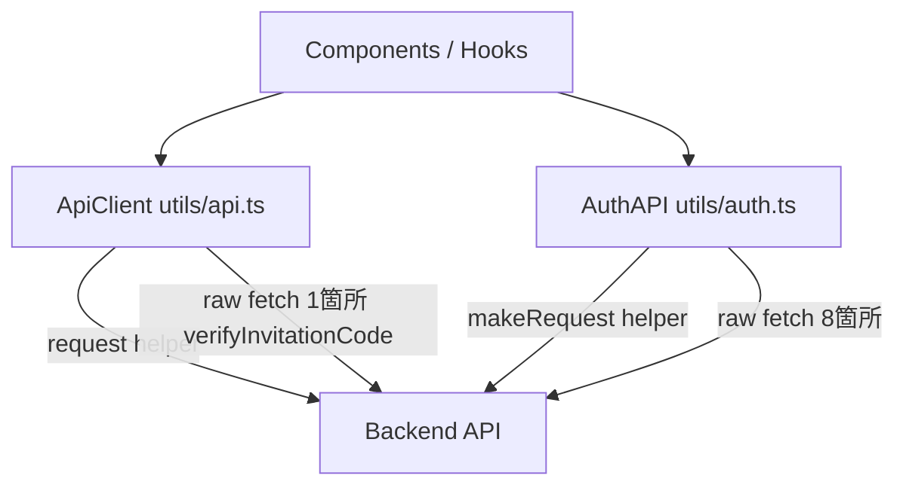
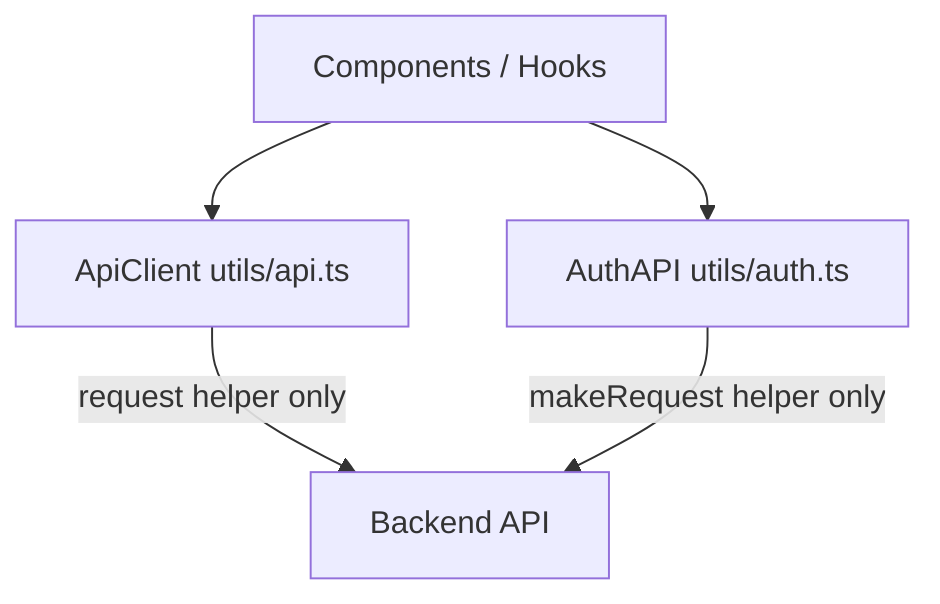

# Design Document

## Overview

フロントエンドの API 通信において、`utils/api.ts`（`ApiClient`）と `utils/auth.ts`（`AuthAPI`）に残存する生 `fetch` 直呼び出しを排除し、Steering ドキュメントが定める「`fetch` 直呼び出し禁止・`apiClient` 経由で統一」方針を完全に実現するリファクタリングである。

**Impact**: `ApiClient.request()` に JSON エラーメッセージ抽出ロジックを追加し、`verifyInvitationCode()` を内部ヘルパー `requestPublic()` に移行する。また `AuthAPI` の 8 メソッドが持つ生 `fetch` 呼び出しを `makeRequest()` に統一する。いずれも外部から見た動作・メソッドシグネチャは変化しない。

### Goals

- `utils/api.ts` および `utils/auth.ts` から生 `fetch` 直呼び出しを排除する（テーマ CSS 読み込みは例外）
- `ApiClient` 内の全 API 呼び出しを `request()` ヘルパー経由に統一する
- `AuthAPI` 内の全 API 呼び出しを `makeRequest()` ヘルパー経由に統一する
- 既存の動作・メソッドシグネチャ・エラーメッセージ品質を維持する

### Non-Goals

- `AuthAPI` を `apiClient` に統合・廃止すること（JWT トークン管理と Auth API は責務が異なる）
- テーマ CSS 読み込み（`useThemeCSS.ts`・`themeLoader.ts`）の変更（静的アセット取得として例外扱い）
- 新しいエンドポイントの追加やAPIの変更

## Architecture

### Existing Architecture Analysis

現在のフロントエンド API 通信は以下の2層構造になっている：



修正後：



### Architecture Pattern & Boundary Map

- **Selected pattern**: 既存のヘルパーメソッドによる集中管理パターンを徹底する
- **Domain boundaries**: `ApiClient`（一般 API）と `AuthAPI`（認証フロー・JWT管理）の責務境界は維持する
- **Steering compliance**: `fetch` 直呼び出し禁止・`apiClient` 経由統一（`structure.md`）を完全実現

### Technology Stack

| Layer    | Choice / Version      | Role in Feature | Notes        |
| -------- | --------------------- | --------------- | ------------ |
| Frontend | TypeScript / React 19 | 変更対象        | 新規依存なし |

## Requirements Traceability

| Requirement | Summary                                                | Components         | Interfaces                   |
| ----------- | ------------------------------------------------------ | ------------------ | ---------------------------- |
| 1.1         | `verifyInvitationCode` を `requestPublic()` 経由に変更 | ApiClient          | `request()`                  |
| 1.2         | non-OK 時の詳細エラーメッセージ維持                    | ApiClient          | `request()`                  |
| 1.3         | `ApiClient` 内に生 `fetch` なし                        | ApiClient          | `request()`                  |
| 2.1〜2.8    | `AuthAPI` 8メソッドを `makeRequest()` に統一           | AuthAPI            | `makeRequest()`              |
| 2.9         | `AuthAPI` 内に生 `fetch` なし                          | AuthAPI            | `makeRequest()`              |
| 3.1         | login 後のトークン保存維持                             | AuthAPI            | `AuthTokenManager`           |
| 3.2         | OAuth 登録後のトークン保存維持                         | AuthAPI            | `AuthTokenManager`           |
| 3.3         | 非 OK レスポンス時のエラー形式維持                     | ApiClient, AuthAPI | `request()`, `makeRequest()` |
| 3.4         | メソッドシグネチャ不変                                 | ApiClient, AuthAPI | —                            |
| 3.5         | `verifyInvitationCode` の成功時レスポンス維持          | ApiClient          | `request()`                  |
| 3.6         | `verifyInvitationCode` の詳細エラー維持                | ApiClient          | `request()`                  |
| 4.1         | アプリケーションコードに生 `fetch` なし                | ApiClient, AuthAPI | —                            |
| 4.2         | `api.ts` の `fetch` は `request()` 内のみ              | ApiClient          | `request()`                  |
| 4.3         | `auth.ts` の `fetch` は `makeRequest()` 内のみ         | AuthAPI            | `makeRequest()`              |
| 4.4         | テーマ CSS 取得は例外として許容                        | —                  | —                            |

## Components and Interfaces

| Component                          | Domain/Layer    | Intent                                         | Req Coverage            | Key Dependencies                        |
| ---------------------------------- | --------------- | ---------------------------------------------- | ----------------------- | --------------------------------------- |
| `ApiClient.request()`              | Frontend / API  | HTTP 通信の中央ヘルパー。JSON エラー抽出を追加 | 1.1〜1.3, 3.5, 3.6, 4.2 | `fetch`（内部のみ）                     |
| `ApiClient.verifyInvitationCode()` | Frontend / API  | 招待コード検証。`requestPublic()` へ移行       | 1.1, 1.2, 3.5, 3.6      | `request()`                             |
| `AuthAPI.makeRequest()`            | Frontend / Auth | 認証前後の API 通信ヘルパー                    | 2.1〜2.9, 4.3           | `AuthTokenManager`, `fetch`（内部のみ） |
| `AuthAPI.*()` （8メソッド）        | Frontend / Auth | 認証・OAuth フロー。`makeRequest()` に移行     | 2.1〜2.9, 3.1〜3.4      | `makeRequest()`, `AuthTokenManager`     |

### Frontend / API Layer

#### ApiClient.request()

| Field        | Detail                                                                   |
| ------------ | ------------------------------------------------------------------------ |
| Intent       | HTTP 通信の中央ヘルパー。認証ヘッダー付与・エラー処理・JSON パースを担う |
| Requirements | 1.1, 1.2, 1.3, 3.5, 3.6, 4.2                                             |

**Responsibilities & Constraints**

- 全 API 呼び出しの唯一の `fetch` 呼び出し箇所として機能する
- `!response.ok` 時は JSON レスポンスから `error.message` の抽出を試み、失敗した場合は `HTTP error! status: N` にフォールバックする
- `authLevel: 'NONE'` の場合は Authorization ヘッダーを付与しない

**Contracts**: Service [x]

##### Service Interface

```typescript
// 変更箇所: !response.ok ブロックの強化
interface RequestErrorExtraction {
	// Content-Type が application/json の場合、レスポンスボディから error.message を取得する
	// JSON パースに失敗した場合は `HTTP error! status: ${response.status}` を使用する
	extractErrorMessage(response: Response): Promise<string>;
}
```

エラー抽出後のスロー形式:

```
throw new Error(extractedMessage)
```

- Preconditions: `response.ok === false`
- Postconditions: 元の `error.message` または `HTTP error! status: N` の `Error` をスローする
- Invariants: 既存の 401 ハンドリング（`認証エラー: ログインし直してください`）は維持する

**Implementation Notes**

- Integration: `verifyInvitationCode()` はこの変更後に `requestPublic()` を呼び出す形に移行する
- Validation: 既存の全 API 呼び出しに対してエラーメッセージ形式の変化がないことを確認する（サーバーが `message` フィールドを返さない場合は従来の `HTTP error!` メッセージになる）
- Risks: `request()` は広範囲で使用されるため、変更後に主要エンドポイントの動作確認が必要

---

#### ApiClient.verifyInvitationCode()

| Field        | Detail                                                              |
| ------------ | ------------------------------------------------------------------- |
| Intent       | 招待コード検証エンドポイントへの通信を `requestPublic()` に移行する |
| Requirements | 1.1, 1.2, 3.5, 3.6                                                  |

**Contracts**: Service [x]

##### Service Interface

```typescript
// 変更前: fetch() を直接呼び出してカスタムエラーハンドリング
// 変更後: this.requestPublic() を使用（apiClientインスタンスメソッド）
async verifyInvitationCode(code: string): Promise<InvitationVerificationResponse>
```

- Preconditions: `code` は非空文字列
- Postconditions: 成功時は `InvitationVerificationResponse`、失敗時は `Error` をスロー
- Invariants: メソッドシグネチャ・戻り値型・エラー形式は変化しない

**Implementation Notes**

- Integration: `ApiClient.request()` の JSON エラー抽出強化に依存する（先行して実装する）
- Risks: `request()` の JSON 抽出が `verifyInvitationCode` のエラー品質を満たすか確認が必要

---

### Frontend / Auth Layer

#### AuthAPI.makeRequest()

| Field        | Detail                                                                                     |
| ------------ | ------------------------------------------------------------------------------------------ |
| Intent       | `AuthAPI` 内の HTTP 通信中央ヘルパー。Content-Type と Authorization ヘッダーを一元管理する |
| Requirements | 2.1〜2.9, 4.3                                                                              |

**Contracts**: Service [x]

##### Service Interface

```typescript
// 既存シグネチャ（変更なし）
private static async makeRequest(
  endpoint: string,
  options: RequestInit
): Promise<Response>
```

- Preconditions: `endpoint` は `/auth/...` 形式のパス
- Postconditions: `Response` オブジェクトを返す。トークンが存在しない場合は Authorization ヘッダーなし
- Invariants: `fetch` の唯一の呼び出し箇所として維持する

---

#### AuthAPI（login / register / resetPassword / \*RegisterWithInvitation）

| Field        | Detail                                                           |
| ------------ | ---------------------------------------------------------------- |
| Intent       | 認証・OAuth フローの 8 メソッドを `makeRequest()` 経由に統一する |
| Requirements | 2.1〜2.9, 3.1〜3.4                                               |

**Contracts**: Service [x]

##### Service Interface

```typescript
// 変更対象メソッド（シグネチャは変化しない）
static async login(email: string, password: string): Promise<LoginResponse>
static async register(email: string, password: string, name?: string, invitationCode?: string): Promise<RegisterResponse>
static async resetPassword(email: string): Promise<{ message: string }>
static async googleRegisterWithInvitation(googleUser: OAuthUserData, invitationCode: string): Promise<LoginResponse>
static async githubRegisterWithInvitation(githubUser: OAuthUserData, invitationCode: string): Promise<LoginResponse>
static async lineRegisterWithInvitation(lineUser: OAuthUserData, invitationCode: string): Promise<LoginResponse>
static async appleRegisterWithInvitation(appleUser: OAuthUserData, invitationCode: string, fallbackEmail?: string): Promise<LoginResponse>
static async xRegisterWithInvitation(xUser: OAuthUserData, invitationCode: string): Promise<LoginResponse>
```

- Preconditions: 各メソッドの引数は既存バリデーションを維持
- Postconditions:
  - `login`, `*RegisterWithInvitation` 系: 成功時に `AuthTokenManager.setAccessToken()` を呼び出す（変化なし）
  - エラー時: `Error` をスロー（メッセージ形式は変化しない）
- Invariants: メソッドシグネチャ・戻り値型は一切変更しない

**Implementation Notes**

- Integration: `makeRequest()` は `Response` を返すので、呼び出し元で `response.json()` と `!response.ok` チェックが引き続き必要。既存パターンを踏襲する
- Validation: `login` と `*RegisterWithInvitation` 系のトークン設定タイミングが変わらないことを確認する
- Risks: なし（動作変化がない置き換え）

## Error Handling

### Error Strategy

- `ApiClient.request()` の強化により、サーバーが返す JSON `message` フィールドをエラーメッセージとして使用する
- JSON 抽出失敗時は既存の `HTTP error! status: N` にフォールバックし、後退させない
- `AuthAPI` 各メソッドの既存 `if (!response.ok) { throw new Error(error.message || '...') }` パターンは維持する

### Error Categories and Responses

**System Errors（4xx/5xx）**:

- `ApiClient`: JSON `error.message` 抽出 → フォールバックは `HTTP error! status: N`
- `AuthAPI`: `response.json()` から `message` 取得 → フォールバックは既存のデフォルトメッセージ

## Testing Strategy

### Unit Tests

- `ApiClient.request()` の `!response.ok` 時に JSON `error.message` を取り出せること
- `ApiClient.request()` の `!response.ok` で JSON パースが失敗した場合に `HTTP error! status: N` を返すこと
- `ApiClient.verifyInvitationCode()` が `requestPublic()` を呼び出すこと（生 `fetch` を直接呼ばないこと）
- `AuthAPI.login()` が `makeRequest()` を使い、成功時に `setAccessToken()` を呼ぶこと
- `AuthAPI.googleRegisterWithInvitation()` が `makeRequest()` を使い、成功時に `setAccessToken()` を呼ぶこと

### Integration Tests

- `verifyInvitationCode()` が有効なコードで `InvitationVerificationResponse` を返すこと
- `verifyInvitationCode()` が無効なコードでサーバーの `message` を含む `Error` をスローすること
- `login()` が成功時にトークンを localStorage に保存すること
- `AuthAPI` 各メソッドのメソッドシグネチャが変化していないこと（型チェック）
