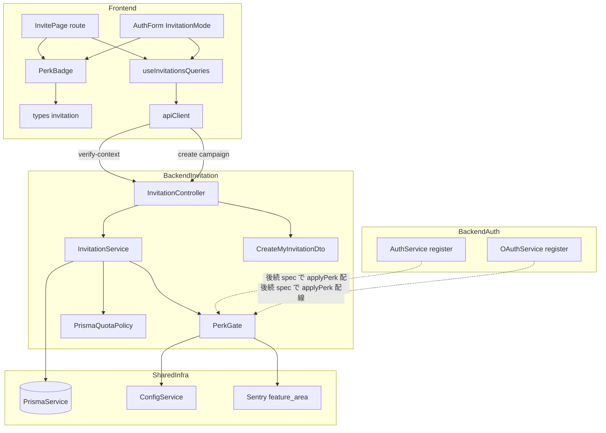
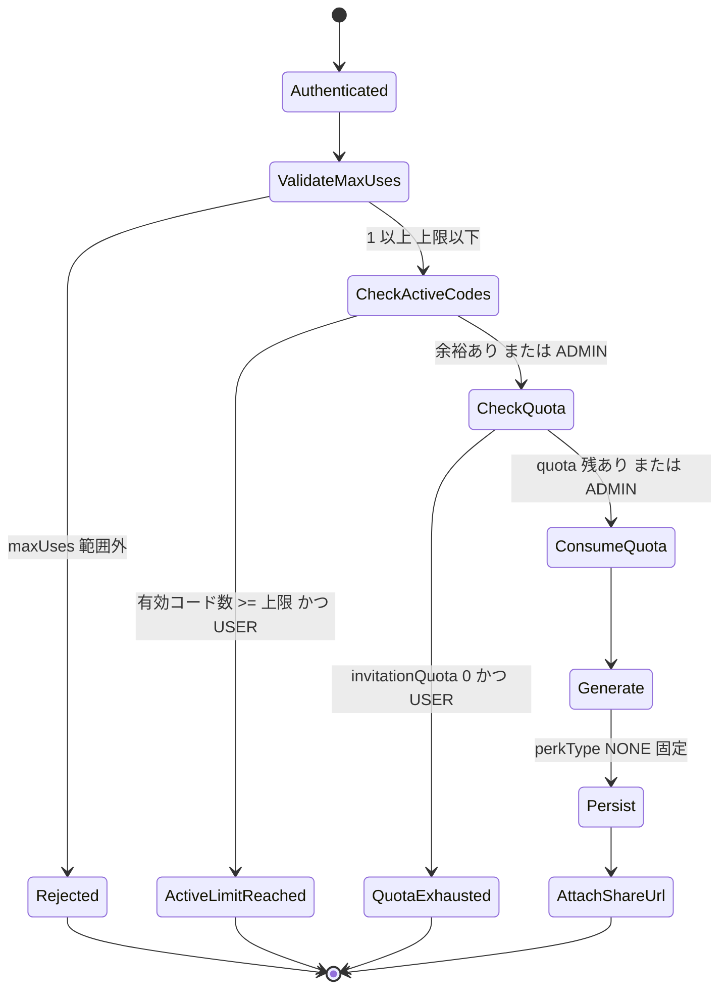
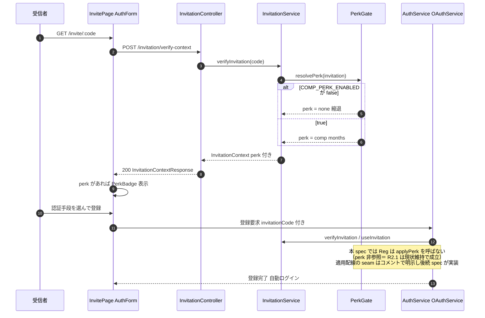
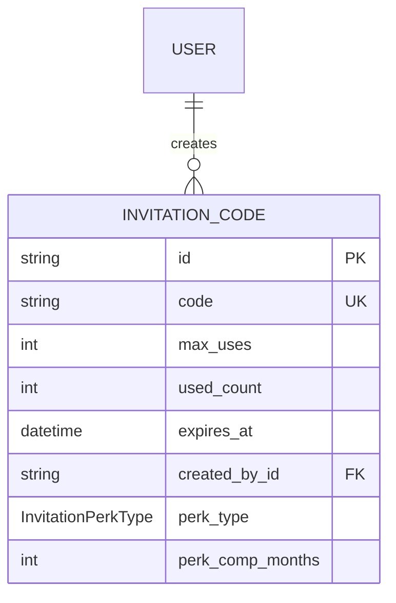
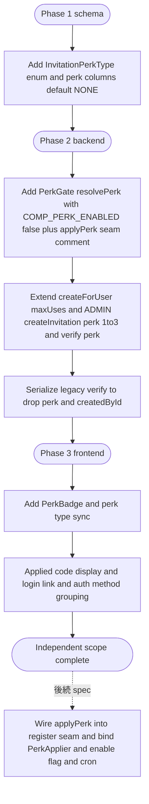

# Technical Design — invitation-perks

## Overview

本機能は、招待コードに「特典属性」を持たせ、登録前に特典価値を提示する登録体験を、既存の招待基盤（`viral-invitation` で構築済み）の拡張として実現する。実装対象は課金ウォレット基盤に依存しない**独立部**に限定する。

**Purpose**: 招待者が「何を提供する招待か」をコードに込められるようにし、招待された見込みユーザーが登録前に特典価値を理解できるようにすることで、招待からの登録転換を高める。

**Users**: 招待コードを発行する既存ユーザー / 運営（ADMIN）と、招待 URL から登録する未登録ユーザー。前者は人数キャンペーンコードを発行し、後者は `/invite/:code` で特典提示付きの登録 UI を利用する。

**Impact**: `InvitationCode` に特典属性（`perkType` / `perkCompMonths`）が加わり、`verify-context` 応答と登録 UI に特典提示が乗る。COMP 特典コードの**生成元は ADMIN の `POST /invitation` 限定**とし、`CreateInvitationDto` に perk 入力（`perkCompMonths` は monetization.md の上限に合わせ 1〜3 ヶ月）を追加する。`POST /invitation/me`（一般ユーザー）は `maxUses: 1` 固定から複数人発行可能へ拡張する（perkType=NONE 固定）。旧 `POST /invitation/verify` は生 row 返却をやめ、perk を露出しないシリアライザへ変更する。COMP 特典の**適用本体は実装せず**、機能フラグ `COMP_PERK_ENABLED`（既定 OFF）で縮退をゲートする。登録フロー（auth / oauth）への `applyPerk` 配線は**本 spec では行わず**、差し込み点（seam）を 1 箇所に明示するに留め、後続 spec が配線とともに有効化する。

### Goals

- `InvitationCode` に後方互換な特典属性を直付けし、特典の種類（COMP / なし）と COMP 継続月数を表現する（R1）
- 課金基盤未実装の間、COMP 特典付きコードでも登録を成立させ、不整合な特典状態を提示しない（R2）
- 認証済みユーザーが人数キャンペーンコード（`maxUses` 複数）を乱発ガード付きで発行できる（R3）
- 登録前に特典価値を提示し、適用済みコードの提示・ログイン導線・認証手段整理を備えた登録 UX を提供する（R4）

### Non-Goals

- COMP 無料枠の**適用本体**（`subscriptionStatus = COMP` 設定・cron 月次 ¥500 付与・期限管理・降格）— 課金ウォレット基盤完成後の**後続 spec**で実装する（R2 注記・R5.2）
- 課金ウォレット基盤（`subscriptionStatus` / `walletBalanceYen` / `spendingCapYen`）そのものの実装
- 一般ユーザーへの COMP 特典発行権限の開放（コスト管理上 ADMIN 限定とする）
- 招待実績ダッシュボード・招待報酬・ウェイトリスト

## Architecture

### Existing Architecture Analysis

| 項目                           | 現状                                                                                                                        | 本 spec での扱い                                                                                                                         |
| ------------------------------ | --------------------------------------------------------------------------------------------------------------------------- | ---------------------------------------------------------------------------------------------------------------------------------------- |
| `InvitationCode` モデル        | `code` / `maxUses` / `usedCount` / `expiresAt` / `createdById`。特典属性なし                                                | `perkType` / `perkCompMonths` を直付け（後方互換 default）                                                                               |
| `InvitationService`            | `createForUser`（`maxUses:1` 固定 + quota 消費・perk 非対応）、`createInvitation`（ADMIN・perk 非対応）、`verifyInvitation` | `createForUser` は `maxUses` 受領＋ perkType=NONE 固定、`createInvitation`（ADMIN）に perk 受領を追加、perk を verify に露出             |
| `PrismaQuotaPolicy`            | ADMIN 無制限・USER は `invitationQuota` を atomic decrement                                                                 | キャンペーン発行でも 1 コード 1 quota 消費で流用                                                                                         |
| `verify-context`               | `@Public()` + `@Throttle(30/60s)`、`InvitationContextResponse`（perk なし）                                                 | 応答に `perk` を追加（フラグ OFF 時は出さない）                                                                                          |
| `/invitation/verify`（旧 API） | `@Public()`、`findValidInvitation` の**生 Prisma row をそのまま返却**（`createdById` 等も露出）                             | 専用シリアライザ経由に変更し perk / `createdById` を除外（生 row 返却を廃止。perk 露出は `verify-context` の `PerkGate` 経路に一本化）   |
| 登録フロー（auth / oauth）     | `register` / `consumeAndIssue`（OAuth 5 社共通）が perk 非参照＝ COMP コードでも登録成立                                    | **本 spec では適用配線を足さない**（R2.1 は現状維持で成立）。`PerkGate.applyPerk` の差し込み点をコメントで明示し、配線は後続 spec が行う |
| `InvitePage` / `AuthForm`      | prefill 登録・OAuth 5 ボタン縦並び・コード編集可・特典/ログイン導線なし                                                     | 特典バッジ・適用済み提示・ログイン導線・認証手段整理を追加                                                                               |
| エラー体系                     | `ERROR_CODES.INVITATION` INV001–INV005                                                                                      | 新コード追加せず、`maxUses` 超過は `VALIDATION` で表現                                                                                   |
| Sentry `feature_area`          | enum `invitation` 定義済み、`/invitation` prefix で自動付与                                                                 | 縮退スキップ時の breadcrumb も `invitation` に揃える                                                                                     |

### Architecture Pattern & Boundary Map

採用パターンは **既存ドメイン拡張（Domain-aligned Extension）**。新規モジュールを作らず `invitation` ドメイン内に perk を直付けし、縮退判定だけを薄い `PerkGate` ヘルパーに切り出す。代替案の比較は `research.md` を参照。



**Architecture Integration**:

- **Selected pattern**: Domain-aligned Extension — 特典属性は `invitation` ドメインに閉じ、縮退判定のみ `PerkGate` に集約して登録フロー（auth / oauth）から再利用する
- **Domain/feature boundaries**: コード生成・検証・発行・quota は `InvitationService` の権威を維持。perk の「適用するか否か」の判断は `PerkGate` 1 箇所に集約し、後続 spec が適用本体を差し込む seam とする
- **Existing patterns preserved**: 1 ドメイン = 1 モジュール、`apiClient` 経由通信、`@Public()` opt-out、React Query 単一の真実の源泉、Sentry `feature_area` 自動付与、`AuthorizationService` 所有権チェック
- **New components rationale**: `PerkGate` は縮退ゲートの単一境界。本 spec では `resolvePerk` を `verify-context` が利用し、`applyPerk` は後続 spec が登録フロー seam から共有する（本 spec では配線しない）。`PerkBadge` は特典提示 UI を `AuthForm` の肥大化なく独立化。スキーマ enum `InvitationPerkType` は特典種別の型安全な表現
- **Steering compliance**: `structure.md`（ドメインモジュール）、`tech.md`（React Query 真実の源泉・グローバル JWT Guard・Sentry 契約）、`monetization.md`（COMP 仕様・既存ウォレットゲート再利用の方針）と一致

### Technology Stack

| Layer              | Choice / Version               | Role in Feature                                                | Notes                                    |
| ------------------ | ------------------------------ | -------------------------------------------------------------- | ---------------------------------------- |
| Frontend           | React 19 + Vite 6 + Tailwind 3 | `InvitePage` / `AuthForm` 改修、`PerkBadge` 新設               | 既存スタック内、新規依存なし             |
| Frontend (state)   | `@tanstack/react-query` 5.x    | `useInvitationsQueries` に perk 含む context 型を反映          | サーバ状態は React Query、Zustand 不使用 |
| Backend / Services | NestJS 11 + TypeScript         | `InvitationService` / `PerkGate` / DTO 拡張                    | 既存。新規依存なし                       |
| Data / Storage     | Prisma 6 + PostgreSQL          | `InvitationCode` に perk カラム追加、enum `InvitationPerkType` | マイグレーション 1 本（カラム追加）      |
| Config / Runtime   | env `COMP_PERK_ENABLED`        | COMP 縮退ゲートのスイッチ（既定 false）                        | Cloud Run / Vercel env に追加            |

## System Flows

### Process: 人数キャンペーンコードの発行（R3）



本フローは **3 軸**で乱発を防ぐ（R3.3 が要求する「`maxUses` 上限」と「同時に有効化できるコード数の上限」を別軸として区別する）:

1. **per-code `maxUses` 上限** — `ValidateMaxUses` を DTO の `@Min(1) @Max(MAX_CAMPAIGN_MAX_USES)` で実施し、超過は `VALIDATION.INVALID_INPUT`
2. **同時有効コード数上限** — `CheckActiveCodes` で、USER は「有効（未失効かつ `usedCount < maxUses`）なコード数」が `MAX_ACTIVE_INVITE_CODES` 未満であることをトランザクション内カウントで確認。到達時は発行拒否（`VALIDATION.INVALID_INPUT`）。ADMIN は対象外
3. **生涯発行総数** — 既存 `invitationQuota`（atomic decrement・既定 5）は*生涯の発行総数*を縛る（削除・失効でも返却しない）。`CheckQuota → ConsumeQuota` で消費

`ConsumeQuota → Generate → Persist` は既存どおり単一トランザクションで整合性を保つ。一般ユーザー経路の `perkType` は常に `NONE`。

> **発行サーフェスの設計（monetization.md の「招待制の小規模コミュニティ前提」に整合）**:
>
> - *同時*成立し得る招待登録 ≤ `MAX_ACTIVE_INVITE_CODES × MAX_CAMPAIGN_MAX_USES`
> - *生涯*の招待登録 ≤ `invitationQuota × MAX_CAMPAIGN_MAX_USES`
>
> `maxUses` 複数化により 1 ユーザー由来の登録サーフェスが従来（`maxUses:1` 固定）比で拡大する点を**許容値として明示**し、各定数は保守的初期値（目安: `MAX_ACTIVE_INVITE_CODES=3` / `MAX_CAMPAIGN_MAX_USES=20` / `invitationQuota` 既定 5）に置く。必要なら `MAX_CAMPAIGN_MAX_USES` を下げて調整する。`invitationQuota` 既定の妥当性はキャンペーン運用開始後に再評価する。

### Sequence: 特典付き招待の検証・登録と COMP 縮退（R2・R4）



検証は表示用と消費用で重複するが、`viral-invitation` の既存方針（表示専用 / 消費直前）を踏襲する。perk の**解決**（`resolvePerk`）は `verify-context` のみが `PerkGate` を経由し、フラグ OFF の間は perk を `none` に縮退させて「提示しない」状態に統一する。perk の**適用**（`applyPerk`）は本 spec のスコープ外で、登録フローへの配線は後続 spec が seam に差し込む（本 spec は登録フローを改変しない＝ R2.1 を現状維持で満たす）。

## Requirements Traceability

| Requirement | Summary                                                | Components                                                                                                        | Interfaces                                                                           | Flows            |
| ----------- | ------------------------------------------------------ | ----------------------------------------------------------------------------------------------------------------- | ------------------------------------------------------------------------------------ | ---------------- |
| 1.1         | 特典の種類属性を保持・設定可能にする                   | Prisma `InvitationCode`, `InvitationPerkType`, `CreateInvitationDto`（ADMIN）                                     | `perkType`（`POST /invitation` で書込）                                              | 発行             |
| 1.2         | COMP 継続月数属性を保持・設定可能にする                | Prisma `InvitationCode`, `CreateInvitationDto`（ADMIN）                                                           | `perkCompMonths`（`@Min(1) @Max(3)`）                                                | 発行             |
| 1.3         | 既存コードを特典なしに後方互換                         | Prisma migration                                                                                                  | `@default(NONE)`                                                                     | 発行             |
| 1.4         | 過剰な種別テーブルを避け最小構造                       | Prisma `InvitationCode`                                                                                           | カラム直付け                                                                         | —                |
| 2.1         | 基盤未実装時も COMP コードで登録成立                   | `AuthService.register`, `OAuthService.consumeAndIssue`（perk 非参照のまま改変しない）                             | 登録フロー現状維持＋ `applyPerk` seam コメント                                       | 登録（現状維持） |
| 2.2         | 不整合な特典状態を提示しない                           | `PerkGate`, `InvitationService.verifyInvitation`, `/invitation/verify` シリアライザ                               | `resolvePerk`（フラグ OFF で none）＋ verify から perk 除外                          | 検証 + 縮退      |
| 2.3         | 適用本体を本 spec で実装せず後続へ切り離す             | `PerkGate`（`resolvePerk` のみ）, 登録フロー TODO seam                                                            | seam コメント（`applyPerk` は後続 spec で追加）                                      | 登録 + 縮退      |
| 2.4         | 後続適用は COMP 正典準拠・既存ガード再利用の余地を残す | `PerkGate` seam, `research.md`                                                                                    | `PerkApplier`（後続 spec で定義）                                                    | —                |
| 3.1         | `maxUses` 複数のコード発行をサポート                   | `InvitationService.createForUser`, `CreateMyInvitationDto`                                                        | `POST /invitation/me`                                                                | 発行             |
| 3.2         | 認証済みユーザーのみ発行・未認証拒否                   | `InvitationController`（JWT 既定保護）                                                                            | `POST /invitation/me`                                                                | 発行             |
| 3.3         | `maxUses` 上限と同時有効コード数上限                   | `CreateMyInvitationDto`（per-code）, `InvitationService.createForUser`（同時有効数）, `PrismaQuotaPolicy`（生涯） | `@Max(MAX_CAMPAIGN_MAX_USES)`, `MAX_ACTIVE_INVITE_CODES` カウント, `invitationQuota` | 発行             |
| 3.4         | 上限超過の発行を拒否し理由提示                         | `CreateMyInvitationDto`, `InvitationController`                                                                   | `VALIDATION.INVALID_INPUT` / `QUOTA_EXHAUSTED`                                       | 発行             |
| 3.5         | `usedCount` 増加・`maxUses` 到達で追加登録拒否         | `InvitationService.findValidInvitation/useInvitation`                                                             | 既存ロジック                                                                         | 登録             |
| 3.6         | 課金基盤非依存で成立                                   | `InvitationService`（perkType NONE 経路）                                                                         | —                                                                                    | 発行             |
| 4.1         | 検証応答に特典情報を含める                             | `InvitationContextResponse`, `types/invitation.ts`                                                                | `verify-context` の `perk`                                                           | 検証             |
| 4.2         | 適用済みコードを提示し編集を要求しない                 | `AuthForm` 改修                                                                                                   | `prefilledInvitationCode` 読み取り提示                                               | 登録 UX          |
| 4.3         | 特典価値を見える形で提示                               | `PerkBadge`, `InvitePage`                                                                                         | `InvitationPerkView`                                                                 | 登録 UX          |
| 4.4         | ログインへの遷移導線                                   | `AuthForm` 改修                                                                                                   | login 切替                                                                           | 登録 UX          |
| 4.5         | 認証手段の選択過多を回避                               | `AuthForm` 改修                                                                                                   | 主要手段 + 展開                                                                      | 登録 UX          |
| 4.6         | 特典未構成でも破綻しない                               | `PerkBadge`, `AuthForm`                                                                                           | `perk` 不在時の分岐                                                                  | 登録 UX          |
| 5.1         | 実装対象を独立部に限定                                 | design スコープ                                                                                                   | —                                                                                    | —                |
| 5.2         | COMP 適用本体を後続 spec の責務に切り離す              | `PerkGate` seam                                                                                                   | `PerkApplier`                                                                        | —                |
| 5.3         | 縮退挙動のみ本 spec で担保                             | `PerkGate`                                                                                                        | フラグゲート                                                                         | 縮退             |
| 5.4         | 課金状態の真実源泉を Stripe/DB としフロント複製しない  | `PerkGate`, 設計方針                                                                                              | —                                                                                    | —                |
| 5.5         | 既存招待基盤の流用を第一候補とする                     | `InvitationService` 拡張                                                                                          | 既存メソッド拡張                                                                     | —                |

## Components and Interfaces

| Component                                   | Domain/Layer     | Intent                                                                                  | Req Coverage                      | Key Dependencies (P0/P1)                                  | Contracts |
| ------------------------------------------- | ---------------- | --------------------------------------------------------------------------------------- | --------------------------------- | --------------------------------------------------------- | --------- |
| `InvitationPerkType` enum                   | Backend / Schema | 特典種別の型安全な表現（NONE / COMP）                                                   | 1.1                               | Prisma (P0)                                               | State     |
| `InvitationCode`（拡張）                    | Backend / Schema | 特典属性を直付けで保持                                                                  | 1.1, 1.2, 1.3, 1.4                | Prisma (P0)                                               | State     |
| `InvitationService`（拡張）                 | Backend / Domain | perk を含む検証・キャンペーン発行（同時有効数ガード）・ADMIN COMP 発行                  | 1.1, 1.2, 3.1, 3.3, 3.5, 3.6, 4.1 | `PrismaService` (P0), `PerkGate` (P0), `QuotaPolicy` (P0) | Service   |
| `PerkGate`                                  | Backend / Domain | COMP 縮退の単一判断点（`resolvePerk` のみ稼働・適用は後続 spec）                        | 2.1, 2.2, 2.3, 2.4, 5.2, 5.3      | `ConfigService` (P0), `Sentry` (P1)                       | Service   |
| `CreateMyInvitationDto`                     | Backend / DTO    | キャンペーン発行入力の検証（`maxUses` 範囲）                                            | 3.1, 3.3, 3.4                     | `class-validator` (P0)                                    | API       |
| `CreateInvitationDto`（拡張・ADMIN）        | Backend / DTO    | COMP 発行入力の検証（`perkType` / `perkCompMonths` 1〜3）                               | 1.1, 1.2                          | `class-validator` (P0)                                    | API       |
| `InvitationController`（拡張）              | Backend / API    | キャンペーン発行受付・ADMIN COMP 発行受付・perk 付き検証応答・verify シリアライザ       | 1.1, 1.2, 3.2, 3.4, 4.1           | `InvitationService` (P0)                                  | API       |
| `AuthService` / `OAuthService`（seam のみ） | Backend / Domain | perk 非参照のまま現状維持。`applyPerk` 差し込み点をコメントで明示（本 spec では未配線） | 2.1                               | —（本 spec では `PerkGate` 非依存）                       | Service   |
| `types/invitation.ts`（拡張）               | Frontend / Types | perk 含む context 型を backend と同期                                                   | 4.1                               | —                                                         | State     |
| `PerkBadge`                                 | Frontend / UI    | 特典価値の可視化（特典なしで非表示）                                                    | 4.3, 4.6                          | `types/invitation` (P0)                                   | UI        |
| `InvitePage` / `AuthForm`（改修）           | Frontend / UI    | 適用済み提示・ログイン導線・認証手段整理・バッジ配置                                    | 4.2, 4.4, 4.5, 4.6                | `useInvitationsQueries` (P0), `PerkBadge` (P0)            | UI        |

詳細ブロックは新規境界を持つ `PerkGate` / `InvitationService` 拡張 / `InvitationController` 拡張 / スキーマに限定し、UI は Implementation Note で補足する。

---

### Backend / Schema

#### `InvitationPerkType` enum + `InvitationCode` 拡張

| Field        | Detail                                                     |
| ------------ | ---------------------------------------------------------- |
| Intent       | 招待コードに特典の種類と COMP 継続月数を後方互換で持たせる |
| Requirements | 1.1, 1.2, 1.3, 1.4                                         |

**Responsibilities & Constraints**

- `perkType` は `NONE`（既定）/ `COMP` の 2 値。既存レコードは `@default(NONE)` で特典なしに吸収（1.3）
- `perkCompMonths` は `COMP` 時の継続月数のみ意味を持つ nullable Int。`NONE` 時は `null`。許容範囲は **1〜3**（monetization.md の「COMP は最大 3 ヶ月＝1 人 max ¥1500」上限に一致）
- 種別テーブル・階層参照は導入しない（1.4）。整合（`COMP` なら `perkCompMonths` は 1〜3 で必須 / `NONE` なら `null`）は書込 DTO（`CreateInvitationDto`）とサービス層で保証

**Contracts**: State [x]

##### State Management

```prisma
enum InvitationPerkType {
  NONE
  COMP
}

model InvitationCode {
  // 既存フィールドは不変
  perkType       InvitationPerkType @default(NONE) @map("perk_type")
  perkCompMonths Int?               @map("perk_comp_months")
}
```

**Implementation Notes**

- Integration: マイグレーション 1 本（enum 追加 + 2 カラム追加）。既存 index・FK は不変
- Validation: `COMP` かつ `perkCompMonths` が 1〜3 の整数であることを書込 DTO とサービス層で検証（範囲外は 400）。`NONE` のとき `perkCompMonths` は `null`
- Risks: enum 追加は PostgreSQL で安全（既存行は default 適用）。ダウングレード時はカラム drop のみ

---

### Backend / Invitation ドメイン

#### `PerkGate`

| Field        | Detail                                                                 |
| ------------ | ---------------------------------------------------------------------- |
| Intent       | COMP 特典の「解決」と「適用」を単一境界に集約し、縮退を 1 点で制御する |
| Requirements | 2.1, 2.2, 2.3, 2.4, 5.2, 5.3                                           |

**Responsibilities & Constraints**

- `resolvePerk(invitation)`【本 spec で稼働・`PerkGate` の唯一の公開メソッド】: `COMP_PERK_ENABLED` が false の間は常に `{ type: 'none' }` を返す（2.2 縮退）。true かつ `perkType=COMP` のとき `{ type: 'comp', months }` を返す。**呼び出し元は `verify-context` のみ**（登録フローは呼ばない）
- **適用本体（`applyPerk` / `PerkApplier`）は本 spec では定義も配線もしない**。`subscriptionStatus=COMP` 設定・月次付与は課金ウォレット基盤に依存するため、後続 spec が `PerkGate` に適用メソッドを足し、登録フロー（auth / oauth）seam に配線する（2.3, 2.4, 5.2）。本 spec の登録フローは perk 非参照のまま現状維持で R2.1 が成立する
- **投機的な no-op メソッドを出荷しない**。本 spec のどの実行経路にも乗らない `applyPerk` を no-op で置くと、誤配線・フラグ誤 ON 時に「COMP が無言でスキップされる」foot-gun になる。よって本 spec の `PerkGate` interface には適用系を載せず、seam は登録フローの **TODO コメント 1 箇所**でのみ宣言する
- 課金状態をフロントへ複製しない（5.4。perk は「コードの属性」のみ露出し、ユーザーの課金状態は返さない）

**Dependencies**

- Outbound: `ConfigService.compPerkEnabled` — フラグ読み出し（P0）
- Outbound: `Sentry` — 縮退 breadcrumb（`feature_area: invitation`）（P1）
- Future（後続 spec・本 spec の依存ではない）: 適用メソッド＋ `PerkApplier` を `PerkGate` に追加し登録フロー seam へ配線

**Contracts**: Service [x]

##### Service Interface

```typescript
import { InvitationPerkType } from '@prisma/client'; // schema enum を型の一次ソースにする（手書き union での drift を避ける）

export type InvitationPerkView = { type: 'none' } | { type: 'comp'; months: number };

// 本 spec の PerkGate は resolvePerk のみを公開する。
// COMP 適用本体（applyPerk / PerkApplier）は課金ウォレット基盤に依存するため後続 spec で追加・配線する（R2.3 / R2.4 / R5.2）。
export interface PerkGate {
	resolvePerk(invitation: {
		perkType: InvitationPerkType;
		perkCompMonths: number | null;
	}): InvitationPerkView;
}
```

- Preconditions: `resolvePerk` は検証済み `InvitationCode` の perk 属性（`perkType` / `perkCompMonths`）を引数に取る
- Postconditions: フラグ OFF の間、`resolvePerk` は必ず `{ type: 'none' }`。適用経路は本 spec の `PerkGate` に存在しない（公開メソッドは `resolvePerk` のみ）
- Invariants: 課金カラムへの書き込みは本 spec では一切発生しない（課金カラム未実装。適用は後続 spec の責務）

**Implementation Notes**

- Integration: `resolvePerk` は `InvitationService.verifyInvitation`（＝ `verify-context` 経路）からのみ呼ぶ。`applyPerk` は本 spec では呼ばず、`AuthService.register` / `OAuthService.consumeAndIssue` の招待消費直後に**差し込み点を示すコメント**（`// TODO(comp-perk-apply): 後続 spec で PerkGate.applyPerk を配線`）を置くに留める
- Validation: フラグ ON かつ `perkType=COMP` かつ `perkCompMonths` 不正時は `resolvePerk` で `{ type: 'none' }` にフォールバックし、Sentry に警告
- Risks: `PerkApplier` 未注入のまま誤ってフラグ ON にすると COMP が適用されない。後続 spec は「フラグ ON = `PerkApplier` バインド＋登録フロー配線済み」を移行手順で保証する

#### `InvitationService`（拡張）

| Field        | Detail                                                                                |
| ------------ | ------------------------------------------------------------------------------------- |
| Intent       | perk を含む検証応答の生成、`maxUses` 可変なキャンペーン発行、ADMIN の COMP 発行を担う |
| Requirements | 1.1, 1.2, 3.1, 3.5, 3.6, 4.1                                                          |

**Responsibilities & Constraints**

- `verifyInvitation` の戻り値 `InvitationContext` に `perk: InvitationPerkView` を追加し、`PerkGate.resolvePerk` の結果を載せる（4.1, 2.2）
- `createForUser(actor, { maxUses })` に拡張。`maxUses` 既定 1、`perkType` は **NONE 固定**（一般ユーザーは COMP を発行不可、3.6）。トランザクション冒頭で USER の**有効コード数**（未失効かつ `usedCount < maxUses`）を数え、`MAX_ACTIVE_INVITE_CODES` 到達なら発行拒否（`VALIDATION.INVALID_INPUT`）。これが R3.3 の「同時に有効化できるコード数の上限」軸。ADMIN は対象外（3.3）
- `createInvitation(dto, adminId)`（ADMIN 限定）に perk passthrough を追加。`dto.perkType` / `dto.perkCompMonths` を `create` データへ反映し、**COMP コードの唯一の生成元**とする（1.1, 1.2）。`perkType=COMP` のとき `perkCompMonths` は 1〜3 必須、`NONE` のとき `null` をサービス層で再保証
- `findValidInvitation` / `useInvitation` の `usedCount` 制御は既存どおり（3.5）

**Dependencies**

- Inbound: `InvitationController`（P0）
- Outbound: `PrismaService`（P0）、`PerkGate`（P0）、`PrismaQuotaPolicy`（P0）

**Contracts**: Service [x]

##### Service Interface（追加・変更分）

```typescript
export interface InvitationContext {
	code: string;
	status: 'valid';
	creator: { id: string; name: string | null; maskedId: string };
	expiresAt: Date | null;
	usesRemaining: number;
	perk: InvitationPerkView; // 追加（フラグ OFF 時は { type: 'none' }）
}

export interface CreateCampaignOptions {
	maxUses: number; // 1..MAX_CAMPAIGN_MAX_USES、perkType は NONE 固定
}

export interface InvitationServiceAdditions {
	createForUser(
		actor: { id: string; role: 'USER' | 'ADMIN' },
		options?: CreateCampaignOptions,
	): Promise<InvitationCode>;
	// ADMIN 経路: perkType=COMP のとき perkCompMonths は 1..3 必須（COMP コードの唯一の生成元）
	createInvitation(dto: CreateInvitationDto, adminId: string): Promise<InvitationCode>;
}
```

- Preconditions: `createForUser` は actor が認証済み。`options.maxUses` は DTO で範囲検証済み
- Postconditions: USER は quota を 1 減算、ADMIN は不変。発行コードの `perkType=NONE`
- Invariants: `usedCount <= maxUses`、`invitationQuota >= 0`、一般発行コードに COMP は付かない

**Implementation Notes**

- Integration: `createForUser` のトランザクション内で `maxUses` を `create` データに反映。quota 消費は既存 `PrismaQuotaPolicy` を流用
- Validation: `maxUses` 範囲は DTO（下記）で保証し、サービス層は信頼境界として再検証しない
- Risks: 既存呼び出し（引数なし `createForUser(actor)`）の後方互換を保つため `options` は省略可能・既定 `maxUses:1`

#### `CreateMyInvitationDto` / `CreateInvitationDto` + `InvitationController`（拡張）

| Field        | Detail                                                                                                      |
| ------------ | ----------------------------------------------------------------------------------------------------------- |
| Intent       | キャンペーン発行入力・ADMIN COMP 発行入力を検証し、perk 付き検証応答を返す。verify 系の perk 露出を制御する |
| Requirements | 1.1, 1.2, 3.2, 3.3, 3.4, 4.1                                                                                |

**Responsibilities & Constraints**

- `POST /invitation/me` は JWT 既定保護（未認証は 401、3.2）。body に `maxUses?`（既定 1）を受ける
- `maxUses` は `@IsInt() @Min(1) @Max(MAX_CAMPAIGN_MAX_USES)`。超過は `VALIDATION.INVALID_INPUT`（3.4）
- **同時有効コード数上限**（`MAX_ACTIVE_INVITE_CODES`）は DTO では表現できない（既存コード状態への参照が要るため）。`InvitationService.createForUser` のトランザクション内カウントで担保し、到達時は `VALIDATION.INVALID_INPUT`（理由文言「同時に有効な招待コードは最大 N 個までです」）（3.3）
- `POST /invitation`（ADMIN・既存 `AdminGuard`）の `CreateInvitationDto` に `perkType?`（既定 `NONE`）/ `perkCompMonths?` を追加。`perkType=COMP` のとき `perkCompMonths` は `@Min(1) @Max(3)` で必須（`@ValidateIf`）、`NONE` のとき欠落必須。違反は `VALIDATION.INVALID_INPUT`（1.1, 1.2）
- `verify-context` 応答 `InvitationContextResponse` に `perk` を追加（4.1）
- `POST /invitation/verify`（旧 API）は `findValidInvitation` の生 row を返さず、`InvitationVerificationResponse`（perk・`createdById` を含まない）へ写像するシリアライザを通す（2.2 漏洩防止）
- quota 枯渇は既存 `QUOTA_EXHAUSTED`（3.4）

**Contracts**: API [x]

##### API Contract（追加・変更分）

| Method | Endpoint                       | Request                                                                        | Response                                                            | Errors                                              |
| ------ | ------------------------------ | ------------------------------------------------------------------------------ | ------------------------------------------------------------------- | --------------------------------------------------- |
| POST   | `/invitation/me`               | `CreateMyInvitationDto`（`maxUses?`）                                          | `InvitationWithShareUrlResponse`                                    | 400 `INVALID_INPUT`, 400 `QUOTA_EXHAUSTED`, 401     |
| POST   | `/invitation`（ADMIN）         | `CreateInvitationDto`（`maxUses? / expiresAt? / perkType? / perkCompMonths?`） | `InvitationWithShareUrlResponse`                                    | 400 `INVALID_INPUT`, 401, 403                       |
| POST   | `/invitation/verify`（旧 API） | `{ code }`                                                                     | `InvitationVerificationResponse`（perk / `createdById` を含まない） | 400 `INVALID_CODE` / `EXPIRED` / `MAX_USES_REACHED` |
| POST   | `/invitation/verify-context`   | `{ code }`                                                                     | `InvitationContextResponse`（`perk` 付き）                          | 400 `INVALID_CODE` / `EXPIRED` / `MAX_USES_REACHED` |

```typescript
export class CreateMyInvitationDto {
	@IsOptional()
	@IsInt()
	@Min(1)
	@Max(MAX_CAMPAIGN_MAX_USES)
	maxUses?: number = 1;
}

// ADMIN 専用。COMP コードの唯一の生成元（既存フィールドに perk を追加）
export class CreateInvitationDto {
	@IsOptional()
	@IsInt()
	@Min(1)
	maxUses?: number = 1;

	@IsOptional()
	@IsDateString()
	expiresAt?: string;

	@IsOptional()
	@IsEnum(InvitationPerkType)
	perkType?: InvitationPerkType = InvitationPerkType.NONE;

	// perkType=COMP のときのみ必須・1..3（monetization.md の最大 3 ヶ月＝¥1500/人 に一致）
	@ValidateIf((o) => o.perkType === InvitationPerkType.COMP)
	@IsInt()
	@Min(1)
	@Max(3)
	perkCompMonths?: number;
}

export interface InvitationContextResponse {
	code: string;
	status: 'valid';
	creator: { name: string | null; maskedId: string };
	expiresAt: string | null;
	usesRemaining: number;
	perk: InvitationPerkView; // { type:'none' } または { type:'comp', months }
}
```

**Implementation Notes**

- Integration: `createMyInvitation` ハンドラで `dto.maxUses` を `createForUser(actor, { maxUses })` に渡す。`createInvitation`（ADMIN）ハンドラは `dto`（perk 含む）をそのまま `invitationService.createInvitation` に渡す。`toInvitationContextResponse` に `perk` を写像
- Integration（verify 漏洩対策）: `verifyInvitation`（`POST /invitation/verify`）ハンドラを生 row 返却から `toInvitationVerificationResponse(invitation)`（perk / `createdById` を除外）経由へ変更。perk 露出口は `verify-context`（`PerkGate` 経由）に一本化
- Validation: `MAX_CAMPAIGN_MAX_USES` / `MAX_ACTIVE_INVITE_CODES` は `invitation` の定数に置きフロントと共有。超過メッセージは「招待人数は最大 N 人までです」/「同時に有効な招待コードは最大 N 個までです」。`perkType=COMP` かつ `perkCompMonths` 範囲外は「COMP の付与月数は 1〜3 ヶ月です」
- Risks: 既存クライアント（body なし POST）の後方互換を保つため `maxUses` / `perkType` は省略可（既定 `NONE`）

---

### Frontend / UI（Summary-only）

#### `PerkBadge`

- 役割: `InvitationPerkView` を受け、`comp` のとき「🎁 AI 無料枠つき（N ヶ月）」等のバッジを描画。`none`（特典未構成・フラグ OFF）のときは **何も描画しない**（4.3, 4.6）
- 場所: `frontend/src/components/auth/PerkBadge.tsx`
- Implementation Note: 表示文言は perk の `type` / `months` から導出。金額等の内部情報は受け取らない（PII / 内部コスト非露出）

#### `InvitePage` / `AuthForm`（改修）

- `types/invitation.ts` の `InvitationContextResponse` に `perk` を追加（backend 同期、4.1）
- `InvitePage`: 取得した context の `perk` を `AuthForm` に渡し、`PerkBadge` を招待者名の近傍に配置（4.3）
- `AuthForm.InvitationModeForm`:
  - 招待コードを**適用済みとして提示**（読み取り専用バッジ表示にし、`onChange` 編集 input を既定で出さない。4.2）
  - **ログイン導線**を追加（「既にアカウントをお持ちですか？ ログイン」で login モードへ切替。4.4）
  - **認証手段の整理**: 主要な少数（例: メール + Google）を既定表示し、残り（GitHub / LINE / Apple / X）は「他の方法で登録」展開の先に配置（4.5）
  - `perk` 不在時もレイアウトが破綻しないこと（4.6）
- Implementation Note: 既存 `AuthForm.newflow.test.tsx` / `EmailAuthForm.newflow.test.tsx` を改修に追従。`PROVIDER_LABELS` の出し分け（主要 / 展開）は表示順の定数で制御

## Data Models

### Logical Data Model



- `perk_type`: 既存レコードは migration default `NONE`。一般ユーザー発行は常に `NONE`、`COMP` は ADMIN 発行かつフラグ ON 運用時のみ意味を持つ
- `perk_comp_months`: `COMP` 時のみ正の整数、`NONE` 時 `null`
- 参照整合・index は `viral-invitation` から不変

### Physical Data Model

```prisma
model InvitationCode {
  id             String             @id @default(cuid())
  code           String             @unique @db.VarChar(50)
  maxUses        Int                @default(1) @map("max_uses")
  usedCount      Int                @default(0) @map("used_count")
  expiresAt      DateTime?          @map("expires_at")
  createdAt      DateTime           @default(now())
  updatedAt      DateTime           @updatedAt
  createdById    String             @map("created_by_id")
  perkType       InvitationPerkType @default(NONE) @map("perk_type")
  perkCompMonths Int?               @map("perk_comp_months")
  user           User               @relation(fields: [createdById], references: [id], onDelete: Cascade)

  @@map("invitation_codes")
}
```

**マイグレーション内容**:

1. `CREATE TYPE "InvitationPerkType" AS ENUM ('NONE', 'COMP')`
2. `ALTER TABLE invitation_codes ADD COLUMN perk_type "InvitationPerkType" NOT NULL DEFAULT 'NONE'`
3. `ALTER TABLE invitation_codes ADD COLUMN perk_comp_months INTEGER`
4. 既存行はデフォルトで `NONE` 初期化（追加 UPDATE 不要）

### Data Contracts & Integration

- `InvitationPerkView` は backend / frontend で共有する型（`INVITATION_ERROR_CODES` と同様「backend 同期」コメントを付与）
- `verify-context` 応答に `perk` を追加。フラグ OFF の間は常に `{ type: 'none' }`（後方互換: 既存クライアントは未知フィールドを無視）

## Error Handling

### Error Strategy

- `maxUses` 範囲外 / `perkCompMonths` 範囲外（1〜3 外）/ `COMP` で months 欠落: DTO `@Max` / `@Min` / `@ValidateIf` 違反 → `VALIDATION.INVALID_INPUT`（400）。専用 INV コードは追加しない
- quota 枯渇: 既存 `INVITATION.QUOTA_EXHAUSTED`（400）
- 期限切れ・上限到達・無効コード: 既存 `INVITATION.{EXPIRED, MAX_USES_REACHED, INVALID_CODE}` を流用
- COMP 縮退: **エラーではない**。フラグ OFF の間は `resolvePerk` が `none` を返し、登録フローは perk を参照しない（`applyPerk` 未配線）。フラグ ON 後に適用がスキップされた場合の Sentry breadcrumb（`feature_area: invitation`, `invitation_perk: comp_skipped`）は後続 spec の適用本体側で残す

### Error Categories and Responses

- **User Errors (400)**: `INVALID_INPUT`（maxUses 上限超過）/ `QUOTA_EXHAUSTED`（発行枠）/ `INVALID_CODE` ほか → フロントは `code` ベースで日本語文言（`invitationErrorMessages`）を表示
- **User Errors (401)**: 未認証で `POST /invitation/me` → グローバル JWT Guard が 401
- **縮退（非エラー）**: COMP 適用スキップは登録成功として完了し、ユーザーには特典適用済みと表示しない（2.2）

### Monitoring

- Sentry: `feature_area: invitation` で自動分類。本 spec では ADMIN の COMP コード発行（`perkType=COMP`）を breadcrumb で記録し、後続 spec 着手時に「フラグ OFF 期間の COMP コード流通量」を把握可能にする。適用スキップの breadcrumb は `applyPerk` を配線する後続 spec の責務

## Testing Strategy

### Unit Tests

- `PerkGate.resolvePerk`: フラグ OFF → 常に `none` / フラグ ON + COMP → `comp months` / ON + 不正 months → `none` フォールバック
- `PerkGate` のサーフェス: 公開メソッドが `resolvePerk` のみで、適用系（`applyPerk`）を持たないこと（本 spec のスコープを resolvePerk に限定する回帰）
- `InvitationService.createForUser`: `maxUses` 反映・`perkType=NONE` 固定・quota 1 減算（USER）/ 不変（ADMIN）・有効コード数が `MAX_ACTIVE_INVITE_CODES` 到達で発行拒否（USER）/ ADMIN は同時有効数の制約なし
- `InvitationService.createInvitation`（ADMIN）: `perkType=COMP` + `perkCompMonths` を `create` に反映 / `perkType=NONE` で `perkCompMonths=null`
- `CreateMyInvitationDto`: `maxUses` 0 / 上限超過 / 範囲内の 3 ケース
- `CreateInvitationDto`（ADMIN）: `COMP` + months 未指定 → 400 / `COMP` + months 4 → 400 / `COMP` + months 1〜3 → OK / `NONE` + months 指定 → 400

### Integration Tests

- `POST /invitation/me`（`maxUses: 5`）→ 複数人コード発行・quota 減算、`maxUses: 0` → 400、未認証 → 401
- `POST /invitation/me`（同時有効数）: USER が `MAX_ACTIVE_INVITE_CODES` 個の有効コードを保持中にさらに発行 → 400「同時に有効な…」。1 個を使い切り（`usedCount=maxUses`）or 失効させた後は再発行可。ADMIN は同上限を受けない
- `POST /invitation`（ADMIN）: `perkType=COMP, perkCompMonths=3` → 発行成功 / `perkCompMonths=12` → 400 / 非 ADMIN → 403
- `POST /invitation/verify`（旧 API）: COMP コードでも応答 body に `perkType` / `perkCompMonths` / `createdById` が**含まれない**（漏洩リグレッション）
- `POST /invitation/verify-context`: フラグ OFF で `perk: { type:'none' }`、ON + COMP コードで `perk: { type:'comp', months }`
- 登録フロー（email / OAuth）: COMP コードでも登録成立し、登録フローは perk 非参照のまま（`PerkGate` の適用系を一切呼ばない＝ R2.1 現状維持）。課金カラムは未実装のため書き込み対象が存在しないことを確認

### E2E/UI Tests

- `/invite/:code`（特典なしコード）→ バッジ非表示・適用済みコード提示・ログイン導線・主要手段＋展開が表示される
- 認証手段の展開操作で残りプロバイダが現れる（4.5）
- 既存ユーザーがログイン導線から login モードへ遷移できる（4.4）

## Security Considerations

- **COMP 発行の権限分離**: 一般ユーザー経路（`createForUser`）は `perkType=NONE` 固定。COMP 付き発行は ADMIN（`AdminGuard` 保護の `POST /invitation`）限定
- **コスト上限の源流ロック**: `perkCompMonths` を書込 DTO で `@Max(3)` 制約し、1 人あたり最大 ¥1500（¥500×3 ヶ月）を**生成時点で構造的に保証**（monetization.md 準拠。後続 spec の付与本体に過大月数が流れない）
- **縮退ゲート**: `COMP_PERK_ENABLED` 既定 false。基盤未完成での誤適用を構造的に防止（フラグ ON は後続 spec が `PerkApplier` バインド＋登録フロー配線と同時に行う）
- **perk 露出口の一本化**: perk を返すのは `verify-context`（`PerkGate` 経由・フラグ OFF で `none`）のみ。旧 `POST /invitation/verify` は専用シリアライザで perk / `createdById` を除外し、ゲートを迂回した生 row 露出を塞ぐ（2.2, 5.4）
- **PII / 内部情報非露出**: `verify-context` の `perk` は種別と月数のみ。金額・課金状態・ユーザー個人情報は含めない（既存 PII ポリシー・5.4 準拠）
- **発行乱発耐性（3 軸 + Throttler）**: `invitationQuota`（生涯発行総数・atomic decrement）＋ `MAX_ACTIVE_INVITE_CODES`（同時有効コード数・サービス層トランザクション内カウント）＋ `MAX_CAMPAIGN_MAX_USES`（per-code 上限・DTO `@Max`）の多層防御に、`verify-context` Throttler（既存 30/60s）を重ねる。同時発行サーフェスは `MAX_ACTIVE_INVITE_CODES × MAX_CAMPAIGN_MAX_USES`、生涯サーフェスは `invitationQuota × MAX_CAMPAIGN_MAX_USES` に構造上限。小規模コミュニティ前提（monetization.md）に合わせ各定数は保守的初期値を採る

## Migration Strategy



**ロールバック基準**:

- Phase 2 で `verify-context` の 5xx 率が 1% を超えたら backend ロールバック（perk は付加情報のため旧クライアント影響なし）
- Phase 3 で新規招待登録成功数が直前比 50% 未満なら frontend ロールバック

**検証チェックポイント**: 各 phase で `npx prisma migrate status`、`COMP_PERK_ENABLED=false` の確認、Sentry `feature_area: invitation` のエラー件数を確認する。

## Supporting References

- COMP 適用本体の正典仕様（後続 spec が実装）は [.kiro/steering/monetization.md](../../steering/monetization.md) を参照
- 招待基盤の現行設計（`InvitationService` / `InvitePage` / `AuthForm` / `QuotaPolicy`）は [.kiro/specs/viral-invitation/design.md](../viral-invitation/design.md) を参照
- 設計判断の詳細（perk 直付け・縮退フラグ・キャンペーン perk=NONE・maxUses バリデーション）は [research.md](./research.md) を参照
