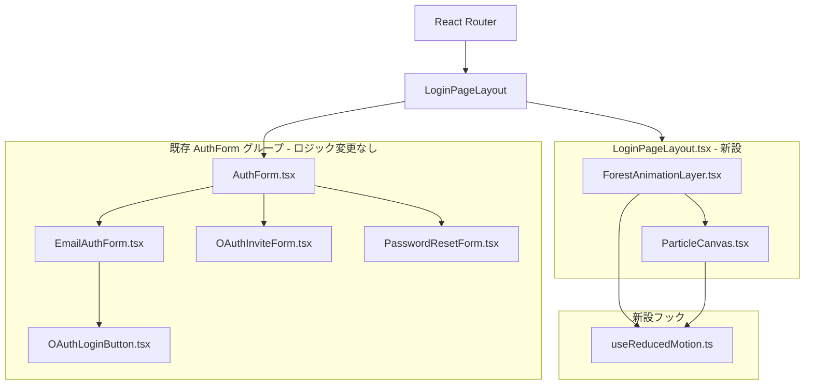
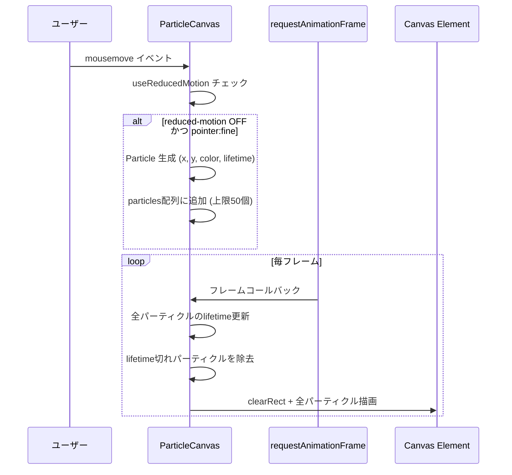

# Technical Design: ログイン画面ビジュアルリデザイン（深緑の森テーマ）

## Overview

ログイン画面を「深緑の森」テーマで全面リデザインする。既存のauth系コンポーネント（AuthForm / EmailAuthForm / OAuthInviteForm / PasswordResetForm / OAuthLoginButton）のロジックを一切変更せず、ビジュアルレイヤーのみを刷新する。

**Purpose**: ユーザーがMosakuを初めて触れる瞬間（ログイン画面）に「使いたくなるデザイン」という価値提案を体現する。  
**Users**: 全ユーザー（ログイン・新規登録・パスワードリセット）  
**Impact**: `AuthForm.tsx` をラップする `LoginPageLayout` を新設し、既存コンポーネントのTailwindクラスを深緑テーマに置き換える。バックエンド変更なし。

### Goals

- 深緑グラデーション背景・霧/葉アニメーション・マウスパーティクルによる没入感の実現
- 外部JSライブラリ追加ゼロ（バンドルサイズ無変更）
- 既存の全認証フロー（メール/OAuth/招待コード/パスワードリセット）の動作維持

### Non-Goals

- 認証ロジック・状態管理の変更
- バックエンドAPIへの変更
- アプリ本体（メモ編集画面等）のデザイン変更
- モバイル専用ジェスチャーインタラクション（タッチパーティクル等）

---

## Architecture

### Existing Architecture Analysis

現行のauth画面は以下の構造を持つ：

```
AuthForm.tsx (モード管理 + OAuth状態管理)
  ├── EmailAuthForm.tsx    (login / signup モード)
  ├── OAuthInviteForm.tsx  (OAuth招待コード入力)
  └── PasswordResetForm.tsx (パスワードリセット)
```

`AuthForm.tsx` は認証モードを状態として管理し、各子コンポーネントを条件分岐でレンダリングする。**このロジック構造は変更しない**（Req 5.6）。

### Architecture Pattern & Boundary Map



**Architecture Integration**:

- 選択パターン: Wrapper / Decorator — `LoginPageLayout` が視覚レイヤーを所有し、フォームロジックは変更なし
- 新設コンポーネントの責務: 背景・アニメーション・パーティクルの完全カプセル化
- 既存パターン踏襲: フロントエンドのディレクトリ規則（`components/{domain}/`, `hooks/use*.ts`）
- Steering準拠: `any` 禁止・TypeScript strict mode・外部ライブラリ最小化

### Technology Stack

| Layer          | Choice / Version           | Role                          | Notes              |
| -------------- | -------------------------- | ----------------------------- | ------------------ |
| Frontend UI    | React 19 + Vite 6          | コンポーネントのレンダリング  | 追加なし           |
| スタイリング   | Tailwind CSS 3             | フォームの森テーマクラス置換  | 既存utilities使用  |
| アニメーション | CSS keyframes (ネイティブ) | 霧・葉・波アニメーション      | 外部ライブラリなし |
| パーティクル   | Canvas API (ネイティブ)    | マウス追跡パーティクル        | 外部ライブラリなし |
| モーション検出 | `window.matchMedia`        | `prefers-reduced-motion` 検出 | ブラウザネイティブ |

---

## System Flows

### マウスパーティクルのライフサイクル



フロー上の決定事項: パーティクル上限を50個に設定し、古いものから除去することでCPU負荷を制御する（`research.md` 参照）。

---

## Requirements Traceability

| Requirement | Summary                                           | Component                                                   | Flow           |
| ----------- | ------------------------------------------------- | ----------------------------------------------------------- | -------------- |
| 1.1         | 深緑グラデーション背景（viewport full）           | LoginPageLayout                                             | —              |
| 1.2         | フォームカードを半透明ダーク化                    | EmailAuthForm, OAuthInviteForm, PasswordResetForm, AuthForm | —              |
| 1.3         | テキスト・ボタンの深緑テーマカラー統一            | EmailAuthForm, OAuthInviteForm, PasswordResetForm           | —              |
| 1.4         | ダークモード共通デザイン（深緑維持）              | LoginPageLayout                                             | —              |
| 2.1         | 霧アニメーション                                  | ForestAnimationLayer                                        | —              |
| 2.2         | 葉の漂いアニメーション（外部Libなし）             | ForestAnimationLayer                                        | —              |
| 2.3         | 波打ちアニメーション（loop）                      | ForestAnimationLayer                                        | —              |
| 2.4         | アニメーション中もフォーム操作性維持              | ForestAnimationLayer（pointer-events: none）                | —              |
| 2.5         | reduced-motion 対応                               | useReducedMotion + ForestAnimationLayer                     | —              |
| 3.1         | マウス移動でパーティクル生成                      | ParticleCanvas                                              | mousemove flow |
| 3.2         | Canvas/CSS実装（外部Libなし）                     | ParticleCanvas                                              | —              |
| 3.3         | 深緑・ゴールド系パーティクル色                    | ParticleCanvas                                              | —              |
| 3.4         | 60fps以下のフレームレート制御                     | ParticleCanvas（requestAnimationFrame）                     | —              |
| 3.5         | reduced-motion 対応（パーティクル無効化）         | useReducedMotion + ParticleCanvas                           | —              |
| 3.6         | タッチデバイスはパーティクルスキップ              | ParticleCanvas（pointer:fine検出）                          | —              |
| 4.1         | フォームカードのボーダー装飾                      | EmailAuthForm, OAuthInviteForm, PasswordResetForm           | —              |
| 4.2         | 入力フィールド: 半透明ダーク + 緑フォーカスリング | EmailAuthForm, OAuthInviteForm, PasswordResetForm           | —              |
| 4.3         | 送信ボタン: blue → emerald                        | EmailAuthForm, PasswordResetForm                            | —              |
| 4.4         | OAuthボタン: 森テーマスタイル                     | OAuthLoginButton（variant="forest"）                        | —              |
| 4.5         | 区切り線: グレー → 淡い緑                         | EmailAuthForm                                               | —              |
| 4.6         | loading状態: 緑系インジケーター                   | EmailAuthForm, PasswordResetForm                            | —              |
| 5.1–5.6     | 既存機能の保持                                    | AuthForm（ロジック変更なし）                                | —              |
| 6.1         | FCP 3秒以内                                       | LoginPageLayout（軽量CSS優先）                              | —              |
| 6.2         | 外部ライブラリ追加ゼロ                            | 全コンポーネント                                            | —              |
| 6.3–6.4     | キーボード/スクリーンリーダーアクセシビリティ維持 | 全フォームコンポーネント                                    | —              |
| 6.5         | フレームレート低下時の軽量モード自動切替          | ParticleCanvas                                              | —              |

---

## Components and Interfaces

### コンポーネントサマリー

| Component              | Layer          | Intent                                     | Req Coverage       | Key Dependencies                     |
| ---------------------- | -------------- | ------------------------------------------ | ------------------ | ------------------------------------ |
| `LoginPageLayout`      | UI / Layout    | 深緑背景 + アニメーション + AuthFormの合成 | 1.1, 1.4, 6.1, 6.2 | ForestAnimationLayer, ParticleCanvas |
| `ForestAnimationLayer` | UI / Animation | CSS-only 霧・葉・波アニメーション          | 2.1–2.5            | useReducedMotion                     |
| `ParticleCanvas`       | UI / Canvas    | Canvas マウスパーティクルシステム          | 3.1–3.6, 6.5       | useReducedMotion                     |
| `useReducedMotion`     | Hook           | prefers-reduced-motion 検出                | 2.5, 3.5           | なし                                 |
| `EmailAuthForm`        | UI / Form      | メール認証フォーム（スタイル変更）         | 1.2, 1.3, 4.1–4.6  | OAuthLoginButton                     |
| `OAuthLoginButton`     | UI / Button    | OAuthボタン（variant prop追加）            | 4.4                | AuthContext                          |
| `OAuthInviteForm`      | UI / Form      | OAuth招待コードフォーム（スタイル変更）    | 1.2, 4.1, 4.2, 4.4 | なし                                 |
| `PasswordResetForm`    | UI / Form      | パスワードリセットフォーム（スタイル変更） | 1.2, 1.3, 4.1–4.3  | AuthContext                          |
| `AuthForm`             | UI / Logic     | 既存ロジックハブ（ラップのみ変更）         | 5.1–5.6            | 全フォームコンポーネント             |

---

### UI / Layout

#### LoginPageLayout

| Field        | Detail                                                                         |
| ------------ | ------------------------------------------------------------------------------ |
| Intent       | ログイン画面全体の深緑背景・アニメーション・フォームを合成するページレイアウト |
| Requirements | 1.1, 1.4, 6.1, 6.2                                                             |

**Responsibilities & Constraints**

- viewport全体（`min-h-screen`）を深緑グラデーションで塗りつぶす
- `ForestAnimationLayer` と `ParticleCanvas` を背景として配置（`position: absolute`, `inset: 0`, `pointer-events: none`）
- `children`（AuthForm）をz-index上で前面に表示する
- フォームカード領域をセンタリング（`flex items-center justify-center`）

**Dependencies**

- Outbound: `ForestAnimationLayer` — 背景アニメーション（P0）
- Outbound: `ParticleCanvas` — パーティクルエフェクト（P1）

**Contracts**: State [ ]

##### Service Interface

```typescript
interface LoginPageLayoutProps {
	children: React.ReactNode;
}
```

**Implementation Notes**

- Integration: `AuthForm.tsx` の return文を `<LoginPageLayout>...</LoginPageLayout>` でラップする
- Validation: なし（プレゼンテーションのみ）
- Risks: z-index の競合に注意。背景レイヤーは `z-index: 0`、フォームは `z-index: 10` 以上

---

### UI / Animation

#### ForestAnimationLayer

| Field        | Detail                                                                     |
| ------------ | -------------------------------------------------------------------------- |
| Intent       | CSS keyframeアニメーションのみで霧・葉・波エフェクトを描画する背景レイヤー |
| Requirements | 2.1, 2.2, 2.3, 2.4, 2.5                                                    |

**Responsibilities & Constraints**

- 3種のアニメーションをCSSのみで実装（外部JS不使用）
- `pointer-events: none` で背面に固定し、フォーム操作を妨げない
- `useReducedMotion` が `true` の場合、アニメーションを停止（`animation: none`）またはfadeのみに制限

**Dependencies**

- Outbound: `useReducedMotion` — モーション設定の読み取り（P0）

**Contracts**: State [ ]

##### Service Interface

```typescript
interface ForestAnimationLayerProps {
	/** デフォルトfalse。trueでアニメーション無効（テスト用） */
	disableAnimations?: boolean;
}
```

**アニメーション仕様（CSS keyframes）**

| アニメーション名 | 対象要素                   | 動作                                           | 周期                                         |
| ---------------- | -------------------------- | ---------------------------------------------- | -------------------------------------------- |
| `fog-drift`      | 霧（白半透明SVGまたはdiv） | 横方向に流れ、opacityが0↔0.3で変化            | 20s ease-in-out infinite                     |
| `leaf-float`     | 葉形状（2〜4個のdiv）      | ランダムな軌跡で上から下へ漂う                 | 15〜25s linear infinite（各要素でdelay差分） |
| `wave-pulse`     | 背景グラデーション         | `background-position` を変化させ波打ち感を演出 | 12s ease infinite                            |

**Implementation Notes**

- Integration: `LoginPageLayout` 内の `position: absolute; inset: 0` コンテナとして配置
- Validation: `prefers-reduced-motion: reduce` 時は全`@keyframes`を `animation: none` でオーバーライド（CSSメディアクエリ + JSフラグの二重制御）
- Risks: 葉アニメーションの数が多いとリペイントが増える。最大4要素に制限

---

### UI / Canvas

#### ParticleCanvas

| Field        | Detail                                                         |
| ------------ | -------------------------------------------------------------- |
| Intent       | Canvas APIでマウス座標追跡パーティクルを描画するコンポーネント |
| Requirements | 3.1, 3.2, 3.3, 3.4, 3.5, 3.6, 6.5                              |

**Responsibilities & Constraints**

- `mousemove` イベントをリスンし、座標ごとにパーティクルオブジェクトを生成する
- `requestAnimationFrame` でフレームループを管理し、各フレームでパーティクルの座標更新・フェードアウト・削除を行う
- `useReducedMotion` が `true`、またはタッチデバイス（`pointer: coarse`）の場合はCanvas非表示／描画停止
- 同時存在パーティクル数の上限: 50個。超過時は最古のパーティクルを削除

**Dependencies**

- Outbound: `useReducedMotion` — モーション設定の読み取り（P0）

**Contracts**: State [x]

##### Service Interface

```typescript
interface Particle {
	x: number;
	y: number;
	vx: number; // 速度x
	vy: number; // 速度y（上方向に漂う）
	radius: number; // 初期半径（2〜5px）
	opacity: number; // 現在の不透明度（0〜1）
	color: ParticleColor;
	lifetime: number; // 残り寿命（フレーム数）
	maxLifetime: number;
}

type ParticleColor = '#86efac' | '#22c55e' | '#fbbf24' | '#ffffff';

interface ParticleCanvasProps {
	/** デフォルトfalse。trueでパーティクル無効（テスト用） */
	disabled?: boolean;
}
```

##### State Management

- State model: `particles: Particle[]` をReact refとして保持（stateにしない → 再レンダリング回避）
- Persistence: セッション内の揮発的状態。永続化不要
- Concurrency strategy: `requestAnimationFrame` によるシングルスレッド描画ループ

**Implementation Notes**

- Integration: `LoginPageLayout` 内に `position: absolute; inset: 0; pointer-events: none` で配置
- Validation: デバイス検出は `window.matchMedia('(pointer: fine)').matches` で判定
- Risks: フレームレートドロップ検出は `deltaTime` 監視で実施。16ms以上かかるフレームが連続した場合はパーティクル生成を一時停止

---

### Hook

#### useReducedMotion

| Field        | Detail                                                                  |
| ------------ | ----------------------------------------------------------------------- |
| Intent       | `prefers-reduced-motion: reduce` をリアクティブに検出するカスタムフック |
| Requirements | 2.5, 3.5                                                                |

**Contracts**: State [x]

##### Service Interface

```typescript
// frontend/src/hooks/useReducedMotion.ts
function useReducedMotion(): boolean;
```

- Preconditions: ブラウザ環境であること（SSR非対応）
- Postconditions: OS設定変更時にリアクティブに値が更新される
- Invariants: 戻り値は `true`（モーション削減）または `false`（通常）のみ

**Implementation Notes**

- Integration: `window.matchMedia('(prefers-reduced-motion: reduce)')` を `useEffect` + `addEventListener('change')` でサブスクライブ
- Risks: SSR環境では `window` が未定義になるが、本プロジェクトはSPA（Vite）のため問題なし

---

### UI / Form（スタイル変更のみ）

以下4コンポーネントはロジック変更なし。Tailwindクラスの置換のみ。

#### フォームコンポーネント共通スタイル仕様

| 要素             | 変更前                                | 変更後                                                                                                              |
| ---------------- | ------------------------------------- | ------------------------------------------------------------------------------------------------------------------- |
| カードコンテナ   | `bg-white rounded-lg shadow-md`       | `bg-black/75 rounded-lg border border-green-300/30 shadow-2xl backdrop-blur-sm`                                     |
| ラベルテキスト   | `text-gray-700`                       | `text-green-200`                                                                                                    |
| 入力フィールド   | `border-gray-300 focus:ring-blue-500` | `bg-black/40 border-green-700 text-green-100 placeholder-green-700 focus:ring-emerald-500 focus:border-emerald-500` |
| 送信ボタン       | `bg-blue-500 hover:bg-blue-600`       | `bg-emerald-700 hover:bg-emerald-600`                                                                               |
| リンクテキスト   | `text-blue-500 hover:text-blue-600`   | `text-emerald-400 hover:text-emerald-300`                                                                           |
| 区切り線コンテナ | `border-gray-300`                     | `border-green-800`                                                                                                  |
| 区切りラベル     | `bg-white text-gray-500`              | `bg-transparent text-green-600`                                                                                     |
| エラーメッセージ | `bg-red-100 text-red-700`             | `bg-red-900/50 text-red-300 border border-red-700`                                                                  |
| 成功メッセージ   | `bg-green-100 text-green-700`         | `bg-emerald-900/50 text-emerald-300 border border-emerald-700`                                                      |

#### OAuthLoginButton の variant 拡張

| Field        | Detail                                                           |
| ------------ | ---------------------------------------------------------------- |
| Intent       | `variant="forest"` propで森テーマのOAuthボタンスタイルを提供する |
| Requirements | 4.4                                                              |

**Contracts**: State [ ]

##### Service Interface

```typescript
// OAuthLoginButtonProps に追加
interface OAuthLoginButtonProps {
	provider: OAuthProvider;
	className?: string;
	children?: React.ReactNode;
	mode?: 'login' | 'signup';
	variant?: 'default' | 'forest'; // 追加
}
```

**forest variant スタイル**: 全プロバイダー共通で `bg-black/40 border border-green-700 text-green-100 hover:bg-black/60` を適用。プロバイダーアイコンはそのまま維持。

---

## Error Handling

### Error Strategy

本機能のエラーはすべてアニメーション/描画層の問題であり、フォームロジックには影響しない。Graceful Degradation を基本とする。

### Error Categories and Responses

**アニメーション描画エラー**

- Canvas取得失敗: `canvasRef.current` が null の場合、パーティクル描画をスキップ（アニメーションなしで通常表示）
- フレームレート低下: deltaTime監視でパーティクル生成を自動停止

**ユーザー環境の制約**

- `prefers-reduced-motion: reduce`: `useReducedMotion` で検出し、全アニメーション・パーティクルを無効化
- タッチデバイス: `pointer: coarse` 検出でCanvasを非表示

**フォームのエラー表示**

- 既存エラーメッセージUIを森テーマに合わせてスタイル変更（ロジック変更なし）

---

## Testing Strategy

### Unit Tests

1. `useReducedMotion` — `matchMedia` をモックし、`true`/`false` 切り替えを検証
2. `ParticleCanvas` — `disabled=true` 時にCanvas要素が非表示になることを確認
3. `ForestAnimationLayer` — `disableAnimations=true` 時にアニメーションクラスが付与されないことを確認

### Integration Tests

1. `LoginPageLayout` + `AuthForm` — EmailAuthFormのsubmitがビジュアル変更後も正常に呼ばれることを確認
2. `OAuthLoginButton variant="forest"` — クリック時に既存のOAuthログイン関数が呼ばれることを確認

### E2E / UI Tests

1. ログインフロー: メール/パスワードでのログイン成功・失敗が森テーマUIで正常動作
2. 新規登録フロー: 招待コード入力・送信が正常動作
3. OAuth招待コードフロー: `?error=invitation_required` パラメータでOAuthInviteFormが表示される
4. パスワードリセットフロー: リセットメール送信成功・失敗メッセージが表示される
5. キーボードナビゲーション: Tab/Enter での全フォーム操作が可能

### Performance Tests

1. Canvas FPS確認: パーティクル50個時のフレームレートが60fps以下に収まること
2. FCP測定: Lighthouseで3秒以内（ローカル基準）

---

## Security Considerations

本機能はフロントエンドのビジュアル変更のみ。認証ロジック・JWT・OAuth処理は変更しないため、追加のセキュリティ考慮事項はない。

---

## Performance & Scalability

- CSSアニメーション（霧・葉・波）はGPU合成レイヤーで処理されるためCPU負荷が低い
- Canvasパーティクルの上限は50個に固定。メモリリークを防ぐため `cancelAnimationFrame` を `useEffect` のクリーンアップで確実に実行する
- バンドルサイズ増加: ゼロ（外部ライブラリ追加なし）
