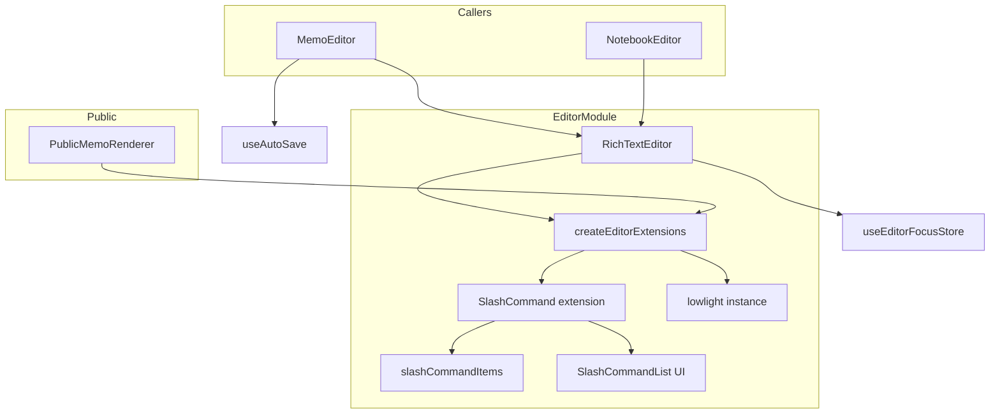
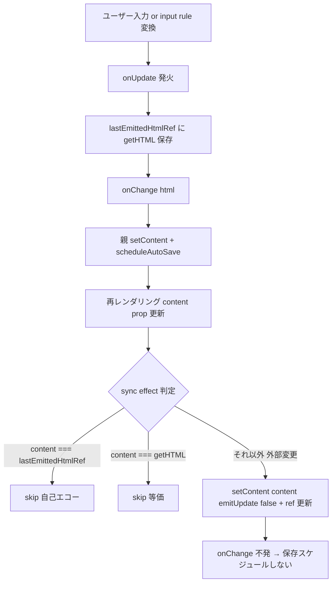
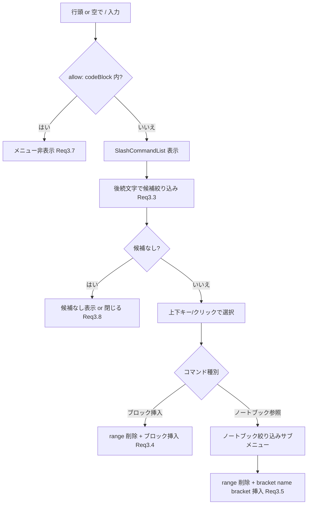

# Technical Design — markdown-wysiwyg-editor

## Overview

本機能は Mosaku のリッチテキストエディタ（`frontend/src/components/editor/RichTextEditor.tsx`、TipTap v3.22.2 + StarterKit）の Markdown WYSIWYG 入力体験を強化し、執筆中のユーザーへ「手を止めずに構造化文章を書ける」価値を届ける。

中核は **Req1 の content 同期バグ修正**である。TipTap v3 では `editor.commands.setContent` の `emitUpdate` がデフォルト `true` であり、現状コードがタイプ中に `setContent(content)` を実行して ProseMirror トランザクションを巻き戻し input rule を潰している（かつ update emit で自動保存ループを誘発する）。この土台を直せば、StarterKit が内蔵する input rule により **Req2（基本ショートカット）・Req6（区切り線）・Req7（リンク）は新規依存ゼロで成立**する。

その上で、`@tiptap/extension-list`（TaskList/TaskItem）と `@tiptap/extension-code-block-lowlight` + `lowlight` を追加して Req4/Req5 を実現し、編集側と公開表示（`PublicMemoRenderer`）が**同一の拡張セットを共有**する `createEditorExtensions` ファクトリへ寄せて Req9.4 の保存↔表示一致を構造的に担保する。Req3 スラッシュコマンドは `@tiptap/suggestion` ベースの専用拡張へ分離し、既存ノートブック参照（`[[name]]` 挿入）と共存させる。

### Goals

- `# ` 等の Markdown input rule をタイプ即時に成立させる（保存ループ・トランザクション巻き戻しを排除）。
- 基本ショートカット網羅・スラッシュコマンド・コードブロック（ハイライト）・チェックリスト・区切り線・リンク自動化を提供する。
- 既存の自動保存・ノートブック参照・テーマフォーカス連携・公開表示を**非回帰**で維持する。

### Non-Goals

- 保存フォーマットの Markdown 化（現状の **HTML 保存を維持**）。
- 自動保存 debounce 値の是正（200ms↔2秒の乖離は Open Question として本機能スコープ外）。
- テーブル・画像・コラボ編集など要件外のリッチ機能。
- ツールバー UI の刷新（既存ボタンの維持のみが対象）。

## Architecture

### Existing Architecture Analysis

- **現行構成**: `RichTextEditor`（StarterKit + Placeholder + Mention[char=`/`]、ツールバー同居・193行）を `MemoEditor` / `NotebookEditor` が呼び出し、`onChange(getHTML())` → 親 `setContent` → `scheduleAutoSave`（`useAutoSave`、実効 debounce 200ms）で自動保存。公開表示は `PublicMemoRenderer`（**StarterKit のみ**、`editable:false`）。
- **保持すべき不変則（CLAUDE.md / steering）**:
  - サーバー状態の真実源泉は React Query（content は MemoEditor のローカル state 経由、コピー禁止則と矛盾しない）。
  - テーマは CSS ファイル管理。**エフェクト用新規 JS ライブラリ追加禁止は「テーマエフェクト」限定**であり、エディタ機能拡張への lowlight 追加は本則の対象外（本設計で明文化）。
  - `useEditorFocusStore` の onFocus/onBlur 更新がテーマエフェクト自動停止と連携（維持必須）。
- **対処する技術的負債**: `SlashCommandList.tsx` 冒頭の `TODO: コマンド設計やり直し`（未完成 UI）、`/` を Mention 流用するハック、編集↔公開の拡張セット二重化。

### Architecture Pattern & Boundary Map

採用パターンは **共有 extension ファクトリ（Option B）への段階収束（Option C）**。エディタ拡張定義を単一モジュールへ集約し、編集用と公開表示用が同じノード定義を取得する。



**Architecture Integration**:

- **Selected pattern**: 共有ファクトリ + 専用 Suggestion 拡張。編集／公開の拡張一致を構造で保証（Req9.4）。
- **Domain/feature boundaries**: ノード定義（extensions.ts）／ Slash ロジック（slashCommand.ts + slashCommandItems.ts）／ UI（SlashCommandList.tsx）／ 同期・ツールバー（RichTextEditor.tsx）を分離。
- **Existing patterns preserved**: onChange→自動保存配線、`useEditorFocusStore` 連携、`placeholder`/`autofocus`/`focusKey` の props 契約、`notebooksData` 注入機構、HTML 保存。
- **New components rationale**: `createEditorExtensions`（拡張一致）、`SlashCommand` 拡張（`/` 抑止・共存）、`lowlight` インスタンス（言語サブセット集約）。
- **Steering compliance**: React Query 真実源泉則・テーマフォーカス連携・型安全（`any` 禁止）を遵守。lowlight 追加の正当性を本設計で明記。

### Technology Stack

| Layer                     | Choice / Version                                                   | Role in Feature                                          | Notes                                                                              |
| ------------------------- | ------------------------------------------------------------------ | -------------------------------------------------------- | ---------------------------------------------------------------------------------- |
| Frontend (editor core)    | `@tiptap/react` / `@tiptap/starter-kit` `3.22.2`                   | input rule・基本ノード・link/hr/underline/codeBlock 内蔵 | サブ拡張を `StarterKit.configure` で設定。`codeBlock:false` で Lowlight へ差し替え |
| Frontend (task list)      | `@tiptap/extension-list` `3.22.2`                                  | TaskList / TaskItem（Req5）                              | **v3 で統合済み**。StarterKit 依存として既存。direct 追記のみ                      |
| Frontend (code highlight) | `@tiptap/extension-code-block-lowlight` `3.22.2` + `lowlight` `^3` | コードブロック構文ハイライト（Req4）                     | `highlight.js` は lowlight 経由。言語はサブセット register                         |
| Frontend (slash)          | `@tiptap/suggestion` `3.22.2` + `tippy.js` `^6`                    | スラッシュコマンドのトリガー・ポップアップ（Req3）       | 既存インストール済み。Mention 依存は除去                                           |
| Frontend (state)          | `zustand`（`useEditorFocusStore`）                                 | フォーカス連携（Req9.3）                                 | 既存。変更なし                                                                     |

> 新規 direct dependency は `@tiptap/extension-list` / `@tiptap/extension-code-block-lowlight` / `lowlight` の3点（前2者は TipTap 系のためバージョンを `3.22.2` に統一）。詳細根拠は `research.md` Topic 2/3。

## Requirements Traceability

| Requirement | Summary                                                | Components                                              | Interfaces                                                | Flows              |
| ----------- | ------------------------------------------------------ | ------------------------------------------------------- | --------------------------------------------------------- | ------------------ |
| 1.1–1.6     | input rules 復活（content 同期再設計・保存ループ防止） | RichTextEditor（content sync）                          | `lastEmittedHtmlRef`, `setContent(_, {emitUpdate:false})` | Content Sync flow  |
| 2.1–2.10    | 基本 Markdown ショートカット網羅                       | createEditorExtensions（StarterKit 設定）               | StarterKit input rules                                    | —                  |
| 3.1–3.8     | スラッシュコマンド（ノートブック共存・CB内抑止）       | SlashCommand ext, slashCommandItems, SlashCommandList   | `SlashCommandItem`, `allow` predicate                     | Slash Command flow |
| 4.1–4.5     | コードブロック + シンタックスハイライト                | createEditorExtensions（CodeBlockLowlight + lowlight）  | `createLowlight`, register languages                      | —                  |
| 5.1–5.4     | チェックリスト                                         | createEditorExtensions（TaskList/TaskItem）             | TaskItem `nested`, `data-checked`                         | —                  |
| 6.1–6.2     | 区切り線                                               | createEditorExtensions（HorizontalRule 内蔵）           | StarterKit input rule `---`                               | —                  |
| 7.1–7.3     | リンク自動化                                           | createEditorExtensions（Link 設定）                     | `StarterKit.configure({link})`                            | —                  |
| 8.1–8.4     | 自動保存との整合                                       | RichTextEditor + MemoEditor + useAutoSave               | onChange 契約, emitUpdate 抑止                            | Content Sync flow  |
| 9.1–9.5     | 既存機能の非回帰                                       | RichTextEditor, PublicMemoRenderer, useEditorFocusStore | createEditorExtensions（editable 出し分け）               | —                  |

## System Flows

### Content Sync（Req1 / Req8 — 中核）

タイプ中の自己エコーと真の外部変更を分離し、input rule 巻き戻しと保存ループの双方を防ぐ。



**Key Decisions**:

- 自己エコー判定は「実際に emit した HTML 文字列」と完全一致で行うため、HTML 再直列化の揺れや input-rule 中間状態に影響されない（Req1.2/1.3/1.6）。
- 外部変更（別メモ切替・新規作成・サーバー再取得）のみ `emitUpdate:false` で反映し、onChange を発火させない（Req1.4/1.5、Req8.4）。

### Slash Command（Req3）



## Components and Interfaces

| Component              | Domain/Layer      | Intent                                            | Req Coverage | Key Dependencies (P0/P1)                                                    | Contracts |
| ---------------------- | ----------------- | ------------------------------------------------- | ------------ | --------------------------------------------------------------------------- | --------- |
| createEditorExtensions | Editor / config   | 編集・公開で共有する拡張セットを生成              | 2,4,5,6,7,9  | StarterKit (P0), extension-list (P0), CodeBlockLowlight (P0), lowlight (P0) | State     |
| RichTextEditor (sync)  | Editor / UI+logic | content 同期再設計・onChange 契約・フォーカス連携 | 1,8,9        | createEditorExtensions (P0), useEditorFocusStore (P1)                       | State     |
| SlashCommand extension | Editor / plugin   | `/` トリガー・CB内抑止・コマンド実行              | 3            | @tiptap/suggestion (P0), slashCommandItems (P0)                             | Service   |
| slashCommandItems      | Editor / logic    | コマンド定義（ブロック挿入・ノートブック参照）    | 3            | notebooksData (P1)                                                          | Service   |
| SlashCommandList       | Editor / UI       | 候補リスト UI（キーボード/クリック/サブメニュー） | 3            | —                                                                           | —         |
| PublicMemoRenderer     | Public / UI       | 共有ファクトリで保存 HTML を崩さず描画            | 9            | createEditorExtensions (P0)                                                 | —         |

### Editor / config

#### createEditorExtensions

| Field        | Detail                                                                                                                       |
| ------------ | ---------------------------------------------------------------------------------------------------------------------------- |
| Intent       | 編集・公開で同一のノード定義を返す単一情報源                                                                                 |
| Requirements | 2.1, 2.2, 2.3, 2.4, 2.5, 2.6, 2.7, 2.8, 2.10, 4.1, 4.2, 4.3, 4.5, 5.1, 5.2, 5.3, 5.4, 6.1, 6.2, 7.1, 7.2, 7.3, 9.1, 9.2, 9.4 |

**Responsibilities & Constraints**

- StarterKit を `configure` し、`codeBlock:false`（Lowlight へ差し替え）・`link`（autolink/linkOnPaste/openOnClick/protocols/rel）・`heading.levels:[1,2,3]` を設定。
- CodeBlockLowlight（lowlight サブセット）・TaskList・TaskItem（`nested:true`）・Placeholder（編集時のみ）・SlashCommand（編集時のみ）を組み立てる。
- `editable` フラグで差分のみ出し分け：公開時は Placeholder/SlashCommand を含めず、TaskItem は読み取り専用（クリックトグル無効）、Link は `openOnClick:true`。
- ノード定義（CodeBlockLowlight/TaskList/TaskItem/Link/HorizontalRule）は編集・公開で**完全一致**させ、保存 HTML の往復を保証（Req4.5/5.4/9.4）。

**Dependencies**

- Outbound: StarterKit / extension-list / CodeBlockLowlight — ノード定義（P0）
- External: lowlight — `createLowlight` インスタンス（言語サブセット register）（P0）

**Contracts**: State [x]

##### State Management

- **State model**: 純関数。`createEditorExtensions(options)` → `Extension[]` を返す（副作用なし）。lowlight インスタンスはモジュールスコープで1度だけ生成し共有。
- **Persistence & consistency**: ノード→HTML 直列化属性（`data-checked`, code 言語 class）が編集・公開で一致。
- **Concurrency strategy**: 不要（生成は同期・冪等）。

```typescript
export interface SlashOptions {
	/** SlashCommand 拡張に渡す suggestion 設定（render/items など） */
	render: SuggestionOptions['render'];
}

export interface EditorExtensionOptions {
	/** true: 編集（Placeholder/Slash/TaskItem トグル有効） / false: 公開表示 */
	editable: boolean;
	/** 編集時の placeholder テキスト（editable=true のときのみ使用） */
	placeholder?: string;
	/** 編集時のスラッシュコマンド設定（editable=true のときのみ使用） */
	slash?: SlashOptions;
}

export function createEditorExtensions(options: EditorExtensionOptions): Extension[];
```

- Preconditions: `editable=true` のとき `slash` と `placeholder` を渡しうる。`editable=false` では両者を無視する。
- Postconditions: 返却配列のノード定義集合は editable に依らず一致（差は Placeholder/Slash の有無と TaskItem/Link の挙動オプションのみ）。
- Invariants: lowlight 言語セットは編集・公開で同一。

**Implementation Notes**

- Integration: RichTextEditor / PublicMemoRenderer の `useEditor({ extensions })` に注入。Mention 拡張は除去。
- Validation: 保存 HTML（task `data-checked`・code 言語 class・hr・link rel）が再読込で同一ノードへ復元されることをスナップショットで確認。
- Risks: lowlight 言語追加でのバンドル肥大（サブセット限定で緩和、`research.md` R4）。highlight CSS と既存テーマ CSS の衝突（エディタスコープに限定、R6）。

### Editor / UI+logic

#### RichTextEditor（content sync 再設計）

| Field        | Detail                                                          |
| ------------ | --------------------------------------------------------------- |
| Intent       | content 同期バグ修正・onChange 契約維持・フォーカス連携維持     |
| Requirements | 1.1, 1.2, 1.3, 1.4, 1.5, 1.6, 8.1, 8.2, 8.3, 8.4, 9.1, 9.3, 9.5 |

**Responsibilities & Constraints**

- `useEditor` の extensions を `createEditorExtensions({ editable:true, placeholder, slash })` に置換。
- onUpdate で `const html = editor.getHTML(); lastEmittedHtmlRef.current = html; onChange(html);`（Req8.1/8.2）。
- content 同期 useEffect を echo-ref 方式へ再設計（下記 State Management）。
- 既存ツールバー・`onFocus/onBlur`→`useEditorFocusStore`・`autofocus`/`focusKey`/`placeholder` を不変で維持（Req9.1/9.3/9.5）。

**Dependencies**

- Inbound: MemoEditor / NotebookEditor — `content` / `onChange` / `placeholder` / `autofocus` / `focusKey`（P0）
- Outbound: createEditorExtensions（P0）, useEditorFocusStore（P1）

**Contracts**: State [x]

##### State Management

- **State model**: `lastEmittedHtmlRef: MutableRefObject<string>`（初期値 = 初回 `content`）。エディタ内容の真実源泉は ProseMirror、React 側はミラーしない。
- **同期ロジック（擬似契約）**:
  - skip if `!editor`
  - skip if `content === lastEmittedHtmlRef.current`（自己エコー、Req1.6）
  - skip if `content === editor.getHTML()`（等価、Req1.6）
  - else `editor.commands.setContent(content, { emitUpdate: false }); lastEmittedHtmlRef.current = content;`（外部変更、Req1.4/1.5）
- **Persistence & consistency**: `emitUpdate:false` により外部反映は onChange を発火せず自動保存をスケジュールしない（Req8.4）。
- **Concurrency strategy**: タイプ中（自己エコー）と外部変更を文字列一致で分離するため、`setContent` がタイプ中に走らない（Req1.2/1.3）。

```typescript
// Props 契約（既存維持・型のみ明示）
interface RichTextEditorProps {
	content: string;
	onChange: (content: string) => void;
	placeholder?: string;
	className?: string;
	autofocus?: boolean;
	focusKey?: string;
}
```

**Implementation Notes**

- Integration: 親（MemoEditor 366行 `setContent(val); scheduleAutoSave()`）の配線は不変。RichTextEditor 内部のみ変更。
- Validation: 「`# `→H1 即時変換」「変換後タイプ継続で巻き戻らない」「別メモ切替で外部 content 反映」「外部反映単体で保存が走らない」を E2E/単体で確認。
- Risks: リグレッション波及（`research.md` R1）。Undo（Ctrl/Cmd+Z）が input rule 変換を1手で戻すこと（Req2.9、StarterKit UndoRedo 標準挙動）を確認。

### Editor / plugin

#### SlashCommand extension

| Field        | Detail                                                                 |
| ------------ | ---------------------------------------------------------------------- |
| Intent       | `/` トリガーの専用 Suggestion 拡張。コードブロック内抑止・コマンド実行 |
| Requirements | 3.1, 3.2, 3.3, 3.4, 3.6, 3.7, 3.8                                      |

**Responsibilities & Constraints**

- `Extension.create` + `addProseMirrorPlugins`（`@tiptap/suggestion` の `Suggestion` プラグイン）。`char:'/'`、`startOfLine` 相当の起動位置（空/行頭、Req3.1）。
- `allow: ({ editor }) => !editor.isActive('codeBlock')` でコードブロック内のメニューを抑止（Req3.7）。
- `command` で `range` を削除しコマンドの挿入処理を実行（Req3.4）。

**Contracts**: Service [x]

##### Service Interface

```typescript
interface SlashCommandRunParams {
	editor: Editor;
	range: { from: number; to: number };
}

interface SlashCommandItem {
	title: string;
	description?: string;
	kind: 'block' | 'notebook';
	/** kind='block': ブロック挿入を実行 / kind='notebook': サブメニューへ遷移 */
	run: (params: SlashCommandRunParams) => void;
}
```

- Preconditions: `editor.isActive('codeBlock') === false`（allow 通過時のみ生成）。
- Postconditions: ブロック挿入後、`/` とクエリ文字列が削除されている（Req3.4）。
- Invariants: ノートブック参照の出力は従来どおりプレーンテキスト `[[name]]`（Req3.5/9.2）。

**Implementation Notes**

- Integration: `createEditorExtensions({ editable:true })` 内でのみ追加。`render` は tippy + ReactRenderer（既存 suggestion.ts のポップアップ構造を流用）。
- Validation: コードブロック内で `/` がメニューを出さない／候補なしクエリで空表示 or 閉じる（Req3.8）／上下・Enter・Esc・クリック網羅（Req3.6）。
- Risks: Mention 除去に伴うノートブック参照デグレ（`research.md` R3）。

#### slashCommandItems（コマンド定義）

| Field        | Detail                                                       |
| ------------ | ------------------------------------------------------------ |
| Intent       | ブロック挿入＋ノートブック参照のコマンド集合とクエリ絞り込み |
| Requirements | 3.2, 3.3, 3.5                                                |

**Responsibilities & Constraints**

- 既定コマンド: 見出し H1/H2/H3・箇条書き・番号付き・引用・コードブロック・チェックリスト・区切り線・ノートブック参照（Req3.2）。
- `query` でタイトル/別名を前方一致・部分一致フィルタ（Req3.3）。
- ノートブック参照は選択でサブメニュー（`notebooksData` を絞り込み）へ遷移し、確定で `insertContent('[[' + name + ']]')`（Req3.5）。

**Contracts**: Service [x]

```typescript
function getSlashCommandItems(query: string, mode: 'root' | 'notebook'): SlashCommandItem[];
```

**Implementation Notes**

- Integration: 既存 `setNotebooksData` の注入機構を流用（RichTextEditor の `useNotebooks` → `setNotebooksData`）。
- Validation: 各ブロック挿入が toolbar 操作と同一ノード構造になること（Req2.10）。

#### SlashCommandList（UI）

要件 3.6/3.8 を満たす候補リスト presentational コンポーネント。冒頭 TODO を解消し作り直す。上下キー移動・Enter 確定・クリック選択・候補なし表示・ノートブックサブメニュー表示に対応。`SlashCommandItem[]` と `command(item)` / 戻る操作を props で受ける（新規ボーダー無し）。

**Implementation Note**: 既存の `forwardRef` + `useImperativeHandle(onKeyDown)` 構造（キーボード操作の Suggestion 連携）を踏襲する。

### Public / UI

#### PublicMemoRenderer

要件 9.4 のため `extensions: [StarterKit]` を `createEditorExtensions({ editable:false })` に置換。`editable:false`・`pointer-events-none select-text` の既存表示属性は維持。新規ノード（コードブロック/タスクリスト/hr/リンク）を崩さず描画する。presentational のため詳細ブロックは不要。

## Data Models

本機能は DB スキーマを変更しない。保存は引き続き **HTML 文字列**（memo.content / notebook 本文）。新規ノードの HTML 直列化属性のみ整理する。

| ノード              | HTML 直列化                                      | 往復保持の要点                                                            |
| ------------------- | ------------------------------------------------ | ------------------------------------------------------------------------- | ----------------------------------------------------- |
| TaskList / TaskItem | `<ul data-type="taskList"><li data-checked="true | false">`                                                                  | `data-checked` を編集・公開の同一拡張で復元（Req5.4） |
| CodeBlockLowlight   | `<pre><code class="language-xxx">`               | 言語 class を保持しハイライト再適用（Req4.5）                             |
| HorizontalRule      | `<hr>`                                           | StarterKit 標準（Req6）                                                   |
| Link                | `<a href rel="noopener noreferrer nofollow">`    | autolink/linkOnPaste 結果を保持。`inclusive:false` で範囲非拡張（Req7.3） |

> ノード定義を共有ファクトリで一致させるため、編集側で保存した HTML を公開側が同一スキーマでパースでき、ノード脱落・崩れが構造的に発生しない。

## Error Handling

### Error Strategy

本機能はネットワーク I/O を増やさず、エラー主体は「入力の整合性」と「外部反映の安全性」。フェイルセーフ（壊すより無変換）を基本とする。

### Error Categories and Responses

- **input rule 競合/未成立**: 変換不能パターンは素のテキストとして残す（StarterKit 標準）。Undo で記法テキストへ復帰（Req2.9）。
- **content 同期の取りこぼし**: echo-ref 不一致時のみ `setContent` するため過剰反映を回避。万一の不整合は次の外部反映で収束（eventual）。
- **lowlight 未登録言語**: 未登録言語指定時はハイライト無しのプレーン code として描画（例外を投げない）。
- **Slash 候補なし**: 候補なし表示 or 自動クローズ（Req3.8）。コードブロック内は起動しない（Req3.7）。

### Monitoring

既存 Sentry（`@sentry/react`）に準拠。本機能は新規エラーバウンダリを追加しない。setContent 例外（`errorOnInvalidContent` は使わずデフォルト寛容パース）を握り込まない方針で、想定外は既存 Sentry に補足させる。

## Testing Strategy

### Unit Tests

1. content 同期: 自己エコー skip / 等価 skip / 外部変更時のみ `setContent(_, {emitUpdate:false})`（Req1.2–1.6, 8.4）。
2. `createEditorExtensions`: editable 出し分け（公開時 Placeholder/Slash 非含・TaskItem 読取専用）とノード定義一致（Req9.4）。
3. `getSlashCommandItems`: クエリ絞り込み・ノートブックサブメニュー・既定コマンド網羅（Req3.2/3.3/3.5）。
4. SlashCommandList: 上下/Enter/Esc/クリック・候補なし表示（Req3.6/3.8）。

### Integration Tests

1. onUpdate→lastEmittedHtmlRef→onChange→親 setContent→sync skip の一巡（保存ループ不発、Req8.4）。
2. RichTextEditor + createEditorExtensions で `# `→H1、`- `→箇条書き、`---`→hr、URL→link が成立（Req2/6/7）。
3. 保存 HTML 往復: task `data-checked` / code 言語 class が再読込で保持（Req4.5/5.4/8.3）。

### E2E/UI Tests

1. `# ` をタイプ→即 H1、続けて文字入力で巻き戻らない（Req1.1/1.2）。
2. `/` でメニュー→コマンド選択でブロック挿入、コードブロック内では非表示（Req3.1/3.4/3.7）。
3. ノートブック参照コマンド→ `[[name]]` 挿入（既存挙動非回帰、Req3.5/9.2）。
4. 別メモ切替で外部 content 反映、その単体で自動保存が走らない（Req1.4/8.4）。
5. 公開表示でコードブロック/タスクリスト/hr/リンクが崩れず描画（Req9.4）。

## Security Considerations

- **リンクの XSS / タブナビング対策**: Link は `protocols`（http/https/mailto に限定）・`HTMLAttributes.rel = 'noopener noreferrer nofollow'`・`target='_blank'` を設定。`javascript:` 等のスキームを排除（Req7）。
- **HTML 保存の信頼境界**: 保存 HTML は TipTap スキーマ準拠のノードに限定され、公開表示も同一拡張で `editable:false` パースするため、未知タグ/属性の持ち込み面を拡大しない。
- ベースラインのサニタイズ・認証は steering（CLAUDE.md 不変則・グローバル JWT Guard）に従い、本機能で新規の認可境界は追加しない。

## Open Questions / Risks

1. **自動保存 debounce 値（200ms vs 要件8.1「2秒」）**: 実装は 200ms、要件文は 2秒。本機能では**既存 200ms を踏襲**（auto-save フックの関心事・リグレッション波及大）し、値是正は別途合意とする。要件文の更新可否を要確認。
2. **lowlight 言語サブセットの確定**: 既定 common セット（js/ts/json/html/xml/css/bash/shell/python/sql/markdown/diff 等）で開始し、バンドル計測後に動的 import 化を検討（R4）。
3. **highlight CSS テーマと既存テーマ CSS の両立**: エディタスコープ限定で適用。テーマ切替時の見え方確認が必要（R6）。
4. **Mention 拡張の完全除去可否**: 現状 `/` 以外で Mention を使っていないか最終確認の上で除去（除去できない場合は無効化）。
