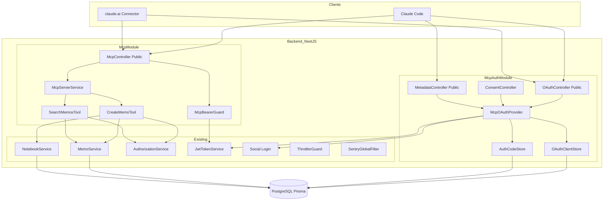
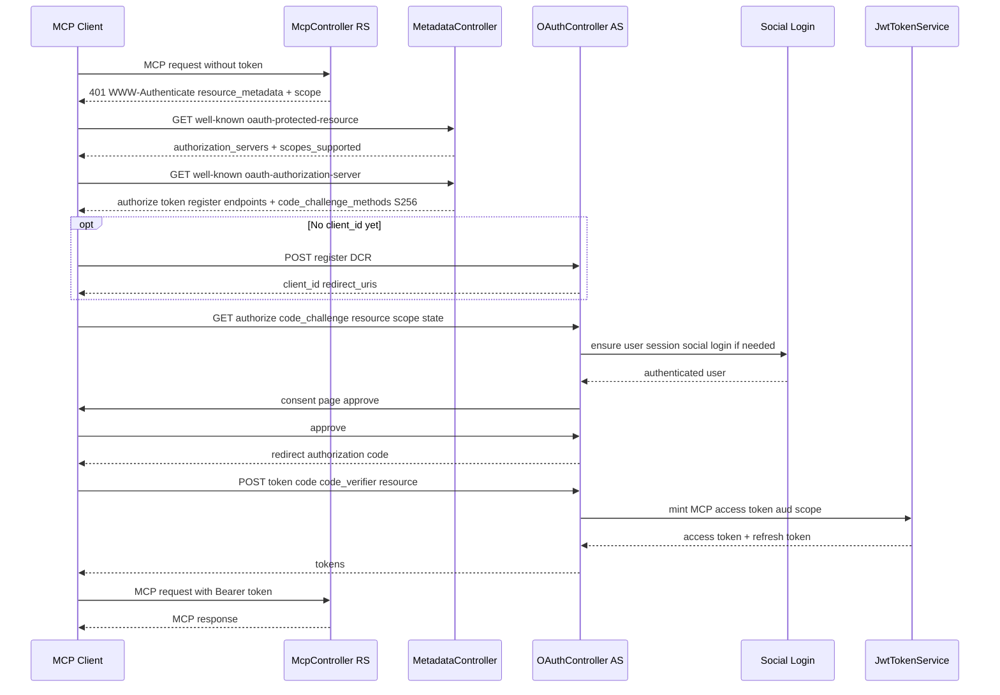
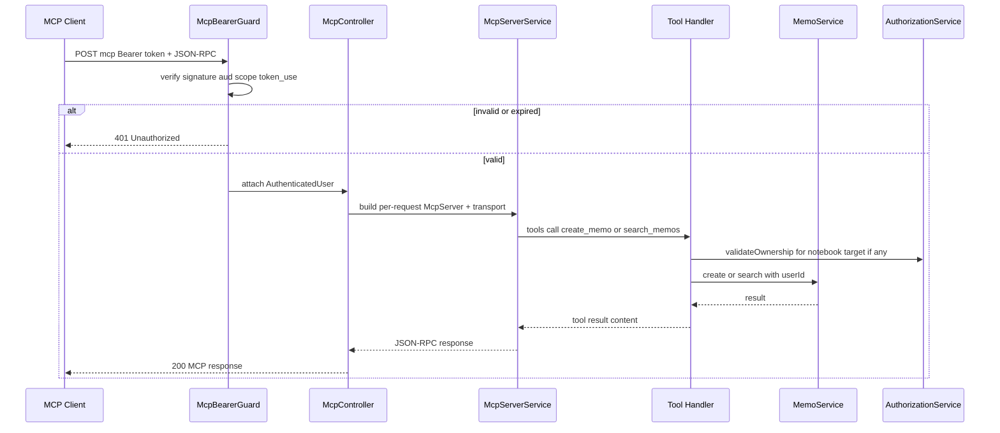
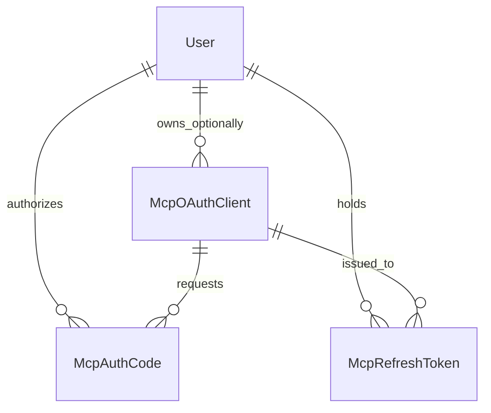
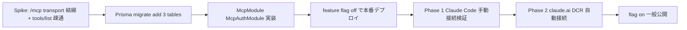

# Technical Design — mcp-endpoint (v1)

## Overview

本機能は mosaku を「AI の外付け脳みそ（長期記憶）」にするためのリモート MCP（Model Context Protocol）サーバーを backend（NestJS / Cloud Run）に追加する。Claude Code 等の MCP クライアントが、ユーザーとの壁打ち結果を mosaku に新規メモとして保存（`create_memo`）し、過去メモを検索して文脈に取り込む（`search_memos`）ことで、「書く行為」を消しつつメモを資産として蓄積させる。

**Users**: 普段 AI（本命は Claude Code、加えて claude.ai / Claude スマホ）と壁打ちする mosaku ユーザー。自分のアカウントでクライアントを OAuth 認可し、AI から mosaku を「道具」として呼び出す。

**Impact**: mosaku は現状 OAuth の _クライアント_（social ログインで Google 等に依存）でしかないが、本機能で **OAuth 2.1 リソースサーバー兼最小認可サーバー**へと役割を拡張する。MCP プロトコル層・OAuth 認可サーバー層は新規だが、メモ作成/検索・所有権・レート制限・観測性は既存基盤（`MemoService` / `AuthorizationService` / `@nestjs/throttler` / `SentryGlobalFilter`）をサーバー直呼びで再利用する。LLM 推論は一切 mosaku 側で行わないため変動コストはほぼゼロで、従量課金不要・定額提供可能（R8）。

### Goals

- MCP 仕様（2025-11-25 revision）準拠の Streamable HTTP エンドポイントを公開し、Claude Code / claude.ai から接続可能にする（R1, R2）。
- mosaku を OAuth 2.1 リソースサーバー + 自前同居認可サーバーとして実装し、`memo:read` / `memo:write` に限定したスコープでトークンを発行・検証する（R2）。
- `create_memo`（write）/ `search_memos`（read）を、既存ドメインサービス直呼び + `validateOwnership()` でユーザー境界を担保して提供する（R3, R4, R5）。
- 既存 REST 認証・throttle・観測性に副作用を出さず、MCP 入口にレート制限と Sentry 連携を適用する（R1.6, R6, R7）。

### Non-Goals

- `append_to_memo` / `get_memo` / `list_notebooks` 等の追加 tool、メモ更新・削除系 tool（v2 候補）。
- semantic（埋め込み）検索。v1 は既存 Postgres キーワード検索（`contains`）で確定。
- Gemini クライアント対応。
- Client ID Metadata Documents（CIMD）対応・第三者 AS 委譲（将来検討）。
- フロントエンド（React Query / Zustand）の変更。本機能はサーバー側のみで、`apiClient` を経由しない（R5.3）。**OAuth 同意画面も BE サーバーレンダリングの最小 HTML で完結させ、FE には一切手を入れない**（同意画面の置き場の決定。Issue 1）。

---

## Architecture

### Existing Architecture Analysis

- **認証**: グローバル `JwtAuthGuard`（`app.module.ts` の APP_GUARD）+ `@Public()`（`common/decorators/public.decorator.ts`）opt-out。Bearer JWT は `JwtStrategy`（`auth/jwt.strategy.ts`, `passport-jwt`）で検証。
- **トークン発行**: `JwtTokenService`（`auth/jwt.service.ts`）が JWT 署名・検証を一元化。`RefreshTokenService` がリフレッシュトークンを管理。
- **メモ**: `MemoService.create(dto, userId)`（`notebookId` 未指定時は `null` で作成 → UI の Inbox/未分類ビューに着地）、`MemoService.search(query, userId)`（userId 限定 + `trashedAt: null` + title/content の大小無視 `contains`）、`searchPaginated`（`take` 上限）。
- **所有権**: `AuthorizationService.validateOwnership(entity, userId, name)`（`common/services/authorization.service.ts`）が NotFound/Forbidden を一元送出。`MemoService`/`NotebookService` は `BaseOwnableService` 継承。
- **レート制限**: `ThrottlerModule.forRoot`（GLOBAL 60req/60s）+ `@Throttle()` 個別、`ThrottlerExceptionFilter`。値は `config/auth-constants.ts` の `THROTTLE_CONFIG`。
- **観測性**: `SentryGlobalFilter`（APP_FILTER）、構造化タグ契約 5 種（`feature_area` enum: `memo`/`notebook`/`tag`/`theme`/`auth`/`invitation`/`dashboard`/`system`/`unknown`）、`sentry-scrubber`、`AppLogger`。
- **インフラ**: Express アダプタ（`main.ts` で `helmet` / `cors` / `session` / `trust proxy`）。Cloud Run はステートレス/オートスケール前提。

**踏襲する境界**: 「1 ドメイン = 1 モジュール」（structure.md）。新規ドメインとして `McpModule` を追加し、OAuth 認可サーバー層をその配下に分離する。React Query 真実源・Zustand コピー禁止の不変則には非抵触（FE 変更なし）。

### Architecture Pattern & Boundary Map

**Selected pattern**: 独立 `McpModule`（MCP プロトコル + tools）+ 配下の OAuth 認可サーバー層（`McpAuthModule`）。tool は既存ドメインサービスを DI で直呼び。mosaku は **RS（リソースサーバー）と AS（認可サーバー）を同居**実装する（MCP 仕様が許容）。



**Architecture Integration**:

- **Selected pattern**: 独立モジュール + 認可サーバー層分離。理由は責務分離・単体テスト容易・既存 REST 認証への無影響（research.md Option B）。
- **Domain/feature boundaries**: `McpModule` = MCP プロトコル/tool 実行。`McpAuthModule` = OAuth AS（discovery/register/authorize/token/consent）。ドメインロジックは既存サービスに委譲し新設しない。
- **Existing patterns preserved**: `@Public()` opt-out、`validateOwnership()` 一元化、`@Throttle()` 個別上書き、`SentryGlobalFilter`、サービス直呼び（apiClient 非経由）。
- **New components rationale**: MCP プロトコル結線（SDK）と OAuth AS は既存に存在しないため新規。永続化用ストアは DCR クライアント・認可コード・リフレッシュトークンの保存に必須。
- **Steering compliance**: 「1 ドメイン = 1 モジュール」、グローバル JWT Guard + `@Public()`、Sentry 構造化タグ契約（`feature_area` に `mcp` を追加）。

### Technology Stack

| Layer                | Choice / Version                                                       | Role in Feature                                                                                                              | Notes                                                                                                                                                                                                                        |
| -------------------- | ---------------------------------------------------------------------- | ---------------------------------------------------------------------------------------------------------------------------- | ---------------------------------------------------------------------------------------------------------------------------------------------------------------------------------------------------------------------------- |
| Backend / Protocol   | `@modelcontextprotocol/sdk`（最新安定版）                              | `McpServer` / `registerTool` / `StreamableHTTPServerTransport` / 認可ヘルパー（`requireBearerAuth` / `OAuthServerProvider`） | 新規依存。subpath import（`/server/mcp.js` 等）。Node 22+ で動作（既存 engines 準拠）                                                                                                                                        |
| Backend / Services   | NestJS 11（既存）                                                      | `McpModule` / `McpAuthModule`、`@Public()` コントローラ、DI で既存サービス直呼び                                             | Express アダプタに transport を結線                                                                                                                                                                                          |
| Backend / Validation | `zod`（既存）                                                          | tool 入力スキーマ（`registerTool` の `inputSchema`）                                                                         | 既存 BE/FE 共有型で利用中                                                                                                                                                                                                    |
| Backend / Auth       | `@nestjs/jwt` `JwtService`（既存）+ `passport`（既存 social ログイン） | MCP 専用 JWT 発行（`aud`+`scope`+`token_use`）、authorize での既存ログイン再利用                                             | 署名鍵 `JWT_SECRET` は共有するが、`JwtTokenService.generateTokens`（payload 固定 `{sub,email,role}`）も passport `JwtStrategy`（aud/token_use 非対応）も**そのまま流用不可**。MCP 用の発行/検証メソッドを新設する（Issue 2） |
| Data / Storage       | PostgreSQL + Prisma（既存）                                            | `McpOAuthClient` / `McpAuthCode` / `McpRefreshToken` の 3 テーブル新設                                                       | アクセストークンはステートレス JWT（無保存）                                                                                                                                                                                 |
| Infra / Runtime      | Cloud Run（既存）                                                      | ステートレス Streamable HTTP（リクエスト毎 transport 生成）                                                                  | `Mcp-Session-Id` のサーバー側保持なし                                                                                                                                                                                        |
| Observability        | `@sentry/nestjs` + `@nestjs/throttler`（既存）                         | MCP エラー捕捉（`feature_area: 'mcp'`）、tool 実行 throttle                                                                  | enum 拡張 + `THROTTLE_CONFIG.MCP` 追加                                                                                                                                                                                       |

> 外部依存・規範要件の詳細は research.md（MCP 認可仕様 2025-11-25 / SDK API / RFC 群）を参照。

---

## System Flows

### OAuth 2.1 接続認可フロー（discovery → authorize → token）



**Key decisions**: ①401 の `WWW-Authenticate` と well-known の両方で discovery を提供（仕様 MUST）。②PKCE S256 検証は token エンドポイントで必須。③`resource` パラメータ（RFC 8707）を authorize/token で受け取り、発行 JWT の `aud` に焼き込む。④authorize は既存 social ログインセッションを再利用し、未ログインなら既存ログインへ誘導した後に同意画面を出す。

### tool 実行フロー（create_memo / search_memos）



**Key decisions**: ①bearer 検証はガードで先行し、無効/期限切れは tool 実行前に 401（R2.2）。②ステートレスのためリクエスト毎に `McpServer` + transport を生成し、認証ユーザーを tool ハンドラにクロージャ束縛（userId の出所を一意化）。③tool 内で `validateOwnership()` を必ず通す（R5.1）。

---

## Requirements Traceability

| Requirement        | Summary                                                                              | Components                                         | Interfaces                      | Flows           |
| ------------------ | ------------------------------------------------------------------------------------ | -------------------------------------------------- | ------------------------------- | --------------- |
| 1.1, 1.2, 1.3, 1.4 | Streamable HTTP / initialize / tools list / 不正メソッドエラー                       | McpController, McpServerService                    | `handleRequest`, `registerTool` | tool 実行フロー |
| 1.5                | Claude Code / claude.ai 接続可能                                                     | McpController, MetadataController, OAuthController | well-known + OAuth endpoints    | 認可フロー      |
| 1.6                | 既存 REST 認証に無影響                                                               | McpController(@Public), McpBearerGuard             | `@Public()` opt-out             | —               |
| 2.1, 2.2           | OAuth 2.1 保護 / 401                                                                 | McpBearerGuard, McpTokenVerifier                   | `verify`, WWW-Authenticate      | 両フロー        |
| 2.3                | 既存認証基盤でユーザー認証                                                           | McpOAuthProvider, Social Login                     | `authorize`                     | 認可フロー      |
| 2.4                | 認可済みセッションを当該ユーザー文脈で処理                                           | McpBearerGuard, Tool Handlers                      | `AuthInfo` → userId             | tool 実行フロー |
| 2.5                | OAuth メタデータ公開                                                                 | MetadataController                                 | RFC 9728 / RFC 8414 docs        | 認可フロー      |
| 2.6                | スコープを memo read/write に限定                                                    | McpOAuthProvider, McpTokenVerifier                 | `scope` claim                   | 認可フロー      |
| 3.1–3.7            | create_memo（content 必須 / notebook 任意 / 既定保存先 / 同一データ表現 / 入力不正） | CreateMemoTool, MemoService, NotebookService       | `create`, `inputSchema`         | tool 実行フロー |
| 4.1–4.6            | search_memos（query 必須 / 自分のみ / ゴミ箱除外 / 件数上限 / 抜粋メタ）             | SearchMemosTool, MemoService                       | `searchPaginated`               | tool 実行フロー |
| 5.1, 5.2, 5.3, 5.4 | 所有権検証 / 直呼び / 不変則準拠                                                     | AuthorizationService, Tool Handlers                | `validateOwnership`             | tool 実行フロー |
| 6.1, 6.2, 6.3, 6.4 | レート制限                                                                           | McpThrottle (@Throttle), ThrottlerGuard            | `THROTTLE_CONFIG.MCP`           | tool 実行フロー |
| 7.1, 7.2, 7.3, 7.4 | エラー秘匿 / Sentry / 機微情報非露出 / ロギング                                      | McpExceptionMapper, SentryGlobalFilter             | JSON-RPC error envelope         | 両フロー        |
| 8.1, 8.2, 8.3      | 定額・従量なし                                                                       | （アーキ制約）                                     | LLM 非呼出・計測不要            | —               |

---

## Components and Interfaces

| Component                                            | Domain/Layer           | Intent                                                          | Req Coverage       | Key Dependencies (P0/P1)                                          | Contracts      |
| ---------------------------------------------------- | ---------------------- | --------------------------------------------------------------- | ------------------ | ----------------------------------------------------------------- | -------------- |
| McpController                                        | MCP / Transport        | `@Public()` で MCP エンドポイントを公開し transport を駆動      | 1.1–1.4, 1.6, 2.2  | McpServerService (P0), McpBearerGuard (P0)                        | API            |
| McpServerService                                     | MCP / Protocol         | リクエスト毎に McpServer + transport を構築し tool 登録         | 1.2, 1.3, 1.4      | SDK (P0), Tools (P0)                                              | Service        |
| McpBearerGuard / McpTokenVerifier                    | MCP / Auth             | Bearer 検証（署名 + aud + scope + token_use）し userId 注入     | 2.1, 2.2, 2.4, 2.6 | JwtTokenService (P0)                                              | Service        |
| CreateMemoTool                                       | MCP / Tool             | content からメモ作成、notebook 解決、title 自動生成             | 3.1–3.7, 5.1–5.4   | MemoService (P0), NotebookService (P1), AuthorizationService (P0) | Service        |
| SearchMemosTool                                      | MCP / Tool             | query で自分のメモ検索、件数上限、抜粋整形                      | 4.1–4.6, 5.1, 5.3  | MemoService (P0)                                                  | Service        |
| MetadataController                                   | OAuth AS / Discovery   | RFC 9728 / RFC 8414 メタデータ公開                              | 1.5, 2.5           | ConfigService (P0)                                                | API            |
| OAuthController                                      | OAuth AS / Endpoints   | register(DCR) / authorize / token                               | 1.5, 2.1, 2.3, 2.6 | McpOAuthProvider (P0)                                             | API            |
| McpOAuthProvider                                     | OAuth AS / Core        | `OAuthServerProvider` 実装。PKCE 検証・コード発行・トークン発行 | 2.1, 2.3, 2.6      | JwtTokenService (P0), Stores (P0), Social Login (P1)              | Service        |
| OAuthClientStore / AuthCodeStore / RefreshTokenStore | OAuth AS / Persistence | DCR クライアント・認可コード・リフレッシュトークン永続化        | 2.1, 2.3           | PrismaService (P0)                                                | Service, State |
| McpExceptionMapper                                   | MCP / Observability    | 内部例外 → MCP/JSON-RPC エラーへ秘匿変換、Sentry 連携           | 7.1, 7.2, 7.3      | SentryGlobalFilter (P1)                                           | Service        |

### MCP / Protocol

#### McpController

| Field        | Detail                                                                                           |
| ------------ | ------------------------------------------------------------------------------------------------ |
| Intent       | MCP Streamable HTTP エンドポイントを `@Public()` で公開し、検証済みリクエストを transport へ渡す |
| Requirements | 1.1, 1.2, 1.3, 1.4, 1.6, 2.2                                                                     |

**Responsibilities & Constraints**

- `POST /mcp`（JSON-RPC over HTTP）と必要に応じ `GET /mcp` を処理。`@Public()` で既存 JWT Guard を opt-out し、`McpBearerGuard` で独自 bearer 検証（R1.6）。
- DNS rebinding 対策（Host ヘッダ検証）を有効化。レスポンス整形は SDK transport に委譲。
- ステートレス: リクエスト毎に `McpServerService.handle(req, res, user)` を呼ぶ。

**Dependencies**

- Inbound: MCP クライアント — JSON-RPC (P0)
- Outbound: McpServerService — transport 駆動 (P0); McpBearerGuard — 認証 (P0)
- External: `@modelcontextprotocol/sdk` — StreamableHTTPServerTransport (P0)

**Contracts**: Service [ ] / API [x] / Event [ ] / Batch [ ] / State [ ]

##### API Contract

| Method | Endpoint | Request                                                  | Response        | Errors                                                                    |
| ------ | -------- | -------------------------------------------------------- | --------------- | ------------------------------------------------------------------------- |
| POST   | /mcp     | JSON-RPC（initialize / tools/list / tools/call）+ Bearer | JSON-RPC result | 401（無効トークン）, 429（throttle）, JSON-RPC error（未知メソッド/tool） |
| GET    | /mcp     | （SSE/ping 用、必要時）+ Bearer                          | stream / 405    | 401                                                                       |

**Implementation Notes**

- Integration: `@Req()/@Res()` を `transport.handleRequest(req, res, body)` に渡す。bodyParser 設定が transport と競合しないよう raw/JSON 整合を確認。
- Validation: 未知メソッド/未知 tool は SDK が JSON-RPC エラーを生成（R1.4）。
- Risks: NestJS の bodyParser と SDK transport の二重消費。`main.ts` の JSON parser 設定との整合を実装時に検証。

#### McpServerService

| Field        | Detail                                                                                   |
| ------------ | ---------------------------------------------------------------------------------------- |
| Intent       | リクエスト毎に `McpServer` を生成し、認証ユーザー文脈で tool を登録して transport に接続 |
| Requirements | 1.2, 1.3, 1.4                                                                            |

**Contracts**: Service [x]

##### Service Interface

```typescript
interface AuthenticatedMcpUser {
	userId: string;
	scopes: ReadonlyArray<'memo:read' | 'memo:write'>;
}

interface McpServerService {
	// 認証済みユーザーに束縛した McpServer を構築し、ステートレス transport で 1 リクエストを処理する
	handle(req: ExpressRequest, res: ExpressResponse, user: AuthenticatedMcpUser): Promise<void>;
}
```

- Preconditions: `user` は `McpBearerGuard` 検証済み。`initialize` レスポンスにサーバー情報と capability（tools）を含める（R1.2）。
- Postconditions: `tools/list` は `create_memo` / `search_memos` の name/description/inputSchema を返す（R1.3）。各 tool は `user.userId` をクロージャ束縛して実行。
- Invariants: scope を満たさない tool 呼び出しは tool 内で拒否（`create_memo` は `memo:write` 必須）。

**Implementation Notes**

- Integration: `server.registerTool(name, { title, description, inputSchema }, handler)`。`StreamableHTTPServerTransport({ sessionIdGenerator: undefined })`。
- Risks: 高頻度時の server/transport 生成コスト。tool 定義は定数化し、生成は薄く保つ。

### MCP / Auth

#### McpBearerGuard / McpTokenVerifier

| Field        | Detail                                                            |
| ------------ | ----------------------------------------------------------------- |
| Intent       | MCP リクエストの Bearer トークンを検証し、ユーザー/スコープを注入 |
| Requirements | 2.1, 2.2, 2.4, 2.6                                                |

**Contracts**: Service [x]

##### Service Interface

```typescript
interface McpTokenClaims {
	sub: string; // userId
	aud: string; // canonical MCP resource URI（RFC 8707）
	scope: string; // 'memo:read memo:write' 等（空白区切り）
	token_use: 'mcp'; // REST 用トークンとの相互排他
	exp: number;
}

interface McpTokenVerifier {
	// 署名 + aud 一致 + token_use=mcp を検証。失敗は例外（→ 401）
	verify(bearer: string, expectedAudience: string): Promise<AuthenticatedMcpUser>;
}
```

- Preconditions: `Authorization: Bearer <jwt>` が存在。`aud` が当該 MCP サーバーの canonical URI と一致すること（audience バインディング, 仕様 MUST）。
- Postconditions: 成功時 `AuthenticatedMcpUser` を `req` に注入。失敗時は 401 + `WWW-Authenticate: Bearer resource_metadata=..., scope=...`（R2.2、discovery 起点）。
- Invariants: `token_use !== 'mcp'`（= REST ログイントークン）は拒否し、token passthrough を防ぐ。scope 不足の tool 実行は 403 相当のエラー結果（runtime insufficient_scope）。

**Implementation Notes**

- Integration: 検証は下層の `@nestjs/jwt` `JwtService.verify`（同一 `JWT_SECRET`）を共有しつつ、MCP 固有クレーム（`aud` 一致・`scope`・`token_use=mcp`）を**新規ロジックで追加チェック**する。`JwtTokenService` には verify メソッドが無く、passport `JwtStrategy`（REST 用）は aud/token_use を見ないため、**いずれもそのまま流用せず MCP 専用 verifier を新設**する（Issue 2）。SDK の `requireBearerAuth` を使う場合は `OAuthTokenVerifier` として本ロジックを供給。
- Risks: 既存 `JwtStrategy`（REST）と MCP 検証の混線。`token_use` と `aud` の有無で相互排他をテスト担保。

### MCP / Tools

#### CreateMemoTool

| Field        | Detail                                                            |
| ------------ | ----------------------------------------------------------------- |
| Intent       | `content`（+任意 `notebook`）から当該ユーザー所有の新規メモを作成 |
| Requirements | 3.1, 3.2, 3.3, 3.4, 3.5, 3.6, 3.7, 5.1, 5.2, 5.3, 5.4             |

**Responsibilities & Constraints**

- `memo:write` スコープ必須。`content` 空/不正は作成せずエラー結果（R3.6）。
- `notebook` 指定時は所有権付きで解決（`NotebookService` + `validateOwnership()`）。未所有/不存在は作成せずエラー（R3.5, R5.2）。
- `notebook` 無指定時は `notebookId = null` で `MemoService.create` に委譲（既存 Inbox/未分類挙動, R3.4）。
- `title` は `content` 先頭行を trim/改行除去して ≤80 文字、空なら `MCP メモ <ISO日付>`（`Memo.title` NOT NULL/VarChar(100) 制約への対応）。
- 既存 `MemoService.create` 経由のため Web UI の通常メモと同一データ表現（R3.7）。

**Contracts**: Service [x]

##### Service Interface

```typescript
// MCP tool 入力（zod inputSchema 由来）
interface CreateMemoToolInput {
	content: string; // 必須・非空
	notebook?: string; // 任意・ユーザー所有 notebook の id
}

interface CreateMemoToolResult {
	memoId: string;
	title: string;
	notebookId: string | null;
}
```

- Preconditions: 認証済み + `memo:write`。`content` 非空。
- Postconditions: `MemoService.create({ title, content, notebookId? }, userId)` で作成し `memoId` を返す（R3.2）。
- Invariants: `validateOwnership()` を notebook 解決時に必ず通す。`userId` は認証文脈からのみ取得（クライアント入力で上書き不可）。

**Implementation Notes**

- Integration: `MemoService` / `NotebookService` を DI 直呼び（apiClient 非経由, R5.3）。
- Validation: zod で `content` 非空、`notebook` は文字列。サービス層で所有権・存在検証。
- Risks: title 生成の文字数/サロゲートペア境界。trim 後の grapheme 安全な切り詰めを実装時に確認。

#### SearchMemosTool

| Field        | Detail                                                              |
| ------------ | ------------------------------------------------------------------- |
| Intent       | `query` で当該ユーザー所有メモを検索し、AI が文脈利用できる形で返す |
| Requirements | 4.1, 4.2, 4.3, 4.4, 4.5, 4.6, 5.1, 5.3                              |

**Contracts**: Service [x]

##### Service Interface

```typescript
interface SearchMemosToolInput {
	query: string; // 必須
}

interface SearchedMemo {
	memoId: string;
	title: string;
	excerpt: string; // 本文抜粋（上限文字数で切り詰め）
	notebookId: string | null;
	updatedAt: string; // ISO8601
}

interface SearchMemosToolResult {
	memos: ReadonlyArray<SearchedMemo>;
	total: number; // 上限適用後の返却件数
}
```

- Preconditions: 認証済み + `memo:read`。
- Postconditions: `MemoService.searchPaginated(query, userId, { page: 1, limit: MCP_SEARCH_LIMIT })`（実シグネチャは `(query, userId, pagination: PaginationQueryDto, tagIds?)`。`take` ではなく `{ page, limit }` を渡す。Issue 2）で userId 限定 + `trashedAt: null`（他人・ゴミ箱除外, R4.2, R4.5）。該当なしは空配列を正常レスポンス（R4.4）。
- Invariants: 返却件数は `MCP_SEARCH_LIMIT`（既定 20, R4.6）以下。excerpt は固定上限で切り詰め過大レスポンス防止。

**Implementation Notes**

- Integration: 既存 `searchPaginated` の `take` を MCP 上限で指定。abstract は本文先頭から生成。
- Risks: 大本文メモの excerpt 長。固定上限（例 300 文字）で制御。

### OAuth AS / Discovery & Endpoints

#### MetadataController

| Field        | Detail                                                    |
| ------------ | --------------------------------------------------------- |
| Intent       | MCP クライアントの自動接続に必要な OAuth メタデータを公開 |
| Requirements | 1.5, 2.5                                                  |

**Contracts**: API [x]

##### API Contract

| Method | Endpoint                                | Response                                                                                                                                                  | Errors |
| ------ | --------------------------------------- | --------------------------------------------------------------------------------------------------------------------------------------------------------- | ------ |
| GET    | /.well-known/oauth-protected-resource   | RFC 9728: `resource`, `authorization_servers`, `scopes_supported`（`memo:read` `memo:write`）                                                             | —      |
| GET    | /.well-known/oauth-authorization-server | RFC 8414: `issuer`, `authorization_endpoint`, `token_endpoint`, `registration_endpoint`, `code_challenge_methods_supported: ["S256"]`, `scopes_supported` | —      |

**Implementation Notes**

- Integration: `@Public()`。URL は `ConfigService`（既存の BACKEND_URL 生成）から組み立て。SDK の `mcpAuthMetadataRouter` 相当の doc を返す（直接マウントはせず Nest コントローラで返却）。
- Risks: `code_challenge_methods_supported` 欠落でクライアントが接続中止（仕様）。S256 を必ず広告。

#### OAuthController + McpOAuthProvider

| Field        | Detail                                                                          |
| ------------ | ------------------------------------------------------------------------------- |
| Intent       | DCR / authorize / token を提供し、PKCE 検証・コード発行・MCP トークン発行を行う |
| Requirements | 1.5, 2.1, 2.3, 2.6                                                              |

**Responsibilities & Constraints**

- `register`（RFC 7591 DCR）: `redirect_uris` 等を受理し `McpOAuthClient` に永続化。public client（`token_endpoint_auth_method: none`）を基本とし、redirect_uri 完全一致検証。feature flag で開閉。
- `authorize`: 既存 social ログインセッションを再利用（未ログインは既存ログインへ 302 誘導し、ログイン後 authorize に復帰）→ **同意画面（BE サーバーレンダリングの最小 HTML）** → ユーザーが許可したら `POST /oauth/authorize/consent` で `McpAuthCode` 発行（PKCE `code_challenge`/`resource`/`scope`/`state` を保存、TTL ≤60s、一回限り）。
- `token`: `code_verifier` と `code_challenge`（S256）を照合、`resource` を検証し、MCP 専用アクセストークン（`aud`+`scope`+`token_use=mcp`、短命）+ リフレッシュトークン（回転）を発行。

**Contracts**: API [x] / Service [x]

##### API Contract

| Method | Endpoint                 | Request                                                                 | Response                                                       | Errors                               |
| ------ | ------------------------ | ----------------------------------------------------------------------- | -------------------------------------------------------------- | ------------------------------------ |
| POST   | /oauth/register          | client_name, redirect_uris, grant_types                                 | client_id (+ metadata)                                         | 400（不正）, 403（flag off）         |
| GET    | /oauth/authorize         | client_id, redirect_uri, code_challenge(S256), scope, state, resource   | 同意画面 HTML（`text/html`、未ログイン時は既存ログインへ 302） | 400, 401（未ログイン→誘導）          |
| POST   | /oauth/authorize/consent | authorize パラメータ（署名付き）+ approve/deny                          | redirect with code（approve）/ redirect with error（deny）     | 400, 401                             |
| POST   | /oauth/token             | grant_type, code, code_verifier, redirect_uri, resource / refresh_token | access_token, refresh_token, expires_in, scope                 | 400（invalid_grant/PKCE不一致）, 401 |

##### Service Interface

```typescript
// SDK の OAuthServerProvider を mosaku 基盤に橋渡しする実装
interface McpOAuthProvider {
	registerClient(input: ClientRegistrationInput): Promise<RegisteredClient>;
	authorize(
		params: AuthorizeParams,
		user: AuthenticatedUser,
	): Promise<{ code: string; redirectTo: string }>;
	exchangeAuthorizationCode(params: TokenExchangeParams): Promise<IssuedTokens>;
	exchangeRefreshToken(params: RefreshParams): Promise<IssuedTokens>;
}

interface IssuedTokens {
	accessToken: string; // aud + scope + token_use=mcp の JWT
	refreshToken: string; // 回転対象
	expiresIn: number;
	scope: string;
}
```

- Preconditions: PKCE S256（`code_challenge` 必須）。`resource` が MCP canonical URI と整合。
- Postconditions: アクセストークンは `aud` に canonical URI、`scope` に許可スコープ（`memo:read`/`memo:write` のみ, R2.6）を含む。
- Invariants: 認可コードは一回限り消費。public client のリフレッシュトークンは回転（OAuth 2.1 MUST）。redirect_uri は登録値と完全一致。

**Implementation Notes**

- Integration: アクセストークン署名は下層の `@nestjs/jwt` `JwtService`（既存 `JWT_SECRET`）を直接共有し、MCP 専用 claims（`aud`/`scope`/`token_use=mcp`）で発行する。**`JwtTokenService.generateTokens` はペイロードが `{sub,email,role}` 固定のため流用不可**で、MCP 用の発行メソッドを新設する（[Issue 2] の訂正）。同意画面は **BE サーバーレンダリングの最小 HTML**（`res.send`、`text/html`）で実装し、FE は触らない（Non-Goals 維持）。
- Validation: `code_challenge_methods` は S256 のみ。`scope` のホワイトリスト検証。
- Risks: ①同意画面 UX と social ログイン再利用の結線（既存 `session`/passport との整合）。②同意 HTML を返すため helmet CSP / `Content-Type` が SPA 既定（JSON 前提）と競合しないよう `/oauth/authorize` 系のみ CSP を調整。confused deputy 回避のため upstream トークンは一切転送しない。

#### Stores（OAuthClientStore / AuthCodeStore / RefreshTokenStore）

**Contracts**: Service [x] / State [x]

- OAuthClientStore: DCR クライアントの CRUD（`McpOAuthClient`）。
- AuthCodeStore: 認可コード発行/一回消費/期限切れ掃除（`McpAuthCode`）。
- RefreshTokenStore: リフレッシュトークン発行/回転/失効（`McpRefreshToken`）。

**Implementation Notes**

- State model: 認可コードは短命（TTL ≤60s）。期限切れは token 検証時に拒否、定期掃除は `@nestjs/schedule`（既存 cron 基盤）で追加可。
- Concurrency: 認可コードの二重消費を `delete-on-use`（トランザクション内 find+delete）で防止。

### MCP / Observability

#### McpExceptionMapper

| Field        | Detail                                                          |
| ------------ | --------------------------------------------------------------- |
| Intent       | 内部例外を MCP/JSON-RPC エラーへ秘匿変換し、Sentry に構造化記録 |
| Requirements | 7.1, 7.2, 7.3, 7.4                                              |

**Implementation Notes**

- Integration: 既存 `SentryGlobalFilter` 経路で捕捉し、`feature_area: 'mcp'` タグを付与（enum 拡張）。tool 実行内の業務エラー（所有権/入力不正）は JSON-RPC error result に整形。
- Validation: エラーレスポンスに JWT・トークン・内部スタックを含めない（R7.1, R7.3）。`sentry-scrubber` でトークン系キーを redact。
- Risks: SDK transport が生成するエラーと Nest 例外の二系統。両者の整形方針を統一。

---

## Data Models

### Domain Model

新規ドメインは「OAuth クライアント登録・認可コード・リフレッシュトークン」のみ。メモ/ノートは既存集約を再利用し、本機能では新規エンティティを追加しない。アクセストークンはステートレス JWT のため永続化しない。



### Logical Data Model

- **McpOAuthClient**: `id`（client_id, PK）, `clientName`, `redirectUris`（String[]）, `grantTypes`（String[]）, `tokenEndpointAuthMethod`, `clientSecretHash`（nullable, public client は null）, `createdAt`, `updatedAt`。
- **McpAuthCode**: `code`（PK）, `clientId`（FK）, `userId`（FK）, `redirectUri`, `codeChallenge`, `codeChallengeMethod`（'S256'）, `scope`, `resource`, `expiresAt`, `createdAt`。一回限り消費（消費時 delete）。
- **McpRefreshToken**: `id`（PK）, `tokenHash`, `clientId`（FK）, `userId`（FK）, `scope`, `expiresAt`, `rotatedAt`（nullable）, `revokedAt`（nullable）, `createdAt`。回転時に旧トークン失効。

**Consistency & Integrity**

- `McpAuthCode` 消費はトランザクション内 find+delete で原子化（二重交換防止）。
- リフレッシュトークン回転は新規発行 + 旧 `revokedAt` セットを同一トランザクションで実施。
- `userId` への FK は既存 `User` を参照（onDelete: Cascade を検討）。

### Data Contracts & Integration

- **MCP tool I/O**: 上記 `CreateMemoToolInput`/`SearchMemosToolResult` 等（zod スキーマで定義、JSON シリアライズ）。
- **OAuth wire format**: RFC 6749/7591/8414/9728 準拠の JSON。アクセストークンは JWT（claims: `sub`/`aud`/`scope`/`token_use`/`exp`）。

---

## Error Handling

### Error Strategy

- **トランスポート/認可エラー（HTTP）**: 401（未認可/トークン無効, `WWW-Authenticate` 付与）, 403（scope 不足, `insufficient_scope`）, 400（不正な認可リクエスト）, 429（throttle 超過）。
- **tool 業務エラー（JSON-RPC result）**: 入力不正（R3.6）、notebook 未所有/不存在（R3.5, R5.2）、その他は MCP 仕様準拠の error result。内部詳細は秘匿（R7.1）。

### Error Categories and Responses

- **User Errors (4xx)**: 入力不正 → tool error result（フィールド指摘）。未認可 → 401 + discovery ヒント。スコープ不足 → 403 + `scope` 提示（step-up 誘導）。
- **System Errors (5xx)**: 内部例外 → 汎用 MCP エラー result + Sentry 記録（詳細非露出）。
- **Business Logic Errors**: 所有権違反 → アクセス不可 error result（R5.2）。

### Monitoring

- `SentryGlobalFilter` でハンドル外例外を捕捉し `feature_area: 'mcp'` + 既存 5 タグ契約で記録（R7.2）。tool 実行・認可フローは `AppLogger` で既存方針に沿って記録（R7.4）。トークン/JWT はログ・エラー双方で redact（R7.3）。

---

## Testing Strategy

### Unit Tests

- `McpTokenVerifier`: 有効/期限切れ/aud 不一致/`token_use≠mcp`/scope 不足の各検証分岐（R2.1, 2.2, 2.6）。
- `CreateMemoTool`: content 空エラー、notebook 未所有エラー、notebook 無指定→null、title 自動生成（先頭行/空フォールバック）（R3.4–3.7）。
- `SearchMemosTool`: userId 限定・ゴミ箱除外・件数上限・空結果（R4.2, 4.4, 4.5, 4.6）。
- `McpOAuthProvider`: PKCE S256 照合、認可コード一回限り、リフレッシュ回転、scope ホワイトリスト（R2）。

### Integration Tests

- discovery → authorize → token → MCP 呼び出しの一連（Supertest）。401→well-known→token の自動接続経路（R1.5, R2.5）。
- 既存 REST エンドポイントが MCP 導入後も従来通り認証/throttle される（R1.6 回帰）。
- MCP トークンで REST が、REST トークンで MCP が、それぞれ拒否される相互排他（passthrough 防止）。

### E2E / 接続検証

- Claude Code `claude mcp add --transport http <url>` で実接続し `tools/list` / `create_memo` / `search_memos` が成功（本命動作確認）。
- claude.ai Custom Connector の DCR 自動登録〜接続（段階公開 Phase 2）。

### Performance / Load

- tool 実行 throttle 超過時に 429 を返し、他ユーザー処理を妨げない（R6.2, R6.4）。
- ステートレス transport 生成のリクエスト毎オーバーヘッド計測。

---

## Security Considerations

- **Audience バインディング（仕様 MUST）**: アクセストークンに `aud`（canonical MCP URI）を焼き込み、検証で一致確認。自分宛て以外のトークンは受理しない（confused deputy/token passthrough 防止）。
- **PKCE S256 必須**: メタデータに `code_challenge_methods_supported: ["S256"]` を広告し、token で照合。欠落クライアントは接続不可（仕様）。
- **スコープ最小化（R2.6）**: 発行スコープは `memo:read` / `memo:write` のみ。`scopes_supported` を最小集合に。
- **トークン保護**: 短命アクセストークン + public client のリフレッシュ回転（OAuth 2.1 MUST）。トークンは URI クエリに載せず Authorization ヘッダのみ。
- **redirect_uri 検証**: 登録値と完全一致。`localhost`/HTTPS のみ許可。
- **DCR 濫用対策**: register に個別レート制限 + feature flag。SSRF を伴う CIMD は v1 非対応。
- **機微情報秘匿（R7.3）**: エラー/ログにトークン・JWT・内部例外を含めない（`sentry-scrubber` 拡張）。
- **既存基盤踏襲**: PII ポリシー（`setUser` は id のみ）・helmet・CORS は既存設定を維持。

## Performance & Scalability

- ステートレス Streamable HTTP により Cloud Run の任意インスタンスで処理可能（セッションストア不要）。
- 検索は既存 `searchPaginated` の `take` 上限（既定 20）で過大レスポンスを抑制（R4.6）。
- tool 実行 throttle はユーザー単位 keying を基本とし、`THROTTLE_CONFIG.MCP`（env 上書き可）で調整。

## Migration Strategy



> **[Issue 3] 最序盤スパイク（tasks Task 1）**: `main.ts` の JSON bodyParser と SDK `transport.handleRequest(req, res, body)` の **body 二重消費**が R1（エンドポイント成立）のブロッカー候補。tasks の最初のグリーンを「`/mcp` ルートのみ raw/JSON parser を整合させ、`claude mcp add --transport http <url>` → `tools/list` が通る」までと定義し、結線方式（per-route parser 除外 or raw body）をここで確定してから OAuth/tool 実装に進む。

- **スキーマ**: `McpOAuthClient` / `McpAuthCode` / `McpRefreshToken` を `npx prisma migrate dev` で追加。既存テーブルは無変更（後方互換）。
- **段階公開**: feature flag（`config` パターン）で MCP/well-known 入口を制御。Phase 1 は本命 Claude Code、Phase 2 で claude.ai 自動接続。
- **ロールバック**: flag off で MCP 入口を即時無効化（既存機能に無影響）。
- **steering 同期**: 承認後、tech.md の Sentry `feature_area` 契約に `mcp` を追記（`/kiro:steering`）。

## Supporting References

- research.md — MCP 認可仕様（2025-11-25）規範要件、SDK API、RFC 群、設計判断の棄却案
- gap-analysis.md — 要件×既存資産マップ、Effort/Risk
- `.kiro/steering/20260615-mcp-endpoint/brainstorm.md` — 背景・意思決定の経緯
