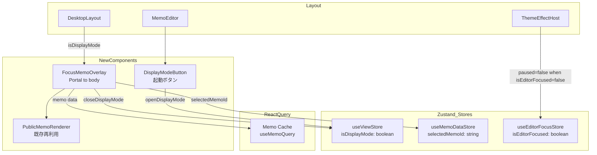
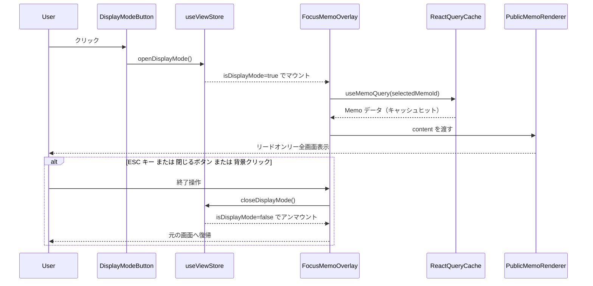

# Technical Design: memo-display-mode

## Overview

メモ表示モード（フォーカス/没入表示）は、Mosaku のメモ詳細・編集画面に追加するリードオンリーの全画面オーバーレイ機能である。ユーザーが書いたメモに静かに向き合える没入体験を提供する。実装は Frontend（React + Vite）のみで完結し、バックエンドへの変更は不要である。

UI 状態は `useViewStore` へ `isDisplayMode` フィールドを追加して管理する。コンテンツ表示には既存の `PublicMemoRenderer`（TipTap `editable: false`）を再利用し、オーバーレイは `createPortal` で `document.body` へマウントしてテーマ変数を `data-theme-id` 属性で継承させる。

### Goals

- 1 アクションでメモ詳細・編集画面から全画面リードオンリー表示を起動する
- 既存テーマ・エフェクトをオーバーレイ内でも継続適用する
- サーバーへの追加 API コールなしで React Query キャッシュから即座に表示する

### Non-Goals

- 表示モード中の編集・保存機能
- オーバーレイ内でのメモ切り替え操作
- モバイル専用のジェスチャー操作
- バックエンド API・DB スキーマの変更

---

## Requirements Traceability

| Requirement | Summary                                                              | Components                                              | Interfaces                                    | Flows      |
| ----------- | -------------------------------------------------------------------- | ------------------------------------------------------- | --------------------------------------------- | ---------- |
| 1.1         | 起動ボタンクリックでオーバーレイ表示                                 | `DisplayModeButton`, `FocusMemoOverlay`, `useViewStore` | `openDisplayMode()`                           | 起動フロー |
| 1.2         | React Query キャッシュから即時表示（追加 API コールなし）            | `FocusMemoOverlay`                                      | `useMemoQuery` (stale cache)                  | —          |
| 1.3         | 起動ボタンをメモ詳細・編集画面の両方に配置                           | `DisplayModeButton`, `MemoEditor`                       | `MemoEditorProps` 変更なし                    | —          |
| 1.4         | 表示状態を Zustand UI ストアで管理、サーバーデータコピー禁止         | `useViewStore`                                          | `ViewState` 拡張                              | —          |
| 2.1         | 100vw × 100vh フルスクリーンオーバーレイ                             | `FocusMemoOverlay`                                      | CSS: `position:fixed; inset:0`                | —          |
| 2.2         | 横幅最大 65ch・中央寄せ・縦スクロール                                | `FocusMemoOverlay`                                      | CSS: `max-w-prose` 相当                       | —          |
| 2.3         | タイトルを本文より大きいフォントで上部に表示                         | `FocusMemoOverlay`                                      | CSS custom props                              | —          |
| 2.4         | サイドバー・ツールバーなど通常 UI を非表示                           | `FocusMemoOverlay`                                      | z-index 最前面（z-[9999]）                    | —          |
| 2.5         | line-height 1.8 以上・font-size 18px 以上                            | `FocusMemoOverlay`                                      | CSS custom props `--dm-*`                     | —          |
| 3.1         | 編集不可のリードオンリーレンダリング                                 | `PublicMemoRenderer`                                    | `editable: false`                             | —          |
| 3.2         | TipTap editable:false または PublicMemoRenderer でリッチテキスト表示 | `PublicMemoRenderer`                                    | `createEditorExtensions({ editable: false })` | —          |
| 3.3         | テキスト選択・コピー可能                                             | `PublicMemoRenderer`                                    | `select-text` CSS class                       | —          |
| 3.4         | 本文が空のとき空状態メッセージを表示                                 | `FocusMemoOverlay`                                      | —                                             | —          |
| 4.1         | ESC キーで終了・元の画面へ復帰                                       | `FocusMemoOverlay`                                      | `closeDisplayMode()`                          | 終了フロー |
| 4.2         | 閉じるボタンクリックで終了                                           | `FocusMemoOverlay`                                      | `closeDisplayMode()`                          | 終了フロー |
| 4.3         | オーバーレイ背景クリックで終了                                       | `FocusMemoOverlay`                                      | backdrop onClick                              | 終了フロー |
| 4.4         | 閉じるボタンを常に視認可能な位置（右上）に表示                       | `FocusMemoOverlay`                                      | CSS: `position:fixed; top; right`             | —          |
| 5.1         | アクティブテーマの CSS 変数を適用                                    | `FocusMemoOverlay`                                      | `data-theme-id` 属性                          | —          |
| 5.2         | テーマ CSS 変数を上書きせず参照のみ                                  | `FocusMemoOverlay`                                      | CSS: `var(--theme-*)` 参照                    | —          |
| 5.3         | テーマエフェクトを表示モード中も継続                                 | `useMoriEffectControl`                                  | 変更不要（既存ロジック対応済み）              | —          |
| 5.4         | 表示モード専用スタイルを CSS カスタムプロパティで定義                | `FocusMemoOverlay`                                      | CSS: `--dm-font-size`, `--dm-line-height`     | —          |

---

## Architecture

### Existing Architecture Analysis

- `useViewStore` が `currentObject / currentView / isEditing / isMobile` などのグローバル UI 状態を一元管理している
- `DesktopLayout` / `MobileLayout` が `useViewStore` の状態に基づき `renderMainContent()` で画面を切り替える
- `ThemeEffectHost` は `DesktopLayout` / `MobileLayout` 内に配置されており、表示モード中も DOM に存在し続ける
- `PublicMemoRenderer` は `createEditorExtensions({ editable: false })` で TipTap をリードオンリー起動し、`select-text` でテキスト選択を許容するコンポーネントとして既実装済み

### Architecture Pattern & Boundary Map



**Architecture Integration**:

- 選択パターン: 既存 `useViewStore` への拡張 + `createPortal` オーバーレイ
- ドメイン境界: 新コンポーネント `FocusMemoOverlay` は `components/memo/` に配置（メモドメイン）
- 保持する既存パターン: React Query をサーバー状態の唯一の真実の源泉とする、Zustand は UI 状態のみ管理
- Steering 準拠: サーバーデータの Zustand コピー禁止・apiClient 直接呼び出し禁止を遵守

### Technology Stack

| Layer        | Choice / Version                       | Role in Feature                            | Notes                           |
| ------------ | -------------------------------------- | ------------------------------------------ | ------------------------------- |
| Frontend     | React 19 + Vite 6                      | コンポーネント・フック実装                 | createPortal で body にマウント |
| UI 状態      | Zustand                                | `isDisplayMode` フラグ管理                 | useViewStore へ拡張             |
| サーバー状態 | TanStack React Query                   | React Query キャッシュからメモデータ参照   | 追加 API コールなし             |
| エディタ     | @tiptap/react                          | リードオンリーレンダリング                 | PublicMemoRenderer 再利用       |
| スタイリング | Tailwind CSS 3 + CSS Custom Properties | オーバーレイレイアウト・表示モード専用変数 | `--dm-*` プレフィックス         |

---

## System Flows



---

## Components and Interfaces

### Summary

| Component             | Domain/Layer     | Intent                                           | Req Coverage                        | Key Dependencies                                             | Contracts |
| --------------------- | ---------------- | ------------------------------------------------ | ----------------------------------- | ------------------------------------------------------------ | --------- |
| `useViewStore` (拡張) | Store / UI State | 表示モード開閉フラグを保持                       | 1.1, 1.4                            | —                                                            | State     |
| `FocusMemoOverlay`    | UI / Memo        | 全画面リードオンリーオーバーレイ                 | 1.2, 2.1–2.5, 3.4, 4.1–4.4, 5.1–5.4 | useViewStore, useMemoDataStore, useMemoQuery, useActiveTheme | State     |
| `DisplayModeButton`   | UI / Memo        | 表示モード起動ボタン（MemoEditor 内に統合）      | 1.1, 1.3                            | useViewStore                                                 | —         |
| `PublicMemoRenderer`  | UI / Editor      | リッチテキストのリードオンリー表示（既存再利用） | 3.1–3.3                             | @tiptap/react                                                | —         |

---

### Store / UI State

#### `useViewStore` 拡張

| Field        | Detail                                                             |
| ------------ | ------------------------------------------------------------------ |
| Intent       | `isDisplayMode` フラグと起動・終了アクションを既存ストアに追加する |
| Requirements | 1.1, 1.4                                                           |

**Responsibilities & Constraints**

- `isDisplayMode: boolean` フラグを管理する（初期値 `false`）
- `openDisplayMode()` で `isDisplayMode` を `true` にセットする
- `closeDisplayMode()` で `isDisplayMode` を `false` にセットする
- サーバーデータ（メモ本文・タイトル）を Zustand に保持しない

**Dependencies**

- 依存なし（既存ストアの拡張）

**Contracts**: State [x]

##### State Management

```typescript
// useViewStore.ts への追加差分
interface ViewState {
	// 既存フィールドはそのまま維持 ...

	isDisplayMode: boolean;
	openDisplayMode: () => void;
	closeDisplayMode: () => void;
}

// 実装例（インターフェース定義のみ）
// isDisplayMode: false,
// openDisplayMode: () => set({ isDisplayMode: true }),
// closeDisplayMode: () => set({ isDisplayMode: false }),
```

- 状態モデル: `isDisplayMode: boolean`（単純なトグル）
- 永続化: なし（セッション内 UI 状態）
- 並行性: Zustand の同期更新で競合なし

**Implementation Notes**

- `useFeedbackStore` の `isOpen / open / close` パターンと同形。差分は `useViewStore` への追加のみ
- 将来的に表示モード対象のメモ ID を別途保持する必要が生じた場合は `displayMemoId: string | null` を追加可能（現在は `useMemoDataStore.selectedMemoId` から参照するため不要）

---

### UI / Memo

#### `FocusMemoOverlay`

| Field        | Detail                                                                                                     |
| ------------ | ---------------------------------------------------------------------------------------------------------- |
| Intent       | `createPortal` で `document.body` に全画面オーバーレイをマウントし、リードオンリーのメモ表示体験を提供する |
| Requirements | 1.2, 2.1–2.5, 3.4, 4.1–4.4, 5.1–5.4                                                                        |

**Responsibilities & Constraints**

- `isDisplayMode = true` のときのみ DOM に存在する（条件レンダリング）
- `useMemoDataStore` から `selectedMemoId` を取得し `useMemoQuery(selectedMemoId)` でキャッシュ参照（追加 API コール禁止）
- `useActiveTheme()` でアクティブテーマを取得し、ラッパー div に `data-theme-id` 属性を付与してテーマ CSS 変数を継承させる
- 本文が空の場合は空状態メッセージを表示する
- ESC キー押下・閉じるボタンクリック・背景クリックで `closeDisplayMode()` を呼ぶ
- マウント時に `document.body` の `overflow` を `hidden` にし、アンマウント時に復元してバックグラウンドスクロールをロックする

**Dependencies**

- Inbound: `useViewStore.isDisplayMode` — 表示トリガー（P0）
- Inbound: `useMemoDataStore.selectedMemoId` — 表示対象メモ ID（P0）
- Outbound: `useViewStore.closeDisplayMode` — 終了アクション（P0）
- Outbound: `useMemoQuery(id)` — React Query キャッシュ参照（P0）
- Outbound: `useActiveTheme()` — テーマ CSS 変数継承（P1）
- External: `ReactDOM.createPortal` — `document.body` への DOM マウント（P0）
- External: `PublicMemoRenderer` — リッチテキスト表示（P0）

**Contracts**: State [x]

##### State Management

```typescript
// Props インターフェース（store から自律取得するため props なし）
interface FocusMemoOverlayProps {
	// no props — all state from stores
}

// 内部で参照する型
type OverlayMemoData = Pick<Memo, 'title' | 'content'>;

// コンポーネントが内部で使用するストア契約
interface FocusMemoOverlayStoreContract {
	isDisplayMode: boolean; // useViewStore
	closeDisplayMode: () => void; // useViewStore
	selectedMemoId: string | null; // useMemoDataStore
	memo: OverlayMemoData | undefined; // useMemoQuery キャッシュ
	activeTheme: MinimalTheme | null; // useActiveTheme
}
```

- 状態モデル: Store 参照のみ（ローカル state は `isClosing` アニメーション用途に限定可）
- 永続化: なし
- 並行性: `closeDisplayMode()` は冪等

**Implementation Notes**

- マウント時: `document.body.style.overflow = 'hidden'`、アンマウント時: `document.body.style.overflow = ''` で復元する
- ESC キーハンドリング: `useEffect` 内で `document.addEventListener('keydown', handler)` を登録し cleanup で解除する
- 背景クリック終了: コンテンツ div の `stopPropagation` + 背景 div の `onClick={closeDisplayMode}` で実装する
- `PublicMemoRenderer` へ渡す `content` は `memo?.content ?? ''`。content が空文字のとき `PublicMemoRenderer` の代わりに空状態メッセージ div を表示する（Req 3.4）
- テーマ CSS 変数継承: `<div data-theme-id={activeTheme?.id} className="focus-memo-overlay ...">` とすることで `[data-theme-id="..."]` セレクタがマッチする

#### `DisplayModeButton`（MemoEditor 内統合）

| Field        | Detail                                                    |
| ------------ | --------------------------------------------------------- |
| Intent       | `MemoEditor` のヘッダー内に表示モード起動ボタンを追加する |
| Requirements | 1.1, 1.3                                                  |

**Implementation Notes**

- 独立コンポーネントとして切り出さず、`MemoEditor.tsx` のヘッダー `<div>` 内に `<button>` として追加する
- `useViewStore` から `openDisplayMode` を参照してクリックハンドラに設定する
- `isCreate` が `true` のとき（新規作成モード）は表示しない（保存前のメモに対して表示モードは不適切）
- 配置位置: 保存ボタンの左隣など視認しやすい位置

---

## Data Models

本機能はデータモデルに変更を加えない。`Memo` 型（`id`, `title`, `content`, `memoTags`, `notebook` 等）は既存定義をそのまま参照する。バックエンド・DB スキーマの変更は不要である。

---

## Error Handling

### Error Strategy

表示モードはキャッシュ参照のみを行うため、ネットワークエラーは発生しない。考慮すべきエラーは UI 状態の不整合のみである。

### Error Categories and Responses

**キャッシュミス（memo が undefined）**

- `useMemoQuery(selectedMemoId)` がデータを返さない場合（キャッシュ未格納・ローディング中）
- 対応: ローディングスピナーまたは「メモを読み込み中...」メッセージを表示し、`data` が確定するまでコンテンツエリアを空にする

**selectedMemoId が null**

- 表示モードがアクティブだが `selectedMemoId = null` という不整合状態
- 対応: `FocusMemoOverlay` 内でガード節を追加し、ID が null の場合は `closeDisplayMode()` を即時呼ぶ

**TipTap インスタンス初期化エラー**

- `PublicMemoRenderer` は既存実装で `editor` が `null` の場合に `null` を返す（既存実装済み）
- 追加対応不要

---

## Testing Strategy

### Unit Tests

- `useViewStore`: `openDisplayMode()` 後に `isDisplayMode = true`、`closeDisplayMode()` 後に `isDisplayMode = false` となること
- `FocusMemoOverlay`: `isDisplayMode = false` のとき DOM に存在しないこと
- `FocusMemoOverlay`: `isDisplayMode = true` のとき `selectedMemoId` に対応するメモタイトルとコンテンツが表示されること
- `FocusMemoOverlay`: `content` が空文字のとき空状態メッセージが表示されること

### Integration Tests

- `MemoEditor` の起動ボタンクリック → `FocusMemoOverlay` がマウントされること
- ESC キー押下 → `FocusMemoOverlay` がアンマウントされること
- 背景クリック → `FocusMemoOverlay` がアンマウントされること
- 閉じるボタンクリック → `FocusMemoOverlay` がアンマウントされること

### E2E / UI Tests

- メモ編集画面から表示モードを起動 → フルスクリーンオーバーレイが表示される
- テーマ設定済み状態で表示モードを起動 → テーマカラーがオーバーレイに適用されている
- 表示モード中にテキスト選択・コピー操作が可能である
- 表示モードを閉じると編集画面へ戻る

---

## Optional Sections

### Performance & Scalability

- `FocusMemoOverlay` は `isDisplayMode = false` のとき DOM から完全にアンマウントされるため、TipTap インスタンスはメモリ上に残らない
- React Query のキャッシュヒット前提のため追加ネットワーク I/O はゼロ
- `useActiveTheme()` はキャッシュ参照のみで計算コストは無視できる

---

## Supporting References

- `research.md` — テーマ CSS スコープ分析・エフェクト継続検証・ストア選択の詳細
- `frontend/src/components/public/PublicMemoRenderer.tsx` — 再利用するリードオンリーレンダラー実装
- `frontend/src/stores/useViewStore.ts` — 拡張対象ストア
- `frontend/src/hooks/useMoriEffectControl.ts` — エフェクト停止条件のロジック（変更なし）
