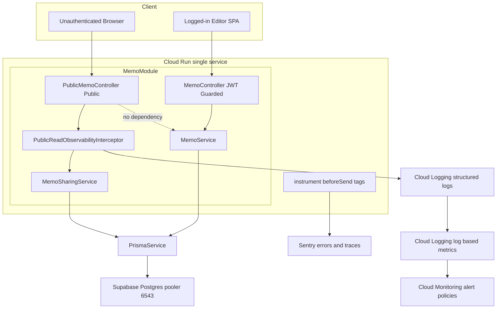
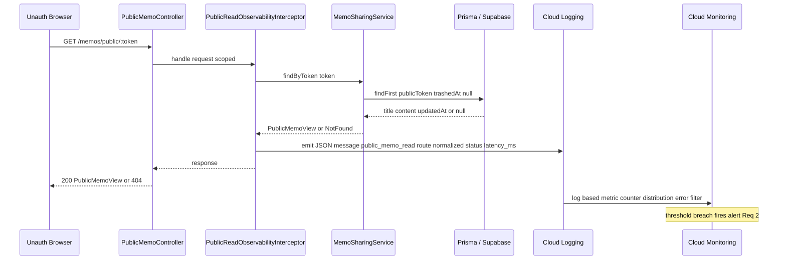
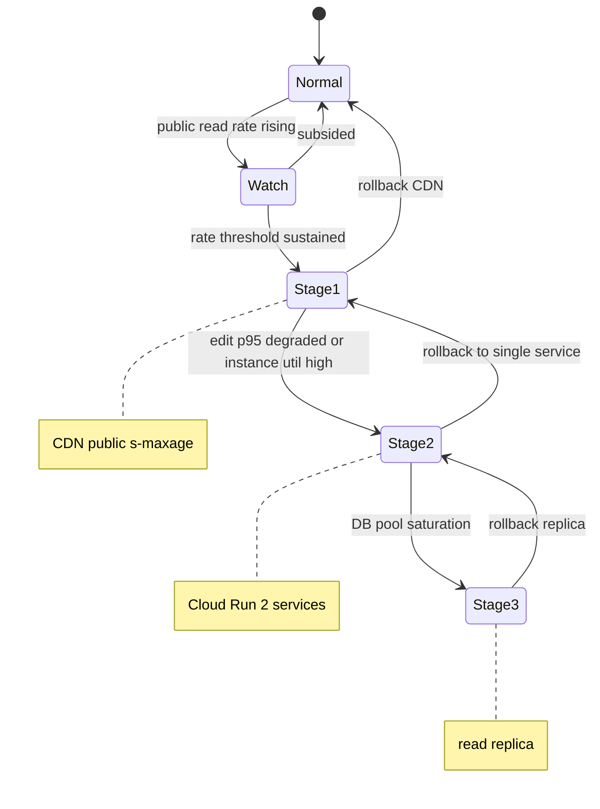

# Technical Design — memo-public-isolation

## Overview

**Purpose**: 本機能は、公開メモ（未ログインで閲覧可能な `/p/:token` ／ `GET /memos/public/:token`）の閲覧トラフィックと、招待制ログインユーザーによる編集トラフィック（保存・編集・一覧）の間に「障害伝播の壁（bulkhead）の素地」を作り、SNS 拡散等による公開閲覧の爆発的増加が編集体験を劣化させないことを Mosaku 運用者・開発者・アーキテクトに保証する。

**Users**: Mosaku 運用者は公開閲覧と編集を区別したメトリクス・アラートで負荷の出所を切り分け、分離着手を数値で判断する。開発者は一方向 DI の継ぎ目を恒久検証で守り、将来のサービス 2 分割コストを抑える。アーキテクトはトリガー駆動で発動できる段階的分離 Playbook を即座に参照する。

**Impact**: 現状は `MemoController` と `PublicMemoController` が同一 NestJS アプリ=同一 Cloud Run に同居し、インスタンスプール・DB コネクションプール・Node イベントループを共有する。本フェーズは**物理分割を行わず**、(1) 公開読み取りの観測分離、(2) 数値トリガーとアラート、(3) 疎結合の自動検証、(4) 段階的分離の文書化により、分割を「いつ・どう」発動するかの準備を完了させる。直近コミットで route 正規化（G1）と DI フィットネステスト（G3）は実装済みであり、本設計はそれらを契約として固定しつつ、残る観測発出源（薄い Interceptor）と運用文書を定義する。

### Goals

- 公開読み取りトラフィックを編集系から独立して計測し（route ラベル分離）、Cloud Monitoring で集計・アラート可能にする。
- 「いつ物理分離に着手するか」を 4 系統の数値トリガー（公開 req レート／DB プール使用率／編集 p95 劣化／インスタンス使用率）で定義し、閾値超過をアラート化する。
- 公開読み取り経路（`MemoSharingService.findByToken`）が編集系（`MemoService`）へ依存しない一方向 DI を CI で恒久検証する。
- 段階的分離オプション（CDN 化 → Cloud Run 2 分割 → 読み取りレプリカ）を前提トリガー・順序・ロールバック込みで明文化する。
- 既存不変則（`apiClient` 経由・React Query 真実源・`@Public()` opt-out・`AuthorizationService` 一元化・Sentry `feature_area` enum 固定・helmet・IP 60req/分）を一切破壊しない。

### Non-Goals

- 物理的なサービス分割（Cloud Run 2 分割）の実装そのもの。
- 読み取りレプリカの実構築。
- Cloud Monitoring アラートポリシーの IaC 化（本フェーズは gcloud 手順書に留める）。
- 公開メモ機能そのものの仕様変更（公開/解除/トークン再生成は `memo-public-sharing` の既存仕様）。

## Architecture

### Existing Architecture Analysis

- **同居構成**: `MemoModule`（`backend/src/memo/memo.module.ts`）が `MemoController`（編集系）と `PublicMemoController`（公開読み取り）を同一モジュール・同一プロセスに配線。これが隔離対象の現状。
- **既存の継ぎ目（健全）**: `PublicMemoController` → `MemoSharingService` のみに依存。`MemoSharingService.findByToken` は `PrismaService` だけを参照し `MemoService` 非依存（Req 3 達成済み）。
- **既存の観測契約**: `instrument.ts` の `beforeSend` が `sanitizeRequestUrl → applyStandardTags` を適用。5 タグ契約（`environment`/`release`/`feature_area`/`route`/`user_facing`）。`route` は `normalizeRoute` で `/memos/public/:token` に正規化済み（G1 達成、Req 1.1/6.3）。`feature_area` は `memo` 固定で、公開/編集は `route` で区別（Req 1.2）。
- **保たれる境界**: `@Public()` opt-out によるグローバル JWT Guard 例外、`@Throttle(60/分)`、`Cache-Control: private, max-age=30, must-revalidate` + `Vary: Accept`。
- **技術的負債への対応**: `AppLogger` はテキストログ（`[ctx] message`）で、Cloud Logging のラベル抽出に不向き。本フェーズは公開読み取り専用の構造化 JSON ログを別経路で発出して回避する（`AppLogger` 自体は変更しない）。

### Architecture Pattern & Boundary Map

**Selected pattern**: 既存 NestJS レイヤードアーキテクチャを維持し、公開読み取り経路に**薄い横断観測 Interceptor を 1 枚追加**するハイブリッド（research.md Option C）。物理境界は変えず、観測の発出源を「将来サービスごと移設可能な単位」に閉じ込める。



**Architecture Integration**:

- **Selected pattern**: 薄い NestJS Interceptor による横断観測 + 文書駆動の運用準備。物理分割は据え置き。
- **Domain/feature boundaries**: 公開読み取り（`PublicMemoController`/`MemoSharingService`/新 Interceptor）と編集（`MemoController`/`MemoService`）を import 方向で一方向に保つ。観測発出は公開コントローラにスコープし編集経路へ漏らさない。
- **Existing patterns preserved**: `@Public()` opt-out、`AuthorizationService` 一元化、5 タグ契約、`normalizeRoute` 単一ソース、`apiClient` 経由、React Query 真実源。
- **New components rationale**: `PublicReadObservabilityInterceptor` は Cloud Logging ログベースメトリクスの clean-label な発出源として唯一の新規コード。Cloud Run 標準メトリクスがルート別に割れない欠落（G2）を埋め、将来のサービス分割時に Interceptor ごと公開サービスへ移設可能にする。
- **Steering compliance**: `tech.md`（Sentry 観測・Cloud Run 構成）/ `structure.md`（`{layer}/{domain}` 配置）/ CLAUDE.md 不変則に整合。

### Technology Stack

| Layer                    | Choice / Version                                                                                                                              | Role in Feature                                     | Notes                                           |
| ------------------------ | --------------------------------------------------------------------------------------------------------------------------------------------- | --------------------------------------------------- | ----------------------------------------------- |
| Backend / Services       | NestJS 10 Interceptor（`@nestjs/common`）                                                                                                     | 公開読み取りの構造化 JSON ログ発出（メトリクス源）  | `PublicMemoController` にスコープ。新規依存なし |
| Observability            | `@sentry/nestjs`（既存）+ `sentry-tags.normalizeRoute`（既存）                                                                                | route 正規化・トークン流出防止・5 タグ契約          | コード変更なし、契約として固定                  |
| Data / Storage           | Supabase Postgres（pooler 6543, 既存）                                                                                                        | 公開読み取りの DB アクセス（プール共有が分離対象）  | スキーマ変更なし                                |
| Infrastructure / Runtime | Cloud Run（`--concurrency=100 --max-instances=10 --cpu=1 --memory=512Mi`）+ Cloud Logging log-based metrics + Cloud Monitoring alert policies | ルート別メトリクス集計とトリガーアラート            | アラートは gcloud 手順書（IaC 化は後続）        |
| Docs                     | `docs/deployment/memo-public-isolation-runbook.md`（新規）                                                                                    | トリガー定義・対応表・3 段階 Playbook・ロールバック | 文書成果物                                      |

## System Flows

### 公開読み取りリクエストの観測フロー（Req 1）



### トリガー判定と段階的分離の発動（Req 2 / Req 5）



各段階は Playbook（Req 5）で定義する前提トリガーが「指定継続時間にわたり閾値超過」した場合のみ手動発動する。通常運用（閾値未超過）では分割を要求しない（Req 2.5）。各段階にはロールバック遷移を定義（Req 5.4）。

## Requirements Traceability

| Requirement | Summary                             | Components                                                                               | Interfaces                             | Flows          |
| ----------- | ----------------------------------- | ---------------------------------------------------------------------------------------- | -------------------------------------- | -------------- |
| 1.1         | 公開を route 区別で計測             | PublicReadObservabilityInterceptor, RouteNormalization（既存）                           | 構造化ログ Contract / `normalizeRoute` | 観測フロー     |
| 1.2         | feature_area=memo 固定 + route 区別 | RouteNormalization（既存 `applyStandardTags`）                                           | Sentry タグ契約                        | 観測フロー     |
| 1.3         | Cloud Monitoring 独立集計           | PublicReadObservabilityInterceptor, LogBasedMetrics                                      | ログベースメトリクス定義               | 観測フロー     |
| 1.4         | サンプリング枠内・env 非変更        | instrument（既存）                                                                       | —                                      | —              |
| 1.5         | タグ欠落時フォールバック            | RouteNormalization（既存）                                                               | `applyStandardTags` フォールバック     | —              |
| 2.1         | 数値トリガー定義                    | IsolationTriggerRunbook                                                                  | トリガー表                             | トリガーフロー |
| 2.2         | 閾値超過でアラート                  | CloudMonitoringAlertPolicies                                                             | アラートポリシー                       | トリガーフロー |
| 2.3         | トリガー→分離段階の対応表           | IsolationTriggerRunbook                                                                  | 対応表                                 | トリガーフロー |
| 2.4         | 編集 p95 劣化アラート               | CloudMonitoringAlertPolicies, EditReadLatencyMetric（編集経路 route 別レイテンシ・必須） | p95 SLO アラート                       | トリガーフロー |
| 2.5         | 通常時は分割を要求しない            | IsolationTriggerRunbook                                                                  | 原則記述                               | トリガーフロー |
| 3.1         | 一方向 DI 維持                      | MemoSharingService（既存）                                                               | Service Interface                      | —              |
| 3.2         | 逆流の検証可能化                    | DependencyFitnessTest（既存）                                                            | テスト契約                             | —              |
| 3.3         | 共通部は下位レイヤー配置            | RouteNormalization（`common/sentry`）                                                    | 共有ユーティリティ                     | —              |
| 3.4         | 逆流の自動検出                      | DependencyFitnessTest（既存）                                                            | CI ゲート                              | —              |
| 3.5         | 認可バイパス新設禁止                | PublicMemoController（既存 `@Public()`）                                                 | 境界契約                               | —              |
| 4.1         | 公開のみ返却                        | MemoSharingService.findByToken（既存）                                                   | Service Interface                      | 観測フロー     |
| 4.2         | 不在/解除/ゴミ箱は 404              | MemoSharingService.findByToken（既存）                                                   | エラー契約                             | 観測フロー     |
| 4.3         | 内部/所有者情報を含めない           | PublicMemoView（既存 select）                                                            | DTO 契約                               | —              |
| 4.4         | 公開は @Public 限定                 | PublicMemoController（既存）                                                             | 境界契約                               | —              |
| 4.5         | 読み取り専用境界                    | PublicMemoController（GET のみ）                                                         | API 契約                               | —              |
| 5.1         | 3 段階 Playbook                     | StagedSeparationPlaybook                                                                 | Playbook 文書                          | トリガーフロー |
| 5.2         | 各段の前提・順序                    | StagedSeparationPlaybook                                                                 | 対応表                                 | トリガーフロー |
| 5.3         | CDN 鮮度要件                        | StagedSeparationPlaybook                                                                 | キャッシュ無効化記述                   | —              |
| 5.4         | ロールバック手順                    | StagedSeparationPlaybook                                                                 | ロールバック表                         | トリガーフロー |
| 5.5         | 2/3 段の実装は除外                  | StagedSeparationPlaybook                                                                 | Non-Goal 記述                          | —              |
| 6.1-6.5     | 不変則維持                          | 全コンポーネント横断                                                                     | 既存契約の非破壊                       | —              |

## Components and Interfaces

| Component                          | Domain/Layer                               | Intent                                                                                                                | Req Coverage            | Key Dependencies (P0/P1)                          | Contracts      |
| ---------------------------------- | ------------------------------------------ | --------------------------------------------------------------------------------------------------------------------- | ----------------------- | ------------------------------------------------- | -------------- |
| PublicReadObservabilityInterceptor | Backend / memo（新規）                     | 公開読み取りの構造化メトリクスログを発出                                                                              | 1.1, 1.3, 2.4           | normalizeRoute (P0), MemoSharingService 経路 (P1) | Service, State |
| RouteNormalization                 | Backend / common-sentry（既存）            | route の `:token` 正規化と 5 タグ付与                                                                                 | 1.1, 1.2, 1.5, 3.3, 6.3 | Sentry beforeSend (P0)                            | Service        |
| MemoSharingService.findByToken     | Backend / memo（既存）                     | 公開メモのみ返却・データ境界                                                                                          | 3.1, 4.1, 4.2, 4.3      | PrismaService (P0)                                | Service        |
| DependencyFitnessTest              | Backend / memo test（既存）                | 逆流 import を CI で禁止                                                                                              | 3.2, 3.4                | —                                                 | Batch          |
| LogBasedMetrics                    | Infra / observability（新規・文書+gcloud） | ルート別 counter/distribution/error 集計（公開 served + 429 throttled の和で req レート算出）                         | 1.3, 2.1                | Cloud Logging (P0)                                | Event          |
| EditReadLatencyMetric              | Infra / observability（新規・必須）        | 編集経路の route 別 p95 レイテンシ発出源（`MemoController` に公開側と対称の薄い Interceptor を適用し混在 p95 を回避） | 2.4                     | normalizeRoute (P0), Cloud Logging (P0)           | Event          |
| CloudMonitoringAlertPolicies       | Infra / observability（新規・文書+gcloud） | 閾値超過アラート                                                                                                      | 2.2, 2.4                | LogBasedMetrics (P0), Cloud Run native (P1)       | Event          |
| IsolationTriggerRunbook            | Docs（新規）                               | 数値トリガー定義と対応表                                                                                              | 2.1, 2.3, 2.5           | —                                                 | Batch          |
| StagedSeparationPlaybook           | Docs（新規）                               | 3 段階分離・前提・ロールバック                                                                                        | 5.1-5.5                 | IsolationTriggerRunbook (P1)                      | Batch          |

### Backend / memo

#### PublicReadObservabilityInterceptor（新規）

| Field        | Detail                                                                 |
| ------------ | ---------------------------------------------------------------------- |
| Intent       | 公開読み取り完了時に正規化 route 付きの構造化 JSON ログを 1 行発出する |
| Requirements | 1.1, 1.3, 2.4                                                          |

**Responsibilities & Constraints**

- `PublicMemoController` にのみ適用（`@UseInterceptors` でコントローラスコープ）。編集経路には適用せず、公開/編集の発出源を物理的に分離する。
- リクエスト完了（成功・例外問わず）時に `latency_ms` と `status` を確定し、`message: "public_memo_read"` を固定キーとする 1 行 JSON を `stdout` へ発出。Cloud Run が `jsonPayload` として自動パースする。
- `route` は必ず `normalizeRoute` を通した値（`/memos/public/:token`）のみを出力し、生トークンを絶対に含めない（不変条件）。
- `AppLogger` のテキストログとは独立経路で発出し、メトリクスフィルタは `jsonPayload.message="public_memo_read"` で限定可能にする。
- 観測は correctness を妨げない: ログ発出失敗はリクエスト処理を中断させず握り潰す（既存 `beforeSend` の安全側フォールバック思想に整合）。
- **観測スコープの限界（重要）**: NestJS の実行順は **Guard → Interceptor** であるため、`ThrottlerGuard`（`@Throttle(60/分)`）が弾く **429 は本 Interceptor に到達しない**。したがって req レート（Req 2.1）を 429 込みの「到達試行レート」で評価するには、429 を Cloud Run ネイティブのリクエストログ（`httpRequest.status=429` ＋ `requestUrl` の `:token` 正規化フィルタ）から別ログベースメトリクス `public_memo_read_throttled_count` として併せて計上する。公開 req レートトリガーは `public_memo_read_count`（served）＋ `public_memo_read_throttled_count`（throttled）の和で判定する。

**Dependencies**

- Inbound: `PublicMemoController` — リクエスト横断で起動（P0）
- Outbound: `normalizeRoute`（`common/sentry/sentry-tags`）— route 正規化（P0）
- External: Cloud Logging（stdout 経由）— メトリクス源（P0）

**Contracts**: Service [x] / API [ ] / Event [ ] / Batch [ ] / State [x]

##### Service Interface

```typescript
// 構造化ログのペイロード契約（jsonPayload としてパースされる）
interface PublicReadLogPayload {
	message: 'public_memo_read'; // メトリクスフィルタの固定キー
	feature_area: 'memo'; // 既存 enum 固定（Req 6.3）
	route: string; // 必ず normalizeRoute 済み（例 '/memos/public/:token'）
	method: 'GET';
	status: number; // Interceptor が観測可能なステータス（200 / 404 / 5xx）。429 は Guard 段で弾かれ到達しないため別経路で計上（後述）
	latency_ms: number; // リクエスト処理時間
	severity: 'INFO' | 'ERROR'; // status>=500 のとき ERROR
}

interface PublicReadObservabilityInterceptor {
	// NestJS NestInterceptor.intercept のシグネチャに準拠
	intercept(context: ExecutionContext, next: CallHandler): Observable<unknown>;
}
```

- Preconditions: `PublicMemoController` のハンドラに到達したリクエストであること。
- Postconditions: 成功・例外いずれでも 1 件の `PublicReadLogPayload` が発出される（`finalize`/`tap` でレイテンシ確定）。`route` は token を含まない。
- Invariants: `feature_area === 'memo'`、`route === normalizeRoute(route)`、生トークン非出力。

**Implementation Notes**

- Integration: `PublicMemoController` に `@UseInterceptors(PublicReadObservabilityInterceptor)` を付与し、`MemoModule.providers` に登録。グローバル登録はしない（公開経路に限定するため）。
- Validation: ユニットテストで (a) `route` が `:token` 正規化される、(b) 200/404/例外それぞれで 1 件発出・`status`/`severity` が正しい、(c) 生トークンが payload に出ないことを固定。
- Risks: `AppLogger` ログとの混在 → `message` 固定キーで分離。発出オーバーヘッド → 1 行 JSON のみで無視可能。

#### MemoSharingService.findByToken（既存・契約固定）

| Field        | Detail                                                     |
| ------------ | ---------------------------------------------------------- |
| Intent       | 公開状態のメモのみを読み取り専用で返却し、データ境界を保つ |
| Requirements | 3.1, 4.1, 4.2, 4.3                                         |

**Responsibilities & Constraints**

- `where: { publicToken: token, trashedAt: null }` で未公開・ゴミ箱を除外（Req 4.1, 4.2）。
- `select: { title, content, updatedAt }` のみ返却し、内部 ID・`userId`・所有者情報を露出しない（Req 4.3）。
- 不在時は `throwNotFound`（404）で存在を推測されにくい応答（Req 4.2）。
- `PrismaService` のみ依存、`MemoService` 非依存を維持（Req 3.1）。

**Contracts**: Service [x]

##### Service Interface

```typescript
interface PublicMemoView {
	title: string;
	content: string;
	updatedAt: Date;
}

interface MemoSharingReadPort {
	// 失敗は NotFoundException（404）として送出される
	findByToken(token: string): Promise<PublicMemoView>;
}
```

- Preconditions: `token` は `@Length(20,64)` + `@Matches(/^[A-Za-z0-9_-]+$/)` を通過済み（`GetPublicMemoParamsDto`）。
- Postconditions: 公開かつ非ゴミ箱のメモのみ `PublicMemoView` を返す。それ以外は 404。
- Invariants: 編集系フィールド非露出、`MemoService` への依存ゼロ。

**Implementation Notes**

- Integration: 変更なし。設計成果は回帰テスト増強（未公開・ゴミ箱・無効トークン・フィールド非露出）。
- Validation: `memo-sharing.service.spec.ts` に上記 4 ケースを固定（既存があれば拡張）。
- Risks: 仕様変更なし。回帰の網羅性のみ担保。

#### DependencyFitnessTest（既存・恒久化）

| Field        | Detail                                                                |
| ------------ | --------------------------------------------------------------------- |
| Intent       | 公開読み取り経路から編集系 `MemoService` への逆流 import を CI で禁止 |
| Requirements | 3.2, 3.4                                                              |

**Responsibilities & Constraints**

- `memo-sharing.service.ts` / `public-memo.controller.ts` のソースに `from './memo.service'` が現れないことをアサート（`memo-sharing.dependency.spec.ts`）。
- 逆流が混入すると CI が失敗し、将来のサービス分割コスト増を未然に防ぐ。

**Contracts**: Batch [x]（CI ゲート）

**Implementation Notes**

- Integration: 既存テストを正式な品質ゲートとして維持。ESLint `no-restricted-imports` への昇格は任意（テストで十分なため本フェーズは追加しない）。
- Validation: 逆流 import を一時的に追加すると RED になることを確認済みの設計前提。
- Risks: ソース文字列マッチのため別名 import 等の回避余地 → 公開経路は import 元が限定的で実害なし。必要なら将来 dependency-cruiser へ移行。

### Infra / observability（文書 + gcloud 断片）

#### LogBasedMetrics（新規）

| Field        | Detail                                                                  |
| ------------ | ----------------------------------------------------------------------- |
| Intent       | Interceptor の構造化ログからルート別 req 数・レイテンシ・エラー率を集計 |
| Requirements | 1.3, 2.1                                                                |

**Contracts**: Event [x]

##### Event Contract

- Source filter: `jsonPayload.message="public_memo_read"`（Interceptor 経由）＋ Cloud Run ネイティブログ（429 計上用）。
- Published metrics:
  - `public_memo_read_count`（counter）: ラベル `status_class`（2xx/4xx/5xx）。Interceptor 到達分の公開 req を計上。
  - `public_memo_read_throttled_count`（counter）: Cloud Run ネイティブログの `httpRequest.status=429` ＋ `:token` 正規化フィルタ由来。**Interceptor に到達しない 429 を補完**（Guard 段で弾かれるため）。
  - 公開 req レート（Req 2.1）= `public_memo_read_count` ＋ `public_memo_read_throttled_count` の和で算出。
  - `public_memo_read_latency`（distribution）: `jsonPayload.latency_ms`。p50/p95/p99 を Cloud Monitoring で算出。
  - エラー率: `public_memo_read_count{status_class="5xx"}` / 総数で導出。
- Delivery: Cloud Logging → Cloud Monitoring 時系列。サンプリングなし（全件・Req 1.3）。
- Idempotency: ログ 1 行=1 イベント。重複発出なし（Interceptor が 1 リクエスト 1 発出）。429 は Cloud Run が 1 リクエスト 1 行で出力するため重複なし。

**Implementation Notes**

- Integration: `docs/deployment/memo-public-isolation-runbook.md` に `gcloud logging metrics create` 断片を記載。IaC 化は後続。
- 編集系メトリクス（Req 2.4 のデータソース・**必須**）: Cloud Run ネイティブの p95 レイテンシは公開＋編集が混在し、公開スパイク時は公開読み取りに汚染されて「編集だけの p95」を切り出せない。よって Req 2.4「編集体験への影響あり」アラートの一次データを確保するため、**編集経路にも route 別レイテンシの発出源を必須で設ける**。実装は次のいずれかを採る:
  - **採用（2026-05-30 validate-design 確定）**: `MemoController` スコープに公開側と同型の薄い Interceptor を適用し、`message:"memo_edit_read"` 固定キー＋ `normalizeRoute` 済み route で `latency_ms` を発出 → `memo_edit_latency`（distribution）を定義。公開側 `PublicReadObservabilityInterceptor` と**対称**で、将来のサービス分割時も両 Interceptor をそれぞれのサービスへそのまま移設できる。clean-label をコード側で能動的に担保する。
  - （不採用の代替）Cloud Run ネイティブのリクエストログを `requestUrl` の route 別フィルタで分割する案は、新規コード不要だが route ラベルの clean 化が公開側より弱く対称性を欠くため採らない。
  - **「任意」ではなく本フェーズの成果物に含める**（Req 2.4 がトリガーの一次データを要求するため）。
  - **不変則への配慮（Req 6.4）**: 編集側 Interceptor は `MemoController` スコープに限定し、`@Public()` opt-out / `AuthorizationService` 一元化 / 既存ハンドラのロジックには一切手を入れない（横断観測のみ）。公開側との一方向 DI の継ぎ目（Req 3.1）は両 Interceptor が `normalizeRoute` という下位共通ユーティリティのみを共有する構成で維持する。

#### CloudMonitoringAlertPolicies（新規）

| Field        | Detail                         |
| ------------ | ------------------------------ |
| Intent       | トリガー閾値超過を運用者に通知 |
| Requirements | 2.2, 2.4                       |

**Contracts**: Event [x]

##### Event Contract

- Subscribed metrics: `LogBasedMetrics`（`public_memo_read_count` + `public_memo_read_throttled_count` + `public_memo_read_latency`）+ `EditReadLatencyMetric`（`memo_edit_latency`）+ Cloud Run ネイティブ（instance count / CPU util）+ Supabase pooler 使用率（ネイティブ）。
- Published alerts（通知先 = 既存 Slack `#mosaku-alerts` 経路に合流）:
  - 公開 req レート閾値超過（継続時間付き）。
  - 編集 p95 レイテンシ劣化 +（公開 req 上昇との相関）→「編集体験への影響あり」アラート（Req 2.4）。
  - インスタンス使用率閾値超過。
  - DB プール使用率閾値超過。
- Ordering / delivery: Cloud Monitoring の継続時間条件（`for N min`）で瞬間スパイクのノイズを抑制。

**Implementation Notes**

- Integration: `gcloud alpha monitoring policies create` 断片を runbook に記載。閾値の具体値は IsolationTriggerRunbook を参照。
- Risks: 閾値の妥当性は実測でチューニング（research.md R2）。

### Docs（新規文書成果物）

#### IsolationTriggerRunbook（新規）`docs/deployment/memo-public-isolation-runbook.md`

| Field        | Detail                                      |
| ------------ | ------------------------------------------- |
| Intent       | 数値トリガー定義とトリガー→分離段階の対応表 |
| Requirements | 2.1, 2.3, 2.5                               |

**Contracts**: Batch [x]（運用手順）

**Responsibilities & Constraints** — 文書に含める初期トリガー（提案値・運用調整前提。母数は Cloud Run `concurrency=100 × max-instances=10 = 1000 同時`）:

| トリガー           | 観測源                                                                              | 提案閾値（初期値）             | 継続時間 | 対応段階                            |
| ------------------ | ----------------------------------------------------------------------------------- | ------------------------------ | -------- | ----------------------------------- |
| 公開 req レート    | `public_memo_read_count` + `public_memo_read_throttled_count`（429 含む和）         | > 50 req/s（≒3000 req/分）     | 5 分     | Stage 1（CDN 化）                   |
| インスタンス使用率 | Cloud Run native                                                                    | アクティブ ≥ 7 / 10（70%）     | 10 分    | Stage 2 候補                        |
| 編集 p95 劣化      | `memo_edit_latency`（編集経路 route 別・EditReadLatencyMetric） + 公開 req 上昇相関 | p95 > 800ms（または平常比 2×） | 5 分     | Stage 2（影響ありアラート Req 2.4） |
| DB プール使用率    | Supabase pooler native                                                              | > 80%                          | 5 分     | Stage 3 検討                        |

- 対応表（トリガー→段階）と「通常運用では分割を自動でも手動でも要求しない」原則（Req 2.5）を明記。

#### StagedSeparationPlaybook（新規）同 runbook 内セクション

| Field        | Detail                                       |
| ------------ | -------------------------------------------- |
| Intent       | 3 段階分離の前提トリガー・順序・ロールバック |
| Requirements | 5.1, 5.2, 5.3, 5.4, 5.5                      |

**Contracts**: Batch [x]

**Responsibilities & Constraints** — 文書化する 3 段階:

| 段階    | 内容                                                                                  | 前提トリガー                           | ロールバック                           | 本フェーズ実装         |
| ------- | ------------------------------------------------------------------------------------- | -------------------------------------- | -------------------------------------- | ---------------------- |
| Stage 1 | `Cache-Control` を `private, max-age=30` → `public, s-maxage=<N>` 化し CDN 前段で吸収 | 公開 req レート超過                    | ヘッダを `private` に戻し CDN purge    | 文書のみ（実装は後続） |
| Stage 2 | Cloud Run を 2 分割し公開読み取り専用サービスを切り出す                               | 編集 p95 劣化 / インスタンス使用率超過 | 単一サービスへ統合（ルーティング戻し） | Non-Goal（Req 5.5）    |
| Stage 3 | 公開読み取りを DB 読み取りレプリカへ向ける                                            | DB プール使用率超過                    | プライマリへ戻す                       | Non-Goal（Req 5.5）    |

- Stage 1 の鮮点（Req 5.3）: `s-maxage` の上限値と、公開解除/更新時のキャッシュ無効化（`unpublishMemo`/`regenerateToken`/メモ更新時に CDN purge またはトークン失効で鮮度を担保）を文書に明示。
- Stage 2/3 の物理実装は本フェーズ成果物に含めない（Req 5.5）。Interceptor を公開サービスへ移設するだけで観測が引き継げる設計を前提とする。

## Error Handling

### Error Strategy

- **公開読み取りの機能エラー**: `findByToken` 不在時は `NotFoundException`（404）。既存 `instrument.ts` の `ignoreErrors` で `NotFoundException` は Sentry ノイズ除外済みのため、404 はメトリクス（`status_class="4xx"`）で観測し Sentry には送らない。
- **観測の失敗**: Interceptor のログ発出失敗・`normalizeRoute` 例外は握り潰し、リクエスト処理を継続（observability は correctness を妨げない）。
- **レート制限**: `@Throttle(60/分)` 超過は 429（`ThrottlerException`）。Sentry は 429 を意図的に除外しないため通報対象。**429 は Guard 段で弾かれ Interceptor に到達しない**ため、ログベースメトリクスでは Interceptor 経由の `public_memo_read_count` ではなく、Cloud Run ネイティブログ由来の `public_memo_read_throttled_count` で計上し、req レートトリガーに合算する（§PublicReadObservabilityInterceptor の観測スコープの限界を参照）。

### Error Categories and Responses

- **User Errors (4xx)**: 無効/失効トークン → 404（存在秘匿）。レート超過 → 429。
- **System Errors (5xx)**: Prisma/DB 障害 → 500、`severity:"ERROR"` でログ発出・Sentry 送出・`status_class="5xx"` でエラー率に算入。
- **Business Logic**: 公開境界違反（編集・削除を公開経路で試行）はルーティング上発生しない（GET のみ・`@Public()` 限定、Req 4.5）。

### Monitoring

- 真実源 = Cloud Logging ログベースメトリクス（全件）。Sentry は errors/traces 専任（本番 trace 0.1・env 駆動、Req 1.4）。
- 5 タグ契約（`environment`/`release`/`feature_area`/`route`/`user_facing`）を維持。`route` は `:token` 正規化必須（Req 1.5 フォールバック含む）。

## Testing Strategy

### Unit Tests

- `PublicReadObservabilityInterceptor`: (1) `route` が `/memos/public/:token` に正規化される、(2) 生トークンが payload に出ない、(3) 200/404/例外で `status`/`severity`/`latency_ms` が正しい 1 件発出。
- `sentry-tags`: `normalizeRoute` が token を `:token` 化（既存 `sentry-tags.spec.ts` 維持）。
- `MemoSharingService.findByToken`: 未公開・ゴミ箱・無効トークンで 404、公開メモで `title/content/updatedAt` のみ返却（編集系フィールド非露出）。

### Integration Tests

- `PublicMemoController` 経由 e2e: `@Public()` で JWT なしアクセス可、`Cache-Control: private, max-age=30, must-revalidate` ヘッダ維持、429 が 60req/分で発火。
- 公開経路は `message:"public_memo_read"` のみを発出し、編集経路にメトリクスログを発出する場合は別キー（例 `memo_edit_read`）で発出して、メトリクスフィルタ上で公開/編集が混線しないこと。
- 公開 req レートが served + throttled（429）の和で算出されること（429 が `public_memo_read_throttled_count` 側で計上され、Interceptor の `public_memo_read_count` には現れないこと）。

### Architecture / Fitness Tests

- `memo-sharing.dependency.spec.ts`: `MemoSharingService`/`PublicMemoController` が `./memo.service` を import しない（Req 3.2/3.4）。逆流追加で RED になること。

### Operational Acceptance（文書検証）

- `memo-public-isolation-runbook.md` に 4 トリガー閾値表・対応表・3 段階 Playbook・各段ロールバックが揃っていること（Req 2/5 のレビュー観点）。

## Security Considerations

- **秘密トークンの非保存**: 公開トークンは base64url 256bit。`normalizeRoute` により Sentry の `route`/`request.url` と Cloud Logging の `jsonPayload.route` の双方で `:token` 正規化され、秘密値が観測基盤に保存されない（Req 6.3）。Interceptor の payload も `route` のみ・生トークン非出力を不変条件とする。
- **認可境界**: 公開経路は `@Public()` opt-out に限定し、その他メモエンドポイントはグローバル JWT Guard を維持（Req 4.4）。`AuthorizationService` 一元化を迂回する認可バイパスを新設しない（Req 3.5）。
- **読み取り専用**: 公開経路は GET のみ。編集・削除・所有権変更を許可しない（Req 4.5）。

## Performance & Scalability

- **観測オーバーヘッド**: Interceptor は 1 リクエスト 1 行 JSON 発出のみ。レイテンシ影響は無視可能。
- **本フェーズのスケール方針**: 物理スケール（CDN/サービス分割/レプリカ）は Non-Goal。トリガー駆動で段階発動（Playbook）。
- **トリガー母数**: Cloud Run `concurrency=100 × max-instances=10 = 1000 同時`。公開 req スパイク時のインスタンス使用率・DB プール使用率を相関監視。

## Supporting References

- `research.md` — Option 評価・意思決定の根拠・リスク詳細。
- `gap-analysis.md` — 要件→資産マップとギャップ判定（G1〜G4）。
- `backend/src/common/sentry/sentry-tags.ts` — `normalizeRoute` / 5 タグ契約の既存実装。
- `backend/src/memo/public-memo.controller.ts` / `memo-sharing.service.ts` — 公開経路の既存契約。
- `docs/deployment/cloud-run.md` / `docs/deployment/sentry.md` — 母数とアラート現状。
