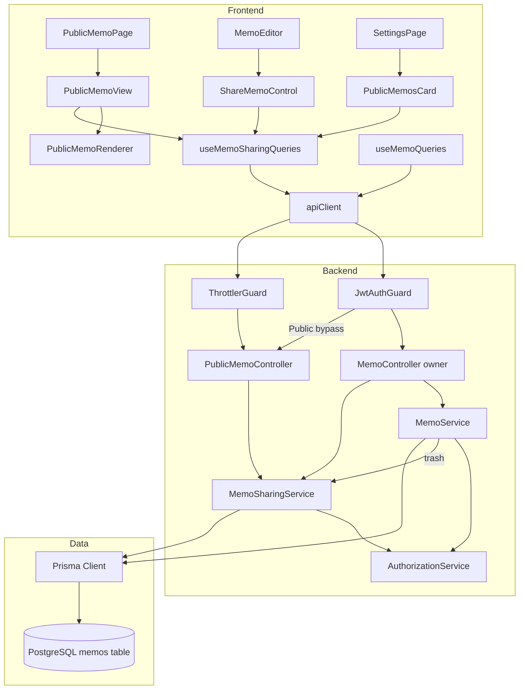
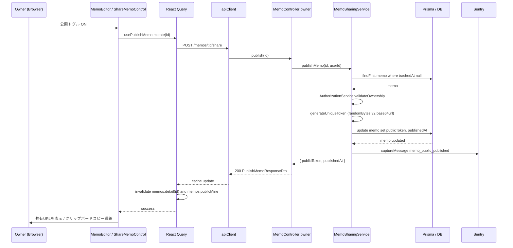
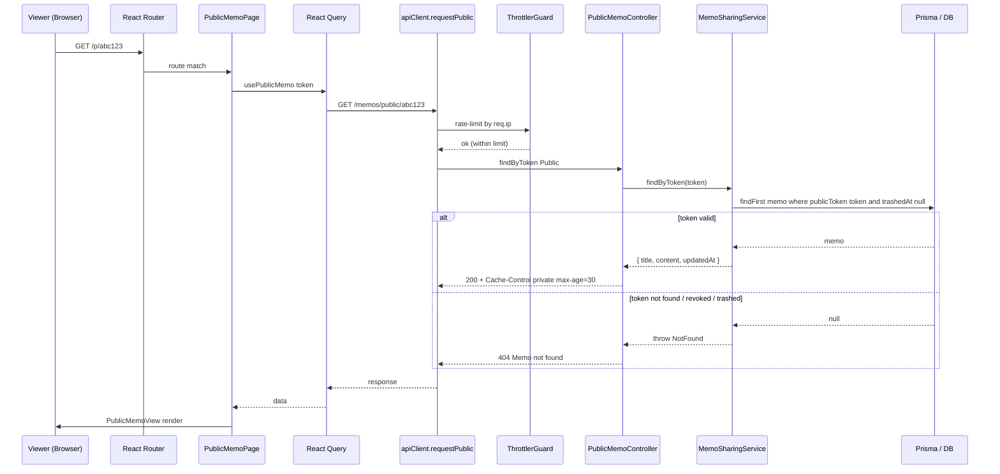
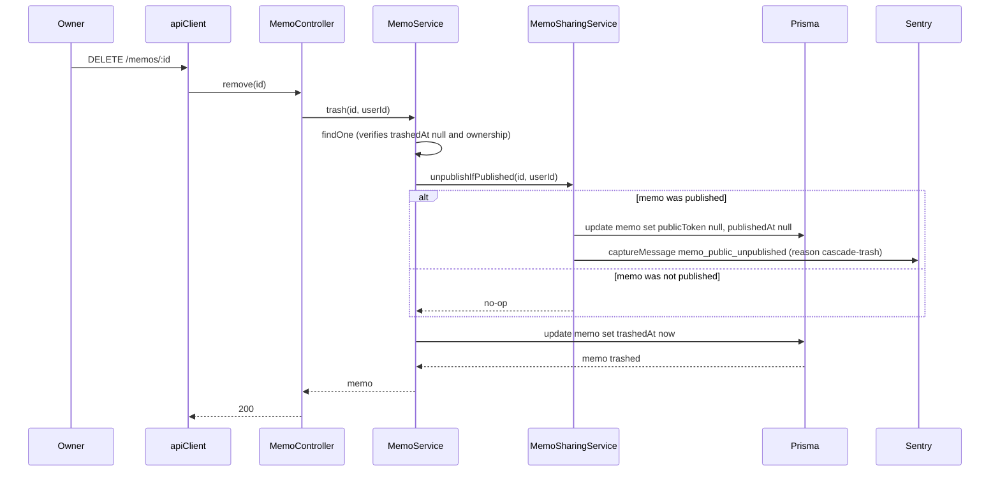
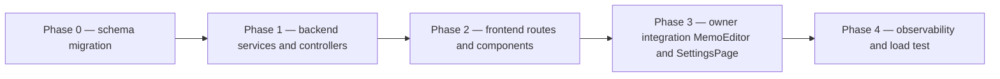

# Technical Design — memo-public-sharing

## Overview

本機能は Mosaku のメモ単体を対象に、所有者が「リンクを知っている人だけ未ログインで閲覧できる」 Unlisted URL（`/p/{token}`）を発行・無効化・再生成できる仕組みを提供する。

**Purpose**: 招待制クローズドコミュニティを保ったまま、必要なメモだけを外部に共有する手段をメモ所有者に提供する。
**Users**: メモ所有者（共有元）と、URL を受け取った未ログイン閲覧者（共有先）。
**Impact**: 既存 `memo` ドメインに公開メタデータ（`publicToken` / `publishedAt`）と専用 Controller を追加する。所有者のメモ編集体験・ダッシュボードに公開トグルを統合し、未ログインルート `/p/:token` を新設する。

### Goals

- メモ所有者が単一操作で公開・非公開を切り替えられる（即時無効化）
- 推測困難なトークン（256bit エントロピー）と URL（`/p/{token}`）で安全な共有を成立させる
- 未ログイン閲覧者が認証なしで `title / content / updatedAt` のみを取得できる（個人情報非露出）
- 既存パターン（グローバル JWT Guard + `@Public()`、`AuthorizationService`、`apiClient.requestPublic`、React Query キャッシュ、Sentry `feature_area: 'memo'`）を踏襲し、新規不変則を増やさない

### Non-Goals

- ノートブック単位の公開、共有先メール指定、認可付き共有、有効期限付き URL
- 公開メモのコメント・編集・複製
- 検索エンジン向け公開ギャラリー / OGP メタタグ動的生成（SSR が必要なため将来拡張）
- 公開メモのアクセス解析（visit count, last viewed at）
- 公開メモへのテーマ・ノートブック名の引き継ぎ

## Architecture

### Existing Architecture Analysis

Mosaku は NestJS モノレポ + React SPA で、本機能が依拠する既存資産は以下:

- **グローバル JWT Guard + `@Public()` opt-out** (`app.module.ts:50`, `common/decorators/public.decorator.ts`) — 未ログイン閲覧 API を最小コードで成立させる
- **`AuthorizationService.validateOwnership`** (`common/services/authorization.service.ts`) — 公開操作の所有者検証を一元化
- **`@nestjs/throttler` グローバル登録** (`app.module.ts:45`) — IP 単位レート制限を decorator で適用可能
- **Sentry `feature_area` 固定 enum** (`common/sentry/sentry-tags.ts`) — `/memos` プレフィックスを `memo` に自動分類するため、バックエンド公開閲覧パスは `/memos/public/:token` を採用
- **`apiClient.requestPublic`** (`utils/api.ts:124`) — 認証不要 API 呼び出しの標準ラッパ
- **React Query `queryKeys.memos.*`** (`constants/queryKeys.ts`) — キャッシュキー階層を拡張して invalidation を整合させる
- **TipTap StarterKit ベースの `RichTextEditor`** (`components/editor/RichTextEditor.tsx`) — 公開閲覧ビューでは `editable: false` の派生コンポーネントを作る

維持する境界: `memo` ドメインの単一モジュール（steering の「1 ドメイン = 1 モジュール」方針）。Memo CRUD と Memo Sharing はサービス層で分離する（SRP）。

### Architecture Pattern & Boundary Map



**Architecture Integration**:

- **Selected pattern**: NestJS ドメインモジュール内のサービス層分離（既存 `memo` モジュール内で `MemoSharingService` + `PublicMemoController` を新設）。React 側は責務別ディレクトリ（components/memo・hooks）に薄く乗せる
- **Domain/feature boundaries**: Memo CRUD（`MemoService`）と Memo Sharing（`MemoSharingService`）をサービス層で分離。所有者向け書き込みは `MemoController`、未ログイン読み取りは `PublicMemoController` に分離
- **Existing patterns preserved**: グローバル JWT Guard + `@Public()` opt-out、`AuthorizationService` の所有権検証、`@nestjs/throttler` decorator、React Query キャッシュ階層、`apiClient` 経由通信、Sentry `feature_area` enum
- **New components rationale**: Public Controller を分離することで `@Public()` 適用範囲を明示的にし、所有者用 API と読取り専用 API のセキュリティポリシーを誤って混在させない。フロントの `PublicMemoRenderer` は所有者用エディタの編集 UI を漏らさないための分離
- **Steering compliance**: `apiClient` 経由通信 / `AuthorizationService.checkOwnership` 一元化 / `@Public()` opt-out / Sentry `feature_area: 'memo'` enum 固定 / React Query を真実の源泉とする — すべて維持

### Technology Stack

| Layer          | Choice / Version                        | Role in Feature                                                                    | Notes                                                               |
| -------------- | --------------------------------------- | ---------------------------------------------------------------------------------- | ------------------------------------------------------------------- |
| Frontend       | React 19 + Vite 6 + React Router 7      | `/p/:token` ルート、`PublicMemoPage/View/Renderer`、ダッシュボード UI              | `BrowserRouter` 直下に AuthGuard 外ルートとして追加                 |
| Frontend       | `@tiptap/react` 既存                    | 公開閲覧ビューの本文レンダリング (`editable: false`)                               | StarterKit のみ、Mention 拡張・toolbar は除外                       |
| Frontend       | `@tanstack/react-query` 既存            | サーバー状態管理、`queryKeys.memos.publicMine/publicView` 拡張                     | 既存 invalidation パターンに同居                                    |
| Backend        | NestJS 11 + Prisma                      | `MemoSharingService` / `PublicMemoController` の追加                               | 既存 `BaseOwnableService` 派生・`AuthorizationService` 経由         |
| Backend        | `@nestjs/throttler` 既存                | IP 単位レート制限（`@Throttle` decorator）                                         | `app.set('trust proxy', 1)` を `main.ts` で有効化（Cloud Run 配下） |
| Backend        | Node.js `crypto` 既存                   | `randomBytes(32).toString('base64url')` で 256bit token 生成                       | 標準ライブラリのみ。新規依存なし                                    |
| Data / Storage | PostgreSQL (Supabase) + Prisma          | `memos` テーブルに `public_token` / `published_at` を追加                          | マイグレーション 1 本。`public_token` に UNIQUE 制約                |
| Observability  | `@sentry/nestjs` / `@sentry/react` 既存 | 監査ログ（publish/unpublish/regenerate） を `captureMessage(level: 'info')` で記録 | `feature_area: 'memo'` enum を変更しない                            |

> 詳細な比較・代替案検討は `research.md`（特に Decision: データモデル / 公開閲覧パス / Cache-Control）を参照。

## System Flows

### Flow 1: 所有者の公開トグル



**Key decisions**:

- 衝突時は `P2002` 捕捉で最大 5 回再生成リトライ
- ゴミ箱内メモに対する公開は `findFirst({ trashedAt: null })` で自動 404（Req 1.5）
- 所有権検証は `AuthorizationService.validateOwnership` 経由（既存パターン）

### Flow 2: 未ログイン閲覧者の公開メモ表示



**Key decisions**:

- `@Public()` で JWT Guard を opt-out（Req 3.4）
- 404 統一で存在判定不可（Req 3.3）
- Cache-Control `private, max-age=30, must-revalidate` でブラウザ短時間キャッシュのみ（Req 6.3）

### Flow 3: ゴミ箱遷移時の自動非公開



**Key decisions**:

- unpublish → trash の順序を保証（既に publicToken が NULL なら no-op）
- トランザクション不要（順次失敗時は手動リトライ可能なログを残す）

## Requirements Traceability

| Requirement | Summary                             | Components                                                                                                 | Interfaces                                           | Flows  |
| ----------- | ----------------------------------- | ---------------------------------------------------------------------------------------------------------- | ---------------------------------------------------- | ------ |
| 1.1         | 公開化 + トークン生成               | `MemoSharingService.publishMemo`, `MemoController.publish`                                                 | `POST /memos/:id/share` → `PublishMemoResponseDto`   | Flow 1 |
| 1.2         | 非公開化 + トークン無効化           | `MemoSharingService.unpublishMemo`, `MemoController.unpublish`                                             | `DELETE /memos/:id/share`                            | —      |
| 1.3         | 非公開時 404                        | `MemoSharingService.findByToken`                                                                           | `GET /memos/public/:token` → 404                     | Flow 2 |
| 1.4         | 所有者以外を拒否                    | `AuthorizationService.validateOwnership` (既存)                                                            | 全所有者向け API で 403                              | —      |
| 1.5         | ゴミ箱内メモは公開不可              | `MemoSharingService.publishMemo` の `findFirst({ trashedAt: null })`                                       | `POST /memos/:id/share` → 404                        | —      |
| 1.6         | 公開中→ゴミ箱で自動非公開           | `MemoService.trash` → `MemoSharingService.unpublishIfPublished`                                            | `DELETE /memos/:id` 内部副作用                       | Flow 3 |
| 2.1         | 128bit エントロピー / 1 本          | `MemoSharingService.generateUniqueToken` (`randomBytes(32).toString('base64url')`)                         | —                                                    | —      |
| 2.2         | トークン再生成                      | `MemoSharingService.regenerateToken`, `MemoController.regenerate`                                          | `POST /memos/:id/share/regenerate`                   | —      |
| 2.3         | 衝突回避                            | `MemoSharingService.generateUniqueToken` (P2002 リトライ最大5回)                                           | —                                                    | —      |
| 2.4         | 識別情報を含めない                  | `generateUniqueToken` (完全ランダム)                                                                       | —                                                    | —      |
| 2.5         | DB ユニーク制約                     | Prisma `Memo.publicToken @unique`                                                                          | —                                                    | —      |
| 3.1         | 未ログイン閲覧                      | `PublicMemoController.findByToken`                                                                         | `GET /memos/public/:token` → `PublicMemoResponseDto` | Flow 2 |
| 3.2         | 個人情報不含                        | `PublicMemoResponseDto = { title, content, updatedAt }`                                                    | —                                                    | —      |
| 3.3         | 404 統一                            | `throwNotFound(ERROR_CODES.RESOURCE.NOT_FOUND)`                                                            | —                                                    | Flow 2 |
| 3.4         | `@Public()` opt-out                 | `@Public()` decorator on `PublicMemoController.findByToken`                                                | —                                                    | —      |
| 3.5         | ログイン状態問わず同一ビュー        | `/p/:token` ルートを AuthGuard 外配置                                                                      | —                                                    | —      |
| 3.6         | IP レート制限                       | `@Throttle({ default: { ttl, limit } })` + `app.set('trust proxy', 1)`                                     | —                                                    | Flow 2 |
| 4.1         | 読み取り専用エンドポイントのみ      | `PublicMemoController` は GET のみ                                                                         | `GET /memos/public/:token`                           | —      |
| 4.2         | 書き込みは 401/403                  | 既存 `MemoController` の `@UseGuards(JwtAuthGuard)` (グローバル)                                           | —                                                    | —      |
| 4.3         | UI 編集 / コメント / 複製を出さない | `PublicMemoView` + `PublicMemoRenderer` (toolbar / Mention 除外)                                           | —                                                    | —      |
| 4.4         | サインアップ導線                    | `PublicMemoView` 下部の `<MosakuCTA />`                                                                    | —                                                    | —      |
| 5.1         | 公開メモ一覧 (publishedAt DESC)     | `MemoSharingService.listMyPublicMemos`, `MemoController.listMyPublicMemos`                                 | `GET /memos/me/public-memos`                         | —      |
| 5.2         | コピー / 再生成 / 解除              | `PublicMemosCard`, `useMemoSharingQueries`                                                                 | UI のみ                                              | —      |
| 5.3         | 完全 URL 返却                       | `useShareUrl(token)` フロントヘルパで `${getAppUrl()}/p/${token}` 組み立て                                 | —                                                    | —      |
| 5.4         | 空状態表示                          | `PublicMemosCard` 内 `EmptyState`                                                                          | —                                                    | —      |
| 5.5         | 編集画面からも切替                  | `ShareMemoControl` を `MemoEditor` ヘッダーに配置                                                          | —                                                    | —      |
| 6.1         | Sentry イベント記録                 | `Sentry.captureMessage` × 3 種 (`memo_public_published/_unpublished/_token_regenerated`)                   | —                                                    | —      |
| 6.2         | React Query キャッシュ無効化        | `queryClient.invalidateQueries({ queryKey: queryKeys.memos.detail(id) })` 等を mutation `onSuccess` で実行 | —                                                    | —      |
| 6.3         | Cache-Control 短時間                | `@Header('Cache-Control', 'private, max-age=30, must-revalidate')` on `findByToken`                        | —                                                    | Flow 2 |
| 6.4         | 例外時 user_facing タグ             | 既存 `SentryGlobalFilter` + `applyStandardTags` (5xx 自動付与)                                             | —                                                    | —      |

## Components and Interfaces

| Component                | Domain/Layer         | Intent                                                        | Req Coverage                                          | Key Dependencies (P0/P1)                      | Contracts |
| ------------------------ | -------------------- | ------------------------------------------------------------- | ----------------------------------------------------- | --------------------------------------------- | --------- |
| MemoSharingService       | Backend / Service    | 公開状態の生成・無効化・再生成・一覧・トークン解決            | 1.1, 1.2, 1.3, 1.5, 1.6, 2.1, 2.2, 2.3, 2.4, 5.1, 6.1 | PrismaService (P0), AuthorizationService (P0) | Service   |
| MemoController (拡張)    | Backend / Controller | 所有者向け公開系 API のエントリ                               | 1.1, 1.2, 1.4, 2.2, 5.1, 5.2, 5.3                     | MemoSharingService (P0), JwtAuthGuard (P0)    | API       |
| PublicMemoController     | Backend / Controller | 未ログイン閲覧 API、`@Public()` + `@Throttle` + Cache-Control | 3.1, 3.2, 3.3, 3.4, 3.6, 4.1, 6.3                     | MemoSharingService (P0), ThrottlerGuard (P0)  | API       |
| MemoService.trash (拡張) | Backend / Service    | ゴミ箱遷移時に `unpublishIfPublished` を呼ぶ                  | 1.6                                                   | MemoSharingService (P0)                       | Service   |
| `memos` テーブル (拡張)  | Data                 | `public_token` / `published_at` 列追加                        | 1.1, 1.2, 2.5                                         | Prisma migration                              | State     |
| useMemoSharingQueries    | Frontend / Hook      | 公開系 mutation / query を React Query で集約                 | 1.1, 1.2, 2.2, 5.1, 5.5, 6.2                          | apiClient (P0), queryKeys (P0)                | State     |
| PublicMemoPage           | Frontend / Route     | `/p/:token` のルートコンポーネント、未ログイン許容            | 3.5                                                   | usePublicMemo (P0)                            | UI        |
| PublicMemoView           | Frontend / Component | 閲覧専用ビュー本体（タイトル + Renderer + CTA）               | 3.1, 3.2, 4.3, 4.4                                    | PublicMemoRenderer (P0)                       | UI        |
| PublicMemoRenderer       | Frontend / Component | TipTap `editable: false` での本文レンダリング                 | 4.3                                                   | `@tiptap/react` (P0)                          | UI        |
| ShareMemoControl         | Frontend / Component | エディタヘッダーの公開トグル / コピー / 再生成 / 解除         | 5.5, 5.2, 5.3                                         | useMemoSharingQueries (P0)                    | UI        |
| PublicMemosCard          | Frontend / Component | 設定ページ内の公開メモ一覧 + 操作                             | 5.1, 5.2, 5.3, 5.4                                    | useMyPublicMemos (P0)                         | UI        |

### Backend / Service

#### MemoSharingService

| Field             | Detail                                                                       |
| ----------------- | ---------------------------------------------------------------------------- |
| Intent            | メモ公開状態のライフサイクル管理（生成・無効化・再生成・一覧・トークン解決） |
| Requirements      | 1.1, 1.2, 1.3, 1.5, 1.6, 2.1, 2.2, 2.3, 2.4, 5.1, 6.1                        |
| Owner / Reviewers | backend/memo owner                                                           |

**Responsibilities & Constraints**

- 公開状態の唯一の書き込み口（`publicToken` / `publishedAt` への変更は本サービスのみが行う）
- 所有権検証は `AuthorizationService.validateOwnership` を必ず通す
- ゴミ箱内メモは公開対象外（`findFirst({ trashedAt: null })` で除外）
- 監査ログ送信（`Sentry.captureMessage` × 3 イベント）

**Dependencies**

- Inbound: `MemoController` (P0) — 所有者向け API のオーケストレーション
- Inbound: `PublicMemoController` (P0) — 未ログイン閲覧の読み取り
- Inbound: `MemoService` (P0) — ゴミ箱遷移時の `unpublishIfPublished` 呼び出し
- Outbound: `PrismaService` (P0) — `memos` テーブルへの read/write
- Outbound: `AuthorizationService` (P0) — 所有権検証
- Outbound: `@sentry/nestjs` (P1) — 監査ログ送信

**Contracts**: Service ✅ / API ☐ / Event ☐ / Batch ☐ / State ☐

##### Service Interface

```typescript
interface MemoSharingService {
	publishMemo(memoId: string, userId: string): Promise<PublishedMemoResult>;
	unpublishMemo(memoId: string, userId: string): Promise<void>;
	unpublishIfPublished(memoId: string, userId: string): Promise<void>;
	regenerateToken(memoId: string, userId: string): Promise<PublishedMemoResult>;
	listMyPublicMemos(userId: string): Promise<PublicMemoListItem[]>;
	findByToken(token: string): Promise<PublicMemoView>;
}

interface PublishedMemoResult {
	memoId: string;
	publicToken: string;
	publishedAt: Date;
}

interface PublicMemoListItem {
	memoId: string;
	title: string;
	publicToken: string;
	publishedAt: Date;
	updatedAt: Date;
}

interface PublicMemoView {
	title: string;
	content: string;
	updatedAt: Date;
}
```

- **Preconditions**:
  - `publishMemo` / `unpublishMemo` / `regenerateToken`: `userId` が認証済みかつメモ所有者であること
  - `findByToken`: `token` は URL セーフ文字列（バリデーションは Controller 側 DTO で実施）
- **Postconditions**:
  - `publishMemo`: メモが公開状態（`publicToken` NOT NULL）になっており、新規 256bit トークンが保存されている
  - `unpublishMemo`: `publicToken` および `publishedAt` が NULL になっている
  - `regenerateToken`: 旧トークン無効化と同時に新トークン保存（同一トランザクション）
  - `findByToken`: 公開中メモは title/content/updatedAt のみ返却。非公開・無効・ゴミ箱内はすべて `NotFoundException`
- **Invariants**:
  - 同時刻に 1 メモにつき 1 トークン（DB UNIQUE 制約で保証）
  - 個人情報（email / OAuth provider / userId）は `findByToken` のレスポンスに含まれない

**Implementation Notes**

- Integration: `MemoService` の constructor に `MemoSharingService` を DI（一方向）し、`trash()` 内で `unpublishIfPublished(id, userId)` を呼ぶ
- Validation: トークン生成衝突は `P2002` を捕捉して最大 5 回リトライ。5 回失敗時は 500 を返し Sentry に `feature_area: 'memo'` で例外送出
- Risks: `MemoService` ↔ `MemoSharingService` 間の循環参照 — `MemoSharingService` は `MemoService` を参照しない（`PrismaService` 直接利用）ことで回避

### Backend / Controller

#### MemoController (拡張)

| Field        | Detail                                              |
| ------------ | --------------------------------------------------- |
| Intent       | 所有者向け公開系 API のエントリ（既存 CRUD と同居） |
| Requirements | 1.1, 1.2, 1.4, 2.2, 5.1, 5.2, 5.3                   |

**Contracts**: Service ☐ / API ✅ / Event ☐ / Batch ☐ / State ☐

##### API Contract

| Method | Endpoint                      | Request    | Response                  | Errors                                                                      |
| ------ | ----------------------------- | ---------- | ------------------------- | --------------------------------------------------------------------------- |
| POST   | `/memos/:id/share`            | (path: id) | `PublishMemoResponseDto`  | 401, 403, 404 (incl. trashed), 409 (token collision retries exhausted), 429 |
| DELETE | `/memos/:id/share`            | (path: id) | `{ success: true }`       | 401, 403, 404                                                               |
| POST   | `/memos/:id/share/regenerate` | (path: id) | `PublishMemoResponseDto`  | 401, 403, 404                                                               |
| GET    | `/memos/me/public-memos`      | —          | `PublicMemoListItemDto[]` | 401                                                                         |

##### Response Schema

```typescript
interface PublishMemoResponseDto {
	memoId: string;
	publicToken: string;
	publishedAt: string; // ISO8601
}

interface PublicMemoListItemDto {
	memoId: string;
	title: string;
	publicToken: string;
	publishedAt: string; // ISO8601
	updatedAt: string; // ISO8601
}
```

**Implementation Notes**

- Integration: 既存 `@UseGuards(JwtAuthGuard)` 配下に新規ハンドラを追加。所有権検証は `MemoSharingService` 内で実施
- Validation: `:id` は `cuid` 形式（既存パターン）。token を返す API は所有者のみが受信
- Risks: なし（既存パターンに同居）

#### PublicMemoController

| Field        | Detail                                                                                     |
| ------------ | ------------------------------------------------------------------------------------------ |
| Intent       | 未ログイン閲覧の唯一のエントリ。`@Public()` opt-out + IP レート制限 + 短時間 Cache-Control |
| Requirements | 3.1, 3.2, 3.3, 3.4, 3.6, 4.1, 6.3                                                          |

**Contracts**: Service ☐ / API ✅ / Event ☐ / Batch ☐ / State ☐

##### API Contract

| Method | Endpoint               | Request                              | Response                | Errors                                        |
| ------ | ---------------------- | ------------------------------------ | ----------------------- | --------------------------------------------- |
| GET    | `/memos/public/:token` | (path: token, max 64 chars URL-safe) | `PublicMemoResponseDto` | 404 (Memo not found / revoked / trashed), 429 |

##### Response Schema

```typescript
interface PublicMemoResponseDto {
	title: string;
	content: string; // TipTap が生成した HTML（StarterKit スキーマ内）
	updatedAt: string; // ISO8601
}
```

**Behavioral Constraints**

- Decorators: `@Public()` + `@Throttle({ default: { ttl: 60_000, limit: 60 } })` + `@Header('Cache-Control', 'private, max-age=30, must-revalidate')` + `@Header('Vary', 'Accept')`
- 404 統一: 「存在しない」「無効化された」「ゴミ箱内」のいずれも `Memo not found` で区別不可（Req 3.3）
- レスポンスに `userId / email / notebookId / themeId / tags` を一切含めない

**Implementation Notes**

- Integration: `app.set('trust proxy', 1)` を `main.ts` で有効化（`@nestjs/throttler` が `req.ip` を正しく解決するため）
- Validation: token は `class-validator` で `@IsString() @Length(20, 64) @Matches(/^[A-Za-z0-9_-]+$/)` で URL セーフ性を検証
- Risks: trust proxy 設定が他エンドポイントの `req.ip` 挙動に影響 — `auth.controller.ts` の既存 throttle と整合する想定（IP 単位 → 同様に GCLB 通過後の原 IP を使用）

### Frontend / Hook

#### useMemoSharingQueries

| Field        | Detail                                                                 |
| ------------ | ---------------------------------------------------------------------- |
| Intent       | 公開系の `useQuery` / `useMutation` を集約。所有者と閲覧者の両方に対応 |
| Requirements | 1.1, 1.2, 2.2, 5.1, 5.5, 6.2                                           |

**Contracts**: Service ✅ / API ☐ / Event ☐ / Batch ☐ / State ✅

##### Service Interface

```typescript
interface UseMemoSharingQueries {
	useMyPublicMemos(): UseQueryResult<PublicMemoListItemDto[]>;
	usePublicMemo(token: string): UseQueryResult<PublicMemoResponseDto>;
	usePublishMemo(): UseMutationResult<PublishMemoResponseDto, Error, string>; // memoId
	useUnpublishMemo(): UseMutationResult<void, Error, string>; // memoId
	useRegenerateMemoToken(): UseMutationResult<PublishMemoResponseDto, Error, string>; // memoId
}

// queryKeys 拡張
const queryKeysMemosExtension = {
	publicMine: () => [...queryKeys.memos.all, 'public', 'mine'] as const,
	publicView: (token: string) => [...queryKeys.memos.all, 'public', 'view', token] as const,
};
```

##### State Management

- **State model**: React Query キャッシュのみ（Zustand へのコピー禁止 / 既存規約遵守）
- **Persistence & consistency**:
  - `usePublishMemo` / `useUnpublishMemo` / `useRegenerateMemoToken` の `onSuccess` で `queryKeys.memos.detail(id)`, `queryKeys.memos.lists()`, `queryKeys.memos.publicMine()` を invalidate
  - `usePublicMemo` の `staleTime: 30_000`, `gcTime: 60_000`、`retry: false`（404 即時失敗）
- **Concurrency strategy**: トークン再生成中の旧トークンキャッシュは `queryKeys.memos.publicView(oldToken)` を明示的に `removeQueries` で削除（mutation の `onSuccess` で実施）

**Implementation Notes**

- Integration: `apiClient` に `publishMemo / unpublishMemo / regenerateMemoToken / getMyPublicMemos / getPublicMemo` を追加。`getPublicMemo` は `requestPublic`、その他は認証済み `request` を使用
- Validation: `usePublishMemo` の引数 `memoId` 必須、`usePublicMemo` の `token` 空文字時はクエリ無効化（`enabled: !!token`）
- Risks: 共有 URL コピー直後に再生成すると古い URL がブラウザキャッシュ（max-age=30）でヒットする可能性 — 仕様として許容（Req 6.3 のトレードオフ）

### Frontend / UI

#### PublicMemoPage

- **Intent**: `/p/:token` のルートコンポーネント、未ログインでもマウント可能（AuthGuard 外）
- **Requirements**: 3.5
- **Implementation Note**: `useParams<{ token: string }>` → `usePublicMemo(token)` → ローディング / 404 / 成功状態を `PublicMemoView` に橋渡し。404 時は中立的なメッセージ（メモが存在しないか公開が解除されています）と Mosaku トップへの導線。

#### PublicMemoView

- **Intent**: 閲覧専用ビュー本体。タイトル + 本文 Renderer + 最終更新日時 + Mosaku への招待制サインアップ CTA
- **Requirements**: 3.1, 3.2, 4.3, 4.4
- **Implementation Note**:
  - 編集 UI / コメント入力欄 / 複製ボタンを一切持たない（Req 4.3）
  - フッターに `これは閲覧専用の公開メモです。Mosaku は招待制のメモアプリです。` のコピー + `/invite` への CTA（`<MosakuCTA />`）
  - `document.title = ${memo.title} | Mosaku` を `useEffect` で動的更新

#### PublicMemoRenderer

- **Intent**: TipTap `editable: false` で本文を表示する読み取り専用レンダラ
- **Requirements**: 4.3
- **Implementation Note**:
  - `useEditor({ extensions: [StarterKit], content, editable: false, onUpdate: undefined })` で初期化
  - `RichTextEditor` の toolbar・Mention 拡張・`onChange` を含めない（公開ビュー専用 props 形状）
  - `editorProps.attributes.class` で読み取り専用スタイル（`prose` + `pointer-events-none` などの装飾）

#### ShareMemoControl

- **Intent**: `MemoEditor` ヘッダーに同居する公開トグル + 共有メニュー
- **Requirements**: 5.5, 5.2, 5.3
- **Implementation Note**:
  - 非公開時: 「公開する」ボタン → `usePublishMemo`
  - 公開中: 公開状態バッジ + ドロップダウンメニュー（URL コピー / 再生成 / 公開解除）
  - URL は `${getAppUrl()}/p/${publicToken}` をクライアントで組み立て、`navigator.clipboard.writeText` でコピー

#### PublicMemosCard

- **Intent**: `SettingsPage` 内に追加する公開メモ一覧カード
- **Requirements**: 5.1, 5.2, 5.3, 5.4
- **Implementation Note**:
  - `useMyPublicMemos` で取得した一覧を `publishedAt` 降順表示
  - 各エントリに「URL コピー」「再生成」「公開解除」アクション
  - 空状態: `<EmptyState message="現在公開中のメモはありません" hint="メモ編集画面から公開を有効化できます" />`

## Data Models

### Domain Model

- **Aggregate root**: `Memo`（既存）。`publicToken` / `publishedAt` は Memo の所有メタデータとして同一トランザクション境界に置く
- **Domain events** (Sentry 監査ログとして表現):
  - `MemoPublished` — name=`memo_public_published`, payload=`{ memoId }`
  - `MemoUnpublished` — name=`memo_public_unpublished`, payload=`{ memoId, reason: 'manual' | 'cascade-trash' }`
  - `MemoPublicTokenRegenerated` — name=`memo_public_token_regenerated`, payload=`{ memoId }`
- **Invariants**:
  - 1 メモにつき同時 1 トークン
  - `trashedAt` NOT NULL のメモは `publicToken` NULL（cascade-trash 遵守）
  - `publicToken` NULL ⇔ `publishedAt` NULL

### Logical Data Model

**Structure Definition**:

```prisma
model Memo {
  id          String    @id @default(cuid())
  title       String    @db.VarChar(100)
  content     String
  createdAt   DateTime  @default(now())
  updatedAt   DateTime  @updatedAt
  trashedAt   DateTime? @map("trashed_at")
  userId      String    @map("user_id")
  notebookId  String?   @map("notebook_id")
  publicToken String?   @unique @map("public_token") @db.VarChar(64) // NEW
  publishedAt DateTime? @map("published_at")                         // NEW
  memoTags    MemoTag[]
  notebook    Notebook? @relation(fields: [notebookId], references: [id])
  user        User      @relation(fields: [userId], references: [id], onDelete: Cascade)

  @@index([userId, publishedAt(sort: Desc)]) // NEW — listMyPublicMemos の高速化
  @@map("memos")
}
```

**Consistency & Integrity**:

- Transaction boundary: 個別の `prisma.memo.update` は単一トランザクション
- Cascading rules: `User` 削除時は既存 `onDelete: Cascade` で公開メタデータも自動削除
- Temporal aspects: `publishedAt` は publish / regenerateToken 時に更新（regenerate も「公開日時を更新する」と扱う）

### Physical Data Model

**Migration**:

```sql
ALTER TABLE memos
  ADD COLUMN public_token VARCHAR(64),
  ADD COLUMN published_at TIMESTAMPTZ;

CREATE UNIQUE INDEX memos_public_token_key ON memos(public_token);
CREATE INDEX memos_user_id_published_at_idx ON memos(user_id, published_at DESC);
```

- 既存メモはすべて `public_token = NULL` で非公開状態として扱う（バックフィル不要）

### Data Contracts & Integration

**API Data Transfer** (詳細は Components and Interfaces セクション参照):

- `PublishMemoResponseDto` / `PublicMemoListItemDto` — 所有者向け（token を含む）
- `PublicMemoResponseDto` — 閲覧者向け（個人情報・token・notebookId を含まない最小スキーマ）

**Serialization**: JSON、日時は ISO8601 (UTC) で送出（既存 `class-transformer` の `@Type(() => Date)` パターンに従う）

## Error Handling

### Error Strategy

- **404 統一（公開閲覧）**: 「存在しない」「無効化された」「ゴミ箱内」のいずれも `throwNotFound(ERROR_CODES.RESOURCE.NOT_FOUND, 'Memo not found')` を返却し、存在判定攻撃を防止
- **403 (所有者でない)**: 既存 `AuthorizationService.validateOwnership` が `throwForbidden` を発行
- **409 (token 衝突リトライ枯渇)**: 5 回リトライしても UNIQUE 制約違反 (P2002) が解消しない場合（実質発生しないが防御的に）、500 として Sentry に通知
- **429 (レート制限超過)**: `ThrottlerExceptionFilter` 経由で `{ statusCode: 429, message: 'ThrottlerException: Too Many Requests' }`

### Error Categories and Responses

- **User Errors (4xx)**: 404 で公開メモの有無を区別不能に統一、403 は所有者以外の操作試行、429 はレート制限
- **System Errors (5xx)**: トークン衝突リトライ枯渇 / DB 接続障害 → 既存 `SentryGlobalFilter` が捕捉し `feature_area: 'memo'` / `user_facing: true` (5xx 自動付与) で送信
- **Business Logic Errors (422)**: 該当なし（公開・非公開の状態遷移はべき等で 422 を発生させない）

### Monitoring

- Sentry breadcrumb で publish/unpublish/regenerate イベントが追跡可能
- 例外は `applyStandardTags` 経由で `environment / release / feature_area / route / user_facing` の 5 タグが自動付与（Steering tech.md の構造化タグ契約に準拠）
- ダッシュボード: Sentry の `feature_area:memo` フィルタで公開機能の異常を検知

## Testing Strategy

### Unit Tests

- `memo-sharing.service.spec.ts`:
  1. `publishMemo` が新規トークンを生成し `publishedAt` を設定する
  2. `unpublishMemo` が `publicToken` / `publishedAt` を NULL にする
  3. `regenerateToken` が旧トークンを無効化し新トークンを発行する
  4. `publishMemo` がゴミ箱内メモに対して NotFound を投げる（Req 1.5）
  5. `findByToken` が個人情報を含まないレスポンスを返す（Req 3.2）
- `memo.service.spec.ts` の `trash()` テストに「公開中メモが trash 時に unpublish される」ケースを追加（Req 1.6）

### Integration Tests

- `public-memo.controller.e2e-spec.ts`:
  1. `GET /memos/public/:token` が未認証で 200 を返す（Req 3.1 / 3.4）
  2. 存在しない token で 404、無効化済み token で 404（Req 3.3）
  3. レート制限 (61 リクエスト /分) で 429（Req 3.6）
  4. レスポンスヘッダーに `Cache-Control: private, max-age=30, must-revalidate` が含まれる（Req 6.3）
- `memo.controller.e2e-spec.ts` に所有者 API（publish / unpublish / regenerate / listMyPublicMemos）の認可テストを追加（Req 1.4）

### E2E / UI Tests (Playwright)

- `public-memo.e2e.ts`:
  1. 所有者がメモを公開 → 別ブラウザコンテキスト（未ログイン）で `/p/:token` を開いて閲覧可能
  2. 所有者が公開解除 → 同じ URL が 404 表示
  3. 公開ビューに編集 UI / コメント欄 / 複製ボタンが存在しない（Req 4.3）
  4. サインアップ CTA が表示される（Req 4.4）

### Performance/Load

- `listMyPublicMemos` の `(user_id, published_at DESC)` 複合インデックスが使われていることを EXPLAIN で確認
- 1 ユーザー 100 件公開ケースで p95 < 100ms

## Security Considerations

- **トークン推測攻撃**: 256bit エントロピー（要件 128bit を大幅超過）+ 60 req/分 IP レート制限で総当たり実質不可
- **個人情報非露出**: `PublicMemoResponseDto` を最小スキーマ（`title / content / updatedAt`）に固定。テストで `email` / `userId` / `notebookId` を含まないことを assertion
- **XSS**: 本文は TipTap StarterKit が生成する HTML のみ（編集時にエディタが想定外タグを排除）。CSP `scriptSrc 'self'` で二重防御
- **CSRF**: 未ログイン読み取り API のみ公開、書き込みは認証必須（Req 4.1 / 4.2）
- **IP 偽装対策**: `app.set('trust proxy', 1)` で GCLB の最後尾 X-Forwarded-For のみ信頼。多段プロキシ偽装はブロック
- **既存 Sentry PII ポリシー遵守**: 公開機能で `setUser` 等の PII 拡張は行わない（既存スクラバの範囲を維持）

## Performance & Scalability

- **目標**:
  - `GET /memos/public/:token` p95 < 150ms（DB クエリ単発 + Cache-Control 30 秒）
  - `GET /memos/me/public-memos` p95 < 200ms（user 1 万件想定）
- **キャッシュ**:
  - ブラウザ層: Cache-Control 30 秒
  - DB 層: `(public_token)` UNIQUE インデックスで O(1)、`(user_id, published_at)` 複合インデックスで一覧 O(log n)
- **スケール**:
  - 1 メモ 1 トークン制約により水平スケール（読み取り）は読み取りレプリカで対応可能（将来）
  - 公開閲覧は state を持たないため Cloud Run の水平スケールで自然に対応

## Migration Strategy



- **Phase 0**: Prisma マイグレーション適用（`public_token` / `published_at` 列追加 + インデックス）。既存メモはすべて非公開のまま稼働継続
- **Phase 1**: `MemoSharingService` / `PublicMemoController` / 拡張 `MemoController` / `MemoService.trash` 改修をデプロイ。`main.ts` の `trust proxy` 設定も同フェーズ
- **Phase 2**: フロントエンドの `/p/:token` ルートと閲覧専用ビューをリリース
- **Phase 3**: 所有者向け UI（`ShareMemoControl` / `PublicMemosCard`）をリリース。React Query キャッシュキー拡張を含む
- **Phase 4**: Sentry ダッシュボード設定、レート制限の調整、Lighthouse スコア計測
- **Rollback trigger**: 公開 API の 5xx 率 > 1% / 24h、または 429 比率 > 10%。即座に該当 Phase の revert + 公開メモを全件 unpublish（緊急時のみ）
