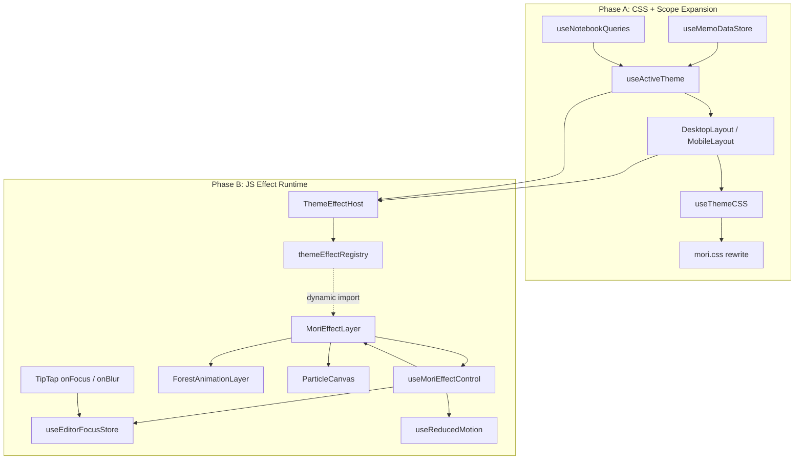
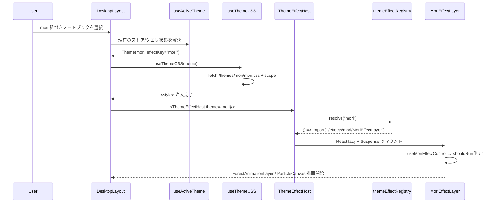
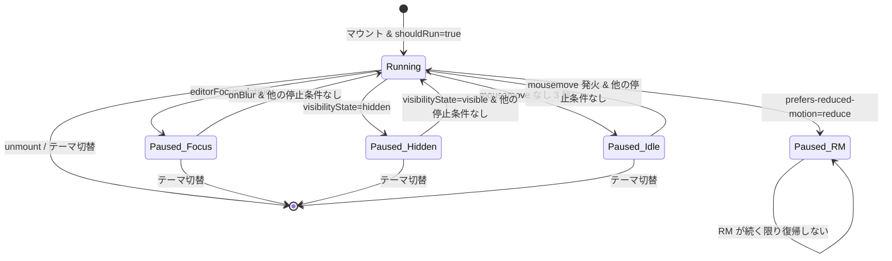

# Technical Design — mosaku-brand-theme

## Overview

**Purpose**: `mori` テーマを「Mosaku のフラッグシップ（ブランドの顔）」として整備し、login-visual-redesign で確立した深緑の森の世界観をログイン後のアプリ本体にも拡張する。
**Users**: Mosaku のすべてのユーザーが対象。特に `mori` を選択したユーザーは、ログイン前後で一貫したブランド体験を得る。`mori` を選ばないユーザーはバンドルサイズ・描画コストともに現状維持。
**Impact**: 既存の `frontend/public/themes/mori/mori.css` を全面リライトし、`.theme-root` の適用スコープをメモ本文エディタからアプリ全体レイアウトへ拡張する。また、既存テーマシステム (`Theme`, `useThemeCSS`) に「JS エフェクトレイヤー」を差し込める拡張ポイントを追加し、mori 選択時のみ `ForestAnimationLayer` / `ParticleCanvas` を動的 import でマウントする。

### Goals

- mori 選択時に、サイドバー・ヘッダー・メモ本文すべてで深緑の森の世界観がレンダリングされる（Phase A）。
- mori 以外のテーマを選択したユーザーの初期バンドル・描画コストを本スペック実装前と同等に保つ（Phase A / Phase B）。
- 将来の夜空テーマ・桜テーマ等でも同じ仕組みで独自 JS エフェクトを追加できる汎用基盤を確立する（Phase B）。
- OS の `prefers-reduced-motion: reduce` 設定を尊重し、視覚刺激を抑えたいユーザーが安全に利用できる（全 Phase）。
- メモ執筆中・タブ非表示時・アイドル時にエフェクトが自動停止し、バッテリー・CPU を無駄にしない（Phase B）。

### Non-Goals

- 他テーマ（`kami` / `aka` / `kuro` / `siro` / `ao` / `code`）のリライトや視覚変更。
- 新規テーマの追加。本スペックは `mori` テーマの拡張として完結する。
- モバイル専用ジェスチャーインタラクション（タッチデバイスはパーティクルを無効化するのみ）。
- ユーザープロファイルへの「アクティブテーマ」設定追加。アクティブテーマは現状どおり「選択中ノートブック/メモのテーマ」から導出する。

## Architecture

### Existing Architecture Analysis

- **現状のテーマ適用経路**: `useThemeCSS` が `/themes/{cssFilePath}` を fetch して `<style>` に注入する際、`.theme-root` を `[data-theme-id="{id}"]` に置換してスコープ化する。結果、mori.css のセレクタは「`data-theme-id="{moriId}"` を持つ要素配下」にのみ適用される。
- **現状の `.theme-root` 付与箇所**: `MemoEditor.tsx:197` と `NotebookEditor.tsx:163` のみ。サイドバー・ヘッダーには付与されていない。
- **アクティブテーマの導出**: `MemoEditor.tsx:41` で `selectedNotebook?.theme || memo?.notebook?.theme` を計算。これを `useActiveTheme` に集約する。
- **login-visual-redesign 資産**: `components/auth/ForestAnimationLayer.tsx`・`components/auth/ParticleCanvas.tsx`・`hooks/useReducedMotion.ts` が既存。CSS keyframes (`wave-pulse` / `fog-drift` / `leaf-float`) は各コンポーネントの style 属性および login 画面用 CSS で定義されている。

### Architecture Pattern & Boundary Map

**Architecture Integration**:

- **Selected pattern**: Layered + Plugin Registry。既存 CSS 層（テーマスタイル）に加えて、新規に「テーマエフェクト層」をプラグインとして差し込む。
- **Domain/feature boundaries**:
  - _Theme Definition_: `Theme` 型 + バックエンドから配信される JSON（`metadata.effectKey` を規約として追加）
  - _Active Theme Resolution_: `useActiveTheme` フック（レイアウト・エディタが共有）
  - _CSS Application_: 既存 `useThemeCSS`（変更最小）
  - _Effect Runtime_: `ThemeEffectHost` + `themeEffectRegistry` + `MoriEffectLayer`（新規）
  - _Focus Coordination_: `useEditorFocusStore`（新規 Zustand ストア）
- **Existing patterns preserved**:
  - CSS ベーステーマ定義（`frontend/public/themes/{name}/{name}.css`）
  - 既存 `.theme-root` スコープ置換ロジック（`useThemeCSS`）
  - ドメイン別ディレクトリ構成（`structure.md` 準拠）
  - Zustand はクライアント UI 状態専用の方針
- **New components rationale**:
  - `useActiveTheme`: アクティブテーマ決定ロジックを 1 箇所に集約し、レイアウト/エディタ間で同じ結果を返すため。
  - `ThemeEffectHost`: 要件 5 の「テーマが任意で JS エフェクトを持てる汎用基盤」の実装。
  - `themeEffectRegistry`: Vite の静的 import 解析を活かしてコード分割を成立させるための静的マッピング。
  - `MoriEffectLayer`: mori 専用の制御ロジックを集約し、`ForestAnimationLayer` / `ParticleCanvas` の単純なマウンタに留める。
  - `useEditorFocusStore` / `useMoriEffectControl`: 要件 7 の複数の停止条件を統合する制御ハブ。
- **Steering compliance**:
  - `tech.md`: TypeScript strict、`any` 禁止、React Query をサーバー状態の真実の源泉、Zustand は UI 状態専用。
  - `structure.md`: フック / コンポーネント / ストアの責務別配置、`use` プレフィックス、`PascalCase.tsx`。



### Technology Stack

| Layer             | Choice / Version             | Role in Feature                                                             | Notes                                                               |
| ----------------- | ---------------------------- | --------------------------------------------------------------------------- | ------------------------------------------------------------------- |
| Frontend (CSS)    | Plain CSS3 + CSS Variables   | Phase A で mori.css を全面リライト                                          | keyframes `wave-pulse` / `fog-drift`、`prefers-reduced-motion` 対応 |
| Frontend (React)  | React 19 + TypeScript strict | `ThemeEffectHost` / `MoriEffectLayer` / `useActiveTheme` / 制御フック       | `React.lazy` + `Suspense` で動的 import を担当                      |
| Frontend (State)  | Zustand（既存）              | `useEditorFocusStore` 新設                                                  | 既存ストア同様 `frontend/src/stores/` 配下に配置                    |
| Frontend (Server) | React Query（既存）          | ノートブック/テーマ情報の取得は既存 `useMemoQueries` / `useNotebookQueries` | 新規クエリは追加しない                                              |
| Build / Runtime   | Vite 6                       | 動的 import によるコード分割                                                | 静的 `import('./effects/mori/MoriEffectLayer')` でチャンク分離      |

既存依存のみで完結。新規 JS ライブラリ追加ゼロ。詳細な比較検討は `research.md` の Architecture Pattern Evaluation を参照。

## System Flows

### Flow 1: テーマ選択時の CSS + JS エフェクト起動シーケンス（Phase A + B）



### Flow 2: `useMoriEffectControl` の停止・再開状態遷移（Phase B）



停止条件は OR 論理。`shouldRun = !editorFocused && !hidden && !idle && !reducedMotion` を満たす場合にのみ RAF を継続させる。

## Requirements Traceability

| Requirement | Summary                                            | Components                                    | Interfaces                                                  | Flows  |
| ----------- | -------------------------------------------------- | --------------------------------------------- | ----------------------------------------------------------- | ------ |
| 1.1         | mori 選択時に深緑グラデ背景をレンダリング          | `mori.css`                                    | CSS `.theme-root`                                           | Flow 1 |
| 1.2         | `wave-pulse` 12s 周期                              | `mori.css`                                    | CSS `@keyframes wave-pulse`                                 | Flow 1 |
| 1.3         | `fog-drift` 擬似要素 2 層                          | `mori.css`                                    | CSS `.theme-root::before` / `.theme-root::after`            | Flow 1 |
| 1.4         | フォーム風 UI を森パレットに統一                   | `mori.css`                                    | CSS ルール群                                                | Flow 1 |
| 1.5         | Phase A を CSS のみで実現                          | `mori.css`                                    | 無変更他ファイル                                            | -      |
| 2.1         | `.theme-root` をアプリ全体ルートに付与             | `DesktopLayout`, `MobileLayout`               | `className`, `data-theme-id`                                | Flow 1 |
| 2.2         | サイドバー・ヘッダー・モーダル等に変数反映         | `mori.css`                                    | CSS 変数                                                    | Flow 1 |
| 2.3         | レイアウト構造を破壊しない                         | `DesktopLayout`, `MobileLayout`               | -                                                           | -      |
| 2.4         | 切替時のちらつき抑止                               | `useActiveTheme`, `useThemeCSS`               | 既存 fetch + scope フロー                                   | Flow 1 |
| 3.1         | 他テーマ選択時の視覚的回帰ゼロ                     | `mori.css`                                    | セレクタスコープ限定                                        | -      |
| 3.2         | mori.css 内セレクタを mori スコープに限定          | `useThemeCSS`, `mori.css`                     | `.theme-root` → `[data-theme-id]` 置換                      | -      |
| 3.3         | 非 mori 時に fog / wave / JS エフェクト DOM 未追加 | `ThemeEffectHost`, `MoriEffectLayer`          | `effectKey` 判定                                            | Flow 1 |
| 3.4         | 非 mori バンドルサイズ不増                         | `themeEffectRegistry`                         | Vite dynamic import                                         | -      |
| 4.1         | RM で CSS アニメ全停止                             | `mori.css`                                    | `@media (prefers-reduced-motion: reduce)`                   | Flow 2 |
| 4.2         | RM で JS エフェクト RAF 非起動                     | `useMoriEffectControl`                        | `shouldRun` false branch                                    | Flow 2 |
| 4.3         | `useReducedMotion` フック再利用                    | `useMoriEffectControl`                        | import `useReducedMotion`                                   | Flow 2 |
| 4.4         | RM でも配色維持                                    | `mori.css`                                    | CSS 変数 / 背景色定義                                       | -      |
| 5.1         | `Theme` 型に JS エフェクト宣言フィールド追加       | `types/theme.ts`                              | `metadata.effectKey?: ThemeEffectKey`                       | -      |
| 5.2         | 宣言あり時のみマウント                             | `ThemeEffectHost`                             | `effectKey` チェック                                        | Flow 1 |
| 5.3         | 宣言なし時は RAF 非起動                            | `ThemeEffectHost`                             | null 早期 return                                            | Flow 1 |
| 5.4         | 他テーマ定義を変更しない                           | `types/theme.ts`                              | 既存テーマ JSON に変更なし                                  | -      |
| 5.5         | 新規ライブラリゼロ                                 | package.json（無変更）                        | -                                                           | -      |
| 6.1         | mori 選択時に動的 import でマウント                | `ThemeEffectHost`, `themeEffectRegistry`      | `React.lazy` + `Suspense`                                   | Flow 1 |
| 6.2         | 非 mori 時はバンドル未ロード                       | `themeEffectRegistry`                         | Vite が `mori-effect-*.js` を別チャンクへ                   | -      |
| 6.3         | 非 mori 初期バンドル不増                           | 同上                                          | 同上                                                        | -      |
| 6.4         | テーマ切替時の DOM 除去と RAF 停止                 | `ThemeEffectHost`                             | cleanup: `React.lazy` アンマウント + `cancelAnimationFrame` | Flow 2 |
| 6.5         | 既存認証 / メモ編集ロジックへの副作用ゼロ          | `MoriEffectLayer`                             | `pointer-events: none` + 読み取り専用ストア購読             | -      |
| 7.1         | TipTap onFocus で RAF 停止                         | `useEditorFocusStore`, `useMoriEffectControl` | `setEditorFocused(true)` → `shouldRun` false                | Flow 2 |
| 7.2         | onBlur で再開（他停止条件なし時）                  | `useEditorFocusStore`, `useMoriEffectControl` | 同上 false → 再評価                                         | Flow 2 |
| 7.3         | visibilityState=hidden で RAF 停止                 | `useMoriEffectControl`                        | `document.addEventListener('visibilitychange')`             | Flow 2 |
| 7.4         | mousemove 3 秒アイドルで停止                       | `useMoriEffectControl`                        | `setTimeout(3000)` + クリア                                 | Flow 2 |
| 7.5         | 再 mousemove で再開                                | `useMoriEffectControl`                        | 同上                                                        | Flow 2 |
| 7.6         | `pointer: coarse` でパーティクル非起動             | `ParticleCanvas`                              | 既存 `isPointerCoarse` 判定                                 | -      |

## Components and Interfaces

### Component Summary

| Component                                    | Domain/Layer          | Intent                                                                     | Req Coverage                           | Key Dependencies                                                 | Contracts   |
| -------------------------------------------- | --------------------- | -------------------------------------------------------------------------- | -------------------------------------- | ---------------------------------------------------------------- | ----------- |
| `frontend/public/themes/mori/mori.css`       | Theme / CSS           | 深緑グラデ + fog/wave + サイドバー/ヘッダー変数 + RM 対応                  | 1.1, 1.2, 1.3, 1.4, 1.5, 2.2, 4.1, 4.4 | `useThemeCSS` のスコープ置換規約                                 | State (CSS) |
| `Theme` 型拡張 (`types/theme.ts`)            | Type / Contract       | `ThemeEffectKey` union と `metadata.effectKey` を規約化                    | 5.1, 5.4                               | バックエンド Theme JSON                                          | State       |
| `themeEffectRegistry`                        | Effect / Registry     | effectKey → lazy コンポーネントの静的マッピング                            | 3.4, 5.2, 6.1, 6.2, 6.3                | Vite 動的 import                                                 | Service     |
| `useActiveTheme`                             | Hook / Presentation   | 現在のアクティブテーマを決定（編集中メモ/ノートブックから）                | 2.1, 2.2, 2.4                          | `useMemoDataStore`, `useNotebookQueries`, `useMemoQueries`       | Service     |
| `ThemeEffectHost`                            | Effect / Runtime      | activeTheme → レジストリから lazy ロードしてマウント                       | 5.2, 5.3, 6.1, 6.4                     | `themeEffectRegistry`, `React.lazy`, `Suspense`                  | Service     |
| `MoriEffectLayer`                            | Effect / Runtime      | mori 専用: `useMoriEffectControl` の結果で Forest/Particle を pause/run    | 3.3, 6.1, 6.4, 6.5, 7.1-7.6            | `ForestAnimationLayer`, `ParticleCanvas`, `useMoriEffectControl` | Service     |
| `useMoriEffectControl`                       | Hook / Runtime        | RM + editorFocus + visibility + idle を統合し `shouldRun` を返す           | 4.2, 4.3, 7.1-7.5                      | `useReducedMotion`, `useEditorFocusStore`, Web API               | Service     |
| `useEditorFocusStore`                        | Store / Zustand       | TipTap フォーカス状態のグローバル共有                                      | 7.1, 7.2                               | Zustand                                                          | State       |
| `ForestAnimationLayer` (既存、拡張)          | Effect / Presentation | 葉 / 霧 / 波背景のレンダリング（`paused` prop 追加）                       | 6.1, 7.1-7.5                           | `useReducedMotion`                                               | State       |
| `ParticleCanvas` (既存、拡張)                | Effect / Presentation | マウス追跡パーティクル（`paused` prop 追加、`pointer: coarse` 非起動既存） | 6.1, 7.1-7.6                           | Canvas 2D API                                                    | State       |
| `DesktopLayout` / `MobileLayout`             | Layout / Presentation | レイアウトルートに `.theme-root` 付与 + `ThemeEffectHost` マウント         | 2.1, 2.3, 6.4                          | `useActiveTheme`, `useThemeCSS`, `ThemeEffectHost`               | -           |
| `MemoEditor` / `NotebookEditor` (既存、変更) | Editor / Presentation | TipTap の onFocus/onBlur を `useEditorFocusStore` に橋渡し                 | 7.1, 7.2                               | TipTap, `useEditorFocusStore`                                    | -           |

以降、新規ドメイン境界を導入するコンポーネントに限り詳細ブロックを記載する。`DesktopLayout` / `MobileLayout` / `MemoEditor` / `NotebookEditor` は既存コンポーネントへの最小変更のため Implementation Notes のみ記載する。

### Theme / CSS

#### `frontend/public/themes/mori/mori.css`

| Field        | Detail                                                                                   |
| ------------ | ---------------------------------------------------------------------------------------- |
| Intent       | mori テーマの深緑・霧・波・フォーム色味・アプリ全体スコープ + RM 対応を 1 ファイルで完結 |
| Requirements | 1.1, 1.2, 1.3, 1.4, 1.5, 2.2, 3.2, 4.1, 4.4                                              |

**Responsibilities & Constraints**

- すべてのセレクタは `.theme-root` プレフィックスで始める。`useThemeCSS` によって `[data-theme-id="{moriId}"]` にスコープ置換される前提。
- 外部ファイルへの `@import` や `url()` は禁止（要件 1.5）。
- `prefers-reduced-motion: reduce` メディアクエリではアニメーションのみ停止し、背景グラデーション / 配色は維持する。

**CSS Contract**

CSS そのもののため "Service" ではなく `State` 契約として扱う。以下のセレクタおよび変数を公開インターフェースとして規定する。

| 分類             | セレクタ / 変数                                                                                                                                                                                                                              | 役割                                             |
| ---------------- | -------------------------------------------------------------------------------------------------------------------------------------------------------------------------------------------------------------------------------------------- | ------------------------------------------------ |
| ルート           | `.theme-root`                                                                                                                                                                                                                                | 深緑グラデ背景、ベーステキスト色、レイアウト変数 |
| 背景アニメ       | `.theme-root` + `@keyframes wave-pulse`（12s）                                                                                                                                                                                               | 要件 1.2                                         |
| 霧 (擬似要素)    | `.theme-root::before`, `.theme-root::after` + `@keyframes fog-drift`                                                                                                                                                                         | 要件 1.3 — 2 層で白半透明の霧を流す              |
| サイドバー       | `.theme-root .app-sidebar`, `.theme-root .app-sidebar__item`                                                                                                                                                                                 | 要件 2.2                                         |
| ヘッダー         | `.theme-root .app-header`, `.theme-root .app-header__brand`                                                                                                                                                                                  | 要件 2.2                                         |
| フォーム         | `.theme-root input`, `.theme-root textarea`, `.theme-root button`                                                                                                                                                                            | 要件 1.4                                         |
| リンク           | `.theme-root a`                                                                                                                                                                                                                              | 要件 1.4                                         |
| メモ本文         | `.theme-root .memo-title`, `.theme-root .memo-content ...`                                                                                                                                                                                   | 既存ルールのパレット統一（要件 1.4）             |
| アクセシビリティ | `@media (prefers-reduced-motion: reduce) { .theme-root, .theme-root::before, .theme-root::after { animation: none; } }`                                                                                                                      | 要件 4.1 / 4.4 — 背景色定義は別セレクタで維持    |
| CSS 変数（公開） | `--theme-bg`, `--theme-text-color`, `--theme-heading-color`, `--theme-accent-color`, `--theme-border-color`, `--theme-font-family`, `--theme-font-size`, `--theme-line-height`, `--theme-padding`, `--theme-margin`, `--theme-border-radius` | サイドバー/ヘッダー/フォームで共通参照           |

**Implementation Notes**

- **Integration**: `useThemeCSS` がスコープ置換を担うため、本 CSS ファイル自身は `.theme-root` をそのまま記述する。ビルド時の処理は不要。
- **Validation**: 他テーマ選択時に `<body>` へ mori 由来のスタイルが漏れていないことを Vitest + Testing Library のスナップショット / DOM 検査で確認。
- **Risks**: Tailwind のユーティリティクラスと競合した場合、特異性で負ける可能性がある → `.theme-root` スコープの特異性を優先し、必要な場合のみ `:where()` で特異性を下げるのではなく、明示的なセレクタを使う。

### Type / Contract

#### `types/theme.ts` 拡張

| Field        | Detail                                                            |
| ------------ | ----------------------------------------------------------------- |
| Intent       | `ThemeEffectKey` を union で定義し、`Theme.metadata` に規約を足す |
| Requirements | 5.1, 5.4                                                          |

**Responsibilities & Constraints**

- 既存の `Theme.metadata?: Record<string, any>` を破壊的変更しないが、新しい型注釈ヘルパー `ThemeMetadata` を追加して effectKey を型安全に読み取れるようにする。
- `ThemeEffectKey` は現時点 `'mori'` の単一リテラルとし、将来拡張時にはここを拡張する。
- 既存テーマ（kami/aka/kuro/siro/ao/code）は metadata を変更しないため、`effectKey` は undefined となり既存挙動を維持する。

**State Contract**

```typescript
export type ThemeEffectKey = 'mori';

export interface ThemeMetadata {
	effectKey?: ThemeEffectKey;
	// 既存の任意キーは維持
	[key: string]: unknown;
}

// 既存 Theme インターフェースの metadata 型を Record<string, any> から ThemeMetadata | undefined へ段階的に置換
```

- Preconditions: バックエンド Theme DTO の metadata は任意 JSON。フロントは受信後に `ThemeMetadata` としてキャストするヘルパーを経由する。
- Postconditions: `effectKey` が未知の値の場合、フロントは `undefined` として扱い JS エフェクトをマウントしない（フェイルセーフ）。
- Invariants: `ThemeEffectKey` 追加時は `themeEffectRegistry` に対応キーを追加することが必須（コンパイル時に網羅検査できるよう `Record<ThemeEffectKey, ...>` で定義する）。

**Implementation Notes**

- **Integration**: 既存 `Theme.metadata?: Record<string, any>` の利用箇所は現状 0 件。型置換の影響範囲は `types/theme.ts` に閉じる。
- **Validation**: `ThemeEffectKey` の単体テストで未知の effectKey が `undefined` に丸められることを確認。
- **Risks**: `any` 撤去による型エラー → strict mode で段階的に解消。

### Effect / Registry

#### `themeEffectRegistry`

| Field        | Detail                                                                   |
| ------------ | ------------------------------------------------------------------------ |
| Intent       | effectKey → `() => Promise<{ default: ComponentType }>` の静的マッピング |
| Requirements | 3.4, 5.2, 6.1, 6.2, 6.3                                                  |

**Responsibilities & Constraints**

- Vite が静的 `import('./effects/mori/MoriEffectLayer')` を検出してコード分割できるよう、import パスは文字列リテラルで固定する。
- `Record<ThemeEffectKey, EffectLoader>` で網羅性を保証する。
- レジストリ自身はごく小さなモジュールで、初期バンドルに含まれてよい（effect 本体はチャンク分離される）。

**Service Interface**

```typescript
import type { ComponentType } from 'react';
import type { ThemeEffectKey } from '../types/theme';

export type EffectLoader = () => Promise<{ default: ComponentType<Record<string, never>> }>;

export const themeEffectRegistry: Record<ThemeEffectKey, EffectLoader> = {
	mori: () => import('../components/effects/mori/MoriEffectLayer'),
};

export function resolveThemeEffect(key: ThemeEffectKey | undefined): EffectLoader | null {
	if (!key) return null;
	return themeEffectRegistry[key] ?? null;
}
```

- Preconditions: `key` は `ThemeEffectKey` またはそれ以外の string / undefined を受け取り得るが、union に含まれない値は `null` を返す（フェイルセーフ）。
- Postconditions: 戻り値の `EffectLoader` を `React.lazy` に渡せる。
- Invariants: effect コンポーネントは props を取らず（あるいは UI 非表示を保つために `pointer-events: none` を自身で設定する）、外部副作用は自身のマウント/アンマウント内に閉じる。

**Implementation Notes**

- **Integration**: `ThemeEffectHost` からのみ呼び出される。レイアウトやエディタからの直接参照は禁止。
- **Validation**: `npm run build` 後に `dist/assets/` に `mori-effect-*.js` 相当の独立チャンクが生成されることを確認。
- **Risks**: effectKey が文字列ユニオンとして正しく型付けされていないと Vite のコード分割が崩れる → `Record<ThemeEffectKey, ...>` でコンパイル時に網羅検査。

### Hook / Presentation

#### `useActiveTheme`

| Field        | Detail                                                        |
| ------------ | ------------------------------------------------------------- |
| Intent       | 編集中メモのノートブック → 選択ノートブック → null の順に解決 |
| Requirements | 2.1, 2.2, 2.4                                                 |

**Responsibilities & Constraints**

- 既存 `MemoEditor.tsx:41` の導出ロジック (`selectedNotebook?.theme || memo?.notebook?.theme`) を本フックへ移動する。
- レイアウト（サイドバー/ヘッダーを含む）と編集ビューの双方から呼び出される。React Query のクエリキャッシュを共有するため追加フェッチは発生しない。
- 将来のユーザープロファイルテーマに備え、解決順序は `null` を最終フォールバックとする（現段階では null のまま）。

**Service Interface**

```typescript
import type { Theme } from '../types/theme';

export function useActiveTheme(): Theme | null;
```

- Preconditions: `useMemoDataStore` および React Query クライアントが Provider 配下で利用可能であること。
- Postconditions: ノートブック/メモが未選択の場合は `null` を返す。
- Invariants: 同一レンダーサイクル内で複数回呼び出されても同じ参照を返す（React Query が dedup）。

**Implementation Notes**

- **Integration**: レイアウトはルート `div` の `className` / `data-theme-id` 付与と `useThemeCSS` 呼び出しに使用。エディタは既存の `selectedTheme` を本フックに置換。
- **Validation**: Vitest で「(a) メモ選択時」「(b) ノートブック選択時」「(c) 未選択時」の返却値を確認。
- **Risks**: レイアウトとエディタで解決結果が瞬間的にずれると、2 つの `<style>` が同時に head に存在する可能性 → `useThemeCSS` は `data-theme-loader` 単位で追加/削除するため共存しても問題なし。

### Store / Zustand

#### `useEditorFocusStore`

| Field        | Detail                                          |
| ------------ | ----------------------------------------------- |
| Intent       | TipTap エディタのフォーカス状態をグローバル共有 |
| Requirements | 7.1, 7.2                                        |

**Responsibilities & Constraints**

- 状態は `boolean` の `isEditorFocused` のみ。複数エディタ同時表示は現行 UI では発生しないため。
- `setEditorFocused(next: boolean)` は TipTap の onFocus/onBlur からのみ呼ばれる。
- エフェクト側は selector で subscribe し、state 変化時のみ再レンダーするようにする。

**State Interface**

```typescript
interface EditorFocusState {
	isEditorFocused: boolean;
	setEditorFocused: (next: boolean) => void;
}

export const useEditorFocusStore: UseBoundStore<StoreApi<EditorFocusState>>;
```

- Preconditions: なし（初期値 `false`）。
- Postconditions: MemoEditor/NotebookEditor アンマウント時に false へ戻す保険をかける（`useEffect` クリーンアップ）。
- Invariants: 同時に 2 つのエディタがフォーカスされないことを前提とする。

**Implementation Notes**

- **Integration**: `MemoEditor` / `NotebookEditor` の TipTap 初期化で `onFocus: () => useEditorFocusStore.getState().setEditorFocused(true)` を渡す。
- **Validation**: ユニットテストで `setEditorFocused` の前後でフラグが切り替わることを確認。
- **Risks**: コンポーネントアンマウント時に blur イベントが発火しないケース → `useEffect` cleanup で `setEditorFocused(false)` を呼ぶ。

### Hook / Runtime

#### `useMoriEffectControl`

| Field        | Detail                                                               |
| ------------ | -------------------------------------------------------------------- |
| Intent       | RM / editorFocus / visibility / idle を統合し `shouldRun` を決定する |
| Requirements | 4.2, 4.3, 7.1, 7.2, 7.3, 7.4, 7.5                                    |

**Responsibilities & Constraints**

- 4 つの停止条件を並列に監視し、いずれかが真なら `shouldRun = false` を返す。
- `idle` は `mousemove` を受けて 3 秒のタイマーをリセットする。`document` レベルで `mousemove` をリスニング。
- `visibility` は `document.addEventListener('visibilitychange', ...)` を使用。
- クリーンアップで全イベントリスナーとタイマーを解除する。

**Service Interface**

```typescript
export interface MoriEffectControlState {
	shouldRun: boolean;
	isReducedMotion: boolean;
	isEditorFocused: boolean;
	isHidden: boolean;
	isIdle: boolean;
}

export function useMoriEffectControl(): MoriEffectControlState;
```

- Preconditions: ブラウザ環境（`window`, `document` が利用可能）。
- Postconditions: `shouldRun = !isReducedMotion && !isEditorFocused && !isHidden && !isIdle`。
- Invariants: `MoriEffectLayer` アンマウント時に全リスナー解除。

**Implementation Notes**

- **Integration**: `MoriEffectLayer` の内部でのみ呼び出し、戻り値を `ForestAnimationLayer` / `ParticleCanvas` の `paused` prop に `!shouldRun` として渡す。
- **Validation**: Vitest + `@testing-library/react` でタイマーと `matchMedia` をモックし、各停止条件の遷移を検証する。
- **Risks**: `mousemove` の高頻度発火による再レンダー → アイドル判定は `useRef` + `useState` でフラグ化し、状態変化時のみ setter を呼ぶ。

### Effect / Runtime

#### `ThemeEffectHost`

| Field        | Detail                                                            |
| ------------ | ----------------------------------------------------------------- |
| Intent       | activeTheme から effectKey を抽出しレジストリ経由で lazy マウント |
| Requirements | 3.3, 5.2, 5.3, 6.1, 6.4                                           |

**Responsibilities & Constraints**

- 自身は presentational コンポーネント的役割。effectKey の解決とライフサイクル管理のみを担う。
- `key={effectKey ?? 'none'}` を指定し、テーマ切替時には lazy コンポーネントを強制的にアンマウントする（RAF 停止の保証）。
- `Suspense` fallback は `null`（透明）。

**Service Interface**

```typescript
import type { Theme } from '../types/theme';

interface ThemeEffectHostProps {
	theme: Theme | null;
}

export function ThemeEffectHost(props: ThemeEffectHostProps): JSX.Element | null;
```

- Preconditions: 親レイアウトから `useActiveTheme()` の戻り値がそのまま渡される。
- Postconditions: `theme` が null もしくは effectKey 未設定なら何もレンダーしない。
- Invariants: 同一 effectKey の間は lazy コンポーネントを再マウントしない（`React.useMemo` で loader を固定）。

**Implementation Notes**

- **Integration**: `DesktopLayout` / `MobileLayout` の最外殻（`<main>` の兄弟要素）に 1 回だけ配置する。メモ編集ビュー内には配置しない（編集ビューは既存通り `theme-root` のみ）。
- **Validation**: 「mori から kami へ切替時に Canvas 要素が DOM から消えること」「`cancelAnimationFrame` が呼ばれること」のテスト。
- **Risks**: `React.lazy` のエラーを Suspense が補足しない → `ErrorBoundary` を内包し、エラー時は null 表示にフォールバックする。

#### `MoriEffectLayer`

| Field        | Detail                                                                         |
| ------------ | ------------------------------------------------------------------------------ |
| Intent       | mori 専用の制御ロジック適用 + `ForestAnimationLayer` / `ParticleCanvas` の構成 |
| Requirements | 3.3, 6.1, 6.4, 6.5, 7.1-7.6                                                    |

**Responsibilities & Constraints**

- `useMoriEffectControl` で `shouldRun` を取得し、`paused={!shouldRun}` を両コンポーネントに渡す。
- ルート要素は `fixed inset-0 pointer-events-none z-[0]` 相当（既存のログイン画面のスタイルに準拠）。編集操作への副作用を完全に遮断する（要件 6.5）。
- `pointer: coarse` デバイスでは `ParticleCanvas` をマウント自体しない（要件 7.6）。既存 `ParticleCanvas` 内部の判定に加え、`MoriEffectLayer` 側でも `window.matchMedia('(pointer: coarse)')` を見て条件付きレンダーすることで「マウントも起動もしない」を明示的に満たす。

**Service Interface**

```typescript
export default function MoriEffectLayer(): JSX.Element;
```

- Preconditions: `ThemeEffectHost` から動的 import されてマウントされる。
- Postconditions: アンマウント時にすべての RAF / イベントリスナーが解除される（内部フックのクリーンアップに委譲）。
- Invariants: 自身は DOM イベントを受け取らず、`pointer-events: none` を必須とする。

**Implementation Notes**

- **Integration**: `components/effects/mori/MoriEffectLayer.tsx` として新規作成。`ForestAnimationLayer` と `ParticleCanvas` は `components/effects/` へ移動（後述）。
- **Validation**: Vitest で「(a) マウント後に Canvas / Forest div が描画される」「(b) `useEditorFocusStore.setEditorFocused(true)` 後に `paused` が true になる」を検証。
- **Risks**: 編集中に `z-index` 干渉でメニューがクリックできなくなる → `pointer-events: none` を強制し、開発環境で手動操作検証する。

### Effect / Presentation

#### `ForestAnimationLayer` (既存、拡張)

| Field        | Detail                                                       |
| ------------ | ------------------------------------------------------------ |
| Intent       | 葉 / 霧 / 波背景のレンダリング。`paused` prop による描画停止 |
| Requirements | 6.1, 7.1-7.5                                                 |

**Responsibilities & Constraints**

- 既存 props に `paused?: boolean` を追加。`paused === true` の場合は各 animation style で `animationPlayState: 'paused'` を指定する（CSS アニメのため RAF 管理は不要）。
- 既存の `disableAnimations` prop は維持し、テスト用の完全無効化スイッチとして残す。
- `components/effects/ForestAnimationLayer.tsx` へ配置を移動する。

**State Interface**

```typescript
interface ForestAnimationLayerProps {
	disableAnimations?: boolean;
	paused?: boolean;
}

export function ForestAnimationLayer(props: ForestAnimationLayerProps): JSX.Element;
```

**Implementation Notes**

- **Integration**: auth ディレクトリから import している login 画面側の参照パスも同時に更新。
- **Validation**: 既存の `ForestAnimationLayer.test.tsx` に `paused` のケースを追加し、`animationPlayState` が切り替わることを確認。
- **Risks**: CSS アニメーションの `animationPlayState` を style 属性で切り替えると一部ブラウザで再生位置がリセットされる恐れ → 主要ブラウザ（Chrome/Safari/Firefox）で目視確認。

#### `ParticleCanvas` (既存、拡張)

| Field        | Detail                                                                     |
| ------------ | -------------------------------------------------------------------------- |
| Intent       | マウス追跡パーティクル。`paused` prop 追加 + 既存の `pointer: coarse` 判定 |
| Requirements | 6.1, 7.1-7.6                                                               |

**Responsibilities & Constraints**

- 既存 props に `paused?: boolean` を追加。`pausedRef` を内部で保持し、`drawLoop` 内で `if (pausedRef.current) { rafIdRef.current = requestAnimationFrame(drawLoop); return; }` により描画のみ skip する。
- `pausedRef` は `useEffect` で `paused` 値の変更に追従する。
- 既存の `isPointerCoarse` 判定と `disabled` / `reducedMotion` は維持。

**State Interface**

```typescript
interface ParticleCanvasProps {
	disabled?: boolean;
	paused?: boolean;
}

export function ParticleCanvas(props: ParticleCanvasProps): JSX.Element;
```

**Implementation Notes**

- **Integration**: `components/effects/ParticleCanvas.tsx` へ配置を移動。
- **Validation**: `ParticleCanvas.test.tsx` に `paused` のテストを追加し、RAF ループ内の描画がスキップされることを検証（fake timer + canvas mock）。
- **Risks**: `paused` 中も RAF は 1 フレームごとに呼ばれる点を CPU プロファイルで確認。

### Layout / Editor Integration

#### `DesktopLayout` / `MobileLayout` — Implementation Notes only

- **Integration**: `useActiveTheme()` でテーマを解決し、最外殻 `<div>` に `className={`h-screen flex flex-col bg-white ${activeTheme ? 'theme-root' : ''}`}` と `data-theme-id={activeTheme?.id}` を付与する。`useThemeCSS(activeTheme)` を併せて呼び、CSS 注入を行う。`<ThemeEffectHost theme={activeTheme} />` を `<main>` の兄弟要素として 1 回だけ配置する。
- **Validation**: Testing Library でレイアウトを描画し、mori テーマ選択時にルート `<div>` へ `theme-root` と `data-theme-id` が付くことを確認。
- **Risks**: 既存の Tailwind `bg-white` が mori 背景と二重指定になる → mori.css の `.theme-root` ルールでは `background` を明示指定するため特異性で上書きされる。

#### `MemoEditor` / `NotebookEditor` — Implementation Notes only

- **Integration**: 既存の `selectedTheme` 導出を `useActiveTheme()` に置換。TipTap の `onFocus` / `onBlur` から `useEditorFocusStore.getState().setEditorFocused(true/false)` を呼ぶ。アンマウント時に `setEditorFocused(false)` を呼ぶクリーンアップを追加。
- **Validation**: TipTap の onFocus/onBlur が呼ばれた際にストアが更新され、`useMoriEffectControl` の `isEditorFocused` が追従することをテスト。
- **Risks**: 既存のテーマ解決ロジックとの互換性を保つため、`useActiveTheme` の返り値がこれまでの `selectedNotebook?.theme || memo?.notebook?.theme` と一致する必要がある（研究ログ R2 の通り同一結果を返すよう実装）。

## Data Models

本機能はデータベーススキーマを変更しない。Theme の `metadata` カラムは既存で汎用 JSON を受け入れるため、mori テーマのレコードに対して以下の値を設定するのみ。

```json
{
	"effectKey": "mori"
}
```

マイグレーションは不要で、seed スクリプトまたは管理画面から手動更新する。バックエンドは変更なし。

## Error Handling

### Error Strategy

- **CSS 読み込み失敗（`useThemeCSS`）**: 既存の実装が `logger.error` を出力するのみ。森テーマが視覚的に未適用になるが、機能は動作し続ける。今回の変更で挙動は維持する。
- **動的 import 失敗（`ThemeEffectHost`）**: `Suspense` の外側に `ErrorBoundary` を配置し、エラー時は `null` を返す（CSS 背景のみで機能継続）。ユーザーには何も表示しない（視覚的変化に留める）。
- **`useMoriEffectControl` 内のイベントリスナー例外**: 各リスナーは try-catch せず、発生時はブラウザ DevTools でしか観測しない（低リスク、非機能）。

### Monitoring

- クライアント側のロガー（既存 `logger`）で CSS / 動的 import の失敗を debug / error レベルで記録。
- Phase B リリース後、実運用ログで mori 選択時の動的 import 成功率を追跡する（ログの閾値監視は既存基盤を流用し、本スペックでは追加しない）。

## Testing Strategy

### Unit Tests

1. `useActiveTheme`: メモ選択 / ノートブック選択 / 未選択の 3 ケースで返却値を検証。
2. `themeEffectRegistry` / `resolveThemeEffect`: `'mori'` / `undefined` / 未知文字列の 3 ケースを網羅。
3. `useMoriEffectControl`: reducedMotion / editorFocused / hidden / idle の組み合わせで `shouldRun` が期待通りに遷移することを fake timer + `matchMedia` モックで検証。
4. `useEditorFocusStore`: `setEditorFocused(true)` / `setEditorFocused(false)` でフラグが切り替わることを検証。
5. `ForestAnimationLayer` / `ParticleCanvas`: `paused` prop によるアニメ停止の挙動を既存テストに追加。

### Integration Tests

1. `DesktopLayout` で mori テーマを選択すると、ルート `<div>` に `theme-root` が付与され `<style data-theme-loader="{moriId}">` が head に追加される。
2. `ThemeEffectHost` + `themeEffectRegistry` + `React.lazy` の結合で、mori 選択時のみ `MoriEffectLayer` がマウントされる。
3. mori → kami への切替で Canvas / Forest 要素が DOM から除去される（`cancelAnimationFrame` を含む cleanup 呼び出しを検証）。
4. `MemoEditor` の TipTap フォーカスで `useEditorFocusStore` が更新され、それに伴い `MoriEffectLayer` の子コンポーネントの `paused` prop が true になる。

### E2E/UI Tests (if applicable)

1. ログイン → mori ノートブック選択 → サイドバー/ヘッダー/メモ全域に森背景が表示される。
2. `prefers-reduced-motion: reduce` を DevTools で有効化した状態で、森テーマを適用してもアニメーションが停止し背景色は維持される。
3. mori 選択状態でメモエディタにフォーカス/ブラーを繰り返し、Canvas の RAF が停止/再開する（Chrome DevTools の Performance プロファイルで確認）。
4. 非 mori テーマ選択時に `network` タブで `mori-effect-*.js` が読み込まれないことを確認。

### Performance/Load

1. `npm run build` 成果物で `mori-effect-*.js` チャンクが独立しており、`index-*.js`（メインチャンク）に mori エフェクトのコードが含まれないことを grep で確認。
2. mori 選択中 + エディタアイドル状態の CPU 使用率が 5% 以下（通常のメモ画面比 +1% 以内）であることを手動計測。
3. テーマ切替連打時にメモリリーク（Canvas / RAF 残存）がないことを 1 分間の操作で確認。

## Security Considerations

- 本機能はクライアント視覚表現のみで、バックエンド API の追加・変更はなく、ユーザー入力を受け付けない。既存の認証フロー・メモ編集ロジックへの副作用はゼロ（要件 6.5）。
- `Theme.metadata.effectKey` は文字列リテラルユニオンで受け取るため、未知の値は無視され任意のコード実行経路にはならない。

## Performance & Scalability

- **初期バンドル**: 非 mori ユーザーのバンドルサイズは本スペック実装前と同等（要件 3.4 / 6.3）。`themeEffectRegistry` 自身の数十バイトを除き増分ゼロ。
- **実行時コスト**: mori 選択時も `useMoriEffectControl` により編集中・非表示時・アイドル時は実質ゼロコスト。ログイン画面と同等の基準で許容。
- **測定方法**: `npm run build` のチャンクサイズ差分、Chrome DevTools Performance でのフレームタイム、手動プロファイル。

## Migration Strategy

本機能はスキーマ変更を伴わない。移行は以下の 2 ステップ。

1. **mori テーマレコードの `metadata` に `{ "effectKey": "mori" }` を追加**: 本番 DB では seed スクリプトまたは管理画面から 1 行更新する。旧クライアントは `effectKey` を無視するため後方互換が保たれる。
2. **フロントデプロイ**: Phase A（CSS + スコープ拡張）と Phase B（JS エフェクト基盤）を別タスクとして順にデプロイ可能。Phase A 単独リリース時は `effectKey` が設定済みでもフロントがそのキーを参照しないため副作用なし。Phase B リリース後に JS エフェクトが自動的に適用される。

## Supporting References

- 長い検討ログ・比較表・根拠データは `research.md` を参照。design.md は自己完結する形で必要な決定のみを収録している。
