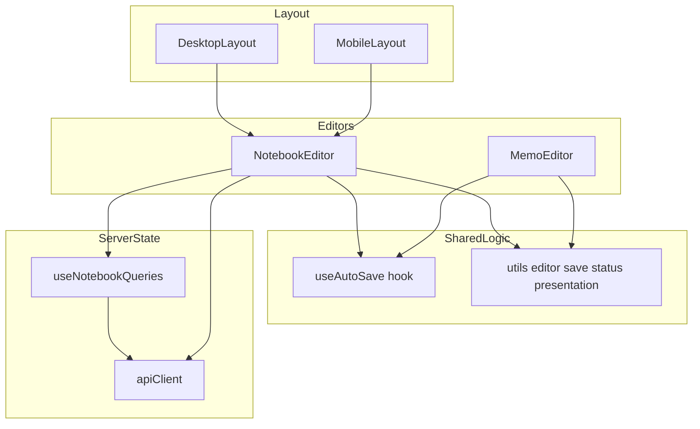
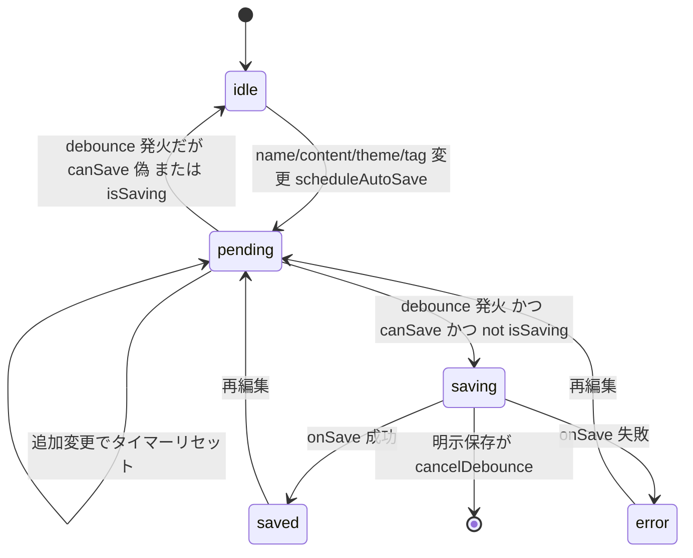
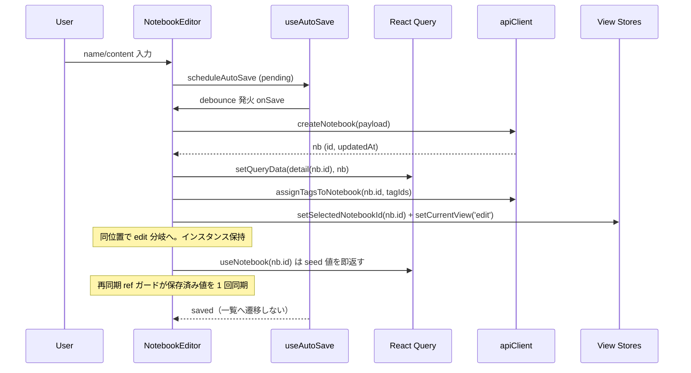

# Technical Design: notebook-autosave

## Overview

本機能は **NotebookEditor に MemoEditor 同等の自動保存（debounce）と保存状態インジケーターを導入**し、ノートブックとメモで保存体験を一貫させる。ドッグフーディングで記録された「ノートブックは自動保存されないと思う」という摩擦を解消し、保存ボタンの押し忘れによる作業消失を防ぐ。

**Users**: ノートブック編集者は、編集を止めるだけで内容が自動保存され、保存状況（保存中／保存済み／相対時刻）を画面上で確認できる。明示保存（ボタン／Ctrl・Cmd+S）も併存する。

**Impact**: 現状の NotebookEditor は手動 `handleSave` のみで、保存成功時に必ずノートブック一覧へ遷移する。本変更で `useAutoSave` を配線し、保存と画面遷移の責務を分離する。新規 API・Query フックの追加は不要で、既存の完成済みアセット（`useAutoSave` / `describeSaveStatus` / `formatRelativeTime`）を再利用する。

### Goals

- NotebookEditor に debounce 自動保存を配線し、name / content / themeId / タグ変更を保存対象にする。
- 保存状態インジケーターをメモと**コード共有で**一貫させる（文言・トーン・相対時刻）。
- 自動保存時は一覧へ遷移せず編集を継続。新規作成は重複作成を防ぎ edit モードへ内部遷移する。
- 明示保存（ボタン／Ctrl・Cmd+S）と debounce の二重保存を防止する。

### Non-Goals

- メモ側 autosave の挙動変更（表示ロジックの移設に伴う import 変更のみで、ロジック本体は不変）。
- ノートブックのオフライン同期キュー（`memo-bridge` 相当）の新設。`offline-saved` 経路は導入しない。
- ノートブックのリアルタイム共同編集。
- 保存ロジック自体の共通フック抽出（スコープ外・費用対効果低）。

## Architecture

### Existing Architecture Analysis

- **再利用可能なアセット**:
  - `useAutoSave`（`frontend/src/hooks/useAutoSave.ts`）— debounce・`SaveStatus` 状態機械・`cancelDebounce`。メモ非依存の汎用フック。**無改修で再利用**。
  - `describeSaveStatus` / `formatRelativeTime`（`frontend/src/utils/memo/save-status-presentation.ts`）— 内容は汎用。Option C で中立モジュールへ移設し共有。
  - `useCreateNotebook` / `useUpdateNotebook` / `useNotebook`（`frontend/src/hooks/useNotebookQueries.ts`）— invalidate 済み。**改修不要**。
  - `apiClient.createNotebook` / `updateNotebook` / `assignTagsToNotebook` / `getNotebookTags`（`frontend/src/utils/api.ts`）— 完備。
- **遵守すべき不変則**: サーバー状態の真実の源泉は React Query（Zustand へコピー禁止）。API は `apiClient` 経由。`useAutoSave` のローカル UI 状態は Zustand に載せない。
- **既存パターン**: MemoEditor が autosave 配線・id 切替再同期・相対時刻 tick・Ctrl/Cmd+S の完成テンプレート。
- **対処する技術的負債 / 破壊点**:
  - 現 `handleSave` は保存成功時に `goToNotebookList()` を呼ぶ → 自動保存経路から除去する。
  - 現 id 切替の再同期 effect は `editingNotebook`（オブジェクト全体）依存 → invalidate の参照変化で入力消失。**id ベースの ref ガードへ変更**する。

### Architecture Pattern & Boundary Map

**Selected pattern**: 既存コンポーネント拡張（Option C）。実装は NotebookEditor へ集約し、保存状態の表示ロジックのみ中立モジュール `utils/editor/save-status-presentation.ts` へ抽出して両エディタで共有する。



**Architecture Integration**:

- **Domain/feature boundaries**: 保存の実行（mutation）は React Query フックが担当、debounce 状態機械は `useAutoSave`、表示文言は共有 presentation モジュール、画面組み立てとフォーム state は NotebookEditor。
- **Existing patterns preserved**: React Query を真実の源泉とする原則、`apiClient` 経由の API コール、`useAutoSave` の状態機械。
- **New components rationale**: `utils/editor/save-status-presentation.ts` のみ新規（メモ専用名前空間からの移設）。Req 2.5「メモと一貫」をコード共有で構造的に担保するため。
- **Steering compliance**: サーバー状態を Zustand へコピーしない／API は `apiClient` 経由／UI ローカル状態のみコンポーネント内保持。

### Technology Stack

| Layer            | Choice / Version              | Role in Feature                                                          | Notes                       |
| ---------------- | ----------------------------- | ------------------------------------------------------------------------ | --------------------------- |
| Frontend         | React 18 + TypeScript         | NotebookEditor 拡張・フォーム state・effect                              | 既存スタック                |
| State (server)   | @tanstack/react-query         | 保存 mutation・detail キャッシュ seed・真実の源泉                        | `useNotebookQueries` 再利用 |
| State (UI local) | React `useState` / `useRef`   | saveStatus・lastSavedAt・再同期 ref ガード                               | Zustand 不使用              |
| API              | `apiClient`（`utils/api.ts`） | createNotebook / updateNotebook / assignTagsToNotebook / getNotebookTags | 改修不要                    |
| Hook             | `useAutoSave`（既存）         | debounce・SaveStatus 状態機械                                            | 無改修再利用                |

新規依存ライブラリは無し。新規ファイルは `utils/editor/save-status-presentation.ts`（既存ロジックの移設）と `NotebookEditor.test.tsx`（新規テスト）のみ。

## System Flows

### 自動保存ライフサイクル（state）



- debounce 発火時に `canSave` / `isSaving` を再評価するため、保存中の二重実行と空保存（Req 1.4/1.5）はタイマーコールバックで一元ガードされる（`useAutoSave` 既存実装）。
- 既存ノート編集中の `idle` は表示上 `saved`（保存済み）として提示する（Req 2.4）。

### 新規作成 → 編集モード遷移（sequence）



- create 成功で detail キャッシュを seed することで、edit 分岐遷移直後の `editingNotebook = undefined` 期間を消し、入力消失・フラッシュを回避する（Req 5.3）。
- 一覧へは遷移せず編集を継続する（Req 5.3 / 4.1）。

## Requirements Traceability

| Requirement        | Summary                                        | Components                                | Interfaces                                  | Flows                  |
| ------------------ | ---------------------------------------------- | ----------------------------------------- | ------------------------------------------- | ---------------------- |
| 1.1, 1.2           | 変更で pending・debounce リセット              | NotebookEditor, useAutoSave               | `scheduleAutoSave()`                        | 自動保存ライフサイクル |
| 1.3                | apiClient 経由保存                             | NotebookEditor                            | `handleSave()` → `apiClient`                | create→edit            |
| 1.4, 1.5           | 空保存抑止・保存中抑止                         | useAutoSave                               | debounce ガード                             | 自動保存ライフサイクル |
| 1.6                | React Query を真実の源泉                       | useNotebookQueries                        | mutation                                    | —                      |
| 2.1–2.4            | 保存中／保存済み／相対時刻／idle→保存済み      | NotebookEditor, Presentation              | `describeSaveStatus` / `formatRelativeTime` | —                      |
| 2.5                | メモと一貫                                     | Presentation（共有）                      | 共有 import                                 | —                      |
| 2.6                | 新規作成中は非表示                             | NotebookEditor                            | displayStatus 分岐                          | —                      |
| 3.1, 3.4, 3.5      | 明示保存ボタン併存・非活性・同一更新           | NotebookEditor                            | 保存ボタン                                  | —                      |
| 3.2, 3.3           | Ctrl/Cmd+S・二重保存防止                       | NotebookEditor                            | keydown + `cancelDebounce`                  | —                      |
| 4.1, 4.3           | 自動保存で遷移しない・入力保持                 | NotebookEditor                            | `handleSave`（遷移除去）+ ref ガード        | —                      |
| 4.2                | 明示完了で遷移                                 | NotebookEditor                            | 閉じるボタン → `goToNotebookList`           | —                      |
| 5.1, 5.2, 5.3, 5.4 | 新規作成 autosave・edit 遷移・継続・空不作成   | NotebookEditor                            | `handleSave` create 分岐 + seed             | create→edit            |
| 6.1, 6.2           | theme/tag を autosave トリガー                 | NotebookEditor                            | onChange → `scheduleAutoSave`               | —                      |
| 6.3, 6.4           | 本体保存後にタグ反映・失敗時破棄しない         | NotebookEditor                            | `assignTagsToNotebook` + try/catch          | —                      |
| 7.1, 7.2, 7.3      | エラー提示・入力保持・再試行                   | NotebookEditor, useAutoSave, Presentation | `saveStatus='error'`                        | 自動保存ライフサイクル |
| 8.1, 8.2, 8.3      | 切替で debounce キャンセル・再同期・churn 無視 | NotebookEditor                            | 再同期 ref ガード                           | —                      |

## Components and Interfaces

| Component                          | Domain/Layer         | Intent                                                       | Req Coverage | Key Dependencies (P0/P1)                                                     | Contracts |
| ---------------------------------- | -------------------- | ------------------------------------------------------------ | ------------ | ---------------------------------------------------------------------------- | --------- |
| NotebookEditor                     | UI / Editor          | 自動保存配線・状態 state・インジケーター・明示保存・遷移分離 | 1–8          | useAutoSave (P0), useNotebookQueries (P0), apiClient (P0), Presentation (P1) | State     |
| save-status-presentation（editor） | Util                 | 保存状態の文言・トーン・相対時刻を両エディタへ提供           | 2.1–2.5, 7.1 | useAutoSave SaveStatus 型 (P1)                                               | Service   |
| useAutoSave                        | Hook（既存・無改修） | debounce 状態機械                                            | 1.1–1.5, 7.1 | —                                                                            | Service   |

### Editor / UI

#### NotebookEditor

| Field        | Detail                                                                                                |
| ------------ | ----------------------------------------------------------------------------------------------------- |
| Intent       | NotebookEditor に autosave を配線し、保存状態提示・明示保存・遷移責務分離・編集対象切替の再同期を担う |
| Requirements | 1.1–1.6, 2.1–2.6, 3.1–3.5, 4.1–4.3, 5.1–5.4, 6.1–6.4, 7.1–7.3, 8.1–8.3                                |

**Responsibilities & Constraints**

- フォーム state（name / content / themeId / selectedTagIds）は UI ローカルに保持し、保存は React Query mutation に委譲する（Zustand へコピーしない）。
- `handleSave` は**純保存関数**とし、一覧遷移の副作用を持たない（Req 4.1）。
- 編集対象切替の再同期は **id 単位 1 回 + データ到着待ち** の ref ガードで行う（Req 8）。
- 派生値はレンダリング中に同期計算する（`isSaving = createNotebook.isPending || updateNotebook.isPending` / `canSave = hasChanges && (name.trim() || content.trim())`）。

**Dependencies**

- Outbound: `useAutoSave` — debounce 配線（P0）
- Outbound: `useCreateNotebook` / `useUpdateNotebook` / `useNotebook`（`useNotebookQueries`）— 保存・取得（P0）
- Outbound: `apiClient.assignTagsToNotebook` / `getNotebookTags` — タグ反映・取得（P0）
- Outbound: `useViewStore.setCurrentView` / `useMemoDataStore.setSelectedNotebookId` — create→edit 内部遷移（P1）
- Outbound: `describeSaveStatus` / `formatRelativeTime` / `SAVE_STATUS_TONE_CLASSES`（共有 Presentation）— 表示（P1）
- Inbound: `DesktopLayout` / `MobileLayout` — `isCreate` / `notebookId` prop で出し分け（P0）

**Contracts**: State [x]

##### State Management

**State model**（UI ローカル）:

```typescript
// フォーム値
name: string;
content: string;
themeId: string;           // 'default' を未選択センチネルとして扱う
selectedTagIds: string[];
hasChanges: boolean;
// 保存状態提示
lastSavedAt: Date | null;  // 既存ノートは updatedAt 初期化、saved で現在時刻へ
// 再同期ガード（命令的）
syncedNotebookIdRef: MutableRefObject<string | null>; // 最後に同期した id。新規はセンチネル
originalTagIds: string[];  // タグ差分検知の基準（getNotebookTags 由来）
```

`useAutoSave` 由来: `saveStatus: SaveStatus` / `scheduleAutoSave()` / `cancelDebounce()`。

**保存関数（純保存・遷移なし）**:

```typescript
// 戻り値は void（offline-saved 経路は導入しない）。エラーは throw して useAutoSave が 'error' へ遷移
const handleSave = useCallback(
	async (): Promise<void> => {
		const trimmedName = name.trim();
		const trimmedContent = content.trim();
		if (!trimmedName && !trimmedContent) return; // Req 1.4 / 5.4

		const payload: UpdateNotebookDto = {
			name: trimmedName ? name : null,
			content: trimmedContent ? content : null,
			themeId: themeId !== 'default' ? themeId : null,
		};

		if (isEdit && notebookId) {
			await updateNotebook.mutateAsync({ id: notebookId, data: payload });
			await reflectTags(notebookId); // try/catch 内包・失敗はログのみ（Req 6.4）
			return; // 一覧へ遷移しない（Req 4.1）
		}

		const nb = await createNotebook.mutateAsync(payload); // Req 5.1
		queryClient.setQueryData(queryKeys.notebooks.detail(nb.id), nb); // seed
		await reflectTags(nb.id);
		setSelectedNotebookId(nb.id); // useMemoDataStore
		setCurrentView('edit'); // useViewStore（Req 5.2 / 5.3）
	},
	[
		/* name, content, themeId, selectedTagIds, isEdit, notebookId, ... */
	],
);
```

**編集対象切替の再同期（ref ガード）**:

```typescript
// 依存に editingNotebook を含めても、id 一致時は ref ガードで早期 return するため
// invalidate の参照変化では再同期されない（Req 4.3 / 8.3）。
useEffect(() => {
	if (isCreate) {
		if (syncedNotebookIdRef.current !== CREATE_SENTINEL) {
			cancelDebounce(); // Req 8.1
			setName('');
			setContent('');
			setThemeId('default');
			setSelectedTagIds([]);
			setOriginalTagIds([]);
			setLastSavedAt(null);
			setHasChanges(false);
			syncedNotebookIdRef.current = CREATE_SENTINEL;
		}
		return;
	}
	if (!notebookId || !editingNotebook) return; // データ到着待ち
	if (syncedNotebookIdRef.current === notebookId) return; // 同一 id churn 無視
	cancelDebounce(); // Req 8.1
	setName(editingNotebook.name ?? '');
	setContent(editingNotebook.content ?? '');
	setThemeId(editingNotebook.themeId ?? editingNotebook.theme?.id ?? 'default');
	setLastSavedAt(editingNotebook.updatedAt ? new Date(editingNotebook.updatedAt) : null);
	setHasChanges(false);
	syncedNotebookIdRef.current = notebookId; // Req 8.2
	apiClient
		.getNotebookTags(editingNotebook.id)
		.then((pairs) => {
			const ids = pairs.map((p) => p.tagId);
			setSelectedTagIds(ids);
			setOriginalTagIds(ids);
		})
		.catch((e) => logger.error('failed to load notebook tags', e));
}, [notebookId, isCreate, editingNotebook, cancelDebounce]);
```

- Preconditions: `isCreate` または `notebookId` のいずれかが供給される。
- Postconditions: フォーム state が編集対象に一致し、`syncedNotebookIdRef` が対象 id を保持。
- Invariants: 同一 id の再フェッチではフォーム state を上書きしない。

**Concurrency strategy**: debounce タイマーは `useAutoSave` が単一管理。明示保存・対象切替は `cancelDebounce()` で先行タイマーを破棄し二重保存を防止（Req 3.3 / 8.1）。

**Implementation Notes**

- **Integration**:
  - onChange 結線: name/content/theme/tag toggle のたびに `scheduleAutoSave()` を呼ぶ（Req 1.1 / 6.1 / 6.2）。`hasChanges` 検知にタグ差分比較（`originalTagIds` と比較）を追加。
  - 明示保存ボタン: `onClick={() => { cancelDebounce(); handleSave().catch(logError); }}`、`disabled = !canSave || isSaving`（Req 3.1 / 3.4 / 3.5）。
  - Ctrl/Cmd+S: `keydown` で `preventDefault()` → `canSave` なら `cancelDebounce()` + `handleSave()`（Req 3.2 / 3.3）。
  - 「閉じる」ボタン: `goToNotebookList()`（旧「キャンセル」を改称。autosave 済みのため破棄ではなく完了。Req 4.2）。
  - インジケーター: MemoEditor と同一の IIFE。既存ノート編集中の `idle` は `saved` 表示、`saved` は相対時刻併記、新規作成中は非表示。`lastSavedAt` 設定後 30 秒間隔の tick で相対表示を更新（Req 2.1–2.4 / 2.6 / 3）。
  - `reflectTags(id)`: タグ差分があれば `apiClient.assignTagsToNotebook(id, { tagIds: selectedTagIds })` を try/catch で実行し、失敗はログのみ（Req 6.3 / 6.4）。成功後 `originalTagIds` を更新。
- **Validation**: `canSave` は name/content の trim 非空を必須にし、タグ・テーマのみの変更で空ノートを作成しない（Req 1.4 / 5.4）。
- **Risks**: `handleSave` 内に遷移副作用を残さないこと（回帰しやすい破壊点）。再同期 ref ガードの 4 シナリオ網羅。

### Util

#### save-status-presentation（editor 共有）

| Field        | Detail                                                                     |
| ------------ | -------------------------------------------------------------------------- |
| Intent       | 保存状態の文言・トーン・相対時刻フォーマットを両エディタへ単一ソースで提供 |
| Requirements | 2.1–2.5, 7.1                                                               |

**Responsibilities & Constraints**

- `frontend/src/utils/memo/save-status-presentation.ts` から `describeSaveStatus` / `formatRelativeTime` / `SaveStatusTone` / `SaveStatusDescription` / `exhaustiveSaveStatusKeys` を `frontend/src/utils/editor/save-status-presentation.ts` へ移設。
- MemoEditor 内ローカル定義の `SAVE_STATUS_TONE_CLASSES` を同モジュールへ移設し export。
- メモ専用の `describeDeleteConfirm` は `utils/memo/` に残し、必要な型を editor モジュールから import。
- ロジック本体は不変（Req 2.5 を構造的に担保。メモの挙動は変えない）。

**Contracts**: Service [x]

##### Service Interface

```typescript
export type SaveStatusTone = 'idle' | 'progress' | 'success' | 'warn' | 'error';
export interface SaveStatusDescription {
	label: string | null;
	tone: SaveStatusTone;
}

export function describeSaveStatus(status: SaveStatus): SaveStatusDescription;
export function formatRelativeTime(now: Date, target: Date): string;
export const SAVE_STATUS_TONE_CLASSES: Record<SaveStatusTone, string>;
```

- Preconditions: `status` は `SaveStatus` の網羅値。
- Postconditions: 文言とトーンを返す。`describeSaveStatus` は default で `never` 網羅チェック。
- Invariants: メモ・ノートで同一文言・同一トーン色。

**Implementation Notes**

- **Integration**: `MemoEditor` / `NotebookEditor` 双方が editor モジュールを import。`utils/memo/save-status-presentation.ts` の該当 export を削除し、`describeDeleteConfirm` の型 import を editor モジュールへ向ける。
- **Validation**: 既存 `MemoEditor.test.tsx` が緑であることで移設の挙動不変を確認。
- **Risks**: import 元付け替え漏れ（型チェックで検出）。

## Data Models

スキーマ変更・新規エンティティ無し。保存ペイロードは既存 DTO を流用する。

### Data Contracts & Integration

**API Data Transfer**（既存）:

```typescript
// CreateNotebookDto / UpdateNotebookDto（共通形）
{ name?: string | null; content?: string | null; themeId?: string | null }
// themeId は 'default'（未選択）を null へ正規化して送信
```

- タグ反映: `assignTagsToNotebook(notebookId, { tagIds: string[] })` を本体保存成功後に実行。
- detail キャッシュ seed: `queryKeys.notebooks.detail(id)` に create 戻り値を `setQueryData`。

## Error Handling

### Error Strategy

- 保存失敗（create/update mutation reject）は `handleSave` から throw し、`useAutoSave` が `saveStatus='error'` へ遷移。インジケーターが「保存失敗 — 手動保存してください」を error トーンで提示（Req 7.1）。
- 失敗時もフォーム state（name/content/themeId/selectedTagIds）は保持し破棄しない。再フェッチによる上書きは再同期 ref ガードで防止（Req 7.2）。
- 失敗後の再編集で `scheduleAutoSave()` が再び pending → 自動再試行（Req 7.3）。

### Error Categories and Responses

- **System Errors（5xx/通信）**: mutation reject → `error` 状態提示。入力保持。明示保存で再試行可能。
- **タグ反映の部分失敗**: `assignTagsToNotebook` 失敗は本体保存結果を破棄せず、`logger.error` でログのみ（Req 6.4）。保存状態は `saved` を維持。

### Monitoring

- `logger.error` でタグ取得・反映・保存失敗を記録（既存ロガー）。Sentry は既存初期化を踏襲。

## Testing Strategy

### Unit Tests（新規 `NotebookEditor.test.tsx`）

- name/content 変更で debounce 後 1 回だけ `apiClient` 経由保存が走る（Req 1.1–1.3）。
- 空（name/content とも空）では保存しない（Req 1.4 / 5.4）。
- 自動保存成功で `goToNotebookList` が**呼ばれない**こと（Req 4.1）。
- 新規作成の autosave 成功で detail キャッシュ seed + `setCurrentView('edit')` が走り、入力が保持される（Req 5.1–5.3）。
- 同一ノートの invalidate（`editingNotebook` 参照変化）でフォーム state が再同期されない（Req 4.3 / 8.3）。

### Integration Tests

- 別ノートへ切替時に debounce キャンセル + 新対象で再同期、前ノートの入力・タイマーが混入しない（Req 8.1 / 8.2）。
- テーマ／タグ変更が autosave をトリガーし、本体保存後に `assignTagsToNotebook` が実行される（Req 6.1–6.3）。
- タグ反映 API 失敗時に本体保存結果が破棄されずログのみ（Req 6.4）。

### E2E/UI Tests

- 明示保存ボタン非活性条件（変更なし／保存中）と Ctrl/Cmd+S での即時保存・二重保存防止（Req 3.2–3.4）。
- 保存状態インジケーターの遷移（保存中 → 保存済み + 相対時刻、既存ノート idle → 保存済み、新規作成中は非表示）がメモと一貫（Req 2.1–2.6）。

### 回帰確認

- 既存 `MemoEditor.test.tsx` が緑（表示ロジック移設の挙動不変）。

## Migration Strategy

データ移行は不要。コード変更のみ。`utils/memo/save-status-presentation.ts` の該当 export を `utils/editor/save-status-presentation.ts` へ移設し、`MemoEditor` の import を付け替える。段階は「①共有モジュール作成・メモ import 付け替え（緑確認）→ ②NotebookEditor 配線 → ③テスト追加」。各段でテスト緑をロールバック判定基準とする。
