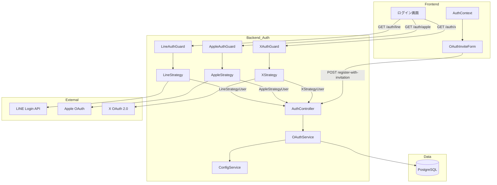
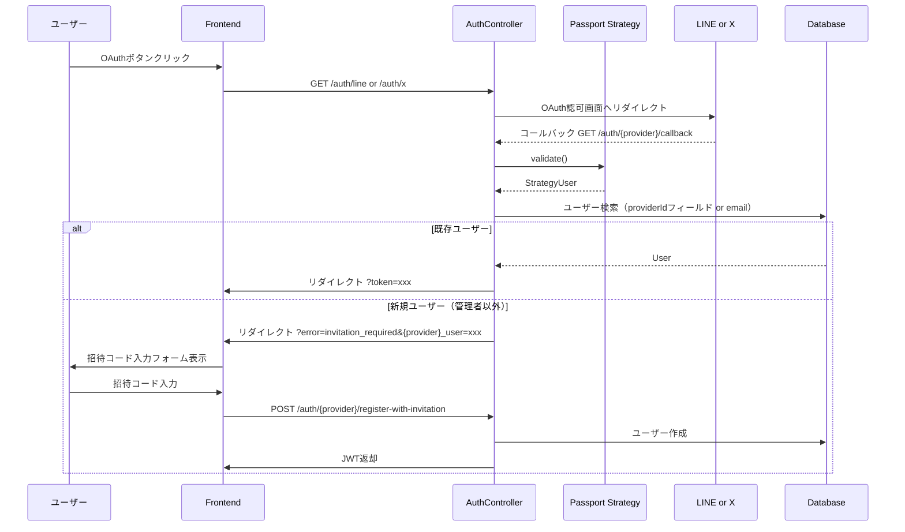
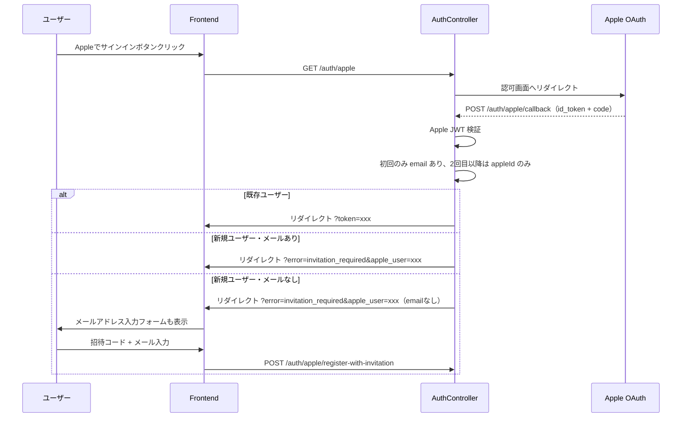

# Design Document: oauth-providers-expansion

## Overview

LINE・Apple・X（Twitter）の3プロバイダーを既存の Passport.js ベースの OAuth アーキテクチャに追加する。現在 Google・GitHub で確立されている「Strategy → Guard → OAuthService → AuthController」のパターンを踏襲し、拡張コストを最小化する。

**Purpose**: 日本語圏ユーザー（LINE）・iOS/Macユーザー（Apple）・Xユーザーへのアクセス経路を拡大し、招待制サービスへのオンボーディング摩擦を下げる。

**Impact**: `User` モデルに `lineId`/`appleId`/`xId` フィールドを追加するスキーママイグレーションが必要。既存ユーザーおよび Google/GitHub の動作は変更なし。

### Goals

- LINE・Apple・X の各プロバイダーで既存の招待コードフローと統合されたログイン・新規登録を実現する
- Apple の POST コールバック・メールなし初回登録など特殊仕様を正しく処理する
- フロントエンドの OAuthInviteForm は既に X スタイルを持つため、最小差分での UI 追加

### Non-Goals

- 既存の `oauthId`（Google/GitHub）フィールドの `googleId`/`githubId` への分離・マイグレーション
- 複数 OAuth プロバイダーを同一アカウントにリンクするマルチプロバイダー統合
- LINE / X のソーシャルグラフや投稿機能の利用

---

## Architecture

### Existing Architecture Analysis

既存の OAuth フローは以下の構造を持つ：

- **Strategy**: `PassportStrategy` を継承、プロバイダー固有の Validate メソッドで `StrategyUser` 型を返す
- **Guard**: `AuthGuard('provider-name')` を継承したシンプルな Guard クラス
- **OAuthService**: `handleOAuthLogin` / `handleOAuthRegistrationWithInvitation` の共通メソッドに `BaseOAuthUser` を渡す
- **AuthController**: `handleOAuthCallback` 共通メソッドで全プロバイダーのコールバックを処理
- **ConfigService**: 各プロバイダーのクレデンシャルを `process.env` から取得する getter を持つ

3プロバイダーの追加はすべてこのパターンの複製・拡張であり、コアロジックの変更は最小限。

### Architecture Pattern & Boundary Map



**Architecture Integration**:

- 既存パターン踏襲: Google/GitHub と同じ Strategy/Guard/Service/Controller 構造
- Apple のみ POST コールバック（`@Post('apple/callback')`）
- `OAuthService` の `handleOAuthLogin` はプロバイダーフィールド名を引数で受け取るよう拡張

### Technology Stack

| Layer            | Choice / Version          | Role                                    | Notes                                 |
| ---------------- | ------------------------- | --------------------------------------- | ------------------------------------- |
| Backend Strategy | `passport-line-auth`      | LINE StrategyUser 生成                  | `passport-line` は非推奨              |
| Backend Strategy | `passport-apple`          | Apple id_token 検証・StrategyUser 生成  | .p8 秘密鍵が必要                      |
| Backend Strategy | `passport-twitter-oauth2` | X OAuth 2.0 StrategyUser 生成           | PKCE 対応を確認                       |
| Database         | Prisma + PostgreSQL       | `lineId`/`appleId`/`xId` フィールド追加 | nullable unique 制約                  |
| Frontend         | React + Tailwind CSS      | ログインボタン・招待コードフォーム追加  | OAuthInviteForm は X スタイル定義済み |

---

## System Flows

### OAuth ログインフロー（LINE/X 共通 - GETコールバック）



### Apple OAuth フロー（POSTコールバック）



---

## Requirements Traceability

| Requirement | Summary                          | Components                                                  | Interfaces                                                                                  | Flows                 |
| ----------- | -------------------------------- | ----------------------------------------------------------- | ------------------------------------------------------------------------------------------- | --------------------- |
| 1.1〜1.6    | LINE OAuth                       | LineStrategy, LineAuthGuard, OAuthService, AuthController   | `GET /auth/line`, `GET /auth/line/callback`, `POST /auth/line/register-with-invitation`     | GETコールバックフロー |
| 2.1〜2.7    | Apple OAuth                      | AppleStrategy, AppleAuthGuard, OAuthService, AuthController | `GET /auth/apple`, `POST /auth/apple/callback`, `POST /auth/apple/register-with-invitation` | Apple POSTフロー      |
| 3.1〜3.6    | X OAuth 2.0                      | XStrategy, XAuthGuard, OAuthService, AuthController         | `GET /auth/x`, `GET /auth/x/callback`, `POST /auth/x/register-with-invitation`              | GETコールバックフロー |
| 4.1〜4.5    | DBスキーマ拡張                   | Prisma schema, DBマイグレーション                           | `lineId`, `appleId`, `xId` フィールド                                                       | —                     |
| 5.1〜5.4    | 招待コード統合                   | OAuthService, InvitationService                             | `handleOAuthLogin`, `handleOAuthRegistrationWithInvitation`                                 | 全フロー              |
| 6.1〜6.5    | フロントエンドUI                 | AuthForm, OAuthInviteForm, AuthContext, EmailAuthForm       | `AuthMode`, `providerName` 型拡張                                                           | —                     |
| 7.1〜7.5    | 環境変数設定                     | ConfigService                                               | 各 getter メソッド追加                                                                      | —                     |
| 8.1〜8.5    | プラットフォーム設定ドキュメント | `docs/deployment/oauth-setup.md`                            | —                                                                                           | —                     |

---

## Components and Interfaces

### コンポーネントサマリー

| Component                                   | Layer          | Intent                                                   | Req Coverage                           | Key Dependencies                                  |
| ------------------------------------------- | -------------- | -------------------------------------------------------- | -------------------------------------- | ------------------------------------------------- |
| LineStrategy                                | Backend/Auth   | LINE profile を LineStrategyUser に変換                  | 1.1〜1.4                               | passport-line-auth, ConfigService                 |
| AppleStrategy                               | Backend/Auth   | Apple id_token を検証し AppleStrategyUser に変換         | 2.1〜2.5                               | passport-apple, ConfigService                     |
| XStrategy                                   | Backend/Auth   | X profile を XStrategyUser に変換                        | 3.1〜3.4                               | passport-twitter-oauth2, ConfigService            |
| LineAuthGuard / AppleAuthGuard / XAuthGuard | Backend/Auth   | 各プロバイダーの Passport Guard                          | 1.1, 2.1, 3.1                          | Passport.js                                       |
| OAuthService（拡張）                        | Backend/Auth   | 共通ログイン・登録処理をプロバイダーフィールド対応に拡張 | 1.2〜1.4, 2.2〜2.4, 3.2〜3.4, 5.1〜5.4 | PrismaService, InvitationService, JwtTokenService |
| AuthController（拡張）                      | Backend/Auth   | 新3プロバイダーのエンドポイント追加                      | 1.5〜1.6, 2.6〜2.7, 3.5〜3.6           | OAuthService, ConfigService                       |
| ConfigService（拡張）                       | Backend/Config | LINE/Apple/X クレデンシャルの環境変数取得                | 7.1〜7.5                               | process.env                                       |
| Prisma schema（拡張）                       | Data           | lineId/appleId/xId フィールド追加                        | 4.1〜4.5                               | —                                                 |
| oauth.types.ts（拡張）                      | Backend/Types  | OAuthProvider / StrategyUser 型を拡張                    | 1〜3, 5                                | —                                                 |
| AuthForm（拡張）                            | Frontend       | AuthMode / providers 配列に LINE/Apple/X を追加          | 6.1〜6.5                               | AuthContext                                       |
| AuthContext（拡張）                         | Frontend       | 新3プロバイダーの register-with-invitation 関数追加      | 6.4                                    | apiClient                                         |
| EmailAuthForm（拡張）                       | Frontend       | LINE/Apple/X ログインボタン追加                          | 6.1〜6.3                               | getBackendUrl                                     |
| oauth-setup.md（新規）                      | Docs           | 各プラットフォームの設定手順                             | 8.1〜8.5                               | —                                                 |

---

### Backend / Auth Layer

#### LineStrategy

| Field        | Detail                                                 |
| ------------ | ------------------------------------------------------ |
| Intent       | LINE Login v2.1 API で認証し `LineStrategyUser` を返す |
| Requirements | 1.1, 1.4                                               |

**Contracts**: Service [x]

##### Service Interface

```typescript
// backend/src/auth/line.strategy.ts
interface LineProfile {
	userId: string;
	displayName: string;
	pictureUrl?: string;
	email?: string;
}

interface LineStrategyUser {
	lineId: string;
	name: string;
	email?: string;
	picture?: string;
	accessToken?: string;
}
```

**Implementation Notes**:

- `passport-line-auth` の `Strategy` を `PassportStrategy` でラップ
- `configService.lineClientId` / `lineClientSecret` が未設定の場合は constructor で Error をスロー（Google/GitHub と同パターン）
- スコープは `['profile', 'email']`（ユーザーが email を許可しない場合は `undefined`）

---

#### AppleStrategy

| Field        | Detail                                                  |
| ------------ | ------------------------------------------------------- |
| Intent       | Apple の `id_token` を検証し `AppleStrategyUser` を返す |
| Requirements | 2.1, 2.4, 2.5                                           |

**Contracts**: Service [x]

##### Service Interface

```typescript
// backend/src/auth/apple.strategy.ts
interface AppleStrategyUser {
	appleId: string; // Apple の sub クレーム
	name: string; // 初回のみ取得可能（取得できない場合は 'Apple User' フォールバック）
	email?: string; // 初回のみ取得可能
	accessToken?: string;
}
```

**Implementation Notes**:

- `passport-apple` を使用。`clientID`（Service ID）、`teamID`、`keyID`、`privateKeyString`（.p8 の内容）を ConfigService から取得
- `privateKeyString` は環境変数内の `\n` を実際の改行に変換してから渡す（ConfigService で処理）
- コールバックは `callbackURL: configService.appleRedirectUri`。Apple の仕様により `POST` ルートに紐付ける
- `name` が取得できない（2回目以降）場合は `'Apple User'` をフォールバック

---

#### XStrategy

| Field        | Detail                                                |
| ------------ | ----------------------------------------------------- |
| Intent       | X OAuth 2.0 でユーザーを認証し `XStrategyUser` を返す |
| Requirements | 3.1, 3.4                                              |

**Contracts**: Service [x]

##### Service Interface

```typescript
// backend/src/auth/x.strategy.ts
interface XProfile {
	id: string;
	username?: string;
	name?: string;
}

interface XStrategyUser {
	xId: string;
	name: string;
	username?: string;
	email?: string; // X は Basic tier 以上でのみ email を提供
	picture?: string;
	accessToken?: string;
}
```

**Implementation Notes**:

- `passport-twitter-oauth2` を使用
- X の無料 API tier ではメールアドレスが取得できない場合があるため、`email` は常に optional

---

#### OAuthService（拡張）

| Field        | Detail                                                                                                 |
| ------------ | ------------------------------------------------------------------------------------------------------ |
| Intent       | `handleOAuthLogin` をプロバイダーフィールド対応に拡張し、LINE/Apple/X の login/register メソッドを追加 |
| Requirements | 1.2〜1.4, 2.2〜2.4, 3.2〜3.4, 5.1〜5.4                                                                 |

**Contracts**: Service [x]

##### Service Interface

```typescript
// handleOAuthLogin の拡張シグネチャ
type UserProviderField = 'oauthId' | 'lineId' | 'appleId' | 'xId';

interface OAuthLoginOptions {
	providerField: UserProviderField;
}

// OAuthService に追加するメソッド
interface OAuthServiceExtension {
	lineLogin(user: LineStrategyUser): Promise<AuthTokens & { user: AuthenticatedUser }>;
	lineRegisterWithInvitation(
		user: LineStrategyUser,
		invitationCode: string,
	): Promise<AuthTokens & { user: AuthenticatedUser }>;

	appleLogin(user: AppleStrategyUser): Promise<AuthTokens & { user: AuthenticatedUser }>;
	appleRegisterWithInvitation(
		user: AppleStrategyUser,
		invitationCode: string,
		fallbackEmail?: string,
	): Promise<AuthTokens & { user: AuthenticatedUser }>;

	xLogin(user: XStrategyUser): Promise<AuthTokens & { user: AuthenticatedUser }>;
	xRegisterWithInvitation(
		user: XStrategyUser,
		invitationCode: string,
	): Promise<AuthTokens & { user: AuthenticatedUser }>;
}
```

- Preconditions: 各プロバイダーの StrategyUser が `id`（`lineId`/`appleId`/`xId`）と `name` を持つこと
- Postconditions: 既存ユーザーは JWT を返す。新規ユーザー（非管理者）は `invitation code` エラーをスローする

**Implementation Notes**:

- `handleOAuthLogin` に `providerField: UserProviderField` 引数を追加し、`where: { [providerField]: providerId }` で検索・更新
- Apple のメールなし登録は `fallbackEmail` パラメータで対応（`handleOAuthRegistrationWithInvitation` 既存の `fallbackEmail` 引数を活用）

---

#### AuthController（拡張）

**Contracts**: API [x]

##### API Contract

| Method | Endpoint                               | Request                          | Response                | Errors |
| ------ | -------------------------------------- | -------------------------------- | ----------------------- | ------ |
| GET    | `/auth/line`                           | —                                | Redirect to LINE        | —      |
| GET    | `/auth/line/callback`                  | OAuth callback                   | Redirect to frontend    | 302    |
| POST   | `/auth/line/register-with-invitation`  | `LineRegisterWithInvitationDto`  | `{ accessToken, user }` | 400    |
| GET    | `/auth/apple`                          | —                                | Redirect to Apple       | —      |
| POST   | `/auth/apple/callback`                 | Apple POST body                  | Redirect to frontend    | 302    |
| POST   | `/auth/apple/register-with-invitation` | `AppleRegisterWithInvitationDto` | `{ accessToken, user }` | 400    |
| GET    | `/auth/x`                              | —                                | Redirect to X           | —      |
| GET    | `/auth/x/callback`                     | OAuth callback                   | Redirect to frontend    | 302    |
| POST   | `/auth/x/register-with-invitation`     | `XRegisterWithInvitationDto`     | `{ accessToken, user }` | 400    |

**Implementation Notes**:

- Apple の callback のみ `@Post` / `@Public()` / `@UseGuards(AppleAuthGuard)`
- 他は既存の `handleOAuthCallback` 共通メソッドをそのまま再利用

---

#### ConfigService（拡張）

**Contracts**: Service [x]

##### Service Interface

```typescript
// 追加 getter
interface ConfigServiceExtension {
	// LINE
	get lineClientId(): string | undefined;
	get lineClientSecret(): string | undefined;
	get lineRedirectUri(): string; // デフォルト: 'http://localhost:3000/auth/line/callback'

	// Apple
	get appleClientId(): string | undefined; // Service ID
	get appleTeamId(): string | undefined;
	get appleKeyId(): string | undefined;
	get applePrivateKey(): string | undefined; // .p8 内容（\n を改行に変換して返す）

	// X
	get xClientId(): string | undefined;
	get xClientSecret(): string | undefined;
	get xRedirectUri(): string; // デフォルト: 'http://localhost:3000/auth/x/callback'
}
```

---

#### oauth.types.ts（拡張）

```typescript
// 拡張後の OAuthProvider
export type OAuthProvider = 'google' | 'github' | 'line' | 'apple' | 'x';

// 新規追加 StrategyUser
export interface LineStrategyUser { ... }   // 上記参照
export interface AppleStrategyUser { ... }  // 上記参照
export interface XStrategyUser { ... }      // 上記参照

// OAuthStrategyUser union 型の拡張
export type OAuthStrategyUser =
  | GoogleStrategyUser
  | GitHubStrategyUser
  | LineStrategyUser
  | AppleStrategyUser
  | XStrategyUser;
```

---

### Backend / DTOs

追加 DTO（既存 `GoogleRegisterWithInvitationDto` / `GithubRegisterWithInvitationDto` と同パターン）:

```typescript
// LineRegisterWithInvitationDto
class LineRegisterWithInvitationDto {
	@IsObject() lineUser: Record<string, unknown>;
	@IsString() @IsNotEmpty() invitationCode: string;
}

// AppleRegisterWithInvitationDto
class AppleRegisterWithInvitationDto {
	@IsObject() appleUser: Record<string, unknown>;
	@IsString() @IsNotEmpty() invitationCode: string;
	@IsEmail() @IsOptional() fallbackEmail?: string; // Apple メールなし対応
}

// XRegisterWithInvitationDto
class XRegisterWithInvitationDto {
	@IsObject() xUser: Record<string, unknown>;
	@IsString() @IsNotEmpty() invitationCode: string;
}
```

---

### Frontend

#### AuthForm（拡張）

| Field        | Detail                                                    |
| ------------ | --------------------------------------------------------- |
| Intent       | `AuthMode` 型と招待コードフロー処理に LINE/Apple/X を追加 |
| Requirements | 6.1〜6.5                                                  |

```typescript
// 拡張後の AuthMode
type AuthMode =
	| 'login'
	| 'signup'
	| 'resetPassword'
	| 'googleInvite'
	| 'githubInvite'
	| 'lineInvite'
	| 'appleInvite'
	| 'xInvite'; // 新規追加

// providers 配列の拡張
const providers = [
	{ key: 'pendingGoogleUser', mode: 'googleInvite' as const },
	{ key: 'pendingGitHubUser', mode: 'githubInvite' as const },
	{ key: 'pendingLineUser', mode: 'lineInvite' as const }, // 新規
	{ key: 'pendingAppleUser', mode: 'appleInvite' as const }, // 新規
	{ key: 'pendingXUser', mode: 'xInvite' as const }, // 新規
];
```

**Implementation Notes**:

- Apple の `appleInvite` モードでは `fallbackEmail` フィールドを追加表示（メールが `pendingOAuthUser` にない場合）
- `OAuthInviteForm` の `providerName` 型を `'LINE' | 'Apple' | 'X'` まで拡張

#### AuthContext（拡張）

```typescript
interface AuthContextExtension {
	lineRegisterWithInvitation(user: OAuthUserData, invitationCode: string): Promise<void>;
	appleRegisterWithInvitation(
		user: OAuthUserData,
		invitationCode: string,
		fallbackEmail?: string,
	): Promise<void>;
	xRegisterWithInvitation(user: OAuthUserData, invitationCode: string): Promise<void>;
}
```

#### EmailAuthForm（拡張）

- 既存 Google/GitHub ボタンの下に LINE/Apple/X ボタンを追加
- `getBackendUrl()` + `/auth/{provider}` への `window.location.href` リダイレクト（既存パターン）
- Apple ボタンは Apple HIG に従い黒背景・白テキストを使用

---

## Data Models

### Physical Data Model（Prisma schema）

```prisma
model User {
  // 既存フィールド（省略）
  oauthId   String?  @unique @map("oauth_id")   // Google/GitHub 既存

  // 新規追加
  lineId    String?  @unique @map("line_id")
  appleId   String?  @unique @map("apple_id")
  xId       String?  @unique @map("x_id")
}
```

マイグレーション: `npx prisma migrate dev --name add-line-apple-x-oauth-ids`

---

## Error Handling

### Error Strategy

OAuth エラーは既存の `handleOAuthCallback` の try/catch パターンで処理する。

### Error Categories and Responses

| エラー                           | 種別           | 対応                                                                                           |
| -------------------------------- | -------------- | ---------------------------------------------------------------------------------------------- |
| LINE/X クレデンシャル未設定      | System (500)   | Strategy constructor で Error をスロー → アプリ起動失敗として早期検知                          |
| Apple .p8 秘密鍵フォーマット不正 | System (500)   | ConfigService の `applePrivateKey` getter で検証                                               |
| 招待コード無効                   | Business (400) | `InvitationService.verifyInvitation` が例外スロー → `throwBadRequest`                          |
| Apple メールなし（新規登録）     | User (400)     | `AppleRegisterWithInvitationDto` の `fallbackEmail` が必須になる。フロントで入力フォームを表示 |
| OAuth プロバイダー側エラー       | System         | `generateAuthFailedUrl()` へリダイレクト                                                       |

### Monitoring

- 既存の `AppLogger` を使用（`logger.error` でプロバイダー名付きエラーログ）
- Strategy の constructor での設定値チェックにより、デプロイ時の設定ミスを早期発見

---

## Testing Strategy

### Unit Tests

- `LineStrategy.validate()`: LINE profile から `LineStrategyUser` への変換
- `AppleStrategy.validate()`: email あり / なし の両パターン
- `XStrategy.validate()`: X profile から `XStrategyUser` への変換
- `OAuthService.lineLogin()` / `appleLogin()` / `xLogin()`: 既存ユーザー・新規ユーザーの分岐
- `OAuthService.appleRegisterWithInvitation()`: fallbackEmail あり / なしの両パターン
- `ConfigService`: LINE/Apple/X の getter（Apple privateKey の改行変換を含む）

### Integration Tests

- `POST /auth/line/register-with-invitation`: 有効/無効な招待コード
- `POST /auth/apple/callback`: Apple POST コールバックの処理
- `POST /auth/apple/register-with-invitation`: fallbackEmail を含むリクエスト
- `GET /auth/x/callback`: X OAuth コールバックの JWT 発行
- Prisma: `lineId`/`appleId`/`xId` のユニーク制約検証

---

## Security Considerations

- Apple の .p8 秘密鍵は環境変数に格納し、ファイルシステムには置かない
- X の OAuth 2.0 は PKCE（Proof Key for Code Exchange）を有効化する
- `generateInvitationRequiredUrl` でのユーザー情報 URL パラメータは既存と同様に `encodeURIComponent` + `JSON.stringify`
- LINE/Apple/X の各プロバイダーコンソールでコールバックURLを明示的に登録し、オープンリダイレクトを防止

---

## Migration Strategy

1. `lineId`/`appleId`/`xId` フィールド追加（nullable, `npx prisma migrate dev`）— 既存データへの影響なし
2. 各プロバイダーのコールバックURL を各プラットフォームのコンソールに登録
3. 環境変数を設定してデプロイ
4. フィーチャーフラグなし（環境変数未設定時は Strategy constructor でエラーになるため、設定済みのプロバイダーのみが動作）

---

## Supporting References

詳細な調査ログ・アーキテクチャパターン評価は `research.md` を参照。

### Platform Setup Documentation（Requirement 8）

実装タスクの一環として `docs/deployment/oauth-setup.md` を作成する。内容：

1. **LINE**: LINE Developers コンソール → LINEログインチャンネル作成 → コールバックURL `{BACKEND_URL}/auth/line/callback` 登録 → Client ID/Secret 取得
2. **Apple**: Apple Developer Portal → Identifiers → Services IDs 作成 → Sign in with Apple 有効化 → ドメイン検証 → Return URL `{BACKEND_URL}/auth/apple/callback` 登録 → Keys → .p8 秘密鍵ダウンロード（再ダウンロード不可）
3. **X**: developer.twitter.com → アプリ作成 → User authentication settings → OAuth 2.0 有効化 → Callback URL `{BACKEND_URL}/auth/x/callback` 登録 → Client ID/Secret 取得
4. 環境変数マッピング表（プラットフォームの呼称 → 環境変数名）
5. ステージング環境では本番と別アプリを作成すること
