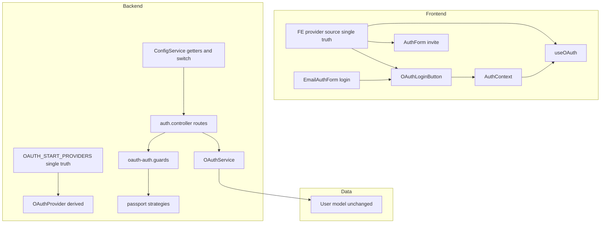
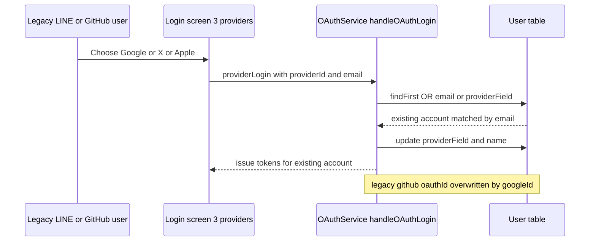
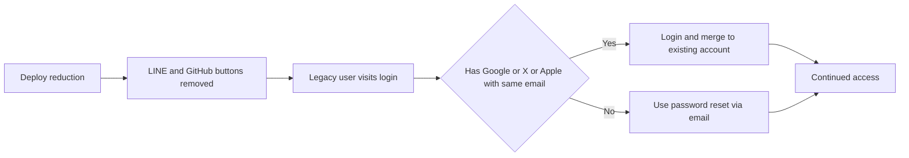

# Technical Design Document

## Overview

**Purpose**: この機能は、Mosaku のログイン体験を「日本市場の利用実態＋X 集客戦略に整合した有効プロバイダ 3 種（Google / X / Apple）」へ収斂させ、廃止プロバイダ（LINE / GitHub）の保守・攻撃面を削減する。既存ユーザーは全員が一意なメールアドレスを保持しているため、廃止プロバイダで登録したユーザーもメール経由で継続アクセスできる。

**Users**: エンドユーザーはログイン／招待登録画面で有効 3 プロバイダのみを見る。開発者は実態と一致した設定・ドキュメントの下で安全にリリースできる。

**Impact**: 現状は `oauth-stateless-unification`(完了) により provider 名でパラメータ化された 5 プロバイダ構成。本変更は **引き算（subtractive）** であり、LINE/GitHub を UI・エンドポイント・Strategy・設定・ドキュメントの各層から除去し、残る 3 プロバイダの経路とスキーマは無変更で維持する。あわせて散在する provider 列挙を各サイド 1 本の真実源へ集約し（Option C）、将来のドリフトを構造的に予防する。

### Goals

- ログイン・招待登録の全導線で表示プロバイダを Google / X / Apple に統一する（要件1）。
- LINE/GitHub の OAuth エンドポイント・Strategy・Guard・Service メソッド・設定を除去し、未定義ルートを 404 化する（要件2）。
- 廃止プロバイダ登録ユーザーの継続アクセスを既存の email 起点合流＋パスワード再設定で保証する（要件3.1〜3.3）。
- GitHub 識別子の扱い（`oauthId` 共用・判別列なし）を確定・文書化し、Google への無影響を保証する（要件4）。
- `lineId` 列とデータを非破壊で保持する（要件5）。
- 残 3 プロバイダの無回帰・テスト緑・ドキュメント整合を維持する（要件6）。
- provider 列挙のドリフト源を 6 箇所 → 各サイド 1 本（計 2 箇所）へ縮約する。

### Non-Goals

- **要件3.4「代替手段の告知」は実装しない（Non-Goal）**。全 User が email 必須(unique)で、他プロバイダログインまたはパスワード再設定により永久ロックアウトは構造的に起きないため、能動的告知（バナー／メール）は不要と判断（人間承認済み）。→ **整合済み**: requirements.md の 3.4 を `[Non-Goal / Descoped]` として更新（`/kiro:validate-design` 2026-07-19）。requirements と design の乖離は解消。
- provider レジストリ（有効プロバイダ集合を単一 config 化し UI/DTO/switch を全導出する仕組み）の導入。今回は各サイド 1 本化に留め、将来リファクタ候補として `research.md` に記録。
- `passport-twitter` 依存の除去。X ステートレス化で未使用の可能性はあるが本スコープ外（別 spec）。
- スキーマのマイグレーション。`lineId` 列は保持し、DB 変更は行わない。

## Architecture

### Existing Architecture Analysis

`oauth-stateless-unification`(完了) により認証フローは以下に統一されている。本変更はこの構造を **維持したまま** LINE/GitHub 分を除去する。

| 層           | ファイル                                                      | 役割                                                                         | 本変更での扱い                                                         |
| ------------ | ------------------------------------------------------------- | ---------------------------------------------------------------------------- | ---------------------------------------------------------------------- |
| Controller   | `backend/src/auth/auth.controller.ts`                         | `/auth/{provider}` + `/callback`、統一登録開始 `/auth/oauth/:provider/start` | github/line ルート削除                                                 |
| Service      | `backend/src/auth/oauth.service.ts`                           | `handleOAuthLogin`(共通) + provider 別メソッド                               | `{github,line}Login` / `{github,line}RegisterWithStateInvitation` 削除 |
| Strategy     | `backend/src/auth/{google,github,line,apple}.strategy.ts`     | Passport 戦略（X は手組み PKCE）                                             | `github.strategy.ts` / `line.strategy.ts` ファイル削除                 |
| Guard        | `backend/src/auth/oauth-auth.guards.ts`                       | `{Google,GitHub,Line,Apple}AuthGuard`                                        | GitHub/Line Guard 削除                                                 |
| Config       | `backend/src/config/config.service.ts`                        | provider 別 env getter ＋ `generateOAuthAuthorizationUrl` switch             | github/line getter＋switch case 削除                                   |
| Types/DTO    | `oauth.types.ts` / `dto/oauth-start.dto.ts`                   | `OAuthProvider` union / `OAUTH_START_PROVIDERS`                              | github/line 除去＋**単一真実源へ集約**                                 |
| UI           | `EmailAuthForm.tsx` / `AuthForm.tsx` / `OAuthLoginButton.tsx` | ログイン・招待の provider ボタン                                             | github/line ボタン・config 削除                                        |
| FE hooks/ctx | `useOAuth.ts` / `AuthContext.tsx` / `utils/oauthAuth.ts`      | provider 起動・login 関数                                                    | github/line 分削除＋**単一真実源へ集約**                               |
| Data         | `backend/prisma/schema.prisma` User                           | `oauthId`/`lineId`/`appleId`/`xId` 各 `@unique`                              | **無変更**（`lineId` 保持）                                            |

**尊重する既存パターン**: グローバル JWT Guard + `@Public()` オプトアウト、OAuth Strategy 未設定時の warn-and-continue、`handleOAuthLogin` の email 起点合流、`AuthorizationService` 一元化（本変更では非対象）。

### Architecture Pattern & Boundary Map

**採用パターン**: Option C（subtractive removal ＋ 各サイド provider 列挙の単一真実源化）。詳細評価は `research.md`「Architecture Pattern Evaluation」。

**Architecture Integration**:

- **Selected pattern**: Option C。LINE/GitHub 除去を土台に、BE は `OAUTH_START_PROVIDERS` 定数、FE は provider source モジュールをそれぞれ単一真実源とし、`OAuthProvider` 型・各参照を導出/集約する。
- **Domain/feature boundaries**: 変更は `backend/src/auth`・`backend/src/config`・`frontend/src/components/auth`・`frontend/src/hooks`・`frontend/src/contexts`・`frontend/src/utils` に限定。auth ドメイン外への波及なし（`lineId`/`oauthId` の外部参照ゼロ）。
- **Existing patterns preserved**: `handleOAuthLogin` の email 起点合流、warn-and-continue 起動、`@Public()` OAuth ルート、X 手組みステートレスフロー。
- **New components rationale**: 新規は「provider 列挙の単一真実源」1 概念のみ（BE/FE 各 1）。散在 6 箇所のドリフトを予防するために必要。
- **Steering compliance**: `tech.md`（`any` 禁止・DTO は class-validator）、`structure.md`（1 ドメイン 1 モジュール）、`quality.md`（正しさをコード外＝テストで先に固定）に準拠。

### Technology Stack

既存スタックの範囲内で完結し、**新規依存は追加しない**。むしろ不要依存を除去する。

| Layer    | Choice / Version                                                                  | Role in Feature                                         | Notes                                          |
| -------- | --------------------------------------------------------------------------------- | ------------------------------------------------------- | ---------------------------------------------- |
| Frontend | React 19 / Vite 6 / TypeScript strict                                             | provider ボタン描画・起動導線の削減と集約               | `any` 禁止。union は単一真実源から `type` 参照 |
| Backend  | NestJS 11 / TypeScript strict                                                     | ルート・Guard・Strategy・Service メソッド除去、DTO 集約 | 未定義ルートは Nest が 404                     |
| Data     | Prisma / PostgreSQL(Supabase)                                                     | `lineId` 列・データ保持（無変更）                       | マイグレーション生成しない                     |
| 依存除去 | `passport-github2` / `@types/passport-github2` / `passport-line-auth` / 自作 shim | strategy 削除に伴う未使用依存の除去                     | `passport-twitter` は据え置き（別スコープ）    |

## System Flows

### 廃止プロバイダ登録ユーザーの継続アクセス（email 起点合流／要件3.2）

旧 LINE/GitHub 登録ユーザーが同一メールの Google/X/Apple でログインした際、既存アカウントに合流する既存フロー。GitHub 由来の `oauthId` は次回 Google ログインで `googleId` に上書きされ、これが正常な移行動線となる（破壊的削除ではなく列の再利用）。

**Key Decisions**: 合流キーは email（全 User で必須・unique）。他プロバイダを持たないユーザーはパスワード再設定（`password-reset.service.ts`）で復帰でき、永久ロックアウトは発生しない。告知（要件3.4）は Non-Goal のため能動通知は行わないが、この継続アクセス経路自体は無変更で保証される。

## Requirements Traceability

| Requirement | Summary                                      | Components                                               | Interfaces / Action                         | Flows        |
| ----------- | -------------------------------------------- | -------------------------------------------------------- | ------------------------------------------- | ------------ |
| 1.1         | 有効3プロバイダのみ表示                      | EmailAuthForm, AuthForm                                  | google/x/apple ボタンのみ描画               | —            |
| 1.2         | LINE/GitHub ボタン非表示                     | EmailAuthForm, AuthForm, OAuthLoginButton                | github/line ボタン・config 削除             | —            |
| 1.3         | 全導線で統一                                 | FE provider source                                       | 単一真実源から全導線が導出                  | Boundary Map |
| 2.1         | 廃止エンドポイントが認証を開始しない         | auth.controller                                          | github/line ルート削除→404                  | —            |
| 2.2         | Strategy/Guard/Service メソッド非保持        | strategies, oauth-auth.guards, OAuthService, auth.module | github/line 分を削除                        | —            |
| 2.3         | env 未設定でも残プロバイダに無影響で起動     | (削除後は該当コード消滅)                                 | 自明に成立                                  | —            |
| 3.1         | email を本人識別の基点                       | OAuthService.handleOAuthLogin                            | `OR:[{email},{[field]:id}]`                 | 継続アクセス |
| 3.2         | 同一メールの残プロバイダで既存アカウント合流 | OAuthService.handleOAuthLogin                            | email 起点 update                           | 継続アクセス |
| 3.3         | パスワード再設定での継続アクセス             | password-reset.service（既存）                           | 無変更で再利用                              | —            |
| 3.4         | 代替手段の告知                               | —                                                        | **Non-Goal（descope）**                     | —            |
| 4.1         | 識別子カラムを確定・文書化                   | Data Models 節                                           | 本設計に明記（oauthId 共用・判別列なし）    | —            |
| 4.2         | Google 無影響検証                            | OAuthService, User model                                 | subtractive ゆえ Google の oauthId 経路不変 | 継続アクセス |
| 4.3         | 残プロバイダの一意制約維持                   | schema.prisma                                            | `oauthId`/`appleId`/`xId` `@unique` 無変更  | —            |
| 5.1         | lineId 列・データを非破壊                    | schema.prisma                                            | 列保持・migration 不作成                    | —            |
| 5.2         | データ喪失なしの整理                         | schema.prisma                                            | 列保持＋コメント追記                        | —            |
| 6.1         | 残3プロバイダ無回帰                          | google/apple strategy, X 手組み                          | 変更しない                                  | 継続アクセス |
| 6.2         | 自動テスト緑維持                             | backend/frontend auth テスト                             | github/line テスト削除/更新                 | —            |
| 6.3         | docs 整合                                    | .env.example, oauth-setup.md, vercel.md, cloud-run.md    | LINE/GitHub 記述削除                        | —            |
| 6.4         | CLAUDE.md env リスト更新                     | CLAUDE.md                                                | `{GOOGLE,X,APPLE}_CLIENT_*` へ              | —            |

## Components and Interfaces

| Component            | Domain/Layer       | Intent                                   | Req Coverage       | Key Dependencies                            | Contracts |
| -------------------- | ------------------ | ---------------------------------------- | ------------------ | ------------------------------------------- | --------- |
| BE Provider Source   | Backend/types      | provider 集合の単一真実源化              | 1.3, 2.2           | oauth-start.dto (P0)                        | State     |
| FE Provider Source   | Frontend/constants | FE provider 集合の単一真実源化           | 1.1, 1.2, 1.3      | OAuthLoginButton・useOAuth・invitation (P0) | State     |
| OAuth Endpoint Layer | Backend/auth       | github/line ルート・Guard・Strategy 除去 | 2.1, 2.2, 2.3      | auth.module (P0)                            | API       |
| OAuthService methods | Backend/auth       | github/line ログイン/登録メソッド除去    | 2.2, 3.1, 3.2, 4.2 | PrismaService (P0)                          | Service   |
| ConfigService oauth  | Backend/config     | github/line getter・switch case 除去     | 2.2, 2.3           | env (P1)                                    | Service   |
| Login Surfaces       | Frontend/auth UI   | ログイン・招待画面の provider ボタン削減 | 1.1, 1.2, 1.3      | FE Provider Source (P0)                     | State     |
| User Data Model      | Data               | lineId 列・データ非破壊保持              | 4.3, 5.1, 5.2      | Prisma (P0)                                 | State     |

### Backend / Provider Source Consolidation

#### BE Provider Source（`OAUTH_START_PROVIDERS` を単一真実源化）

| Field        | Detail                                                                    |
| ------------ | ------------------------------------------------------------------------- |
| Intent       | BE の有効 provider 集合を 1 箇所で定義し `OAuthProvider` union を導出する |
| Requirements | 1.3, 2.2                                                                  |

**Responsibilities & Constraints**

- `OAUTH_START_PROVIDERS` を `['google', 'x', 'apple']` へ縮約（github/line 除去）。
- `OAuthProvider` union をこの定数から `typeof OAUTH_START_PROVIDERS[number]` で導出し、`oauth.types.ts` の手書き union を置換。DTO の `@IsIn(OAUTH_START_PROVIDERS)` バリデーションはそのまま有効プロバイダのみ許可する。
- github/line 専用の interface（`GitHubProfile` / `GitHubOAuthUser` / `GitHubStrategyUser` / `LineStrategyUser` および `OAuthUser` / `OAuthStrategyUser` union の該当メンバ）を削除。

**Dependencies**

- Inbound: `oauth-start.dto.ts`（`@IsIn` バリデータ）— P0
- Outbound: `oauth.service.ts` / `auth.controller.ts`（provider 別分岐）— P0
- External: なし

**Contracts**: State [x]

##### State Management

- State model: コンパイル時定数（`ReadonlyArray<OAuthProvider>`）。実行時状態は持たない。
- Persistence & consistency: 型システムが唯一の一貫性境界。`OAuthProvider` を参照する全 BE コードが自動で 3 プロバイダに追従。
- Concurrency strategy: 該当なし。

**Implementation Notes**

- Integration: 既存 `OAUTH_START_PROVIDERS` を真実源に昇格。`oauth.types.ts:1` の手書き union を導出型へ差し替え。
- Validation: TS strict の型エラーで LINE/GitHub 参照残存を検出。`@IsIn` により無効 provider の start リクエストは 400。
- Risks: 導出型化で `provider: 'github'` 等の literal 型を参照していた箇所が型エラー化する（＝削除漏れの検出器として機能）。

### Frontend / Provider Source Consolidation

#### FE Provider Source（provider 型＋id 一覧の単一真実源化）

| Field        | Detail                                                             |
| ------------ | ------------------------------------------------------------------ |
| Intent       | FE の provider 型と id 一覧を 1 モジュールに集約し全導線が参照する |
| Requirements | 1.1, 1.2, 1.3                                                      |

**Responsibilities & Constraints**

- FE の `OAuthProvider` 型と有効 provider id 一覧（`['google', 'x', 'apple']`）を単一モジュールに定義。
- 現状 3 箇所に重複する手書き union（`useOAuth.ts:13` / `OAuthLoginButton.tsx:3` / `types/invitation.ts:91` の `InvitationOAuthProvider`）をこの真実源への参照に統一。
- `useOAuth.ts` の `OAUTH_PROVIDERS` レコード、`OAuthLoginButton.tsx` の `providerConfigs`、`AuthForm.tsx` の `PROVIDER_LABELS` / `PRIMARY_PROVIDERS` / `SECONDARY_PROVIDERS` から github/line エントリを削除。`utils/oauthAuth.ts` の `GitHubAuthUtils` / `LineAuthUtils`、`AuthContext.tsx` の `githubLogin` / `lineLogin` を削除。

**Dependencies**

- Inbound: なし（最上流の定義）
- Outbound: `OAuthLoginButton.tsx` / `useOAuth.ts` / `AuthForm.tsx` / `types/invitation.ts` — P0
- External: なし

**Contracts**: State [x]

##### State Management

- State model: コンパイル時定数＋型。実行時状態なし。
- Persistence & consistency: 型システムが一貫性境界。id 一覧を参照する全 FE コンポーネントが 3 プロバイダに追従。
- Concurrency strategy: 該当なし。

**Implementation Notes**

- Integration: `useOAuth.ts` を FE 真実源の第一候補とし、`OAUTH_PROVIDERS` の keys から id 一覧・union を導出（または `constants/` 配下に独立モジュール化）。実装時に最小差分となる配置を選ぶ。
- Validation: TS strict の型エラー＋`grep -ri "github\|line" frontend/src/components/auth frontend/src/hooks/useOAuth.ts` で残存ゼロを確認。
- Risks: `AuthContext` の login 関数を参照するテスト・コンポーネントが型エラー化（検出器として機能）。`InvitationOAuthProvider` を使う招待フローの型も追従。

### Backend / Endpoint & Service Removal

#### OAuth Endpoint Layer（github/line ルート・Guard・Strategy 除去）

| Field        | Detail                                                    |
| ------------ | --------------------------------------------------------- |
| Intent       | 廃止プロバイダの認証経路を除去し未定義ルートを 404 化する |
| Requirements | 2.1, 2.2, 2.3                                             |

**Responsibilities & Constraints**

- `auth.controller.ts` の `@Get('github')` / `@Get('github/callback')` / `@Get('line')` / `@Get('line/callback')` ハンドラを削除。
- `oauth-auth.guards.ts` の `GitHubAuthGuard` / `LineAuthGuard` を削除。
- `github.strategy.ts` / `line.strategy.ts` を削除。`auth.module.ts` の import・providers・exports から該当 Strategy/Guard を除去。
- `OAuthService` の `githubLogin` / `lineLogin` / `githubRegisterWithStateInvitation` / `lineRegisterWithStateInvitation` を削除。`UserProviderField` 型から未使用となる `'lineId'` を外す（列自体は Data Models で保持）。
- `ConfigService` の `githubClientId/Secret/RedirectUri`・`lineClientId/Secret/RedirectUri` getter と `generateOAuthAuthorizationUrl` の `case 'github'` / `case 'line'` を削除。

**Dependencies**

- Inbound: HTTP クライアント（削除後は 404）— P0
- Outbound: `OAuthService` / `ConfigService` — P0
- External: `passport-github2` / `passport-line-auth`（削除対象）— P1

**Contracts**: API [x]

##### API Contract

| Method | Endpoint                                      | Before                          | After                                         |
| ------ | --------------------------------------------- | ------------------------------- | --------------------------------------------- |
| GET    | /auth/github, /auth/github/callback           | 302 to GitHub authorize         | **404 Not Found**                             |
| GET    | /auth/line, /auth/line/callback               | 302 to LINE authorize           | **404 Not Found**                             |
| GET    | /auth/google, /auth/x, /auth/apple(+callback) | 認証開始/成立                   | 無変更                                        |
| POST   | /auth/oauth/:provider/start                   | google/x/apple/github/line 受理 | google/x/apple のみ受理（github/line は 400） |

**Implementation Notes**

- Integration: ルート削除により NestJS ルータが 404 を返す（要件2.1 の許容応答）。明示的な 404 ハンドラは作らない。
- Validation: `oauth-start.dto.ts` の `@IsIn(OAUTH_START_PROVIDERS)` が github/line の start を 400 で弾く。E2E/integration で 404・400 を検証。
- Risks: env 未設定時の warn-and-continue コードは strategy 削除で消滅するため、要件2.3 は自明に成立。

### Frontend / Login Surfaces（UI 削減）

**Summary-only**（新境界なし・表示コンポーネント）。`EmailAuthForm.tsx` は `OAuthLoginButton provider="github|line"` の 2 行を削除し google/apple/x の 3 ボタンに、`AuthForm.tsx` は `SECONDARY_PROVIDERS` から github/line を除去。両者とも FE Provider Source を参照して統一（要件1.3）。

**Implementation Note**: `mode`（login/signup）双方で 3 プロバイダ表示になること、招待画面の「他の方法で登録」展開でも github/line が現れないことをテストで固定。

## Data Models

### Logical Data Model（要件4・5の一次記述）

User モデルの OAuth 識別子カラムと本変更での扱い。**スキーマは無変更**。

| Column     | Type    | Constraint          | 用途                        | 本変更での扱い                                    |
| ---------- | ------- | ------------------- | --------------------------- | ------------------------------------------------- |
| `email`    | String  | `@unique`, NOT NULL | 全ユーザーの本人識別基点    | 無変更（要件3.1 の合流キー）                      |
| `password` | String? | nullable            | パスワード認証・再設定      | 無変更（要件3.3 の復帰手段）                      |
| `oauthId`  | String? | `@unique`           | **Google と GitHub が共用** | 無変更（Google 経路のまま）                       |
| `lineId`   | String? | `@unique`           | LINE 識別子                 | **列・データ保持**（要件5）。書き込み経路のみ消滅 |
| `appleId`  | String? | `@unique`           | Apple 識別子                | 無変更                                            |
| `xId`      | String? | `@unique`           | X 識別子                    | 無変更                                            |

**要件4 の確定事項（文書化）**:

- User に **`githubId` 列は存在しない**。GitHub は Google と**同一の `oauthId` 列を共用**しており、**プロバイダ判別列も無い**。
- したがって GitHub 撤去は「`oauthId` へ書き込む経路を 1 つ減らす」だけの subtractive 変更であり、**Google の識別・ログインには構造的に無影響**（要件4.2）。
- 旧 GitHub 由来の `oauthId` を持つユーザーが同一メールの Google でログインすると、`handleOAuthLogin` の email 起点合流により `oauthId` が `googleId` に上書きされる。これは破壊的削除ではなく**列の再利用＝正常な移行動線**（要件3.2）。
- 残プロバイダの一意制約（`oauthId` / `appleId` / `xId` の `@unique`）は無変更で維持（要件4.3）。

**Consistency & Integrity**:

- Transaction boundaries: 変更なし（合流は既存 `update` 単一トランザクション）。
- Temporal aspects: `lineId` 列は監査・復旧・将来再有効化に備えて保持。schema に「LINE 廃止後も列保持」の説明コメントを追記（要件5.2、データ喪失を伴わない整理）。
- Migration: **生成しない**。DB スキーマは現状のまま。

## Error Handling

### Error Strategy

本変更は経路の除去が主であり、新規エラー分類は導入しない。除去により発生する応答のみ定義する。

### Error Categories and Responses

- **404 Not Found**: 削除された `/auth/github(/callback)`・`/auth/line(/callback)` へのアクセス。NestJS ルータの標準応答。要件2.1 の許容応答。
- **400 Bad Request**: `/auth/oauth/:provider/start` に github/line を指定した場合。`@IsIn(OAUTH_START_PROVIDERS)` バリデーションで既存のバリデーション例外整形により応答。
- **回帰防止**: 残 3 プロバイダ（Google/X/Apple）の成功・失敗経路は無変更。X の 503（未設定時）等の既存挙動も維持。

### Monitoring

- Sentry の構造化タグ契約（`feature_area: 'auth'`）は既存のまま。新規メトリクスは追加しない。削除後、github/line 経路のエラーイベントが自然消滅することをリリース後に確認する。

## Testing Strategy

品質モデル（`quality.md`）に従い、**正しさをテストで先に固定**する。github/line 参照テストは削除または残プロバイダ基準へ更新する（要件6.2）。

### Unit Tests

- `oauth.service.spec.ts`: github/line メソッドのテスト削除。`handleOAuthLogin` の email 起点合流（旧識別子上書き）が Google/X/Apple で成立することを維持・確認（要件3.2, 4.2）。
- `config.service` テスト: github/line getter・switch case 参照を削除し、google/x/apple の URL 生成が無回帰であることを確認。
- BE Provider Source: `OAUTH_START_PROVIDERS` が `['google','x','apple']` で、`@IsIn` が github/line を弾くことを確認（要件1.3, 2.1）。

### Integration Tests

- `auth.controller.spec.ts` / 関連 integration: `/auth/github`・`/auth/line`(+callback) が **404** を返すこと（要件2.1）。`line.strategy.spec.ts` は strategy 削除に伴い除去。
- `/auth/oauth/:provider/start`: github/line 指定で **400**、google/x/apple で 200 を確認（要件2.2）。
- `auth.module.spec.ts`: DI コンテナが GitHub/Line Strategy・Guard 無しで解決すること。

### E2E/UI Tests

- ログイン画面（`EmailAuthForm.test`/`.newflow`）: 表示ボタンが google/apple/x の 3 種のみで、github/line が現れないこと（要件1.1, 1.2）。
- 招待登録画面（`AuthForm.test`/`.newflow`, `InvitePage.test`）: PRIMARY＋SECONDARY 展開でも github/line が現れないこと（要件1.3）。
- `OAuthLoginButton.test.tsx`: github/line variant のテストを削除し、残 3 プロバイダの描画・起動を維持。

## Security Considerations

- **攻撃面の縮小**: 廃止プロバイダのコールバック経路・Strategy 除去により、未使用の OAuth エンドポイントを排除する（本 spec の主目的の一部）。
- **継続アクセスの健全性**: 合流キーは email（unique）。旧識別子の上書きは同一 email 本人に限定され、他人アカウントへの合流は起こらない（`OR` 条件は email 一致 or 同一 providerField 一致のみ）。
- **一意制約の維持**: `oauthId`/`appleId`/`xId` の `@unique` を保持し、識別子衝突を DB レベルで防止（要件4.3）。
- **依存の削減**: `passport-github2`/`passport-line-auth`＋自作 shim を除去し、サプライチェーン面を縮小。

## Migration Strategy

スキーマ移行は**行わない**（`lineId` 列保持）。ここでの「移行」は廃止プロバイダ登録ユーザーのアクセス継続を指す。

- **Phase**: (1) 削除 PR マージ → (2) 残 3 プロバイダ回帰テスト緑を確認 → (3) docs/.env.example/CLAUDE.md 整合 → (4) リリース。
- **Rollback triggers**: 残 3 プロバイダのログイン成功率低下、または想定外の 404/400 増加。`lineId` 保持・スキーマ無変更ゆえロールバックはコード revert のみで完結（データ復旧不要）。
- **Validation checkpoints**: 削除後 grep で LINE/GitHub 残存ゼロ、全テストスイート緑、`/auth/{github,line}` の 404 実測。

## Supporting References

- `research.md` — Option 評価・設計判断・R1〜R3 の詳細ログ（背景）。
- `gap-analysis.md` — 変更対象アセットの行番号付きマップ（実装時の一次参照）。
- `.kiro/specs/oauth-stateless-unification/` — X 手組みステートレスフローの前提基盤。
