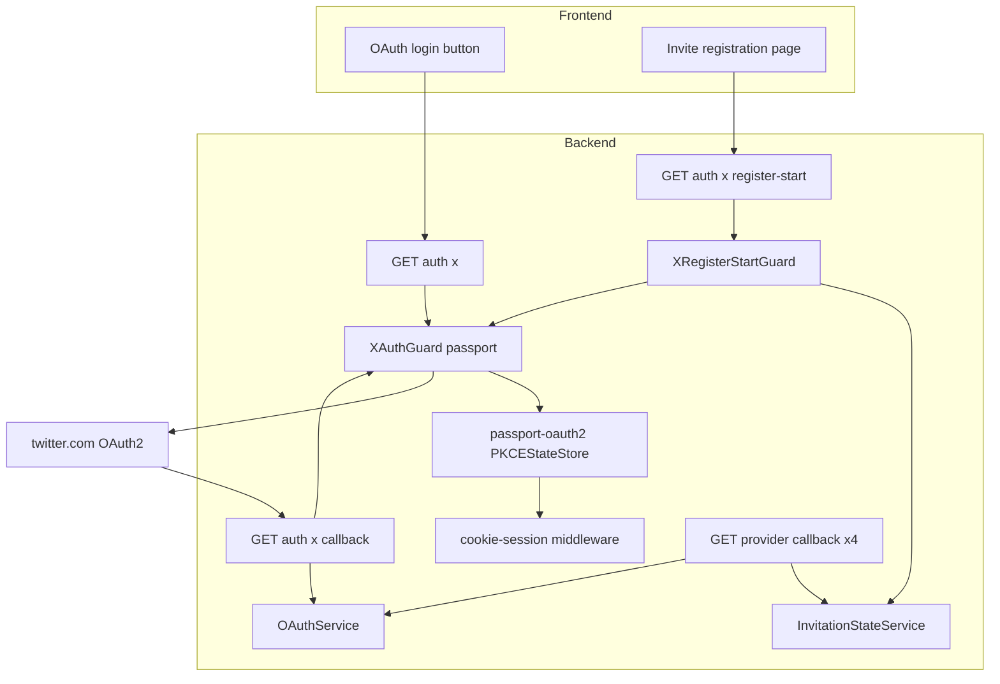
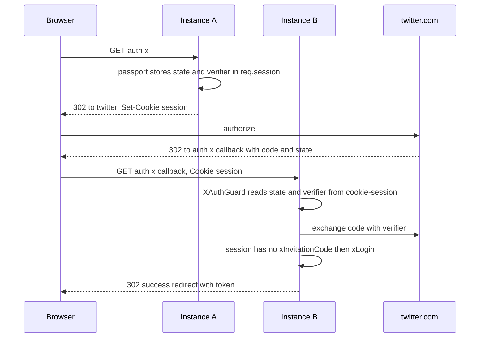
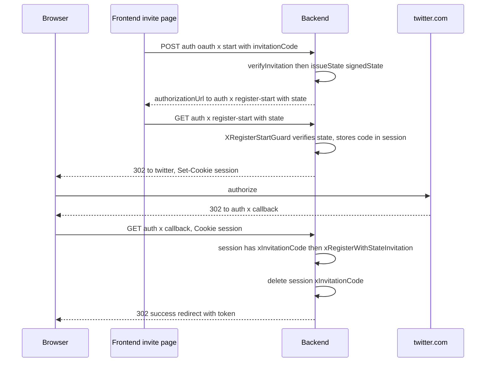

# Technical Design: oauth-session-durability

## Overview

**Purpose**: X OAuth ログインを成立させ、かつログイン開始とコールバックが別々の Cloud Run インスタンスに到達しても確実に成功させる。あわせて express-session のデフォルト MemoryStore（本番非推奨・メモリリーク源）を全インスタンス共有可能な永続化方式へ置換する。

**Users**: X でログイン/招待登録するエンドユーザーと、複数インスタンス本番を運用する運用者。

**Impact**: 現状、X OAuth は**両フロー（既存ログイン／招待登録）とも単一インスタンスでも未成立**（gap-analysis §3.5 発見 A）。本設計は (1) セッションストアを **cookie-session（署名付き Cookie）** へ置換して多インスタンス耐性を確保し、(2) X 経路を **passport 一本化（案 b）** に整理して controller の二重 state 解釈とダミー PKCE start を撤廃する。X 以外の 4 プロバイダ（Google/GitHub/LINE/Apple）の挙動は不変。

### Goals

- express-session MemoryStore を排除し、全インスタンスから参照可能な署名付き Cookie ベースのセッションへ置換する。
- X OAuth の既存ログイン・招待登録の両フローを成立させ、開始とコールバックが別インスタンスでも成功させる。
- controller の「passport ランダム state を招待署名 state と誤認」する設計矛盾を解消する。
- セキュリティ構成（helmet/CORS/cookie-parser/クロスオリジン）と整合し、セッション秘密鍵を env 管理する。

### Non-Goals

- X 以外のプロバイダのフロー変更（ステートレス HMAC 署名 state のまま不変）。
- OAuth を完全 stateless 化する 5 社統一リファクタ（PKCE verifier の署名 state 移植＝案 a。**将来の別 spec**）。
- フロントエンドの招待登録 UI 変更（`{ authorizationUrl }` 契約は不変）。

## Architecture

### Existing Architecture Analysis

- **セッション機構**: `main.ts:42-54` で `express-session` を `store` 未指定（＝MemoryStore）で適用。`trust proxy=1`（`main.ts:76`）、`SESSION_SECRET` は `config.service.ts:114-122` で fail-fast 済。
- **OAuth の 2 系統**:
  - **HMAC 署名 state 系**（Google/GitHub/LINE/Apple、X の start 経路も）: `InvitationStateService.issueState/verifyState` が `state` クエリで往復。**session 非依存・ステートレス**。
  - **passport-oauth2 session 系**（X の `GET /auth/x` のみ）: `x.strategy.ts:34-35` の `pkce:true/state:true` で CSRF state + PKCE verifier を `req.session` に保存。**X だけ passport が state を所有する例外**。
- **維持すべき統合点**: グローバル JWT Guard + `@Public()`、`runOAuthCallbackWithStateSupport`（他 4 社）、`RefreshCookieHelper` 系統、`AuthorizationService` 一元化（本 spec では不変更）。
- **対処する技術的負債**: controller の二重 state 解釈（発見 A Flow A）、ダミー PKCE start（発見 A Flow B）、MemoryStore 依存。

### Architecture Pattern & Boundary Map



**Architecture Integration**:

- **Selected pattern**: ミドルウェア層のストア差し替え（cookie-session）＋ X 専用のルート/ガード境界追加。既存の passport ストラテジ機構は保持し、保存先のみ共有化。
- **Domain/feature boundaries**: 「session 永続化（横断ミドルウェア）」と「X 経路整流化（auth ドメイン）」を分離。他 4 社の callback 経路 `runOAuthCallbackWithStateSupport` には触れない。
- **Existing patterns preserved**: HMAC 署名 state（他 4 社）、`@Public()` オプトアウト、`RefreshCookieHelper`、`trust proxy`、helmet/CORS。
- **New components rationale**: X は passport が state を所有する唯一の例外のため、招待コードを session 往復させる専用開始ルート（`register-start`）と専用ガードが必要。X callback も login/register 分岐のため専用化。
- **Steering compliance**: 「OAuth Strategy 未設定時は警告ログで起動継続」（CLAUDE.md 落とし穴 7）、サーバー状態の真実源泉に関する不変則は本 spec で不変更。

### Technology Stack

| Layer                    | Choice / Version                 | Role in Feature                                     | Notes                                                               |
| ------------------------ | -------------------------------- | --------------------------------------------------- | ------------------------------------------------------------------- |
| Backend / Session        | **cookie-session 2.1.1**（新規） | 署名付き Cookie に session を格納。MemoryStore 置換 | express-session（1.19.0）を撤去。`req.session` API を提供           |
| Backend / Auth           | passport-oauth2 1.8.0（既存）    | X の PKCE/CSRF state 機構（保存先のみ cookie へ）   | `@nestjs/passport` 11.0.5 は `session:false` で `regenerate` 不使用 |
| Backend / Runtime        | Express 5.2.1 / NestJS（既存）   | ミドルウェア適用・ルーティング                      | `trust proxy=1` 維持                                                |
| Infrastructure / Runtime | Cloud Run（複数インスタンス）    | 共有ストア不要で多インスタンス耐性を実現            | Cookie 方式のため外部ストア追加ゼロ                                 |
| Config / Secrets         | `SESSION_SECRET` / `X_CLIENT_*`  | Cookie 署名鍵・X 資格情報                           | `.env.example` の X キー名統一（`X_CONSUMER_*`→`X_CLIENT_*`）       |

> フォールバック候補 connect-pg-simple（Option B）の評価詳細・Express 5 互換ゲートは `research.md`（Topic 1 / Architecture Pattern Evaluation）参照。

## System Flows

### X 既存ログイン（state なし）— 複数インスタンス耐性



別インスタンス（A→B）でも session は Cookie に載るため state/verifier を解決できる（Req 2.2）。callback は passport のランダム state を `verifyState` に渡さず、`xLogin` へ直行（Req 2.3）。

### X 招待登録（session 往復）



招待コードは passport が所有する state クエリに載せられないため **session 経由**で往復（Req 2.4）。callback は session の `xInvitationCode` 有無で register/login を分岐。

## Requirements Traceability

| Requirement | Summary                                          | Components                                         | Interfaces                                                                                  | Flows       |
| ----------- | ------------------------------------------------ | -------------------------------------------------- | ------------------------------------------------------------------------------------------- | ----------- |
| 1.1         | MemoryStore 排除・共有ストア使用                 | Session Middleware                                 | `cookieSession()` 設定                                                                      | 全 X フロー |
| 1.2         | 起動時に永続化バックエンドで session 構成        | Session Middleware                                 | `main.ts` bootstrap                                                                         | —           |
| 1.3         | 本番で MemoryStore 不採用＋未構成検知            | Session Middleware / ConfigService                 | `sessionSecret` getter fail-fast                                                            | —           |
| 1.4         | 別インスタンスから同一 session 値を解決          | Session Middleware                                 | Cookie シリアライズ                                                                         | X ログイン  |
| 1.5         | 他 4 社・session 非依存挙動を不変                | （制約）                                           | `runOAuthCallbackWithStateSupport` 不変                                                     | 回帰テスト  |
| 2.1         | X の state+verifier を共有方式で保存             | Session Middleware / PKCEStateStore                | cookie-session ＋ passport                                                                  | X ログイン  |
| 2.2         | 別インスタンス到達でも state/verifier 解決       | Session Middleware                                 | Cookie                                                                                      | X ログイン  |
| 2.3         | passport state を招待 state と区別し誤拒否しない | X Callback Handler                                 | `xAuthCallback`（query state を verifyState に渡さない）                                    | X ログイン  |
| 2.4         | 招待コードを共有方式で引き継ぎ解決               | XRegisterStartGuard / X Callback Handler           | `req.session.xInvitationCode`                                                               | X 招待登録  |
| 2.5         | state 不一致/欠落で拒否                          | XRegisterStartGuard / ExceptionFilter / XAuthGuard | `verifyState` throw → `InvitationStateInvalidException` → filter redirect / passport reject | X 招待登録  |
| 2.6         | 成立時の識別・JWT・redirect 不変                 | OAuthService                                       | `xLogin` / `xRegisterWithStateInvitation`                                                   | 両 X フロー |
| 2.7         | 未構成時は警告ログ＋構成不備応答                 | XStrategy                                          | 既存 `isConfigured` / `ServiceUnavailableException`                                         | —（回帰）   |
| 3.1         | 本番で secure/httpOnly                           | Session Middleware                                 | `cookieSession()` cookie 属性                                                               | —           |
| 3.2         | sameSite をクロスオリジンと整合                  | Session Middleware                                 | `sameSite:'lax'`（env 上書き可）                                                            | X 両フロー  |
| 3.3         | helmet/CORS/cookie-parser と矛盾しない           | Session Middleware                                 | `main.ts` ミドルウェア順序                                                                  | —           |
| 3.4         | Cookie payload がサイズ上限内                    | Session Middleware                                 | state+verifier+code < 4KB                                                                   | —           |
| 3.5         | Cookie 有効期間が十分かつ過度でない              | Session Middleware                                 | `maxAge` 既定 10 分                                                                         | —           |
| 4.1         | secret を env 取得・ハードコード禁止             | ConfigService                                      | `sessionSecret` getter                                                                      | —（既達）   |
| 4.2         | secret/永続化 env を `.env.example` 記載         | Project Configuration                              | `.env.example` X キー統一                                                                   | —           |
| 4.3         | 本番で secret 未設定なら検知                     | ConfigService                                      | fail-fast throw                                                                             | —（既達）   |
| 4.4         | （pg 採用時）TTL/クリーンアップ                  | —（N/A: Cookie 方式採用）                          | —                                                                                           | —           |
| 4.5         | （pg 採用時）DATABASE_URL/DIRECT_URL 整合        | —（N/A: Cookie 方式採用）                          | —                                                                                           | —           |

> 4.4 / 4.5 は `Where Supabase Postgres ベース…` 条件節。本設計は Cookie 方式採用のため **適用外（N/A）**。Option B フォールバック時のみ有効化（`research.md` 参照）。

## Components and Interfaces

| Component               | Domain/Layer        | Intent                                                    | Req Coverage          | Key Dependencies (P0/P1)                        | Contracts  |
| ----------------------- | ------------------- | --------------------------------------------------------- | --------------------- | ----------------------------------------------- | ---------- |
| Session Middleware      | Runtime / bootstrap | MemoryStore を cookie-session に置換                      | 1.1-1.4, 3.1-3.5      | ConfigService (P0), cookie-session (P0)         | State      |
| XRegisterStartGuard     | Auth                | 招待 signedState を検証し session に code を格納→passport | 2.4, 2.5              | InvitationStateService (P0), XAuthGuard (P0)    | Service    |
| X Callback Handler      | Auth                | session の xInvitationCode で register/login 分岐         | 2.2, 2.3, 2.4, 2.6    | OAuthService (P0), session (P0)                 | API, State |
| OAuth Start (X case)    | Auth                | X start で register-start URL を返す（ダミー PKCE 撤去）  | 2.4                   | InvitationStateService (P0), ConfigService (P1) | API        |
| ConfigService (session) | Config              | sessionSecret fail-fast / X URL 生成・Cookie 属性         | 1.3, 3.1-3.5, 4.1-4.3 | env (P0)                                        | Service    |
| Project Configuration   | Config / ops        | `.env.example` の X キー統一・session env 記載            | 4.2                   | —                                               | —          |

### Runtime / bootstrap

#### Session Middleware

| Field        | Detail                                                |
| ------------ | ----------------------------------------------------- |
| Intent       | express-session(MemoryStore) を cookie-session に置換 |
| Requirements | 1.1, 1.2, 1.3, 1.4, 3.1, 3.2, 3.3, 3.4, 3.5           |

**Responsibilities & Constraints**

- `main.ts` で `express-session(...)` を撤去し `cookieSession(...)` を適用。適用順序は helmet → cookie-parser → cookie-session → CORS を維持（既存順序に session を差し替え）。
- session 本体（passport の state/verifier、X の `xInvitationCode`）を署名付き Cookie に格納。サーバー側ストアを持たない（多インスタンス native）。
- 本番で `secure:true`/`httpOnly:true`、`sameSite:'lax'`、`maxAge` 既定 10 分。MemoryStore へのフォールバックを行わない。

**Dependencies**

- Inbound: passport-oauth2 PKCEStateStore — `req.session` の get/set/delete (P0)
- Inbound: X Callback Handler / XRegisterStartGuard — `req.session.xInvitationCode` (P0)
- Outbound: ConfigService — `sessionSecret`・Cookie 属性 (P0)
- External: cookie-session 2.1.1 — 署名付き Cookie シリアライズ (P0)

**Contracts**: Service [ ] / API [ ] / Event [ ] / Batch [ ] / State [x]

##### State Management

- **State model**: `req.session = { <passport-handle>: { state, codeVerifier }, xInvitationCode?: string }`。
- **Persistence & consistency**: ブラウザ Cookie に署名付きで保存。読み手はリクエストごとに Cookie から復元するため、インスタンス間で共有される（Req 1.4）。
- **Concurrency strategy**: 各 OAuth フローは単一ブラウザ・単一 Cookie に閉じるため競合なし。passport-oauth2 はハンドル鍵で state を分離。

**Implementation Notes**

- Integration: cookie-session の `keys:[configService.sessionSecret]`。`name` は既存 `connect.sid` 互換不要のため任意（例 `mosaku.sid`）。`secure`/`httpOnly`/`sameSite`/`maxAge` を ConfigService 経由で設定（env 上書き可）。
- Validation: 実装フェーズ最初の RED テストで「passport-oauth2 が cookie-session 上で state+verifier を往復」を検証（Express 5 + passport 0.7 ゲート）。NG 時は Option B（connect-pg-simple）へ切替（`research.md` R1）。
- Risks: cookie-session は `req.session.regenerate/save` を実装しないが、本構成（`session:false`・`req.login` 不使用）では呼ばれない（`research.md` 発見 B）。

### Auth

#### XRegisterStartGuard（新規）

| Field        | Detail                                                         |
| ------------ | -------------------------------------------------------------- |
| Intent       | 招待 signedState を検証し session に code を格納後 passport へ |
| Requirements | 2.4, 2.5                                                       |

**Responsibilities & Constraints**

- `GET /auth/x/register-start?state=<signedState>` の `canActivate` で `state` を取得し `InvitationStateService.verifyState(state, 'x')` で検証。
- 検証成功時のみ `req.session.xInvitationCode = payload.code` を格納し、`super.canActivate`（passport `x` authenticate）へ委譲して twitter へリダイレクト。
- 検証失敗（不一致/欠落/TTL 超過）は passport へ進めず拒否（Req 2.5）。`AuthGuard('x')` を継承。

**Dependencies**

- Inbound: `GET /auth/x/register-start` ルート (P0)
- Outbound: InvitationStateService — `verifyState` (P0)
- Outbound: Session Middleware — `req.session` 書き込み (P0)

**Contracts**: Service [x] / API [ ] / Event [ ] / Batch [ ] / State [ ]

##### Service Interface

```typescript
class XRegisterStartGuard extends AuthGuard('x') {
	// canActivate(context): verify signedState -> set req.session.xInvitationCode -> super.canActivate
	canActivate(context: ExecutionContext): boolean | Promise<boolean> | Observable<boolean>;
}
```

- Preconditions: `req.query.state` に有効な HMAC 署名 state（provider='x'、TTL 内）。
- Postconditions: `req.session.xInvitationCode` に招待コードが設定され、passport が twitter へリダイレクト。
- Invariants: 検証失敗時は session に何も書かず、passport へ進めない。

**Implementation Notes**

- Integration（リダイレクト機構・**確定**）: register-start では `super.canActivate`（passport）が twitter へ 302 リダイレクトするため、**コントローラのハンドラ本体は実行されない**。よって `runOAuthCallbackWithStateSupport` のように「ハンドラ catch 内で `res.redirect`」する既存流儀は register-start には適用できない。`verifyState` 失敗時のリダイレクトは次の方式に確定する:
  - guard が検証失敗時に専用例外 **`InvitationStateInvalidException`**（招待コードを保持）を throw。
  - ルート（またはコントローラ）に付与した **`@Catch(InvitationStateInvalidException)` ExceptionFilter** が `configService.generateInvitationStateInvalidUrl(code)` へ `res.redirect` する。
  - guard 内で `res.redirect` を直叩きして `return false` する方式は、Nest が `false` を `ForbiddenException` に変換し二重送出（"headers already sent"）を招くため**不採用**。
  - これにより検証失敗時の UX（invite ページへ `error=invalid_state` 復帰）を既存の HMAC 署名 state 系（他 4 社）と揃える。
- Validation: state の provider が `x` であること、TTL（10 分）内であることを `verifyState` が保証。
- Risks: register-start を踏まず直接 callback に到達した場合は `xInvitationCode` 未設定＝login 分岐になる（誤登録防止）。

#### X Callback Handler

| Field        | Detail                                              |
| ------------ | --------------------------------------------------- |
| Intent       | session の xInvitationCode で register/login を分岐 |
| Requirements | 2.2, 2.3, 2.4, 2.6                                  |

**Responsibilities & Constraints**

- `GET /auth/x/callback`（`XAuthGuard`）。passport が state+verifier を cookie-session から検証済の前提で `req.user` を受領。
- **`runOAuthCallbackWithStateSupport` を経由しない**（passport のランダム state を `verifyState` に渡さない＝発見 A Flow A 解消、Req 2.3）。
- `req.session.xInvitationCode` が存在すれば `xRegisterWithStateInvitation`、無ければ `xLogin` を呼ぶ。register 後は `xInvitationCode` を削除。
- 成立時の JWT 発行・refresh cookie・成功 redirect は既存 `handleOAuthCallback` 流儀を踏襲（Req 2.6）。

**Dependencies**

- Inbound: `GET /auth/x/callback` ルート + XAuthGuard (P0)
- Outbound: OAuthService — `xLogin` / `xRegisterWithStateInvitation` (P0)
- Outbound: Session Middleware — `req.session.xInvitationCode` 読取・削除 (P0)
- Outbound: RefreshCookieHelper / ConfigService — refresh cookie・redirect URL (P1)

**Contracts**: Service [ ] / API [x] / Event [ ] / Batch [ ] / State [x]

##### API Contract

| Method | Endpoint               | Request                          | Response            | Errors                                   |
| ------ | ---------------------- | -------------------------------- | ------------------- | ---------------------------------------- |
| GET    | /auth/x                | （なし）                         | 302 → twitter       | 503（未構成）                            |
| GET    | /auth/x/register-start | `?state=<signedState>`           | 302 → twitter       | 4xx/redirect（state 不正）, 503          |
| GET    | /auth/x/callback       | `?code&state`（passport が処理） | 302 → 成功 redirect | 302 → auth_failed（login/register 失敗） |

##### State Management

- **State model**: `req.session.xInvitationCode?: string`（register-start guard が書き、callback が読んで削除）。
- **Persistence & consistency**: cookie-session の Cookie に格納。passport の state/verifier と同一 Cookie に共存。
- **Concurrency strategy**: 単一ブラウザフローに閉じる。

**Implementation Notes**

- Integration: 既存 `xAuthCallback`（`auth.controller.ts:651-666`）を `runOAuthCallbackWithStateSupport` 呼び出しから専用分岐に変更。他 4 社の callback は不変更（Req 1.5）。
- Validation: `xInvitationCode` 消費後の削除を保証（再利用・誤登録防止、`research.md` R2）。
- Risks: 既存テスト `auth.controller.spec.ts:489-517` は `verifyState` モック成功で実バグを隠蔽。X の login（state なし）/register（session あり）の実挙動テストを追加。

#### OAuth Start（X case）

| Field        | Detail                                                      |
| ------------ | ----------------------------------------------------------- |
| Intent       | X の start で register-start URL を返す（ダミー PKCE 撤去） |
| Requirements | 2.4                                                         |

**Responsibilities & Constraints**

- `POST /auth/oauth/x/start`（`startOAuthRegistration`）は他 4 社と同様に `verifyInvitation` → `issueState` まで実施。
- **X のみ** `authorizationUrl` を twitter 直 URL（ダミー PKCE）でなく **backend の `/auth/x/register-start?state=<signedState>`** として返す。
- `generateOAuthAuthorizationUrl` の X case（`code_challenge:'challenge'/plain`）は撤去/差し替え（発見 A Flow B 解消）。他 4 社の case は不変更。

**Dependencies**

- Outbound: InvitationStateService — `issueState` (P0)
- Outbound: ConfigService — backend URL / `generateXRegisterStartUrl`（新規 or 既存メソッド改修） (P1)

**Contracts**: Service [ ] / API [x] / Event [ ] / Batch [ ] / State [ ]

##### API Contract

| Method | Endpoint            | Request              | Response                                 | Errors   |
| ------ | ------------------- | -------------------- | ---------------------------------------- | -------- |
| POST   | /auth/oauth/x/start | `{ invitationCode }` | `{ authorizationUrl: <register-start> }` | 400, 429 |

**Implementation Notes**

- Integration: frontend は `{ authorizationUrl }` を `window.location` するだけ＝**契約不変・FE 改修不要**（Non-Goals）。
- Validation: 招待コードは `OAuthStartBodyDto`（8-50 英数字）で検証済。
- Risks: ダミー PKCE 撤去で `generateOAuthAuthorizationUrl('x')` 呼び出し側の回帰をテストで担保（`research.md` R3）。

### Config

#### ConfigService（session 関連）/ Project Configuration

| Field        | Detail                                                     |
| ------------ | ---------------------------------------------------------- |
| Intent       | sessionSecret fail-fast・Cookie 属性・X URL 生成・env 記載 |
| Requirements | 1.3, 3.1, 3.2, 3.5, 4.1, 4.2, 4.3                          |

**Responsibilities & Constraints**

- `sessionSecret` getter は未設定で throw（既存維持、Req 1.3/4.1/4.3 既達）。
- Cookie 属性（`secure`/`sameSite`/`maxAge`）を提供。`sameSite`/`secure` は refresh cookie 同様 env 上書き可能にする（実装時に getter 追加）。
- `.env.example` の X キーを `X_CONSUMER_KEY/SECRET` → `X_CLIENT_ID/X_CLIENT_SECRET` に統一（`X_REDIRECT_URI` は既存）。`SESSION_SECRET`（L33）は記載済。

**Implementation Notes**

- Integration: `generateOAuthAuthorizationUrl` の X case 撤去に伴い、X register-start URL 生成を ConfigService へ集約（backend base URL ＋ `/auth/x/register-start?state=`）。
- Validation: 既存 fail-fast テストを維持。
- Risks: env キー統一に伴う本番 env 設定の周知（`X_CONSUMER_*` を参照中の環境があれば移行）。

## Error Handling

### Error Strategy

- **未構成（X 資格情報なし）**: 既存どおり起動時に警告ログ、ログイン要求時 `ServiceUnavailableException`（`x.strategy.ts:38-49`、Req 2.7）。
- **state 検証失敗（招待登録）**: `XRegisterStartGuard` が `InvitationStateInvalidException` を throw → `@Catch` ExceptionFilter が `generateInvitationStateInvalidUrl` へ `res.redirect`（passport へ進めず拒否、Req 2.5）。register-start は passport が先に 302 するためハンドラ catch では拾えず、guard＋filter で整流する（XRegisterStartGuard Implementation Notes 参照）。
- **passport state/verifier 不一致・欠落（callback）**: `XAuthGuard`（passport）が reject → `handleOAuthCallback` の catch で `auth_failed` redirect（Req 2.5）。
- **session secret 未設定（本番）**: `config.service.ts` fail-fast で起動時 throw（Req 1.3/4.3）。

### Error Categories and Responses

- **User Errors (4xx)**: state 不正 → invite ページへ `error=invalid_state`。未構成 → 503。
- **System Errors (5xx)**: session secret 欠落 → 起動失敗（fail-fast）。
- **Business Logic Errors**: 既存ユーザー重複（register）→ 既存 `USER_ALREADY_EXISTS` 経路を維持。

### Monitoring

- 既存の Sentry `oauth_callback_failed` / `invitation_state_invalid` キャプチャを踏襲（`auth.controller.ts:176-187,271-282`）。X 専用 callback でも同等のロギングを維持。

## Testing Strategy

### Unit Tests

- `XRegisterStartGuard.canActivate`: 有効 signedState → `req.session.xInvitationCode` 設定＋passport 委譲／不正・期限切れ → 拒否。
- X Callback Handler: `xInvitationCode` あり → `xRegisterWithStateInvitation`／なし → `xLogin`、消費後削除。
- ConfigService: `sessionSecret` 未設定で throw（回帰）、X register-start URL 生成、Cookie 属性 getter。
- `generateOAuthAuthorizationUrl`: X case 撤去後、他 4 社 URL が不変（回帰）。

### Integration Tests

- **[互換ゲート]** passport-oauth2 × cookie-session（Express 5）: `/auth/x` で state+verifier が Cookie に載り、`/auth/x/callback` で復元・検証が通る round-trip。
- X 既存ログイン（state なし）: callback が `verifyState` を呼ばず `xLogin` に到達（発見 A Flow A 回帰）。
- X 招待登録: start → register-start（session セット）→ callback で `xRegisterWithStateInvitation`（発見 A Flow B 回帰）。
- 他 4 社 callback: `runOAuthCallbackWithStateSupport` 経路が不変（Req 1.5 回帰）。

### E2E/Manual（Cloud Run 実機）

- secure + `SameSite=Lax` の Set-Cookie/送出を `trust proxy` 配下で確認（Req 3.1/3.2）。
- ログイン開始とコールバックが別インスタンスでも X ログイン成功（Req 2.2、複数インスタンス耐性）。

## Security Considerations

- **Cookie 機密性**: cookie-session 既定は署名のみ（非暗号）。PKCE verifier が Cookie バイト列に載るが `httpOnly` で JS 不可読・verifier は自ブラウザ内に留まる値のため実害なし（`research.md` 発見 B）。暗号化（`keys` 複数/暗号オプション）は将来検討、本 spec スコープ外。
- **CSRF**: passport の `state:true` を維持＝CSRF state 検証は継続。`sameSite:'lax'` で cross-site POST には送出されない（X callback は GET top-level navigation のため成立）。
- **秘密鍵管理・全インスタンス同一（不変則）**: `SESSION_SECRET` は env・fail-fast（Req 4.1/4.3）。**cookie-session の署名鍵であるため、全 Cloud Run インスタンスで完全同一の単一値であることが多インスタンス耐性（Req 1.4 / 2.2）の前提**。インスタンスごとに異なる値・自動生成だと、別インスタンスに到達した callback で署名検証が黙って失敗し session が解決できず、durability がサイレントに壊れる。Cloud Run の単一 env 注入で同一値は満たされるが、これを運用上の不変則として固定する。ローテーション時は進行中フロー無効化を許容。

## Migration Strategy

- **段階**: (1) **互換ゲートを最初のタスク（Task 1）として単独実施** — cookie-session 導入＋「passport-oauth2 が cookie-session 上で state+verifier を往復する」RED→GREEN を最速で白黒つける → (2) X 経路整流化（register-start/guard/callback 分岐＋ダミー PKCE 撤去）→ (3) `.env.example` X キー統一。
- **ゲート前倒しの理由**: 採用方式の唯一の load-bearing 仮定（Express 5 × passport 0.7 × cookie-session の round-trip）を実装中盤でなく**起点で**検証し、NG 時の手戻りを最小化する。
- **ロールバックトリガ**: 互換ゲート失敗時は Option B（connect-pg-simple）へ。express-session API を維持するため X 経路変更（段階 2/3）とは独立に差し替え可能。**Option B の最小実装スケッチは `research.md`「Option B フォールバック最小スケッチ」に先置き済**のため、ゲートが落ちても設計フェーズに逆戻りせず継続できる。
- **検証チェックポイント**: 各段階で回帰テスト（他 4 社不変）と X 両フロー成立を確認。
  </content>
