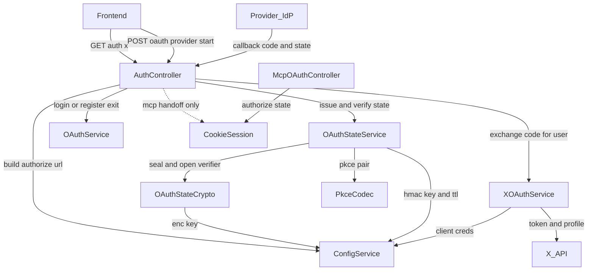
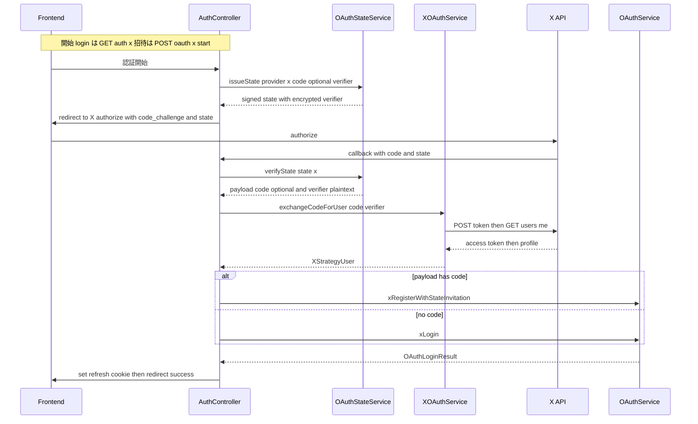
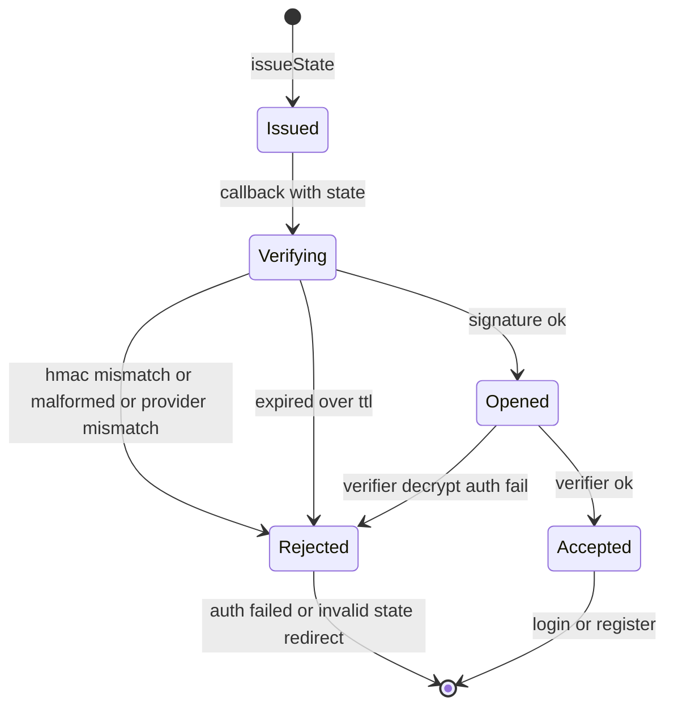
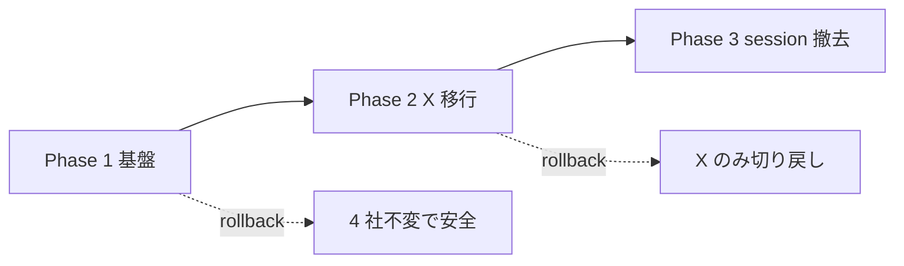

# Technical Design Document: oauth-stateless-unification

## Overview

本機能は OAuth ログイン／招待登録フローを**完全ステートレス化**し、5 プロバイダ（Google / GitHub / LINE / Apple / X）を**単一の署名 state 機構**へ統一する内部リファクタである。中心課題は、現状 X のみが `passport-oauth2` の `state:true / pkce:true` を介して `cookie-session` に CSRF state・PKCE `code_verifier`・招待コードを保存している点を解消し、X を他 4 社と同じ `OAuthStateService` 経由の署名 state 経路へ寄せることにある。

**Purpose**: 保守者・運用者に対し「プロバイダ分岐のない単一 OAuth 経路」と「OAuth ログイン側の session 依存ゼロ」を提供する。**Users**: 本リファクタの裨益者は保守者（将来のプロバイダ追加が 1 パターン化）と運用者（X 固有の cookie-session 依存の運用コスト排除）であり、エンドユーザーから見た認証挙動は不変とする。**Impact**: X を `passport-oauth2` から外して手組みフロー（`XOAuthService`）へ移行し、`InvitationStateService` を AEAD 暗号対応の汎用 `OAuthStateService` へ昇格し、`handleXCallback` を撤去して 5 社共通の finalize へ合流させる。`cookie-session` は MCP 認可フロー専用へ縮退して残置する。

本 spec は `oauth-session-durability`（cookie-session 移行済み・`implementation-validated`）の安定稼働を前提とする。

### Goals

- 5 プロバイダの認証開始・コールバックを、session 非依存の署名 state 単一経路で処理する（X 専用分岐の物理削除）。
- PKCE `code_verifier` を AEAD で暗号化し署名 state に載せて往復させ、X の session 依存を撤去する。
- OAuth ログイン／招待登録の成立条件から `req.session` を排除する（`cookie-session` は MCP 専用へ縮退）。
- リファクタ前後でユーザー識別・JWT 発行・リダイレクト・招待解決の挙動を完全に不変とする。

### Non-Goals

- MCP 認可フロー（`mcp/auth/oauth.controller.ts`）の stateless 化、および `cookie-session` ミドルウェア・`SESSION_*` env の完全撤去（**別 spec**）。
- 4 プロバイダ（Google/GitHub/LINE/Apple）の既存ログイン経路（passport によるトークン交換・profile 取得）の作り替え。本 spec は X を 4 社の機構へ合流させるものであり、4 社側の挙動は変更しない（R5 不変則）。
- 招待特典（無料枠・サブスク期間等）の付与ロジック。
- **login-CSRF のブラウザ束縛ハードニング**（開始時 nonce cookie の double-submit 等で署名 state を開始ブラウザにバインドする保護）。本 spec は X を 4 社と同一の stateless ポスチャへ揃えるに留め、5 社横断の login-CSRF 保護強化は**別 spec（将来）**へ委ねる（根拠は下記 Security Considerations の CSRF 項）。

## Requirements Traceability

| Requirement | Summary                                           | Components                                       | Interfaces                                         | Flows              |
| ----------- | ------------------------------------------------- | ------------------------------------------------ | -------------------------------------------------- | ------------------ |
| 1.1         | 5 社を session 非依存の署名 state 単一経路で処理  | AuthController, OAuthStateService, XOAuthService | `verifyState`, `finalizeOAuthCallback`             | X 統一コールバック |
| 1.2         | X が他 4 社と同一の署名 state 機構を使用          | OAuthStateService, ConfigService                 | `issueState`, `generateOAuthAuthorizationUrl`      | X 開始             |
| 1.3         | コールバックがプロバイダ分岐を持たない            | AuthController                                   | `finalizeOAuthCallback`                            | X 統一コールバック |
| 1.4         | 新プロバイダ追加が 1 パターン                     | OAuthStateService, ConfigService                 | `IssueStateInput`, `generateOAuthAuthorizationUrl` | —                  |
| 1.5         | passport `state:true/pkce:true` 非依存            | 撤去資産（XStrategy/XAuthGuard）                 | —                                                  | —                  |
| 2.1         | PKCE `code_challenge`(S256) を付与                | PkceCodec, ConfigService                         | `generatePkcePair`                                 | X 開始             |
| 2.2         | verifier を暗号化して state へ・session 非保存    | OAuthStateService, OAuthStateCrypto              | `issueState`, `seal`                               | X 開始             |
| 2.3         | コールバックで verifier を復号して使用            | OAuthStateService, XOAuthService                 | `verifyState`, `exchangeCodeForUser`               | X 統一コールバック |
| 2.4         | 復号/検証失敗で認証拒否                           | OAuthStateService, AuthController                | `verifyState`(throw)                               | エラー処理         |
| 2.5         | verifier を平文露出させない（暗号化のみ）         | OAuthStateCrypto                                 | `seal`/`open`                                      | —                  |
| 3.1         | ログイン/招待成立に `req.session` を要さない      | AuthController, XOAuthService                    | `xAuthCallback`                                    | X 統一コールバック |
| 3.2         | コールバックが認証成立に session を読み書きしない | AuthController                                   | `finalizeOAuthCallback`                            | X 統一コールバック |
| 3.3         | X 由来の session 依存資産を残さない               | 撤去資産（x-register-start.\*）                  | —                                                  | —                  |
| 3.4         | MCP ハンドオフは MCP 専用・全社認証が非依存       | AuthController                                   | `handleOAuthCallback`(mcp 温存)                    | MCP ハンドオフ     |
| 3.5         | cookie-session/`SESSION_*` は MCP 専用で明示残置  | main.ts, ConfigService                           | —                                                  | —                  |
| 4.1         | AEAD（改ざん+盗聴防止）で verifier を暗号化       | OAuthStateCrypto                                 | `seal`/`open`                                      | —                  |
| 4.2         | 鍵を env から取得・ハードコード禁止               | ConfigService                                    | `oauthStateEncKey`, `invitationStateSecret`        | —                  |
| 4.3         | 必要 env を `.env.example` に記載                 | ConfigService, .env.example                      | —                                                  | —                  |
| 4.4         | 鍵未設定で起動時に検知                            | ConfigService                                    | fail-fast getter                                   | —                  |
| 4.5         | state に TTL を設け期限切れを拒否                 | OAuthStateService                                | `verifyState`                                      | エラー処理         |
| 5.1         | 認証成立の識別/JWT/redirect を不変                | OAuthService, AuthController                     | `*Login`, `finalizeOAuthCallback`                  | X 統一コールバック |
| 5.2         | 招待コードを state で引き継ぎ解決                 | OAuthStateService, OAuthService                  | `verifyState`, `consumeAndIssue`                   | X 招待登録         |
| 5.3         | state 不一致/欠落/失敗で拒否                      | OAuthStateService, AuthController                | `verifyState`                                      | エラー処理         |
| 5.4         | 未構成プロバイダは警告継続+構成不備応答           | XOAuthService, ConfigService                     | `isConfigured`                                     | —                  |
| 5.5         | durability の X 成立条件を stateless で満たす     | 統合テスト                                       | —                                                  | X 両フロー         |
| 6.1         | helmet/CORS/cookie 構成と矛盾しない               | main.ts                                          | —                                                  | —                  |
| 6.2         | 本番クロスオリジンで全社リダイレクト成立          | AuthController, ConfigService                    | —                                                  | X 両フロー         |
| 6.3         | 5社×(ログイン+招待) の自動テスト                  | Testing Strategy                                 | —                                                  | —                  |
| 6.4         | state/verifier/TTL 拒否経路の自動テスト           | Testing Strategy                                 | —                                                  | エラー処理         |

## Architecture

### Existing Architecture Analysis

`oauth-session-durability` 完了後の現状は二層構造である。

- **4 社（Google/GitHub/LINE/Apple）**: 招待登録は `POST /auth/oauth/:provider/start` → `ConfigService.generateOAuthAuthorizationUrl` が**手組み URL**（署名 state 付き）を返す。コールバックは passport guard が **token 交換 + profile 取得**を行い `req.user` を生成、`AuthController.runOAuthCallbackWithStateSupport` が `state` の有無で招待登録/ログインへ分岐。**session 非依存**。通常ログインは `@Get('/auth/:provider')` の passport redirect（state なし）。
- **X**: `passport-oauth2`（`state:true/pkce:true`）が CSRF state・PKCE verifier を `cookie-session` に保存。招待登録は `@Get('/auth/x/register-start')` で `XRegisterStartGuard` が `xInvitationCode` を session に格納。コールバックは X 専用の `handleXCallback` が session を読む。**session 依存**。さらに `x.strategy.ts` は `userProfile` を override しておらず、X profile 取得は実装上欠落している（research.md Topic 2）。

維持すべき結合点: `AuthController.handleOAuthCallback` は `session.mcpAuthorizeReturn` がある場合のみ `mcpUserId` を注入して MCP authorize へ戻す（MCP 専用ハンドオフ）。`OAuthService` の `*Login` / `*RegisterWithStateInvitation` は認証成立の出口であり**不変**とする。

### Architecture Pattern & Boundary Map

**Selected pattern**: 既存の「手組み authorize URL + 署名 state + 共通 finalize」パターンへ X を合流させる（passport を X から排除）。state の発行/検証は `OAuthStateService` に、verifier の AEAD は `OAuthStateCrypto` に、X の token/profile は `XOAuthService` に責務分離する。



**Architecture Integration**:

- **Domain/feature boundaries**: state 表現（`OAuthStateService`）／暗号（`OAuthStateCrypto`）／PKCE 生成（`PkceCodec`）／X 外部通信（`XOAuthService`）を分離し、各々を独立にユニットテスト可能にする。
- **Existing patterns preserved**: 手組み authorize URL（`generateOAuthAuthorizationUrl`）、署名 state（HMAC + base64url + TTL）、共通コールバック finalize、グローバル JWT Guard + `@Public()`、`apiClient` 経由のフロント呼び出し。
- **New components rationale**: `OAuthStateCrypto`（R4.1 AEAD の SRP 化）、`XOAuthService`（passport 代替・research.md Topic 2/3 より profile fetch が新規必須）、`PkceCodec`（R2.1）。
- **Steering compliance**: `any` 禁止（tech.md）、1 ドメイン 1 モジュール（structure.md）、鍵は env・fail-fast（既存 `invitationStateSecret` 前例）、Sentry タグ契約（`feature_area`）。

### Technology Stack

| Layer                | Choice / Version                             | Role in Feature                   | Notes                                                 |
| -------------------- | -------------------------------------------- | --------------------------------- | ----------------------------------------------------- |
| Backend / Services   | NestJS 11 / TypeScript                       | controller・サービスの DI と契約  | 既存スタック踏襲                                      |
| Crypto               | Node 22 `crypto`（AES-256-GCM, HMAC-SHA256） | verifier の AEAD 封緘・state 署名 | 追加依存なし（research.md Topic 5）                   |
| External Integration | Node 22 組込 `fetch`                         | X token 交換・profile 取得        | `passport-oauth2` を X から排除（新規ライブラリ不要） |
| Session（縮退）      | `cookie-session`                             | **MCP 認可フロー専用**として残置  | OAuth ログインは非依存（R3.5）                        |

> 4 プロバイダの passport ストラテジー（`passport-google-oauth20` 他）は変更しない。`passport-twitter-oauth2`/`passport-oauth2` への X の依存のみ撤去する。

## System Flows

### Flow 1: X 統一コールバック（ログイン / 招待登録の単一経路）



**Key decisions**: verifier は state 内で AEAD 暗号化され、X へは `code_challenge`(S256) のみ送出される（X は verifier 平文を見ない / R2.5）。`finalizeOAuthCallback` は `payload.code` の有無のみで login/register を選び、**プロバイダ分岐を持たない**（R1.3）。session への読み書きは一切ない（R3.1/R3.2）。

### Flow 2: state ライフサイクルと拒否経路



## Components and Interfaces

| Component                        | Domain/Layer | Intent                                            | Req Coverage                           | Key Dependencies (P0/P1)                                      | Contracts      |
| -------------------------------- | ------------ | ------------------------------------------------- | -------------------------------------- | ------------------------------------------------------------- | -------------- |
| OAuthStateService                | auth         | 署名+暗号 state の発行/検証（汎用化）             | 1.2, 1.4, 2.2, 2.3, 2.4, 4.5, 5.2, 5.3 | OAuthStateCrypto (P0), ConfigService (P0)                     | Service, State |
| OAuthStateCrypto                 | auth         | verifier の AEAD 封緘/開封                        | 2.2, 2.5, 4.1                          | ConfigService (P0)                                            | Service        |
| PkceCodec                        | auth (util)  | verifier 生成 + S256 challenge                    | 2.1                                    | —                                                             | Service        |
| XOAuthService                    | auth         | X token 交換 + profile 取得（passport 代替）      | 1.1, 1.5, 2.3, 3.1, 5.4                | ConfigService (P0), X API (P0)                                | Service, API   |
| AuthController（改修）           | auth         | 5 社統一 start + 共通 finalize callback           | 1.1, 1.3, 2.4, 3.2, 3.4, 5.1, 5.3      | OAuthStateService (P0), XOAuthService (P0), OAuthService (P0) | API            |
| ConfigService（改修）            | config       | authorize URL 生成 + 鍵供給                       | 1.2, 2.1, 4.2, 4.3, 4.4, 5.4           | env (P0)                                                      | Service        |
| main.ts / cookie-session（注記） | bootstrap    | session を MCP 専用へ縮退・明示                   | 3.5, 6.1                               | —                                                             | —              |
| 撤去資産                         | auth         | XStrategy / XAuthGuard / x-register-start.\* 削除 | 1.5, 3.3                               | —                                                             | —              |

### auth ドメイン

#### OAuthStateService

| Field        | Detail                                                                          |
| ------------ | ------------------------------------------------------------------------------- |
| Intent       | 署名（HMAC）+ verifier 暗号化（AEAD）+ TTL を備えた汎用 OAuth state の発行/検証 |
| Requirements | 1.2, 1.4, 2.2, 2.3, 2.4, 4.5, 5.2, 5.3                                          |

**Responsibilities & Constraints**

- `code`（招待コード, 任意）・`verifier`（PKCE, 任意）・`provider`・`nonce`・`iat` を 1 つの署名 state に符号化／復号する。
- `verifier` を渡された場合のみ `OAuthStateCrypto.seal` で暗号化して `ev` フィールドに格納する。verifyState 時は `ev` を `open` して平文 `verifier` を payload に復元する。
- HMAC 署名検証（timing-safe）→ provider 一致 → TTL（既定 10 分）の順に検証し、いずれか失敗で例外を投げる（R2.4/4.5/5.3）。
- `InvitationStateService` を本サービスへ昇格・改名する（`oauth-state.service.ts`）。既存の base64url + HMAC + TTL ロジックを再利用し、`code` 必須前提を任意へ緩和する。

**Dependencies**

- Inbound: AuthController — state 発行/検証 (P0)
- Outbound: OAuthStateCrypto — verifier の seal/open (P0)
- Outbound: ConfigService — `invitationStateSecret`（HMAC 鍵）(P0)

**Contracts**: Service [x] / State [x]

##### Service Interface

```typescript
export interface OAuthStatePayload {
	readonly v: 1;
	readonly provider: OAuthProvider;
	readonly code?: string; // 招待登録時のみ。ログインでは欠落
	readonly verifier?: string; // verifyState 戻り値でのみ平文（state 上は ev に暗号化）
	readonly nonce: string;
	readonly iat: number; // epoch ms
}

export interface IssueStateInput {
	readonly provider: OAuthProvider;
	readonly code?: string;
	readonly verifier?: string; // 平文を渡すと内部で AEAD 封緘
}

export interface OAuthStateService {
	issueState(input: IssueStateInput): string;
	verifyState(signedState: string, expectedProvider: OAuthProvider): OAuthStatePayload;
}
```

- Preconditions: `issueState` の `provider` は対応プロバイダ。`verifier` は base64url（PkceCodec 生成）。
- Postconditions: 返却 state は `<base64url(payload)>.<base64url(hmac)>` 形式。`verifyState` 成功時のみ `verifier` が平文で復元される。
- Invariants: `ev` 以外の payload フィールドは署名付き平文。`verifier` は state 上で常に暗号化（R2.5）。X 用 state は 500 文字以内（research.md Topic 4）。

**Implementation Notes**

- Integration: 招待コード抽出ヘルパー（無効 state 時に invite ページへ誘導するための best-effort 復号）は署名検証前の base64url デコードのみ行い、既存挙動を維持する。短キー化に伴い `c`（新）と `code`（旧）の**両キーを読む**。
- Validation: payload 型ガードを `code` 任意・`v===1`・`ev` 任意へ更新。**移行互換**として、旧長キー payload（`{code,provider,nonce,iat}`、`v`/`ev` なし）も `verifyState` で受理する（1 リリース限定。デプロイ跨ぎの飛行中 state 救済 / Migration Strategy 参照）。
- Risks: 短キー JSON（`{v,p,c,n,t,ev}`）採用で X の 500 文字制限を死守。

#### OAuthStateCrypto

| Field        | Detail                                         |
| ------------ | ---------------------------------------------- |
| Intent       | PKCE verifier の AES-256-GCM 封緘/開封（AEAD） |
| Requirements | 2.2, 2.5, 4.1                                  |

**Responsibilities & Constraints**

- `seal(plaintext)` は 12 byte ランダム IV を生成し、`iv || ciphertext || authTag(16)` を base64url で返す。
- `open(sealed)` は IV/tag を分離し復号する。auth tag 不一致（改ざん）時は例外を投げる（R2.4）。
- 鍵は `ConfigService.oauthStateEncKey`（32 byte）。IV は毎回ランダムで鍵との再利用を禁止する。

**Dependencies**

- Inbound: OAuthStateService — verifier の seal/open (P0)
- Outbound: ConfigService — `oauthStateEncKey` (P0)

**Contracts**: Service [x]

##### Service Interface

```typescript
export interface OAuthStateCrypto {
	seal(plaintext: string): string; // base64url(iv | ciphertext | tag), AES-256-GCM
	open(sealed: string): string; // tag 不一致で throw
}
```

- Preconditions: `oauthStateEncKey` が 32 byte で構成済み。
- Postconditions: `open(seal(x)) === x`。改ざん/鍵不一致では throw。
- Invariants: AEAD により機密性と完全性を同時に保証（R4.1）。

#### PkceCodec

| Field        | Detail                                                  |
| ------------ | ------------------------------------------------------- |
| Intent       | PKCE `code_verifier` 生成と `code_challenge`(S256) 算出 |
| Requirements | 2.1                                                     |

**Contracts**: Service [x]

##### Service Interface

```typescript
export interface PkcePair {
	readonly verifier: string; // base64url(randomBytes(32)) = 43 文字
	readonly challenge: string; // base64url(sha256(verifier))
}

export function generatePkcePair(): PkcePair;
```

- Postconditions: `challenge === base64url(sha256(verifier))`。verifier 長は RFC 7636 準拠（43–128）かつ state 長最小化のため 43 文字固定。

#### XOAuthService

| Field        | Detail                                                   |
| ------------ | -------------------------------------------------------- |
| Intent       | X の token 交換と profile 取得（`passport-oauth2` 代替） |
| Requirements | 1.1, 1.5, 2.3, 3.1, 5.4                                  |

**Responsibilities & Constraints**

- `code` + 復号済み `verifier` を用い、X token エンドポイントへ confidential client として token 交換し、profile を取得して `XStrategyUser` を返す。
- session に一切触れない（R3.1）。失敗（token/profile の非 2xx・ネットワーク）は例外を投げ、controller が `auth_failed` へ落とす。
- 未構成（client id/secret 空）時は `isConfigured()` が false。起動時に警告ログ、認証要求時は構成不備として扱う（R5.4）。

**Dependencies**

- Inbound: AuthController — `exchangeCodeForUser` (P0)
- Outbound: ConfigService — `xClientId/xClientSecret/xRedirectUri` (P0)
- External: X API — token + users/me (P0)

**Contracts**: Service [x] / API [x]

##### Service Interface

```typescript
export interface XOAuthService {
	isConfigured(): boolean;
	exchangeCodeForUser(input: { code: string; verifier: string }): Promise<XStrategyUser>;
}
```

##### API Contract（External: X）

| Method | Endpoint                                                         | Request                                                                                                            | Response                                              | Errors          |
| ------ | ---------------------------------------------------------------- | ------------------------------------------------------------------------------------------------------------------ | ----------------------------------------------------- | --------------- |
| POST   | https://api.twitter.com/2/oauth2/token                           | `Authorization: Basic base64(id:secret)`; form: `grant_type=authorization_code, code, redirect_uri, code_verifier` | `{ access_token }`                                    | 4xx/5xx → throw |
| GET    | https://api.twitter.com/2/users/me?user.fields=profile_image_url | `Authorization: Bearer <access_token>`                                                                             | `{ data: { id, name, username, profile_image_url } }` | 4xx/5xx → throw |

- Preconditions: `verifier` は当該フローの `code_challenge` に対応。
- Postconditions: `XStrategyUser{ xId, name, username?, picture?, accessToken }` を返す。`email` は X からは取得せず `undefined`（既存挙動と一致 / R5.1）。
- Invariants: token/profile の host・scope（`tweet.read users.read`）は既存 `x.strategy.ts` 定数を踏襲。

**Implementation Notes**

- Integration: 認可 URL の組み立ては `ConfigService.generateOAuthAuthorizationUrl('x', state, challenge)` に集約（5 社で同一の生成口）。
- Validation: profile レスポンスの `data.id` 欠落を異常として扱う。
- Risks: 本番クロスオリジンの `X_REDIRECT_URI` 一致確認（既存 callback URL を維持）。

#### AuthController（改修）

| Field        | Detail                                                                            |
| ------------ | --------------------------------------------------------------------------------- |
| Intent       | 5 社統一の開始エンドポイントと、プロバイダ分岐を持たない共通コールバック finalize |
| Requirements | 1.1, 1.3, 2.4, 3.2, 3.4, 5.1, 5.3                                                 |

**Responsibilities & Constraints**

- `POST /auth/oauth/:provider/start`: 全 5 社で `verifyInvitation(code)` 後に state を発行。X は `generatePkcePair()` → `issueState({provider:'x', code, verifier})` → `generateOAuthAuthorizationUrl('x', state, challenge)`。4 社は従来どおり `issueState({provider, code})` → `generateOAuthAuthorizationUrl(provider, state)`。返却 `{authorizationUrl}` の契約は不変（フロント無変更 / R5/R6.2）。
- `GET /auth/x`（X 通常ログイン）: passport guard を廃し、`generatePkcePair()` → `issueState({provider:'x', verifier})`（code なし）→ X authorize URL へ 302。
- `GET /auth/x/callback`: guard を廃し、`verifyState(state, 'x')` → `XOAuthService.exchangeCodeForUser` → `finalizeOAuthCallback`。
- `finalizeOAuthCallback`（新設・共通）: `payload?.code` の有無で register/login を選び、refresh cookie 設定・MCP ハンドオフ・成功 redirect を行う。**プロバイダ分岐なし**（R1.3）。`runOAuthCallbackWithStateSupport`（4 社）と X コールバックの双方が本メソッドへ合流。
- MCP ハンドオフ（`handleOAuthCallback` 内の `mcpAuthorizeReturn`/`mcpUserId`）は不変で温存。X はこの session 書き込みに依存しない（R3.4）。

**Dependencies**

- Outbound: OAuthStateService (P0), XOAuthService (P0), OAuthService (P0), ConfigService (P0), RefreshCookieHelper (P0)

**Contracts**: API [x]

##### API Contract

| Method | Endpoint                    | Request              | Response                                    | Errors                 |
| ------ | --------------------------- | -------------------- | ------------------------------------------- | ---------------------- |
| POST   | /auth/oauth/:provider/start | `{ invitationCode }` | `{ authorizationUrl }`                      | 400 invalid invitation |
| GET    | /auth/x                     | —                    | 302 → X authorize                           | 503 未構成             |
| GET    | /auth/x/callback            | `?code&state`        | 302 → success / auth_failed / invalid_state | —                      |

**Implementation Notes**

- Integration: 4 社のコールバック（`runOAuthCallbackWithStateSupport`）は state を req から取り出し `verifyState`（verifier なし）→ `finalizeOAuthCallback`。X はコールバック内で `verifyState`（verifier あり）+ token/profile を経て `finalizeOAuthCallback`。
- Validation: X コールバックで state 欠落は `auth_failed`。`verifyState` 失敗は invite ページ（`generateInvitationStateInvalidUrl`、code 復号可能時）または `auth_failed`。
- Risks: `runOAuthCallbackWithStateSupport` のリファクタで 4 社の挙動を変えない（回帰テストで固定 / R6.3）。

#### ConfigService（改修）

| Field        | Detail                                       |
| ------------ | -------------------------------------------- |
| Intent       | 5 社の authorize URL 生成と署名/暗号鍵の供給 |
| Requirements | 1.2, 2.1, 4.2, 4.3, 4.4, 5.4                 |

**Responsibilities & Constraints**

- `oauthStateEncKey: Buffer` を新設。`OAUTH_STATE_ENC_KEY`（hex 64 字 = 32 byte）を decode・長さ検証し、未設定/不正は fail-fast（R4.4）。`invitationStateSecret`（HMAC 鍵）とは分離（R4.2）。
- `generateOAuthAuthorizationUrl(provider, state, codeChallenge?)`: `case 'x'` を実装（`response_type=code`, `scope=tweet.read users.read`, `code_challenge`, `code_challenge_method=S256`, `state`）。従来の例外送出を撤去。
- `generateXRegisterStartUrl` を撤去。`sessionSecret`/`sessionCookieOptions` は MCP 専用注記を付して残置（R3.5）。

**Contracts**: Service [x]

```typescript
// 追加
get oauthStateEncKey(): Buffer; // 32 byte, fail-fast
generateOAuthAuthorizationUrl(provider: OAuthProvider, state: string, codeChallenge?: string): string;
// 撤去: generateXRegisterStartUrl(signedState: string): string
```

### bootstrap

#### main.ts / cookie-session（注記のみ）

- `cookie-session` ミドルウェアと適用順序（helmet → cookie-parser → cookie-session → CORS）は不変（R6.1）。コメントを「**MCP 認可フロー専用**」へ更新し、OAuth ログインが非依存である旨を明示する（R3.5）。helmet/CSP・CORS（`credentials:true`）・Refresh Cookie 系統は変更しない。

#### 撤去資産（Summary-only）

`x.strategy.ts` / `x.strategy.spec.ts` / `XAuthGuard`（`oauth-auth.guards.ts` から削除）/ `x-register-start.guard.ts`（+spec）/ `x-register-start.exception.ts` / `x-register-start.filter.ts` / `x-cookie-session-gate.spec.ts` を撤去し、`auth.module.ts` の providers/exports を更新する。`auth.x-flow.integration.spec.ts` は stateless X 用に再構成する（R1.5/R3.3）。

## Data Models

### 署名 state（論理 → on-wire）

論理ペイロード `OAuthStatePayload` を、X の 500 文字制限（research.md Topic 4）に収めるため短キー JSON へ符号化する。

| 論理     | on-wire key | 内容                    | 備考                     |
| -------- | ----------- | ----------------------- | ------------------------ |
| v        | `v`         | スキーマ版（=1）        | 将来移行用               |
| provider | `p`         | プロバイダ識別子        | 検証で一致確認           |
| code     | `c`         | 招待コード（任意）      | 署名付き平文（秘匿不要） |
| verifier | `ev`        | 暗号化 verifier（任意） | AEAD 封緘（R2.5）        |
| nonce    | `n`         | ランダム nonce          | 一意性/リプレイ低減      |
| iat      | `t`         | 発行 epoch ms           | TTL 判定（R4.5）         |

- **wire 形式**: `base64url(payloadJson) + "." + base64url(HMAC_SHA256(base64url(payloadJson)))`。HMAC 鍵 = `INVITATION_STATE_SECRET`。
- **暗号化 verifier エンベロープ**: `ev = base64url(iv[12] || ciphertext || authTag[16])`、AES-256-GCM、鍵 = `OAUTH_STATE_ENC_KEY`。

### X state 長予算（≤ 500）

| 要素                                                | 概算            |
| --------------------------------------------------- | --------------- |
| verifier 32 byte → base64url                        | 43              |
| AEAD 封緘（iv12+ct+tag16=71 byte）→ base64url（ev） | ≈ 95            |
| 短キー JSON（c≤50, n, t, p, v, ev 含む）            | ≈ 250           |
| base64url(payloadJson)                              | ≈ 333           |
| `.` + base64url(HMAC-SHA256)                        | 1 + 43          |
| **合計**                                            | **≈ 377 < 500** |

### 環境変数

| Key                                   | 用途                                        | 必須         | 検証                                |
| ------------------------------------- | ------------------------------------------- | ------------ | ----------------------------------- |
| `OAUTH_STATE_ENC_KEY`                 | verifier AEAD 暗号鍵（hex 64 字 / 32 byte） | 必須（新規） | 未設定/長さ不正で fail-fast（R4.4） |
| `INVITATION_STATE_SECRET`             | state HMAC 署名鍵（既存）                   | 必須         | 既存 fail-fast                      |
| `SESSION_SECRET` / `SESSION_COOKIE_*` | **MCP 専用**で残置（既存）                  | 必須         | 既存                                |

## Error Handling

### Error Strategy

state 検証と verifier 復号は fail-fast とし、いかなる失敗もログイン成立へフォールスルーさせない（R2.4/5.3）。失敗は redirect で完結し、ユーザーへエラーを示す。

### Error Categories and Responses

| 失敗                                     | 区分            | 応答                                          | Req |
| ---------------------------------------- | --------------- | --------------------------------------------- | --- |
| state 欠落（X callback）                 | User (4xx 相当) | `auth_failed` redirect                        | 5.3 |
| HMAC 不一致 / 不正形式 / provider 不一致 | User            | invite ページ（code 復号可時）/ `auth_failed` | 5.3 |
| state TTL 超過                           | User            | invite ページ / `auth_failed`                 | 4.5 |
| verifier 復号（AEAD）失敗                | Security        | `auth_failed`（成立させない）                 | 2.4 |
| X token/profile 非 2xx                   | System          | `auth_failed`                                 | 5.4 |
| プロバイダ未構成                         | Business (503)  | 構成不備応答 / 起動時警告継続                 | 5.4 |

### Monitoring

既存パターンを踏襲し、`Sentry.captureMessage` に `feature_area: 'invitation' | 'auth'` と失敗コードを付与する。PII は付与しない（既存スクラバ / `setUser` は id のみ）。招待コードは redirect path にのみ載せ、イベント本文には含めない。

## Testing Strategy

### Unit Tests

- `OAuthStateCrypto`: `open(seal(x))===x`、改ざん（tag 破壊）で throw、鍵不一致で throw。
- `OAuthStateService`: code あり/なし・verifier あり/なしの issue/verify 往復、TTL 超過拒否、provider 不一致拒否、HMAC 改ざん拒否、X state が 500 文字以内。
- `PkceCodec`: `challenge === base64url(sha256(verifier))`、verifier 長 43。
- `XOAuthService`: `fetch` mock で token→profile→`XStrategyUser` マッピング、token 4xx / profile 4xx で throw、未構成で `isConfigured()===false`。
- `ConfigService`: `oauthStateEncKey` の長さ検証 fail-fast、`generateOAuthAuthorizationUrl('x', …)` に `code_challenge`/`code_challenge_method=S256` が載る。

### Integration Tests

- 5 社 × (ログイン / 招待登録) のコールバック routing（R6.3）。X ログイン（code なし → `xLogin`）/ X 招待（code あり → `xRegisterWithStateInvitation`）。
- 拒否経路（R6.4）: 不正 state / verifier 復号失敗 / TTL 超過 がいずれも認証拒否で終わる。
- MCP ハンドオフ不変: `mcpAuthorizeReturn` ありで `mcpUserId` 注入が温存され、X 認証成立が session 書き込みに依存しない（R3.4）。
- 4 社回帰: `runOAuthCallbackWithStateSupport` の state 経路が従来どおり（R5）。

### E2E / 手動検証

- 本番クロスオリジン（mosaku.jp ↔ api.mosaku.jp）で X を含む 5 社のリダイレクト成立を確認（R6.2）。

## Security Considerations

- **AEAD（AES-256-GCM）**で verifier の機密性+完全性を担保（R4.1）。verifier は state 上で平文露出しない（R2.5）。X へは `code_challenge`(S256) のみ送出し PKCE を維持。
- **鍵分離**: HMAC 鍵（`INVITATION_STATE_SECRET`）と暗号鍵（`OAUTH_STATE_ENC_KEY`）を用途分離（R4.2）。両鍵とも未設定で fail-fast（R4.4）。
- **CSRF（意図的トレードオフ・要人間承認）**: 署名 state は **HMAC による偽造・改ざん防止**と **provider バインド + TTL ≤10 分のリプレイ窓限定**（R4.5）を担保する。ただし session を撤去するため state を**開始ブラウザにはバインドしない**。よって「攻撃者が自分の正規 state + 自分の認可 code を victim のブラウザへ注入し攻撃者アカウントでログインさせる」**login-CSRF** は署名 state だけでは防げない（攻撃者が自分の verifier を握るため PKCE も無効）。これは X を既存 4 社（招待=未バインド署名 state / 通常ログイン=state なし）と**同一ポスチャへ揃える意図的トレードオフ**であり、R3（session 撤去）の要請として明示的に受容する。5 社横断の login-CSRF ハードニング（開始時 nonce cookie の double-submit 等）は **別 spec（将来）** へ切り出す（Non-Goals 参照）。
- **session 撤去**: OAuth ログイン側の `req.session` 依存を排除（R3.1–3.3）。`cookie-session` は MCP 専用へ縮退（R3.5）。helmet/CORS/Refresh Cookie 構成は不変（R6.1）。

## Migration Strategy



- **Phase 1 基盤**: `OAuthStateCrypto` 追加、`InvitationStateService`→`OAuthStateService` 昇格（code/verifier 任意化）、`ConfigService.oauthStateEncKey`/`generateOAuthAuthorizationUrl('x')`、`.env.example` 追記、`PkceCodec`。挙動変更なし（4 社不変）。**wire 後方互換**: `verifyState` は新短キー payload（`{v,p,c?,n,t,ev?}`）の parse 失敗時に旧長キー payload（`{code,provider,nonce,iat}`）も受理し、ローリングデプロイ中に旧 revision 発行済みの「飛行中」state を失効でなく成立させる（1 リリース限定。`tryExtractInvitationCodeFromState` も `c`/`code` 両読み）。後方互換コードは本番 1 リリース安定後の cleanup フォローアップで除去する。
- **Phase 2 X 移行**: `XOAuthService` 追加、`GET /auth/x`・`GET /auth/x/callback` を手組みへ、`POST /auth/oauth/x/start` の X 分岐を統一生成口へ。`finalizeOAuthCallback` 共通化。
- **Phase 3 session 撤去**: `x.strategy`/`XAuthGuard`/`x-register-start.*`/関連 spec を撤去、`main.ts` の cookie-session コメントを MCP 専用へ更新、`auth.x-flow.integration.spec.ts` を stateless 用に再構成。
- **Rollback triggers**: 本番 X リダイレクト失敗・5 社テスト退行時。短キー化で wire フォーマットが変わるため進行中 state は TTL 失効だけでは救えない（旧長キー state は新型ガードで弾かれる）。Phase 1 の後方互換 parse で飛行中 state を吸収するため、ロールフォワード時もログイン中ユーザーは継続できる。後方互換コードの除去は本番安定後の cleanup フォローアップで行う。

## Supporting References

- 署名/暗号 state の wire 形式・長予算: 本書 Data Models 節。
- passport-oauth2 StateStore/PKCE 内部契約、X API 契約、state 500 文字制限、AEAD 選定の証跡: `research.md`（Topics 1, 3, 4, 5）。
- 採否判断（Option A vs B）の根拠: `research.md` Design Decisions / `gap-analysis.md`。
