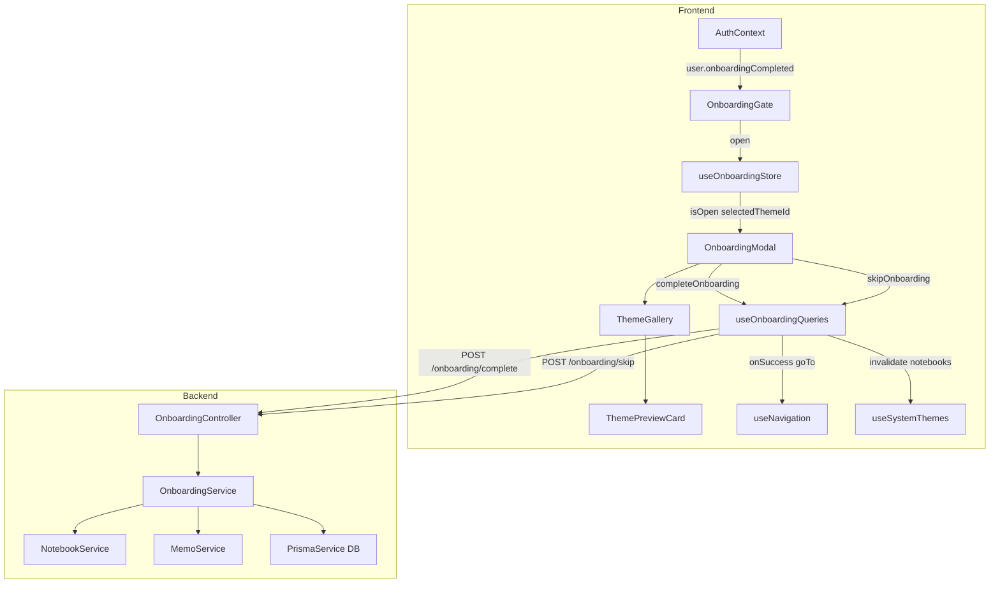
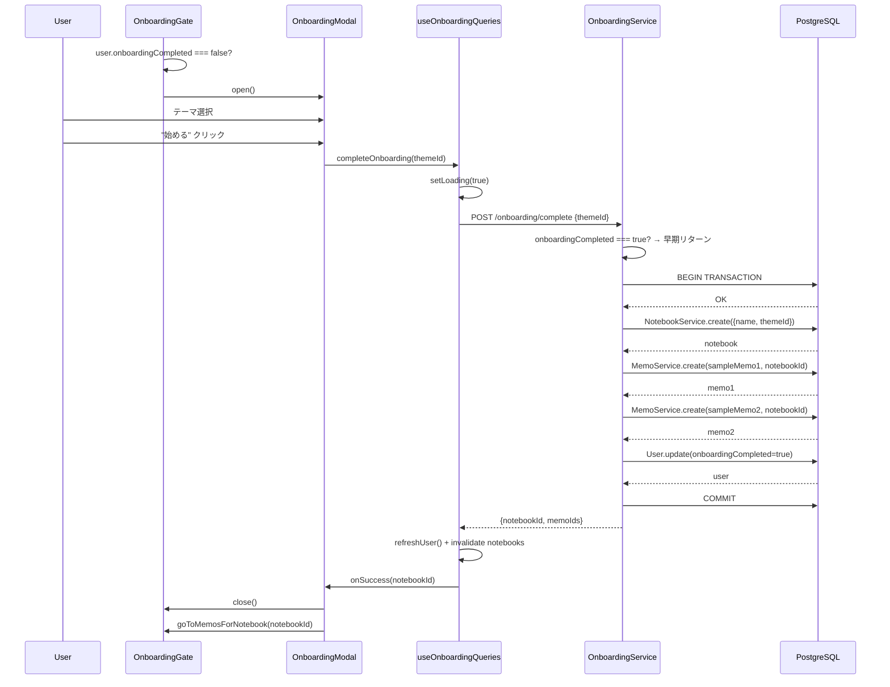
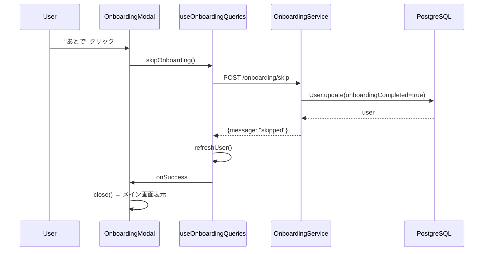

# Technical Design: onboarding-experience（リッチ・オンボーディング体験）

## Overview

本機能は、初回ログインしたユーザーを「メモがありません」の空状態に放り出す現状から、mosaku の差別化軸（テーマの美しさ・ノートブック・リッチエディタ）を初回体験として届けるオンボーディングフローを提供する。

ユーザーが選んだテーマでノートブックを作成し、サンプルメモとともに用意することで、「うわ綺麗！→ お、すぐ書ける」という優先順を実現する。オンボーディングは初回のみ表示し、完了・スキップ後は DB に永続化して再表示しない。

### Goals

- 初回ログイン後のテーマ選択 → ようこそノートブック自動作成 → メイン画面へのスムーズな遷移を実現する
- オンボーディングの完了状態を `User` モデルで DB 永続化し、端末をまたいで一度だけ表示を保証する
- 既存の notebook / memo / theme / auth アーキテクチャを拡張し、新概念（アプリ共通テーマ等）を持ち込まない

### Non-Goals

- アプリ全体共通テーマの概念は新設しない（テーマはノートブック単位の既存設計を維持）
- オンボーディングのステップ数を 2 以上に拡張する（現フェーズはテーマ選択の 1 ステップ）
- チュートリアル動画・インタラクティブツアー等のリッチな案内機能

---

## Requirements Traceability

| Requirement | Summary                                          | Components                     | Interfaces                                       | Flows                    |
| ----------- | ------------------------------------------------ | ------------------------------ | ------------------------------------------------ | ------------------------ |
| 1.1         | 未完了ユーザーにオンボーディング自動起動         | OnboardingGate                 | `user.onboardingCompleted`                       | Login → Gate → Modal     |
| 1.2         | 完了済みは表示しない                             | OnboardingGate                 | `user.onboardingCompleted`                       | Gate early return        |
| 1.3         | 完了/スキップ時に状態永続化                      | OnboardingService              | POST /onboarding/complete, POST /onboarding/skip | Complete / Skip flow     |
| 1.4         | 再ログイン時も再表示しない                       | User.onboardingCompleted DB    | GET /auth/me                                     | Auth initialization      |
| 1.5         | 認証/ログアウト操作を妨げない                    | OnboardingModal                | —                                                | Modal overlay            |
| 2.1         | テーマギャラリー一覧表示                         | ThemeGallery                   | `useSystemThemes()`                              | Gallery render           |
| 2.2         | テーマ選択時プレビュー反映                       | ThemePreviewCard               | `selectedThemeId` state                          | Card select              |
| 2.3         | 初期選択なし                                     | useOnboardingStore             | `selectedThemeId: null`                          | Store init               |
| 2.4         | 未選択で次へ進めない                             | OnboardingModal                | `selectedThemeId` guard                          | "始める" disabled        |
| 2.5         | スキップ動線（控えめ）                           | OnboardingModal                | —                                                | Skip link                |
| 2.6         | モバイル対応レイアウト                           | ThemeGallery                   | —                                                | Tailwind responsive grid |
| 2.7         | prefers-reduced-motion 対応                      | ThemePreviewCard               | CSS media query                                  | Card animation           |
| 3.1         | スキップ → メイン画面遷移                        | OnboardingModal                | POST /onboarding/skip                            | Skip flow                |
| 3.2         | スキップ時ノートブック・メモ作成しない           | OnboardingService.skip()       | POST /onboarding/skip                            | Skip flow                |
| 3.3         | スキップ時に完了状態永続化                       | OnboardingService.skip()       | User.onboardingCompleted                         | Skip flow                |
| 4.1         | ようこそノートブック作成                         | OnboardingService              | NotebookService.create()                         | Complete flow            |
| 4.2         | 選択テーマをノートブックに適用                   | OnboardingService              | CreateNotebookDto.themeId                        | Complete flow            |
| 4.3         | 完了後ようこそノートブックを選択状態で表示       | useOnboardingQueries.onSuccess | goToMemosForNotebook                             | Complete flow            |
| 4.4         | ようこそノートブックを通常操作可能               | OnboardingService              | Notebook（通常モデル）                           | —                        |
| 4.5         | 既存 apiClient 経由、アプリ全体テーマ概念なし    | useOnboardingQueries           | apiClient                                        | Architecture compliance  |
| 5.1         | サンプルメモ 1〜2 枚作成                         | OnboardingService              | MemoService.create()                             | Complete flow            |
| 5.2         | サンプルメモに各種エディタ要素を含める           | SAMPLE_MEMO_CONTENT 定数       | —                                                | Content seeding          |
| 5.3         | 日常利用を想起させる実例コンテンツ               | SAMPLE_MEMO_CONTENT 定数       | —                                                | Content seeding          |
| 5.4         | サンプルメモに選択テーマ適用                     | OnboardingService              | notebookId 経由で自動適用                        | —                        |
| 5.5         | サンプルメモを通常操作可能                       | OnboardingService              | Memo（通常モデル）                               | —                        |
| 6.1         | 完了済みユーザーへ重複作成しない                 | OnboardingService              | onboardingCompleted guard                        | Idempotency              |
| 6.2         | 中断再試行時の重複防止                           | OnboardingService              | Prisma Transaction                               | Idempotency              |
| 6.3         | 作成中のローディング表示                         | useOnboardingStore.isLoading   | `isPending` state                                | Complete flow            |
| 7.1         | 作成失敗時のエラー通知 + メイン画面到達可能      | useOnboardingQueries.onError   | ErrorBoundary / toast                            | Error flow               |
| 7.2         | テーマ適用失敗時は既定表示                       | OnboardingService              | try-catch in transaction                         | Error flow               |
| 7.3         | 完了状態永続化失敗時でもアプリ利用可能           | useOnboardingQueries.onError   | graceful degrade                                 | Error flow               |
| 8.1         | サーバー状態は React Query、Zustand に複製しない | useOnboardingQueries           | React Query mutations                            | Architecture compliance  |
| 8.2         | UI 状態は Zustand で管理                         | useOnboardingStore             | Zustand store                                    | Architecture compliance  |
| 8.3         | API コールは apiClient 経由                      | useOnboardingQueries           | apiClient                                        | Architecture compliance  |

---

## Architecture

### Existing Architecture Analysis

- **テーマはノートブック単位で適用**（`useActiveTheme.ts`）。アプリ全体共通テーマは存在せず、本機能もこの設計を踏襲する
- **サーバー状態は React Query**。`useNotebookQueries` / `useThemeQueries` の既存フックパターンを再利用する
- **UI 状態は Zustand**。`useMemoDataStore` / `useViewStore` のパターンに倣い `useOnboardingStore` を新設する
- **`User` モデルに `onboardingCompleted` フィールドが存在しない**。DB マイグレーションが必要

### Architecture Pattern & Boundary Map



**Architecture Integration**:

- **選択パターン**: 既存 NestJS ドメインモジュール + React Query + Zustand の拡張パターンをそのまま適用
- **ドメイン境界**: `OnboardingService` は `NotebookService` / `MemoService` を DI で注入し、HTTP 二重コールなしに Prisma Transaction 内で一括操作する
- **既存パターン維持**: `apiClient`, `queryKeys`, `useNavigation`, `useAuth` すべて変更ゼロで利用
- **新規コンポーネント理由**: `OnboardingGate` はトリガー責務の分離のため。`useOnboardingStore` は要件 8.2 の明示的要求のため

### Technology Stack

| Layer                 | Choice / Version          | Role in Feature                                   | Notes                                                         |
| --------------------- | ------------------------- | ------------------------------------------------- | ------------------------------------------------------------- |
| Frontend UI           | React 19 + Tailwind CSS 3 | OnboardingModal / ThemeGallery / ThemePreviewCard | 既存スタックをそのまま使用                                    |
| Frontend 状態         | Zustand                   | useOnboardingStore（UI 状態）                     | 既存 Zustand パターン準拠                                     |
| Frontend サーバー状態 | TanStack React Query      | useOnboardingQueries（complete / skip mutations） | 既存フックパターン準拠                                        |
| Backend               | NestJS 11                 | OnboardingModule / Controller / Service           | 新規ドメインモジュール                                        |
| DB                    | Prisma + PostgreSQL       | User.onboardingCompleted マイグレーション         | `@default(false)` で既存ユーザー影響なし（※後述の運用対応要） |

---

## System Flows

### オンボーディング完了フロー



### スキップフロー



---

## Components and Interfaces

### Summary Table

| Component              | Domain/Layer     | Intent                                                                                | Req Coverage                 | Key Dependencies (P0/P1)                                   | Contracts |
| ---------------------- | ---------------- | ------------------------------------------------------------------------------------- | ---------------------------- | ---------------------------------------------------------- | --------- |
| `OnboardingController` | Backend / HTTP   | complete・skip エンドポイントを公開                                                   | 1.3, 3.1, 6.1                | OnboardingService (P0)                                     | API       |
| `OnboardingService`    | Backend / Domain | ノートブック・メモ作成とフラグ更新をトランザクションで実行                            | 4.1, 4.2, 5.1, 6.1, 6.2, 7.1 | NotebookService (P0), MemoService (P0), PrismaService (P0) | Service   |
| `useOnboardingStore`   | Frontend / State | オンボーディング UI 状態（開閉・ステップ・選択テーマ・ローディング）を Zustand で管理 | 2.3, 6.3, 8.2                | —                                                          | State     |
| `useOnboardingQueries` | Frontend / Query | complete・skip ミューテーションと後続アクション                                       | 4.3, 6.3, 7.1, 8.1, 8.3      | apiClient (P0), useAuth (P0), useNavigation (P1)           | Service   |
| `OnboardingGate`       | Frontend / UI    | 認証後にオンボーディング必要性を検出し modal を開く                                   | 1.1, 1.2, 1.4                | useAuth (P0), useOnboardingStore (P0)                      | —         |
| `OnboardingModal`      | Frontend / UI    | モーダルコンテナ。ThemeGallery を内包し始める・スキップの導線を持つ                   | 1.5, 2.4, 2.5                | useOnboardingStore (P0), useOnboardingQueries (P0)         | —         |
| `ThemeGallery`         | Frontend / UI    | テーマカード一覧をグリッド表示し選択状態を管理                                        | 2.1, 2.6                     | useSystemThemes (P0)                                       | —         |
| `ThemePreviewCard`     | Frontend / UI    | 単一テーマカード。選択状態・プレビュー色チップを表示                                  | 2.2, 2.7                     | Theme型 (P0)                                               | —         |

---

### Backend / Domain

#### OnboardingService

| Field        | Detail                                                                                                    |
| ------------ | --------------------------------------------------------------------------------------------------------- |
| Intent       | ようこそノートブック + サンプルメモの作成とオンボーディング完了フラグ更新を単一トランザクションで提供する |
| Requirements | 1.3, 3.2, 3.3, 4.1, 4.2, 5.1, 5.2, 5.3, 6.1, 6.2, 7.1, 7.2                                                |

**Responsibilities & Constraints**

- `complete(userId, themeId)`: `onboardingCompleted` チェック後、Prisma Transaction でノートブック作成 → サンプルメモ作成 → フラグ更新を実行。べき等（フラグ true なら早期リターン）
- `skip(userId)`: `onboardingCompleted = true` を設定するのみ。ノートブック・メモは作成しない
- 外部 HTTP を呼ばず `NotebookService` / `MemoService` を DI で使用する

**Dependencies**

- Inbound: `OnboardingController` — HTTP リクエスト (P0)
- Outbound: `NotebookService` — ノートブック作成 (P0)
- Outbound: `MemoService` — メモ作成 (P0)
- Outbound: `PrismaService` — User フラグ更新・Transaction 管理 (P0)

**Contracts**: Service [x] / API [ ] / Event [ ] / Batch [ ] / State [ ]

##### Service Interface

```typescript
interface OnboardingResult {
	notebookId: string;
	memoIds: string[];
}

interface OnboardingService {
	complete(userId: string, themeId: string): Promise<OnboardingResult>;
	skip(userId: string): Promise<void>;
}
```

- Preconditions: `userId` は認証済みユーザーの ID。`themeId` は存在するテーマの ID
- Postconditions: `complete()` 成功後は `User.onboardingCompleted === true`、ようこそノートブックとサンプルメモが作成済み
- Invariants: `complete()` / `skip()` はいずれもべき等（2 回目以降は早期リターンし重複作成しない）

**Implementation Notes**

- Integration: `NotebookModule` / `MemoModule` を `OnboardingModule.imports` に追加し DI を有効化する
- Validation: `onboardingCompleted === true` の場合は既存の `notebookId` を返す設計は複雑になるため、単純に `{ notebookId: '', memoIds: [] }` を返しフロントエンドでは完了扱いとする
- Risks: Prisma Transaction 内でのテーマ存在バリデーション失敗 → `themeId` は `connect: { id: themeId }` のみで Prisma がバリデーション。失敗時はトランザクション全体をロールバック。フロントエンドには 400 エラーで通知する

---

#### OnboardingController

| Field        | Detail                                                                                          |
| ------------ | ----------------------------------------------------------------------------------------------- |
| Intent       | POST /onboarding/complete と POST /onboarding/skip の 2 エンドポイントを JWT 認証付きで公開する |
| Requirements | 1.3, 3.1, 6.1                                                                                   |

**Contracts**: Service [ ] / API [x] / Event [ ] / Batch [ ] / State [ ]

##### API Contract

| Method | Endpoint             | Request                 | Response                        | Errors                                       |
| ------ | -------------------- | ----------------------- | ------------------------------- | -------------------------------------------- |
| POST   | /onboarding/complete | `CompleteOnboardingDto` | `OnboardingCompleteResponseDto` | 400 (invalid themeId), 409 (theme not found) |
| POST   | /onboarding/skip     | `{}`                    | `{ message: string }`           | 401 (未認証)                                 |

**DTO 定義**

```typescript
class CompleteOnboardingDto {
	@IsString()
	@IsNotEmpty()
	themeId: string;
}

interface OnboardingCompleteResponseDto {
	notebookId: string;
	memoIds: string[];
}
```

**Implementation Notes**

- Integration: `@UseGuards(JwtAuthGuard)` をコントローラクラスに付与（全エンドポイント保護）
- Validation: `CompleteOnboardingDto` に `class-validator` デコレータを使用（`any` 禁止）

---

### Frontend / State

#### useOnboardingStore

| Field        | Detail                                                                           |
| ------------ | -------------------------------------------------------------------------------- |
| Intent       | オンボーディング UI 状態（モーダル開閉・選択テーマ ID）を Zustand で一元管理する |
| Requirements | 2.3, 6.3, 8.2                                                                    |

**Contracts**: Service [ ] / API [ ] / Event [ ] / Batch [ ] / State [x]

##### State Management

```typescript
interface OnboardingState {
	isOpen: boolean;
	selectedThemeId: string | null;
	open: () => void;
	close: () => void;
	setSelectedThemeId: (themeId: string | null) => void;
}
```

- State model: `isOpen` がモーダル表示状態、`selectedThemeId` が選択中テーマ ID（null = 未選択）
- Persistence & consistency: セッション内メモリのみ（ページリロードでリセット。永続化は DB の `onboardingCompleted` フラグが担う）
- Concurrency strategy: Zustand のシングルトン store。非同期操作中のローディング状態は `useOnboardingQueries` の `isPending` を参照するため store には持たない

**Implementation Notes**

- `isLoading` は React Query mutation の `isPending` で代替するため store に含めない（Zustand と React Query の責務を分離）

---

### Frontend / Query

#### useOnboardingQueries

| Field        | Detail                                                                                                                       |
| ------------ | ---------------------------------------------------------------------------------------------------------------------------- |
| Intent       | オンボーディング complete・skip ミューテーションと onSuccess 後続アクション（refreshUser / navigate / invalidate）を提供する |
| Requirements | 4.3, 6.3, 7.1, 7.3, 8.1, 8.3                                                                                                 |

**Dependencies**

- Inbound: `OnboardingModal` — complete / skip のトリガー (P0)
- Outbound: `apiClient.completeOnboarding()` / `apiClient.skipOnboarding()` — API コール (P0)
- Outbound: `useAuth().refreshUser()` — user 状態更新 (P0)
- Outbound: `useNavigation().goToMemosForNotebook()` — 完了後ナビゲーション (P1)
- Outbound: `queryClient.invalidateQueries(queryKeys.notebooks.all)` — ノートブック一覧キャッシュ無効化 (P1)

**Contracts**: Service [x] / API [ ] / Event [ ] / Batch [ ] / State [ ]

##### Service Interface

```typescript
interface UseCompleteOnboardingOptions {
	onSuccess?: (notebookId: string) => void;
	onError?: (error: Error) => void;
}

interface UseCompleteOnboarding {
	completeOnboarding: (themeId: string) => void;
	isPending: boolean;
}

interface UseSkipOnboarding {
	skipOnboarding: () => void;
	isPending: boolean;
}
```

**Implementation Notes**

- Integration: `onSuccess` コールバック内で `refreshUser()` → `invalidateQueries` → `goToMemosForNotebook(notebookId)` の順で実行
- Validation: `themeId` は `OnboardingModal` の送信ガード（`selectedThemeId` が null のとき "始める" ボタン disabled）で担保する
- Risks: `refreshUser()` が失敗した場合、`user.onboardingCompleted` が古い値のままになり Gate が再度モーダルを開く可能性 → `refreshUser()` エラー時は `close()` のみ実行し次回ページロードで再確認させる（許容）

---

### Frontend / UI

#### OnboardingGate

| Field        | Detail                                                                                                                |
| ------------ | --------------------------------------------------------------------------------------------------------------------- |
| Intent       | 認証後に `user.onboardingCompleted` を確認し、`false` の場合に `useOnboardingStore.open()` を呼ぶ副作用コンポーネント |
| Requirements | 1.1, 1.2, 1.4                                                                                                         |

**Implementation Notes**

- `useEffect(() => { if (user && !user.onboardingCompleted) open(); }, [user])` で実現
- レンダリング出力はゼロ（`return null`）。`OnboardingModal` と合わせて `AuthGuard` 内（`AppContent` の直前）に配置する

#### OnboardingModal

| Field        | Detail                                                                     |
| ------------ | -------------------------------------------------------------------------- |
| Intent       | テーマ選択ステップを内包するモーダルコンテナ。始める・スキップの導線を持つ |
| Requirements | 1.5, 2.4, 2.5, 6.3                                                         |

**Implementation Notes**

- Tailwind の `fixed inset-0 z-50` で全画面オーバーレイ。既存の `FeedbackModal` パターンを参照する
- "始める" ボタンは `selectedThemeId === null || isPending` のとき `disabled`
- "あとで" リンクは `isPending` のとき非表示（要件 6.3 のローディング中操作防止）

#### ThemeGallery

| Field        | Detail                                                                           |
| ------------ | -------------------------------------------------------------------------------- |
| Intent       | `useSystemThemes()` でテーマ一覧を取得し、レスポンシブグリッドでカードを表示する |
| Requirements | 2.1, 2.6                                                                         |

**Implementation Notes**

- `grid grid-cols-2 sm:grid-cols-3 lg:grid-cols-5 gap-3` の Tailwind グリッド（モバイル 2 列 / タブレット 3 列 / デスクトップ 5 列）
- テーマ一覧の取得中はスケルトン UI を表示する

#### ThemePreviewCard

| Field        | Detail                                                                                                             |
| ------------ | ------------------------------------------------------------------------------------------------------------------ |
| Intent       | 単一テーマのプレビューカード。テーマのプライマリカラーを色チップとして表示し、選択状態・ホバーアニメーションを持つ |
| Requirements | 2.2, 2.7                                                                                                           |

**Implementation Notes**

- テーマの CSS ファイル全読み込みではなく、`theme.styles.primaryColor`（DB の `styles: Json`）で色チップを表示し、ネットワーク負荷を抑える
- `@media (prefers-reduced-motion: reduce)` で hover アニメーションを抑制（CSS レベルで対応）

---

## Data Models

### Domain Model

オンボーディング機能で変化するデータ境界：

- **User**: `onboardingCompleted` フラグを追加。オンボーディング完了後は `true` で固定され降順なし（リセット API は非対称に意図的に不存在）
- **Notebook**: 通常 Notebook と同一モデル。`name = "ようこそ"`, `themeId = <選択テーマ>` で作成
- **Memo**: 通常 Memo と同一モデル。`notebookId` で ようこそノートブック に紐付け

### Logical Data Model

**User モデル変更**（マイグレーション追加）:

```
User {
  + onboardingCompleted: Boolean  // @default(false) @map("onboarding_completed")
}
```

**既存ユーザー対応**: マイグレーション実行後、既存ユーザーには手動 SQL で `UPDATE users SET onboarding_completed = true WHERE created_at < '<リリース日>'` を実行する（詳細は `research.md` 参照）

### Physical Data Model

```sql
ALTER TABLE users ADD COLUMN onboarding_completed BOOLEAN NOT NULL DEFAULT FALSE;
```

（Prisma マイグレーションが自動生成する）

### Data Contracts & Integration

**API Data Transfer**

`POST /onboarding/complete` リクエスト:

```typescript
interface CompleteOnboardingRequest {
	themeId: string; // 選択テーマ ID (必須)
}
```

`POST /onboarding/complete` レスポンス:

```typescript
interface CompleteOnboardingResponse {
	notebookId: string;
	memoIds: string[];
}
```

`GET /auth/me` レスポンスへの追加フィールド（`UserProfile` 型拡張）:

```typescript
interface UserProfile {
	id: string;
	email: string;
	name: string | null;
	role: 'USER' | 'ADMIN';
	createdAt: string;
	updatedAt: string;
	onboardingCompleted: boolean; // 追加
}
```

---

## Error Handling

### Error Strategy

グレースフルデグレードを優先する。オンボーディング失敗がアプリ利用を妨げてはならない（要件 7.1, 7.3）。

### Error Categories and Responses

**System Errors（5xx）**:

- ノートブック作成失敗 → Transaction ロールバック → `onSuccess` を呼ばず toast でエラー通知 + `close()` でメイン画面へ遷移
- `onboardingCompleted` 更新失敗 → 同上（要件 7.3：次回起動時の再表示は許容）

**Business Logic Errors（400/409）**:

- `themeId` が不正 / 存在しないテーマ → フロントエンドの送信ガードで基本的に防止。バックエンドからの 400 はエラートーストで表示

**User Errors**:

- 未選択での進行 → "始める" ボタン `disabled`（サーバーリクエストを発生させない）

### Monitoring

- Sentry タグ: `feature_area: 'onboarding'`（既存 5 タグ契約に従い `feature_area` に新 enum 値 `onboarding` を追加）
- エラーイベントには `userId` タグ（id のみ、email 禁止）と `step` タグ（`'complete'` / `'skip'`）を付与する

---

## Testing Strategy

### Unit Tests

- `OnboardingService.complete()`: 正常系（notebook + 2 memos + flag 更新）、べき等（2 回目は早期リターン）
- `OnboardingService.skip()`: flag のみ更新、notebook/memo 作成なし
- `useOnboardingStore`: 初期状態 (`isOpen: false, selectedThemeId: null`)、`open()` / `close()` / `setSelectedThemeId()`
- `useOnboardingQueries.useCompleteOnboarding`: mutate 成功時に `refreshUser` + `invalidateQueries` + navigate が呼ばれる

### Integration Tests

- `POST /onboarding/complete`: 認証済みユーザーで notebook + memo が作成され `onboardingCompleted=true` になる
- `POST /onboarding/skip`: notebook/memo が作成されず `onboardingCompleted=true` になる
- `GET /auth/me`: `onboardingCompleted` フィールドが `UserProfile` レスポンスに含まれる
- べき等テスト: `complete` を 2 回呼んだとき 2 回目は同じ `notebookId` を返すか（または新規作成しない）

### E2E Tests

- 新規ユーザーがログイン後にオンボーディングモーダルが表示され、テーマ選択 → 完了後にようこそノートブックが選択状態になる
- "あとで" クリック後にモーダルが閉じ、再ログイン後にモーダルが表示されない
- テーマ未選択のまま "始める" が無効状態であることの確認

---

## Security Considerations

- `POST /onboarding/complete` / `POST /onboarding/skip` は `JwtAuthGuard` で保護。`@Public()` デコレータを付けない
- `OnboardingService` は `userId` を JWT から取得した値のみ使用し、リクエストボディから受け取らない（IDOR 防止）
- `themeId` の存在検証は Prisma の `connect: { id: themeId }` に委ねる（Prisma がFK 違反で例外を投げる）

## Migration Strategy

1. **DB マイグレーション**: `npx prisma migrate dev --name add-onboarding-completed`
2. **既存ユーザー対応**: マイグレーション後に SQL で `UPDATE users SET onboarding_completed = true WHERE created_at < '2026-06-10T00:00:00Z'` を手動実行
3. **フィーチャーフラグなし**: オンボーディングフローは既存ユーザーへの手動対応で管理するため、フィーチャーフラグは不要
