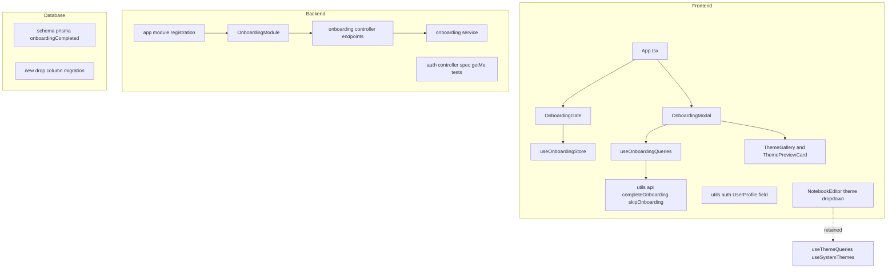
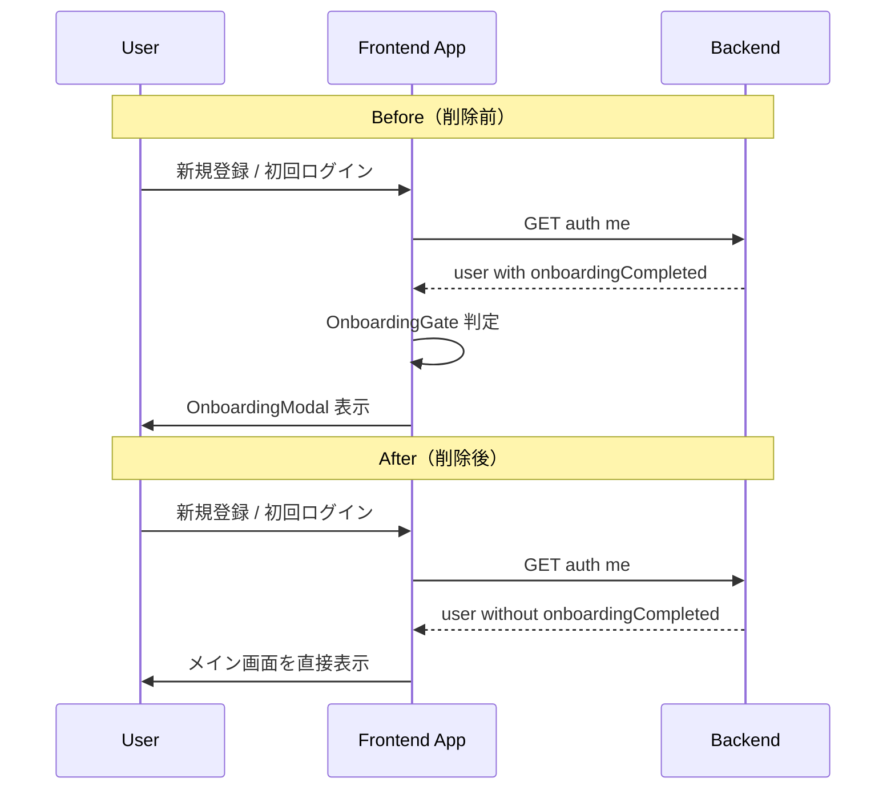
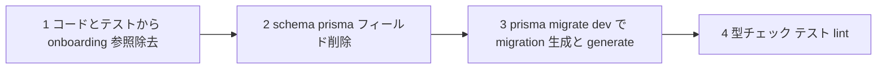
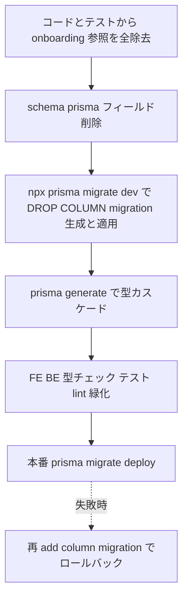
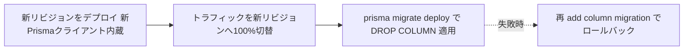

# Technical Design — onboarding-removal

## Overview

**Purpose**: 本機能はオンボーディング（登録直後に表示されるテーマ選択＋サンプルメモ生成モーダル）をフロントエンド・バックエンド・データベースの三層から完全に除去する。「早すぎた」「毎回表示されて邪魔」という UX 課題に対し、機能の撤去そのものを価値として提供する。

**Users**: 既存ユーザーは登録・初回ログイン直後に割り込みモーダルなしで即メイン画面を利用できる。開発者はデッドコード・未使用エンドポイント・未使用カラムの保守コストと攻撃面を削減できる。

**Impact**: 現状の「認証直後に `OnboardingGate` が `onboardingCompleted` を判定し `OnboardingModal` を起動する」フローを撤廃する。`POST /onboarding/complete` `POST /onboarding/skip` は消滅（404）し、`User.onboardingCompleted` カラムは migration で drop される。`AuthenticatedUser` 型と `GET /auth/me` レスポンスからは当該フィールドが自動的に除外される。

### Goals

- オンボーディング UI・状態・クエリ・API クライアント・型をフロントから痕跡なく除去する（R1, R2）
- `OnboardingModule` とエンドポイントをバックから除去する（R3）
- `User.onboardingCompleted` カラムを forward migration で drop する（R4）
- 削除後もビルド・型チェック・lint・既存テストがグリーンであること（R5）
- テーマ選択導線を `NotebookEditor` 経由で維持する（R1.5）

### Non-Goals

- 代替オンボーディングフロー・チュートリアル・初回ガイドの新規提供（スコープ外）
- メール送信元デフォルト `onboarding@resend.dev` の変更（無関係・保護対象 / R5.1）
- 既存マイグレーション `20260608230032_add_onboarding_completed` の編集（履歴として保持）
- `NotebookEditor` のテーマ選択 UI への機能追加・変更

## Architecture

### Existing Architecture Analysis

- **ドメインモジュール構成**（structure.md）: backend は「1 ドメイン = 1 モジュール」。`OnboardingModule` は独立ドメインとして `backend/src/onboarding/` にカプセル化され、`app.module.ts` の imports 配列に登録されている。
- **単方向依存**: `OnboardingModule` は `Notebook/Memo/Prisma` を import するが、他モジュールから `OnboardingModule`・`OnboardingService` への逆参照は存在しない（research.md 参照）。切り離しは他ドメインに波及しない。
- **型カスケード**: `AuthenticatedUser = Omit<User, 'password'>`（`auth/types.ts`）。`getMe` は `findUserById` の戻り値を明示 select なしで素通しするため、Prisma の `User` 型からカラムが消えれば型・レスポンスが自動追従する。
- **テーマ選択の所在**: テーマ選択 UI は `SettingsPage` ではなく `NotebookEditor.tsx`（`useSystemThemes`）のノートブック単位ドロップダウンに実在。onboarding 配下の `ThemeGallery`/`ThemePreviewCard` は onboarding 専用。

### Architecture Pattern & Boundary Map

採用パターン: **単一パス完全削除（Option A）**。3 層 + DB + 取りこぼしテストを 1 スペックで一括除去し、中間の型不整合状態を残さない。



**Architecture Integration**:

- **Selected pattern**: 単一パス完全削除。削除のみで新規境界を導入しない。
- **Domain/feature boundaries**: onboarding ドメイン境界をまるごと撤去。auth / memo / theme / notebook の境界は不変（R3.5）。
- **Existing patterns preserved**: ドメインモジュール構成・React Query を真実の源泉とする方針・テーマ選択導線（`NotebookEditor`）は維持。
- **New components rationale**: 新規コンポーネントなし（削除専用）。唯一の新規成果物は forward migration ファイル。
- **Steering compliance**: structure.md（ドメインモジュール）・tech.md（Prisma generate 必須・型安全）・CLAUDE.md（pre-push フック順序）に準拠。

### Technology Stack

| Layer          | Choice / Version                     | Role in Feature                              | Notes                                                |
| -------------- | ------------------------------------ | -------------------------------------------- | ---------------------------------------------------- |
| Frontend       | React 19 / Vite 6 / TypeScript       | UI・状態・クエリ・型・API クライアントの除去 | 新規依存なし。削除のみ                               |
| Backend        | NestJS 11 / TypeScript               | OnboardingModule・エンドポイント除去         | 新規依存なし                                         |
| Data / Storage | Prisma ORM / PostgreSQL（Supabase）  | `onboarding_completed` カラム drop           | forward migration を新規作成。`prisma generate` 必須 |
| Infrastructure | Google Cloud Run（BE）/ Vercel（FE） | 本番は `prisma migrate deploy` で適用        | R4.4                                                 |

## System Flows

### Before / After: 認証直後フロー



削除後は `OnboardingGate` による判定分岐そのものが消滅し（R1.2）、認証直後は無条件でメイン画面へ遷移する。テーマ選択が必要なユーザーは `NotebookEditor` のテーマドロップダウンから任意に選択する（R1.5）。

### 作業順序（実装フロー）



順序は固定。`prisma generate`（Step3）を型チェック（Step4）より前に実行しないと `AuthenticatedUser` 型が旧フィールドを保持し検知がすり抜ける。pre-push フックの `prisma generate → ESLint → 型チェック` と整合（research.md の Decision 参照）。

## Requirements Traceability

| Requirement   | Summary                               | Components                                               | Interfaces            | Flows                 |
| ------------- | ------------------------------------- | -------------------------------------------------------- | --------------------- | --------------------- |
| 1.1, 1.2      | モーダル非表示・Gate 判定撤廃         | App.tsx, OnboardingGate, OnboardingModal                 | —                     | 認証直後フロー(After) |
| 1.3           | onboarding コンポーネント群の不在     | `components/onboarding/`                                 | —                     | —                     |
| 1.4           | App.tsx の import/JSX 不在            | App.tsx                                                  | —                     | —                     |
| 1.5           | テーマ選択導線の維持                  | NotebookEditor（不変）                                   | useSystemThemes       | —                     |
| 2.1           | store 不在                            | useOnboardingStore                                       | —                     | —                     |
| 2.2           | queries 不在                          | useOnboardingQueries                                     | —                     | —                     |
| 2.3           | api クライアント関数除去              | utils/api.ts                                             | apiClient             | —                     |
| 2.4           | UserProfile フィールド除去            | utils/auth.ts                                            | UserProfile           | —                     |
| 2.5           | 残存参照ゼロを型チェックで保証        | 全 FE                                                    | tsc                   | 作業順序(Step4)       |
| 3.1, 3.2, 3.3 | モジュール・登録解除                  | `backend/src/onboarding/`, app.module.ts                 | —                     | —                     |
| 3.4           | エンドポイント 404                    | （削除により消滅）                                       | POST /onboarding/\*   | —                     |
| 3.5           | 他モジュール不変                      | auth/memo/theme/notebook                                 | —                     | —                     |
| 4.1, 4.2, 4.3 | schema フィールド削除・migration 作成 | schema.prisma, migrations/                               | DROP COLUMN           | 作業順序(Step2,3)     |
| 4.4           | 本番 migration 適用                   | デプロイ手順                                             | prisma migrate deploy | Migration Strategy    |
| 4.5, 5.6      | 型整合・自動除外                      | AuthenticatedUser, getMe                                 | prisma generate       | 作業順序(Step3)       |
| 5.1           | メール送信元保護                      | config.service.ts                                        | （変更禁止）          | —                     |
| 5.2           | ビルド健全性                          | 全層                                                     | npm run build         | 作業順序(Step4)       |
| 5.3, 5.4      | テスト健全性・削除                    | onboarding spec, auth.controller.spec, api.test, \*.test | Jest/Vitest           | —                     |
| 5.5           | lint 健全性                           | 全層                                                     | npm run lint          | 作業順序(Step4)       |

## Components and Interfaces

> 本機能は削除専用のため、各コンポーネントは「除去操作」と「除去後の不変条件」を契約とする。新規境界の導入は forward migration のみ。

| Component              | Domain/Layer | Intent                               | Req Coverage                 | Key Dependencies (P0/P1)         | Contracts |
| ---------------------- | ------------ | ------------------------------------ | ---------------------------- | -------------------------------- | --------- |
| Frontend UI 除去       | FE/UI        | onboarding UI と App.tsx 参照を削除  | 1.1, 1.2, 1.3, 1.4           | App.tsx (P0)                     | State     |
| Frontend データ層除去  | FE/Data      | store/queries/api/型の削除           | 2.1, 2.2, 2.3, 2.4, 2.5      | utils/api.ts, utils/auth.ts (P0) | State     |
| Backend モジュール除去 | BE/Module    | OnboardingModule・エンドポイント削除 | 3.1, 3.2, 3.3, 3.4, 3.5      | app.module.ts (P0)               | API       |
| DB スキーマ migration  | Data         | onboardingCompleted カラム drop      | 4.1, 4.2, 4.3, 4.4, 4.5, 5.6 | schema.prisma (P0)               | Batch     |
| テスト健全性           | BE/FE Test   | 取りこぼしテストの削除・修正         | 5.3, 5.4                     | auth.controller.spec.ts (P0)     | —         |
| 保護境界               | BE/Config    | メール送信元を変更しない             | 5.1                          | config.service.ts (P2)           | —         |

### Frontend

#### Frontend UI 除去

| Field        | Detail                                                      |
| ------------ | ----------------------------------------------------------- |
| Intent       | onboarding UI コンポーネント群と `App.tsx` の参照を除去する |
| Requirements | 1.1, 1.2, 1.3, 1.4                                          |

**Responsibilities & Constraints**

- `frontend/src/components/onboarding/`（`OnboardingGate.tsx` / `OnboardingModal.tsx` / `ThemeGallery.tsx` / `ThemePreviewCard.tsx` と対応 test×4）をディレクトリごと削除。
- `frontend/src/App.tsx` L22-23 の import 2 行、L100-101 の `<OnboardingGate />` `<OnboardingModal />` JSX 2 行を除去。
- 除去後、認証直後に onboarding 起因の分岐レンダリングが発生しないこと（不変条件）。

**Dependencies**

- Inbound: `App.tsx` — onboarding コンポーネントの唯一の利用元 (P0)
- Outbound: なし（削除後）

**Contracts**: State [x]

##### State Management

- State model: 削除後、onboarding 関連の表示状態は存在しない。
- Persistence & consistency: クライアント状態のみ。永続化なし。

**Implementation Notes**

- Integration: `App.tsx` の周辺 JSX（フラグメント/レイアウト）は維持し、2 行のみ除去。
- Validation: 削除後 `grep onboarding frontend/src/App.tsx` が空であること。
- Risks: JSX 除去時に親要素の構造を崩さないこと。

#### Frontend データ層除去

| Field        | Detail                                                          |
| ------------ | --------------------------------------------------------------- |
| Intent       | store / queries / api クライアント関数 / 型フィールドを除去する |
| Requirements | 2.1, 2.2, 2.3, 2.4, 2.5                                         |

**Responsibilities & Constraints**

- `frontend/src/stores/useOnboardingStore.ts`(+ `.test.ts`) を削除（2.1）。
- `frontend/src/hooks/useOnboardingQueries.ts`(+ `.test.ts`) を削除（2.2）。`useOnboardingQueries.test.ts` は要件のフック記述に含意される取りこぼし対象として削除する。
- `frontend/src/utils/api.ts` L583-591 の `completeOnboarding` / `skipOnboarding` を削除（2.3）。
- `frontend/src/utils/auth.ts` L11 `UserProfile.onboardingCompleted` フィールドを削除（2.4）。要件 2.4 の「User 型」は実体 `UserProfile` インターフェースを指す（gap-analysis の名称訂正を吸収）。
- 残存参照がある場合、TypeScript 型チェックがエラーを報告すること（2.5＝残存参照ゼロの保証手段）。

**Dependencies**

- Inbound: `OnboardingModal` / `OnboardingGate` — 削除済みのため参照消滅 (P0)
- Outbound: `apiClient`（utils/api.ts 本体は維持） (P1)

**Contracts**: State [x]

##### State Management

- State model: `useOnboardingStore`（Zustand UI 状態）を撤去。`UserProfile` 型から `onboardingCompleted` を除去。
- Consistency: `UserProfile` を参照する全箇所で型エラーが出ないこと（出れば残存参照のシグナル）。

**Implementation Notes**

- Integration: `useOnboardingQueries` 内の `setTag('feature_area','onboarding')` は Sentry の `feature_area` enum 契約外（tech.md）。削除で自然解消（R5.5 に寄与）。
- Validation: `npm run build`（tsc）と `npm run lint` が緑であること。
- Risks: `UserProfile` の他参照（プロフィール表示等）が `onboardingCompleted` を読んでいないか型チェックで確認。

### Backend

#### Backend モジュール除去

| Field        | Detail                                                            |
| ------------ | ----------------------------------------------------------------- |
| Intent       | OnboardingModule とエンドポイントを除去し他モジュールを不変に保つ |
| Requirements | 3.1, 3.2, 3.3, 3.4, 3.5                                           |

**Responsibilities & Constraints**

- `backend/src/onboarding/`（`onboarding.controller.ts` / `onboarding.service.ts` / `onboarding.module.ts` / `dto/complete-onboarding.dto.ts` / `onboarding.controller.spec.ts` / `onboarding.service.spec.ts`）をディレクトリごと削除（3.1）。
- `backend/src/app.module.ts` L12 の `import { OnboardingModule }` と L46 の imports 配列要素を除去（3.2, 3.3）。
- 削除後 `POST /onboarding/complete` `POST /onboarding/skip` はルート未登録となり 404 を返す（3.4）。
- auth / memo / theme / notebook の既存エンドポイントは変更しない（3.5）。

**Dependencies**

- Inbound: `app.module.ts` — OnboardingModule の唯一の登録元 (P0)
- Outbound: `Notebook/Memo/Prisma`（OnboardingService が利用していたが削除で参照消滅） (P1)

**Contracts**: API [x]

##### API Contract

| Method | Endpoint             | Request               | Response (Before)         | Response (After) |
| ------ | -------------------- | --------------------- | ------------------------- | ---------------- |
| POST   | /onboarding/complete | CompleteOnboardingDto | 200 (notebookId, memoIds) | 404 Not Found    |
| POST   | /onboarding/skip     | —                     | 200 (message)             | 404 Not Found    |

**Implementation Notes**

- Integration: NestJS はルート未登録時にグローバル例外で 404 を返すため追加実装不要。
- Validation: 起動ログに OnboardingModule が現れないこと（3.2）。
- Risks: imports 配列のカンマ・整形崩れに注意（pre-commit Prettier で吸収）。

### Database

#### DB スキーマ migration

| Field        | Detail                                                                    |
| ------------ | ------------------------------------------------------------------------- |
| Intent       | `User.onboardingCompleted` を schema から削除し forward migration で drop |
| Requirements | 4.1, 4.2, 4.3, 4.4, 4.5, 5.6                                              |

**Responsibilities & Constraints**

- `backend/prisma/schema.prisma` L159 `onboardingCompleted Boolean @default(false) @map("onboarding_completed")` を削除（4.1）。
- `npx prisma migrate dev` で新規 forward migration を `prisma/migrations/` に生成し `DROP COLUMN onboarding_completed` を記録（4.2, 4.3）。
- 既存 `20260608230032_add_onboarding_completed` は履歴として編集禁止。
- 本番は `prisma migrate deploy` で適用（4.4）。
- migration 適用 + `prisma generate` 後、`AuthenticatedUser`（= `Omit<User,'password'>`）と `GET /auth/me` レスポンスから当該フィールドが自動除外される（4.5, 5.6）。手動型編集は不要。

**Contracts**: Batch [x]

##### Batch / Job Contract

- Trigger: ローカル `npx prisma migrate dev` / 本番 `prisma migrate deploy`
- Input / validation: `schema.prisma` のフィールド削除差分
- Output / destination: `prisma/migrations/<timestamp>_remove_onboarding_completed/migration.sql`（`ALTER TABLE "User" DROP COLUMN "onboarding_completed"`）
- Idempotency & recovery: forward-only。ロールバックは「再 add column の新規 migration」で対応（データ＝boolean フラグの損失は意図的・許容）。

**Implementation Notes**

- Integration: migration 生成は schema 編集後に実行（作業順序 Step2→Step3）。
- Validation: 生成 SQL に `DROP COLUMN "onboarding_completed"` が含まれること。`prisma generate` 後に `npm run build` が緑。
- Risks: generate を飛ばすと型が旧フィールドを保持。順序固定で回避。

### Test / Config

#### テスト健全性

| Field        | Detail                                           |
| ------------ | ------------------------------------------------ |
| Intent       | 取りこぼしテストを削除・修正し全テストを緑に保つ |
| Requirements | 5.3, 5.4                                         |

**Responsibilities & Constraints**

- `backend/src/onboarding/*.spec.ts` 2 件はモジュール削除に伴い消滅。
- `backend/src/auth/auth.controller.spec.ts` の getMe テスト群を修正（research.md の依存構造に基づく）:
  - L604「`onboardingCompleted: true` …含まれること」→ **テストごと削除**
  - L621「`onboardingCompleted: false` …含まれること」→ **テストごと削除**
  - L638「`findUserById` を `req.user.id` で呼ぶこと」→ **モック値の `onboardingCompleted` 行のみ除去**しテスト本体は残す
- `frontend/src/utils/api.test.ts` の `completeOnboarding` / `skipOnboarding` テストを削除。
- `frontend/src/components/onboarding/*.test.tsx`、`useOnboardingQueries.test.ts`、`useOnboardingStore.test.ts` はファイルごと削除。

**Contracts**: なし（テスト修正のみ）

**Implementation Notes**

- Validation: `cd backend && npm run test`、`cd frontend && npm run test` が緑。
- Risks: getMe の混合操作（2 削除 + 1 修正）を誤って全削除/全残ししないこと。

#### 保護境界

| Field        | Detail                             |
| ------------ | ---------------------------------- |
| Intent       | メール送信元デフォルトを変更しない |
| Requirements | 5.1                                |

**Responsibilities & Constraints**

- `backend/src/config/config.service.ts` L102 `onboarding@resend.dev`、および同値を参照する `config.service.spec.ts` L292-294 / `mail.service.spec.ts` L26 を **一切変更しない**。
- これらは文字列に `onboarding` を含むがメール機能であり本削除と無関係。

**Implementation Notes**

- Validation: 削除作業後、上記 3 箇所の差分が発生していないこと（`git diff` で確認）。

## Data Models

### Logical Data Model

- **対象エンティティ**: `User`
- **変更**: `onboarding_completed`（PostgreSQL `boolean NOT NULL DEFAULT false`）カラムを削除。
- **Referential integrity**: 当該カラムは外部キー・インデックス・複合制約に関与しない単独 boolean フラグ。削除による参照整合性への影響なし。
- **Temporal aspects**: forward migration として履歴に追記。既存の add migration は保持。

### Physical Data Model（Relational）

```sql
-- migration.sql（生成想定）
ALTER TABLE "User" DROP COLUMN "onboarding_completed";
```

- Primary/foreign keys: 影響なし
- Indexes: 当該カラムにインデックスなし、再構築不要
- Partitioning: 対象外

### Data Contracts & Integration

- **API Data Transfer**: `GET /auth/me` レスポンスから `onboardingCompleted` が自動除外（`Omit<User,'password'>` カスケード）。FE `UserProfile` も同フィールドを削除し契約一致。
- **Compatibility**: 当該フィールドを参照していたクライアントは onboarding 機能ごと削除済みのため、破壊的変更の影響を受ける外部コンシューマは存在しない。

## Error Handling

### Error Strategy

削除専用機能のため新規エラーハンドリングは導入しない。除去に起因する想定エラーと対処のみ記載する。

### Error Categories and Responses

- **404（旧エンドポイント）**: `POST /onboarding/*` はルート未登録で NestJS グローバル例外が 404 を返す（R3.4）。意図的挙動。
- **型エラー（残存参照）**: `onboardingCompleted` / onboarding モジュールへの残存参照は tsc が検知（R2.5）。作業順序 Step4 で解消を保証。
- **migration 適用エラー（本番）**: `prisma migrate deploy` 失敗時はデプロイを中断しロールバック migration で復旧（forward-only 方針）。

### Monitoring

- `useOnboardingQueries` の `feature_area: 'onboarding'` タグ（enum 契約外）は削除で消滅し Sentry タグ契約の整合性が向上（tech.md）。新規監視項目なし。

## Testing Strategy

### Unit Tests

- `auth.controller.spec.ts` getMe: 修正後も「`findUserById` を `req.user.id` で呼ぶ」テストが緑（モック値除去後）。
- `frontend` 型チェック（tsc）: `UserProfile` / onboarding 参照ゼロでビルド成功。
- 削除対象 spec が存在しないこと（onboarding/\*.spec.ts、onboarding 配下 test、api.test の onboarding ケース）。

### Integration Tests

- backend 起動: OnboardingModule 非ロードで全モジュール正常起動（R3.2, R3.5）。
- `prisma generate` 後: `AuthenticatedUser` 型に `onboardingCompleted` が存在しないこと（型レベル検証 / R4.5, R5.6）。

### E2E / UI Tests

- 認証直後フロー: 新規登録・初回ログイン後にモーダルが表示されずメイン画面が表示される（R1.1）。
- テーマ選択導線: `NotebookEditor` のテーマドロップダウンでテーマ選択が継続可能（R1.5）。
- 既存 E2E スイートに onboarding 削除起因の失敗が無いこと（R5.3）。

### Build / Lint Gate

- `npm run build`（FE/BE 両方）がエラーなく完了（R5.2）。
- `npm run lint` が未使用 import・未参照シンボルの新規エラーを出さない（R5.5）。

## Migration Strategy



- **Phase 区切り**: 単一 PR 内で A→E を完結（Option A）。F は本番デプロイ時に実行。
- **Rollback triggers**: 本番 migration 適用失敗、または想定外の参照残存検知時。
- **Validation checkpoints**: Step3 後の生成 SQL 確認、Step4 の build/test/lint 緑、`git diff` で保護対象（`onboarding@resend.dev` 3 箇所）の無変更確認。

### 本番デプロイ順序（後方互換ウィンドウの回避）

Prisma クライアントは `User` クエリで全カラムを明示 SELECT するため、`onboarding_completed` を drop した瞬間、**旧 Prisma クライアントを保持する旧 Cloud Run リビジョンは `getMe` だけでなくログイン含む全 `User` クエリで「column does not exist」エラーになる**（R3.5 の他エンドポイント不変条件を一時的に破る）。したがって本番では「カラムを参照しない新クライアントを内蔵した新リビジョンへトラフィックを切り替えてから drop する」順序を固定する。



- 新クライアントは drop 済みカラムを参照しないため、drop 前に新リビジョンが稼働していても問題なし（カラムは存在するが SELECT 対象外）。
- 逆に drop を先行させると、切替完了までの間だけ旧リビジョンが全 `User` クエリで失敗する非互換ウィンドウが生じる。これを避けるため **「デプロイ → 切替 → migrate deploy」の順を厳守**する（expand/contract の contract フェーズに相当）。
- 本プロジェクトはトラフィックが小さく短時間の許容余地はあるが、認証系の全面失敗を招くため意図的にこの順序を採用する。

## Supporting References

- `.kiro/specs/onboarding-removal/research.md` — 参照全数把握・テーマ導線検証・getMe テスト依存構造・設計決定の根拠
- `.kiro/specs/onboarding-removal/gap-analysis.md` — 実装ギャップ分析（スコープ補正の起点）
