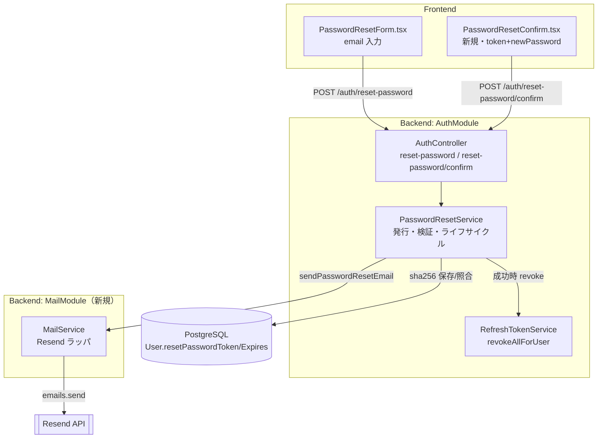
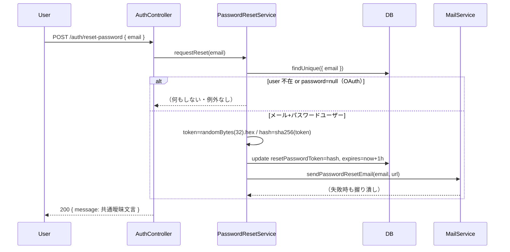
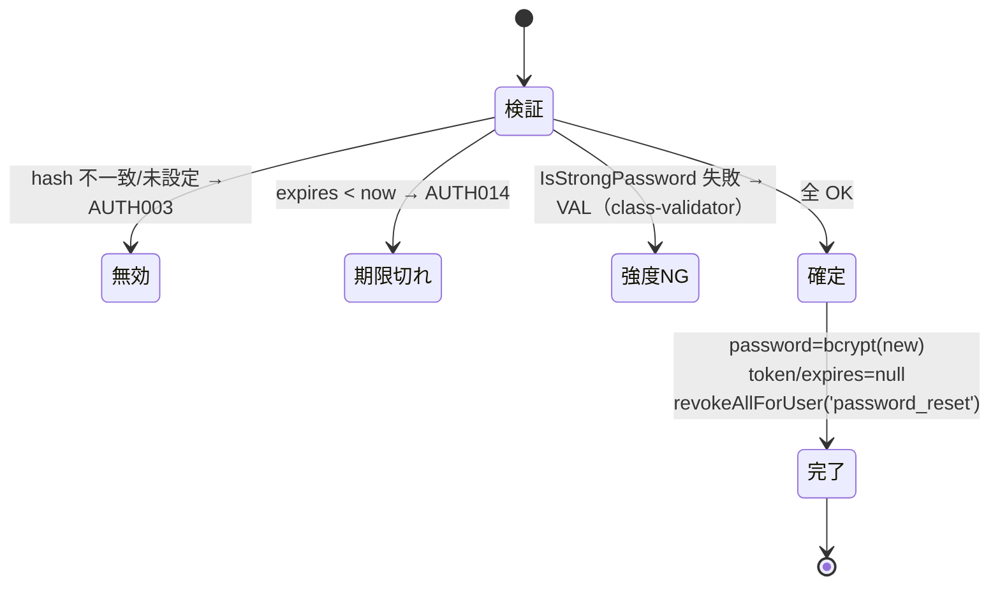

# Technical Design: password-reset-email

## Overview

**Purpose**: メール＋パスワードで登録したユーザーがパスワードを忘れた際に、登録メールアドレス宛のリセットリンクから安全に再設定できる機能を本実装する。現状 `POST /auth/reset-password` はユーザー検索のみで `// TODO: メール送信機能を実装` のまま動作せず、フロントの UI も機能しない。

**Users**: メール＋パスワードで登録した一般ユーザー（`password != null`）。OAuth 専用アカウント（`password = null`）は対象外で、要求しても送信されない。

**Impact**: 既存 NestJS 認証システムに、(1) メール送信基盤 `MailModule`（Resend ラッパ）、(2) リセットの発行・送信・検証・無効化を担う `PasswordResetService`、(3) フロントのトークン確定画面 `PasswordResetConfirm.tsx` を追加する。`User.resetPasswordToken` / `resetPasswordExpires` カラムは既存のため**スキーマ変更なし**。

### Goals

- リセット要求 → トークン発行（sha256 ハッシュ保存・期限1時間）→ メール送信 → トークン検証 → 新パスワード設定 → トークン無効化＋既存 Refresh Token revoke の一連フローを実装。
- ユーザー列挙攻撃に対し、存在有無・OAuth 有無・送信成否にかかわらず**同一の曖昧レスポンス**を返す（最重要セキュリティ要件）。
- 既存規約（`@Public()`＋JWT Guard、`ERROR_CODES`/`AppException`、`AppLogger`、`@nestjs/throttler`、bcrypt＋`IsStrongPassword`、Sentry `feature_area: 'auth'`）に完全準拠する。

### Non-Goals

- パスワード変更（`change-password` は実装済み）。
- OAuth 専用アカウントへのパスワード新規設定。
- メールテンプレートの多言語化（日本語のみ）。
- 本番ドメイン認証（DKIM/SPF DNS）の自動化 — 運用作業として tasks に前提明記するが本実装の対象外。

## Architecture

### Existing Architecture Analysis

- **認証**: グローバル JWT Guard + `@Public()` オプトアウト。公開エンドポイントは `@Public()` + `@Throttle()` 併用（`auth.controller.ts`）。
- **エラー**: `ERROR_CODES` 定数 + `throwBadRequest`/`throwUnauthorized`（`common/exceptions/`）。
- **Sentry**: `Sentry.captureException(err, { tags: { feature_area: 'auth' } })` を直接呼ぶ慣例（`refresh-token.service.ts`）。
- **未設定許容パターン**: `google.strategy.ts` が `isConfigured` フラグ + `logger.warn` で起動継続。**本機能の Resend 未設定時挙動はこれを踏襲**。
- **再利用アセット**: `hashPassword`/`comparePassword`、`IsStrongPassword`、`ResetPasswordDto`（定義済み・未使用）、`refreshTokenService.revokeAllForUser`、機能フラグ `FEATURE_PASSWORD_RESET_EMAIL`。
- **保持すべき境界**: メール送信は auth ドメインから分離し独立 module 化（将来の通知系で再利用）。

### Architecture Pattern & Boundary Map

採用パターン: **責務分離 service ＋独立メール module（gap-analysis Option C）**。



**Architecture Integration**:

- **Selected pattern**: ドメイン service（`PasswordResetService`）＋ポート的メール抽象（`MailService`）。発行・検証・単回性・列挙一貫性を service に閉じ込め単体テスト可能にする。
- **Domain/feature boundaries**: 認証ロジック=AuthModule、メール送信=MailModule。controller は薄い委譲のみ。
- **Existing patterns preserved**: `@Public()`+`@Throttle`、`ERROR_CODES`/`AppException`、Sentry タグ、OAuth 未設定警告、bcrypt/強度バリデータ、`revokeAllForUser`。
- **New components rationale**: `MailService`=外部 SDK の失敗を握り潰し曖昧レスポンスを構造保証（R2.5）。`PasswordResetService`=列挙一貫性とトークン単回性をテスト単位に集約。`PasswordResetConfirm.tsx`=確定 UI の到達経路を提供。
- **Steering compliance**: 「API コールは apiClient 経由」「Sentry 初期化不変則」「所有権/認証の一元化」を尊重。

### Technology Stack

| Layer                    | Choice / Version                         | Role in Feature                                       | Notes                                                     |
| ------------------------ | ---------------------------------------- | ----------------------------------------------------- | --------------------------------------------------------- |
| Frontend                 | React + react-router（既存）             | 確定画面 `/auth/reset-password/confirm`               | `useSearchParams` で `?token=` 取得、`AuthAPI` 経由で送信 |
| Backend / Services       | NestJS（既存）+ `PasswordResetService`   | 発行・検証・ライフサイクル                            | auth module の providers に登録                           |
| Messaging / Email        | `resend`（公式 Node SDK）                | リセットメール送信                                    | `{ data, error }` を返す。失敗は内部で握り Sentry へ      |
| Data / Storage           | PostgreSQL（Prisma 既存）                | `resetPasswordToken`(sha256) / `resetPasswordExpires` | **スキーマ変更なし**                                      |
| Crypto                   | Node `crypto`（標準）                    | `randomBytes(32)` + `createHash('sha256')`            | パスワードは別途 bcrypt 維持                              |
| Infrastructure / Runtime | Cloud Run（backend）/ Vercel（frontend） | 本番。外部 egress→api.resend.com                      | 本番は mosaku.jp の DKIM/SPF 認証が前提作業               |

> SDK 契約・ハッシュ方式・列挙対策の調査詳細は `research.md` を参照。

## System Flows

### リセット要求（列挙対策の核）



ゲーティング: 分岐は **early-return（例外を投げない）**で行い、レスポンスは常に同一文言・同一構造・200（R3.1〜3.3）。`MailService` 失敗はここに伝播しない（R2.5）。機能フラグ `FEATURE_PASSWORD_RESET_EMAIL` が OFF または `RESEND_API_KEY` 未設定なら、送信をスキップし dev では AppLogger にリセット URL を出力（本番は warn のみ）。

### トークン確定とライフサイクル



## Requirements Traceability

| Requirement | Summary                                  | Components                                 | Interfaces                              | Flows     |
| ----------- | ---------------------------------------- | ------------------------------------------ | --------------------------------------- | --------- |
| 1.1         | 安全トークン生成＋期限保存               | PasswordResetService                       | `requestReset()`                        | 要求      |
| 1.2         | トークンはハッシュ化保存                 | PasswordResetService                       | sha256(token)→`resetPasswordToken`      | 要求      |
| 1.3         | 再要求で上書き・旧無効化                 | PasswordResetService                       | `update` 上書き                         | 要求      |
| 1.4         | OAuth(password=null)は発行も送信もしない | PasswordResetService                       | early-return                            | 要求      |
| 1.5         | 各処理を AppLogger 記録（PII 出力なし）  | PasswordResetService                       | `logger.log/warn`                       | 要求      |
| 2.1         | Resend 経由でリセット URL 送信           | MailService                                | `sendPasswordResetEmail()`              | 要求      |
| 2.2         | URL=`{base}?token={平文}` 形式           | PasswordResetService                       | `buildResetUrl()`                       | 要求      |
| 2.3         | 件名・本文は日本語                       | MailService                                | テンプレート                            | 要求      |
| 2.4         | 送信失敗→Sentry記録・曖昧レスポンス      | MailService                                | 内部 try/catch + `captureException`     | 要求      |
| 2.5         | 送信例外がレスポンスを変えない           | MailService / PasswordResetService         | `sendPasswordResetEmail` は void/bool   | 要求      |
| 3.1         | 存在有無で同一メッセージ                 | AuthController / PasswordResetService      | 共通 `message` 定数                     | 要求      |
| 3.2         | 不在/OAuth でも区別不能なレスポンス      | PasswordResetService                       | early-return → 同一返却                 | 要求      |
| 3.3         | ステータス・構造で存在を示さない         | AuthController                             | 常に 200 同一 body                      | 要求      |
| 3.4         | 要求 EP は `@Public()`＋throttle         | AuthController                             | `@Public()` `@Throttle(PASSWORD_RESET)` | 要求      |
| 4.1         | 受領トークンを sha256 照合               | PasswordResetService                       | `confirmReset()`                        | 確定      |
| 4.2         | 不一致→無効トークンエラー                | PasswordResetService                       | `throwBadRequest(AUTH003)`              | 確定      |
| 4.3         | 期限切れ→期限切れエラー                  | PasswordResetService                       | `throwBadRequest(AUTH014)`              | 確定      |
| 4.4         | 新パスワードを強度検証                   | ResetPasswordDto                           | `@IsStrongPassword`                     | 確定      |
| 4.5         | 強度NG→バリデーションエラー              | ValidationPipe                             | class-validator → VAL                   | 確定      |
| 4.6         | 新パスワードを bcrypt 保存               | PasswordResetService                       | `hashPassword()`                        | 確定      |
| 5.1         | 成功時 token/expires を null クリア      | PasswordResetService                       | `update { null, null }`                 | 確定      |
| 5.2         | 使用済みトークン再使用→無効              | PasswordResetService                       | sha256 照合で hit せず AUTH003          | 確定      |
| 5.3         | 有効期限1時間                            | PasswordResetService                       | `now + 3600_000`                        | 要求      |
| 5.4         | 確定 EP に throttle                      | AuthController                             | `@Throttle(PASSWORD_RESET)`             | 確定      |
| 5.5         | 成功時 既存 RT を revoke                 | PasswordResetService / RefreshTokenService | `revokeAllForUser('password_reset')`    | 確定      |
| 6.1         | API キーを env から読込                  | MailService / ConfigService                | `RESEND_API_KEY`                        | -         |
| 6.2         | リセット URL ベースを env から読込       | ConfigService                              | `passwordResetUrlBase`                  | -         |
| 6.3         | 追加 env を `.env.example` 記載          | （設定）                                   | `.env.example`                          | -         |
| 6.4         | キー未設定→警告ログ＋起動継続＋曖昧維持  | MailService                                | `isConfigured` + `logger.warn`          | 要求      |
| 6.5         | Sentry を `feature_area: 'auth'` 分類    | MailService / PasswordResetService         | `tags: { feature_area: 'auth' }`        | 要求/確定 |

## Components and Interfaces

| Component              | Domain/Layer      | Intent                         | Req Coverage                | Key Dependencies (P0/P1)                                                       | Contracts |
| ---------------------- | ----------------- | ------------------------------ | --------------------------- | ------------------------------------------------------------------------------ | --------- |
| PasswordResetService   | Backend / AuthMod | 発行・検証・単回性・列挙一貫性 | 1,2.2,3,4,5                 | PrismaService(P0), MailService(P0), RefreshTokenService(P0), ConfigService(P1) | Service   |
| MailService            | Backend / MailMod | Resend ラッパ・失敗握り潰し    | 2.1,2.3,2.4,2.5,6.1,6.4,6.5 | resend SDK(P0), ConfigService(P0), AppLogger(P1)                               | Service   |
| AuthController（拡張） | Backend / AuthMod | 2 エンドポイント公開・薄い委譲 | 3.1,3.3,3.4,5.4             | PasswordResetService(P0)                                                       | API       |
| ConfigService（拡張）  | Backend / Config  | env getter 追加                | 6.1,6.2                     | process.env                                                                    | Service   |
| PasswordResetConfirm   | Frontend / Auth   | token+newPassword 確定 UI      | 4（UI 到達）                | AuthAPI(P0), react-router(P1)                                                  | State     |
| AuthAPI（拡張）        | Frontend / utils  | `confirmPasswordReset` 追加    | 4（UI 到達）                | makeRequest(P0)                                                                | Service   |

### Backend / AuthModule

#### PasswordResetService

| Field        | Detail                                                                              |
| ------------ | ----------------------------------------------------------------------------------- |
| Intent       | リセットの発行・送信委譲・検証・トークン単回ライフサイクル                          |
| Requirements | 1.1, 1.2, 1.3, 1.4, 1.5, 2.2, 3.1, 3.2, 4.1, 4.2, 4.3, 4.6, 5.1, 5.2, 5.3, 5.5, 6.5 |

**Responsibilities & Constraints**

- 要求: ユーザー解決 → `password=null`/不在は early-return → トークン生成・sha256 保存・送信委譲。**例外を投げない**（列挙一貫性）。
- 確定: sha256 照合 → 期限検証 → bcrypt 保存 → token/expires クリア → RT revoke。検証失敗は `ERROR_CODES` で throw。
- データ所有: `User.resetPasswordToken` / `resetPasswordExpires` の書き込み主体。平文トークンは永続化しない（不変条件）。

**Dependencies**

- Inbound: AuthController — 2 エンドポイントの委譲先（P0）
- Outbound: PrismaService（P0）、MailService（P0）、RefreshTokenService（P0）、ConfigService（P1）、`crypto`（標準）
- External: なし（メール送信は MailService 越し）

**Contracts**: Service [x] / API [ ] / Event [ ] / Batch [ ] / State [ ]

##### Service Interface

```typescript
interface PasswordResetService {
	// 要求: 成否・分岐に関わらず常に正常 return（例外なし）。送信は内部で委譲し失敗を握る。
	requestReset(email: string): Promise<void>;

	// 確定: 検証失敗は AppException(AUTH003 / AUTH014 / VAL) を throw。成功時のみ完了。
	confirmReset(token: string, newPassword: string): Promise<void>;
}
```

- **Preconditions**: `requestReset` は任意 email を受理（存在チェックは内部）。`confirmReset` は DTO バリデーション通過済み（強度は ValidationPipe で先行検証）。
- **Postconditions**: `requestReset` 後、対象ユーザーが存在し `password!=null` なら `resetPasswordToken=sha256(token)`・`resetPasswordExpires=now+1h`。`confirmReset` 成功後は `password` 更新・`resetPasswordToken=null`・`resetPasswordExpires=null`・該当ユーザーの全 RT revoked。
- **Invariants**: 平文トークンは DB に保存しない。`requestReset` は外部から見て副作用差を観測できない（同一レスポンス）。

**Implementation Notes**

- トークン: `crypto.randomBytes(32).toString('hex')`（平文 64 桁）、保存 `crypto.createHash('sha256').update(token).digest('hex')`。
- URL: `buildResetUrl(token) = ${configService.passwordResetUrlBase}?token=${token}`（R2.2）。
- ログ（R1.5）: `logger.log('password reset requested', 'PasswordResetService')` 等。**email 平文・トークンは出力しない**（PII ポリシー）。dev のみリセット URL を出力可。
- 確定の照合: `findFirst({ where: { resetPasswordToken: sha256(token) } })`。hit せず=AUTH003、`expires < now`=AUTH014。

#### AuthController（拡張）

**Contracts**: API [x]

##### API Contract

| Method | Endpoint                     | Request                                   | Response                                        | Errors                                       |
| ------ | ---------------------------- | ----------------------------------------- | ----------------------------------------------- | -------------------------------------------- |
| POST   | /auth/reset-password         | `ResetPasswordRequestDto { email }`       | 200 `{ message: <共通曖昧文言> }`               | 429（throttle）。**存在/送信成否で変化なし** |
| POST   | /auth/reset-password/confirm | `ResetPasswordDto { token, newPassword }` | 200 `{ message: 'パスワードを再設定しました' }` | 400 AUTH003/AUTH014/VAL, 429                 |

- `/auth/reset-password`（既存・本実装化）: `@Public()` + `@Throttle({ default: PASSWORD_RESET })`。本体は `await passwordResetService.requestReset(email)` → 共通 message を return。既存 `try/catch` は撤去し service に委譲（要求側で例外を表に出さない）。
- `/auth/reset-password/confirm`（新規）: `@Public()` + `@Throttle({ default: PASSWORD_RESET })`。`await passwordResetService.confirmReset(token, newPassword)`。

### Backend / MailModule（新規）

#### MailService

| Field        | Detail                                          |
| ------------ | ----------------------------------------------- |
| Intent       | Resend SDK ラッパ。送信失敗を内部で握り潰す境界 |
| Requirements | 2.1, 2.3, 2.4, 2.5, 6.1, 6.4, 6.5               |

**Responsibilities & Constraints**

- コンストラクタで `RESEND_API_KEY` を読み、未設定なら `isConfigured=false`＋`logger.warn`（google.strategy パターン）。
- `sendPasswordResetEmail` は `{ data, error }` の `error` と例外を**両方**握り、失敗時は `Sentry.captureException(err, { tags: { feature_area: 'auth' } })`。**呼び出し側へ throw しない**（R2.5）。
- 件名・本文は日本語（R2.3）。`MAIL_FROM` を送信元に使用。

**Dependencies**

- Outbound: ConfigService（`resendApiKey` / `mailFrom`）（P0）、AppLogger（P1）
- External: `resend`（公式 SDK）— 送信失敗は reject せず `error` 返却（research.md 参照）（P0）

**Contracts**: Service [x]

##### Service Interface

```typescript
interface MailService {
	// 成功/失敗を bool で返すが、PasswordResetService 側は結果に依存しない（送らないだけ）。
	sendPasswordResetEmail(to: string, resetUrl: string): Promise<boolean>;
}
```

- **Preconditions**: `isConfigured` でない場合は送信スキップし `false` を返す（例外なし）。
- **Postconditions**: 送信成功で `true`。失敗・未設定で `false`＋（失敗時）Sentry 記録。いずれも throw しない。
- **Invariants**: この境界の外へ Resend 由来の例外を漏らさない。

### Frontend / Auth

#### PasswordResetConfirm（新規コンポーネント）

| Field        | Detail                                             |
| ------------ | -------------------------------------------------- |
| Intent       | メールリンク遷移先。`?token=` ＋新パスワードを確定 |
| Requirements | 4（UI 到達経路）                                   |

**Responsibilities & Constraints**

- 新ルート `/auth/reset-password/confirm`（`App.tsx` に追加）。`useSearchParams()` で `token` を取得。
- 新パスワード（＋確認入力）を受け、`AuthAPI.confirmPasswordReset(token, newPassword)` を呼ぶ。成功で完了表示＋ログイン導線、失敗でエラー文言表示。
- 既存 `PasswordReset.tsx`（ログイン中の変更 UI、`/auth/reset-password`）とは**別ルート・別コンポーネント**で衝突回避。
- スタイルは既存 `PasswordResetForm.tsx` のクラス慣例（緑系トークン UI）を踏襲。

**Contracts**: State [x]

##### State Management

- ローカル state: `token`(URL 由来)、`newPassword`、`confirmPassword`、`loading`、`message`。
- サーバ状態は持たない（リセットは一過性アクション）。React Query 不要。

#### AuthAPI（拡張）

```typescript
// frontend/src/utils/auth.ts — 既存 resetPassword(email) と同様の makeRequest パターン
static async confirmPasswordReset(
  token: string,
  newPassword: string,
): Promise<{ message: string }>;
// POST /auth/reset-password/confirm { token, newPassword }
```

## Data Models

### Physical Data Model（既存・変更なし）

`User`（`prisma/schema.prisma`）の既存カラムをそのまま使用。**マイグレーション不要**。

| Column                 | Type        | Usage                                                     |
| ---------------------- | ----------- | --------------------------------------------------------- |
| `resetPasswordToken`   | `String?`   | sha256(平文トークン) の 64 桁 hex。確定時の検索キー       |
| `resetPasswordExpires` | `DateTime?` | 発行時刻 + 1 時間。確定時に `< now()` で期限切れ判定      |
| `password`             | `String?`   | bcrypt ハッシュ。`null`=OAuth 専用→リセット対象外（R1.4） |

- **Consistency**: 確定処理（password 更新＋token/expires クリア）は単一 `prisma.user.update` で原子的に実施。RT revoke は後続呼び出し（失敗時は warn ログ、パスワード更新自体は確定済み）。
- **Temporal**: 期限は保存値 `resetPasswordExpires` で表現。cron 等のクリーンアップは本 spec 範囲外（次回要求で上書き、確定でクリア）。

## Error Handling

### Error Strategy

要求フローは「決して失敗を表に出さない」、確定フローは「`ERROR_CODES` で明示的に失敗を返す」の二極構成。

### Error Categories and Responses

| シナリオ                          | フロー | 挙動                                      | コード          |
| --------------------------------- | ------ | ----------------------------------------- | --------------- |
| メール不在 / OAuth(password=null) | 要求   | 送信せず 200 共通文言（区別不能）         | -（200）        |
| メール送信失敗                    | 要求   | Sentry 記録、200 共通文言維持             | -（200）        |
| Resend 未設定 / フラグ OFF        | 要求   | warn ログ、送信スキップ、200 共通文言維持 | -（200）        |
| トークン不一致 / 使用済み         | 確定   | パスワード変更せず 400                    | AUTH003         |
| トークン期限切れ                  | 確定   | パスワード変更せず 400                    | AUTH014（新設） |
| 新パスワード強度不足              | 確定   | ValidationPipe で 400（class-validator）  | VAL 系          |
| throttle 超過                     | 両方   | 429                                       | -（429）        |

新設: `ERROR_CODES.AUTH.RESET_TOKEN_EXPIRED = 'AUTH014'`（`error-codes.ts`）。`RevokeAllReason` に `'password_reset'` を追加（`refresh-token.service.ts`）。

### Monitoring

- 成功/分岐: `AppLogger`（PII 非出力）。
- 失敗（送信失敗・予期せぬ例外）: `Sentry.captureException(err, { tags: { feature_area: 'auth' } })`（R6.5）。

## Testing Strategy

### Unit Tests（PasswordResetService / MailService）

- `requestReset`: 存在ユーザーで token sha256 保存＋expires=+1h、再要求で上書き（旧無効化）、`password=null` で送信もトークン発行もしない、不在でも例外を投げず副作用なし。
- `confirmReset`: 正常確定で password 更新＋token/expires クリア＋`revokeAllForUser('password_reset')` 呼び出し、不一致で AUTH003、期限切れで AUTH014、使用済みトークン再使用で AUTH003。
- `MailService`: `isConfigured=false` で送信スキップ＋warn＋throw しない、Resend `error` 返却時に Sentry 記録かつ throw しない。

### Integration Tests

- `POST /auth/reset-password`: 存在 / 不在 / OAuth の 3 ケースで**レスポンス本文・ステータス・構造が同一**（列挙対策の回帰防止）。
- `POST /auth/reset-password/confirm`: 有効トークン→200＋実 DB の password 変更確認、無効/期限切れ→該当コード、強度不足→VAL。
- 送信失敗注入時も要求エンドポイントが 200 共通文言を返す（R2.5）。

### E2E/UI Tests

- フロント `/auth/reset-password/confirm?token=...` 表示 → 新パスワード入力 → 確定 → ログイン導線表示。
- token 欠落 URL でのエラーハンドリング表示。

## Security Considerations

- **ユーザー列挙防御（最重要）**: 要求エンドポイントは存在有無・OAuth 有無・送信成否で本文/ステータス/構造を変えない。分岐は early-return で行い例外を表に出さない。回帰を integration test で固定。
- **トークン保護**: 平文は 256bit 乱数、保存は sha256（DB 漏洩時も平文復元不能）。単回使用（成功時クリア）・1 時間期限・再要求で上書き。
- **セッション無効化**: 再設定成功時に既存 Refresh Token を全 revoke（`'password_reset'`）。漏洩済みセッションの継続使用を遮断。
- **レート制限**: 要求・確定とも `@Throttle(PASSWORD_RESET)`。総当たり・スパム送信を抑止。
- **PII**: ログに email 平文・トークンを出さない。失敗のみ Sentry（feature_area: auth）。

### Rate Limit 設定追加

`THROTTLE_CONFIG.PASSWORD_RESET`（`config/auth-constants.ts`）を新設。デフォルト例: 15 分に 5 回（env `PASSWORD_RESET_THROTTLE_LIMIT` / `..._TTL` で上書き可、既存 LOGIN/REGISTER と同形式）。

## Migration Strategy

スキーマ・データ移行なし（既存カラム使用）。段階導入は機能フラグ `FEATURE_PASSWORD_RESET_EMAIL` で制御:

- **OFF（デフォルト/dev）**: 発行・検証は動作、実送信はスキップし dev では URL をログ出力。
- **ON（本番）**: Resend 実送信。前提作業として **mosaku.jp の DKIM/SPF DNS 認証**と `MAIL_FROM`（例 `noreply@mosaku.jp`）の整備。

## 環境変数（R6.1〜6.3）

`.env.example` へ追記する:

| 変数                                     | 用途                                    | dev 既定                                                      | 本番                                   |
| ---------------------------------------- | --------------------------------------- | ------------------------------------------------------------- | -------------------------------------- |
| `RESEND_API_KEY`                         | Resend API キー（R6.1）                 | 空（未設定→warn＋送信スキップ, R6.4）                         | 実キー                                 |
| `MAIL_FROM`                              | 送信元アドレス                          | `onboarding@resend.dev`                                       | `noreply@mosaku.jp`                    |
| `PASSWORD_RESET_URL_BASE`                | リセット URL ベース（R6.2、任意上書き） | 未設定時 `${FRONTEND_URL}/auth/reset-password/confirm` を導出 | 同左（FRONTEND_URL=https://mosaku.jp） |
| `PASSWORD_RESET_THROTTLE_LIMIT` / `_TTL` | レート制限（任意）                      | 5 / 900000(15分)                                              | 同左                                   |

`FEATURE_PASSWORD_RESET_EMAIL`（既存）で実送信を最終ゲート。`ConfigService` に `resendApiKey` / `mailFrom` / `passwordResetUrlBase`（未設定時 `frontendUrl` から導出）getter を追加。

## Supporting References

- `research.md` — Resend SDK の `{ data, error }` 契約、sha256 採用根拠、列挙/タイミング対策の検討。
- `gap-analysis.md` — 既存アセット棚卸し・実装アプローチ比較・スコープ確定。
