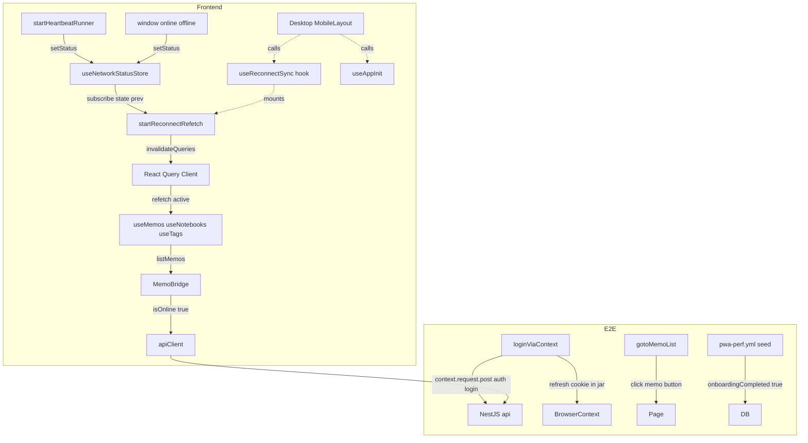
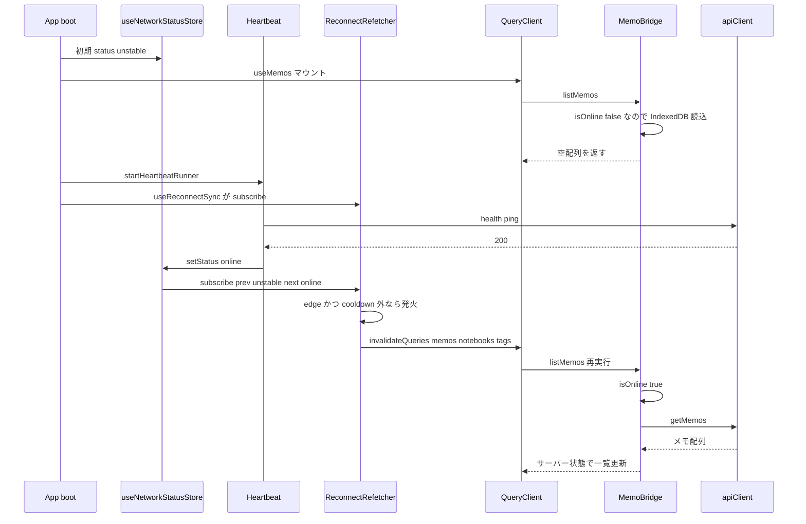
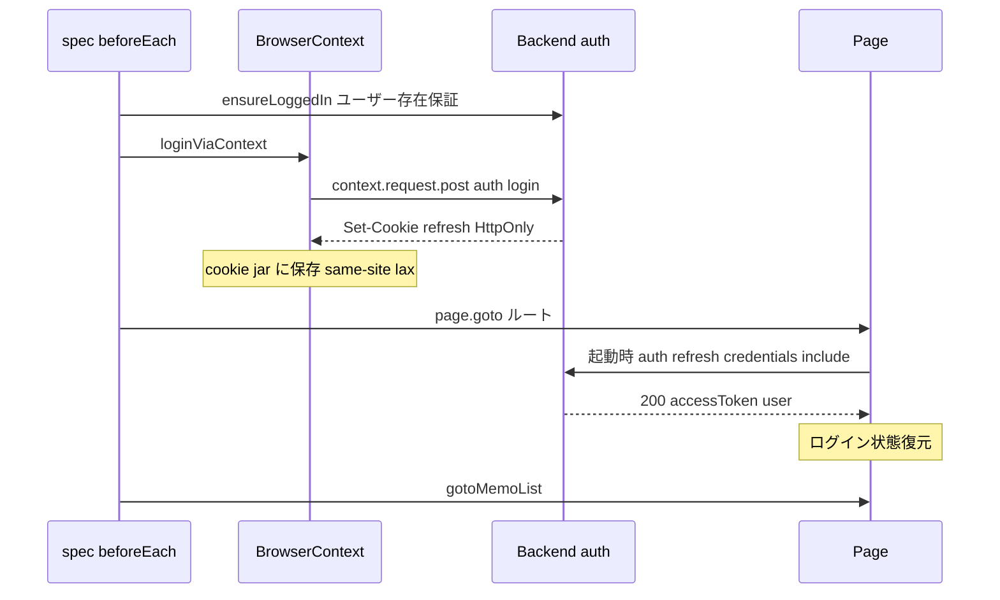

# Technical Design — pwa-e2e-greenup

## Overview

本機能は `.github/workflows/pwa-perf.yml` の e2e ジョブを完全緑化する。直近の修正（VITE 変数・throttle 緩和・test 管理者 seed）で 0→29 passed まで改善したが、editor/sync 系の残り約 12 件が RED である。診断により残失敗は 4 連鎖に集約された:（1）seed ユーザーの onboarding 未完、（2）E2E 認証セットアップ方式、（3）初期ビュー変更への導線、（4）**ネットワーク再接続時にサーバー状態が再取得されないアプリ本体のバグ**。

本設計の中核は（4）のアプリ本体バグ是正である。`useNetworkStatusStore` の初期 `status='unstable'` のまま `useMemos` が走り、`MemoBridge` が空の IndexedDB を `[]` として確定キャッシュする。heartbeat が `'online'` へ遷移しても React Query を再取得する結線が存在しないため、新端末・キャッシュ削除直後の利用者は一覧を空のまま見続ける。これはテスト修正では直らない実 UX バグであり、是正を「正しさ」としてテストで固定する。

**Impact**: フロントエンドに「再接続時再取得」結線（新規ユーティリティ＋hook）を追加し、E2E ヘルパー（context 経由ログイン・メモ遷移）と CI seed step を改修する。オフライン同期エンジン本体・既存クエリの `networkMode` は変更しない。

### Goals

- ネットワーク状態が `online` へ遷移した時、memo/notebook/tag のサーバー状態を自動再取得する（アプリ本体バグ是正）。
- E2E を context 経由ログイン＋メモ遷移ヘルパーに統一し、fresh コンテキストでも一覧が満たされる前提を成立させる。
- `pwa-perf.yml` の e2e ジョブを全件パスさせ、既存 29 件に回帰を出さない。

### Non-Goals

- PWA オフライン同期エンジン本体（ローカル優先・キュー同期）の再設計。
- React Query `onlineManager` 連動および全 `offlineFirst` クエリの再取得意味論の変更。
- trash 系クエリの再接続時再取得（要件外）。`memos.trash()` は対象 spec で active にならず、再接続再取得の対象としない。
- dashboard の **`recentMemos` は本 spec の対象に含める**（要件 1.1 改定）。ログイン後の着地画面で最初に表示されるクエリであり、`memos.list` と同一バグ階級（`isOnline()` false 時に空キャッシュを確定）を抱えるため、着地直後のホームで最近メモが空に見える実 UX バグを是正する。dashboard 配下のその他クエリ（`dashboard.notebooks` 等）は要件外であり、必要になれば後続 spec で `dashboard.all` への拡張を検討する。
- editor/sync 以外の広範な E2E 書き換え、既に commit 済みの env/throttle/seed の再実装。

## Architecture

### Existing Architecture Analysis

- **サーバー状態の真実の源泉は React Query**（`hooks/use{Domain}Queries.ts`）。クエリキーは `constants/queryKeys.ts` で一元管理。
- **ネットワーク状態は独自 zustand**（`stores/useNetworkStatusStore.ts`、3 状態: `online`/`unstable`/`offline`、初期 `unstable`）。`utils/offline/heartbeat.ts` の `startHeartbeatRunner`（純粋ランナー）が ping 結果で `setStatus` する。`useAppInit` が起動時に runner を開始するが status 遷移を購読していない。
- **メモ取得は `MemoBridge` 経由**（`utils/memo/memo-bridge.ts`）。`isOnline()===true`（status==='online'）の時のみ API 取得し IndexedDB へ upsert、それ以外はローカル値を返す。この挙動は仕様通りで変更しない。
- **認証は起動時 `tryAutoRefresh()`**（`contexts/AuthContext.tsx` → `utils/refreshClient.ts`）。HttpOnly refresh cookie を `credentials:'include'` で `/auth/refresh` に送る。失敗時は `removeTokens()` で localStorage の access token を消去する。
- **E2E ヘルパー**は `frontend/e2e/helpers/`（`auth.ts` / `backend-api.ts` / `idb.ts`）に分離。現状 `injectAccessToken`（localStorage のみ）。

**保持する境界**: React Query 単一真実源、`MemoBridge` のオフライン優先、heartbeat の純粋ランナー pattern、`queryKeys` 一元管理、e2e helpers の分離。

### Architecture Pattern & Boundary Map



**Architecture Integration**:

- **Selected pattern**: 純粋ランナー＋薄い hook（`startHeartbeatRunner` と同型）。再接続時再取得の責務を 1 ファイルに閉じる。
- **Domain/feature boundaries**: 「再接続検知→invalidate」は `utils/sync/reconnect-refetch.ts` に閉じ、`MemoBridge` や個別クエリ hook を変更しない。
- **Existing patterns preserved**: React Query 単一真実源、`queryKeys` 一元管理、heartbeat の DI 可能な純粋ランナー、e2e helpers 分離。
- **New components rationale**: `startReconnectRefetch`（status 遷移→invalidate の純粋ロジック、単体テスト用）、`useReconnectSync`（queryClient と store の結線・マウント）、`loginViaContext`（cookie 主経路）、`gotoMemoList`（初期ビュー追従）。
- **Steering compliance**: API コールは `apiClient`（bridge 経由・直 fetch 無し）、Zustand へのデータコピー無し、`queryKeys` 経由の invalidate。

### Technology Stack

| Layer    | Choice / Version                      | Role in Feature                                           | Notes                                               |
| -------- | ------------------------------------- | --------------------------------------------------------- | --------------------------------------------------- |
| Frontend | React 19 / `@tanstack/react-query` v5 | `invalidateQueries` による再接続時再取得                  | `onlineManager` 非連動（research.md Decision 参照） |
| Frontend | `zustand`                             | `useNetworkStatusStore.subscribe(state, prev)` で遷移検知 | 既存ストア・変更なし（購読のみ）                    |
| E2E      | `@playwright/test`                    | `context.request.post` で cookie 取得、`getByRole` で遷移 | `browserContext.request` が cookie jar 共有         |
| CI       | GitHub Actions / Prisma               | seed upsert に `onboardingCompleted:true`                 | `pwa-perf.yml` 内・アプリコード非依存               |

## System Flows

### 起動〜再接続時再取得（核心フロー / Req 1）

> **前提補正（重要）**: 下図は「boot 時に `useMemos` が `unstable` でマウントし空キャッシュする」最悪ケースを描いている。実際のログイン後初期ビューは**ホームダッシュボード**で、表示クエリは `dashboard.recentMemos`（別キー）であり `memos.list` はこの時点で **active ではない**（research Q4: `currentObject:'home'`）。`memos.list` が active 化するのは `gotoMemoList` 遷移後で、その時点では heartbeat ping（非同期）が完了し `online` になっていることが多い。したがって本フローの「再接続再取得」は**初回マウントが `unstable` 中に起きた場合の救済**であり、E2E のハッピーパスでは `memos.list` が `online` 確定後にマウントして素直に API fetch する経路も並存する。なお着地画面で active な `dashboard.recentMemos` は `unstable` 中にマウントして空キャッシュを抱える典型ケースであり、再接続再取得の主たる救済対象となる（要件 1.1）。



`unstable|offline → online` のエッジでのみ発火し、直前発火から `cooldownMs`（既定 2000ms）以内の再エッジは抑制する（AC 1.4）。steady な `online` 維持中・`online → unstable` の劣化方向では何もしない。

なお `useReconnectSync` のマウントが heartbeat の online 確定より遅れた場合、subscribe は当該エッジを捕捉できない。この取りこぼしは `start()` 時の reconcile（`getStatus()==='online'` なら初回 invalidate を発火）で補償する。reconcile と直後の `online` エッジは同一 `lastFiredAt` cooldown を共有し二重発火しない。

### E2E 認証セットアップ（Req 2）



## Requirements Traceability

| Requirement | Summary                                                      | Components                           | Interfaces                 | Flows        |
| ----------- | ------------------------------------------------------------ | ------------------------------------ | -------------------------- | ------------ |
| 1.1         | online 遷移で memo/notebook/tag/dashboard.recentMemos 再取得 | ReconnectRefetcher, useReconnectSync | `startReconnectRefetch`    | 起動〜再接続 |
| 1.2         | online 以外はローカル結果のみ・空を確定値にしない            | MemoBridge（既存・無変更）           | `listMemos`（既存）        | 起動〜再接続 |
| 1.3         | ローカル空＋online でサーバー取得                            | ReconnectRefetcher → MemoBridge      | invalidate→`listMemos`     | 起動〜再接続 |
| 1.4         | 再接続多発時の多重発行抑制                                   | ReconnectRefetcher                   | edge トリガ＋cooldown      | 起動〜再接続 |
| 1.5         | 同期エンジン責務は不変                                       | ReconnectRefetcher（追加のみ）       | —                          | —            |
| 2.1         | context 経由ログインで cookie 保存                           | E2EAuthHelper                        | `loginViaContext`          | E2E 認証     |
| 2.2         | 起動時 refresh 成功で復元                                    | Application（既存）                  | `/auth/refresh`（既存）    | E2E 認証     |
| 2.3         | localStorage 注入のみに依存しない                            | E2EAuthHelper                        | `injectAccessToken` 任意化 | E2E 認証     |
| 2.4         | 共有ヘルパー化                                               | E2EAuthHelper                        | `loginViaContext`          | E2E 認証     |
| 3.1         | seed に onboardingCompleted true                             | CISeedStep                           | Prisma upsert              | —            |
| 3.2         | OnboardingModal が遮らない                                   | Application（既存 `OnboardingGate`） | —                          | —            |
| 3.3         | アプリコード非依存維持                                       | CISeedStep                           | `pwa-perf.yml`             | —            |
| 4.1         | メモボタンでメモ一覧へ遷移                                   | E2ENavHelper                         | `gotoMemoList`             | E2E 認証     |
| 4.2         | 一覧表示を確認してから後続                                   | E2ENavHelper                         | `gotoMemoList`             | E2E 認証     |
| 4.3         | 共有ヘルパー化                                               | E2ENavHelper                         | `gotoMemoList`             | E2E 認証     |
| 5.1         | 残り約 12 件を含む全 spec パス                               | 5 spec beforeEach 統一               | helpers 適用               | —            |
| 5.2         | fresh context で一覧充足                                     | ReconnectRefetcher                   | —                          | 起動〜再接続 |
| 5.3         | 既存 29 件に回帰なし                                         | invalidate スコープ最小化            | —                          | —            |
| 6.1         | FE 変更が本番デプロイ誘発を考慮                              | プロセス制約                         | —                          | —            |
| 6.2         | 隔離 DB / alt ポートで反復                                   | プロセス制約                         | —                          | —            |
| 6.3         | env/throttle/seed 再実装除外                                 | スコープ制約                         | —                          | —            |
| 6.4         | 同期エンジン再設計・広範書換除外                             | スコープ制約                         | —                          | —            |

## Components and Interfaces

| Component          | Domain/Layer         | Intent                                          | Req Coverage       | Key Dependencies                                             | Contracts      |
| ------------------ | -------------------- | ----------------------------------------------- | ------------------ | ------------------------------------------------------------ | -------------- |
| ReconnectRefetcher | Frontend / sync util | status 遷移を購読し対象クエリを invalidate      | 1.1, 1.3, 1.4, 1.5 | QueryClient (P0), useNetworkStatusStore (P0), queryKeys (P0) | Service, State |
| useReconnectSync   | Frontend / hook      | queryClient と store を結線しランナーをマウント | 1.1, 5.2           | ReconnectRefetcher (P0), QueryClientProvider (P0)            | Service        |
| E2EAuthHelper      | E2E / helper         | context 経由ログインで refresh cookie を確立    | 2.1, 2.3, 2.4      | BrowserContext.request (P0), BackendApi (P1)                 | Service        |
| E2ENavHelper       | E2E / helper         | メモ一覧への共有遷移                            | 4.1, 4.2, 4.3      | Playwright Page (P0)                                         | Service        |
| CISeedStep         | CI / workflow        | seed ユーザーを onboarding 完了で作成           | 3.1, 3.3           | Prisma upsert (P0)                                           | Batch          |

### Frontend / Sync

#### ReconnectRefetcher

| Field        | Detail                                                                                                 |
| ------------ | ------------------------------------------------------------------------------------------------------ |
| Intent       | ネットワーク状態が online へ遷移した時、memo/notebook/tag のサーバー状態クエリを再取得する純粋ランナー |
| Requirements | 1.1, 1.3, 1.4, 1.5                                                                                     |

**Responsibilities & Constraints**

- `非online → online` のエッジを検知し `invalidate` を呼ぶ。劣化方向（`online → unstable/offline`）では何もしない。
- **`start()` 時に現在 status を reconcile する**: `getStatus()==='online'` なら、購読開始前に heartbeat が確定させた `unstable→online` エッジ（subscribe が捕捉できない先行遷移）を補償するため、初回 invalidate を一度だけ発火する。これにより「`useReconnectSync` のマウントが heartbeat の online 確定より遅れる」レースで一覧が空のまま固定される事象を防ぐ。
- 直前発火から `cooldownMs`（既定 2000ms）以内の再エッジを抑制する（leading-edge + cooldown）。
- invalidate 対象は `memos.all` / `notebooks.all` / `tags.all` / `dashboard.recentMemos()` のみ（着地画面の最近メモを含む最小スコープ）。`memos.all` 等は prefix 一致のため配下（`memos.trash()` 等）も stale 化するが、refetch は active クエリのみで対象 spec では trash は active にならない。
- 同期エンジン（`MemoBridge`・`SyncEngine`）の責務を変更しない。再取得トリガのみ追加する。
- DI 可能（`subscribe` / `invalidate` / `now` を注入）で単体テスト可能とする。

**Dependencies**

- Inbound: useReconnectSync — マウント時に起動・アンマウントで停止 (P0)
- Outbound: QueryClient.invalidateQueries — 対象クエリ再取得 (P0)
- Outbound: useNetworkStatusStore.subscribe — status 遷移検知 (P0)
- Outbound: queryKeys — invalidate 対象キー (P0)

**Contracts**: Service [x] / State [x]

##### Service Interface

```typescript
import type { QueryKey } from '@tanstack/react-query';
import type { NetworkStatus } from '../../stores/useNetworkStatusStore';

export interface ReconnectRefetchOptions {
	/** zustand 互換の購読関数。(state, prevState) を受ける listener を登録し解除関数を返す */
	subscribe: (listener: (status: NetworkStatus, prevStatus: NetworkStatus) => void) => () => void;
	/** 現在の status を読む。start() 時の reconcile に使用。既定 () => useNetworkStatusStore.getState().status */
	getStatus: () => NetworkStatus;
	/** invalidate 実行。既定実装は queryClient.invalidateQueries をキーごとに呼ぶ */
	invalidate: (keys: readonly QueryKey[]) => void;
	/** 再取得対象キー。既定 [memos.all, notebooks.all, tags.all, dashboard.recentMemos()] */
	targetKeys?: readonly QueryKey[];
	/** 多重発行抑制の cooldown（ms）。既定 2000 */
	cooldownMs?: number;
	/** テスト用時刻源。既定 () => Date.now() */
	now?: () => number;
}

export interface ReconnectRefetcher {
	stop(): void;
}

export function startReconnectRefetch(options: ReconnectRefetchOptions): ReconnectRefetcher;
```

- **Preconditions**: `subscribe` は zustand 既定の `(state, prev)` を渡せること。`getStatus` は現在の status を同期的に返せること。
- **Postconditions**: `非online → online` かつ cooldown 外で `invalidate(targetKeys)` が一度だけ呼ばれる。**加えて `start()` 時点で `getStatus()==='online'` の場合、エッジ購読前に確定した online 状態を取りこぼさないよう、cooldown を尊重して初回 reconcile を一度だけ発火する**。`stop()` で購読解除。
- **Invariants**: 同一 online 遷移に対し cooldown 内では最大 1 回しか発火しない。劣化方向では発火しない。`start()` 直後の reconcile も同じ `lastFiredAt` cooldown を共有し、直後の `online` エッジと二重発火しない。

##### State Management

- **State model**: 内部に `lastFiredAt: number | null` のみ保持。グローバル状態は持たない。
- **Concurrency strategy**: invalidate は React Query が同一キーの並行 refetch を dedup する。ランナー側は cooldown で連続エッジを平滑化。

**Implementation Notes**

- Integration: `useReconnectSync` が `useQueryClient()` と `useNetworkStatusStore.subscribe` を渡して起動。既定 `invalidate` は `keys.forEach(k => queryClient.invalidateQueries({ queryKey: k }))`。
- Validation: `online → unstable → online` のフラップで invalidate が cooldown により 1 回に抑制されることを単体テストで確認。
- Risks: 再接続多発時の API バースト → cooldown とスコープ最小化で平滑化。
- Race（重要）: `useAppInit`（heartbeat 起動）と `useReconnectSync` のマウント順は保証されない。subscribe 前に `online` が確定すると edge を取りこぼすため、**`start()` の初回 reconcile（getStatus 読み）を一次防御、subscribe による edge 検知を二次防御**とする二段構えで担保する。invalidate は active クエリのみ・dedup ありのため reconcile の追加コストは無視できる。

#### useReconnectSync

| Field        | Detail                                                                                       |
| ------------ | -------------------------------------------------------------------------------------------- |
| Intent       | `ReconnectRefetcher` を queryClient と store に結線し、レイアウトで一度だけマウントする hook |
| Requirements | 1.1, 5.2                                                                                     |

**Responsibilities & Constraints**

- `QueryClientProvider` 配下でのみ動作（`useQueryClient()` 依存）。
- マウント時に `startReconnectRefetch` を起動、アンマウントで `stop()`。`useAppInit` と同じく一度だけ初期化（`useRef` ガード）。

**Contracts**: Service [x]

```typescript
export function useReconnectSync(): void;
```

**Implementation Notes**

- Integration: `DesktopLayout` / `MobileLayout` で `useAppInit()` の隣に `useReconnectSync()` を呼ぶ。両 layout は `AuthGuard`（=`QueryClientProvider` 配下）でマウントされる。
- Validation: 既存 layout テスト（`DesktopLayout.test.tsx` 等）が hook を `vi.mock` できるよう副作用を hook 内に閉じる。
- Risks: 二重マウント → `useRef` 初期化ガードで回避（layout は同時に 1 つのみ表示）。

### E2E / Helpers

#### E2EAuthHelper（auth.ts 拡張）

| Field        | Detail                                                                            |
| ------------ | --------------------------------------------------------------------------------- |
| Intent       | BrowserContext 経由でログインし HttpOnly refresh cookie を context jar に保存する |
| Requirements | 2.1, 2.3, 2.4                                                                     |

**Responsibilities & Constraints**

- `context.request.post(`${backendUrl}/auth/login`, { data })` で cookie を取得・保存する。
- `accessToken` / `userId` を返し、メモ seed 等に再利用可能にする。
- `injectAccessToken`（localStorage 注入）には依存しない（主経路は cookie）。残置する場合も補助に留める。

**Contracts**: Service [x]

```typescript
import type { BrowserContext } from '@playwright/test';

export async function loginViaContext(
	context: BrowserContext,
	config: E2EAuthConfig,
): Promise<E2EAuthSession>; // { accessToken, userId }
```

- **Preconditions**: 対象ユーザーが存在（`ensureLoggedIn` でユーザー作成保証 or CI seed 済み）。`config.backendUrl` が CORS_ORIGINS と同一 site。
- **Postconditions**: context jar に refresh cookie（HttpOnly, path=/auth）が保存され、後続 page の `/auth/refresh` で送出される。

**Implementation Notes**

- Integration: 既存 `ensureLoggedIn`（ユーザー作成・Node fetch）は維持。cookie 取得のみ context 経由へ移行。`BackendApi.login`（Node fetch）はメモ seed 用 bearer 取得に継続利用。
- Validation: ローカル隔離環境（backend:3100 / preview:4173 / `mosaku_e2e`）で起動時 refresh が 200 になることを確認（research.md Q3 で実証済み）。
- Risks: クロスサイト本番との差異 → cookie 設定は env 駆動で本番は `sameSite='none'/secure=true`、E2E は変更しない。

#### E2ENavHelper（nav.ts 新設）

| Field        | Detail                                                 |
| ------------ | ------------------------------------------------------ |
| Intent       | ホームダッシュボードからメモ一覧へ遷移する共有ヘルパー |
| Requirements | 4.1, 4.2, 4.3                                          |

**Responsibilities & Constraints**

- `getByRole('button', { name: 'メモ', exact: true })` をクリックしメモ一覧へ遷移する。
- メモ一覧ビューが表示されたことを確認してから戻る（メモ未取得でも view 自体は表示される）。

**Contracts**: Service [x]

```typescript
import type { Page } from '@playwright/test';

export async function gotoMemoList(page: Page): Promise<void>;
```

- **Preconditions**: 認証済みでアプリがマウント済み（`page.goto('/')` 完了後）。Playwright project は Desktop Chrome（span「メモ」可視）。
- **Postconditions**: `currentObject='memo' / currentView='list'` のメモ一覧ビューが表示されている。

**Implementation Notes**

- Integration: 対象 5 spec の `beforeEach` を「`loginViaContext` → `page.goto('/')` → `gotoMemoList(page)` → `waitForSelector('[data-testid="memo-item"]')`」に統一。memo-item の出現は Req 1（再接続再取得）に依存。
- Validation: クリック後にメモ一覧ビューの表示を確認（メモボタンの active 状態 or 一覧コンテナ）。具体セレクタは実装時に確定するが、view 表示確認を必須とする。
- Risks: accessible name 不一致 → Desktop project のみで span 可視（research.md Q4）。

### CI / Workflow

#### CISeedStep（pwa-perf.yml）

| Field        | Detail                                            |
| ------------ | ------------------------------------------------- |
| Intent       | E2E seed ユーザーを onboarding 完了状態で作成する |
| Requirements | 3.1, 3.3                                          |

**Contracts**: Batch [x]

- **Trigger**: 「Seed E2E test user」step（Prisma upsert、アプリコード非依存）。
- **Input / validation**: 既存 upsert の `create` / `update` 双方に `onboardingCompleted: true` を追加。
- **Output / destination**: `mosaku_test` DB（CI）。
- **Idempotency & recovery**: upsert により冪等。既存ユーザーも `update` で onboarding 完了へ揃う。

**Implementation Notes**

- Integration: `schema.prisma` の `onboardingCompleted Boolean @default(false)` を `true` で上書き。`OnboardingGate` は `user.onboardingCompleted` true で modal を開かない。
- Risks: 本番 seed には影響しない（CI workflow 内のみ）。

## Error Handling

### Error Strategy

- **ReconnectRefetcher**: `invalidate` 内の例外は購読 listener を破壊しないよう各キー独立に処理（1 キーの失敗が他をブロックしない）。invalidate 自体の失敗はログのみ（次回 staleness で吸収）。
- **loginViaContext**: login レスポンスが 2xx 以外なら明示的に throw し、原因（status/body）を含めて beforeEach を fail させる（テスト診断性）。
- **gotoMemoList**: ビュー表示確認のタイムアウトは Playwright の `expect` タイムアウトに委ねる。

### Monitoring

- 本番アプリ側: 既存 Sentry breadcrumb（auth refresh）で再接続後の挙動を観測可能。再接続再取得の追加ログは不要（invalidate は通常動作）。
- CI 側: 失敗時は `pwa-perf.yml` の既存ログ収集（backend.log・Playwright list reporter）で診断。

## Testing Strategy

### Unit Tests（frontend / Vitest）— Req1 の正しさの番人

> Req1（再接続時再取得）の正しさは **Vitest 単体テストを一次の番人**とする。E2E は環境依存のタイミング（heartbeat ping 完了と memos.list マウント順）に左右されるため、Req1 の網羅は単体で固定する。

- `startReconnectRefetch`: `unstable → online` で invalidate が 1 回呼ばれる。
- `startReconnectRefetch`: `online → unstable → online` のフラップで cooldown により 1 回に抑制される。
- `startReconnectRefetch`: 劣化方向（`online → unstable`）では invalidate しない。
- `startReconnectRefetch`: **`start()` 時に `getStatus()==='online'` なら初回 reconcile が 1 回発火する（マウント遅延レースの救済）。**
- `startReconnectRefetch`: **`start()` 直後の reconcile と直後の `online` エッジが cooldown を共有し二重発火しない。**
- `startReconnectRefetch`: `stop()` 後は購読が解除され発火しない。
- `useReconnectSync`: マウント／アンマウントで runner が起動・停止する（`useRef` 二重起動ガード）。

### Integration / E2E Tests（Playwright）

> E2E は「fresh コンテキストで最終的に memo-item が表示される」統合ハッピーパスを担保する。Req1 が機能経路（初回 `unstable` マウント救済）を通るか、`online` 確定後の素直な fetch を通るかは環境タイミング依存であり、**どちらでも memo-item が表示されること**を成功条件とする（Req1 の経路網羅は上記 Unit に委譲）。

- fresh コンテキスト（空 IndexedDB）で `loginViaContext` → `page.goto('/')` → 起動時 refresh 200 → `gotoMemoList` → memo-item 表示。
- 対象 5 spec（markdown-editor / prose-typography / slash-command / train-scenario / feedback）が beforeEach 統一後にパス。
- 回帰: 既存 29 件（特に refresh-token-auto-login / public-memo / auth-flow）が引き続きパス。

### 回帰確認（手動 / CI）

- `pwa-perf.yml` の e2e ジョブ全件グリーン（CI workers=1, retries=2 の既存設定）。
- ローカル隔離環境（backend:3100 / preview:4173 / `mosaku_e2e`）で全件再現。

## Security Considerations

- `loginViaContext` は HttpOnly refresh cookie を Playwright context jar に保持するのみ。テスト用 seed ユーザー（`pwa-e2e-admin@test.example`）に限定され、本番資格情報を扱わない。
- `RefreshCsrfGuard`（Origin ∈ CORS_ORIGINS ＋ `X-Refresh-Request:1`）は維持。E2E はブラウザ経由 fetch のため Origin が自動付与され既存ガードを通過する。cookie 設定（sameSite/secure/domain）は env 駆動で本番（`none`/`true`/`.mosaku.jp`）を変更しない。

## Performance & Scalability

- 再接続再取得は active（マウント中）クエリのみ refetch し、React Query が同一キーの並行 refetch を dedup する。
- フラップ環境の API バーストは edge トリガ＋cooldown（既定 2000ms）＋invalidate スコープ最小化（memo/notebook/tag/dashboard.recentMemos のみ）で平滑化する。steady online では追加リクエストを発生させない。

## Supporting References

- 詳細な discovery ログ・クロスオリジン cookie 実証・アーキ選定比較は `research.md` を参照。
