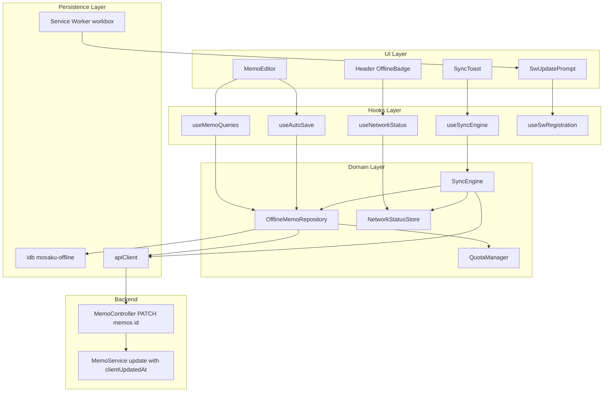
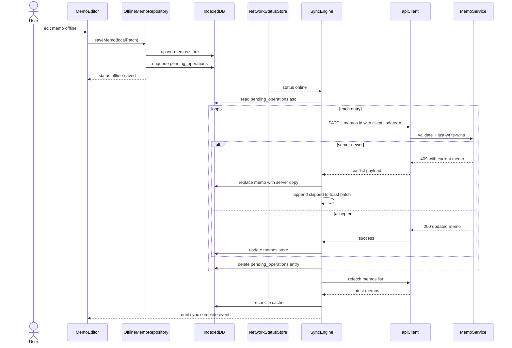
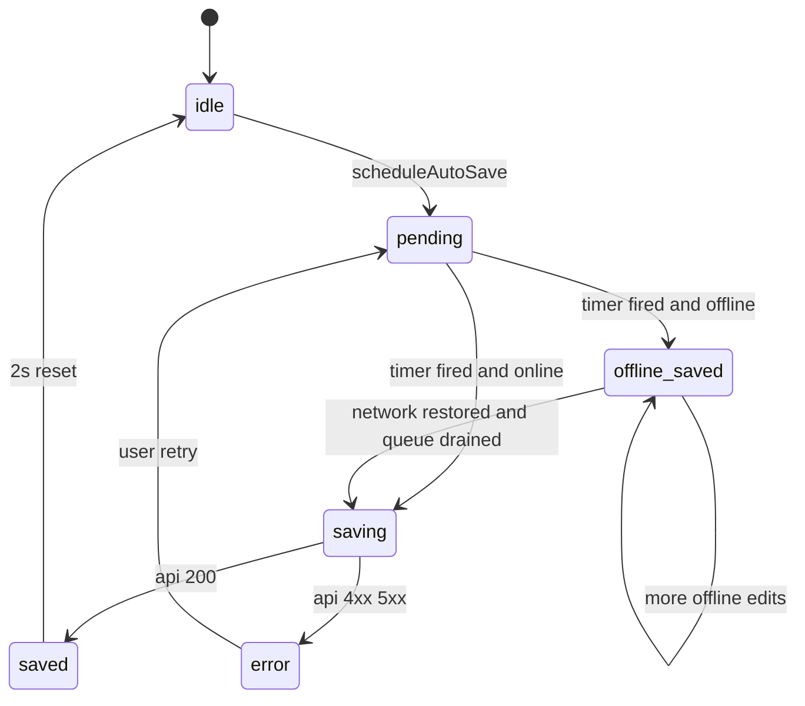
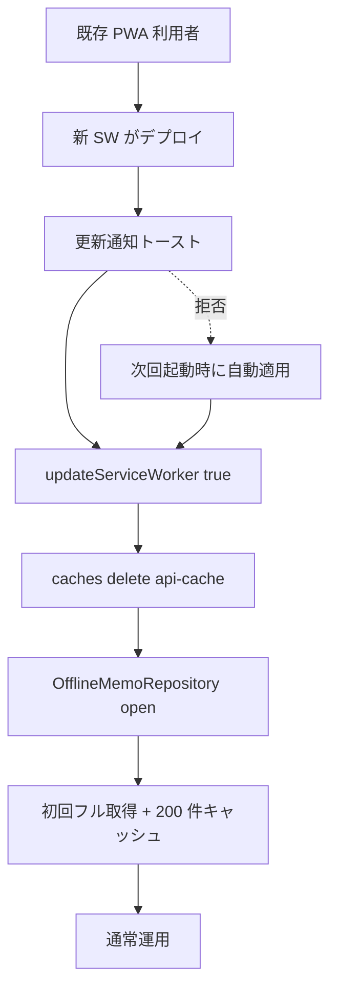

# Technical Design — PWA Offline Support

## Overview

**Purpose**: 本機能は Mosaku を PWA として再構成し、電車内など 30 分〜1 時間程度のオフライン環境でもメモの閲覧・編集・検索を継続でき、再接続時に自動で last-write-wins 同期を行う体験を提供する。

**Users**: ログイン済みのユーザーが、ホーム画面アイコンから起動して通信不通環境でも作業を続けられるようになる。マルチデバイス間の同時編集競合は別 spec に委譲する前提で、本機能は単一デバイス中心の継続作業の信頼性に集中する。

**Impact**: 既存の React Query を Single Source of Truth とする SPA に対し、(1) Service Worker / Web App Manifest によるアプリシェル化、(2) IndexedDB ベースのローカルメモストアと保留キュー、(3) ネットワーク状態に基づく同期エンジンの 3 階層を新たに挿入する。`apiClient` を直接呼んでいた `useMemos` / `useUpdateMemo` 等は、新設する `OfflineMemoRepository` を経由する形に置き換わる。バックエンドは `PATCH /memos/:id` に `clientUpdatedAt` 受信ロジックを追加する。

### Goals

- Requirement 1〜10 を満たすオフライン体験（A2HS インストール、200 件・50 MB 上限のメモキャッシュ、保留キュー、再接続時の last-write-wins 同期、ネットワーク可視化、Sentry 観測性）。
- 既存の autosave インジケーター（5 状態）と整合した「未同期（オフライン保存済み）」状態の追加。
- Service Worker から認証必須エンドポイントを完全に分離し、機微情報の SW Cache Storage 残留を排除。

### Non-Goals

- マルチデバイス間の OT / CRDT による同時編集競合解決（別 spec で対応）。
- ノートブック・タグ・テーマのオフライン CRUD（参照のみキャッシュ）。
- バックグラウンド Push 通知 / Periodic Background Sync。
- オフライン状態からの新規ログイン。
- 添付ファイル・画像のオフライン編集。

## Architecture

### Existing Architecture Analysis

- 既存 SPA は React Query を「サーバー状態の唯一の真実の源泉」とし、Zustand は UI 状態のみを担当する（steering: `tech.md` Key Technical Decisions）。本設計はこの分離を破らない。
- `apiClient` (`frontend/src/utils/api.ts`) は全 API 通信を統一窓口で扱う。本機能ではここを直接置換せず、`OfflineMemoRepository` 経由でラップする形で挿入する。
- 既存 `useAutoSave` は SaveStatus を 5 状態で管理する。本機能は `'idle' | 'pending' | 'saving' | 'saved' | 'error' | 'offline-saved'` の 6 状態に拡張する。
- `vite-plugin-pwa@1.0.3` は導入済みだが `runtimeCaching: [{ urlPattern: /\/api\//, handler: 'NetworkFirst' }]` が Requirement 9.4 と矛盾。SW 設定を再構築する。
- バックエンドは NestJS の `MemoController` / `MemoService` で完結しており、`UpdateMemoDto` への `clientUpdatedAt` 追加と `update` メソッドの楽観ロック分岐のみで last-write-wins を実装可能。

### Architecture Pattern & Boundary Map

採用パターンは **Outbox + Cache-Aside**。書き込みは保留キュー（Outbox）に積み上げて同期エンジンがドレイン、読み取りはローカル IndexedDB を経由した read-through キャッシュとして React Query を支える。



**Architecture Integration**

- **Selected pattern**: Outbox + Cache-Aside（`research.md` の Architecture Pattern Evaluation 参照）。
- **Domain/feature boundaries**: Persistence（IndexedDB / SW）→ Domain（Repository / SyncEngine / QuotaManager）→ Hooks → UI の単方向依存。Domain 層は React 非依存にしてテスト容易性を確保。
- **Existing patterns preserved**: React Query を SoT とする運用、`apiClient` 統一窓口、Zustand は UI 状態のみ、`useAutoSave` の SaveStatus 中心の挙動契約。
- **New components rationale**: 永続層の追加とネットワーク不確実性のため、Repository（read-through）と SyncEngine（書き込みドレイン）を分離。前者は React Query の queryFn から呼ばれ、後者はネットワーク状態に駆動される独立アクター。
- **Steering compliance**: バンドル軽量主義（`idb` ~3 KB）、Sentry 構造化タグ契約、PII ポリシー（メモ本文を Sentry へ送らない）、ゴミ箱の論理削除フローと整合。

### Technology Stack

| Layer                 | Choice / Version                                  | Role in Feature                                                                   | Notes                                                                                                                         |
| --------------------- | ------------------------------------------------- | --------------------------------------------------------------------------------- | ----------------------------------------------------------------------------------------------------------------------------- |
| Frontend (PWA)        | `vite-plugin-pwa` 1.0.3（既存） + Workbox         | Web App Manifest 配信、アプリシェル precache、SW 更新通知                         | `registerType: 'autoUpdate'` → `'prompt'` に変更。`runtimeCaching` から `/api/*` を削除し、テーマ CSS のみ runtime キャッシュ |
| Frontend (永続層)     | `idb` ^8 (新規追加)                               | IndexedDB の Promise ラッパー。`mosaku-offline` データベース管理                  | Dexie / localforage は採用しない（research.md 参照）                                                                          |
| Frontend (状態)       | `@tanstack/react-query` 5.81 / `zustand` 5        | React Query は引き続き SoT、Zustand に `useNetworkStatusStore` を追加             | React Query は `networkMode: 'offlineFirst'` を queries / mutations へ適用                                                    |
| Frontend (オブザーバ) | `@sentry/react` 10                                | 同期成功/失敗 breadcrumb、リトライ上限到達時の error イベント                     | 既存 `sentry-scrubber.ts` を経由、メモ本文は送信しない                                                                        |
| Backend               | NestJS 11 / Prisma 6 (既存)                       | `UpdateMemoDto.clientUpdatedAt` 追加、`MemoService.update` に楽観ロック分岐を追加 | 既存 `JwtAuthGuard` / `AuthorizationService` の経路を維持                                                                     |
| Data / Storage        | IndexedDB (`mosaku-offline` v1) / 既存 PostgreSQL | クライアント永続層に `memos` / `pending_operations` / `meta` ストアを新設         | サーバー側 schema は無変更                                                                                                    |

> 採否判断と外部 API の契約詳細は `research.md` に集約。design.md では決定事項のみを記述する。

## System Flows

オフラインからオンライン復帰までの主要フロー。シーケンス図はオンライン同期、状態図は SaveStatus の遷移を表す。

### Sync Cycle Sequence



**Key Decisions**

- 409（last-write-wins 敗北）は `Engine` がローカルキャッシュをサーバー版で上書きしつつ、ユーザー通知バッチ（タイトル一覧）にメモ識別子を蓄積し、サイクル完了時にトーストでまとめて通知（Requirement 7.5）。
- 5xx / ネットワーク再切断は指数バックオフで再試行（初期 2 秒、最大 5 分）し、保留キューを失わない（Requirement 6.4）。

### SaveStatus Lifecycle (extended)



**Key Decisions**

- `'offline-saved'` は「ローカルへは確実に保存済み」を意味する終端状態。再接続後に `SyncEngine` がドレインに成功すると `'saved'` を経由して `'idle'` に戻る（Requirement 4.7）。
- `'error'` は「サーバー側で 4xx を受信した（=同期不能）」もしくは「リトライ上限到達」を表す。オフラインによる送信遅延は `'error'` ではなく `'offline-saved'`。

## Requirements Traceability

| Requirement | Summary                               | Components                                                       | Interfaces                                             | Flows                |
| ----------- | ------------------------------------- | ---------------------------------------------------------------- | ------------------------------------------------------ | -------------------- |
| 1.1–1.6     | A2HS / アプリシェル / SW 更新         | `PwaShell`, `useSwRegistration`, `SwUpdatePrompt`                | `vite.config.ts` PWA options, `useRegisterSW` hook     | —                    |
| 2.1–2.6     | メモキャッシュ範囲                    | `OfflineMemoRepository`, `QuotaManager`                          | `OfflineMemoRepository` Service, IDB schema            | —                    |
| 3.1–3.4     | オフライン閲覧                        | `useMemoQueries`(改修), `OfflineMemoRepository`, `OfflineBadge`  | React Query queryFn 契約                               | —                    |
| 4.1–4.7     | オフライン編集 + 自動保存             | `MemoEditor`(改修), `useAutoSave`(拡張), `OfflineMemoRepository` | SaveStatus state machine, IDB pending_operations       | SaveStatus Lifecycle |
| 5.1–5.4     | オフライン検索                        | `OfflineMemoRepository.search`, `useSearchMemos`(改修)           | Service Interface (search method)                      | —                    |
| 6.1–6.7     | オンライン復帰時自動同期              | `SyncEngine`, `NetworkStatusStore`, `OfflineMemoRepository`      | Service Interface, API contract (`clientUpdatedAt`)    | Sync Cycle Sequence  |
| 7.1–7.5     | ネットワーク状態 + サーバーエラー契約 | `NetworkStatusStore`, `OfflineBadge`, `SyncToast`                | Zustand store API, Toast event                         | Sync Cycle Sequence  |
| 8.1–8.5     | パフォーマンス・容量                  | `QuotaManager`, `OfflineMemoRepository`                          | `QuotaManager` Service, `navigator.storage.estimate()` | —                    |
| 9.1–9.5     | セキュリティ・プライバシー            | `vite.config.ts` PWA options, `OfflineMemoRepository`, scrubber  | SW runtimeCaching policy, Repository purge API         | —                    |
| 10.1–10.4   | 観測性                                | `SyncTelemetry`, `SyncEngine`, `DebugPanel`                      | Sentry breadcrumb / event helpers                      | —                    |

## Components and Interfaces

| Component               | Domain/Layer | Intent                                                                                  | Req Coverage                                | Key Dependencies (P0/P1)                                                  | Contracts      |
| ----------------------- | ------------ | --------------------------------------------------------------------------------------- | ------------------------------------------- | ------------------------------------------------------------------------- | -------------- |
| `OfflineMemoRepository` | Domain       | IDB と apiClient を束ね、read-through / write-through / 保留キュー追加を提供            | 2.1–2.6, 3.1–3.4, 4.1–4.7, 5.1–5.4, 9.2–9.3 | `idb` (P0), `apiClient` (P0), `QuotaManager` (P1)                         | Service, State |
| `SyncEngine`            | Domain       | 保留キューを単一プロデューサで順次サーバーへ送信し last-write-wins を実装               | 6.1–6.7, 7.4–7.5, 10.1–10.2                 | `OfflineMemoRepository` (P0), `apiClient` (P0), `NetworkStatusStore` (P0) | Service, Event |
| `NetworkStatusStore`    | Domain       | `online` / `offline` イベント + heartbeat による状態判定を Zustand で公開               | 7.1, 7.2                                    | `apiClient` (P1)                                                          | State          |
| `QuotaManager`          | Domain       | `navigator.storage.estimate()` で空き枠を取得し件数上限と退避を制御                     | 2.4, 8.1, 8.2, 8.5                          | `OfflineMemoRepository` (P0)                                              | Service        |
| `SyncTelemetry`         | Domain       | 同期成功/失敗の Sentry breadcrumb と error event を構造化タグ付きで送信                 | 9.5, 10.1, 10.2, 10.4                       | `@sentry/react` (P0), `sentry-scrubber` (P0)                              | Service        |
| `useMemoQueries` (改修) | Hooks        | React Query の queryFn / mutationFn を `OfflineMemoRepository` 経由に切替               | 3.1–3.4, 4.1–4.6, 5.1–5.4                   | `OfflineMemoRepository` (P0), `@tanstack/react-query` (P0)                | Service        |
| `useAutoSave` (拡張)    | Hooks        | SaveStatus に `'offline-saved'` を追加し、Repository の応答で状態を切り替える           | 4.1, 4.7                                    | `OfflineMemoRepository` (P0)                                              | State          |
| `useNetworkStatus`      | Hooks        | `NetworkStatusStore` を購読し、UI 層で online/offline/unstable を取得                   | 7.1, 7.2                                    | `NetworkStatusStore` (P0)                                                 | State          |
| `useSyncEngine`         | Hooks        | `SyncEngine` のシングルトンに購読し、保留件数や進行状況を提供                           | 6.7, 7.3, 7.5, 10.3                         | `SyncEngine` (P0)                                                         | State          |
| `useSwRegistration`     | Hooks        | `useRegisterSW` をラップし、更新通知トーストとパージ初期化を統合                        | 1.1–1.6                                     | `vite-plugin-pwa` (P0)                                                    | Service        |
| `MemoEditor` (改修)     | UI           | `'offline-saved'` 表示と未同期件数の可視化、削除/ゴミ箱送り操作を Repository 経由に変更 | 3.4, 4.1, 4.6, 4.7, 7.3                     | `useAutoSave` (P0), `OfflineMemoRepository` (P0)                          | —              |
| `OfflineBadge`          | UI           | アプリヘッダーの恒常表示でネットワーク状態と未同期件数を可視化                          | 3.4, 7.2, 7.3                               | `useNetworkStatus` (P0), `useSyncEngine` (P1)                             | —              |
| `SwUpdatePrompt`        | UI           | SW 更新通知トーストでユーザー承認時に `updateServiceWorker(true)` を呼ぶ                | 1.6                                         | `useSwRegistration` (P0)                                                  | —              |
| `SyncToast`             | UI           | 同期完了/スキップ件数の通知トーストを表示                                               | 7.4, 7.5                                    | `useSyncEngine` (P0)                                                      | —              |
| `DebugPanel`            | UI           | 設定画面の開発者向けセクションでキャッシュ件数・キュー件数・最終同期日時を表示          | 10.3                                        | `OfflineMemoRepository` (P1), `useSyncEngine` (P1)                        | —              |
| `MemoController` (改修) | Backend      | 既存 `PATCH /memos/:id` で `clientUpdatedAt` を受理し DTO バリデーション                | 6.2, 6.3                                    | `MemoService` (P0)                                                        | API            |
| `MemoService` (改修)    | Backend      | `update` メソッド内で `clientUpdatedAt` 比較を行い、敗北時 `ConflictException`          | 6.2, 6.3                                    | Prisma `memo` model (P0)                                                  | Service        |

UI コンポーネント（`OfflineBadge` / `SwUpdatePrompt` / `SyncToast` / `DebugPanel`）は新たな永続境界を持たないため、上記サマリ + 後段の Implementation Note に集約する。

### Domain

#### OfflineMemoRepository

| Field        | Detail                                                                                                  |
| ------------ | ------------------------------------------------------------------------------------------------------- |
| Intent       | IndexedDB と `apiClient` を束ね、read-through / write-through / 保留キュー追加を一元化する              |
| Requirements | 2.1, 2.2, 2.3, 2.4, 2.5, 2.6, 3.1, 3.2, 3.3, 4.1, 4.2, 4.3, 4.4, 4.5, 4.6, 5.1, 5.2, 5.3, 5.4, 9.2, 9.3 |

**Responsibilities & Constraints**

- 単一ユーザー（`AuthTokenManager.getAccessToken()` から取得した `sub`）スコープでのみ操作する。`userId` mismatch 検出時は IDB を全パージ（Requirement 9.3）。
- `memos` ストアの書き込み時に `searchableText = stripHtml(content)` を派生フィールドとして保存し、検索 300 ms 目標を支える。
- 保留キューへの追加は同一 `memoId` の既存エントリを最新内容で上書きし、エントリ数を線形に肥大化させない（Requirement 4.5）。
- IDB トランザクションは `readwrite` で `memos` + `pending_operations` を必ずアトミックに開く。

**Dependencies**

- Inbound: `useMemoQueries` — read/write の中継 (P0)
- Inbound: `useAutoSave` — オフライン保存パス (P0)
- Inbound: `SyncEngine` — キュー読み出し / キャッシュ更新 (P0)
- Outbound: `idb` ライブラリ — IDB 操作 (P0)
- Outbound: `apiClient` — オンライン時の API 通信 (P0)
- Outbound: `QuotaManager` — 退避制御 (P1)
- External: なし

**Contracts**: Service [x] / API [ ] / Event [ ] / Batch [ ] / State [x]

##### Service Interface

```typescript
type SyncOperationKind = 'update' | 'trash' | 'permanentDelete';

interface PendingOperation {
	memoId: string;
	kind: SyncOperationKind;
	patch?: { title?: string; content?: string; notebookId?: string | null };
	clientUpdatedAt: string; // ISO8601
	enqueuedAt: string;
	retryCount: number;
}

interface CachedMemo {
	id: string;
	userId: string;
	title: string;
	content: string;
	searchableText: string;
	tagIds: string[];
	notebookId: string | null;
	createdAt: string;
	updatedAt: string;
	trashedAt: string | null;
	syncStatus: 'synced' | 'offline-saved';
}

interface OfflineMemoRepository {
	listMemos(filter?: { tagIds?: string[] }): Promise<CachedMemo[]>;
	getMemo(id: string): Promise<CachedMemo | null>;
	upsertFromServer(memos: ReadonlyArray<CachedMemo>): Promise<void>;
	saveLocal(memo: CachedMemo): Promise<CachedMemo>;
	enqueueOperation(op: PendingOperation): Promise<void>;
	listPending(): Promise<PendingOperation[]>;
	removePending(memoId: string, kind: SyncOperationKind): Promise<void>;
	search(query: string): Promise<CachedMemo[]>;
	purgeForUser(userId: string): Promise<void>;
	verifyOwnerOrPurge(currentUserId: string): Promise<void>;
}
```

- Preconditions: 呼び出し時点でログイン済み（`AuthTokenManager.isAuthenticated()` が真）。
- Postconditions: `saveLocal` 完了後は `getMemo` が同内容を返す。`enqueueOperation` 完了後は `listPending` に同 `memoId+kind` が高々 1 件存在する。
- Invariants: `memos` ストアの全エントリは現在ログイン中の userId に属する。`syncStatus` が `'offline-saved'` の memo は必ず `pending_operations` に対応エントリを持つ。

**Implementation Notes**

- Integration: 既存 `apiClient` をコンストラクタ注入とし、テストでは fake 実装を差し替え可能にする。
- Validation: `enqueueOperation` で `clientUpdatedAt` を ISO8601 でない場合は早期 reject（Sentry breadcrumb で `level: warning`）。
- Risks: IDB 破損時のフォールバック（Requirement 2.6）はストア構築の `upgrade()` 失敗 + 構造検査時の例外を捕捉して `deleteDB → reopen` を実行し、UI へ「オフラインキャッシュを再構築しました」を通知。

#### SyncEngine

| Field        | Detail                                                                                     |
| ------------ | ------------------------------------------------------------------------------------------ |
| Intent       | 保留キューを単一プロデューサとして順次サーバーへ送信し、last-write-wins と再試行を制御する |
| Requirements | 6.1, 6.2, 6.3, 6.4, 6.5, 6.6, 6.7, 7.4, 7.5, 10.1, 10.2                                    |

**Responsibilities & Constraints**

- アプリ全体で **シングルトン**として起動し、複数タブが同時起動した場合は `BroadcastChannel('mosaku-sync')` でリーダー選出（先勝ち）。リーダー以外はキュー操作のみを行う。
- ドレインサイクル中の新規エントリは現サイクルでは送信せず、`drain` 完了後に再起動する（Requirement 6.7）。
- 401 / 403 受信時は同期を中断し、`AuthAPI.logout` は呼ばずトーストで再ログインを促す（Requirement 6.5）。保留キューは保持。
- 4xx（404 / 409 以外）は対象エントリを破棄し、ユーザーへ通知（Requirement 7.4）。

**Dependencies**

- Inbound: `useSyncEngine` — 状態購読 (P0)
- Inbound: `NetworkStatusStore` — `'online'` 遷移シグナル (P0)
- Outbound: `OfflineMemoRepository` — キュー読み書き / キャッシュ更新 (P0)
- Outbound: `apiClient` — `PATCH /memos/:id` 等の発行 (P0)
- Outbound: `SyncTelemetry` — Sentry 連携 (P0)
- External: `BroadcastChannel` — タブ間リーダー選出 (P1)

**Contracts**: Service [x] / API [ ] / Event [x] / Batch [x] / State [x]

##### Service Interface

```typescript
type SyncCycleResult =
	| {
			kind: 'completed';
			succeeded: number;
			skippedByLww: ReadonlyArray<{ memoId: string; title: string }>;
			failed: number;
	  }
	| { kind: 'paused'; reason: 'auth' | 'unstable-network'; pendingCount: number }
	| { kind: 'aborted'; reason: 'leader-lost' };

interface SyncEngine {
	start(): void;
	stop(): void;
	isRunning(): boolean;
	getPendingCount(): number;
	getLastSyncAt(): string | null;
	subscribe(listener: (event: SyncEvent) => void): () => void;
	triggerDrainNow(): Promise<SyncCycleResult>;
}

type SyncEvent =
	| { type: 'cycle-start' }
	| { type: 'cycle-complete'; result: SyncCycleResult }
	| { type: 'pending-changed'; count: number }
	| { type: 'auth-required' };
```

- Preconditions: `start()` 呼び出し時点で `OfflineMemoRepository` がオープン済み。
- Postconditions: `triggerDrainNow()` の戻り値時点で、保留キューには新規追加分のみが残る（既存分はすべて成功・409 上書き・404 破棄・401 中断のいずれか）。
- Invariants: 同一プロセス内で同時に実行されるドレインサイクルは高々 1 つ。

##### Batch / Job Contract

- Trigger: `NetworkStatusStore` が `'online'` に遷移、または `triggerDrainNow()` 呼び出し（手動再試行）。
- Input / validation: `OfflineMemoRepository.listPending()`（updatedAt 昇順）。
- Output / destination: 成功時は `apiClient.updateMemo` などへ。失敗時は `pending_operations` に retryCount を増やして残置（指数バックオフ管理は SyncEngine 内で `setTimeout` チェイン）。
- Idempotency & recovery: `clientUpdatedAt` の楽観ロックにより同一エントリの再送が安全。プロセス終了時はキューが永続化されているため次回起動時に自然復帰。

##### Event Contract

- Published events: `SyncEvent`（上記）。`useSyncEngine` フックがこれを購読し UI に橋渡し。
- Subscribed events: `NetworkStatusStore` の変化通知（Zustand subscribe）。
- Ordering / delivery guarantees: イベントは発生順に同期的に listener へ配信。重複なし。

**Implementation Notes**

- Integration: 起動は `useAppInit` フックの初期化フェーズで行う。SW 登録と独立。
- Validation: 401 受信時は `auth-required` イベントで AuthContext のフラグを立て、再ログイン UI（既存）を露出。
- Risks: 同期サイクルが長時間化した際にユーザーが新規編集すると、サイクル完了後に再ドレインが必要。`pending-changed` 監視で自動的に再起動するロジックの単体テストを必ず用意。

#### NetworkStatusStore

| Field        | Detail                                                              |
| ------------ | ------------------------------------------------------------------- |
| Intent       | アプリ全体のネットワーク状態を一元的に管理し、UI/同期エンジンへ提供 |
| Requirements | 7.1, 7.2                                                            |

**Responsibilities & Constraints**

- 状態は `'online' | 'unstable' | 'offline'` の 3 値。`navigator.onLine` を一次シグナル、`HEAD /health`（既存 `apiClient.health()` を新設）で二次検証。
- `'unstable'` は `navigator.onLine === true` だが heartbeat 失敗中の状態。同期エンジンは `'unstable'` ではドレインを開始しない。
- `visibilityState: 'hidden'` の間は heartbeat を停止しバッテリー消費を抑える。

**Dependencies**

- Inbound: `useNetworkStatus`、`SyncEngine` (P0)
- Outbound: `apiClient.health()` — 軽量 HEAD 通信 (P1)
- External: `window.addEventListener('online'/'offline')` (P0)

**Contracts**: Service [ ] / API [ ] / Event [ ] / Batch [ ] / State [x]

##### State Management

- State model: `{ status: 'online' | 'unstable' | 'offline'; lastChangeAt: string }`。
- Persistence & consistency: 永続化なし。プロセス起動時は `'unstable'` から開始し、初回 heartbeat 結果で確定。
- Concurrency strategy: Zustand の同期 setter のみで更新。heartbeat タイマーは単一インスタンス。

**Implementation Notes**

- Integration: `useAppInit` で初期化。`useNetworkStatus` で UI 層へ公開。
- Validation: heartbeat の連続失敗回数で `'unstable' → 'offline'` を遷移（連続 2 回失敗で `'offline'`）。
- Risks: Captive portal 環境では `'online'` 判定が遅れる可能性。許容（同期は heartbeat 成功後に開始）。

#### QuotaManager

| Field        | Detail                                                 |
| ------------ | ------------------------------------------------------ |
| Intent       | ストレージ枠を計測し、件数上限と退避ロジックを駆動する |
| Requirements | 2.4, 8.1, 8.2, 8.5                                     |

**Responsibilities & Constraints**

- `navigator.storage.estimate()` 失敗時は固定上限 50 MB / 200 件で運用。
- 80% 超過時に UI トーストと退避ロジックを起動。退避はサーバー上のメモを削除しない（Requirement 2.4）。

**Dependencies**

- Inbound: `OfflineMemoRepository` (P0)
- External: `navigator.storage.estimate()` (P1)

**Contracts**: Service [x] / API [ ] / Event [ ] / Batch [ ] / State [ ]

##### Service Interface

```typescript
interface QuotaSnapshot {
	usageBytes: number;
	quotaBytes: number;
	maxEntries: number;
	thresholdReached: boolean;
}

interface QuotaManager {
	estimate(): Promise<QuotaSnapshot>;
	enforce(repository: OfflineMemoRepository): Promise<{ evicted: number }>;
}
```

- Preconditions: なし。
- Postconditions: `enforce` 完了後、`memos` ストアの件数は `maxEntries` 以下。
- Invariants: `enforce` は `updatedAt` 昇順で削除し、`pending_operations` に対応エントリがあるメモは退避対象から除外する（未同期データ保護）。

**Implementation Notes**

- Integration: `OfflineMemoRepository.upsertFromServer` の後段で呼ばれる。
- Validation: `quotaBytes < 100 MB` の場合は `maxEntries = floor(quotaBytes / (250 * 1024))`。
- Risks: 同期中のメモを誤って退避すると未送信編集が消えるため、`syncStatus === 'offline-saved'` をスキップする不変条件をテストで担保。

#### SyncTelemetry

| Field        | Detail                                                       |
| ------------ | ------------------------------------------------------------ |
| Intent       | 同期処理の Sentry 構造化ログ送信を一元化し、PII を漏らさない |
| Requirements | 9.5, 10.1, 10.2, 10.4                                        |

**Responsibilities & Constraints**

- `feature_area: 'memo'` / `route` / `user_facing` タグを必ず付与（steering: Sentry 構造化タグ契約）。
- breadcrumb の `data` には `memoId` / ステータスコード / `attempt` のみを許可。タイトル・本文は禁止。
- リトライ上限到達時のみ `level: 'error'` イベントを送出（Requirement 10.2）。

**Dependencies**

- Inbound: `SyncEngine` (P0)
- Outbound: `@sentry/react` (P0), `sentry-scrubber` (P0)

**Contracts**: Service [x] / API [ ] / Event [ ] / Batch [ ] / State [ ]

##### Service Interface

```typescript
interface SyncTelemetry {
	breadcrumb(
		stage: 'cycle-start' | 'success' | 'skipped-by-lww' | 'failed',
		payload: { memoId?: string; statusCode?: number; attempt?: number },
	): void;
	reportRetryExhausted(payload: { memoId: string; attempt: number; statusCode?: number }): void;
}
```

**Implementation Notes**

- Integration: `SyncEngine` 内で `breadcrumb` を呼ぶラッパーから利用。テストでは `Sentry.addBreadcrumb` をスパイ化して呼び出し回数とタグ整合を検証。
- Validation: `payload` のキーをコンパイル時に絞ることで意図しないフィールド送信を防止する。
- Risks: 既存 `SENTRY_TRACES_SAMPLE_RATE` を侵さないため、Trace API は使わず breadcrumb / event のみ使用する（Requirement 10.4）。

### Hooks

#### useMemoQueries (改修)

| Field        | Detail                                                                        |
| ------------ | ----------------------------------------------------------------------------- |
| Intent       | React Query の queryFn / mutationFn を `OfflineMemoRepository` 経由に切替する |
| Requirements | 3.1, 3.2, 3.3, 4.1, 4.2, 4.3, 4.4, 4.5, 4.6, 5.1, 5.2, 5.3, 5.4               |

**Responsibilities & Constraints**

- `useMemos` / `useMemo` / `useSearchMemos` / `usePaginated*` の queryFn を `repository.listMemos` / `getMemo` / `search` に切替。
- `useUpdateMemo` / `useDeleteMemo` / `usePermanentDeleteMemo` の mutationFn を `repository.applyMutation` ラッパーに変更し、内部でオンライン分岐 + 楽観更新 + キュー追加を行う。
- `networkMode: 'offlineFirst'` を全 query / mutation に設定し、オフライン時にキャッシュからの即時返却を許す。
- 既存 `apiClient.createMemo` 呼び出しはオンライン時のみ実行し、オフライン中は新規作成を不許可（Requirement の前提：オフラインでは未キャッシュメモへの遷移のみガイダンス）。

**Dependencies**

- Inbound: `MemoEditor`、`MemoList` 等の UI コンポーネント (P0)
- Outbound: `OfflineMemoRepository` (P0), `@tanstack/react-query` (P0)

**Contracts**: Service [x] / API [ ] / Event [ ] / Batch [ ] / State [ ]

**Implementation Notes**

- Integration: `apiClient` を `OfflineMemoRepository` のコンストラクタへ移し、フック層は `apiClient` を直接呼ばない構造に整理する。
- Validation: queryClient.invalidateQueries の挙動は既存と同じだが、Repository 側の write-through により React Query キャッシュと IDB は同期する。
- Risks: 楽観更新と Repository の二重更新で UI が一瞬古い値に戻る可能性 → `onMutate` でキャッシュを書き換えた後は Repository 結果で再上書きしない実装に統一。

#### useAutoSave (拡張)

| Field        | Detail                                                                            |
| ------------ | --------------------------------------------------------------------------------- |
| Intent       | `'offline-saved'` 状態を SaveStatus に追加し、Repository の応答で正しく遷移させる |
| Requirements | 4.1, 4.7                                                                          |

**Responsibilities & Constraints**

- 既存 5 状態に `'offline-saved'` を追加。`scheduleAutoSave` の発火タイミング（編集停止後 2 秒）は維持。
- `onSave` の戻り値ではなくスローした例外型で「ネットワーク不通による offline-saved」と「サーバー 4xx/5xx による error」を区別する（Repository が `OfflineSavedSignal` を `resolve` で返し、`error` のみ `reject`）。

**Dependencies**

- Inbound: `MemoEditor` (P0)
- Outbound: `OfflineMemoRepository`（呼び出し元から間接的に） (P0)

**Contracts**: Service [ ] / API [ ] / Event [ ] / Batch [ ] / State [x]

##### State Management

- State model: `'idle' | 'pending' | 'saving' | 'saved' | 'error' | 'offline-saved'`
- Persistence & consistency: メモリのみ。プロセス再起動時は `'offline-saved'` を `OfflineMemoRepository.listPending` の存在から再導出。
- Concurrency strategy: 既存実装どおり `useRef` で最新値を保持し、タイマー発火時に再評価。

**Implementation Notes**

- Integration: 既存テスト `useAutoSave.test.ts` を拡張し、`onSave` が `'offline-saved'` を解決した場合に状態が `'offline-saved'` に遷移することを検証。
- Validation: `'offline-saved'` から `'saved'` への自動遷移は `SyncEngine` のイベント購読側（`MemoEditor` 内）で扱う。`useAutoSave` 内では遷移しない。
- Risks: 状態名の追加によりタイプミスや UI 分岐漏れが発生しやすい → discriminated union を export し UI 側で `exhaustive switch` を促す。

#### useNetworkStatus / useSyncEngine / useSwRegistration

| Component           | Intent                                                                        | Requirements        | Dependencies              |
| ------------------- | ----------------------------------------------------------------------------- | ------------------- | ------------------------- |
| `useNetworkStatus`  | `NetworkStatusStore` を Zustand 経由で購読                                    | 7.1, 7.2            | `NetworkStatusStore` (P0) |
| `useSyncEngine`     | `SyncEngine` の `getPendingCount` / `getLastSyncAt` / イベントを購読          | 6.7, 7.3, 7.5, 10.3 | `SyncEngine` (P0)         |
| `useSwRegistration` | `useRegisterSW` をラップし、トースト連携と SW 削除（旧 api キャッシュ）を実行 | 1.1, 1.6, 9.4       | `vite-plugin-pwa` (P0)    |

**Implementation Notes**

- Integration: いずれも `useAppInit` で 1 回だけ起動、UI 層からは状態取得のみ。
- Validation: `useSwRegistration` は初回登録時に旧 `runtimeCaching` で残った `caches` から `api-cache` を `caches.delete('api-cache')` で破棄する初期化処理を含める。
- Risks: SW 登録 / IDB 初期化は非同期。`useAppInit` で `await` しない場合、最初の query が IDB 未オープン状態で空配列を返すリスク → `OfflineMemoRepository.ready: Promise<void>` を export し、React Query の `enabled` で待機。

### UI

| Component          | Intent                                                                                           | Requirements            | Implementation Note                                                                                                                                          |
| ------------------ | ------------------------------------------------------------------------------------------------ | ----------------------- | ------------------------------------------------------------------------------------------------------------------------------------------------------------ |
| `MemoEditor`(改修) | `'offline-saved'` のラベル表示と未同期件数の出し分け、オフライン時の削除ボタンも Repository 経由 | 3.4, 4.1, 4.6, 4.7, 7.3 | `useAutoSave` の SaveStatus を `discriminated union` で網羅。オフライン時の confirm ダイアログ文言を専用化（「オフライン保存済み: 再接続後に同期されます」） |
| `OfflineBadge`     | アプリヘッダーに常時表示するネットワーク + 未同期件数バッジ                                      | 3.4, 7.2, 7.3           | `useNetworkStatus` + `useSyncEngine` を結合し、`'offline'` 時は赤バッジ、`'unstable'` は黄、未同期件数は数字表示                                             |
| `SwUpdatePrompt`   | 更新通知トースト UI                                                                              | 1.6                     | `useSwRegistration` の `needRefresh` を購読、ユーザーが「更新」を押すと `updateServiceWorker(true)`、「あとで」で次回起動時に有効                            |
| `SyncToast`        | 同期完了 / スキップ件数 / リトライ上限通知                                                       | 7.4, 7.5                | `useSyncEngine` の `cycle-complete` イベントを購読し、`skippedByLww.length > 0` のときタイトル一覧をまとめて表示                                             |
| `DebugPanel`       | 設定画面の開発者向けセクション                                                                   | 10.3                    | `OfflineMemoRepository.statsForDebug()` と `SyncEngine.getLastSyncAt()` を表示する読み取り専用 UI                                                            |

### Backend

#### MemoController (改修) / MemoService (改修)

| Field        | Detail                                                                                  |
| ------------ | --------------------------------------------------------------------------------------- |
| Intent       | `PATCH /memos/:id` に `clientUpdatedAt` の楽観ロック分岐を追加し last-write-wins を実装 |
| Requirements | 6.2, 6.3                                                                                |

**Responsibilities & Constraints**

- DTO は後方互換のため `clientUpdatedAt` をオプショナルに保つ（既存のフロント `useUpdateMemo` 呼び出しは壊さない）。
- 比較は ms 精度。`existing.updatedAt > new Date(clientUpdatedAt)` のとき敗北。
- 敗北時は `ConflictException`（NestJS 既定で 409）を投げ、`response.body` に現在の Memo（`getDefaultInclude` 込み）を含める。

**Dependencies**

- Inbound: `apiClient.updateMemo` (P0), 同期エンジン経由の呼び出し (P0)
- Outbound: `PrismaService.memo` (P0)

**Contracts**: Service [x] / API [x] / Event [ ] / Batch [ ] / State [ ]

##### API Contract

| Method | Endpoint          | Request                                             | Response                               | Errors                |
| ------ | ----------------- | --------------------------------------------------- | -------------------------------------- | --------------------- |
| PATCH  | /memos/:id        | `UpdateMemoDto` + 任意の `clientUpdatedAt: ISO8601` | `200 OK` + `Memo`                      | 401 / 403 / 404 / 409 |
| —      | エラー 409 ボディ | —                                                   | `{ error: 'CONFLICT', current: Memo }` | —                     |

##### Service Interface

```typescript
interface MemoService {
	update(
		id: string,
		dto: UpdateMemoDto & { clientUpdatedAt?: string },
		userId: string,
	): Promise<MemoWithRelations>;
}
```

- Preconditions: `JwtAuthGuard` を通過済み、`AuthorizationService.checkOwnership` で所有確認済み。
- Postconditions: 成功時は最新の `Memo`（`getDefaultInclude`）を返す。失敗時は副作用なし。
- Invariants: `clientUpdatedAt` 未指定時は従来挙動（無条件上書き）。

**Implementation Notes**

- Integration: `BaseOwnableService.updateBase` を直接呼ばず、`update` 内で `clientUpdatedAt` 分岐を実装する。既存の所有権バリデーションは流用。
- Validation: `class-validator` の `@IsISO8601()` で DTO バリデーション。タイムゾーン情報が欠落した文字列は不可。
- Risks: クライアントと DB のタイムゾーン解釈差異 → サーバー側で `new Date(clientUpdatedAt)` の `getTime()` 比較を行い、両者を UTC ms に正規化。`MemoService` の単体テストでタイムゾーン交差ケースを検証。

## Data Models

### Domain Model

- **集約ルート**: `CachedMemo`（クライアント）と `Memo`（サーバー）。`PendingOperation` は `CachedMemo` のサブエンティティとして同一 IDB トランザクションで一貫性を保つ。
- **不変条件**: `CachedMemo.syncStatus === 'offline-saved'` ⇔ `pending_operations` に同 `memoId` のエントリが存在。`searchableText` は `stripHtml(content)` の結果と常に一致。
- **イベント**: `SyncEvent`（cycle-start / cycle-complete / pending-changed / auth-required）。永続化なし、プロセス内のみ。

### Logical Data Model

#### IndexedDB Database `mosaku-offline` (version 1)

- **`memos` ストア**: `keyPath: 'id'`、インデックス `byUser` (`userId`), `byUpdatedAt` (`updatedAt`), `byNotebook` (`notebookId`)
- **`pending_operations` ストア**: `autoIncrement: true`、インデックス `byMemoId` (`memoId`, unique:false), `byEnqueuedAt` (`enqueuedAt`)
- **`meta` ストア**: `keyPath: 'key'`。エントリ例: `{ key: 'currentUserId', value: string }`、`{ key: 'lastSyncAt', value: string }`、`{ key: 'schemaVersion', value: number }`

##### Constraints

- 一意性: `memos.id` は cuid。`pending_operations` の同一 `memoId + kind` は最終 1 件まで（重複は repository が collapse）。
- 参照整合性: `pending_operations.memoId` は `memos` 内のレコードを参照することが期待されるが、メモ削除時はキューエントリも削除して整合を保つ（trash / permanentDelete のキューイング後はメモはローカル論理削除済み）。
- 時間性: `enqueuedAt` / `clientUpdatedAt` は ISO8601。すべて UTC で記録。

#### サーバー Schema 変更

なし。既存 `Memo` モデル（Prisma）の `updatedAt` を比較対象に流用する。

### Data Contracts & Integration

**API Data Transfer**

```typescript
type UpdateMemoRequest = {
	title?: string;
	content?: string;
	notebookId?: string | null;
	clientUpdatedAt?: string; // ISO8601 (UTC)
};

type ConflictResponse = {
	statusCode: 409;
	error: 'CONFLICT';
	current: Memo; // getDefaultInclude 込み
};
```

- Validation: `clientUpdatedAt` は `@IsOptional()` + `@IsISO8601()`。ms 精度を要求。
- Serialization: 既存の NestJS デフォルト JSON。

**Event Schemas**

`SyncEvent` は内部イベントのみ。永続化や跨プロセス送出はなし。タブ間調整用の `BroadcastChannel('mosaku-sync')` メッセージは `{ type: 'leader-heartbeat'; tabId: string; ts: number }` の固定形式。

## Error Handling

### Error Strategy

`OfflineMemoRepository`・`SyncEngine`・SW Registration のそれぞれで「リカバリ可能 / ユーザー通知 / 致命的」を分離する。

| エラー種別                        | 検出箇所                       | リカバリ                                                               | UI 通知                                                       |
| --------------------------------- | ------------------------------ | ---------------------------------------------------------------------- | ------------------------------------------------------------- |
| IDB 破損 / open 失敗              | `OfflineMemoRepository.open()` | `deleteDB → reopen`、メタ初期化                                        | トースト「オフラインキャッシュを再構築しました」(Req 2.6)     |
| 認証期限切れ (401/403)            | `SyncEngine`                   | 同期中断、保留キュー保持、`auth-required` イベント                     | バナー「再ログインが必要です」(Req 6.5)                       |
| サーバー 5xx / ネットワーク再切断 | `SyncEngine`                   | 指数バックオフ（2 秒 → 5 分）、最大 3 回                               | リトライ上限到達時のみトースト + Sentry error (Req 6.4, 10.2) |
| サーバー側削除済み (404)          | `SyncEngine`                   | 該当エントリをキューから除去、ローカルキャッシュも削除                 | トースト「このメモはサーバー側で削除されています」(Req 7.4)   |
| Last-write-wins スキップ (409)    | `SyncEngine`                   | サーバー版でローカル上書き、ユーザーへタイトル列挙                     | サイクル完了後トースト (Req 7.5)                              |
| ストレージ 80% 超                 | `QuotaManager`                 | `updatedAt` 昇順退避、ただし `offline-saved` のメモは除外              | トースト「キャッシュ容量が逼迫しています」(Req 8.2)           |
| SW 更新利用可能                   | `useSwRegistration`            | ユーザー承認で `updateServiceWorker(true)`、未承認なら次回起動時に有効 | 更新通知トースト (Req 1.6)                                    |

### Monitoring

- Sentry breadcrumb: 各サイクルの `cycle-start` / `success` / `skipped-by-lww` / `failed`。`feature_area: 'memo'`、`route`、`user_facing` を必ず付与。
- Sentry error event: リトライ上限到達時のみ `level: 'error'`。サーバー側 `MemoService.update` の Conflict は通常運用なので breadcrumb のみ。
- Debug panel: 設定画面で `cachedCount` / `pendingCount` / `lastSyncAt` / `quotaUsage` を表示（Requirement 10.3）。

## Testing Strategy

### Unit Tests (Vitest / Jest)

- `OfflineMemoRepository`: idempotent collapse（同一 memoId への複数 update が高々 1 件に潰れる）、`syncStatus` 整合、`stripHtml` 経由の `searchableText` 一致、`verifyOwnerOrPurge` のパージ動作（Requirements 4.5, 9.3）
- `SyncEngine`: 通常成功 / 409 によるサーバー上書き / 404 によるエントリ破棄 / 401 中断 / 5xx → 指数バックオフ → 上限到達 → Sentry error（Requirements 6.x, 10.2）
- `QuotaManager`: 80% 閾値での退避、`offline-saved` メモのスキップ、quota < 100 MB 時の上限縮小（Requirements 2.4, 8.2, 8.5）
- `useAutoSave` 拡張: `'offline-saved'` への遷移と再オンライン後の `'saved'` 復帰（Requirement 4.7）
- `MemoService.update` (Jest): `clientUpdatedAt` 未指定時の従来挙動 / 指定時の楽観ロック / タイムゾーン正規化（Requirements 6.2, 6.3）

### Integration Tests

- React Query + Repository: オフライン状態で `useMemos` が IDB から読み取り、再オンラインで `SyncEngine` ドレイン後に React Query キャッシュが更新されること
- Service Worker 登録: 旧 `api-cache` の存在下で初回登録時に `caches.delete('api-cache')` が実行されること（Requirement 9.4）
- Backend e2e (Supertest): `PATCH /memos/:id` で `clientUpdatedAt` が古い場合に 409 + 現在表現が返ること、未送信時は 200 で従来挙動

### E2E Tests (Playwright)

- 電車内シナリオ: オンラインでメモ閲覧 → DevTools `Offline` 強制 → 編集 + 自動保存 + キャッシュからの検索 → オンライン復帰 → 自動同期 → サーバーに反映
- インストール: Manifest 検証 + アイコン読み込み + standalone 起動時の初期描画 3 秒以内（Requirement 1.3）
- SW 更新: 新版デプロイ後にトーストが表示され「更新」で再読込 → 旧 `api-cache` が消えていること

### Performance / Load

- 検索性能: 200 件キャッシュでの全文検索 300 ms 以内（Requirement 5.2）— Pixel 5 / iPhone XR 相当端末で実測
- アプリシェル precache サイズ: 既存ビルドサイズの 1.5 倍以下（Requirement 8.3）— `vite build` 出力サイズで CI チェック
- 同期スループット: 50 件保留時のドレインが 4G 想定で 30 秒以内に完了
- ストレージ計測: `navigator.storage.estimate()` 失敗時のフォールバックが安定動作

## Security Considerations

- **認証情報の SW 残留排除（Requirement 9.1, 9.4）**: `runtimeCaching` から `/api/*` を完全削除し、初回 SW 登録時に旧 `api-cache` を `caches.delete()` で破棄する初期化を実行。
- **ログアウト時パージ（Requirement 9.2）**: `AuthAPI.logout` 完了後に `OfflineMemoRepository.purgeForUser(currentUserId)` を呼び、`mosaku-offline` データベース内のメモ・保留キュー・メタを削除。
- **ユーザー境界の保護（Requirement 9.3）**: 起動時 `verifyOwnerOrPurge(currentUserId)` を実行し、`meta.currentUserId` と一致しなければ全パージしてから読み込む。端末共有時の混入を防止。
- **Sentry PII（Requirement 9.5）**: `SyncTelemetry` のホワイトリストで `memoId` / ステータスコード / `attempt` のみ送信。既存 `sentry-scrubber` を経由し、突発的なフィールド追加が起きてもキー名ブラックリスト + 値正規表現で二重防御。

## Performance & Scalability

- **検索性能**: `searchableText` を IDB 書き込み時に派生生成し、検索時は線形スキャン + `String.includes` のみで 300 ms 目標を満たす（research.md 実測根拠）。
- **バンドル増加**: `idb` (~3 KB gzip) のみを追加。Dexie / localforage は採用しない。アプリシェル precache サイズは Workbox の `globPatterns` を `themes/*.css` 除外で抑え、既存ビルドの 1.5 倍を超えない CI ガード。
- **CPU/GPU**: SW 起因の追加 RAF / setInterval は生成しない（Requirement 8.4）。heartbeat は `visibilityState: 'hidden'` 時に停止し、テーマエフェクトの自動停止条件と矛盾しない。
- **同期スループット**: シングルプロデューサで実装するが、200 件キャッシュ + 想定保留 30〜50 件のスケールでは並列化メリットなし。

## Migration Strategy

新規機能のためデータマイグレーションは不要。ただしクライアント側で旧 SW キャッシュを掃除する必要があるため、リリース時の挙動を以下に明示する。



- **ロールバック**: 万一 SW 切替で問題が発生した場合、`vite.config.ts` を旧設定に戻して再デプロイ。クライアント側はトースト経由で再更新するか、`localStorage.clear()` + 再インストールで復旧。
- **検証チェックポイント**: (1) 新 SW 登録後に DevTools で `caches.keys()` が `api-cache` を含まないこと、(2) `mosaku-offline` データベースが v1 で存在し `memos` / `pending_operations` / `meta` ストアが揃っていること、(3) 設定画面の `DebugPanel` で `lastSyncAt` が更新されていること。

## Supporting References

- 詳細な discovery ノート、API 比較、ライブラリ選定の背景は `research.md` を参照。
- Sentry サンプリング戦略 / PII ポリシーは `docs/deployment/sentry.md` の §3〜§5 を参照。
- 既存 PWA / Service Worker 設定は `frontend/vite.config.ts` を参照。
