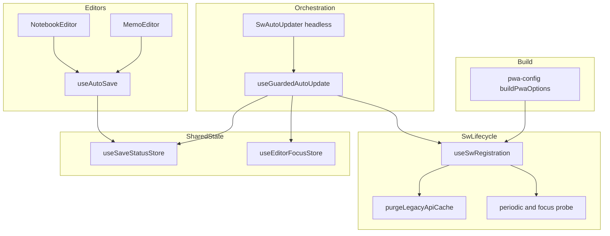
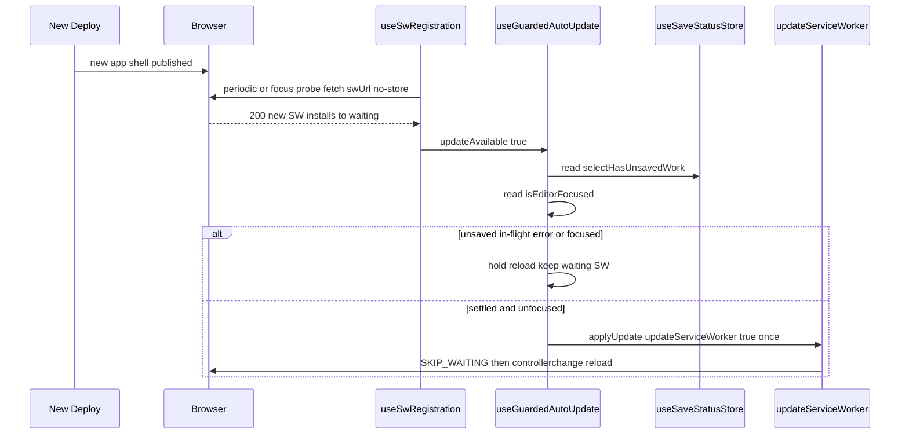
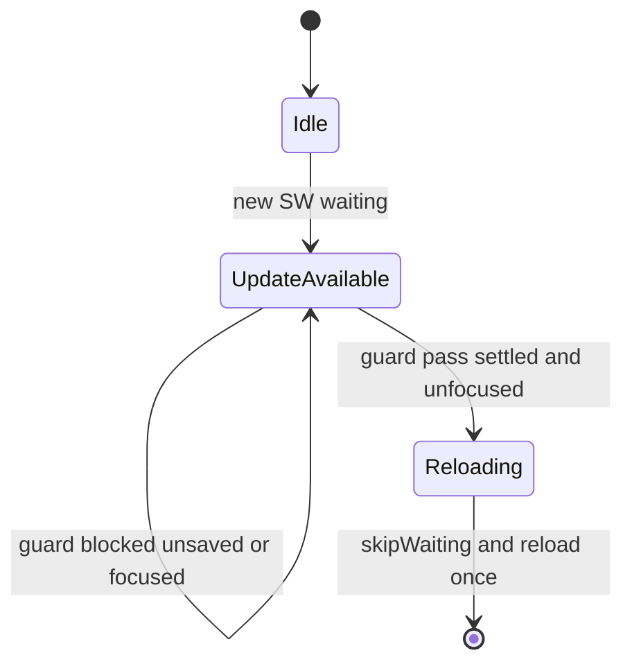
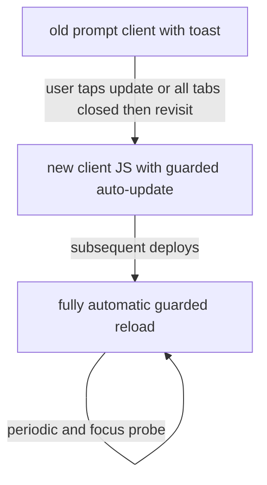

# Technical Design — pwa-sw-auto-update

## Overview

本機能は PWA の Service Worker（SW）更新を、ユーザー操作ゼロで最新フロントエンドへ追従させる。現行の `registerType: 'prompt'`＋更新トースト（`SwUpdatePrompt`）方式は、ユーザーがトーストを押さない限り削除済みバンドル（onboarding 等）が `waiting` に滞留する構造的問題を抱える。本設計はこの導線をシームレスな自動更新へ置き換える。

**採用機構（M1）**: `registerType` は **`'prompt'` のまま据え置く**。トースト UI を撤去し、未保存ガード（保存確定 ∧ エディタ非フォーカス）が通った瞬間に `updateServiceWorker(true)` を**自動呼出**して skipWaiting＋リロードを発火する。これにより AC 1.1 の「`autoUpdate`（skipWaiting + clientsClaim）**相当**」を、コード分割（`React.lazy`）下でも安全な「制御付き skipWaiting＋reload」として実現する。素の `autoUpdate`（`controllerchange` で無条件即時リロード）は編集中遅延（Req 2）と衝突し、`clientsClaim` 即時奪取が遅延リロード窓で lazy チャンク 404 を招くため採らない（評価は `research.md` 参照）。

**Impact**: SW 設定（workbox）は無改修。変更は frontend のフック層・新規 Zustand store・マウント箇所・テストに限定される。backend/DB は対象外。

### Goals

- 新版検知時にユーザー操作ゼロで最新バンドルへ自動追従する（Req 1）。
- 自動更新による再読み込みで未保存データを失わない（Req 2）。
- 長時間タブ・旧 prompt クライアントへも更新を届ける（Req 3）。
- 既存キャッシュ戦略・テーマエフェクト挙動への副作用ゼロ（Req 4）。
- 更新通知 UI を撤去し、関連 dead code とテストを整理する（Req 5・Req 6.4）。

### Non-Goals

- backend / DB の変更（onboarding 削除は完了済み）。
- キャッシュ戦略（workbox runtimeCaching / precache）の全面再設計。
- 旧 prompt クライアント初回移行の完全無操作化（SW の 1 世代遅れ特性により仕様上不可能。許容＋定期チェックで対応、kill-switch 非導入）。
- 複数エディタ同時編集 UX の新規導入（単一エディタ稼働前提を維持。store はレジストリ化で将来拡張に備える）。

## Requirements Traceability

| Requirement | Summary                        | Components                                      | Interfaces                                | Flows     |
| ----------- | ------------------------------ | ----------------------------------------------- | ----------------------------------------- | --------- |
| 1.1         | autoUpdate 相当登録            | pwa-config（prompt 維持）, useGuardedAutoUpdate | `buildPwaOptions`, `applyUpdate`          | —         |
| 1.2         | 無確認で有効化                 | useGuardedAutoUpdate                            | `applyUpdate`                             | Sequence  |
| 1.3         | 制御獲得で再読込               | useGuardedAutoUpdate, useSwRegistration         | `applyUpdate`→`updateServiceWorker(true)` | Sequence  |
| 1.4         | 操作を要求しない               | SwAutoUpdater（toast 撤去）                     | —                                         | —         |
| 1.5         | 新版なしなら再読込しない       | useGuardedAutoUpdate                            | `updateAvailable` ガード                  | State     |
| 1.6         | 再読込は高々1回                | useGuardedAutoUpdate                            | `appliedRef` one-shot                     | State     |
| 2.1         | pending/saving 中は保留        | useSaveStatusStore, useGuardedAutoUpdate        | `selectHasUnsavedWork`                    | State     |
| 2.2         | フォーカス中は保留             | useEditorFocusStore, useGuardedAutoUpdate       | `isEditorFocused`                         | State     |
| 2.3         | error 中は保留                 | useSaveStatusStore                              | `selectHasUnsavedWork`（error∈blocking）  | —         |
| 2.4         | 解消後に実行                   | useGuardedAutoUpdate                            | reactive effect                           | State     |
| 2.5         | 進行中保存の完了待機           | useSaveStatusStore                              | saving∈blocking                           | —         |
| 2.6         | 自動保存挙動の不変             | useAutoSave                                     | publish 副作用のみ                        | —         |
| 2.7         | error 保留の bounded escape    | useGuardedAutoUpdate                            | held-cycle escape                         | State     |
| 3.1         | 旧クライアント移行             | M1（client JS 更新で移行）                      | —                                         | Migration |
| 3.2         | 定期更新チェック               | useSwRegistration                               | `onRegisteredSW` probe interval           | —         |
| 3.3         | フォーカス/再訪チェック        | useSwRegistration                               | visibility/focus probe                    | —         |
| 3.4         | kill-switch 非導入で許容       | 方針                                            | —                                         | Migration |
| 3.5         | 検知時もガード尊重             | useGuardedAutoUpdate                            | guard                                     | Sequence  |
| 4.1         | テーマ CSS キャッシュ維持      | pwa-config（無改修）                            | `runtimeCaching`                          | —         |
| 4.2         | precache 設定維持              | pwa-config（無改修）                            | `globPatterns`/`globIgnores`              | —         |
| 4.3         | legacy purge 維持              | useSwRegistration                               | `purgeLegacyApiCache`                     | —         |
| 4.4         | エフェクト停止に非干渉         | useSwRegistration（独立リスナー）               | —                                         | —         |
| 4.5         | navigateFallback/denylist 維持 | pwa-config（無改修）                            | `navigateFallback`                        | —         |
| 5.1         | トースト非表示                 | SwUpdatePrompt 撤去                             | —                                         | —         |
| 5.2         | 手動導線撤去                   | useSwRegistration                               | `needRefresh`/`update` 撤去               | —         |
| 5.3         | 通知非表示                     | SwAutoUpdater（headless）                       | —                                         | —         |
| 5.4         | マウント/テスト除去            | App.tsx, SwUpdatePrompt.test                    | —                                         | —         |
| 5.5         | 未使用面整理                   | useSwRegistration                               | `offlineReady`/`dismiss` 除去             | —         |
| 6.1         | 旧バンドル非表示               | 本番検証                                        | —                                         | Migration |
| 6.2         | 中核挙動の自動テスト           | テスト一式                                      | —                                         | —         |
| 6.3         | 本番検証の記録                 | verification.md                                 | —                                         | —         |
| 6.4         | 既存テストの改修               | pwa-config.test, useSwRegistration.test         | —                                         | —         |
| 6.5         | 保留・不発の観測性             | useGuardedAutoUpdate, useSwRegistration         | Sentry breadcrumb/counter                 | —         |

## Architecture

### Existing Architecture Analysis

- **PWA スタック**: `vite-plugin-pwa@1.3.0` / `workbox-window@7.4.1`。`pwa-config.ts` の `buildPwaOptions()` が `vite.config.ts` から読まれ、`registerType:'prompt'`・workbox（globIgnores で `**/themes/**/*.css` 除外、theme CSS の CacheFirst runtimeCaching、navigateFallback `/index.html`、`/api/` denylist）を定義する。
- **更新導線**: `useSwRegistration`（`useRegisterSW` ラッパ）が `needRefresh/offlineReady/update/dismiss` を公開し、`SwUpdatePrompt` のみが消費する。`onRegisteredSW` は `purgeLegacyApiCache('api-cache')` のみ実行し、定期チェックは存在しない。
- **保護対象状態**: `saveStatus`（`idle/pending/saving/saved/error/offline-saved`）は `useAutoSave` の**ローカル `useState`**（`MemoEditor.tsx` L149 / `NotebookEditor.tsx` L109）。`isEditorFocused` は `useEditorFocusStore`（Zustand・グローバル）で、`RichTextEditor` が publish する**前例**が既にある。
- **尊重すべき境界**: 「React Query をサーバー状態の真実の源泉とし Zustand へ複製しない」不変則。`saveStatus` はサーバーデータではない一時 UI 状態のため、Zustand 集約は本不変則に抵触しない（`useEditorFocusStore` と同カテゴリ）。
- **副作用に注意すべき資産**: テーマエフェクトは `themeEffectRegistry` の `React.lazy` 動的 import。`useMoriEffectControl` が `visibilitychange` で停止条件を監視する。

### Architecture Pattern & Boundary Map



**Architecture Integration**:

- **Selected pattern**: 関心分離型ハイブリッド（Option C）。SW ライフサイクル（登録・purge・probe）は `useSwRegistration`、ガード判定＋リロード起動は新規 `useGuardedAutoUpdate`、横断状態は新規 `useSaveStatusStore`。
- **Domain/feature boundaries**: 「SW 鮮度の検知」（useSwRegistration）と「適用してよいかの判断」（useGuardedAutoUpdate）を分離。状態の真実は `useSaveStatusStore`（保存状態）・`useEditorFocusStore`（フォーカス）に集約し、オーケストレータは読み取り専用。
- **Existing patterns preserved**: `useEditorFocusStore` と同型の薄い UI store パターン、`onRegisteredSW` での purge、workbox 設定一式（無改修）。
- **New components rationale**: `useSaveStatusStore`＝App 層判定に必須な `saveStatus` の横断集約。`useGuardedAutoUpdate`＝新責務（ガード付きリロード）の単体テスト可能な独立境界。`SwAutoUpdater`＝トーストに代わる headless マウント点。
- **Steering compliance**: Zustand は UI 状態のみ（React Query 不変則維持）。store は `stores/`、フックは `hooks/`、PWA コンポーネントは `components/pwa/` の構成規約に従う。

### Technology Stack

| Layer    | Choice / Version        | Role in Feature                                                                      | Notes                        |
| -------- | ----------------------- | ------------------------------------------------------------------------------------ | ---------------------------- |
| Frontend | `vite-plugin-pwa` 1.3.0 | `useRegisterSW` 経由の SW 登録・`updateServiceWorker(true)` での skipWaiting＋reload | 既存依存。バージョン据え置き |
| Frontend | `workbox-window` 7.4.1  | SW ランタイム（precache / runtimeCaching）                                           | 設定無改修                   |
| Frontend | React 19                | `useId`（インスタンス id）・`useEffect`/`useRef`（ガード effect）                    | 既存                         |
| Frontend | `zustand`               | `useSaveStatusStore`（保存状態レジストリ）                                           | 既存。新 store 追加          |

新規ライブラリ追加なし。すべて既存スタック内で完結する（Extension）。

## System Flows

### 自動更新の全体シーケンス（Req 1.2 / 1.3 / 2.x / 3.2 / 3.5）



ガード保留中も新 SW は `waiting` のまま旧 SW が制御を握り続けるため、遅延リロード窓でも旧 lazy チャンクが配られ 404 化しない（M1 の構造的利点）。

### ガード付きリロードの状態遷移（Req 1.5 / 1.6 / 2.1–2.4）



`Idle` では `updateAvailable=false` のため決してリロードしない（Req 1.5）。`UpdateAvailable→Reloading` の遷移は `appliedRef` で 1 サイクル 1 回に制限する（Req 1.6）。`guard blocked` は `selectHasUnsavedWork || isEditorFocused`、`guard pass` はその否定。ガード条件の解消（保存確定・フォーカス解除）で effect が再評価され保留分が flush される（Req 2.4）。

## Components and Interfaces

| Component            | Domain/Layer  | Intent                                                  | Req Coverage                 | Key Dependencies (P0/P1)                                                  | Contracts |
| -------------------- | ------------- | ------------------------------------------------------- | ---------------------------- | ------------------------------------------------------------------------- | --------- |
| buildPwaOptions      | Build config  | prompt ビルドを基盤として維持（無改修）                 | 1.1, 4.1, 4.2, 4.5           | vite-plugin-pwa (P0)                                                      | State     |
| useSwRegistration    | SW lifecycle  | SW 登録・purge・定期/フォーカス probe・更新シグナル公開 | 1.3, 3.2, 3.3, 4.3, 5.2, 5.5 | useRegisterSW (P0), purgeLegacyApiCache (P1)                              | Service   |
| useSaveStatusStore   | Shared state  | 保存状態の横断レジストリと未保存判定                    | 2.1, 2.3, 2.5                | zustand (P0)                                                              | State     |
| useAutoSave (delta)  | Editor hook   | 既存状態機械はそのまま、status を store へ publish      | 2.6                          | useSaveStatusStore (P1)                                                   | State     |
| useGuardedAutoUpdate | Orchestration | ガード評価＋one-shot リロード起動                       | 1.2, 1.5, 1.6, 2.2, 2.4, 3.5 | useSwRegistration (P0), useSaveStatusStore (P0), useEditorFocusStore (P0) | Service   |
| SwAutoUpdater        | UI mount      | headless でオーケストレータを駆動（トースト代替）       | 1.4, 5.1, 5.3                | useGuardedAutoUpdate (P0)                                                 | —         |

### Build config

#### buildPwaOptions（変更最小）

| Field        | Detail                                                    |
| ------------ | --------------------------------------------------------- |
| Intent       | prompt ビルドを「ガード付き自動駆動」の基盤として維持する |
| Requirements | 1.1, 4.1, 4.2, 4.5                                        |

**Responsibilities & Constraints**

- `registerType:'prompt'` を**据え置く**（M1）。workbox の `globPatterns`/`globIgnores`/`runtimeCaching`（theme CSS CacheFirst）/`navigateFallback`/`navigateFallbackDenylist` は**一切変更しない**（Req 4.1/4.2/4.5）。
- AC 1.1「`autoUpdate`（skipWaiting + clientsClaim）相当」は、リテラルな `registerType` 値ではなく「ユーザー操作ゼロで最新化される振る舞い」として `useGuardedAutoUpdate` が実現する（解釈は `research.md` の Decision 参照）。**requirements.md の AC 1.1 はこの解釈に合わせて改訂済み**（リテラルな `'autoUpdate'` 登録要求を撤去し「autoUpdate 相当の振る舞い」へ／validate-design 2026-06-21）。

**Contracts**: State [x]

##### State Management

- 本コンポーネントは純粋な設定ビルダ。状態は持たない。変更は意図的に「無し」（無改修が Req 4 の保全契約そのもの）。

**Implementation Notes**

- Integration: 実体の自動化はフック層に閉じる。config はトリガ値（`'prompt'`）を提供するのみ。
- Risks: なし（既存の workbox 不変則を温存）。

### SW lifecycle

#### useSwRegistration（再設計）

| Field        | Detail                                                                                    |
| ------------ | ----------------------------------------------------------------------------------------- |
| Intent       | SW 登録・legacy purge・定期/フォーカス probe を担い、更新シグナルと適用関数のみを公開する |
| Requirements | 1.3, 3.2, 3.3, 4.3, 5.2, 5.5                                                              |

**Responsibilities & Constraints**

- `useRegisterSW` をラップし、`onRegisteredSW(swUrl, registration)` で次を実行する: ① `purgeLegacyApiCache()`（Req 4.3 維持）、② 60 分間隔の定期 probe 開始（Req 3.2）、③ `visibilitychange`（visible 化）/ `focus` での probe 登録（Req 3.3）。`registration` は ref 保持。
- probe は公式パターンに従う: `registration.installing` または `navigator.onLine===false` ならスキップ、`fetch(swUrl, {cache:'no-store'})` が 200 のときのみ `registration.update()`。
- 公開面を縮小し、`offlineReady`/`dismiss`/手動 `needRefresh` 露出を**撤去**（Req 5.2/5.5）。更新検知は `updateAvailable: boolean` として、適用は `applyUpdate()` として公開。
- アンマウント時に interval / リスナーを確実に解除する。

**Dependencies**

- Outbound: `purgeLegacyApiCache` — legacy `api-cache` の purge（P1）
- External: `virtual:pwa-register/react` `useRegisterSW` — SW 登録・`updateServiceWorker`（P0）

**Contracts**: Service [x]

##### Service Interface

```typescript
export interface UseSwRegistrationResult {
	/** 新しい SW が waiting に到達し、有効化可能になったか */
	updateAvailable: boolean;
	/**
	 * skipWaiting + reload を実行する。内部で updateServiceWorker(true) に委譲。
	 * 呼び出しは useGuardedAutoUpdate の one-shot ガード下でのみ行う。
	 */
	applyUpdate: () => Promise<void>;
}

export function useSwRegistration(): UseSwRegistrationResult;

/** 定期/フォーカス probe の間隔（ミリ秒）。公式推奨に倣い 60 分。 */
export const SW_UPDATE_PROBE_INTERVAL_MS = 60 * 60 * 1000;
```

- Preconditions: ブラウザに `serviceWorker` / `caches` が存在しない環境でも例外を投げない（graceful degradation）。
- Postconditions: `updateAvailable` は waiting SW の有無を反映。`applyUpdate()` は `updateServiceWorker(true)` を 1 回呼ぶ。
- Invariants: `onRegisteredSW` での `purgeLegacyApiCache` 呼出を維持する（Req 4.3）。probe は `useMoriEffectControl` とは独立リスナーで、共有状態を持たない（Req 4.4 非干渉）。

**Implementation Notes**

- Integration: `updateAvailable` は `useRegisterSW` の `needRefresh[0]` を内部委譲して導出（手動 setter は非公開化）。
- Validation: probe の 200 判定・`installing`/`onLine` スキップで無駄な `update()` を抑止。
- Risks: `registration` が `undefined`（登録失敗）の場合は probe を張らずログのみ（`onRegisterError` 既存挙動を維持）。

### Shared state

#### useSaveStatusStore（新規）

| Field        | Detail                                                                                             |
| ------------ | -------------------------------------------------------------------------------------------------- |
| Intent       | 複数エディタの `saveStatus` をインスタンス id 単位で集約し、未保存/進行中/失敗の有無を単一判定する |
| Requirements | 2.1, 2.3, 2.5                                                                                      |

**Responsibilities & Constraints**

- `Record<instanceId, SaveStatus>` のレジストリを保持。`setStatus`/`clearStatus` で各 `useAutoSave` インスタンスが自身の status を publish/解除する。
- 派生セレクタ `selectHasUnsavedWork` が blocking 集合 `{pending, saving, error}` の存在を判定（`saving∈blocking` が Req 2.5 の「進行中保存の完了待機」を、`error∈blocking` が Req 2.3 を充足）。
- サーバーデータを持たない一時 UI 状態のみ（React Query 不変則を尊重）。単一エディタ稼働前提だが、レジストリ化により mount 重複時の last-writer-wins クロバを回避。

**Contracts**: State [x]

##### State Management

```typescript
import type { SaveStatus } from '../hooks/useAutoSave';

interface SaveStatusState {
	/** active な useAutoSave インスタンス（useId）→ 最新 status */
	statuses: Readonly<Record<string, SaveStatus>>;
	setStatus: (instanceId: string, status: SaveStatus) => void;
	clearStatus: (instanceId: string) => void;
}

export const useSaveStatusStore: import('zustand').UseBoundStore<
	import('zustand').StoreApi<SaveStatusState>
>;

/** 自動リロードを保留すべき status（未保存・進行中・失敗） */
export const RELOAD_BLOCKING_STATUSES: ReadonlySet<SaveStatus>;

/** いずれかのエディタに未保存/進行中/失敗があるとき true */
export function selectHasUnsavedWork(state: SaveStatusState): boolean;
```

- State model: blocking = `{pending, saving, error}` / settled = `{idle, saved, offline-saved}`。
- Persistence & consistency: 永続化なし。`clearStatus` 漏れ防止のため `useAutoSave` のアンマウント cleanup で必ず解除。
- Concurrency strategy: id 単位レジストリで複数インスタンスを衝突なく合成。

**Implementation Notes**

- Integration: 消費者は `useGuardedAutoUpdate`（`selectHasUnsavedWork`）。
- Validation: セレクタは 6 状態すべてに対し blocking/settled を網羅的に判定。
- Risks: アンマウント時の `clearStatus` 欠落で stale blocking が残ると更新が恒久保留化 → cleanup を契約として明記しテストで担保。

#### useAutoSave（差分のみ）

| Field        | Detail                                                                                           |
| ------------ | ------------------------------------------------------------------------------------------------ |
| Intent       | 既存の保存状態機械はそのまま、`saveStatus` を `useSaveStatusStore` へ publish する副作用のみ追加 |
| Requirements | 2.6                                                                                              |

**Responsibilities & Constraints**

- **既存のデバウンス・状態遷移ロジックは一切変更しない**（Req 2.6）。追加は publish 副作用のみ。
- `useId()` でインスタンス id を確定し、`saveStatus` 変化時に `setStatus(id, saveStatus)`、アンマウント時に `clearStatus(id)`。

**Contracts**: State [x]

##### State Management

```typescript
// useAutoSave 内に追加する配線（状態機械本体には触れない）
const instanceId = useId();
const setStatus = useSaveStatusStore((s) => s.setStatus);
const clearStatus = useSaveStatusStore((s) => s.clearStatus);
useEffect(() => {
	setStatus(instanceId, saveStatus);
}, [instanceId, saveStatus, setStatus]);
useEffect(() => () => clearStatus(instanceId), [instanceId, clearStatus]);
```

**Implementation Notes**

- Integration: `MemoEditor`/`NotebookEditor` 側の呼び出しは無改修（publish は hook 内に閉じる）。
- Validation: 既存 `useAutoSave.test.ts` の状態遷移アサートが不変で通ること（Req 2.6 の回帰防止）。
- Risks: publish が状態機械の再レンダリングを誘発しないこと（既存挙動と等価）を確認。

### Orchestration

#### useGuardedAutoUpdate（新規）

| Field        | Detail                                                                          |
| ------------ | ------------------------------------------------------------------------------- |
| Intent       | 更新検知・ガード評価・one-shot リロード起動を統括する headless オーケストレータ |
| Requirements | 1.2, 1.5, 1.6, 2.2, 2.4, 3.5                                                    |

**Responsibilities & Constraints**

- `useSwRegistration().updateAvailable`/`applyUpdate`、`useSaveStatusStore`（`selectHasUnsavedWork`）、`useEditorFocusStore`（`isEditorFocused`）を購読。
- `canReload = !hasUnsavedWork && !isEditorFocused`。`updateAvailable && canReload && !appliedRef.current` のとき `appliedRef.current=true` として `applyUpdate()` を 1 回だけ起動（Req 1.6）。`updateAvailable===false` の間は決して起動しない（Req 1.5）。
- ガード条件解消（保存確定・フォーカス解除）で effect が再評価され、保留分が flush される（Req 2.4・3.5）。

**Dependencies**

- Inbound: `SwAutoUpdater` — 駆動（P0）
- Outbound: `useSwRegistration` — 更新シグナル/適用（P0）, `useSaveStatusStore` — 未保存判定（P0）, `useEditorFocusStore` — フォーカス判定（P0）

**Contracts**: Service [x]

##### Service Interface

```typescript
/**
 * 安全な場合のみ SW 更新を適用する headless オーケストレータ。
 * 戻り値なし（マウント側 SwAutoUpdater から呼ぶ）。
 */
export function useGuardedAutoUpdate(): void;
```

- Preconditions: アプリ起動中に常駐（App ルート直下）。
- Postconditions: 安全条件成立時に 1 サイクル 1 回 reload を起動。
- Invariants: `appliedRef` により二重発火・reload ループを防止（Req 1.6）。

**Implementation Notes**

- Integration: `applyUpdate()` が reject した場合はログのうえ `appliedRef` を戻し、次サイクルで再試行可能にする（reload 未発火のためループにならない）。自動リロード起動時に Sentry breadcrumb（`feature_area:'system'`）を残す。**stuck 回避（Req 6.5）**: `appliedRef` は waiting SW（バージョン）単位で管理し、新たな waiting SW を検知したら再武装する。`applyUpdate()` 後一定時間 reload しなければ不発として breadcrumb を残し、次の更新検知で再試行できるようにする。
- Validation: ガード行列（pending/saving/error/focused で保留、settled∧unfocused で flush、update なしで無動作）をテストで網羅。
- Risks: `error` 継続時はリロードが恒久保留（データ保護優先・Req 2.3 の許容トレードオフ。`research.md` 参照）。

#### SwAutoUpdater（headless・summary）

| Field        | Detail                                                                            |
| ------------ | --------------------------------------------------------------------------------- |
| Intent       | `useGuardedAutoUpdate()` を駆動し `null` を返す。トースト UI の置き換えマウント点 |
| Requirements | 1.4, 5.1, 5.3                                                                     |

**Implementation Note**: `App.tsx` の `<SwUpdatePrompt />`（L16 import / L66 mount）を `<SwAutoUpdater />` に差し替える。UI を一切描画しないため更新に関する通知は出ない（Req 1.4/5.3）。`components/pwa/SwAutoUpdater.tsx` に配置。

### 撤去対象（Req 5）

- `components/pwa/SwUpdatePrompt.tsx` と `SwUpdatePrompt.test.tsx` を**削除**（Req 5.1/5.4）。
- `App.tsx` の `SwUpdatePrompt` import / mount を除去し `SwAutoUpdater` へ差し替え（Req 5.4）。
- `useSwRegistration` から `offlineReady`/`dismiss`/手動 `needRefresh`/`update` の公開を除去（Req 5.2/5.5）。`offlineReady` は他参照なし（grep 確認済）→ dead code 化を解消。

## Data Models

本機能が追加するデータは `useSaveStatusStore` のレジストリのみ（永続化なし・サーバー同期なし）。

- **Entity**: `statuses: Record<instanceId: string, SaveStatus>`。`instanceId` は React `useId()` 由来の安定キー。
- **Value classification**: blocking=`{pending, saving, error}` / settled=`{idle, saved, offline-saved}`。
- **Invariant**: active な `useAutoSave` インスタンスのみが entry を持ち、アンマウントで必ず削除される（stale entry 禁止）。
- **Derived**: `selectHasUnsavedWork(state) = Object.values(statuses).some(s => RELOAD_BLOCKING_STATUSES.has(s))`。

## Error Handling

### Error Strategy

- **SW 登録失敗**: `onRegisterError` で `logger.error` のみ（既存挙動維持）。probe は張らずアプリは通常動作（graceful degradation）。
- **probe 失敗 / オフライン**: `installing`/`!onLine`/非 200 でスキップし例外化しない。次間隔で再試行。
- **`applyUpdate` 失敗**: catch してログ、`appliedRef` を戻し次サイクルで再試行（reload 未発火のためループ化しない）。
- **保存 `error` 継続**: リロードを保留しデータを保護（Req 2.3）。ただし無制限放置は本機能の主目的（削除済みバンドル撲滅）を損なうため、**bounded escape**（Req 2.7）を設ける: 保留が一定サイクル継続したら held カウンタを観測（Req 6.5）し、settled 化／未保存内容の退避を促す。最終的な解消経路は settled 化または全タブクローズ後の再訪（kill-switch 非導入・Req 3.4）。

### Error Categories and Responses

- User Errors: なし（自動更新はユーザー入力を伴わない）。
- System Errors: SW/registration/probe 失敗 → ログ＋機能縮退（更新は次サイクルへ）。
- Business Logic Errors: 「保存未確定中のリロード」を禁止条件として扱い、ガードで状態遷移を制御（State 図参照）。

### Monitoring

- 既存 `logger` で probe/適用/失敗を記録。
- 自動リロード起動時に Sentry breadcrumb（steering のタグ契約 `feature_area:'system'`）を付与し、本番での自動更新発火を観測可能にする。
- **保留・不発の観測（Req 6.5）**: 更新検知後にガードで保留した状態が一定サイクル継続したとき、および `applyUpdate()` 呼出後に一定時間内へ `controllerchange`／reload が起きなかったとき（不発）に breadcrumb／カウンタを記録し、「最新化されないまま滞留するクライアント」を本番で検知可能にする。

## Testing Strategy

### Unit Tests

- `useSaveStatusStore`: 6 状態すべてに対する `selectHasUnsavedWork` の blocking/settled 判定、`setStatus`/`clearStatus` のレジストリ整合、複数 id 合成（新規）。
- `useGuardedAutoUpdate`: ガード行列（pending/saving/error/focused で保留 → settled∧unfocused で 1 回 flush）、`updateAvailable===false` で無動作（Req 1.5）、one-shot（二重 reload しない・Req 1.6）、**bounded escape**（`error` 継続保留で held カウンタ計上・Req 2.7/6.5）、**不発検知**（`applyUpdate` 後未 reload で breadcrumb・Req 6.5）、**再武装**（新 waiting SW 検知で `appliedRef` リセット）（新規）。
- `useSwRegistration`: `applyUpdate()`→`updateServiceWorker(true)`、`updateAvailable` 反映、`onRegisteredSW` で `purgeLegacyApiCache` 継続（Req 4.3）、定期 probe の interval 設定（fake timers）、visibility/focus で `registration.update()`（改修）。
- `useAutoSave`: 既存の状態遷移テストが不変で通る＝挙動回帰なし（Req 2.6）。
- `pwa-config`: `registerType` 値（`'prompt'` のまま）アサートを維持しつつ、テスト名/意図を「ガード付き自動駆動の基盤として prompt を維持」へ書き換え。theme CSS CacheFirst・globIgnores・denylist の不変則アサートは維持（Req 4・6.4）。

### Integration Tests

- 「新版 waiting → 編集中（saving）→ 保存確定 → 自動 reload」が `useSaveStatusStore`＋`useGuardedAutoUpdate`＋`useSwRegistration` モックで通ること。
- フォーカス中保留 → blur で flush（`useEditorFocusStore` 連携）。

### Removed / Migrated Tests

- `SwUpdatePrompt.test.tsx` を削除（Req 5.4）。
- `useSwRegistration.test.ts` の `needRefresh`/`offlineReady`/`update`/`dismiss` ケースを新公開面（`updateAvailable`/`applyUpdate`/probe）へ再設計（Req 6.4）。
- テストスタブ `virtualPwaRegisterReact.ts` は `onRegisteredSW(swUrl, registration)` に fake registration を渡せる前提で利用（既存署名で対応可）。

### Verification (Req 6.1 / 6.3)

- `.kiro/specs/onboarding-removal/verification.md` 形式で、本番デプロイ後に自動更新で最新バンドルが適用され、削除済み UI（onboarding 等）が表示されないことを記録する。

## Migration Strategy



- 旧 prompt クライアントは、現行のトースト操作または全タブクローズ後の再訪により**新クライアント JS**を取得する（最大 1 更新サイクル）。M1 は `registerType:'prompt'` を維持するため、SW の skipWaiting セマンティクス自体は不変で、変わるのはクライアント JS の振る舞い（トースト → ガード付き自動駆動）のみ。
- 以降は完全自動。定期/フォーカス probe で長時間タブにも更新が届く（Req 3.2/3.3）。
- 初回 1 サイクルの移行コストは仕様上不可避として許容し、kill-switch は導入しない（Req 3.1/3.4）。
- **Rollback**: 問題発生時は `SwAutoUpdater` を旧 `SwUpdatePrompt` に戻し、`useSwRegistration` の手動公開面を復活させることで prompt 方式へ即時復帰可能（SW 設定は無改修のため SW 側のロールバック不要）。

## Performance & Scalability

- 定期 probe は 60 分間隔・`no-store` の HEAD 相当 GET 1 件のみ。`installing`/オフライン時はスキップするため負荷は無視可能。
- ガード判定は Zustand セレクタの純関数評価でレンダリングコスト極小。
- テーマエフェクトの RAF 停止条件（`useMoriEffectControl`）とは独立リスナーで干渉せず、エディタ作業時の CPU/GPU 配分に影響しない（Req 4.4）。
