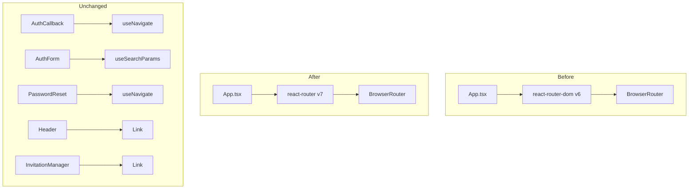
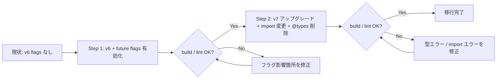

# Technical Design: React Router v7 Migration

## Overview

本機能は `react-router-dom@^6.30.1` を React Router v7（`react-router`）へ段階的に移行し、フロントエンドの依存関係を最新化する。

**Purpose**: 旧来の v5 型定義（`@types/react-router-dom@^5.3.3`）を排除し、v7 本体の型定義に統一することで型整合性を確保し、今後の React Router 機能進化に追従できる状態にする。

**Users**: フロントエンド開発者がルーティング関連コードを安全に変更できる。エンドユーザーは移行前後で動作差異を感じない。

**Impact**: `frontend/src/` 内の 6 ファイルのみが変更対象。バックエンドへの影響はない。

### Goals

- future flags を有効化して v7 挙動に段階的に移行する（Requirement 1）
- `react-router` v7 へパッケージを更新し `@types/react-router-dom` を削除する（Requirement 2）
- 既存 API（`useNavigate`・`useSearchParams`・`Link`）の動作を維持する（Requirement 3）
- 各ステップを独立コミットとして `npm run build` + `npm run lint` が通ることを確認する（Requirement 4）
- TypeScript strict mode・`any` 禁止を維持する（Requirement 5）

### Non-Goals

- `createBrowserRouter`（Data Router）への移行（スコープ外。将来の SSR 対応時に別仕様として検討）
- React Router のローダー・アクション機能の導入
- バックエンドコードの変更

---

## Architecture

### Existing Architecture Analysis

```
App.tsx
└── BrowserRouter（react-router-dom@6）
    └── Routes
        ├── /auth/callback    → AuthCallback（useNavigate）
        ├── /auth/reset-password → PasswordReset（useNavigate）
        ├── /admin/invitations → InvitationManager（Link, AuthGuard）
        └── /*               → AppContent（AuthGuard）
                               └── Zustand（useViewStore）でビュー切り替え
```

- ルーティングは URL ベースでなく Zustand でビュー状態を管理
- Data Router 機能（ローダー・アクション・フェッチャー）は未使用
- 相対パスリンクは存在せず、すべて絶対パス（`/admin/invitations`、`/auth`、`/`）

### Architecture Pattern & Boundary Map



**Architecture Integration**:

- Selected pattern: ライブラリモード維持（BrowserRouter 宣言型）
- 移行前後で外部インターフェース・コンポーネント責務は不変
- Steering の「React Query をサーバー状態の唯一の真実の源泉」「Zustand はUI状態専用」を維持
- `react-router-dom` → `react-router` への import パス変更のみが実質の差分

### Technology Stack

| Layer                 | 変更前                                         | 変更後                      | 備考                 |
| --------------------- | ---------------------------------------------- | --------------------------- | -------------------- |
| Frontend ルーティング | `react-router-dom@^6.30.1`                     | `react-router@latest`（v7） | パッケージ統合       |
| TypeScript 型         | `@types/react-router-dom@^5.3.3`（v5型、不正） | v7 本体内包型               | devDep 削除          |
| React                 | `react@^19.1.0`                                | 変更なし                    | v7 は React 18+ 対応 |

---

## Migration Strategy

移行は 2 ステップに分割し、各ステップで `npm run build` + `npm run lint` を確認してコミットする。



---

## Requirements Traceability

| Requirement | Summary                                    | Components                  | Interfaces             | Flows              |
| ----------- | ------------------------------------------ | --------------------------- | ---------------------- | ------------------ |
| 1.1         | BrowserRouter に future flags 設定         | RouterConfig                | `future` prop          | Step 1             |
| 1.2         | flags 有効化後に deprecation 警告なし      | RouterConfig                | —                      | Step 1 検証        |
| 1.3         | TypeScript 型安全に設定できる              | RouterConfig                | `Future` 型            | Step 1             |
| 1.4         | 既存 4 ルートが同一動作                    | RouterConfig                | `Routes` / `Route`     | Step 1 検証        |
| 2.1         | npm install が競合なく完了                 | PackageDependency           | `package.json`         | Step 2             |
| 2.2         | `@types/react-router-dom` 削除             | PackageDependency           | `package.json`         | Step 2             |
| 2.3         | `npm run build` エラーゼロ                 | 全変更ファイル              | TypeScript             | Step 2 検証        |
| 2.4         | 削除 API があれば置き換え                  | 全変更ファイル              | import パス            | Step 2             |
| 3.1         | `useNavigate` が正常動作                   | AuthCallback, PasswordReset | `useNavigate`          | Step 2 検証        |
| 3.2         | `useSearchParams` が正常動作               | AuthForm                    | `useSearchParams`      | Step 2 検証        |
| 3.3         | `Link` が正常動作                          | Header, InvitationManager   | `Link`                 | Step 2 検証        |
| 3.4         | スプラットルート配下の絶対リンクが正常解決 | RouterConfig                | `v7_relativeSplatPath` | Step 1 検証        |
| 3.5         | AuthGuard が移行後も正常動作               | AuthGuard                   | `Routes` / `Route`     | Step 2 検証        |
| 4.1         | 2 ステップ分割コミット                     | —                           | —                      | Migration Strategy |
| 4.2         | 各ステップで build 通過                    | —                           | TypeScript / Vite      | 各ステップ検証     |
| 4.3         | lint ゼロ維持                              | —                           | ESLint                 | 各ステップ検証     |
| 4.4         | 動作差異発見時は既存動作を優先             | 全変更ファイル              | —                      | 実装方針           |
| 5.1         | TypeScript strict mode 維持                | 全変更ファイル              | —                      | 全ステップ         |
| 5.2         | `any` 型を導入しない                       | 全変更ファイル              | —                      | 全ステップ         |
| 5.3         | 不要型パッケージを残さない                 | PackageDependency           | `package.json`         | Step 2             |
| 5.4         | frontend のみ変更                          | —                           | —                      | スコープ           |

---

## Components and Interfaces

| Component         | Domain/Layer                      | Intent                                                   | Req Coverage | Key Dependencies     | Contracts |
| ----------------- | --------------------------------- | -------------------------------------------------------- | ------------ | -------------------- | --------- |
| RouterConfig      | Frontend / ルーティング設定       | BrowserRouter の future flags 設定と v7 移行後の設定維持 | 1.x, 3.4     | react-router v7 (P0) | State     |
| PackageDependency | Frontend / 依存管理               | package.json のパッケージ入れ替えと型整合性確保          | 2.x, 5.3     | npm (P0)             | —         |
| ImportPaths       | Frontend / 全ルーター使用ファイル | `react-router-dom` → `react-router` への import 変更     | 2.4, 3.x     | RouterConfig (P0)    | —         |

### Frontend / ルーティング設定

#### RouterConfig

| Field        | Detail                                                                                                               |
| ------------ | -------------------------------------------------------------------------------------------------------------------- |
| Intent       | `App.tsx` の `BrowserRouter` に future flags を追加し、v7 へのアップグレード後は import を `react-router` に変更する |
| Requirements | 1.1, 1.2, 1.3, 1.4, 3.4                                                                                              |

**Responsibilities & Constraints**

- `BrowserRouter` の `future` prop に `v7_startTransition: true`・`v7_relativeSplatPath: true` を設定（Step 1）
- v7 アップグレード後は import を `react-router-dom` → `react-router` に変更（Step 2）
- `BrowserRouter` 宣言型モードを維持する（`createBrowserRouter` への移行はスコープ外）
- ルート定義（4 つの `<Route>`）は変更しない

**Dependencies**

- External: `react-router v7` — ルーティング基盤 (P0)

**Contracts**: State [x]

##### State Management

```typescript
// Step 1: future flags 有効化
// App.tsx（変更点のみ）
import { BrowserRouter as Router, Routes, Route } from 'react-router-dom'; // v6 のまま

// BrowserRouter に future prop を追加
<Router future={{ v7_startTransition: true, v7_relativeSplatPath: true }}>

// Step 2: v7 アップグレード後
import { BrowserRouter as Router, Routes, Route } from 'react-router'; // react-router に変更
```

**Implementation Notes**

- Integration: `future` prop の型は `react-router-dom@6.x` では `Partial<FutureConfig>` として定義されており TypeScript が通ること
- Validation: `npm run build` が各ステップで通ることを確認
- Risks: `@types/react-router-dom@^5.3.3`（v5型）が `future` prop の型を認識しない可能性 → Step 2 で削除後に解決される

---

#### PackageDependency

| Field        | Detail                                                                                                                        |
| ------------ | ----------------------------------------------------------------------------------------------------------------------------- |
| Intent       | `package.json` を更新して `react-router-dom` を `react-router@latest` に置き換え、不正な `@types/react-router-dom` を削除する |
| Requirements | 2.1, 2.2, 2.3, 5.3                                                                                                            |

**Responsibilities & Constraints**

- `dependencies` の `react-router-dom` → `react-router@latest` へ置き換え
- `devDependencies` の `@types/react-router-dom` を削除
- 他の依存関係（react@19、react-dom@19、Vite 等）は変更しない

**Dependencies**

- External: npm registry (P0)

**Contracts**: —

**Implementation Notes**

- Integration: `npm uninstall react-router-dom && npm install react-router@latest` → `npm uninstall -D @types/react-router-dom`
- Validation: `npm install` 後に `package-lock.json` に依存競合がないことを確認
- Risks: `react-router@7` は React 18+ を要求。Mosaku は React 19 を使用しており要件を満たす

---

#### ImportPaths

| Field        | Detail                                                                       |
| ------------ | ---------------------------------------------------------------------------- |
| Intent       | `react-router-dom` からの import を全 6 ファイルで `react-router` に変更する |
| Requirements | 2.4, 3.1, 3.2, 3.3                                                           |

**Responsibilities & Constraints**

- 対象 6 ファイルの import 文のみ変更する。ロジック・JSX は変更しない
- 変更後の API が v7 で維持されていることを前提とする（research.md で確認済み）

**Dependencies**

- Inbound: PackageDependency — v7 インストール後に実施 (P0)

**Contracts**: —

##### Service Interface

変更対象ファイルと import の対応:

| ファイル                                     | 変更前                    | 変更後                |
| -------------------------------------------- | ------------------------- | --------------------- |
| `src/App.tsx`                                | `from 'react-router-dom'` | `from 'react-router'` |
| `src/components/auth/AuthCallback.tsx`       | `from 'react-router-dom'` | `from 'react-router'` |
| `src/components/auth/AuthForm.tsx`           | `from 'react-router-dom'` | `from 'react-router'` |
| `src/components/auth/PasswordReset.tsx`      | `from 'react-router-dom'` | `from 'react-router'` |
| `src/components/ui/Header.tsx`               | `from 'react-router-dom'` | `from 'react-router'` |
| `src/components/admin/InvitationManager.tsx` | `from 'react-router-dom'` | `from 'react-router'` |

**Implementation Notes**

- Integration: 全ファイルの import 変更は Step 2（v7 アップグレード）と同時に行う
- Validation: `npm run build` でインポートエラーと型エラーがゼロであることを確認
- Risks: v7 で一部 API が `react-router/dom` 深いインポートになった場合に対応が必要（`RouterProvider`・`HydratedRouter` は `react-router/dom` から。ただし Mosaku は未使用）

---

## Testing Strategy

### ビルド検証（各ステップ必須）

- Step 1 完了後: `npm run build`（TypeScript + Vite）が通ること
- Step 1 完了後: `npm run lint` が警告・エラーゼロであること
- Step 2 完了後: `npm run build` が TypeScript エラーゼロで通ること
- Step 2 完了後: `npm run lint` が警告・エラーゼロであること

### 手動動作確認（Step 2 完了後）

- `/auth/callback` にアクセスして `/auth` にリダイレクトされること
- `/auth/reset-password` にアクセスしてパスワード変更フォームが表示されること
- `/admin/invitations` にアクセスして AuthGuard が認証状態を正しく判定すること
- `/` にアクセスして MobileLayout / DesktopLayout が正常表示されること
- `AuthForm.tsx` でクエリパラメータ（`?error=invitation_required`）が正常に読み取られること

### ブラウザコンソール確認（Step 1 完了後）

- React Router の deprecation 警告が表示されないこと
