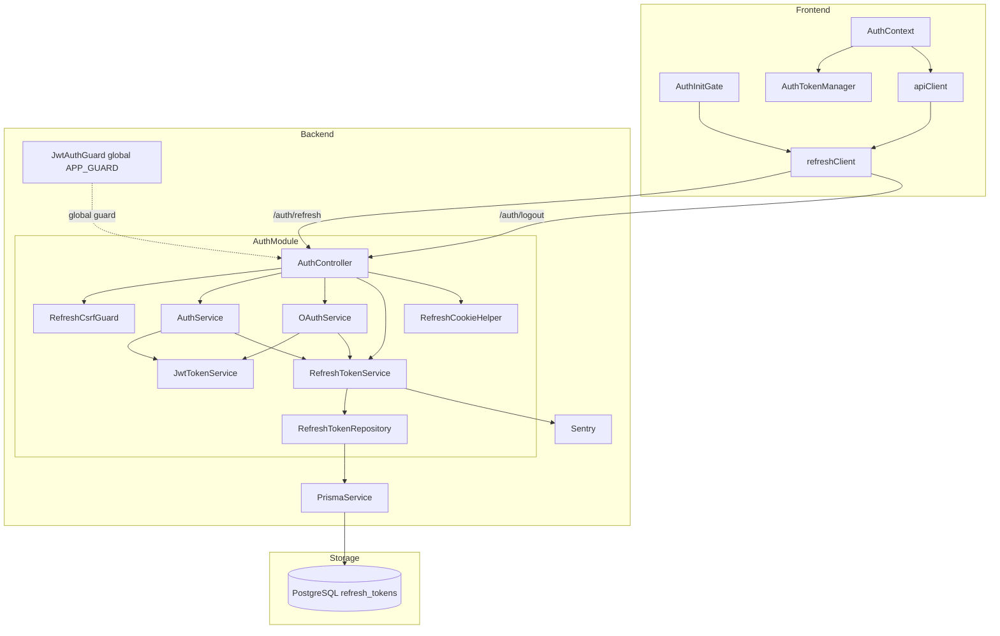
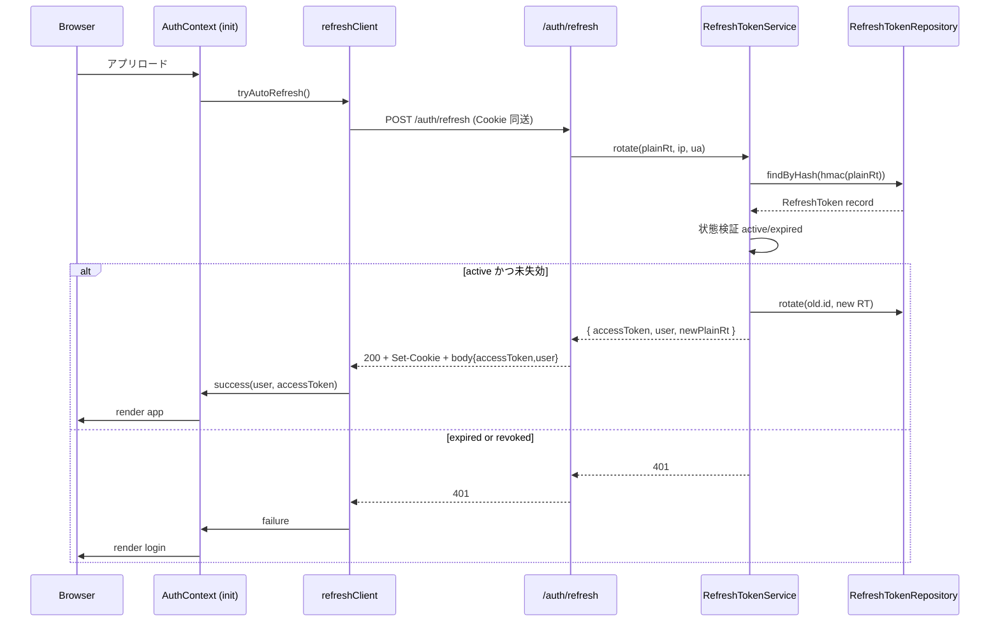
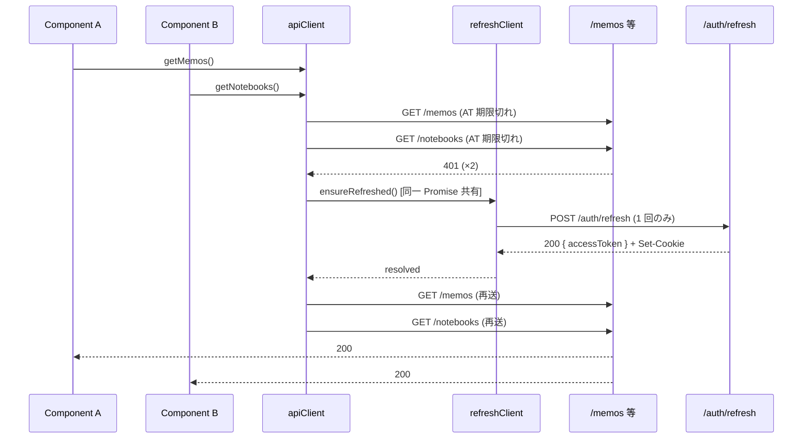
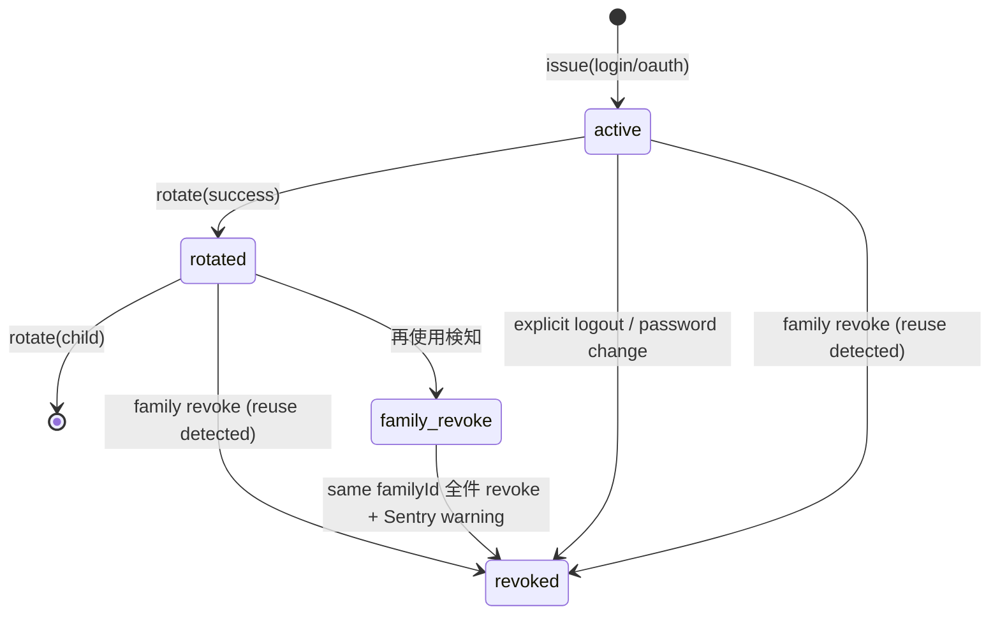
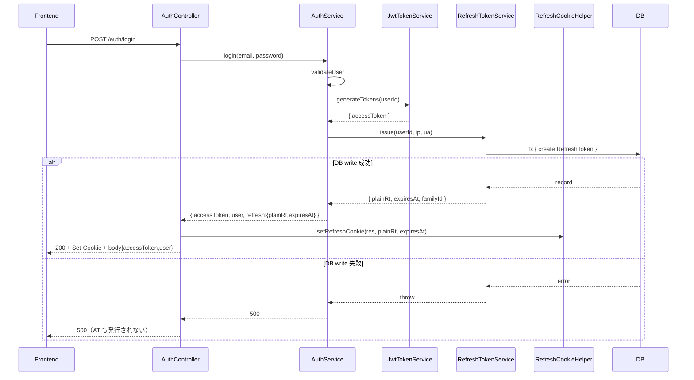
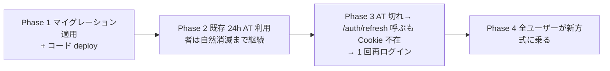

# Technical Design — Refresh Token による自動ログイン

## Overview

**Purpose**: 本機能は、Mosaku の認証セッションを Refresh Token (RT) ベースに再構築し、ドッグフーディング Phase 1 で最大頻度の摩擦である「毎朝の強制再ログイン」を解消する。短命の Access Token (AT, 既定 15 分) と長命の Refresh Token (RT, 既定 30 日) の二段構成にし、Access Token 切れ時の透過リフレッシュ・アプリ起動時の自動セッション復元・ローテーション + reuse 検知によるセキュリティ強化を実現する。

**Users**: Mosaku を日常メモツールとして使うドッグフーディング期間中の本人および招待ユーザー全員。メール/パスワード認証と全 OAuth プロバイダ（Google / GitHub / LINE / Apple / X）を等しくサポートする。

**Impact**: AuthModule 内に新規 `RefreshTokenService` / `RefreshTokenRepository` を追加し、AT 発行責務を持つ既存 `JwtTokenService` の責務範囲を変更せずに RT 機構を積み上げる。Prisma スキーマに `RefreshToken` モデル 1 本と `cookie-parser` ミドルウェアを追加。`JwtAuthGuard` を `APP_GUARD` として真のグローバル化し、`@Public()` opt-out 方式へ整合させる。Frontend は新規 `refreshClient` モジュールを追加し、`apiClient.request()` の 401 経路を透過リフレッシュに差し替える。

### Goals

- アプリ起動時の RT による自動セッション復元（ログイン画面遷移ゼロ）
- AT 期限切れ時の透過リフレッシュ（並行リクエスト集約・1 度きりの `/auth/refresh` 発火）
- RT のローテーション + 再使用検知 + family 単位の一括 revoke
- HttpOnly Cookie + SameSite + Origin + カスタムヘッダ三重 CSRF 防御
- ドッグフーディング Phase 1 の主要摩擦（毎朝の強制再ログイン）の解消

### Non-Goals

- AT 自体の Cookie 化（v1 は localStorage + Bearer ヘッダ継続。Out of scope）
- デバイス管理 UI（v1 は `familyId` を内部表現として持つのみ、UI 露出なし）
- 既存 24h AT を持つユーザーへの先回り通知（リリース時の手動周知で対応）
- フィーチャーフラグによる段階導入（Requirement 8.5 に従い常時 ON）
- 外部 CSRF ライブラリ導入（自前三重防御で代替）

---

## Architecture

### Existing Architecture Analysis

- **AuthModule 三分割**: `AuthService`（ユーザー管理）/ `JwtTokenService`（JWT 発行）/ `OAuthService`（OAuth 処理）の責務分離を尊重する。RT 関連の新規責務はこの 3 つに混ぜず、新規 `RefreshTokenService` + `RefreshTokenRepository` に閉じ込める。
- **`@Public()` opt-out 方針との整合**: 現状の `JwtAuthGuard` は Controller 単位の `@UseGuards()` で個別適用されており、Steering 文書の宣言と乖離。本仕様で `{ provide: APP_GUARD, useClass: JwtAuthGuard }` を導入し、宣言と実装を一致させる（`research.md` Decision: `APP_GUARD として JwtAuthGuard を真にグローバル化` 参照）。
- **`apiClient` 単一 API ゲートウェイ**: 既存 `frontend/src/utils/api.ts` の単一エントリを維持しつつ、401 経路に新規 `refreshClient` を差し込む。`AuthAPI`（`utils/auth.ts`）は影響範囲外（既存呼び出しを継続）。
- **OAuth コールバック URL 互換**: 現状の `?token=...` URL クエリ経由 AT 配送は維持する（Requirement 6.4）。新たに `Set-Cookie: refresh_token=...` を併せて返す。
- **Sentry 構造化タグ既設定**: `/auth` パスは `feature_area: 'auth'` に自動分類済、`refreshToken` キーは PII スクラバ対象済 → Requirement 7.1 / 7.2 は既存基盤で成立。

### Architecture Pattern & Boundary Map

採用パターン: **AuthModule 内 Hybrid 分離**（`research.md` Option C）。`RefreshTokenService` を新規追加して RT ライフサイクル責務（発行・検証・ローテ・revoke・reuse 検知）を集約し、`RefreshTokenRepository` で Prisma 詳細を隔離。Frontend は `refreshClient` を新規追加して 401 透過リフレッシュロジックを `apiClient` から分離する。



**Architecture Integration**:

- Selected pattern: **AuthModule 内 Hybrid 分離** — `JwtTokenService` (AT 専任) と `RefreshTokenService` (RT 責務) の協調。
- Domain/feature boundaries: RT のライフサイクル/永続層/Cookie 操作は全て AuthModule 内に閉じる。他ドメイン（Memo / Notebook / Tag / Theme / Invitation）には RT の概念を一切露出しない。
- Existing patterns preserved: `AuthService`/`JwtTokenService`/`OAuthService` 三分割、`apiClient` 単一 API ゲートウェイ、`AuthTokenManager` localStorage 抽象化、Sentry tag / scrubber 既定運用、`AuthorizationService.checkOwnership()` 一元化（無影響）。
- New components rationale: `RefreshTokenService`（責務集約）、`RefreshTokenRepository`（Prisma 詳細隔離）、`RefreshCookieHelper`（Cookie 属性の単一定義）、`RefreshCsrfGuard`（Origin + custom header 検証）、`refreshClient`（FE 透過リフレッシュ専任）。
- Steering compliance: グローバル JWT Guard + `@Public()` opt-out を**実装側で**揃える（CLAUDE.md `アーキテクチャの不変則` と一致）。React Query は本仕様で扱わない（認証はサーバー状態ではない）。`apiClient` 経由統一は維持。

### Technology Stack

| Layer                    | Choice / Version                                                                                                    | Role in Feature                                                               | Notes                                                                                          |
| ------------------------ | ------------------------------------------------------------------------------------------------------------------- | ----------------------------------------------------------------------------- | ---------------------------------------------------------------------------------------------- |
| Frontend / CLI           | React 19 + TanStack Query 5（既存）/ 新規 `refreshClient` ユーティリティ                                            | アプリ起動時の自動 RT 復元 / 401 透過リフレッシュ / refresh promise singleton | `apiClient.request()` の 401 経路フックのみ追加。React Query キー設計には影響なし              |
| Backend / Services       | NestJS 11 + Passport JWT（既存）/ 新規 `RefreshTokenService` / 新規 `RefreshTokenRepository` / `cookie-parser` v1.x | RT 発行・検証・ローテ・revoke・reuse 検知・Cookie 配送                        | `cookie-parser` を `main.ts` に `app.use(cookieParser())` で追加（新規依存 1 個）              |
| Data / Storage           | Supabase PostgreSQL + Prisma 6（既存）+ 新規 `RefreshToken` モデル                                                  | RT ハッシュ・状態・family・監査情報の永続化                                   | マイグレーション 1 本。インデックス `(tokenHash)` `(familyId)` `(userId, status)` の 3 本      |
| Crypto / Hashing         | Node.js 標準 `crypto.randomBytes(32)` + `crypto.createHmac('sha256', PEPPER)`                                       | RT 平文生成 / `tokenHash` 列の決定論的ハッシュ                                | 新規依存なし。`REFRESH_TOKEN_PEPPER` env 必須化                                                |
| Observability            | Sentry（既存 `@sentry/nestjs` + `@sentry/react`）                                                                   | refresh 成功/失敗/reuse 検知/明示 revoke を `feature_area: 'auth'` で送出     | `sentry-tags.ts` の `/auth` 自動分類 + `sentry-scrubber.ts` の `refreshToken` リダクション既設 |
| Rate Limiting            | `@nestjs/throttler`（既存）                                                                                         | `/auth/refresh` `/auth/logout` の per-IP rate limit                           | `THROTTLE_CONFIG.REFRESH = { LIMIT: 10, TTL: 60_000 }` を追加                                  |
| Infrastructure / Runtime | Vercel (FE) + Cloud Run (BE) + Supabase (DB)（既存）                                                                | クロスドメイン Cookie（Production 想定 `mosaku.jp` ↔ `api.mosaku.jp`）        | `REFRESH_COOKIE_DOMAIN` / `REFRESH_COOKIE_SAMESITE` / `REFRESH_COOKIE_SECURE` env 追加         |

詳細トレードオフ（bcrypt vs HMAC、SameSite Lax vs None、Token Family 表現、CSRF 防御選択肢、APP_GUARD 化判断）は `research.md` Design Decisions セクション参照。

---

## System Flows

### Flow 1: アプリ起動時の自動セッション復元（Requirement 3.x）



ロード中はログイン画面ではなくスプラッシュ（`AuthState.loading=true`）を表示する（Requirement 3.3）。`refreshClient.tryAutoRefresh()` は body なし POST + `X-Refresh-Request: 1` ヘッダ + `credentials: 'include'` で呼び出す。

### Flow 2: AT 期限切れの透過リフレッシュ + 並行リクエスト集約（Requirement 2.4 / 2.5）



`refreshClient.ensureRefreshed()` はモジュールスコープの `Promise<void> | null` をキャッシュし、進行中なら同一 Promise を返す。完了後にキャッシュをクリアする（Requirement 2.5）。

### Flow 3: Refresh Token のローテーションと Reuse 検知（Requirement 2.2 / 4.4）



`active` から `rotated` への遷移時、新規 RT は親と同じ `familyId` を継承。`rotated` 状態の RT を再度受領した場合、`familyId` 配下の `active` / `rotated` 全件を `revoked` に遷移させ Sentry `level: 'warning'` で `refresh_token_reuse_detected` イベントを送出する。

### Flow 4: ログイン → AT+RT 同時発行（Requirement 1.1 / 1.2 / 1.3 / 1.7）



`AuthService.login()` は AT 発行と RT 発行を 1 つのトランザクションとして失敗時に AT を返さない（Requirement 1.7）。OAuth 経路（`OAuthService.handle*`）も同じ並びで RT を発行し、`AuthController.handleOAuthCallback` で `res.cookie() → res.redirect()` の順に Set-Cookie を付ける。

---

## Requirements Traceability

| Requirement | Summary                                                         | Components                                                                                  | Interfaces                                                            | Flows     |
| ----------- | --------------------------------------------------------------- | ------------------------------------------------------------------------------------------- | --------------------------------------------------------------------- | --------- |
| 1.1         | Email login で AT+RT 発行                                       | AuthService, RefreshTokenService, RefreshCookieHelper                                       | `POST /auth/login`, `RefreshTokenService.issue()`                     | Flow 4    |
| 1.2         | 全 OAuth で AT+RT 発行                                          | OAuthService, RefreshTokenService, RefreshCookieHelper, AuthController                      | `GET/POST /auth/*/callback`, `RefreshTokenService.issue()`            | Flow 4    |
| 1.3         | 招待コード新規登録で AT+RT 発行                                 | AuthService.register / OAuthService.handle\*RegistrationWithInvitation, RefreshTokenService | `POST /auth/*/register-with-invitation`, `POST /auth/register`        | Flow 4    |
| 1.4         | RT 平文を保存せず HMAC-SHA256 ハッシュのみ保存                  | RefreshTokenService, RefreshTokenRepository                                                 | `RefreshTokenService.issue()` 内 `hashToken()`                        | -         |
| 1.5         | RT レコードに userId/issuedAt/expiresAt/status/lastUsedAt/ip/ua | RefreshTokenRepository, Prisma `RefreshToken` モデル                                        | -                                                                     | -         |
| 1.6         | TTL を env で設定可能                                           | auth-constants.ts `REFRESH_TOKEN_EXPIRATION`                                                | -                                                                     | -         |
| 1.7         | RT 発行失敗時はログイン全体失敗                                 | AuthService, OAuthService                                                                   | `AuthService.login()` 例外伝播                                        | Flow 4    |
| 2.1         | `POST /auth/refresh` 提供                                       | AuthController, RefreshTokenService                                                         | `POST /auth/refresh`, `RefreshTokenService.rotate()`                  | Flow 1, 2 |
| 2.2         | 新 AT+新 RT 返却 + 旧 RT を rotated 化                          | RefreshTokenService, RefreshTokenRepository                                                 | `RefreshTokenService.rotate()`                                        | Flow 3    |
| 2.3         | 失効/不正 RT で 401 + 現 RT revoke                              | RefreshTokenService                                                                         | `RefreshTokenService.rotate()` 例外                                   | Flow 3    |
| 2.4         | AT 期限切れ時にリクエスト保留 + refresh 後再送                  | refreshClient, apiClient                                                                    | `refreshClient.ensureRefreshed()`                                     | Flow 2    |
| 2.5         | 並行リクエストで refresh 多重実行禁止                           | refreshClient                                                                               | refresh promise singleton                                             | Flow 2    |
| 2.6         | refresh 失敗時に保留全失敗 + ログアウト                         | refreshClient, AuthContext                                                                  | `refreshClient.ensureRefreshed()` reject ハンドラ                     | -         |
| 2.7         | `/auth/refresh` を `@Public()` で Guard 対象外                  | AuthController, JwtAuthGuard (APP_GUARD)                                                    | `@Public()` デコレータ                                                | -         |
| 3.1         | 起動時に RT 有無確認                                            | AuthContext, refreshClient                                                                  | `refreshClient.tryAutoRefresh()`                                      | Flow 1    |
| 3.2         | 有効 RT があれば `/auth/refresh` でセッション復元               | AuthContext, refreshClient                                                                  | `refreshClient.tryAutoRefresh()`                                      | Flow 1    |
| 3.3         | 復元中はログイン画面ではなくロード表示                          | AuthContext, AuthGuard                                                                      | `AuthState.loading`                                                   | Flow 1    |
| 3.4         | 起動時 refresh 失敗で全トークン削除 + ログイン画面遷移          | AuthContext, AuthTokenManager                                                               | `AuthTokenManager.removeTokens()`                                     | Flow 1    |
| 3.5         | 自動復元 success/failure を Sentry に送出                       | AuthContext, Sentry                                                                         | `Sentry.captureMessage(level, tags:{feature_area:'auth'})`            | Flow 1    |
| 4.1         | `/auth/logout` で RT を revoked 化                              | AuthController.logout, RefreshTokenService.revoke                                           | `POST /auth/logout`, `RefreshTokenService.revoke()`                   | -         |
| 4.2         | ログアウト後 FE で AT/RT 参照削除                               | AuthContext.logout, AuthTokenManager, refreshClient                                         | `AuthTokenManager.removeTokens()`                                     | -         |
| 4.3         | revoked RT 再使用で即 401                                       | RefreshTokenService.rotate                                                                  | `RefreshTokenService.rotate()` 検証分岐                               | Flow 3    |
| 4.4         | rotated RT 再使用で系列全 revoke + Sentry warning               | RefreshTokenService.detectReuse, Sentry                                                     | `RefreshTokenService.rotate()` reuse 経路                             | Flow 3    |
| 4.5         | パスワード変更で当該ユーザー全 RT を revoked 化                 | AuthController.changePassword, RefreshTokenService.revokeAllForUser                         | `POST /auth/change-password`                                          | -         |
| 5.1         | RT を HttpOnly Cookie で配送                                    | RefreshCookieHelper                                                                         | `setRefreshCookie()`                                                  | Flow 4    |
| 5.2         | Cookie に Secure / SameSite / Path=/auth                        | RefreshCookieHelper, config.service.ts                                                      | `setRefreshCookie()`                                                  | -         |
| 5.3         | CORS credentials:true                                           | main.ts（既存）                                                                             | `app.enableCors({ credentials: true })`                               | -         |
| 5.4         | FE は RT 文字列を JS 領域に格納禁止                             | refreshClient, AuthTokenManager                                                             | `AuthTokenManager` に RT API なし                                     | -         |
| 5.5         | FE は `credentials: 'include'` で Cookie 自動同送               | refreshClient                                                                               | `fetch(..., { credentials: 'include' })`                              | Flow 1, 2 |
| 5.6         | dev 用に Cookie ドメイン / SameSite を env 切替                 | config.service.ts                                                                           | `REFRESH_COOKIE_DOMAIN` / `REFRESH_COOKIE_SAMESITE` / `_SECURE`       | -         |
| 6.1         | AT 既定 TTL を 15 分に変更                                      | auth-constants.ts                                                                           | `JWT_EXPIRATION` 既定 `'15m'`                                         | -         |
| 6.2         | `JwtStrategy` の挙動を維持                                      | jwt.strategy.ts（変更なし）                                                                 | -                                                                     | -         |
| 6.3         | 旧 24h AT を exp まで受理                                       | jwt.strategy.ts（既存 `ignoreExpiration:false` 挙動）                                       | -                                                                     | -         |
| 6.4         | AT は localStorage 保持継続、RT は Cookie 専用                  | AuthTokenManager, refreshClient                                                             | レスポンス body に `accessToken` のみ                                 | Flow 4    |
| 7.1         | refresh 成功/失敗/reuse/revoke を Sentry に送出                 | RefreshTokenService, AuthController                                                         | `Sentry.captureMessage`, `feature_area:'auth'` 既定タグ               | -         |
| 7.2         | Sentry に RT 平文 / hash / JWT を出さない                       | sentry-scrubber.ts（既存）                                                                  | `refreshToken` / `tokenHash` リダクション既設                         | -         |
| 7.3         | `/auth/refresh` のレート制限                                    | auth-constants.ts `THROTTLE_CONFIG.REFRESH`, AuthController                                 | `@Throttle({ default:{ limit:10, ttl:60_000 }})`                      | -         |
| 7.4         | `ERROR_CODES.AUTH.REFRESH_*` 追加                               | error-codes.ts                                                                              | `AUTH010〜AUTH013`                                                    | -         |
| 7.5         | FE refresh 失敗で Sentry breadcrumb                             | refreshClient                                                                               | `Sentry.addBreadcrumb({ category:'auth', message:'refresh_failed' })` | -         |
| 8.1         | RT 各分岐を Jest 単体テストで検証                               | RefreshTokenService.spec.ts                                                                 | 純関数 / Injectable メソッド                                          | -         |
| 8.2         | FE 透過リフレッシュを Vitest で検証                             | refreshClient.test.ts                                                                       | fetch モック差し替え                                                  | -         |
| 8.3         | 既存 spec の互換維持                                            | auth.controller.spec.ts / jwt.service.spec.ts / oauth.service.spec.ts                       | -                                                                     | -         |
| 8.4         | E2E で login→refresh→AT 期限切れ API 自動更新                   | refresh-token.e2e-spec.ts                                                                   | Supertest シナリオ                                                    | -         |
| 8.5         | フィーチャーフラグなしで常時 ON                                 | -                                                                                           | -                                                                     | -         |

---

## Components and Interfaces

| Component                 | Domain/Layer   | Intent                                                                     | Req Coverage                        | Key Dependencies                                                     | Contracts         |
| ------------------------- | -------------- | -------------------------------------------------------------------------- | ----------------------------------- | -------------------------------------------------------------------- | ----------------- |
| `RefreshTokenService`     | Backend/Auth   | RT の発行・検証・ローテ・revoke・reuse 検知の責務集約                      | 1.1-1.7, 2.1-2.3, 4.1, 4.3-4.5, 7.1 | RefreshTokenRepository (P0), Sentry (P1), ConfigService (P0)         | Service, State    |
| `RefreshTokenRepository`  | Backend/Auth   | Prisma `RefreshToken` モデルへの CRUD 抽象化                               | 1.4, 1.5, 4.3, 4.4, 4.5             | PrismaService (P0)                                                   | Service           |
| `RefreshCookieHelper`     | Backend/Auth   | Cookie 属性（HttpOnly/Secure/SameSite/Path/Domain）の単一定義              | 5.1, 5.2, 5.6, 4.2                  | ConfigService (P0), express Response (P0)                            | Service           |
| `RefreshCsrfGuard`        | Backend/Auth   | `/auth/refresh` `/auth/logout` の Origin + custom header 検証              | 5.2 (CSRF)                          | ConfigService (P0)                                                   | Service           |
| `AuthController` (拡張)   | Backend/Auth   | `/auth/refresh` 新設 + `/auth/logout` 拡張 + OAuth callback で Cookie 付与 | 2.1, 2.7, 4.1, 4.5                  | RefreshTokenService (P0), RefreshCookieHelper (P0), AuthService (P0) | API               |
| `AuthService` (拡張)      | Backend/Auth   | login 戻り値に RT 情報を含めて Controller に委譲                           | 1.1, 1.3, 1.7, 4.5                  | RefreshTokenService (P0), JwtTokenService (P0)                       | Service           |
| `OAuthService` (拡張)     | Backend/Auth   | 全 OAuth 経路（5 プロバイダ × Login/Register 系）で RT も発行              | 1.2, 1.3, 1.7                       | RefreshTokenService (P0), JwtTokenService (P0)                       | Service           |
| `JwtAuthGuard` (再配置)   | Backend/Auth   | APP_GUARD としてグローバル化、`@Public()` opt-out                          | 2.7                                 | Reflector (P0), JwtStrategy (P0)                                     | Service           |
| `RefreshToken` (Prisma)   | Data/Storage   | RT のハッシュ・状態・family・監査情報を永続化                              | 1.4, 1.5, 4.3, 4.4                  | PostgreSQL (P0)                                                      | State             |
| `refreshClient`           | Frontend/Util  | 透過リフレッシュ + 並行集約 + 起動時自動復元 + 失敗時クリア                | 2.4, 2.5, 2.6, 3.1-3.5, 7.5         | apiClient (P0), AuthTokenManager (P0), Sentry (P1)                   | Service           |
| `apiClient` (拡張)        | Frontend/Util  | 401 経路で `refreshClient.ensureRefreshed()` を発火                        | 2.4, 2.5                            | refreshClient (P0)                                                   | Service           |
| `AuthContext` (拡張)      | Frontend/State | 初期化時に `refreshClient.tryAutoRefresh()` を呼び出す                     | 3.1-3.4                             | refreshClient (P0), AuthTokenManager (P0)                            | State             |
| `AuthTokenManager` (補強) | Frontend/Util  | RT を扱う API を**追加しない**（露出禁止）                                 | 5.4                                 | -                                                                    | State (read-only) |

### Backend / Auth Domain

#### RefreshTokenService

| Field        | Detail                                                                              |
| ------------ | ----------------------------------------------------------------------------------- |
| Intent       | Refresh Token のライフサイクル（issue / rotate / revoke / detectReuse）責務を一元化 |
| Requirements | 1.1, 1.2, 1.3, 1.4, 1.5, 1.6, 1.7, 2.1, 2.2, 2.3, 4.1, 4.3, 4.4, 4.5, 7.1           |

**Responsibilities & Constraints**

- RT 平文の生成（`crypto.randomBytes(32).toString('base64url')`、256bit entropy）
- HMAC-SHA256 + pepper による `tokenHash` 計算
- `RefreshTokenRepository` を介した永続化操作（issue/findByHash/markRotated/revoke/revokeByFamily/revokeAllForUser）
- 状態遷移ルール（`active → rotated → 自然消滅 / revoked` / `active → revoked`）の不変則を維持
- reuse 検知時に `Sentry.captureMessage('refresh_token_reuse_detected', { level: 'warning' })` を送出
- トランザクション境界: `rotate()` は「親を `rotated` 化 + 子を `active` 作成」を 1 トランザクションで実行（`prisma.$transaction`）

**Dependencies**

- Inbound: `AuthService.login()`, `OAuthService.handle*Login`, `OAuthService.handle*RegistrationWithInvitation`, `AuthController.refresh`, `AuthController.logout`, `AuthController.changePassword` (P0)
- Outbound: `RefreshTokenRepository` (P0), `ConfigService` (P0, pepper/TTL 取得), `Sentry` (P1)
- External: なし

**Contracts**: Service [x] / API [ ] / Event [ ] / Batch [ ] / State [x]

##### Service Interface

```typescript
type RefreshTokenStatus = 'active' | 'rotated' | 'revoked';

interface IssueResult {
	plainRt: string; // 平文 RT（Cookie で配送、メモリには残さない）
	expiresAt: Date;
	familyId: string;
}

interface RotateResult extends IssueResult {
	userId: string;
	accessTokenPayload: { sub: string; email: string; role: 'USER' | 'ADMIN' };
}

interface IssueContext {
	userId: string;
	ip: string | null;
	userAgent: string | null;
	familyId?: string; // 未指定なら新規 family
}

interface RotateContext {
	plainRt: string;
	ip: string | null;
	userAgent: string | null;
}

interface RefreshTokenService {
	issue(ctx: IssueContext): Promise<IssueResult>;
	rotate(ctx: RotateContext): Promise<RotateResult>;
	revoke(plainRt: string): Promise<void>;
	revokeAllForUser(userId: string, reason: 'password_change' | 'admin'): Promise<number>;
}
```

- Preconditions: `ctx.userId` は実在ユーザー / `ctx.plainRt` は呼び出し側で trim 済 / `pepper` env が起動時に検証済
- Postconditions: `issue` 成功時に DB に 1 行追加 / `rotate` 成功時に親 `rotated` + 子 `active` の 2 行状態遷移 / `revoke` 成功時に対象 1 行が `revoked` / `revokeAllForUser` は更新行数を返却
- Invariants: 同一 `tokenHash` は DB に 2 行存在しない（`@unique`）/ `familyId` 配下に複数 `active` が並走しない（rotate 時に親を即座に `rotated` 化）

##### State Management

- 状態モデル: Flow 3 の state diagram 参照（`active`/`rotated`/`revoked` 3 状態）
- 永続化と整合性: 全状態遷移は `prisma.$transaction` で原子的に実行
- 並行性戦略: 同一 `tokenHash` への並行 rotate は DB ユニーク制約 + 親 row の `status='active'` 条件付き update で防ぐ（lost update 防止）

**Implementation Notes**

- Integration: `AuthService.login()` / `OAuthService.handle*Login()` の戻り型を `AuthTokens & { user, refresh: IssueResult }` に拡張。`AuthController` で `refresh.plainRt` を `RefreshCookieHelper.setRefreshCookie()` に渡して Cookie 設定 → レスポンス body には plainRt を含めない。
- Validation: `rotate()` 内で `tokenHash` 不一致 → `AUTH010 REFRESH_TOKEN_INVALID` 401 / `status='revoked'` → `AUTH011 REFRESH_TOKEN_REVOKED` 401 / `status='rotated'`（reuse 検知）→ family 全 revoke + `AUTH012 REFRESH_TOKEN_REUSED` 401 + Sentry warning / `expiresAt < now` → `AUTH013 REFRESH_TOKEN_EXPIRED` 401。
- Risks: pepper の単一管理 → `.env.example` で必須マーク + production 起動時の `ConfigService` での fail-fast チェック。

#### RefreshTokenRepository

| Field        | Detail                                                                                 |
| ------------ | -------------------------------------------------------------------------------------- |
| Intent       | Prisma `RefreshToken` モデルの CRUD を抽象化し、Service 層に Prisma 詳細を露出させない |
| Requirements | 1.4, 1.5, 4.3, 4.4, 4.5                                                                |

**Responsibilities & Constraints**

- `prisma.refreshToken.*` 呼び出しの抽象化（findByHash / create / markRotated / revoke / revokeByFamily / revokeAllForUser / pruneExpired）
- 単一トランザクション内の協調操作を呼び出し側（Service 層）に許容する（`prisma.$transaction` の引数として渡せる形）

**Dependencies**

- Inbound: `RefreshTokenService` (P0)
- Outbound: `PrismaService` (P0)
- External: PostgreSQL (P0)

**Contracts**: Service [x] / API [ ] / Event [ ] / Batch [ ] / State [ ]

##### Service Interface

```typescript
interface RefreshTokenRecord {
	id: string;
	userId: string;
	tokenHash: string;
	familyId: string;
	status: 'active' | 'rotated' | 'revoked';
	issuedAt: Date;
	expiresAt: Date;
	lastUsedAt: Date | null;
	ip: string | null;
	userAgent: string | null;
}

interface RefreshTokenRepository {
	create(input: Omit<RefreshTokenRecord, 'id' | 'lastUsedAt'>): Promise<RefreshTokenRecord>;
	findByHash(tokenHash: string): Promise<RefreshTokenRecord | null>;
	markRotated(id: string, lastUsedAt: Date): Promise<RefreshTokenRecord>;
	revoke(id: string): Promise<RefreshTokenRecord>;
	revokeByFamily(familyId: string): Promise<number>;
	revokeAllForUser(userId: string): Promise<number>;
	pruneExpired(now: Date): Promise<number>;
}
```

- Preconditions: 入力 `tokenHash` は 64 hex 文字 / `familyId` は UUID v4
- Postconditions: `revoke*` 系は更新行数 or 単一レコードを返却
- Invariants: `tokenHash` 一意制約 / `(userId, status)` 複合 index でユーザー単位検索高速化

**Implementation Notes**

- Integration: Service 層から `prisma.$transaction(async (tx) => { ... })` 引数経由でも使えるよう、Repository メソッドはすべて optional な `tx?: PrismaTransactionClient` を受け取る設計にする。
- Validation: 引数の `tokenHash` 形式不正は Service 層で事前検証する。
- Risks: なし（薄い CRUD ラッパー）。

#### RefreshCookieHelper

| Field        | Detail                                                                                  |
| ------------ | --------------------------------------------------------------------------------------- |
| Intent       | RT Cookie の属性（HttpOnly/Secure/SameSite/Path/Domain）を 1 ヶ所で定義し、設定漏れ防止 |
| Requirements | 5.1, 5.2, 5.6, 4.2                                                                      |

**Responsibilities & Constraints**

- `setRefreshCookie(res, plainRt, expiresAt)` / `clearRefreshCookie(res)` の 2 メソッドのみ提供
- Cookie 属性は `ConfigService.refreshCookieOptions` から取得し、env 駆動の Path/Domain/SameSite/Secure を反映
- Cookie 名は固定 `refresh_token`

**Dependencies**

- Inbound: `AuthController` (P0)
- Outbound: `ConfigService` (P0), express `Response` (P0)
- External: なし

**Contracts**: Service [x] / API [ ] / Event [ ] / Batch [ ] / State [ ]

##### Service Interface

```typescript
interface RefreshCookieOptions {
	domain?: string;
	sameSite: 'lax' | 'none' | 'strict';
	secure: boolean;
	path: '/auth';
}

interface RefreshCookieHelper {
	setRefreshCookie(res: Response, plainRt: string, expiresAt: Date): void;
	clearRefreshCookie(res: Response): void;
}
```

- Preconditions: `expiresAt > now`
- Postconditions: `setRefreshCookie` は `Set-Cookie: refresh_token=...; HttpOnly; Secure; SameSite=Lax|None|Strict; Path=/auth; [Domain=...]; Expires=...` ヘッダを 1 行付加 / `clearRefreshCookie` は `Max-Age=0` で削除指示
- Invariants: 平文 RT は **本ヘルパーの引数として渡る瞬間のみメモリに存在**、レスポンス body には絶対に出力しない（Requirement 5.4 と整合）

**Implementation Notes**

- Integration: `AuthController.login`/`OAuthController.handle*Callback`/`AuthController.refresh`/`AuthController.logout`/`AuthController.changePassword` から呼び出し。
- Validation: 引数 plainRt は base64url 文字列の形式チェックを Service 層に委譲（Helper では検証しない）。
- Risks: Cookie name 変更時は FE 側に直接依存はないが、サーバー側の検証ロジックと整合させる必要あり → constants 化 (`REFRESH_COOKIE_NAME`)。

#### RefreshCsrfGuard

| Field        | Detail                                                                                           |
| ------------ | ------------------------------------------------------------------------------------------------ |
| Intent       | `/auth/refresh` `/auth/logout` で Origin ヘッダ検証 + カスタムヘッダ `X-Refresh-Request: 1` 必須 |
| Requirements | 5.2 (CSRF 三重防御)                                                                              |

**Responsibilities & Constraints**

- リクエストの `Origin` ヘッダが `ConfigService.corsOrigins` のいずれかに一致することを検証
- `X-Refresh-Request` ヘッダが `1` であることを検証
- 不一致時は `ForbiddenException`（403）を投げる

**Dependencies**

- Inbound: `AuthController.refresh`, `AuthController.logout`（`@UseGuards(RefreshCsrfGuard)` で個別適用）(P0)
- Outbound: `ConfigService` (P0)

**Contracts**: Service [x] / API [ ] / Event [ ] / Batch [ ] / State [ ]

##### Service Interface

```typescript
interface RefreshCsrfGuard {
	canActivate(context: ExecutionContext): boolean;
}
```

- Preconditions: なし
- Postconditions: 検証パスで `true`、不一致で `ForbiddenException` を投げる
- Invariants: Origin 不一致 / カスタムヘッダ欠如のいずれかで遮断

**Implementation Notes**

- Integration: `@UseGuards(RefreshCsrfGuard)` を `/auth/refresh` `/auth/logout` ハンドラに付与。`@Public()` opt-out との並列適用。
- Validation: dev 環境では `Origin` が `http://localhost:5173` を許可（`corsOrigins` env で制御）。
- Risks: dev / preview / production で env 設定ミスがあると 403 連発 → e2e で疎通テストを必須化。

#### AuthController (拡張)

| Field        | Detail                                                                                         |
| ------------ | ---------------------------------------------------------------------------------------------- |
| Intent       | 新規 `/auth/refresh` 実装 + 既存 `/auth/logout` 拡張 + OAuth callback / login での Cookie 付与 |
| Requirements | 2.1, 2.7, 4.1, 4.5, 5.1, 7.3                                                                   |

**Responsibilities & Constraints**

- `/auth/refresh` `/auth/logout` を `@Public()` + `@UseGuards(RefreshCsrfGuard)` + `@Throttle(THROTTLE_CONFIG.REFRESH)` で公開
- 全 OAuth callback / login / register-with-invitation で `RefreshCookieHelper.setRefreshCookie()` を呼ぶ
- パスワード変更成功時に `RefreshTokenService.revokeAllForUser(userId, 'password_change')` を呼ぶ
- RT 平文を**レスポンス body に絶対含めない**（Cookie 配送のみ）

**Dependencies**

- Inbound: HTTP リクエスト (P0)
- Outbound: `AuthService` (P0), `OAuthService` (P0), `RefreshTokenService` (P0), `RefreshCookieHelper` (P0), `RefreshCsrfGuard` (P0)
- External: なし

**Contracts**: Service [ ] / API [x] / Event [ ] / Batch [ ] / State [ ]

##### API Contract

| Method | Endpoint                                                  | Request                                                      | Response                                                        | Errors                                          |
| ------ | --------------------------------------------------------- | ------------------------------------------------------------ | --------------------------------------------------------------- | ----------------------------------------------- |
| POST   | `/auth/refresh`                                           | Cookie: `refresh_token` / Header: `X-Refresh-Request: 1`     | `200 { accessToken, user }` + `Set-Cookie: refresh_token=<new>` | 401 (`AUTH010-013`), 403 (CSRF), 429 (throttle) |
| POST   | `/auth/logout`                                            | Cookie: `refresh_token` / Header: `X-Refresh-Request: 1`     | `200 { message }` + `Set-Cookie: refresh_token=; Max-Age=0`     | 403 (CSRF), 429                                 |
| POST   | `/auth/login` (拡張)                                      | `{ email, password }`                                        | `200 { accessToken, user }` + `Set-Cookie: refresh_token=<new>` | 401 (`AUTH001`), 429                            |
| POST   | `/auth/register-with-invitation` 系 (5 プロバイダ × 拡張) | `{ <provider>User, invitationCode, fallbackEmail? }`         | `200 { accessToken, user }` + `Set-Cookie: refresh_token=<new>` | 400 (`VAL*`/`INV*`), 401, 429                   |
| GET    | `/auth/google/callback` 系 (拡張)                         | OAuth redirect                                               | `302` → `${FRONTEND_URL}?token=...&user=...` + `Set-Cookie`     | `302` → `${FRONTEND_URL}?error=...`             |
| POST   | `/auth/change-password` (拡張)                            | `{ currentPassword, newPassword }` + `Authorization: Bearer` | `200 { message }`（副作用: 全 RT revoke）                       | 401, 400                                        |

**Implementation Notes**

- Integration: 既存 `handleOAuthCallback` private メソッドのシグネチャを拡張し、`authMethod` の戻り値型を `{ accessToken, user, refresh: IssueResult }` に変更。`res.cookie() → res.redirect()` の順で出力。
- Validation: `/auth/refresh` のリクエストに `refresh_token` Cookie がない場合は 401 `AUTH010 REFRESH_TOKEN_INVALID`。
- Risks: 10 発行経路（Email login + 5 OAuth callback + 4 invitation register、Apple は POST callback 含む）の RT 発行漏れ → e2e で全経路カバー。

#### AuthService (拡張)

| Field        | Detail                                                                |
| ------------ | --------------------------------------------------------------------- |
| Intent       | login 戻り値型を `AuthTokens & { user, refresh: IssueResult }` に拡張 |
| Requirements | 1.1, 1.3, 1.7, 4.5                                                    |

**Responsibilities & Constraints**

- `login(email, password)` で AT 発行後、`RefreshTokenService.issue()` を呼んで RT も発行する
- `register()` は副作用なし維持（直後の `/auth/login` 呼び出しで RT 発行）
- RT 発行失敗時は例外伝播（AT を返さない）

**Dependencies**

- Inbound: `AuthController.login`, `AuthController.changePassword` (P0)
- Outbound: `JwtTokenService` (P0), `RefreshTokenService` (P0), `PrismaService` (P0), `InvitationService` (P0)
- External: なし

**Contracts**: Service [x] / API [ ] / Event [ ] / Batch [ ] / State [ ]

**Implementation Notes**

- Integration: login 戻り値型変更。Controller 側で `refresh.plainRt` を Cookie ヘルパに渡す責務へ。
- Validation: 既存 `validateUser()` の挙動を維持。
- Risks: 既存 `auth.service.spec.ts` の戻り値モック更新が必要（破壊的変更）→ Requirement 8.3 互換性タスクで対応。

#### OAuthService (拡張)

| Field        | Detail                                                                          |
| ------------ | ------------------------------------------------------------------------------- |
| Intent       | 全 OAuth 経路（5 プロバイダ × Login/Register 系の 10 メソッド）で RT 発行を追加 |
| Requirements | 1.2, 1.3, 1.7                                                                   |

**Responsibilities & Constraints**

- `googleLogin / githubLogin / lineLogin / appleLogin / xLogin` および `*RegisterWithInvitation` の各メソッドで AT 発行直後に `RefreshTokenService.issue()` を呼ぶ
- 失敗時はトランザクション破棄 + 例外伝播

**Dependencies**

- Inbound: `AuthController.handleOAuthCallback`, `AuthController.handleOAuthRegisterWithInvitation` (P0)
- Outbound: `JwtTokenService` (P0), `RefreshTokenService` (P0), `PrismaService` (P0), `InvitationService` (P0)

**Contracts**: Service [x] / API [ ] / Event [ ] / Batch [ ] / State [ ]

**Implementation Notes**

- Integration: 既存 10 メソッドの戻り値型を `{ accessToken, user, refresh: IssueResult }` に統一。
- Validation: OAuth プロバイダ側の挙動には影響なし。
- Risks: 既存 `oauth.service.spec.ts` の戻り値モック更新が必要。

#### JwtAuthGuard (再配置: APP_GUARD グローバル化)

| Field        | Detail                                                               |
| ------------ | -------------------------------------------------------------------- |
| Intent       | `APP_GUARD` として真にグローバル化し、`@Public()` opt-out 方式に統一 |
| Requirements | 2.7                                                                  |

**Responsibilities & Constraints**

- 既存 `JwtAuthGuard` クラス自体は変更しない（`@Public()` 判定ロジック実装済）
- `app.module.ts` の `providers` に `{ provide: APP_GUARD, useClass: JwtAuthGuard }` を追加
- 既存 `@UseGuards(JwtAuthGuard)` は段階的にクリーンアップ可（本仕様の Tasks には含めない）

**Dependencies**

- Inbound: 全 Controller のリクエスト (P0)
- Outbound: `Reflector` (P0), `JwtStrategy` (P0)

**Contracts**: Service [x] / API [ ] / Event [ ] / Batch [ ] / State [ ]

**Implementation Notes**

- Integration: 既存公開ハンドラ inventory（`research.md` §「グローバル JWT Guard の真のグローバル化」）の `@Public()` 付与漏れを 1 タスクで監査。
- Validation: 起動時に `JwtModule` registered 確認。
- Risks: `@Public()` 付与漏れで既存公開 API が 401 → e2e の `/health` `/auth/login` `/theme/system/list` 等を CI で疎通確認。

### Data / Storage

#### RefreshToken (Prisma model)

| Field        | Detail                                                 |
| ------------ | ------------------------------------------------------ |
| Intent       | Refresh Token の永続化（ハッシュ・状態・family・監査） |
| Requirements | 1.4, 1.5, 4.3, 4.4, 4.5                                |

**Contracts**: Service [ ] / API [ ] / Event [ ] / Batch [ ] / State [x]

詳細は Data Models § Physical Data Model 参照。

### Frontend / Auth Layer

#### refreshClient

| Field        | Detail                                                                                                               |
| ------------ | -------------------------------------------------------------------------------------------------------------------- |
| Intent       | 透過リフレッシュ（並行集約・1 度きり発火）+ 起動時自動復元 + Sentry 観測 + 失敗時 AuthTokenManager クリア の責務集約 |
| Requirements | 2.4, 2.5, 2.6, 3.1, 3.2, 3.4, 3.5, 5.4, 5.5, 7.5                                                                     |

**Responsibilities & Constraints**

- `ensureRefreshed()` の戻り値 Promise をモジュールスコープにキャッシュ（多重呼び出しは同一 Promise を返す）
- `tryAutoRefresh()` はアプリ起動時に 1 度呼び出される（`AuthContext.useEffect`）
- 全 fetch 呼び出しは `credentials: 'include'` + `X-Refresh-Request: 1` ヘッダ付与
- 失敗時に `AuthTokenManager.removeTokens()` + Sentry breadcrumb + `Promise.reject`
- RT 文字列は**一切メモリに触れない**（Cookie 経由のみ）

**Dependencies**

- Inbound: `apiClient.request()` (P0), `AuthContext.useEffect` (P0)
- Outbound: `AuthTokenManager` (P0), `Sentry` (P1), `fetch` (P0)
- External: バックエンド `/auth/refresh` (P0)

**Contracts**: Service [x] / API [ ] / Event [ ] / Batch [ ] / State [x]

##### Service Interface

```typescript
interface RefreshOutcome {
	accessToken: string;
	user: UserProfile;
}

interface RefreshClient {
	ensureRefreshed(): Promise<RefreshOutcome>;
	tryAutoRefresh(): Promise<RefreshOutcome | null>;
	clearPendingRefresh(): void;
	logout(): Promise<void>;
}
```

- Preconditions: なし（Cookie 不在は内部で 401 として扱う）
- Postconditions: 成功時に `AuthTokenManager.setAccessToken(accessToken)` 実行 + outcome を返却 / 失敗時に `AuthTokenManager.removeTokens()` + reject
- Invariants: 進行中の Refresh Promise は 1 件のみ（singleton）

##### State Management

- 状態モデル: `let pendingRefresh: Promise<RefreshOutcome> | null = null`（モジュールスコープ）
- 永続化: なし（RT は HttpOnly Cookie で BE 管理、AT は localStorage で AuthTokenManager 管理）
- 並行性: `ensureRefreshed()` 同期呼び出しでも同一 Promise を返す

**Implementation Notes**

- Integration: `apiClient.request()` の 401 分岐で `refreshClient.ensureRefreshed()` を呼び、成功なら同じリクエストを再送（最大 1 回）。失敗なら `Promise.reject` を伝播し UI 側で AuthGuard → ログイン画面遷移。
- Validation: `tryAutoRefresh()` は body なし POST。Cookie 不在時は 401 を受け取り `null` を返す（throw しない）。
- Risks: 起動時に並行で `apiClient` が複数呼ばれる場合のレース → `ensureRefreshed()` の singleton で吸収。

#### apiClient (拡張)

| Field        | Detail                                                                           |
| ------------ | -------------------------------------------------------------------------------- |
| Intent       | 401 経路で `refreshClient.ensureRefreshed()` を発火し、成功なら 1 度だけ再送する |
| Requirements | 2.4, 2.5                                                                         |

**Responsibilities & Constraints**

- 既存 `request()` の 401 分岐を「`authLevel='REQUIRED'` の場合は `refreshClient.ensureRefreshed()` → 成功なら同リクエスト再送 / 失敗なら従来エラー伝播」に変更
- 再送は最大 1 回（無限ループ防止）

**Dependencies**

- Inbound: 全 hook / component (P0)
- Outbound: `refreshClient` (P0), `AuthTokenManager` (P0)

**Contracts**: Service [x] / API [ ] / Event [ ] / Batch [ ] / State [ ]

**Implementation Notes**

- Integration: `request()` の 401 ブロックに `if (authLevel === 'REQUIRED' && !alreadyRetried) { await refreshClient.ensureRefreshed(); return this.request(endpoint, { ...config, _retried: true }); }` を追加。`_retried` 内部フラグで再帰深さ 1 に制限。
- Validation: `authLevel='NONE'` `'OPTIONAL'` は従来挙動維持。
- Risks: ヘッダの再構築漏れ → 既存 `getAuthHeaders()` が再評価されることを test で担保。

#### AuthContext (拡張)

| Field        | Detail                                                                                          |
| ------------ | ----------------------------------------------------------------------------------------------- |
| Intent       | 初期化時に `refreshClient.tryAutoRefresh()` を呼び、Cookie ベースの自動セッション復元を実現する |
| Requirements | 3.1, 3.2, 3.3, 3.4                                                                              |

**Responsibilities & Constraints**

- 既存 `useEffect` で OAuth callback 処理 → `tryAutoRefresh()` → 失敗時のみ既存 `initializeEmailAuth()`（localStorage AT 復元）にフォールバック → さらに失敗で全クリア
- `loading=true` の間はログイン画面を出さない（既存 AuthGuard の `loading` フラグ尊重）

**Dependencies**

- Inbound: `<App />` (P0)
- Outbound: `refreshClient` (P0), `AuthTokenManager` (P0), `AuthAPI.getCurrentUser` (P1), `Sentry` (P1)

**Contracts**: Service [ ] / API [ ] / Event [ ] / Batch [ ] / State [x]

**Implementation Notes**

- Integration: `initialize()` 関数を `oauthHandled → tryAutoRefresh → initializeEmailAuth` の 3 段優先順序に変更。Cookie ベース成功時は `setUser` + `AuthTokenManager.setAccessToken` + `Sentry.captureMessage('auto_refresh_success', { level: 'info', tags: { feature_area: 'auth' } })` を実行。
- Validation: `loading=false` への遷移は finally で 1 回だけ。
- Risks: OAuth callback と RT 自動復元の優先順序ミス → 既存挙動踏襲（OAuth callback 優先）。

#### AuthTokenManager (補強)

| Field        | Detail                                                             |
| ------------ | ------------------------------------------------------------------ |
| Intent       | RT を扱う public API を**追加しない**（露出禁止）。AT 操作のみ提供 |
| Requirements | 5.4                                                                |

**Responsibilities & Constraints**

- 既存 4 メソッド（`getAccessToken` / `setAccessToken` / `removeTokens` / `isTokenExpired` / `getTokenPayload` / `isAuthenticated`）を維持
- RT に関する getter / setter を**作らない**

**Contracts**: Service [ ] / API [ ] / Event [ ] / Batch [ ] / State [x]

**Implementation Notes**

- Integration: 変更なし。
- Validation: 追加メソッドゼロを code review で担保（Requirement 5.4 の明示的保証）。
- Risks: なし。

---

## Data Models

### Domain Model

- **集約**: `RefreshToken` は `User` 集約に従属する単一エンティティ。`User` 削除時に `onDelete: Cascade` で物理削除される。
- **エンティティ**: `RefreshToken`（ID 主体）
- **値オブジェクト**: `RefreshTokenStatus`（`active | rotated | revoked` の判別共用体）
- **ドメインイベント**: `RefreshTokenRotated` / `RefreshTokenRevoked` / `RefreshTokenReuseDetected`（実装上は Sentry イベントとして送出、内部 EventBus 化はしない）
- **不変則**:
  - 同一 `familyId` 配下に `status='active'` のレコードは最大 1 件
  - `tokenHash` は DB 全体で一意
  - `status` 遷移: `active → rotated`, `active → revoked`, `rotated → revoked` のみ許容（逆方向遷移なし）

### Logical Data Model

- `User (1) — (N) RefreshToken`：`User.id = RefreshToken.userId` 外部キー（`onDelete: Cascade`）
- `RefreshToken` の自然キーは `tokenHash`（一意制約）、論理キーは `id`（cuid）
- `familyId` は同一 family の凝集を表す（UUID v4、`@db.Uuid`）
- 監査列: `issuedAt`, `expiresAt`, `lastUsedAt`, `ip` (`@db.Inet` or `@db.VarChar(45)`), `userAgent` (`@db.VarChar(512)`)
- 整合性: 全状態遷移は単一トランザクションで実行（rotate 時の親→子の更新 = 1 transaction）

### Physical Data Model

```prisma
model RefreshToken {
  id          String                @id @default(cuid())
  userId      String                @map("user_id")
  tokenHash   String                @unique @map("token_hash") @db.VarChar(64)
  familyId    String                @map("family_id") @db.Uuid
  status      RefreshTokenStatus    @default(active)
  issuedAt    DateTime              @default(now()) @map("issued_at")
  expiresAt   DateTime              @map("expires_at")
  lastUsedAt  DateTime?             @map("last_used_at")
  ip          String?               @db.VarChar(45)
  userAgent   String?               @map("user_agent") @db.VarChar(512)
  user        User                  @relation(fields: [userId], references: [id], onDelete: Cascade)

  @@index([userId, status])
  @@index([familyId])
  @@map("refresh_tokens")
}

enum RefreshTokenStatus {
  active
  rotated
  revoked
}
```

- インデックス選定根拠:
  - `(tokenHash)` 一意 — `/auth/refresh` 検索のホットパス
  - `(userId, status)` — `revokeAllForUser`（パスワード変更）の高速化
  - `(familyId)` — `revokeByFamily`（reuse 検知）の高速化
- TTL 戦略: `pruneExpired(now)` を将来 cron 化する余地を残す（v1 では即時実装しない。expiresAt 過ぎは検証時に 401 で弾けば実害なし）
- 列挙型 `RefreshTokenStatus` は PostgreSQL `enum` として実体化（Prisma 標準）

### Data Contracts & Integration

**API Data Transfer**

- `POST /auth/refresh` Request: 空 body + Cookie + `X-Refresh-Request: 1` ヘッダ
- `POST /auth/refresh` Response:
  ```json
  {
  	"accessToken": "<jwt>",
  	"user": {
  		"id": "...",
  		"email": "...",
  		"name": "...",
  		"role": "USER",
  		"createdAt": "...",
  		"updatedAt": "..."
  	}
  }
  ```

  - `Set-Cookie: refresh_token=<plainRt>; HttpOnly; Secure; SameSite=Lax; Path=/auth; Domain=.mosaku.jp; Expires=<ttl>`
- `POST /auth/logout` Request: 空 body + Cookie + `X-Refresh-Request: 1`
- `POST /auth/logout` Response: `{ "message": "Logout successful" }` + `Set-Cookie: refresh_token=; Max-Age=0; Path=/auth`
- 既存 `POST /auth/login` Response: 既存形式に変化なし（body は `{ message, accessToken, user }` 維持）+ Set-Cookie 追加
- OAuth callback リダイレクト: 既存 `?token=<at>&user=<...>` を維持（Requirement 6.4）+ Set-Cookie 追加

**スキーマバージョニング**: 既存レスポンス形式を破壊しない（Cookie 追加 + 新エンドポイント追加のみ）。

---

## Error Handling

### Error Strategy

- **RT 検証エラーは全て 401**: `AUTH010 REFRESH_TOKEN_INVALID` / `AUTH011 REFRESH_TOKEN_REVOKED` / `AUTH012 REFRESH_TOKEN_REUSED` / `AUTH013 REFRESH_TOKEN_EXPIRED` を新規追加。FE は文言を出し分けつつ最終的に同じログイン画面遷移にフォールバック。
- **CSRF 違反は 403**: `RefreshCsrfGuard` で `ForbiddenException`。Sentry には情報過多にならぬよう `level: 'info'` で送出。
- **Rate limit は 429**: 既存 `ThrottlerExceptionFilter` で整形済み。
- **DB 書き込み失敗（issue 時）は 500**: AT を返さない（Requirement 1.7）。Sentry capture exception。

### Error Categories and Responses

**User Errors (4xx)**

- `400 AUTH012 REFRESH_TOKEN_REUSED` → FE はログイン画面 + 「セキュリティ上の理由で再ログインが必要です」表示
- `401 AUTH010-013` → FE は AuthTokenManager クリア + ログイン画面遷移（Requirement 2.6）
- `403 (CSRF)` → FE 想定外（Origin / カスタムヘッダは自動付与）。Sentry に capture
- `429` → FE は既存 throttler フィルタの message を表示しつつ、refresh client では 5 秒 backoff

**System Errors (5xx)**

- `500 RT issue 失敗` → ログイン全体失敗（AT も返さない）、Sentry capture exception
- `503 DB 不通` → 既存パターン踏襲、FE は一時的なバナー表示（既存挙動）

**Business Logic Errors**

- なし（RT は技術的トークンであり業務ルールなし）

### Monitoring

- Sentry イベント:
  - `refresh_token_issued` (`level: 'info'`)
  - `refresh_token_rotated` (`level: 'info'`)
  - `refresh_token_revoked` (`level: 'info'`, `reason: 'logout' | 'password_change' | 'explicit' | 'reuse_detected'`)
  - `refresh_token_reuse_detected` (`level: 'warning'`)
  - `refresh_token_issue_failed` (`level: 'error'`)
  - FE: `auto_refresh_success` / `auto_refresh_failure` / `transparent_refresh_success` / `transparent_refresh_failure`（breadcrumb category: `auth`）
- 全イベントに `feature_area: 'auth'` タグ付与（既存 `sentry-tags.ts` で自動分類）
- `refreshToken` / `tokenHash` / `accessToken` キーは既存 scrubber が redact

---

## Testing Strategy

### Unit Tests

- `RefreshTokenService.spec.ts` — issue（HMAC ハッシュ計算 + family 採番）、rotate（active → rotated + 子 active 作成）、rotate(rotated 再使用 → family revoke + Sentry warning)、rotate(revoked / expired / 不存在 → 401)、revoke、revokeAllForUser
- `RefreshTokenRepository.spec.ts` — CRUD 各メソッドが Prisma に正しい引数を渡すこと
- `RefreshCookieHelper.spec.ts` — Cookie 属性が ConfigService 値に従って組み立てられること、env 値変更で SameSite / Secure / Domain が切り替わること
- `RefreshCsrfGuard.spec.ts` — Origin 一致 + カスタムヘッダあり = 200, Origin 不一致 = 403, ヘッダ欠如 = 403

### Integration Tests

- `auth.controller.spec.ts` 拡張 — `/auth/refresh` で Cookie 受領 → 新 AT 返却 + 新 RT Set-Cookie / `/auth/logout` で Cookie revoke 確認 / `/auth/change-password` で全 RT revoke 確認
- `auth.service.spec.ts` 拡張 — login で AT + RT 両方発行されること、RT 失敗時に例外伝播すること
- `oauth.service.spec.ts` 拡張 — 全 5 プロバイダの Login + Register で RT 発行されること

### E2E Tests

- `refresh-token.e2e-spec.ts`（新規）:
  1. login → Cookie 受領 → AT 期限切れまで wait → 通常 API 401 → `/auth/refresh` 自動更新 → 再送 200 のシナリオ
  2. logout → 再度 `/auth/refresh` が 401 になること
  3. Cookie の `HttpOnly` / `Secure` / `SameSite` 属性が env に従うこと
  4. 旧 RT 再使用（手動コピー → 2 回連続呼び出し）→ 2 回目で family 全 revoke + 401 + Sentry warning（mock spy）
- Frontend `refreshClient.test.ts`（Vitest + fetch mock）:
  1. ensureRefreshed 並行呼び出し → 単一 fetch 発火
  2. 起動時 tryAutoRefresh 成功で setAccessToken + user 返却
  3. 401 で AuthTokenManager クリア + Sentry breadcrumb
- Playwright e2e（既存 `frontend/e2e/`）:
  - ブラウザ再起動相当（`page.context().clearCookies()` 以外）でアプリ再ロード → ログイン画面ではなく直接エディタ表示

### Performance / Load

- `/auth/refresh` p99 < 200ms 目標（HMAC-SHA256 1ms + DB 2 クエリ + JWT sign 5ms 想定）
- 同一ユーザー per minute 10 リクエストで throttle 429 確認
- DB に 10 万件 RT ある状態で `(tokenHash)` インデックス検索が 5ms 以下

---

## Security Considerations

- **RT 平文の取り扱い**: 生成直後 → Cookie 設定 → メモリ破棄。レスポンス body / ログ / Sentry イベントに**一切含めない**。テストでも RT 平文を直接 assert しない（hash 経由）。
- **pepper の保管**: `REFRESH_TOKEN_PEPPER` は本番では Cloud Run の Secret Manager 経由で注入。`.env.example` は値ではなく空欄 + コメントで運用。
- **CSRF 三重防御**: SameSite + Origin 検証 + カスタムヘッダ（`research.md` Decision: CSRF 参照）。
- **`SameSite=None` 切替時の追加防御**: Origin ヘッダの厳密一致 + `corsOrigins` の最小化（Preview URL は環境変数で都度追加）。
- **トークン盗難検知**: rotated 再使用 = family 全 revoke + Sentry warning。これにより RT 盗難時の被害ウィンドウは「rotated → 攻撃者の次回 refresh」までに限定される。
- **ログアウト時の確実な revoke**: `/auth/logout` で当該 RT のみ revoke（family 全部ではない、他デバイスへの影響を避けるため）。パスワード変更時のみ全 RT revoke（Requirement 4.5）。
- **AT のセキュリティ**: 既存 `localStorage` 配送のため XSS リスクは残存。AT TTL を 15 分に短縮することで被害ウィンドウを最小化（Requirement 6.1）。将来 AT も Cookie 化する余地は残す。

---

## Performance & Scalability

- **`/auth/refresh` レイテンシ**: HMAC-SHA256 < 1ms + DB find by `tokenHash` (unique index) < 5ms + DB transaction (rotate) < 10ms + JWT sign < 5ms = **合計 < 50ms** (excluding network)。p99 < 200ms を目標。
- **DB 負荷**: 1 ユーザー = 30 日で最大 ~3000 RT レコード（15 分ごとに rotate を想定した上限）。Phase 1 ドッグフーディング規模なら 10 万件以下 → インデックス検索で十分。
- **将来のスケール考慮**: `pruneExpired(now)` cron 化（既存 `trash-cleanup.service.ts` パターン踏襲）で `expiresAt < now - 7days` の物理削除。v2 で実装余地。
- **FE refresh promise singleton**: 1 タブ内で多重 refresh を抑制。複数タブ同時 refresh は許容（各タブ独立、サーバ側 family rotation が直列化）。

---

## Migration Strategy



- **Phase 1 (リリース直後)**: Prisma マイグレーション `add_refresh_tokens` を Cloud Run の prebuild ステップで適用 (`npx prisma migrate deploy`)。コード deploy 同時。
- **Phase 2 (24 時間以内)**: 既存 24h AT を持つユーザーは Cookie 不在のため `/auth/refresh` は 401。AT 切れまでは通常利用継続。
- **Phase 3 (AT 期限切れ後)**: ログイン画面遷移 → 1 度の手動再ログイン → 以降は新方式（AT 15 分 + RT 30 日）に統合。
- **Phase 4 (1 週間後目安)**: 全ユーザーが新方式に乗っている。ドッグフーディング Slack で「再ログインしてください」周知を deploy 後に投稿（Implementation Notes で対応）。
- **Rollback トリガー**: 全 OAuth login が 5 分間連続失敗 / `/auth/refresh` の 5xx 率 > 10% / Sentry で `refresh_token_reuse_detected` が大量誤検知（family 設計バグの兆候）→ Cloud Run の previous revision に即時 rollback。Prisma マイグレーションは `RefreshToken` テーブル追加のみで既存 `User` に列追加なし → コード rollback で動作不整合は出ない。
- **検証チェックポイント**: deploy 直後に (a) `/health` 200、(b) `/auth/login` で AT + Cookie 発行、(c) `/auth/refresh` で AT 更新、(d) Sentry に `refresh_token_issued` イベントが流れる、を手動で確認。

---

## Supporting References

- gap-analysis.md（`./gap-analysis.md`）— 既存資産マップ、Requirement-to-Asset 表、実装オプション比較
- research.md（`./research.md`）— ハッシュ方式 / Token Family / CSRF / APP_GUARD グローバル化の各 Design Decisions と Rejected Alternatives
- 既存 `backend/src/auth/`（`jwt.service.ts` / `auth.service.ts` / `oauth.service.ts` / `jwt-auth.guard.ts`）— 拡張対象の既存実装
- 既存 `frontend/src/utils/api.ts` / `frontend/src/utils/auth.ts` / `frontend/src/contexts/AuthContext.tsx` — FE 改修対象の既存実装
- 既存 `backend/src/common/sentry/sentry-scrubber.ts` / `sentry-tags.ts` — Requirement 7.1 / 7.2 の既設実装ポイント
