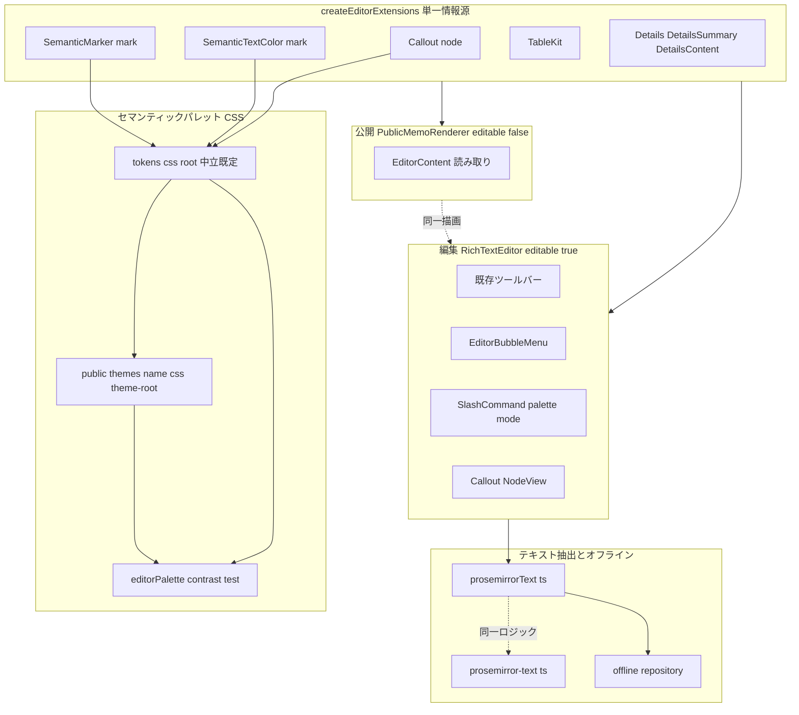
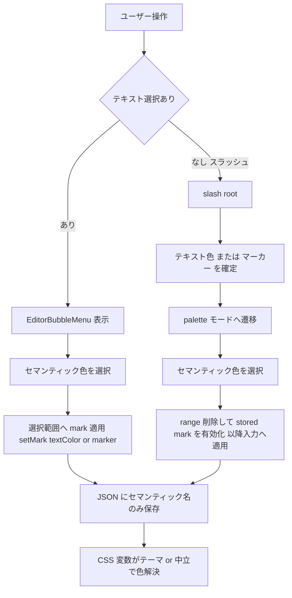
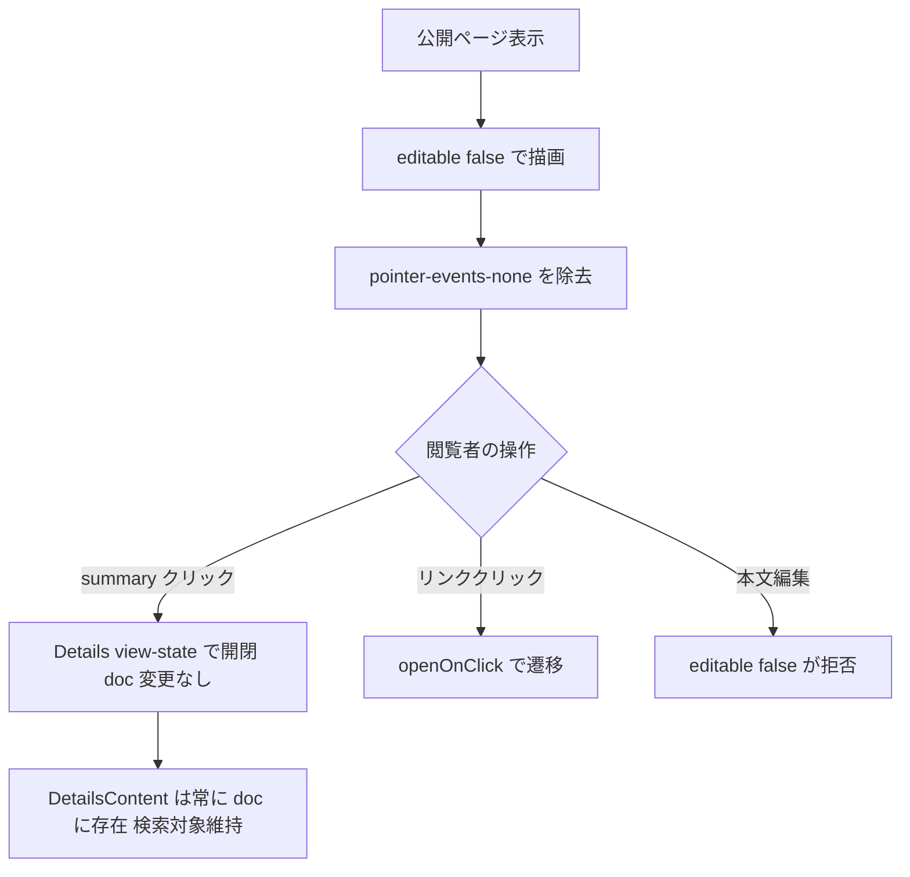

# Technical Design — rich-editor-blocks

## Overview

本設計は、Mosaku のリッチテキストエディタ（TipTap 3.x + StarterKit、`frontend/src/components/editor/`）を markdown 相当からリッチ表現へ拡張する第1波の HOW を定義する。対象は **(1) コールアウト、(2) テキスト色・マーカー、(3) 表、(4) トグル** の4機能で、いずれもスラッシュコマンドから挿入・適用できる。

**Users**: メモを書く全ユーザーが、💡ポイント枠・蛍光ペン・表・折りたたみで表現力の高いメモを作成し、公開ページでも同一の姿で共有できる。**Impact**: TipTap の拡張セット（`createEditorExtensions.ts`＝編集/公開の単一情報源）へ4機能のノード/マークを追加し、色彩をテーマ対応セマンティックカラー（CSS 変数解決）として提供する。本文は JSONB（Tiptap JSON）保存済みのため **DB スキーマ変更は不要**。検索テキスト抽出（FE/BE）とオフライン層は content 再帰の既存汎用実装に構造的に追随する。

差別化の核は **「mori / umi / yoru / asa のどのテーマでも AA コントラストを守って美しく発色する色体系」**。生 hex ではなくセマンティック識別子を本文へ保存し、theme-immersive-world で確立した AA 機械検証文化を editor パレットへ一般化する。

### Goals

- 4機能をスラッシュコマンド・バブルメニューから既存ブロックと同じ操作感で挿入/適用できる（Req1〜5）。
- 編集↔公開↔再読込↔オフラインで4機能が構造・表示を欠損なく往復する（Req6・8）。
- テキスト色/マーカーを全提供テーマ×中立既定パレットで AA を機械検証する（Req2.10）。
- コールアウト/表/トグルの内テキストが検索・プレビューに含まれる（Req7）。
- 既存メモ・既存9コマンド・自動保存・バリデーションを非回帰で維持する（Req9）。

### Non-Goals

- 画像アップロード（第3波）・リンクカード/OGP（第2波）・ウェルカムメモのシード（後続 welcome-memo-seed）。
- 本文保存の DB スキーマ変更（JSONB 移行済みのため不要）。
- 公開ビューへのテーマ機構導入（公開ビューは `:root` 中立既定パレットで解決＝Req6.5）。
- トグル開閉状態の永続（doc に保存しない。詳細は Data Models／Details 参照）。

## Architecture

### Existing Architecture Analysis

- **拡張の単一情報源**: `createEditorExtensions.ts` が編集（`RichTextEditor`）と公開（`PublicMemoRenderer`）で共有する拡張セットを一元管理。`editable` 差分は Placeholder / SlashCommand / Link.openOnClick のみ。→ **4機能のノード/マーク定義をここへ足せば往復一致が構造的に担保される**（Req6.1 の受け皿）。
- **テキスト抽出**: FE `utils/editor/prosemirrorText.ts` と BE `common/utils/prosemirror-text.ts` は同一ロジック（text 収集＋`content` 配列の再帰）。→ **content にテキストを持つノードは無改修で抽出**。attrs にテキストを持たせた場合のみ漏れる（Req7.6 の設計制約）。
- **オフライン層**: `utils/offline/repository.ts` が `extractPlainText(snapshot.content)` で `searchableText` を生成し content は JSON パススルー保存。→ Req8 は構造的に既対応。
- **BE バリデーション**: `IsProseMirrorDoc` はノードタイプのホワイトリストを持たず構造のみ検証。→ 4機能ノードは現行のまま受理（Req9.1 成立）。
- **保持すべき制約**: 公開ビュー `PublicMemoRenderer.tsx:17` の `pointer-events-none` が Req4.5（公開ビュー開閉）と衝突（G-1）。編集面は `.theme-root .memo-content`＋`prose` の二重スタイル環境。

### Architecture Pattern & Boundary Map

**Selected pattern**: 公式拡張最大活用＋薄いカスタム（Hybrid）。全ノード/マーク定義は単一情報源に集約し、UI（バブルメニュー・スラッシュパレット・NodeView）を編集面にのみ載せる。

**Architecture Integration**:

- **Domain/feature boundaries**: ノード/マーク定義（データ契約）は単一情報源に集約。UI 層（バブルメニュー・パレット・NodeView）は編集面のみ。色値（CSS 変数）はパレット層に隔離し、拡張は data 属性を出すだけで色を知らない。
- **Existing patterns preserved**: 単一情報源による往復一致・content 再帰抽出・スラッシュサブメニュー（notebook モードの先例）・AA 機械検証（tokens.contrast.test.ts）。
- **New components rationale**: `Callout`（公式拡張なし）・セマンティックマーク2種（Req2.5 のため公式 extend）・`EditorBubbleMenu`（選択適用＋文脈操作）・`contrast.ts` 共有化（Req2.10 一般化）。
- **Steering compliance**: 「テーマは CSS ファイル管理・DB はメタデータのみ」「新拡張は単一情報源へ追加」「エフェクト用 JS ライブラリを増やさない（色は CSS 変数のみ）」を遵守。

### Technology Stack

| Layer                | Choice / Version                                            | Role in Feature                                      | Notes                                                      |
| -------------------- | ----------------------------------------------------------- | ---------------------------------------------------- | ---------------------------------------------------------- |
| Frontend（エディタ） | `@tiptap/extension-table@3.22.2`（TableKit）                | 表の挿入・行列操作・Tab 移動・横スクロール           | peer: `@tiptap/pm`,`@tiptap/core`                          |
| Frontend（エディタ） | `@tiptap/extension-text-style@3.22.2`（TextStyle）          | テキスト色マークの基底（extend でセマンティック化）  | Color/BackgroundColor サブ拡張は登録しない                 |
| Frontend（エディタ） | `@tiptap/extension-highlight@3.22.2`                        | マーカーマークの基底（extend でセマンティック化）    | multicolor を extend で置換                                |
| Frontend（エディタ） | `@tiptap/extension-details@3.22.2`                          | トグル（Details/DetailsSummary/DetailsContent 同梱） | peer に text-style を要求（色機能と相乗り）・persist=false |
| Frontend（エディタ） | `@tiptap/pm@3.22.2`（直接依存へ昇格）                       | table/details の ProseMirror 基盤                    | 現状は推移依存（3.23.4 dedupe）                            |
| Frontend（UI）       | `@tiptap/react`（既存） のメニュー機構                      | バブルメニュー（選択適用・文脈操作）                 | 新規 JS ライブラリ追加なし                                 |
| Frontend（配色）     | CSS 変数（`tokens.css` `:root` ＋ `public/themes/*/*.css`） | セマンティックカラー解決・中立フォールバック         | DB 変更なし                                                |
| Backend              | 変更なし（`prosemirror-text.ts` は content 再帰で自動追随） | 検索/プレビュー用平文抽出                            | Req9.1 は既存バリデータで成立                              |

> バージョンは既存規約に合わせ 4 依存とも `3.22.2` にピン留め（core 3.23.4 と `^3.22.2` peer で互換 dedupe）。詳細な調達根拠は `research.md`（パッケージ地図）。

## System Flows

### テキスト色/マーカーの適用（選択範囲 vs 以降入力）

- 選択あり＝バブルメニュー（Req2.1/2.2）、選択なし＝スラッシュ palette（Req5.3）。両経路とも保存は data 属性のセマンティック名で、hex は保存しない（Req2.5）。「デフォルトに戻す」は `unsetMark`（Req2.4）。

### 公開ビューのトグル開閉（G-1 の解消）

- persist=false のため開閉はトランザクションを伴わない view-state（Req4.5）。編集不可は `editable:false` が構造的に保証（Req4.4/6.4）。詳細は `research.md`（Details 決定）。

## Requirements Traceability

| Requirement             | Summary                                      | Components                                            | Interfaces / Contracts                                                         | Flows    |
| ----------------------- | -------------------------------------------- | ----------------------------------------------------- | ------------------------------------------------------------------------------ | -------- |
| 1.1–1.6                 | コールアウト挿入・種別・複数段落・脱出・削除 | Callout node, Callout NodeView, slashCommandItems     | Node schema（block+, variant attr）, keymap（脱出）, NodeView（種別変更/削除） | —        |
| 1.7                     | コールアウトの AA                            | Palette CSS, editorPalette contrast test              | `--editor-callout-*`（不透明背景×文字）                                        | —        |
| 2.1, 2.2                | 選択範囲へ色/マーカー適用                    | EditorBubbleMenu, SemanticTextColor, SemanticMarker   | `setMark`/`toggleMark`（範囲）                                                 | 色適用   |
| 2.3                     | 4色以上×2種                                  | Palette CSS                                           | セマンティック識別子セット（≥4）                                               | —        |
| 2.4                     | デフォルトに戻す                             | EditorBubbleMenu                                      | `unsetTextColor`/`unsetMarker`                                                 | 色適用   |
| 2.5, 2.6                | セマンティック保存・テーマ追随               | SemanticTextColor, SemanticMarker                     | addAttributes/renderHTML/parseHTML（data 属性・hex 非保存）                    | 色適用   |
| 2.7, 2.8, 2.9, 2.10     | AA・フォールバック・機械検証                 | Palette CSS, contrast.ts, editorPalette contrast test | `--editor-text-*`/`--editor-marker-*(-on)`＋`:root` 既定                       | —        |
| 3.1–3.5                 | 表の挿入・編集・行列・Tab                    | TableKit, slashCommandItems, EditorBubbleMenu         | TableKit commands（insertTable/add/delete/Tab）                                | —        |
| 3.6                     | 横スクロール                                 | Node CSS（tableWrapper）                              | `.tableWrapper { overflow-x:auto }`（編集/公開共通）                           | —        |
| 4.1–4.4                 | トグル挿入・開閉・サマリー・複数ブロック     | Details（persist=false）                              | Details/DetailsSummary(inline)/DetailsContent(block+)                          | 公開開閉 |
| 4.5                     | 公開ビュー開閉                               | PublicMemoRenderer（pointer-events 除去）             | editable=false＋view-state 開閉                                                | 公開開閉 |
| 5.1, 5.2, 5.4, 5.5, 5.6 | 5項目・絞り込み・range 削除・Undo・非回帰    | slashCommandItems, suggestion, SlashCommandList       | CommandDef（keywords）, mode 拡張                                              | 色適用   |
| 5.3                     | 色サブメニュー（以降入力）                   | suggestion（palette mode）, SlashCommandList          | `SlashCommandMode='palette'`                                                   | 色適用   |
| 6.1, 6.2, 6.3           | 単一情報源・公開同一描画・再読込復元         | createEditorExtensions, saveRoundTrip test            | 拡張セット共有・getJSON 往復                                                   | —        |
| 6.4, 6.5                | 公開の編集不可・中立パレット                 | PublicMemoRenderer, Palette CSS(`:root`)              | editable=false・`:root` 解決                                                   | 公開開閉 |
| 7.1–7.6                 | 検索抽出（FE/BE・閉トグル・色付き・attr）    | prosemirrorText, prosemirror-text, 各ノード schema    | content 再帰（表示テキストは content に限定）                                  | —        |
| 8.1–8.4                 | オフライン保存/同期/検索/復元                | offline repository                                    | JSON パススルー・searchableText                                                | —        |
| 9.1–9.4                 | JSONB 受理・自動保存・既存非回帰             | IsProseMirrorDoc, createEditorExtensions              | 構造バリデーション・input rules 不変                                           | —        |

## Components and Interfaces

| Component                                         | Domain/Layer       | Intent                                           | Req Coverage            | Key Dependencies (P0/P1)             | Contracts |
| ------------------------------------------------- | ------------------ | ------------------------------------------------ | ----------------------- | ------------------------------------ | --------- |
| `createEditorExtensions.ts` (MODIFY)              | Editor/単一情報源  | 4機能のノード/マークを編集・公開共通で登録       | 6.1, 9.4                | TipTap 拡張 (P0)                     | State     |
| `Callout` node + NodeView (NEW)                   | Editor/Node        | 種別付き枠ブロック・種別変更・脱出・削除         | 1.1–1.6                 | ReactNodeView (P0), Palette CSS (P1) | State     |
| `SemanticTextColor` mark (NEW)                    | Editor/Mark        | テキスト色をセマンティック名で保存               | 2.1, 2.4–2.6            | TextStyle (P0)                       | State     |
| `SemanticMarker` mark (NEW)                       | Editor/Mark        | マーカーをセマンティック名で保存                 | 2.2, 2.4–2.6            | Highlight (P0)                       | State     |
| TableKit 設定 (NEW dep)                           | Editor/Node        | 表挿入・行列・Tab・横スクロール                  | 3.1–3.6                 | @tiptap/pm (P0)                      | State     |
| Details 設定 (NEW dep)                            | Editor/Node        | トグル（persist=false）                          | 4.1–4.4                 | text-style (P0)                      | State     |
| `EditorBubbleMenu.tsx` (NEW)                      | Editor/UI          | 選択時の色/マーカー・文脈操作（表/コールアウト） | 2.1, 2.2, 2.4, 3.3, 1.3 | @tiptap/react (P0)                   | —         |
| `slashCommandItems.ts` (MODIFY)                   | Editor/UI          | 5項目追加・palette モード                        | 5.1–5.6                 | 既存 CommandDef (P0)                 | Service   |
| `suggestion.ts` / `SlashCommandList.tsx` (MODIFY) | Editor/UI          | palette サブメニュー遷移                         | 5.3                     | 既存 render (P0)                     | —         |
| `PublicMemoRenderer.tsx` (MODIFY)                 | Public/UI          | pointer-events 除去・公開開閉                    | 4.5, 6.4                | createEditorExtensions (P0)          | State     |
| Palette CSS (MODIFY)                              | Theme/CSS          | セマンティック色値（中立＋4テーマ）              | 2.6–2.9, 6.5, 1.7       | —                                    | —         |
| `contrast.ts` + palette test (NEW)                | Theme/Test         | AA 機械検証の共有化・一般化                      | 2.10                    | tokens.contrast.test (P1)            | —         |
| Extractors / offline (TEST)                       | Search/Offline     | content 再帰の追随担保                           | 7.x, 8.x                | —                                    | —         |
| `IsProseMirrorDoc` (TEST)                         | Backend/Validation | 4機能ノード受理の回帰固定                        | 9.1                     | —                                    | —         |

以降、新境界を導入するコンポーネントのみ詳細ブロックを記す。純表示（`SlashCommandList` 等）は上表＋実装注記に委ねる。

### Editor / Nodes & Marks

#### Callout node

| Field        | Detail                                                                   |
| ------------ | ------------------------------------------------------------------------ |
| Intent       | 種別（アイコン＋配色）付きの枠ブロック。本文は複数段落・インライン装飾可 |
| Requirements | 1.1, 1.2, 1.3, 1.4, 1.5, 1.6, 1.7                                        |

**Responsibilities & Constraints**

- スキーマ: `group:'block'`, `content:'block+'`, `defining:true`, `attrs:{ variant: CalloutVariant }`（既定 `'point'`）。**表示テキスト（アイコン/ラベル）を attrs に持たない**（Req7.6 回避）。アイコンは CSS `::before` の装飾で描画し、種別→アイコン/配色は variant レジストリと CSS が解決。
- `renderHTML` → `
`。`parseHTML` は同属性から復元。→ 公開/再読込で同一描画（Req6.2/6.3）。
- キャレット脱出（Req1.5）: StarterKit 同梱 Gapcursor＋文末での ArrowDown / Mod-Enter 脱出 keymap を追加。ブロック内に閉じ込めない。
- 削除（Req1.6）: NodeView 内の削除操作＋バックスペース慣例で本文ごと削除。
- AA（Req1.7）: 背景は**不透明**なテーマ別実色（`--editor-callout-<variant>-bg` / `-on`）。文字×背景を機械検証。

**Dependencies**

- Outbound: Palette CSS — 種別配色の解決（P1）
- External: `@tiptap/react` ReactNodeViewRenderer — 種別変更 UI と NodeViewContent（P0）

**Contracts**: State [x]

##### State Management

- State model: `variant` のみが永続属性。本文は `content`（block+）に保持。
- Persistence: JSONB の doc に格納。open/hidden 等の一時状態は持たない。
- Concurrency: 既存 contentSync（echo-ref）に委譲、追加なし。

**Implementation Notes**

- Integration: `createEditorExtensions` に `editable` 非依存で登録（編集/公開一致）。種別変更 UI は NodeView 内蔵（軸4=A）。
- Validation: variant は enum。未知値は既定へフォールバックして描画（前方互換）。
- Risks: プロジェクト初のカスタム block ＋ NodeView。NodeViewContent の contenteditable 境界と脱出 keymap の実挙動を手動＋ユニットで検証（research R1）。

#### SemanticTextColor mark / SemanticMarker mark

| Field        | Detail                                                                                            |
| ------------ | ------------------------------------------------------------------------------------------------- |
| Intent       | テキスト色（TextStyle 拡張）・マーカー（Highlight 拡張）をセマンティック名で保存し CSS 変数で解決 |
| Requirements | 2.1, 2.2, 2.4, 2.5, 2.6, 2.7, 2.8, 2.9                                                            |

**Responsibilities & Constraints**

- `SemanticTextColor` = `TextStyle.extend`：`addAttributes` に `textColor:{ default:null }` を追加、`renderHTML` は `data-text-color=<name>` を出力、`parseHTML` は同属性から復元。**生 hex の `style="color:…"` を出力/保存しない**。commands: `setTextColor(name)` / `unsetTextColor()`。
- `SemanticMarker` = `Highlight.extend`：`multicolor` の hex 属性を `marker:{ default:null }` へ置換、`renderHTML` は `<mark data-marker=<name>>`。commands: `setMarker(name)` / `unsetMarker()`。
- 保存表現は識別子のみ（Req2.5）。テーマ切替時も JSON 不変で描画色のみ変わる（Req2.6）＝CSS 変数解決。
- color と marker と既存装飾（bold 等）は同一 text ノード上の複数 mark として共存（research R5 でテスト固定）。

**Contracts**: State [x]

##### State Management

- State model: text ノードの `marks[]` に `{type:'textStyle', attrs:{textColor}}` / `{type:'highlight', attrs:{marker}}`。
- Persistence: JSONB。hex を含まない（round-trip テストで固定）。
- 解決: `[data-text-color='<name>'] { color: var(--editor-text-<name>, <中立既定>) }`、`mark[data-marker='<name>'] { background: var(--editor-marker-<name>); color: var(--editor-marker-on-<name>) }`。

**Implementation Notes**

- Integration: `TextStyle`＋`SemanticTextColor`、`SemanticMarker` を単一情報源へ登録。公式 `Color`/`BackgroundColor` は登録しない。
- Validation: 未知 name は `var()` 第2引数（中立既定）へフォールバック（Req2.9）。
- Risks: 抽出器は mark 越しに text を自動抽出（Req7.5）＝追加コード不要。テストで担保。

#### TableKit 設定 / Details 設定

| Field        | Detail                                       |
| ------------ | -------------------------------------------- |
| Intent       | 表・トグルを公式拡張で提供し単一情報源へ登録 |
| Requirements | 3.1–3.6, 4.1–4.4                             |

**Responsibilities & Constraints**

- Table: `TableKit.configure({ table:{ resizable:false }, ... })`。ヘッダー行付き挿入（Req3.1）、セル内編集＋インライン装飾（Req3.2）、行列追加/削除・全体削除（Req3.3/3.4）は TableKit commands（`addRow*`/`deleteRow`/`addColumn*`/`deleteColumn`/`deleteTable`）を EditorBubbleMenu／スラッシュから呼ぶ。Tab/Shift+Tab セル移動は TableKit 標準（Req3.5）。横スクロールは `.tableWrapper` の `overflow-x:auto` を編集/公開両スコープに付与（Req3.6）。
- Details: `Details.configure({ persist:false })`。挿入は開いた状態（Req4.1）。DetailsSummary は inline、DetailsContent は `block+`（複数ブロック配置＝Req4.4）。開閉は view-state（Req4.2/4.3）。公開ビュー開閉は G-1 解消で成立（Req4.5）。

**Contracts**: State [x]（doc 構造）

**Implementation Notes**

- Integration: `editable` 非依存で登録。行列操作 UI は文脈検出でバブルメニューに出す（軸3=A）。
- Validation: 表の空セル・空トグルも往復で構造維持（saveRoundTrip 拡張）。
- Risks（research R2）: Details の `editable:false` 開閉が実機で動くかを**実装タスクの最初期 spike で最優先検証**（分岐を早期確定）。動かない場合の待避契約＝公開ビューで「persist=true＋`open` 属性限定のトランザクションゲート」に一本化する（native 描画案は往復一致を崩すため不採用。Data Models「待避契約」参照）。

### Editor / UI

#### EditorBubbleMenu.tsx（詳細ブロック）

| Field        | Detail                                                                  |
| ------------ | ----------------------------------------------------------------------- |
| Intent       | 選択範囲への色/マーカー適用と、文脈（表内・コールアウト内）の操作を提示 |
| Requirements | 2.1, 2.2, 2.4, 3.3, 1.3                                                 |

**Responsibilities & Constraints**

- テキスト選択時: セマンティック色スウォッチ（テキスト色・マーカー）＋「デフォルトに戻す」を表示し `setMark`/`unsetMark` を実行（Req2.1/2.2/2.4）。
- キャレットが表内: 行列追加/削除・表削除を表示（Req3.3/3.4）。
- キャレットがコールアウト内: 種別変更（NodeView 内蔵と併存可）を補助。
- doc に UI 状態を持たせない（表示は選択/キャレット文脈から純粋導出）。

**Dependencies**

- Inbound: `RichTextEditor` — editable=true 時のみマウント（P0）
- External: `@tiptap/react` メニュー機構（既存依存・新ライブラリ追加なし）（P0）

**Contracts**: なし（表示コンポーネント＋既存エディタコマンド呼び出しのみ）

**Implementation Notes**

- Integration: `RichTextEditor` にのみ配置。公開ビューには載せない（Req6.4）。
- Validation: `editor.can()` で不能コマンドを無効化（既存ツールバー踏襲）。
- Risks: 本プロジェクト初のバブルメニュー UI。既存依存で実装しリスクを限定。

#### slashCommandItems / suggestion / SlashCommandList（サマリー＋実装注記）

- **slashCommandItems.ts**（Service 契約）: `blockDefs` に5項目を追加。
  - コールアウト → `insertContent` で callout 挿入（`deleteRange`→挿入）。
  - 表 → `insertTable({ withHeaderRow:true })`（Req3.1）。
  - トグル → Details 挿入（開いた状態、Req4.1）。
  - テキスト色 / マーカー → **doc を変更せず** palette モードへ遷移するトリガー（notebook 先例と同型、`run` は no-op、遷移は render 層）。
  - 各項目は日本語名・英語別名・読みの `keywords`（Req5.2）。確定時 `deleteRange` で `/`＋クエリ削除（Req5.4）。Undo は ProseMirror history が自動提供（Req5.5）。既存9コマンド＋notebook 参照は不変（Req5.6）。
- **suggestion.ts / SlashCommandList.tsx**: `SlashCommandMode` を `'root' | 'notebook' | 'palette'` へ拡張。palette モードはセマンティック色スウォッチを列挙し、確定で `deleteRange`→stored mark 有効化（以降入力へ適用＝Req5.3）。「戻る」/Escape/クエリ空で root 復帰（notebook と同じ復帰契約）。
- Implementation Note: mode 遷移ロジックは render クロージャ保持（既存 `suggestion.ts` の `mode` 変数に palette を追加）。doc に mode を持たせない不変則を維持。

### Public / UI

#### PublicMemoRenderer.tsx（サマリー＋実装注記）

- `pointer-events-none` を除去し、編集不可は `editable:false` に一本化（G-1 解消）。→ トグル開閉（view-state）とリンク遷移（openOnClick）が回復、本文編集は拒否（Req4.4/4.5/6.4）。
- **公開ビューで許可する操作の一覧（棚卸し）**: (a) トグル開閉、(b) リンク遷移（openOnClick）、(c) テキスト選択・コピー（`select-text` 維持）の3操作のみ。それ以外（本文編集・**既存 TaskItem チェックボックスのトグル**・表のセル編集・コールアウト種別変更等）は `editable:false` が編集トランザクションを弾くことで構造的に拒否する。pointer-events 復活で全要素がクリック可能になっても実挙動は上記3操作に限定され、既存メモの非回帰（Req9.3）を維持する。
- セマンティックカラーは `data-theme` 非適用のため `:root` 中立既定パレットで解決（Req6.5）。`.prose` に新ノード CSS（tableWrapper 横スクロール・callout・mark）を編集面と同一に適用（Req6.2）。
- Implementation Note: `select-text` は維持。**既存の `pointer-events-none` 固定テスト（`PublicMemoRenderer.test.tsx`「既存の表示属性（pointer-events-none select-text）を維持する」）は、`editable:false` ベースの挙動テスト（編集拒否＋開閉/リンク/選択の許可）へ意図的に置換する**（Testing Strategy 参照）。待避契約（Details 開閉が動かない場合）は本ファイルに閉じる。

### Backend / Search & Validation

- **prosemirror-text.ts（BE）/ prosemirrorText.ts（FE）**: content 再帰実装のため4機能ノードのテキストは自動抽出（Req7.2/7.3）。**設計制約: 表示テキストは必ずノード content に持たせ attrs に置かない**（callout の種別・color/marker の識別子・details の open は非テキスト属性のため抽出不要＝Req7.6 適合）。閉トグルも DetailsContent が doc に在るため抽出対象（Req7.4）。色/マーカー付きテキストも通常同様抽出（Req7.5）。→ **コード変更なし・担保テスト追加のみ**。
- **offline repository.ts**: `extractPlainText` 依存のため FE 抽出器の追随で Req8.3 も同時充足。content は JSON パススルー保存/同期（Req8.1/8.2/8.4）。→ 担保テスト追加のみ。
- **IsProseMirrorDoc**: ホワイトリストなしのため4機能ノードを受理（Req9.1）。受理を固定する回帰テストを追加。

## Data Models

### 保存ノード/マークのスキーマ契約（Tiptap JSON / JSONB）

本文は既存 JSONB カラムに格納（**DB 変更なし**）。4機能が追加する doc 構造の契約は下表。表示テキストは全て `content` 側に置き、属性はセマンティック識別子・列挙・真偽のみ（Req7.6 の抽出整合）。

| ノード/マーク | type                                         | 主要属性（非テキスト）               | content                                            | テキスト所在       | 抽出                      |
| ------------- | -------------------------------------------- | ------------------------------------ | -------------------------------------------------- | ------------------ | ------------------------- |
| コールアウト  | `callout`                                    | `variant`（enum, 既定 point）        | `block+`                                           | content（段落等）  | 自動（再帰）              |
| テキスト色    | mark `textStyle`                             | `textColor`（semantic name \| null） | —                                                  | 付与先 text ノード | 自動                      |
| マーカー      | mark `highlight`                             | `marker`（semantic name \| null）    | —                                                  | 付与先 text ノード | 自動                      |
| 表            | `table`/`tableRow`/`tableHeader`/`tableCell` | TableKit 標準（colspan 等）          | セル→`block+`                                      | セル content       | 自動                      |
| トグル        | `details`                                    | （persist=false のため open 非永続） | `detailsSummary`(inline)＋`detailsContent`(block+) | summary/content    | 自動（閉でも content 在） |

**Consistency & Integrity**:

- 前方互換: 未知 `variant` / 未知 color name は描画時に既定へフォールバック（Req2.9・1 系）。JSON は保持。
- 往復不変則: 編集で得た `getJSON()` が公開（editable:false）・再読込・オフライン復元で構造等価（Req6.3/8.4）。`saveRoundTrip.test.ts` を4機能へ拡張して固定。
- hex 非混入: color/marker の JSON に hex/rgb が出現しないことをテストで固定（Req2.5）。

### セマンティックパレットの CSS 変数契約（2層）

| 変数                                                   | 定義層                                                                          | 役割                             |
| ------------------------------------------------------ | ------------------------------------------------------------------------------- | -------------------------------- |
| `--editor-text-<name>`                                 | `:root`（tokens.css 中立）＋ 各 `public/themes/*/*.css .theme-root`（テーマ別） | テキスト色の解決値               |
| `--editor-marker-<name>` / `--editor-marker-on-<name>` | 同上                                                                            | マーカー背景/上の文字（対で AA） |
| `--editor-callout-<variant>-bg` / `-on`                | 同上                                                                            | コールアウトの不透明背景/文字    |

- 中立既定（`:root`）は常時ロード（render-blocking）で公開ビュー主経路＋フォールバックを兼ねる（Req6.5/2.9）。テーマ別は memo 面 CSS（4テーマ実在）に実値を置く（Req2.6/2.7/2.8）。
- セマンティック識別子は各種≥4（Req2.3）。命名は Mosaku の世界観に沿う和名（例 テキスト: `wakaba`/`sora`/`kohaku`/`sumire`、マーカー: `kiiro`/`midori`/`momo`/`mizu`）。**確定値は AA テストが RED で炙り出す**（テスト先行）。
- **色数下限の防波堤（Req2.3 と 2.7/2.8 の両立保証）**: マーカー/コールアウトは不透明背景×文字の単色 AA 検証に落ちるため各種4色/種別の確保は容易。下限リスクはテキスト色（テーマ本文グラデ背景の両端床合成で AA 判定）に集中する。テキスト色は**全4テーマの両端床で同時に AA を満たす前景色**として選定し、特定色相が両立しない場合も彩度を落とす／明度を上げる方向へ調整して**各種4色を必ず確保する**（「AA 不成立ゆえ除外した結果4色未満」を許容しない）。

### 待避契約（Details 開閉が editable:false で不成立の場合）

- **待避策は「persist=true へ切替＋`open` 属性限定 `filterTransaction` ゲート」の一本に統一する。** persist=false の view-state 開閉が公開ビューで動かなかった場合のみ、Details を `persist:true`（開閉を `open` 属性として doc に永続）へ切替え、公開ビューでは **`open` 属性の変更に限りトランザクションを許可**する `filterTransaction` ゲートを `PublicMemoRenderer` に導入する（他の全変更は拒否＝Req6.4 維持）。research.md の Details 決定（persist=true 移行）と本節の記述を一致させる。
- **native `
/
` 描画案は採らない。** 公開ビュー専用の native 描画は単一情報源（`createEditorExtensions`）による編集/公開の同一ノード定義＝往復一致（Req6.1/6.2）を崩すため、待避策から除外する。待避時も単一情報源のノード定義は不変で、変更は `PublicMemoRenderer`（ゲート）と Details の `persist` 値のみに閉じる。
- persist=true 移行時も DetailsContent は開閉に依らず常に content に在るため、Req7.4（閉トグルも検索）・Req6.3/8.4（構造復元）は引き続き成立する。

## Error Handling

- **未知属性のフォールバック**（前方互換・Graceful Degradation）: 未知 `variant`/color name は既定色・既定種別で描画し、本文 JSON は保持（Req2.9・9.3）。
- **不能コマンドの抑止**（Fail Fast）: バブルメニュー/スラッシュは `editor.can()` で不能操作を無効化（例: 表外での行追加）。
- **公開ビューの編集拒否**: `editable:false` により開閉・リンク以外の変更を構造的に拒否（Req6.4）。待避時もゲートで open 以外を拒否。
- **Monitoring**: 既存 Sentry `feature_area` タグの `memo` を踏襲（本 spec で新規 area 追加なし）。抽出器の例外は既存の防御的実装（null/空 content ガード）を維持。

## Testing Strategy

### Unit Tests

- `SemanticTextColor`/`SemanticMarker`: `setMark`→JSON に semantic name のみ・hex 非混入、`unsetMark` で除去（Req2.4/2.5）。
- Callout: 種別変更で本文保持・アイコン/配色のみ切替（Req1.3）、文末脱出 keymap でキャレットが外へ出る（Req1.5）。
- slashCommandItems: 5項目の keywords 絞り込み（日本語/英語/読み）、確定で range 削除（Req5.2/5.4）、既存9コマンド不変（Req5.6）。
- 抽出器（FE/BE）: callout/表セル/トグル summary・content・**閉トグル**・色付きテキストが平文に含まれる（Req7.1–7.5）。

### Integration Tests

- `saveRoundTrip.test.ts` 拡張: 4機能を含む複合 doc が 編集↔公開↔再読込 で構造等価（Req6.2/6.3）。TaskList/コードブロック既存往復の非回帰。
- オフライン `repository.test.ts`: 4機能入り JSON の保存/同期パススルー＋`searchableText` に内テキスト（Req8.1–8.4）。
- BE `IsProseMirrorDoc`: 4機能ノードを含む doc を受理（Req9.1）。
- mark 共存: color＋marker＋bold 同時適用の JSON 構造と復元（research R5）。

### AA / 機械検証（Req2.10）

- `contrast.ts` を共有抽出し `tokens.contrast.test.ts` を import に切替え（重複排除・非回帰）。
- `editorPalette.contrast.test.ts`（新）: `:root` 中立＋各 `public/themes/*/*.css` × 全セマンティック色（テキスト/マーカー/コールアウト）で AA を検証。テキスト色はテーマ `--theme-bg` グラデの両端合成、マーカー/コールアウトは不透明背景×文字。計算ユーティリティの既知値セルフテストを維持。**加えて、テキスト色・マーカーが全テーマで各種4色以上 AA を満たすことを件数で固定し、Req2.3 の下限割れ（AA 不成立による色除外の結果4色未満）を検出する。**

### E2E / UI（該当時）

- スラッシュ→palette→色選択→以降入力へ適用（Req5.3）、公開ページでトグル開閉が動く（Req4.5）。
- 公開ビュー挙動: 既存 `pointer-events-none` 固定テストを置換し、`editable:false` 下で (a) トグル開閉・リンク遷移・テキスト選択が可能／(b) 本文編集・TaskItem トグル等の編集系が拒否されることを固定する（Req4.4/6.4/9.3）。

## Security Considerations

- リンク安全性は既存 `createEditorExtensions` の `protocols:['http','https','mailto']`＋`rel="noopener noreferrer nofollow"` を継承（新規導線なし）。
- Callout の `renderHTML` は data 属性のみ（任意 HTML/style を出力しない）。color/marker も data 属性のみで、ユーザー入力由来の生 hex を DOM/JSON に流さない（Req2.5 がインジェクション面も縮小）。
- 公開ビューは `editable:false`＋（待避時）open 限定ゲートで書込面を最小化。

## Performance & Scalability

- 追加拡張のバンドル影響は編集/公開画面に限定（テーマエフェクトのような遅延ロード対象ではない）。新規 JS ライブラリ追加なし（色は CSS 変数のみ・steering 準拠）。
- 中立パレットは render-blocking の `tokens.css` に少量の変数追加のみ。テーマ別値はテーマ有効時 fetch の memo 面 CSS に載る（非該当テーマのバンドルを増やさない）。
- 抽出器は content 再帰の既存実装で追加計算なし。
