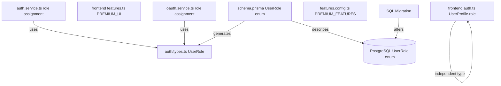
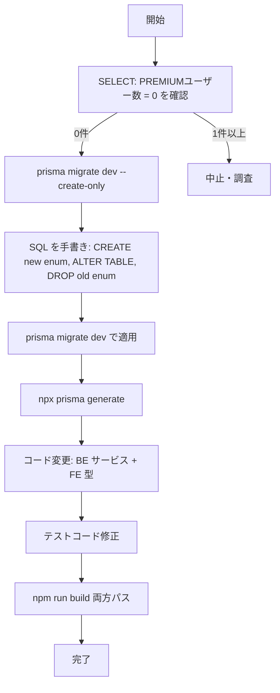

# Design Document: role-model-cleanup

## Overview

本機能は、コードベース全体に残存する未使用の `PREMIUM` ロールおよび旧称の `FREE` ロールを削除し、ロールモデルを `USER` / `ADMIN` の2値に統一する。既存のビジネスロジック（管理者判定、JWT ペイロード、API ガード）は一切変更せず、型定義・文字列リテラル・DB スキーマの整理のみを行う。

既存ユーザーデータは `FREE` → `USER` の無損失変換により保護される。`PREMIUM` ロールはコード上で割り当てられたことがなく、DB 上の参照行もゼロであることをマイグレーション前 SELECT で確認する。

### Goals

- `UserRole` enum を `USER` / `ADMIN` の2値に整理し、コードと DB を一致させる
- `FREE` → `USER` 変換を既存ユーザーデータ無損失で実施する
- TypeScript コンパイルエラーにより `PREMIUM` / `FREE` 参照を静的に排除する

### Non-Goals

- 認証フローやアクセス制御ロジックの変更
- ADMIN 権限の付与条件変更（`ADMIN_EMAIL` 環境変数ロジックは維持）
- X/Twitter OAuth 削除（別 spec: A-1 で実施）
- レガシー sync エンドポイント削除（別 spec: B-3 で実施）

---

## Requirements Traceability

| Requirement | Summary                                              | Components                       | Migration                     |
| ----------- | ---------------------------------------------------- | -------------------------------- | ----------------------------- |
| 1.1         | UserRole enum を USER/ADMIN の2値に変更              | `schema.prisma`                  | カスタム SQL マイグレーション |
| 1.2         | FREE → USER 変換マイグレーション実行                 | Prisma マイグレーションファイル  | `CASE WHEN` による変換        |
| 1.3         | PREMIUM 参照が TypeScript コンパイルエラーになること | `schema.prisma`, `auth/types.ts` | —                             |
| 2.1         | 新規メール/PW ユーザーのロールを USER に設定         | `auth.service.ts`                | —                             |
| 2.2         | 新規 OAuth ユーザーのロールを USER に設定            | `oauth.service.ts`               | —                             |
| 2.3         | PREMIUM_FEATURES フラグ削除                          | `features.config.ts`             | —                             |
| 2.4         | LEGACY_SYNC_ENDPOINTS フラグ削除                     | `features.config.ts`             | —                             |
| 3.1         | フロントエンド UserRole 型を USER\|ADMIN のみに      | `frontend/utils/auth.ts`         | —                             |
| 3.2         | PREMIUM_UI フラグ参照を削除                          | `frontend/constants/features.ts` | —                             |
| 3.3         | ADMIN 条件分岐を維持                                 | `frontend/utils/auth.ts`         | —                             |
| 3.4         | FREE/PREMIUM 前提の UI 要素を非表示に                | `frontend/utils/auth.ts`         | —                             |
| 4.1         | FREE → USER 無損失変換                               | Prisma マイグレーション          | SQL CASE WHEN                 |
| 4.2         | ADMIN ロール維持                                     | Prisma マイグレーション          | SQL CASE WHEN                 |
| 4.3         | ロールバック可能状態の維持                           | Prisma マイグレーション          | Prisma migrate reset          |

---

## Architecture

### Existing Architecture Analysis

本変更は既存アーキテクチャの拡張（Extension）であり、新規コンポーネントは作成しない。影響範囲は以下のレイヤーに限定される:

- **DB / Prisma スキーマ**: `UserRole` enum 定義の変更
- **バックエンドサービス**: ロール文字列リテラルの置換
- **バックエンド設定**: 未使用フラグの削除
- **フロントエンド型定義**: `UserProfile.role` 型の更新
- **フロントエンド定数**: 未使用フラグの削除

`backend/src/auth/types.ts` の `UserRole` 型は Prisma 生成型から自動導出（`AuthenticatedUser['role']`）されるため、スキーマ変更のみで自動更新される（手動変更不要）。

### Architecture Pattern & Boundary Map



- 選択パターン: 既存システムへの局所変更（In-Place Refactor）
- 新規コンポーネント: なし
- Steering 準拠: `backend/src/auth/types.ts` が Prisma 型から自動導出される設計パターンを維持

### Technology Stack

| Layer             | Choice / Version      | Role in Feature                | Notes                                     |
| ----------------- | --------------------- | ------------------------------ | ----------------------------------------- |
| Backend ORM       | Prisma 6.x            | UserRole enum 定義・型生成     | `backend/generated/prisma/` に生成        |
| Database          | PostgreSQL (Supabase) | enum 値の物理変更              | ALTER TYPE は非サポートのためカスタム SQL |
| Backend Framework | NestJS 11             | サービス層の文字列リテラル修正 | 型変更のみ、ロジック変更なし              |
| Frontend          | React 19 + TypeScript | 型定義・定数の修正             | Prisma 型とは独立した手動型定義           |

---

## Components and Interfaces

### Component Summary

| Component                        | Layer           | Intent                       | Req Coverage       | Contracts |
| -------------------------------- | --------------- | ---------------------------- | ------------------ | --------- |
| `schema.prisma`                  | DB Schema       | UserRole enum 再定義         | 1.1, 1.3           | State     |
| SQL Migration                    | DB Migration    | FREE→USER 変換・PREMIUM 削除 | 1.2, 4.1, 4.2, 4.3 | Batch     |
| `auth.service.ts`                | Backend Service | ロール割り当てを USER に変更 | 2.1                | Service   |
| `oauth.service.ts`               | Backend Service | ロール割り当てを USER に変更 | 2.2                | Service   |
| `features.config.ts`             | Backend Config  | 未使用フラグ削除             | 2.3, 2.4           | —         |
| `frontend/utils/auth.ts`         | Frontend Type   | UserProfile.role 型更新      | 3.1, 3.3, 3.4      | State     |
| `frontend/constants/features.ts` | Frontend Config | PREMIUM_UI フラグ削除        | 3.2                | —         |

---

### Backend / Database Layer

#### schema.prisma — UserRole Enum

| Field        | Detail                                                |
| ------------ | ----------------------------------------------------- |
| Intent       | `UserRole` enum を `USER` / `ADMIN` の2値に再定義する |
| Requirements | 1.1, 1.3                                              |

**Responsibilities & Constraints**

- `UserRole` enum から `FREE` と `PREMIUM` を削除し `USER` と `ADMIN` のみを定義する
- `User.role` のデフォルト値を `FREE` から `USER` に変更する
- Prisma が型を再生成することで `auth/types.ts` の `UserRole` が自動更新される

**Contracts**: State [x]

##### State Management

- 変更前: `enum UserRole { FREE PREMIUM ADMIN }`、`User.role @default(FREE)`
- 変更後: `enum UserRole { USER ADMIN }`、`User.role @default(USER)`
- Prisma 型生成後: `backend/src/auth/types.ts` の `UserRole` が `'USER' | 'ADMIN'` に自動更新される

**Implementation Notes**

- スキーマ変更後は `npx prisma generate` を実行して型を再生成すること
- マイグレーションは自動生成せず、カスタム SQL Migration コンポーネントで別途作成する

---

#### SQL Migration — UserRole enum 再作成

| Field        | Detail                                                          |
| ------------ | --------------------------------------------------------------- |
| Intent       | PostgreSQL の enum を安全に再作成し、既存データを無損失変換する |
| Requirements | 1.2, 4.1, 4.2, 4.3                                              |

**Responsibilities & Constraints**

- PostgreSQL は既存の enum 値の削除を直接サポートしないため、新 enum 作成 → カラム変換 → 旧 enum 削除の手順が必要
- PREMIUM ロールを持つユーザーが存在しないことをマイグレーション前に検証する
- トランザクション内で実行し、エラー時はロールバック可能にする

**Contracts**: Batch [x]

##### Batch / Job Contract

- **Trigger**: `npx prisma migrate dev` 実行時（`--create-only` で空ファイル作成後、SQL を手書き）
- **Input / Validation**: マイグレーション前に `SELECT count(*) FROM users WHERE role = 'PREMIUM'` で 0 行を確認
- **Output**: `users.role` カラムの型が新 `UserRole` enum に変換済み
- **Idempotency**: Prisma マイグレーション履歴により冪等性保証。`prisma migrate reset` でロールバック可能

```sql
-- マイグレーション前検証（0件であること）
SELECT count(*) FROM "users" WHERE role::text = 'PREMIUM';

-- 1. 新しい enum を作成
CREATE TYPE "UserRole_new" AS ENUM ('USER', 'ADMIN');

-- 2. カラムを新しい enum に変換（FREE→USER, ADMIN→ADMIN）
ALTER TABLE "users"
  ALTER COLUMN "role" TYPE "UserRole_new"
  USING (
    CASE role::text
      WHEN 'FREE'  THEN 'USER'::"UserRole_new"
      WHEN 'ADMIN' THEN 'ADMIN'::"UserRole_new"
    END
  );

-- 3. デフォルト値を再設定
ALTER TABLE "users"
  ALTER COLUMN "role" SET DEFAULT 'USER'::"UserRole_new";

-- 4. 旧 enum を削除して新 enum をリネーム
DROP TYPE "UserRole";
ALTER TYPE "UserRole_new" RENAME TO "UserRole";
```

**Implementation Notes**

- `prisma migrate dev --create-only` で空のマイグレーションファイルを作成し、上記 SQL を手書きで記述する
- Risks: PREMIUM 行が存在する場合、`CASE` に `WHEN 'PREMIUM'` が未定義のため変換がスキップされ NULL になる可能性がある。事前検証 SELECT で防止する

---

#### auth.service.ts — ロール割り当て修正

| Field        | Detail                                                                   |
| ------------ | ------------------------------------------------------------------------ |
| Intent       | 新規メール/PW ユーザー作成時のロールを `'FREE'` から `'USER'` に変更する |
| Requirements | 2.1                                                                      |

**Responsibilities & Constraints**

- `register()` メソッド内の `role: isAdmin ? 'ADMIN' : 'FREE'` を `role: isAdmin ? 'ADMIN' : 'USER'` に変更する
- ロジック変更なし（管理者判定は `ADMIN_EMAIL` 環境変数で決定する既存ロジックを維持）

**Contracts**: Service [x]

##### Service Interface

変更箇所（L80）:

```typescript
// Before
role: isAdmin ? 'ADMIN' : 'FREE';

// After
role: isAdmin ? 'ADMIN' : 'USER';
```

---

#### oauth.service.ts — ロール割り当て修正

| Field        | Detail                                                               |
| ------------ | -------------------------------------------------------------------- |
| Intent       | OAuth 新規ユーザー作成時のロールを `'FREE'` から `'USER'` に変更する |
| Requirements | 2.2                                                                  |

**Responsibilities & Constraints**

- L111 の `role: 'FREE'` を `role: 'USER'` に変更する
- ロジック変更なし

**Contracts**: Service [x]

##### Service Interface

変更箇所（L111）:

```typescript
// Before
role: 'FREE';

// After
role: 'USER';
```

---

#### features.config.ts — 未使用フラグ削除

| Field        | Detail                                                                         |
| ------------ | ------------------------------------------------------------------------------ |
| Intent       | `PREMIUM_FEATURES` および `LEGACY_SYNC_ENDPOINTS` フィーチャーフラグを削除する |
| Requirements | 2.3, 2.4                                                                       |

**Responsibilities & Constraints**

- `PREMIUM_FEATURES` オブジェクトを削除する
- `LEGACY_SYNC_ENDPOINTS` フラグを削除する
- 削除後、TypeScript コンパイルエラーが発生するファイルがないことを確認する（これらのフラグは未参照のため、コンパイルエラーは発生しないことが調査済み）

---

### Frontend Layer

#### frontend/utils/auth.ts — UserProfile.role 型更新

| Field        | Detail                                                                          |
| ------------ | ------------------------------------------------------------------------------- |
| Intent       | `UserProfile` インターフェースの `role` 型を `'USER' \| 'ADMIN'` のみに変更する |
| Requirements | 3.1, 3.3, 3.4                                                                   |

**Responsibilities & Constraints**

- L9 の `role: 'FREE' | 'PREMIUM' | 'ADMIN'` を `role: 'USER' | 'ADMIN'` に変更する
- L40 付近の型アサーションも同様に更新する
- `role === 'ADMIN'` の条件分岐は維持する（管理者判定ロジックの保持）
- フロントエンドはバックエンドから独立した手動型定義のため、スキーマ変更の自動反映はない

**Contracts**: State [x]

##### State Management

```typescript
// Before
interface UserProfile {
	role: 'FREE' | 'PREMIUM' | 'ADMIN';
	// ...
}

// After
interface UserProfile {
	role: 'USER' | 'ADMIN';
	// ...
}
```

**Implementation Notes**

- `role === 'FREE'` や `role === 'PREMIUM'` を参照している箇所があれば TypeScript コンパイルエラーで検出される
- Risks: フロントエンドテストフレームワーク未導入のため、型変更の影響は TypeScript コンパイルのみで確認する

---

#### frontend/constants/features.ts — PREMIUM_UI フラグ削除

| Field        | Detail                                    |
| ------------ | ----------------------------------------- |
| Intent       | `PREMIUM_UI` フィーチャーフラグを削除する |
| Requirements | 3.2                                       |

**Responsibilities & Constraints**

- `PREMIUM_UI` エントリを削除する
- 削除後、参照箇所があれば TypeScript コンパイルエラーで検出されることを確認する

---

## Data Models

### Domain Model

ロールはユーザーの権限レベルを表す値オブジェクト。ビジネスルールは以下の通り:

- `USER`: 通常ユーザー。メモ・ノートブック・タグの CRUD が可能
- `ADMIN`: 管理者。招待コード管理が追加で可能。`ADMIN_EMAIL` 環境変数と一致するメールアドレスで登録したユーザーのみが該当

### Logical Data Model

**変更前**:

```
UserRole enum: FREE | PREMIUM | ADMIN
User.role: UserRole @default(FREE)
```

**変更後**:

```
UserRole enum: USER | ADMIN
User.role: UserRole @default(USER)
```

**一貫性**:

- `ADMIN` ロールを持つ既存ユーザーのロールは変更しない
- `FREE` ロールを持つ既存ユーザーは `USER` に変換される
- `PREMIUM` ロールを持つユーザーが存在しないことを前提とする（マイグレーション前に検証）

### Physical Data Model

PostgreSQL `users` テーブルの `role` カラムが `UserRole` enum 型を参照する。変更手順は SQL Migration コンポーネントを参照。

---

## Testing Strategy

### Unit Tests

バックエンドの既存ユニットテスト（Jest）を以下の通り修正する:

- `auth.service.spec.ts`: L17, L141, L143, L150 の `'FREE'` モック値を `'USER'` に変更
- `oauth.service.spec.ts`: L17 の `'FREE'` モック値を `'USER'` に変更
- `jwt.service.spec.ts`: L29, L48 の `'FREE'` モック値を `'USER'` に変更
- `admin.guard.spec.ts`: L29-36 の `'FREE'` / `'PREMIUM'` テストケースを `'USER'` に変更

### Integration Tests

- `npm run test` でユニットテスト全件がパスすることを確認
- `npx prisma migrate dev` でマイグレーションが正常に完了することを確認
- マイグレーション後に `SELECT role, count(*) FROM users GROUP BY role` で `USER` と `ADMIN` のみが存在することを確認

### TypeScript Compilation Check

- バックエンド: `npm run build`（`backend/` で実行）が型エラーなしでパスすること
- フロントエンド: `npm run build`（`frontend/` で実行）が型エラーなしでパスすること
- `PREMIUM` / `FREE` 参照が残存している場合、コンパイルエラーで検出される

---

## Migration Strategy



**ロールバック**: マイグレーション適用前は `prisma migrate reset` でロールバック可能。本番環境への適用前に必ずステージング環境で検証すること。
