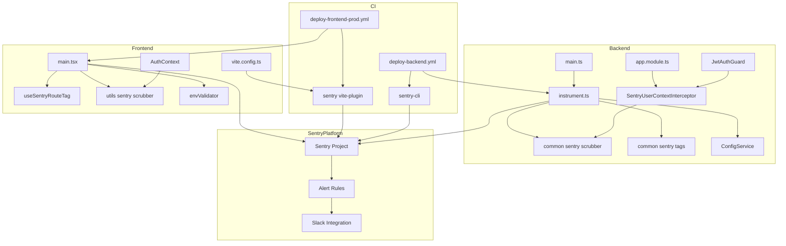
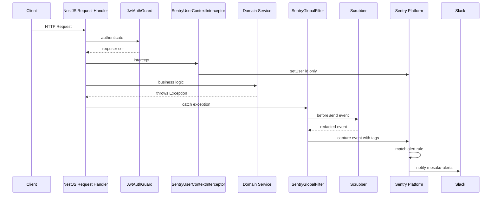
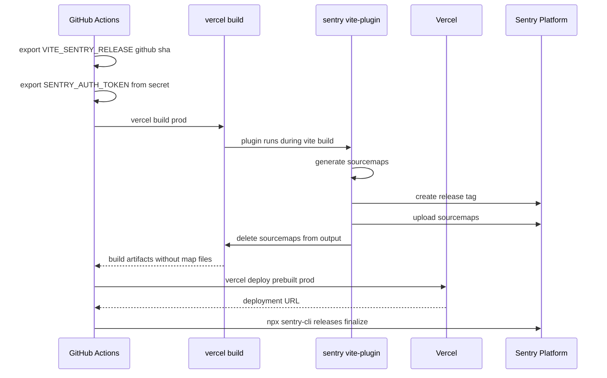
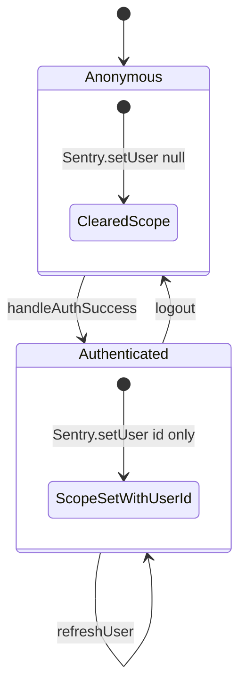
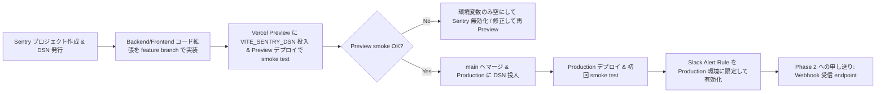

# Technical Design — sentry-integration

## Overview

**Purpose**: Sentry を「DSN を投入しただけ」の状態から、個人開発者が週 5 時間で運用できる本番監視基盤に引き上げる。Production 単一運用（Staging は 2026-04-23 に廃止済み、Vercel Preview は Production Sentry プロジェクトに相乗りし `release` タグで識別）を前提に、環境識別、PII スクラビング、ユーザー識別、リリーストラッキング、Source Map、ノイズ除外、Slack 通知を一式そろえ、Phase 2 の AI 障害自動調査パイプライン（Sentry Webhook → Claude API → Slack）の前提となる構造化メタデータを整える。

**Users**: 運用者（= プロジェクトオーナー自身）と、招待制で利用する Mosaku ユーザー（PII 保護が提供価値となる）。

**Impact**: Backend `instrument.ts` / `app.module.ts`、Frontend `main.tsx` / `AuthContext.tsx` / `vite.config.ts`、および CI ワークフロー 2 本を拡張する。新規ファイルは scrubber / user-context interceptor / route tag hook / 運用ドキュメントの計 5 ファイル程度に限定する。Sentry SDK そのもののアップグレードや新ドメインモジュールの新設は行わない。

### Goals

- Production で発生したエラーが **5 分以内に Slack に届く** 運用フローを確立する
- メモ本文・招待コード・JWT・OAuth シークレットが **Sentry に到達する前に確実にマスク** される
- エラーごとに `environment` / `release` / `feature_area` / `route` / `user_facing` の 5 タグを付与し、Phase 2 の AI 連携で文脈が揃った状態にする
- サンプリング率を環境変数化し、Sentry 無料枠を超えないよう **コード変更無しで調整** できる状態にする

### Non-Goals

- AI 障害自動調査パイプライン本体の実装（Phase 2 / 別スペック `ai-incident-triage` で扱う）
- UptimeRobot によるアップタイム監視（別スペック `uptime-monitoring`）
- 既存 `@sentry/nestjs` / `@sentry/react` のバージョンアップグレード（`^10.47.0` のまま運用）
- Performance Monitoring 指標の SLO 化・ダッシュボード設計（必要になった時点で別スペック）
- `useAuth.ts` と `AuthContext.tsx` の二重化解消（別タスクで扱う。本スペックは AuthContext を single source として扱う）

---

## Architecture

### Existing Architecture Analysis

現状コードの Sentry 関連資産:

- **Backend**: `backend/src/main.ts` で `import './instrument'` を最先行に実行し、`@sentry/nestjs` の `Sentry.init` を起動。`AppModule` に `SentryModule.forRoot()` + `SentryGlobalFilter` を `APP_FILTER` で登録済み
- **Frontend**: `frontend/src/main.tsx` で `Sentry.init` を実行。DSN 未設定時の `enabled` ガードあり。現状 `tracesSampleRate: import.meta.env.PROD ? 0.2 : 0` のみ設定
- **環境変数ハブ**: Backend は `ConfigService`（`backend/src/config/config.service.ts`）、Frontend は `envValidator`（`frontend/src/utils/env.ts`）で集約。Sentry 関連プロパティはまだ存在しない
- **認証**: Frontend は `AuthContext` が single source（`handleAuthSuccess` / `logout` が挿入点）。Backend は `JwtAuthGuard` → `req.user` のパターン
- **CI**: `.github/workflows/deploy-backend.yml`（Cloud Run + Workload Identity Federation）と `deploy-frontend-prod.yml`（Vercel CLI）。`github.sha` は Docker タグで既に利用
- **Slack**: `SLACK_WEBHOOK_URL` は GitHub Secrets に登録済みで CI のデプロイ通知で稼働。Sentry 側からは未連携

この設計は**既存パターンを踏襲しつつ拡張する Extension 型**であり、`1 ドメイン = 1 モジュール`（backend）/ `responsibility 別ディレクトリ`（frontend）という steering 原則を変更しない。

### Architecture Pattern & Boundary Map

**Selected Pattern**: Side-car observability extension（既存の認証・ドメインモジュールに side-car として Sentry を接続し、業務ロジックに混入しない）。

**Domain Boundaries**:

- **Sentry Core 層**（共通ヘルパ）: PII scrubber / tag 付与 / user context 同期。`backend/src/common/sentry/` と `frontend/src/utils/sentry/` に閉じ込め、業務ドメイン（memo / notebook / auth）からは「hook / interceptor 経由で 1 行呼ぶだけ」の状態を維持
- **業務ドメイン層**: 既存の `AuthContext.tsx` / `JwtAuthGuard` が Sentry へ user context を流すだけ。業務ロジックは Sentry の存在を意識しない
- **CI / Infra 層**: GitHub Actions で `SENTRY_RELEASE` を注入し、`sentry-cli` および `@sentry/vite-plugin` でリリース登録・Source Map アップロードを行う
- **Sentry Platform 層**: Sentry UI 上で Alert Rule / Slack Integration を設定（コード化は Phase 2 以降に先送り）



**Key Decisions**（詳細は research.md §Design Decisions）:

- **単一 Sentry プロジェクト + `environment` タグ**で Production / ローカル opt-in を識別。Vercel Preview は Production DSN に相乗りし `release` タグ（git sha）でメインラインと区別（プロジェクト 2 個案は却下）
- **`@sentry/vite-plugin`** で Source Map と Release 登録を自動化（Sentry CLI 単独案は却下）
- **Frontend `setUser` は AuthContext 1 箇所**、Backend は **新規 `SentryUserContextInterceptor`** で `JwtAuthGuard` 通過後に注入（Guard 直接改造案は却下。Guard の単一責任を崩さないため）
- **Slack 連携は Sentry ネイティブ統合**（Webhook 自前整形は Phase 2 で Claude 経由にするため今は保留）
- **Scrubber はブラックリスト方式**（`content` / `body` / `html` / `code` / `password` / `token` / JWT 正規表現 / UUID 正規表現）+ `sendDefaultPii: false`

### Technology Stack

| Layer                   | Choice / Version                                              | Role in Feature                                                     | Notes                                                                                                                                  |
| ----------------------- | ------------------------------------------------------------- | ------------------------------------------------------------------- | -------------------------------------------------------------------------------------------------------------------------------------- |
| Backend SDK             | `@sentry/nestjs` ^10.47.0（既存）                             | エラー・トレース捕捉                                                | バージョン据え置き。`beforeSend` / `ignoreErrors` / `release` / `environment` 等のオプション拡張のみ                                   |
| Backend Profiling       | `@sentry/profiling-node` ^10.47.0（既存）                     | CPU プロファイル                                                    | `profilesSampleRate` を環境変数化                                                                                                      |
| Frontend SDK            | `@sentry/react` ^10.47.0（既存）                              | ブラウザエラー・トレース捕捉                                        | `BrowserTracing` + `React Router v7` 連携を追加（`reactRouterV7BrowserTracingIntegration`）                                            |
| Frontend Build Plugin   | `@sentry/vite-plugin` ^4 系（新規）                           | Source Map 生成・アップロード・Release 登録                         | `vite-plugin-pwa` と共存。`sourcemaps.filesToDeleteAfterUpload` で公開回避                                                             |
| Backend Release Tooling | `@sentry/cli` ^2 系（CI のみ `npx` 実行）                     | リリース finalize                                                   | devDependencies には追加せず GitHub Actions 内で `npx @sentry/cli` 呼び出し                                                            |
| CI                      | GitHub Actions（既存）                                        | `SENTRY_RELEASE` / `VITE_SENTRY_RELEASE` 注入 / Sentry CLI 呼び出し | `SENTRY_AUTH_TOKEN` を新規 Secret 追加。`SENTRY_ENVIRONMENT` は Production 固定（ローカル opt-in 時のみ `development`）                |
| Secret Storage          | GCP Secret Manager（Backend）/ Vercel Env（Frontend）（既存） | DSN / Auth Token 保管                                               | `sentry-dsn` Secret と `SENTRY_AUTH_TOKEN` を追加                                                                                      |
| Alert Routing           | Sentry Slack Integration（新規設定）                          | Production アラートを `#mosaku-alerts` に通知                       | Production 1 ルールのみ（Vercel Preview も同チャネルに集約し `release` タグで識別）。既存 `SLACK_WEBHOOK_URL` は CI 通知のみに限定継続 |

---

## System Flows

### Error Capture Lifecycle（Backend）



**Key decisions**:

- `SentryUserContextInterceptor` は `APP_INTERCEPTOR` としてグローバル登録。`req.user` が未セット（公開ルート）なら `setUser` を呼ばず匿名のまま
- `beforeSend` は `SentryGlobalFilter` の外側（`Sentry.init` 時点）で登録。つまりどの経路から捕捉されても必ず scrubber を通過する
- Tag 付与（`feature_area` / `route` / `user_facing`）は `beforeSend` 内で URL path から解決。Interceptor で都度 setTag する案は NestJS の ExecutionContext 依存度が高まるため不採用

### Release & Source Map Pipeline（Frontend）



**Key decisions**:

- Source Map は Vercel 成果物には残さず、ビルド時に Sentry に送信してからローカル削除（`sourcemaps.filesToDeleteAfterUpload`）
- `release` は `VITE_SENTRY_RELEASE` としてバンドル埋め込み + Sentry 側タグの両方に使用（同じ値で突合）
- Plugin 内でのアップロード失敗は CI の warning のみに留め、デプロイ自体はブロックしない（Observability は correctness を妨げない方針）

### Frontend User Context Sync



**Key decisions**:

- `AuthContext.handleAuthSuccess` / `logout` に **1 行ずつ** 副作用追加。`refreshUser` は user.id が変わらない限り再呼び出し不要
- email / OAuth プロバイダ名 / IP は **絶対に setUser に含めない**（PII 方針）

---

## Requirements Traceability

| Requirement | Summary                                                           | Components                                                     | Interfaces | Flows                         |
| ----------- | ----------------------------------------------------------------- | -------------------------------------------------------------- | ---------- | ----------------------------- |
| 1.1         | 単一 Sentry プロジェクト + `environment` タグ方針を文書化         | Sentry Project Setup / docs/deployment/sentry.md               | —          | —                             |
| 1.2         | Backend で `SENTRY_DSN` / `SENTRY_ENVIRONMENT` を環境変数から読む | instrument.ts / ConfigService                                  | Service    | —                             |
| 1.3         | Frontend で `VITE_SENTRY_DSN` / `VITE_SENTRY_ENVIRONMENT` を読む  | main.tsx / envValidator                                        | Service    | —                             |
| 1.4         | DSN 未設定で Sentry 初期化をスキップ                              | instrument.ts / main.tsx                                       | —          | —                             |
| 1.5         | ローカル開発は既定で無効化                                        | instrument.ts / main.tsx                                       | —          | —                             |
| 1.6         | ローテーション手順を `docs/deployment/` に記載                    | docs/deployment/sentry.md                                      | —          | —                             |
| 2.1–2.6     | サンプリング率の環境変数化と Production / development 切替        | instrument.ts / main.tsx / ConfigService / envValidator        | Service    | —                             |
| 3.1         | Backend beforeSend で PII redaction                               | BackendSentryScrubber / instrument.ts                          | Service    | Error Capture Lifecycle       |
| 3.2         | Frontend beforeSend で PII redaction                              | FrontendSentryScrubber / main.tsx                              | Service    | —                             |
| 3.3         | Redacted placeholder を `[REDACTED]` に統一                       | BackendSentryScrubber / FrontendSentryScrubber                 | Service    | —                             |
| 3.4         | `sendDefaultPii: false` を両 SDK で設定                           | instrument.ts / main.tsx                                       | —          | —                             |
| 3.5         | 新規フィールド追加時のチェックリスト                              | docs/deployment/sentry.md                                      | —          | —                             |
| 3.6         | Scrubber のユニットテスト                                         | sentry-scrubber.spec.ts / sentryScrubber.test.ts               | —          | —                             |
| 4.1         | Frontend ログイン成功で setUser id のみ                           | AuthContext 拡張 / FrontendSentryScrubber                      | Service    | User Context Sync             |
| 4.2         | Frontend ログアウトで setUser null                                | AuthContext 拡張                                               | Service    | User Context Sync             |
| 4.3         | Backend JWT 検証後に setUser                                      | SentryUserContextInterceptor                                   | Service    | Error Capture Lifecycle       |
| 4.4         | 公開エンドポイントでは setUser しない                             | SentryUserContextInterceptor                                   | Service    | —                             |
| 4.5         | email / IP / OAuth プロバイダは setUser に含めない                | SentryUserContextInterceptor / AuthContext                     | Service    | —                             |
| 5.1–5.2     | CI で SENTRY_RELEASE / VITE_SENTRY_RELEASE 注入                   | deploy-backend.yml / deploy-frontend-prod.yml                  | Batch      | Release & Source Map Pipeline |
| 5.3         | Backend Sentry.init に release 設定                               | instrument.ts                                                  | Service    | —                             |
| 5.4         | Frontend Sentry.init に release 設定                              | main.tsx                                                       | Service    | —                             |
| 5.5         | CI で sentry-cli releases new / finalize                          | deploy-backend.yml / deploy-frontend-prod.yml                  | Batch      | —                             |
| 5.6         | release 未設定時の fallback                                       | instrument.ts / main.tsx                                       | Service    | —                             |
| 6.1         | Frontend で source map 生成 + upload                              | vite.config.ts / @sentry/vite-plugin                           | Batch      | Release & Source Map Pipeline |
| 6.2         | vite-plugin 採用判断を research.md に記録                         | research.md                                                    | —          | —                             |
| 6.3         | source map を Vercel 公開から除外                                 | vite.config.ts（`filesToDeleteAfterUpload`）                   | Batch      | —                             |
| 6.4         | upload 失敗はデプロイをブロックしない                             | deploy-frontend-prod.yml                                       | Batch      | —                             |
| 6.5         | Production 初回デプロイ smoke test（手動エラー→可読スタック確認） | docs/deployment/sentry.md                                      | —          | —                             |
| 7.1         | Frontend ignoreErrors リスト                                      | main.tsx                                                       | Service    | —                             |
| 7.2         | Backend 4xx 除外（429 / 401 except）                              | instrument.ts（`beforeSend` 内）                               | Service    | —                             |
| 7.3         | AbortError / canceled request は報告しない                        | main.tsx                                                       | Service    | —                             |
| 7.4         | 除外ルールをドキュメント化                                        | docs/deployment/sentry.md                                      | —          | —                             |
| 7.5         | ルールごとに理由コメント                                          | instrument.ts / main.tsx                                       | —          | —                             |
| 8.1–8.6     | Sentry Alert Rule + Slack 連携                                    | Sentry Platform 設定 / docs/deployment/sentry.md               | —          | Error Capture Lifecycle       |
| 9.1         | 構造化タグ付与                                                    | BackendSentryTags / FrontendSentryTags / useSentryRouteTag     | Service    | —                             |
| 9.2         | NestJS controller / handler をタグ化                              | BackendSentryTags（ExecutionContext から解決）                 | Service    | —                             |
| 9.3         | Frontend route pathname をタグ化                                  | useSentryRouteTag                                              | Service    | —                             |
| 9.4         | Webhook / Issue-created の受け口を docs 化                        | docs/deployment/sentry.md                                      | —          | —                             |
| 9.5         | Phase 2 ロジックは本スペックに含めない                            | —                                                              | —          | —                             |
| 10.1–10.4   | ドキュメント・steering・CLAUDE.md 更新                            | docs/deployment/sentry.md / .kiro/steering/tech.md / CLAUDE.md | —          | —                             |

---

## Components and Interfaces

| Component                                       | Domain/Layer       | Intent                                                                                                                         | Req Coverage                                         | Key Dependencies                                   | Contracts |
| ----------------------------------------------- | ------------------ | ------------------------------------------------------------------------------------------------------------------------------ | ---------------------------------------------------- | -------------------------------------------------- | --------- |
| `BackendSentryScrubber`                         | Backend common     | `beforeSend` 内で PII をマスクする純関数                                                                                       | 3.1, 3.3, 3.6                                        | ConfigService (P2)                                 | Service   |
| `BackendSentryTags`                             | Backend common     | `feature_area` / `user_facing` / `route` / `controller` タグを event に付与                                                    | 9.1, 9.2                                             | Scrubber (P1)                                      | Service   |
| `SentryUserContextInterceptor`                  | Backend common     | 認証済み request で `Sentry.setUser({ id })` を呼び出すグローバル Interceptor                                                  | 4.3, 4.4, 4.5                                        | `JwtAuthGuard` (P0), `@sentry/nestjs` (P0)         | Service   |
| Extended `instrument.ts`                        | Backend bootstrap  | `Sentry.init` の拡張（environment/release/sampling/beforeSend/ignoreErrors）                                                   | 1.2, 1.4, 1.5, 2.1–2.3, 2.6, 3.4, 5.3, 5.6, 7.2, 7.5 | ConfigService (P0), Scrubber (P0), Tags (P0)       | Service   |
| Extended `ConfigService`                        | Backend config     | Sentry 関連環境変数を型安全に公開                                                                                              | 1.2, 2.5                                             | env (P0)                                           | Service   |
| `FrontendSentryScrubber`                        | Frontend util      | `beforeSend` 内で PII をマスクする純関数                                                                                       | 3.2, 3.3, 3.6                                        | envValidator (P2)                                  | Service   |
| Extended `main.tsx`                             | Frontend bootstrap | `Sentry.init` の拡張 + React Router v7 統合                                                                                    | 1.3, 1.4, 1.5, 2.4–2.6, 3.4, 5.4, 5.6, 7.1, 7.3, 7.5 | envValidator (P0), Scrubber (P0), vite-plugin (P0) | Service   |
| Extended `envValidator`                         | Frontend util      | Sentry 関連環境変数を型安全に取得                                                                                              | 1.3, 2.5                                             | import.meta.env (P0)                               | Service   |
| Extended `AuthContext`                          | Frontend context   | `handleAuthSuccess` / `logout` に `Sentry.setUser` 副作用を追加                                                                | 4.1, 4.2, 4.5                                        | `@sentry/react` (P0)                               | State     |
| `useSentryRouteTag`                             | Frontend hook      | React Router v7 の location 変化を Sentry タグ `route` に反映                                                                  | 9.1, 9.3                                             | react-router v7 (P0)                               | Service   |
| Extended `vite.config.ts`                       | Frontend build     | `@sentry/vite-plugin` を追加し source map upload と release 登録を自動化                                                       | 6.1, 6.3, 6.4                                        | `@sentry/vite-plugin` (P0)                         | Batch     |
| Extended `deploy-backend.yml`                   | CI                 | Cloud Run デプロイ時に `SENTRY_RELEASE` 注入 + `sentry-cli releases new / finalize`                                            | 5.1, 5.5                                             | GitHub Secrets (P0), `sentry-cli` (P0)             | Batch     |
| Extended `deploy-frontend-prod.yml`             | CI                 | Vercel ビルド前に `VITE_SENTRY_RELEASE` / `SENTRY_AUTH_TOKEN` を export。plugin がリリース finalize を担うため CLI は fallback | 5.2, 5.5, 6.4                                        | GitHub Secrets (P0), Vercel CLI (P0)               | Batch     |
| Sentry Platform Settings                        | External           | Sentry 側のプロジェクト作成 / Alert Rule / Slack Integration 設定                                                              | 1.1, 8.1–8.6, 9.4                                    | Sentry UI (P0), Slack workspace (P1)               | Service   |
| `docs/deployment/sentry.md`                     | Documentation      | 運用手順の single source                                                                                                       | 1.1, 1.6, 3.5, 6.5, 7.4, 8.6, 9.4, 10.1              | —                                                  | —         |
| Updated `docs/deployment/{cloud-run,vercel}.md` | Documentation      | 旧 Sentry セクションを最新版に置換                                                                                             | 10.1                                                 | —                                                  | —         |
| Updated `.kiro/steering/tech.md`                | Steering           | 初期化パターンの最新化（PII ポリシー / サンプリング戦略）                                                                      | 10.2                                                 | —                                                  | —         |
| Updated `CLAUDE.md`                             | Steering           | 環境変数セクションに Sentry 系を追記                                                                                           | 10.4                                                 | —                                                  | —         |

### Backend / Common

#### `BackendSentryScrubber`

| Field        | Detail                                                            |
| ------------ | ----------------------------------------------------------------- |
| Intent       | `beforeSend` フックで event payload 内の PII をマスクする純関数群 |
| Requirements | 3.1, 3.3, 3.6                                                     |

**Responsibilities & Constraints**

- 再帰的に event の `request.data` / `request.headers` / `contexts` / `extra` / `breadcrumbs[].data` を走査し、**キー名ブラックリスト** と **値の正規表現**（JWT / UUID として扱われうるもの）の両軸で redact
- 純関数。NestJS の DI には参加しない（`instrument.ts` 側で import して `Sentry.init.beforeSend` に渡す）
- invitation code / password / token / JWT / OAuth secret / API key を必ずマスク

**Dependencies**

- Inbound: `instrument.ts` — Sentry.init で beforeSend として注入 (P0)
- Outbound: なし
- External: なし（pure TypeScript）

**Contracts**: Service [x]

##### Service Interface

```typescript
type RedactableKey =
	| 'content'
	| 'body'
	| 'html'
	| 'code'
	| 'password'
	| 'newPassword'
	| 'currentPassword'
	| 'token'
	| 'accessToken'
	| 'refreshToken'
	| 'invitationCode'
	| 'clientSecret'
	| 'privateKey';

interface ScrubberOptions {
	readonly redactableKeys: ReadonlySet<RedactableKey | string>;
	readonly valuePatterns: ReadonlyArray<RegExp>;
	readonly placeholder: string;
}

interface SentryScrubber {
	scrub<TEvent extends Record<string, unknown>>(event: TEvent): TEvent;
}

declare function createScrubber(options?: Partial<ScrubberOptions>): SentryScrubber;
```

- Preconditions: event is a plain JSON-serializable object returned by Sentry SDK
- Postconditions: returned object has the same shape, with targeted leaf values replaced by `[REDACTED]`. Keys that are absent remain absent
- Invariants: 入力 event は破壊変更されない（新規 object を返す）

**Implementation Notes**

- Integration: `instrument.ts` で `createScrubber()` を 1 回呼び、その `scrub` を `beforeSend` にバインド
- Validation: 既定のブラックリストで memo content / invitation code / JWT を確実にマスクするユニットテスト必須。任意のキー追加を許すために options を公開
- Risks: ネストが深い event で性能劣化 → 走査は `WeakSet` で循環参照ガードを入れる。巨大文字列（>10KB）は `truncate` してから redact

#### `BackendSentryTags`

| Field        | Detail                                                                                          |
| ------------ | ----------------------------------------------------------------------------------------------- |
| Intent       | event への構造化タグ付与（`feature_area` / `user_facing` / `controller` / `handler` / `route`） |
| Requirements | 9.1, 9.2                                                                                        |

**Responsibilities & Constraints**

- `beforeSend` パイプラインの中で、event の `request.url` から `feature_area` を推定（`/memo` → `memo`、`/notebook` → `notebook` 等の prefix map）
- NestJS の例外捕捉経路では `transaction` プロパティに controller / handler 名が入るため、そこから `controller` / `handler` タグを抽出
- HTTP ステータス（`contexts.response.status_code`）を見て 5xx のみ `user_facing: true` として扱う

**Contracts**: Service [x]

##### Service Interface

```typescript
type FeatureArea =
	| 'memo'
	| 'notebook'
	| 'tag'
	| 'theme'
	| 'auth'
	| 'invitation'
	| 'system'
	| 'unknown';

interface TaggedEvent<TEvent> {
	readonly event: TEvent;
	readonly tags: Readonly<{
		feature_area: FeatureArea;
		user_facing: boolean;
		controller?: string;
		handler?: string;
		route?: string;
	}>;
}

declare function applyStandardTags<TEvent extends Record<string, unknown>>(
	event: TEvent,
): TaggedEvent<TEvent>;
```

**Implementation Notes**

- Integration: scrubber 後 / Sentry 送信前に `applyStandardTags` を呼び、返り値の `tags` を event に merge
- Validation: `/memo/123` / `/notebook/456` / `/auth/login` の 3 URL で `feature_area` が正しく解決されるテスト
- Risks: 未知の URL prefix は `unknown` に落ちる。運用で `unknown` が増えたら prefix map を拡張

#### `SentryUserContextInterceptor`

| Field        | Detail                                                                                       |
| ------------ | -------------------------------------------------------------------------------------------- |
| Intent       | 認証済み request で `Sentry.getCurrentScope().setUser({ id })` を呼び出す NestJS Interceptor |
| Requirements | 4.3, 4.4, 4.5                                                                                |

**Responsibilities & Constraints**

- `ExecutionContext` から `req.user.id` を取得できた場合のみ scope に user を設定
- email / username / OAuth 情報は**絶対に含めない**（PII 方針）
- `APP_INTERCEPTOR` としてグローバル登録。公開ルートでは `req.user` が無いため scope は匿名のまま

**Dependencies**

- Inbound: `AppModule`（`APP_INTERCEPTOR` provider）(P0)
- Outbound: `@sentry/nestjs` の `Sentry.getCurrentScope` (P0)
- External: NestJS Passport (`req.user` を挿入する前提) (P0)

**Contracts**: Service [x]

##### Service Interface

```typescript
import type { CallHandler, ExecutionContext, NestInterceptor } from '@nestjs/common';
import type { Observable } from 'rxjs';

interface AuthenticatedRequest {
	user?: { id: string };
}

declare class SentryUserContextInterceptor implements NestInterceptor {
	intercept(context: ExecutionContext, next: CallHandler): Observable<unknown>;
}
```

**Implementation Notes**

- Integration: `AppModule` の providers に `{ provide: APP_INTERCEPTOR, useClass: SentryUserContextInterceptor }` を追加
- Validation: 認証済みテストで scope に user が反映されること、公開エンドポイントで scope が匿名のまま残ることを e2e / unit テスト
- Risks: `Sentry.getCurrentScope` のスコープ伝搬が NestJS の AsyncLocalStorage に依存。`@sentry/nestjs` が内部で `requestHandler` / `setupNestErrorHandler` を通じて transaction scope を確立するため、interceptor は transaction 内で setUser が反映されることを前提にできる

#### Extended `instrument.ts`

| Field        | Detail                                               |
| ------------ | ---------------------------------------------------- |
| Intent       | Backend Sentry SDK の初期化を本番運用レベルに拡張    |
| Requirements | 1.2, 1.4, 1.5, 2.1–2.3, 2.6, 3.4, 5.3, 5.6, 7.2, 7.5 |

**Responsibilities & Constraints**

- `Sentry.init` の options を `ConfigService` ではなく **`process.env` から直接**読む（Nest コンテキスト生成前に評価されるため）
- `sendDefaultPii: false` を明示
- `tracesSampleRate` / `profilesSampleRate` は `SENTRY_TRACES_SAMPLE_RATE` / `SENTRY_PROFILES_SAMPLE_RATE` を parseFloat し、未設定時は `environment === 'production' ? 0.1 : 1.0` をデフォルトとする
- `beforeSend` には scrubber + tag applier の合成関数を渡す
- `ignoreErrors` に `ThrottlerException` などの 429 非該当 4xx / `NotFoundException` を指定

**Contracts**: Service [x]

##### Service Interface

```typescript
// backend/src/instrument.ts
declare function initializeSentry(): void;
```

（シグネチャは既存ファイルの同形。`Sentry.init` 呼び出しをファイルトップレベルで実行）

**Implementation Notes**

- Integration: `main.ts` の `import './instrument'` は維持
- Validation: DSN 未設定時に `Sentry.init` が呼ばれないテスト / `SENTRY_ENVIRONMENT` が `development` / `production` で `environment` タグが正しく付与されるテスト
- Risks: `process.env` がビルド時ではなくランタイム時評価なので、Cloud Run の環境変数投入が Secret Manager 由来か平文かを `docs/deployment/sentry.md` に明示

#### Extended `ConfigService`

| Field        | Detail                                                |
| ------------ | ----------------------------------------------------- |
| Intent       | Sentry 関連環境変数を型安全にアプリケーション層へ公開 |
| Requirements | 1.2, 2.5                                              |

**Contracts**: Service [x]

##### Service Interface

```typescript
interface SentryConfig {
	readonly dsn?: string;
	readonly environment: 'development' | 'production';
	readonly release?: string;
	readonly tracesSampleRate: number;
	readonly profilesSampleRate: number;
}

interface ConfigService {
	readonly sentry: SentryConfig;
	// 既存メソッドは省略
}
```

**Implementation Notes**

- Integration: `instrument.ts` は起動タイミングの都合で ConfigService を使わず `process.env` 直接参照。`ConfigService.sentry` はドキュメント上の公式 API として定義し、`SentryUserContextInterceptor` 等アプリ層で使う
- Risks: 二重の読み込み箇所（`instrument.ts` と `ConfigService`）で不整合を起こさないよう、`env` 名を定数化 `SENTRY_ENV_KEYS` として Backend 共通に export

### Frontend / Utils & Bootstrap

#### `FrontendSentryScrubber`

Backend 版と同じ契約・責務だが、`breadcrumbs[].data`・React Query cache snapshot・form state（`formData`）も走査対象。`TipTap` エディタの `content` プロパティ（JSON ドキュメント）は深さ制限付き（4 階層）で `[REDACTED]` に置換。Req: 3.2, 3.3, 3.6。

##### Service Interface（差分のみ）

```typescript
interface FrontendSentryScrubber {
	scrub<TEvent extends Record<string, unknown>>(event: TEvent): TEvent;
	redactTipTapDocument(doc: unknown): unknown;
}
```

#### Extended `main.tsx`

| Field        | Detail                                                                               |
| ------------ | ------------------------------------------------------------------------------------ |
| Intent       | Frontend Sentry SDK を Production 運用レベルに拡張、React Router v7 トレーシング統合 |
| Requirements | 1.3, 1.4, 1.5, 2.4–2.6, 3.4, 5.4, 5.6, 7.1, 7.3, 7.5                                 |

**Responsibilities & Constraints**

- `enabled: !!VITE_SENTRY_DSN` ガードを維持
- `Sentry.reactRouterV7BrowserTracingIntegration` を組み込み、route ベースの transaction を開始
- `ignoreErrors` に `AbortError` / `NetworkError: Failed to fetch` / `Load failed` / browser-extension 由来エラーを追加
- `denyUrls` で `chrome-extension://` / `moz-extension://` を除外
- `beforeSend` に scrubber を渡す
- `release` は `import.meta.env.VITE_SENTRY_RELEASE`、未設定なら undefined（SDK が fallback）

**Contracts**: Service [x]

##### Service Interface

```typescript
declare function initSentry(): void;
```

（ファイルトップレベルで実行されるため関数エクスポートではない。契約は `Sentry.init` のオプションが req 要件を満たすことに集約）

#### Extended `envValidator`

Sentry 関連の optional env を追加。

```typescript
interface EnvConfig {
	// 既存
	backendUrl: string;
	appUrl: string;
	supabaseUrl: string;
	supabaseAnonKey: string;
	googleClientId?: string;
	githubClientId?: string;
	xConsumerKey?: string;
	// 追加
	sentryDsn?: string;
	sentryEnvironment?: 'development' | 'production';
	sentryRelease?: string;
	sentryTracesSampleRate?: number;
}
```

`validate()` では Sentry 系を optional として扱い、DSN のみ存在する場合は environment 未指定でも `production` に fallback（CI で必ず渡すので実際はここに落ちない）。

#### Extended `AuthContext`

`handleAuthSuccess` / `logout` / token refresh の 3 箇所に副作用を追加する。

```typescript
// 既存: setUser(userProfile)
// 追加: Sentry.setUser({ id: userProfile.id });

// 既存: setUser(null)
// 追加: Sentry.setUser(null);
```

Req 4.1, 4.2, 4.5。email / OAuth provider を引数に渡さない契約を単体テストで検証。

#### `useSentryRouteTag`

| Field        | Detail                                                                                         |
| ------------ | ---------------------------------------------------------------------------------------------- |
| Intent       | React Router v7 の pathname 変化を `Sentry.getCurrentScope().setTag('route', pathname)` に同期 |
| Requirements | 9.1, 9.3                                                                                       |

##### Service Interface

```typescript
declare function useSentryRouteTag(): void;
```

**Implementation Notes**

- Integration: `App.tsx` 直下（`RouterProvider` の子）で 1 回呼び出し。`useLocation` + `useEffect` で pathname を監視
- Validation: 2 route 遷移でそれぞれ setTag が呼ばれること（vitest + react-router test utilities）
- Risks: 動的セグメント（`/memo/:id`）はそのまま pathname として入るため、high-cardinality tag 問題を避けるためルートパターンを別途マッピング（初期実装では pathname をそのまま送るが、後で `matchPath` でパターン化）

#### Extended `vite.config.ts`

`@sentry/vite-plugin` を `VitePWA` の後に配置。`VITE_SENTRY_RELEASE` を release として渡し、`sourcemaps.filesToDeleteAfterUpload` で `.map` を最終成果物から除去。Req 6.1, 6.3, 6.4。

```typescript
import { sentryVitePlugin } from '@sentry/vite-plugin';

plugins: [
  react(),
  VitePWA({ /* 既存 */ }),
  sentryVitePlugin({
    org: process.env.SENTRY_ORG,
    project: process.env.SENTRY_PROJECT,
    authToken: process.env.SENTRY_AUTH_TOKEN,
    release: { name: process.env.VITE_SENTRY_RELEASE },
    sourcemaps: {
      filesToDeleteAfterUpload: ['**/*.js.map'],
    },
    disable: !process.env.SENTRY_AUTH_TOKEN,
  }),
],
build: {
  sourcemap: true,
},
```

`disable` ガードで ローカルビルドや PR プレビューでは無効化される。

### CI / Workflows

#### Extended `deploy-backend.yml`

**Contracts**: Batch [x]

- `deploy` ジョブに `--set-env-vars="SENTRY_RELEASE=${{ github.sha }},SENTRY_ENVIRONMENT=production,SENTRY_TRACES_SAMPLE_RATE=0.1,SENTRY_PROFILES_SAMPLE_RATE=0.1"` を追加
- `deploy` の後に `release` ジョブを追加: `npx @sentry/cli releases new ${{ github.sha }}` → `npx @sentry/cli releases set-commits ${{ github.sha }} --auto` → `npx @sentry/cli releases finalize ${{ github.sha }}`
- 新規 Secret: `SENTRY_AUTH_TOKEN`、`SENTRY_ORG`、`SENTRY_PROJECT_BACKEND`
- 既存 `SLACK_WEBHOOK_URL` は CI 通知専用として変更なし

Req 5.1, 5.5。

#### Extended `deploy-frontend-prod.yml`

- `build-check` ジョブと `deploy` ジョブ両方の `env` に `VITE_SENTRY_RELEASE: ${{ github.sha }}`、`SENTRY_AUTH_TOKEN: ${{ secrets.SENTRY_AUTH_TOKEN }}`、`SENTRY_ORG` / `SENTRY_PROJECT_FRONTEND` を追加
- Vercel の environment variable にも `VITE_SENTRY_DSN` / `VITE_SENTRY_ENVIRONMENT` を事前登録（手動作業、docs に記載）
- `@sentry/vite-plugin` がリリース登録と source map upload を担うため、CI 内での `sentry-cli` 呼び出しは不要（失敗時の手動リカバリのみ docs に記載）

Req 5.2, 5.5, 6.4。

---

## Data Models

本機能は永続化データを追加しない（DB スキーマ変更なし）。ただし Sentry event の構造は固定契約として扱う。

### Sentry Event Tag Schema

| Tag            | Type                                                                                        | Cardinality | 用途                                                                                              |
| -------------- | ------------------------------------------------------------------------------------------- | ----------- | ------------------------------------------------------------------------------------------------- |
| `environment`  | enum (`development` / `production`)                                                         | Low         | 環境識別（Production 単一運用。Vercel Preview も `production` として記録し `release` タグで識別） |
| `release`      | string (git sha)                                                                            | High        | リリース突合                                                                                      |
| `feature_area` | enum (`memo` / `notebook` / `tag` / `theme` / `auth` / `invitation` / `system` / `unknown`) | Low         | Phase 2 AI triage の粒度                                                                          |
| `user_facing`  | boolean                                                                                     | Low         | エンドユーザーに見えたか（5xx 時 true）                                                           |
| `route`        | string                                                                                      | Medium      | route pathname（フロント）/ controller path（バック）                                             |
| `controller`   | string                                                                                      | Low         | NestJS controller クラス名                                                                        |
| `handler`      | string                                                                                      | Low         | NestJS handler メソッド名                                                                         |

### Scrubbed Key Blacklist

| Key                                                           | Source       | 根拠           |
| ------------------------------------------------------------- | ------------ | -------------- |
| `content`, `body`, `html`                                     | memo content | メモ本文       |
| `password`, `newPassword`, `currentPassword`                  | auth DTO     | パスワード     |
| `token`, `accessToken`, `refreshToken`                        | JWT / OAuth  | 認証トークン   |
| `invitationCode`, `code` (auth / invitation コンテキスト限定) | 招待フロー   | 招待コード     |
| `clientSecret`, `privateKey`                                  | OAuth        | プロバイダ機密 |

---

## Error Handling

### Error Strategy

本機能自体がエラー監視基盤のため、**Sentry 起動失敗はアプリケーションの起動を妨げない** を最優先原則とする。

| シナリオ                         | 挙動                                                                                                        |
| -------------------------------- | ----------------------------------------------------------------------------------------------------------- |
| `SENTRY_DSN` 未設定              | Sentry.init をスキップ。stdout に 1 行だけ情報ログ `Sentry disabled: SENTRY_DSN not set` を出力（Req 10.3） |
| `Sentry.init` が例外を投げる     | `try/catch` で握りつぶし、`console.warn` のみ。アプリ起動継続                                               |
| Source map upload が CI で失敗   | CI は warning のみ。デプロイ続行（Req 6.4）                                                                 |
| Slack Webhook rate-limit / 失敗  | Sentry 側のリトライに委ねる（fire-and-forget）。アプリ・CI は感知しない（Req 8.5）                          |
| Scrubber が event を破壊（例外） | `beforeSend` は try/catch で包み、失敗時は `null` を返して送信抑止（安全側にフォールバック）                |

### Monitoring

Sentry 自体を監視する仕組みは置かない（循環参照のため）。代替として:

- Production 初回デプロイ直後の `docs/deployment/sentry.md` チェックリスト（Vercel Preview or Production で意図的にエラーを起こし、`release` タグと可読スタックを確認）
- 月 1 回の Sentry Release view 目視確認（未登録 release が無いか）
- `SENTRY_RELEASE` 未設定イベントが Sentry で `release: unknown` として集計されるため、その件数を見てリリース注入漏れを検知

---

## Testing Strategy

### Unit Tests

1. `BackendSentryScrubber.scrub` — memo `content` / `html` / `body` が `[REDACTED]` に置換されることと、キー名が保持されることを検証
2. `BackendSentryScrubber.scrub` — 招待コード（`invitationCode`）と JWT 形式文字列（正規表現）が redact されることを検証
3. `FrontendSentryScrubber.redactTipTapDocument` — TipTap JSON document の text ノードが `[REDACTED]` に置換されること
4. `BackendSentryTags.applyStandardTags` — `/memo/123` / `/notebook/abc` / `/auth/login` の 3 URL で `feature_area` が正しく解決されること
5. `useSentryRouteTag` — 2 回の `useLocation` 変化で `Sentry.getCurrentScope().setTag` が 2 回呼ばれること（@sentry/react モック）

### Integration Tests

1. `SentryUserContextInterceptor`（Backend e2e）— `/memo` 認証済みリクエストで Sentry scope に `{ id: userId }` がセットされること
2. `SentryUserContextInterceptor`（Backend e2e）— `/auth/invitation-validate`（公開エンドポイント）で scope が匿名のまま残ること
3. `AuthContext`（Frontend integration）— login → logout のフローで `Sentry.setUser` が id → null の順に呼ばれること（email / OAuth 情報を含まない assertion）

### E2E / Smoke Tests

1. Production 初回デプロイ後、Vercel Preview もしくは Production で意図的エラー（`/__debug/crash` 等の一時エンドポイント or ブラウザコンソールから `throw new Error`）を発生させ、Sentry UI に以下がそろうこと:
   - `environment: production`
   - `release: <git-sha>`（Vercel Preview 由来であっても `release` でメインラインと識別可能）
   - `feature_area` / `route` タグ
   - Source map による可読スタックトレース
2. Slack `#mosaku-alerts` に通知が届くこと

### Performance / Load

- 本機能は PII scrubbing が `beforeSend` で同期実行されるため、**1 event あたり scrubber 処理時間 < 5ms** を目標。1,000 件のメモ本文を持つ event を擬似生成してマイクロベンチマーク（Vitest + `performance.now`）。性能目標を超えた場合は truncation 閾値を下げる

---

## Security Considerations

- **PII ブラックリスト方式の限界**: 新しく追加した DTO フィールドが自動的にはマスクされない → `docs/deployment/sentry.md` の PII チェックリストで運用補完（Req 3.5）。長期的には zod schema annotation ベースの自動スクラブへ移行検討（別スペック）
- **Source Map の公開漏れ**: Vercel 成果物に `.map` が混入すると公開 URL から内部コードが取得可能 → `filesToDeleteAfterUpload` + CI の post-check（`ls dist/**/*.map` が空であることを確認）を二重化
- **SENTRY_AUTH_TOKEN の権限**: Sentry org の Release Management 権限のみに絞る（プロジェクト削除権限は付与しない）
- **ユーザー ID 漏洩**: Sentry の Issue 画面には user.id（DB の uuid）が表示される。Sentry org メンバーは運用者のみに限定
- **Browser extension エラー**: `denyUrls` で `chrome-extension://` / `moz-extension://` を除外しないと、ユーザーがインストールした拡張のエラーで Issue が汚染される

---

## Performance & Scalability

- **Backend サンプリング**: 本番 `tracesSampleRate: 0.1` / `profilesSampleRate: 0.1` でスタート。週次で Sentry の月次 quota 消費を確認し、5 割超えたら 0.05 に下げる
- **Frontend バンドルサイズ**: `@sentry/react` + `reactRouterV7BrowserTracingIntegration` は gzipped 約 35KB。現行 `@sentry/react` のみ構成と比べて +10KB 程度。LCP への影響は Vercel Edge キャッシュで相殺
- **Source map upload 時間**: 初回で約 30 秒〜1 分。CI の `build-check` ジョブに含まれるため全体デプロイ時間は +1 分程度

---

## Migration Strategy

本機能はデータマイグレーション不要。段階的ロールアウトは CI / 環境変数投入の順序で制御する。



- **Rollback triggers**: Preview / Production smoke test で (1) 可読スタックトレースが出ない、(2) PII マスク漏れを発見、(3) Sentry 経由のアプリ起動遅延が 500ms を超える、のいずれか
- **Validation checkpoints**: 各段階（C / G）終了時に `docs/deployment/sentry.md` のチェックリストを手動で通過

---

## Supporting References

- 設計意思決定の背景・代替案比較: `.kiro/specs/sentry-integration/research.md`
- 現状コードの Sentry 初期化箇所: `backend/src/instrument.ts`, `frontend/src/main.tsx`, `backend/src/app.module.ts`
- 環境変数ハブ: `backend/src/config/config.service.ts`, `frontend/src/utils/env.ts`
- CI ワークフロー: `.github/workflows/deploy-backend.yml`, `.github/workflows/deploy-frontend-prod.yml`
- 旧 Sentry ガイド（差し替え対象）: `docs/deployment/cloud-run.md` §C6.2, `docs/deployment/vercel.md` §V5.3
- Steering: `.kiro/steering/tech.md`（Key Libraries / Key Technical Decisions）
- 外部: [Sentry NestJS Integration](https://docs.sentry.io/platforms/javascript/guides/nestjs/), [@sentry/vite-plugin](https://docs.sentry.io/platforms/javascript/guides/react/sourcemaps/uploading/vite/), [Sentry Release Management](https://docs.sentry.io/product/releases/)
