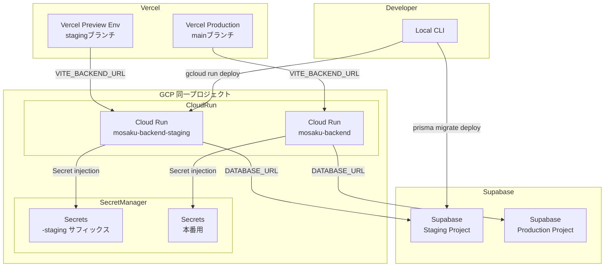
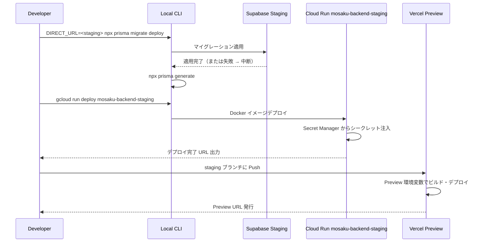
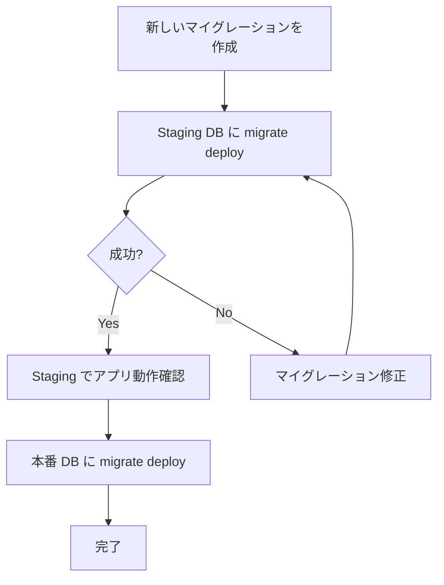

# Design Document — staging-setup

---

## Overview

本機能は、本番リリース（Phase 0）前に本番と同等構成の Staging 環境を構築する。バックエンド（Cloud Run）、フロントエンド（Vercel Preview）、データベース（Supabase 別プロジェクト）をそれぞれ Staging 専用インスタンスとして用意し、シークレット管理・ドメイン・マイグレーション実行フローを整備する。

開発者は Staging 環境を使って本番デプロイ前の最終動作確認とマイグレーション検証を安全に実施できる。本番 DB を汚染するリスクなく、本番と同等の実行環境で API と UI の統合テストを行うことが目的である。

### Goals

- 本番 DB と完全に分離した Staging 用 Supabase プロジェクトを構築する
- 本番サービスと独立した Cloud Run サービス（`mosaku-backend-staging`）を構築する
- Vercel Preview 環境を Staging フロントエンドとして機能させる
- シークレットを Secret Manager で安全に管理し、リポジトリにコミットしない
- マイグレーション実行フローをドキュメント化し、安全な本番反映の準備を整える

### Non-Goals

- CI/CD パイプラインによるマイグレーション自動実行（Phase 1 以降）
- 別 GCP プロジェクトによる完全なリソース分離
- Staging 専用カスタムドメインの必須化（Cloud Run / Vercel のデフォルト URL で十分）
- ロードテスト・パフォーマンス計測

---

## Requirements Traceability

| Requirement | Summary                                             | Components                                | Interfaces                              | Flows            |
| ----------- | --------------------------------------------------- | ----------------------------------------- | --------------------------------------- | ---------------- |
| 1.1         | Supabase 別プロジェクト                             | Supabase Staging Project                  | 接続文字列（DATABASE_URL / DIRECT_URL） | —                |
| 1.2         | DATABASE_URL / DIRECT_URL の2種類を保持             | Supabase Staging Project, Secret Manager  | —                                       | —                |
| 1.3         | migrate deploy で全マイグレーション適用             | Migration Executor                        | CLI コマンド                            | Migration Flow   |
| 1.4         | 失敗時にエラー出力・デプロイ中断                    | Migration Executor                        | exit code                               | Migration Flow   |
| 2.1         | Cloud Run 別サービス `mosaku-backend-staging`       | Cloud Run Staging Service                 | Cloud Run サービス URL                  | —                |
| 2.2         | Staging 用環境変数を保持                            | Cloud Run Staging Service, Secret Manager | Secret Manager injection                | —                |
| 2.3         | 200 系レスポンス・本番に影響なし                    | Cloud Run Staging Service                 | HTTP                                    | Deploy Flow      |
| 2.4         | CORS_ORIGINS に Staging フロントエンド URL          | Cloud Run Staging Service                 | CORS ヘッダー                           | —                |
| 2.5         | シークレットを Secret Manager から注入              | Secret Manager                            | Secret Manager API                      | —                |
| 3.1         | Vercel Preview 環境 / staging ブランチ              | Vercel Preview Environment                | Vercel CLI / GitHub 連携                | —                |
| 3.2         | VITE_BACKEND_URL → Staging Cloud Run URL            | Vercel Preview Environment                | Vercel 環境変数                         | —                |
| 3.3         | VITE_SUPABASE_URL / ANON_KEY → Staging              | Vercel Preview Environment                | Vercel 環境変数                         | —                |
| 3.4         | Staging フロントエンドが Staging バックエンドと通信 | Vercel Preview Environment                | HTTP                                    | —                |
| 4.1         | Staging シークレットを本番と別値で管理              | Secret Manager                            | —                                       | —                |
| 4.2         | シークレットをリポジトリにコミットしない            | Secret Manager                            | —                                       | —                |
| 4.3         | シークレットを Cloud Run に環境変数として注入       | Cloud Run Staging Service                 | Secret Manager → Cloud Run              | Deploy Flow      |
| 4.4         | OAuth コールバック URL を外部サービスに登録         | OAuth Registration                        | Google Cloud Console / GitHub           | —                |
| 5.1         | Staging バックエンドに固定 URL を割り当て           | Cloud Run Staging Service                 | Cloud Run URL                           | —                |
| 5.2         | Staging フロントエンドに固定 URL を割り当て         | Vercel Preview Environment                | Vercel URL                              | —                |
| 5.3         | HTTPS で有効な SSL 証明書                           | Cloud Run / Vercel                        | TLS（自動付与）                         | —                |
| 6.1         | migrate deploy コマンド / スクリプトの存在          | Migration Executor                        | CLI                                     | Migration Flow   |
| 6.2         | マイグレーション → アプリ起動 の順序                | Migration Executor                        | —                                       | Deploy Checklist |
| 6.3         | prisma generate の実行                              | Migration Executor                        | CLI                                     | Migration Flow   |
| 6.4         | Staging 成功 → 本番反映の準備完了と判断             | Migration Executor                        | —                                       | Migration Flow   |

---

## Architecture

### Architecture Pattern & Boundary Map

Phase 0 の Staging 環境は「同一クラウドアカウント内の別サービス」パターンを採用する。完全なアカウント分離は設定コストが大きく、Phase 0 の規模では不要と判断した（詳細は `research.md` の Architecture Pattern Evaluation を参照）。



**Architecture Integration**:

- 選択パターン: 同一 GCP プロジェクト内の別サービス。設定コスト最小で Phase 0 の目的を達成できる
- ドメイン境界: シークレット名に `-staging` サフィックスをつけて本番と分離する
- 既存パターン維持: 本番デプロイ手順（cloud-run.md / vercel.md）をそのまま踏襲する
- 新規コンポーネントの理由: Staging 専用の Cloud Run サービス・Supabase プロジェクト・Vercel 環境変数セットが必要
- Steering 準拠: `docs/deployment/` の既存手順を再利用し、Staging 固有の差分のみドキュメント化する

### Technology Stack

| Layer             | Choice / Version                          | Role in Feature                    | Notes                                    |
| ----------------- | ----------------------------------------- | ---------------------------------- | ---------------------------------------- |
| Frontend          | Vercel Preview Environment                | Staging フロントエンドホスティング | staging ブランチ Push で自動デプロイ     |
| Backend           | Google Cloud Run (mosaku-backend-staging) | Staging API サーバー               | 本番と同一 Docker イメージ、別サービス名 |
| Database          | Supabase（別プロジェクト）                | Staging DB（本番から完全分離）     | 無料プラン、最大2プロジェクト            |
| Secret Management | GCP Secret Manager                        | Staging シークレット管理           | シークレット名に -staging サフィックス   |
| ORM / Migration   | Prisma migrate deploy                     | DB スキーマ適用                    | DIRECT_URL（ポート5432）で手動実行       |

---

## System Flows

### Staging デプロイフロー



**Key Decisions**:

- マイグレーション失敗時は Prisma が非ゼロ exit code を返すため、後続のデプロイコマンドを `&&` で繋ぐことで自動中断できる
- Vercel は staging ブランチの Push を検知して自動デプロイするため、フロントエンドは手動操作不要

### マイグレーション検証フロー



---

## Components and Interfaces

### コンポーネント一覧

| Component                  | Domain/Layer              | Intent                                  | Req Coverage      | Key Dependencies                           | Contracts                  |
| -------------------------- | ------------------------- | --------------------------------------- | ----------------- | ------------------------------------------ | -------------------------- |
| Supabase Staging Project   | Infrastructure / DB       | 本番から分離した Staging DB             | 1.1, 1.2          | —                                          | 接続文字列                 |
| Cloud Run Staging Service  | Infrastructure / Backend  | Staging API サーバー                    | 2.1–2.5, 4.3, 5.1 | Secret Manager (P0), Supabase Staging (P0) | HTTP API, Secret injection |
| Vercel Preview Environment | Infrastructure / Frontend | Staging フロントエンド                  | 3.1–3.4, 5.2, 5.3 | Cloud Run Staging (P0)                     | 環境変数設定               |
| Secret Manager             | Infrastructure / Security | Staging シークレット一元管理            | 4.1–4.3           | —                                          | Secret API                 |
| Migration Executor         | Operations / CLI          | Staging DB へのマイグレーション適用手順 | 1.3, 1.4, 6.1–6.4 | Supabase Staging (P0)                      | CLI コマンド               |
| OAuth Registration         | Operations / Auth         | Staging OAuth コールバック URL の登録   | 4.4               | Google Cloud Console, GitHub OAuth App     | 外部コンソール操作         |

---

### Infrastructure / DB

#### Supabase Staging Project

| Field        | Detail                                                                  |
| ------------ | ----------------------------------------------------------------------- |
| Intent       | 本番 Supabase プロジェクトから完全に分離した Staging 専用 DB を提供する |
| Requirements | 1.1, 1.2                                                                |

**Responsibilities & Constraints**

- 独立した Supabase プロジェクトとして管理し、本番プロジェクトとデータを共有しない
- コネクションプーリング URL（ポート 6543）とダイレクト URL（ポート 5432）の2種類の接続文字列を発行する
- データは Staging 専用のため、本番データのコピーは持たない（開発用テストデータのみ）

**Dependencies**

- Outbound: GCP Secret Manager — 接続文字列の安全な格納先（P0）
- Outbound: Cloud Run Staging Service — `DATABASE_URL` による接続先（P0）

**Contracts**: Service [x]

##### Service Interface

```
Supabase Staging Project が発行する接続文字列:
- DATABASE_URL: postgresql://<user>:<password>@<host>:6543/<db>?pgbouncer=true
- DIRECT_URL:   postgresql://<user>:<password>@<host>:5432/<db>
```

**Implementation Notes**

- Supabase コンソールから新規プロジェクトを作成し、Settings > Database から接続文字列を取得する
- 取得した接続文字列は直ちに GCP Secret Manager に登録し、ローカルファイルには保存しない
- Supabase 無料プランは最大2プロジェクトまで。現在1プロジェクト使用中のため問題なし（`research.md` 参照）

---

### Infrastructure / Backend

#### Cloud Run Staging Service

| Field        | Detail                                                                 |
| ------------ | ---------------------------------------------------------------------- |
| Intent       | 本番 Cloud Run サービスとは独立した Staging 専用バックエンドを提供する |
| Requirements | 2.1, 2.2, 2.3, 2.4, 2.5, 4.3, 5.1, 5.3                                 |

**Responsibilities & Constraints**

- サービス名 `mosaku-backend-staging` で本番 `mosaku-backend` と同一 GCP プロジェクト内に共存する
- Staging 専用の環境変数・シークレットをすべて Secret Manager から注入する（ソースコードや Dockerfile に平文を含めない）
- `CORS_ORIGINS` に Staging フロントエンドの URL（Vercel Preview URL または `staging.mosaku.app`）を設定する

**Dependencies**

- Inbound: Vercel Preview Environment — HTTP リクエスト（P0）
- Outbound: Supabase Staging Project — `DATABASE_URL` による DB 接続（P0）
- External: GCP Secret Manager — シークレット注入（P0）

**Contracts**: API [x]

##### API Contract

本番 Cloud Run サービス（`mosaku-backend`）と同一 API を提供する。追加 / 変更エンドポイントはなし。

| Method | Endpoint | Request    | Response   | Errors     |
| ------ | -------- | ---------- | ---------- | ---------- |
| ALL    | /\*      | 本番と同一 | 本番と同一 | 本番と同一 |

Staging 固有の設定差分:

| 環境変数                  | Staging 値の取得元                     | 備考                                     |
| ------------------------- | -------------------------------------- | ---------------------------------------- |
| DATABASE_URL              | Secret Manager: `database-url-staging` | Supabase Staging プーリング URL          |
| DIRECT_URL                | Secret Manager: `direct-url-staging`   | Supabase Staging ダイレクト URL          |
| JWT_SECRET                | Secret Manager: `jwt-secret-staging`   | Staging 専用の値（本番と異なる値を推奨） |
| CORS_ORIGINS              | 環境変数（平文）                       | Staging Vercel URL                       |
| GOOGLE_CLIENT_ID / SECRET | Secret Manager: `*-staging`            | Staging OAuth アプリのクレデンシャル     |
| GITHUB_CLIENT_ID / SECRET | Secret Manager: `*-staging`            | Staging OAuth アプリのクレデンシャル     |

**Implementation Notes**

- デプロイコマンド: `gcloud run deploy mosaku-backend-staging --image gcr.io/<PROJECT_ID>/mosaku-backend:latest --region asia-northeast1 --set-secrets ...`
- Cloud Run の `--set-secrets` フラグでシークレットを環境変数にマウントする
- Staging サービスは認証不要（`--allow-unauthenticated`）で公開する（本番と同様）
- デプロイ後に発行される `*.run.app` URL を Vercel Preview 環境変数と OAuth コールバックに設定する

---

### Infrastructure / Frontend

#### Vercel Preview Environment

| Field        | Detail                                                                        |
| ------------ | ----------------------------------------------------------------------------- |
| Intent       | `staging` ブランチの Push に連動して Staging フロントエンドを自動デプロイする |
| Requirements | 3.1, 3.2, 3.3, 3.4, 5.2, 5.3                                                  |

**Responsibilities & Constraints**

- Vercel の既存プロジェクトの「Preview」環境変数として Staging 固有の値を設定する（新規プロジェクト作成不要）
- `staging` ブランチを作成し、Vercel の Branch Tracking で `staging` ブランチを Preview に割り当てる
- `VITE_BACKEND_URL` は Staging Cloud Run サービスの URL を指す
- `VITE_SUPABASE_URL` / `VITE_SUPABASE_ANON_KEY` は Staging Supabase プロジェクトのものを指す

**Dependencies**

- Outbound: Cloud Run Staging Service — `VITE_BACKEND_URL` 経由での API 通信（P0）

**Contracts**: State [x]

##### State Management

Vercel Preview 環境の環境変数設定（Vercel Dashboard > Settings > Environment Variables):

| 変数名                 | 環境    | 値                                              |
| ---------------------- | ------- | ----------------------------------------------- |
| VITE_BACKEND_URL       | Preview | `https://mosaku-backend-staging-<hash>.run.app` |
| VITE_SUPABASE_URL      | Preview | Staging Supabase プロジェクト URL               |
| VITE_SUPABASE_ANON_KEY | Preview | Staging Supabase anon key                       |
| VITE_GOOGLE_CLIENT_ID  | Preview | Staging Google OAuth クライアント ID            |
| VITE_GITHUB_CLIENT_ID  | Preview | Staging GitHub OAuth クライアント ID            |

**Implementation Notes**

- Vercel は `main` = Production、`staging` = Preview として自動区別するため、追加の設定なしでブランチベースのデプロイが機能する
- Preview 環境変数が本番（Production）環境変数と混在しないよう、Vercel Dashboard の「Environment」列で「Preview」のみに設定する
- Vercel が発行する Preview URL（`mosaku-frontend-git-staging-<team>.vercel.app`）を Cloud Run の `CORS_ORIGINS` と OAuth コールバックに追加する
- SSL 証明書は Vercel が自動付与するため、手動設定不要

---

### Infrastructure / Security

#### Secret Manager

| Field        | Detail                                                                 |
| ------------ | ---------------------------------------------------------------------- |
| Intent       | Staging シークレットを本番と分離して安全に管理し、Cloud Run に注入する |
| Requirements | 4.1, 4.2, 4.3                                                          |

**Responsibilities & Constraints**

- 全 Staging シークレットのシークレット名に `-staging` サフィックスを付けて本番と区別する
- シークレットをリポジトリ・Dockerfile・環境ファイルにコミットしない
- Cloud Run Staging Service の `--set-secrets` フラグで環境変数として注入する

**Dependencies**

- Outbound: Cloud Run Staging Service — シークレット injection（P0）

**Contracts**: Service [x]

##### Service Interface

```
登録するシークレット一覧（GCP Secret Manager）:
- database-url-staging      → DATABASE_URL（Supabase Staging プーリング URL）
- direct-url-staging        → DIRECT_URL（Supabase Staging ダイレクト URL）
- jwt-secret-staging        → JWT_SECRET
- google-client-id-staging  → GOOGLE_CLIENT_ID
- google-client-secret-staging → GOOGLE_CLIENT_SECRET
- github-client-id-staging  → GITHUB_CLIENT_ID
- github-client-secret-staging → GITHUB_CLIENT_SECRET
```

**Implementation Notes**

- `gcloud secrets create database-url-staging --replication-policy=automatic` で作成する
- `echo -n "<value>" | gcloud secrets versions add database-url-staging --data-file=-` で値を登録する
- Cloud Run サービスアカウントに `roles/secretmanager.secretAccessor` を付与する

---

### Operations / CLI

#### Migration Executor

| Field        | Detail                                                                                      |
| ------------ | ------------------------------------------------------------------------------------------- |
| Intent       | Staging DB にマイグレーションを安全に適用し、マイグレーション成功を本番反映の前提条件とする |
| Requirements | 1.3, 1.4, 6.1, 6.2, 6.3, 6.4                                                                |

**Responsibilities & Constraints**

- `DIRECT_URL` を Staging Supabase の直接接続 URL（ポート 5432）に設定してコマンドを実行する
- マイグレーション失敗時は非ゼロ exit code で後続コマンドを停止する
- スキーマ変更時は `prisma generate` を合わせて実行する

**Contracts**: Batch [x]

##### Batch / Job Contract

- Trigger: 開発者が手動実行（Staging デプロイ前）
- Input / validation: Staging `DIRECT_URL` 環境変数
- Output / destination: Supabase Staging DB にマイグレーション適用

実行コマンド（スクリプト: `scripts/migrate-staging.sh`）:

```
DIRECT_URL=<staging_direct_url> npx prisma migrate deploy && \
npx prisma generate
```

デプロイチェックリスト:

1. `scripts/migrate-staging.sh` を実行してマイグレーション適用・Prisma クライアント再生成
2. `gcloud run deploy mosaku-backend-staging ...` で Cloud Run デプロイ
3. `staging` ブランチに Push して Vercel Preview 自動デプロイ
4. Staging URL で動作確認（ログイン・メモ作成・ゴミ箱操作）

- Idempotency & recovery: `prisma migrate deploy` は冪等。適用済みマイグレーションはスキップされる

**Implementation Notes**

- `DIRECT_URL` はローカルの `.env.staging`（`.gitignore` 対象）に記載するか、コマンド実行時に直接指定する
- Staging マイグレーション成功後、同じマイグレーションファイルを本番 DB に適用することで整合性を担保する（6.4）

---

### Operations / Auth

#### OAuth Registration

| Field        | Detail                                                                           |
| ------------ | -------------------------------------------------------------------------------- |
| Intent       | Staging バックエンド URL を OAuth プロバイダーのコールバック許可リストに登録する |
| Requirements | 4.4                                                                              |

**Responsibilities & Constraints**

- Google Cloud Console と GitHub OAuth App の両方に Staging コールバック URL を登録する
- 登録する URL のパターン: `{STAGING_BACKEND_URL}/auth/google/callback`、`{STAGING_BACKEND_URL}/auth/github/callback`

**Dependencies**

- External: Google Cloud Console — Google OAuth コールバック URL 登録（P0）
- External: GitHub OAuth App — GitHub OAuth コールバック URL 登録（P0）

**Implementation Notes**

- Staging 用 OAuth アプリを別途作成するか、既存の開発用 OAuth アプリにコールバック URL を追加する
- Cloud Run Staging サービスのデプロイ後に URL が確定するため、OAuth 登録はデプロイ後に実施する

---

## Data Models

### Domain Model

Staging 環境構築はインフラ構成の変更であり、アプリケーションの Prisma スキーマ変更は伴わない。データモデルは本番と同一である。

### Logical Data Model

Staging Supabase プロジェクトは本番と同一スキーマを持つが、データは独立している。`prisma migrate deploy` により本番と同一のマイグレーション履歴が適用される。

---

## Error Handling

### Error Strategy

Staging 環境構築はインフラ操作が中心であるため、エラーは構築フロー中に検出・修正する。

### Error Categories and Responses

**インフラ設定エラー**:

- シークレット名の誤り → Secret Manager のシークレット一覧と照合して修正する
- CORS エラー → `CORS_ORIGINS` に Staging Vercel URL が含まれているか確認する
- OAuth リダイレクト不一致 → コールバック URL が `{STAGING_BACKEND_URL}/auth/{provider}/callback` と一致しているか確認する

**マイグレーションエラー**:

- `migrate deploy` 失敗 → エラーログを確認して SQL を修正し、再実行する
- 接続エラー → `DIRECT_URL` がポート 5432 を指しているか確認する（プーリング URL は `migrate deploy` では使用不可）

**デプロイエラー**:

- Cloud Run デプロイ失敗 → `gcloud run services describe mosaku-backend-staging` でログを確認する
- Vercel ビルド失敗 → Vercel Dashboard のビルドログを確認する

### Monitoring

- Cloud Run: Cloud Logging でリクエストログ・エラーログを確認する
- Vercel: Dashboard の Function Logs でフロントエンドエラーを確認する
- Staging 環境では Sentry 等の本格的な監視ツールは Phase 1 以降に導入する

---

## Testing Strategy

Staging 環境構築は infrastructure-as-checklist パターンを採用する。自動テストではなく、手動の動作確認チェックリストで品質を担保する。

### Staging 動作確認チェックリスト

**Supabase 確認**:

- [ ] Staging プロジェクトが Supabase コンソールに表示される
- [ ] `prisma migrate deploy` が全マイグレーションを適用して成功する
- [ ] `prisma migrate status` で全マイグレーションが "Applied" になっている

**Cloud Run 確認**:

- [ ] `mosaku-backend-staging` サービスが GCP コンソールに表示される
- [ ] `GET {STAGING_BACKEND_URL}/health` が 200 を返す（またはルートエンドポイントが正常応答）
- [ ] 本番サービス（`mosaku-backend`）に影響がないことを確認する

**Vercel 確認**:

- [ ] `staging` ブランチの Push で Preview デプロイが開始される
- [ ] Preview URL にアクセスして画面が表示される
- [ ] `VITE_BACKEND_URL` が Staging Cloud Run URL を指していることを確認する（ブラウザのネットワークタブで確認）

**統合確認**:

- [ ] Staging フロントエンドからログインできる（Google / GitHub OAuth）
- [ ] メモの作成・編集・削除（ゴミ箱）が Staging DB に反映される
- [ ] 本番フロントエンドへのアクセスに影響がないことを確認する

---

## Security Considerations

- Staging シークレットは本番と異なる値を使用する（JWT_SECRET は必ず別の値を生成する）
- Staging の OAuth アプリと本番の OAuth アプリは分離する（または開発用 OAuth アプリにコールバックを追加する）
- Staging Cloud Run サービスは `--allow-unauthenticated` で公開するが、Staging URL を外部に広く公開しない
- `.env.staging` ファイルは `.gitignore` に追加してリポジトリにコミットしない
- GCP IAM で Cloud Run Staging サービスアカウントを本番と分ける（Phase 0 では許容範囲として同一でも可）
