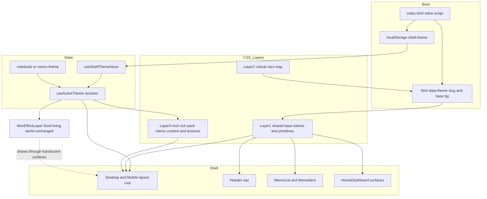
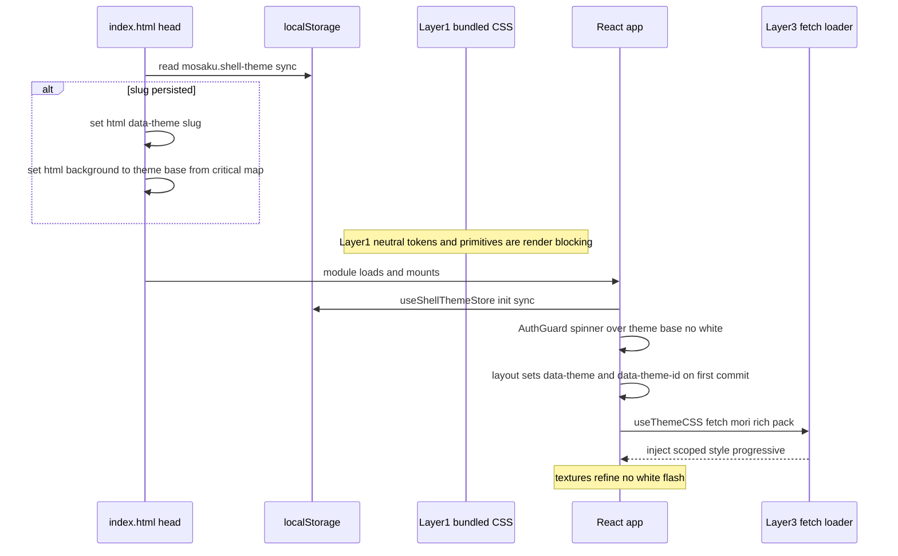

# Technical Design — theme-immersive-world

## Overview

**Purpose**: 本機能は Mosaku のテーマを「メモ本文だけの色替え」から「アプリを開いた瞬間に玄関（メモ一覧・ホーム・ヘッダーナビ）から本文まで一貫して切り替わる"入る世界"」へ進化させる。第一スライスとしてフラッグシップの森（mori）を対象に、**完全没入**（玄関へのテーマ適用）と**作り込まれた質感**（脱・ありきたり）をセットで実現し、海・夜・朝が**トークン差し替えだけで相乗りできる基盤**を確立する。

**Users**: Mosaku のエンドユーザーは「好きな世界に帰ってきた」感覚でメモを見に行く動機を得る。Mosaku 開発者は、過去ロールバック（ヘッダー文字消失）を構造的に回避したトークン契約と質感 primitive 層を、後続 3 テーマへ安全に横展開できる。

**Impact**: 現状、森の生きた背景（`MoriEffectLayer`）は全域に描画済みだが、玄関は生 Tailwind（`bg-white` / `text-gray-*`）でフタをしている。本設計はこのフタを外し、(a) 玄関コンポーネントを**セマンティックトークン駆動**へ置換、(b) **アプリ単位テーマ**の出どころ（localStorage 永続）を新設、(c) **3 層 CSS 分割**で FOUC ゼロと非森バンドル不増を両立、(d) **質感 primitive 層**を新設する。DB スキーマ・認証・メモ編集ロジック・他テーマ挙動は不変。

### Goals

- 森テーマ有効時、玄関（一覧・ホーム・ヘッダーナビ）から本文まで一貫した没入を、白フラッシュ（FOUC）なしで成立させる。
- 生のカラーリテラルを玄関から排除し、surface / on-surface 等のセマンティックトークンと質感 primitive で再構築する。
- WCAG AA のコントラストを主要 surface×on-surface ペアで保証し、機械検証テストを備える。
- 森で確立した「トークン契約＋質感 primitive 層」を、海・夜・朝が**値差し替えのみ**で相乗りできる構造にする。

### Non-Goals

- 海・夜・朝の値実装・全体没入・質感フルリライト（本スペックは受け皿のみ。値実装は後続スペック）。
- 独立サイドバーコンポーネントの新設（「サイドバー」＝現 Header 内ナビ領域と読み替える）。
- バックエンド／DB スキーマ変更、テーマのクロスデバイス同期（localStorage はデバイスローカル）。
- 外部 JS ライブラリの追加（CSS 変数＋クラス＋既存フック・既存エフェクト資産のみで実現）。

## Architecture

### Existing Architecture Analysis

- **テーマ機構**: `useActiveTheme()`（`notebook/memo` 文脈のみ）→ `useThemeCSS()` が `fetch('/themes/<cssFilePath>')` し、文字列 `.theme-root` を `[data-theme-id="<uuid>"]` に置換して `<style>` を `head` へ注入。**非同期適用＝構造的に FOUC が出る。**
- **生きた背景**: `MoriEffectLayer`（`position:fixed; inset:0; z-0`、`React.lazy` で mori 有効時のみマウント）がグラデ・霧・葉・粒子を全域描画。`useMoriEffectControl` が 4 条件（reduced-motion / エディタフォーカス / タブ非表示 / 3 秒アイドル）で自動停止。**本設計はこの基盤を無改変で温存する。**
- **過去の地雷（テストで固定済み）**: `mori.css.test.ts` が「要素型セレクタ（`.theme-root button|input|textarea`）禁止」「`.theme-root a` 直当て禁止」「全トップレベルセレクタを `.theme-root` スコープに限定」を検証。要素型禁止は本設計の Requirement 1.4 と一致するため**継承**し、玄関の彩色はクラス選択子のみで行う。
- **永続化の素地**: zustand `persist` 採用実績なし・localStorage キー規約なし。本設計は薄い専用層（`useShellThemeStore`）を新設し、runtime ローダーは増やさない（新規 CSS は静的バンドル）。
- **境界の尊重**: API コールは `apiClient` 経由、サーバー状態は React Query が真実の源泉、UI 状態は zustand（`structure.md`）。シェルテーマ選択は **UI 状態**＝zustand（localStorage バック）に置き、サーバー状態とはしない。

### Architecture Pattern & Boundary Map

**Selected pattern**: 「トークン契約（意味語彙）＋質感 primitive 層（構造）＋テーマ値パック（固有値）」の 3 分離（gap-analysis Option C）。各面の彩色は生 Tailwind を**除去してトークン置換**（Option A）。CSS は役割で **3 層**（共有 base / critical vars / rich pack）に分割し、FOUC（2.3）と非森バンドル不増（7.5）を両立する。



**Architecture Integration**:

- **Selected pattern**: 3 層トークン駆動（契約／primitive／値パック）＋ボーダレス没入（半透明 surface ＋単一の生きた背景）。
- **Domain/feature boundaries**: (1) シェルテーマ状態・解決（`useShellThemeStore` / `useActiveTheme` / boot）、(2) トークン＆質感 primitive 層（CSS）、(3) 玄関 surface 改修（presentational）、(4) エフェクト共存（`MoriEffectLayer` 無改変）。境界は並行実装可能（CSS 契約が先、各面改修は契約に従って独立）。
- **Existing patterns preserved**: React Query＝サーバー状態の真実、zustand＝UI 状態、テーマ CSS はファイル管理（DB はメタデータのみ）、effectKey の code-split、4 条件自動停止。
- **New components rationale**: `useShellThemeStore`（アプリ単位テーマの出どころ＝Requirement 2.1 の受け皿）／トークン契約・primitive 層（Requirement 1/4/6）／boot 適用（Requirement 2.3 FOUC）。
- **Steering compliance**: 外部 JS 追加ゼロ（`tech.md`）、テーマは CSS（`tech.md`）、可読性優先（`branding.md`）、reduced-motion で動きのみ停止（`branding.md` 深掘りの型）。

### Technology Stack

| Layer        | Choice / Version                               | Role in Feature                                   | Notes                                                                                    |
| ------------ | ---------------------------------------------- | ------------------------------------------------- | ---------------------------------------------------------------------------------------- |
| Frontend     | React 19 + Vite 6 + TypeScript strict          | 玄関 surface 改修・状態層・boot                   | 既存。`any` 禁止                                                                         |
| Styling      | CSS Custom Properties + Tailwind CSS 3         | トークン契約・質感 primitive・玄関彩色            | 新規セマンティックトークンは CSS 変数。Tailwind は arbitrary value `var(...)` 参照で併用 |
| Client State | zustand（localStorage バック手書き）           | `useShellThemeStore`（アプリ単位テーマ）          | `persist` ミドルウェアは未採用のため最小手書き同期                                       |
| Effects      | 既存 Canvas/CSS keyframes（`MoriEffectLayer`） | 生きた背景の単一ソース                            | **無改変**。新規 JS ライブラリ追加なし（7.2）                                            |
| Persistence  | `localStorage`（key `mosaku.shell-theme`）     | 選択テーマ `{ id, slug }` の永続                  | DB 不変（7.3）。デバイスローカル                                                         |
| Test         | Vitest + Testing Library / Playwright          | コントラスト AA 検証・解決優先順位・FOUC/没入 E2E | `mori.css.test.ts` の CSS パター ン拡張                                                  |

## System Flows

### 起動時のテーマ適用（FOUC 回避）



**Key decisions**: 白フラッシュの正体は「白い面」。Layer1（中立既定）で構造フラッシュを消し、`<head>` インラインが first paint 前に `<html>` 地色と `data-theme` を確定するため、**スピナーもシェルもテーマ base 上に描画**され白は一瞬も出ない（2.3）。**mori の色/構造トークンは Layer1 の `[data-theme="mori"]` が first paint で確定する**ため、accent/outline/elevation の「半テーマ窓」も生じない。Layer3 で後追いするのは**テクスチャ/noise/本文面のみ**＝progressive enhancement（白→テーマでも青→緑でもなく、テクスチャの精緻化）。

### テーマ解決の優先順位

| 文脈                               | 解決結果                           | 根拠                          |
| ---------------------------------- | ---------------------------------- | ----------------------------- |
| ノートブック/メモを開いている      | その notebook の theme（上書き）   | 既存挙動を温存                |
| Home / 全メモ / 受信箱など文脈なし | shell テーマ（localStorage の床）  | 「開いた瞬間に森」（2.1）     |
| shell テーマ未設定 かつ 文脈なし   | `null`（中立既定＝現状の白シェル） | 非森・未設定は現状維持（7.1） |

解決式: `notebookContextTheme ?? shellTheme ?? null`。`shellTheme` は `useShellThemeStore.selection.id` を `useThemes()` キャッシュで `Theme` へ解決する。FOUC 用の `slug` は localStorage に併存し、`Theme`（server）未ロードでも Layer1/2 のトークンは即適用される。

## Requirements Traceability

| Requirement | Summary                            | Components                             | Interfaces                              | Flows      |
| ----------- | ---------------------------------- | -------------------------------------- | --------------------------------------- | ---------- |
| 1.1         | セマンティックトークン定義         | Token Contract（`tokens.css`）         | CSS 変数語彙                            | —          |
| 1.2         | 玄関は生リテラル不可・トークン経由 | Shell Surface 改修, Token Contract     | `.shell-*` primitive                    | —          |
| 1.3         | surface×on-surface をペアで定義    | Token Contract                         | トークンペア契約                        | —          |
| 1.4         | 要素型セレクタ非依存・面側適用     | Token Contract, Quality Primitives     | `.shell-*`（クラス選択子）              | —          |
| 1.5         | 4 テーマ共通語彙                   | Token Contract                         | `data-theme` slug 契約                  | テーマ解決 |
| 2.1         | 玄関全域を森で描画                 | Shell Theme State, Shell Surface 改修  | `useActiveTheme`, `useShellThemeStore`  | テーマ解決 |
| 2.2         | `bg-white` を surface へ置換       | Shell Surface 改修                     | `.shell-surface`                        | —          |
| 2.3         | FOUC なし初期表示                  | Boot Apply, Token Contract（Layer1/2） | `applyCriticalTheme`, inline script     | 起動フロー |
| 2.4         | Desktop/Mobile 両対応              | Layout Root 改修                       | `.app-shell`                            | —          |
| 2.5         | 導線・操作を破壊しない             | Shell Surface 改修                     | （既存ハンドラ温存）                    | —          |
| 3.1         | 全玄関面 WCAG AA                   | Token Contract, Contrast Test          | トークンペア契約                        | —          |
| 3.2         | ナビ文字/アイコンが消失しない      | Header 改修, Token Contract            | `.shell-nav-item`                       | —          |
| 3.3         | フォーカス/選択/ホバーを区別可能に | Quality Primitives                     | 状態トークン `--state-*` `--focus-ring` | —          |
| 3.4         | 低強調テキストも判読下限を維持     | Token Contract                         | `--on-surface-variant`                  | —          |
| 3.5         | コントラスト検証テスト             | Contrast Test                          | `tokens.contrast.test.ts`               | —          |
| 4.1         | テクスチャ/マテリアル処理          | Quality Primitives, Mori Rich Pack     | `--surface-texture`                     | —          |
| 4.2         | エレベーション設計                 | Quality Primitives                     | `--elevation-1..3`                      | —          |
| 4.3         | 意図的な余白スケール               | Quality Primitives                     | `--shell-space-*`                       | —          |
| 4.4         | 游明朝の字階層                     | Quality Primitives                     | `--shell-font` 字階層トークン           | —          |
| 4.5         | マイクロインタラクション           | Quality Primitives                     | `transition` 契約                       | —          |
| 4.6         | reduced-motion で動きのみ停止      | Quality Primitives                     | `@media reduced-motion`                 | —          |
| 5.1         | 森資産の再利用                     | Effect Coexistence                     | `MoriEffectLayer`（無改変）             | —          |
| 5.2         | 玄関〜本文の連続性                 | Quality Primitives, Mori Rich Pack     | 半透明 surface ＋ backdrop              | —          |
| 5.3         | 既存エフェクト基盤と共存           | Effect Coexistence                     | `useMoriEffectControl`（無改変）        | —          |
| 5.4         | 本文面の見た目を後退させない       | Mori Rich Pack                         | `.memo-content` 既存 CSS 温存           | —          |
| 6.1         | テーマ固有値を外出し               | Token Contract, Critical Vars          | slug 別値ブロック                       | —          |
| 6.2         | コード非変更で値差し替え           | Token Contract, Quality Primitives     | `[data-theme="<slug>"]`                 | テーマ解決 |
| 6.3         | 明暗反転に耐えるペア契約           | Token Contract                         | neutral/dark 両対応の役割契約           | —          |
| 6.4         | 本スペックは森のみ実装             | Critical Vars, Mori Rich Pack          | umi/yoru/asa は placeholder             | —          |
| 7.1         | 非森は実装前と同一描画             | Token Contract（中立既定）             | `:root` neutral defaults                | テーマ解決 |
| 7.2         | 外部 JS 追加ゼロ                   | （全体制約）                           | CSS + 既存フックのみ                    | —          |
| 7.3         | DB スキーマ不変                    | Shell Theme State                      | localStorage 永続                       | —          |
| 7.4         | 認証/編集に副作用なし              | Effect Coexistence, Shell Surface 改修 | 既存ロジック温存                        | —          |
| 7.5         | 非森ユーザーのバンドル不増         | CSS 3 層分割                           | Layer3 は mori 有効時のみ fetch         | 起動フロー |

## Components and Interfaces

| Component                              | Domain/Layer | Intent                                          | Req Coverage            | Key Dependencies (P0/P1)                | Contracts |
| -------------------------------------- | ------------ | ----------------------------------------------- | ----------------------- | --------------------------------------- | --------- |
| useShellThemeStore                     | State        | アプリ単位テーマを localStorage 永続で保持      | 2.1, 7.3                | localStorage (P0)                       | State     |
| useActiveTheme（更新）                 | State        | 文脈テーマ→シェル床→null の解決                 | 2.1, 1.5                | useShellThemeStore (P0), useThemes (P1) | Service   |
| shellThemeBoot + inline script         | State/Boot   | first paint 前に slug と地色を適用              | 2.3                     | localStorage (P0), Critical Vars (P0)   | Service   |
| Token Contract（tokens.css）           | CSS          | セマンティックトークン語彙＋中立既定＋slug 別値 | 1.1, 1.3, 1.5, 6.x, 7.1 | —                                       | State     |
| Quality Primitives（primitives.css）   | CSS          | 質感 5 軸の構造クラス（theme-neutral）          | 4.x, 3.3, 5.2           | Token Contract (P0)                     | State     |
| Critical Vars（shellThemeCritical.ts） | CSS/State    | slug→コア変数の極小マップ                       | 2.3, 6.4                | —                                       | State     |
| Mori Rich Pack（mori.css 拡張）        | CSS          | 森固有テクスチャ＋本文面（fetch, code-split）   | 4.1, 5.2, 5.4, 7.5      | Token Contract (P1)                     | State     |
| Layout Root 改修                       | UI           | ルートを `.app-shell`＋`data-theme` 化          | 2.2, 2.4                | useActiveTheme (P0)                     | —         |
| Header 改修                            | UI           | ナビ領域をトークン駆動・可読性保証              | 2.1, 3.2                | Quality Primitives (P0)                 | —         |
| MemoList / MemoItem 改修               | UI           | 一覧・カードをトークン＋エレベーション化        | 2.1, 4.1, 4.2           | Quality Primitives (P0)                 | —         |
| HomeDashboard surfaces 改修            | UI           | ホーム 6 子をトークン駆動化                     | 2.1, 5.2                | Quality Primitives (P0)                 | —         |
| Effect Coexistence                     | Effects      | 生きた背景の単一ソース化                        | 5.1, 5.3, 7.4           | MoriEffectLayer (P0)                    | —         |
| Shell Theme Selector（最小）           | UI           | システムテーマからシェル床を選択                | 2.1                     | useShellThemeStore (P1), useThemes (P1) | —         |

### State & Resolution

#### useShellThemeStore

| Field        | Detail                                                       |
| ------------ | ------------------------------------------------------------ |
| Intent       | アプリ単位の選択テーマを localStorage 永続で保持する UI 状態 |
| Requirements | 2.1, 7.3                                                     |

**Responsibilities & Constraints**

- `selection: { id, slug } | null` を保持。初期値は localStorage から**同期**読み出し（first render で確定）。
- `setShellTheme` は (1) localStorage 書き込み、(2) `applyCriticalTheme(slug)` 呼び出し（即時反映）、(3) store 更新を行う。
- サーバー状態を持たない（`Theme` 本体は React Query が真実の源泉）。保持するのは「どのテーマを選んだか」の UI 選択のみ。

**Dependencies**

- Outbound: `shellThemeCritical`（`applyCriticalTheme`）— 即時 critical 反映（P0）。
- External: `localStorage` — 永続（P0）。利用不可環境（プライベートモード等）では in-memory フォールバック。

**Contracts**: State [x]

##### State Management

```typescript
import type { ThemeEffectKey } from '../types/theme';

export interface ShellThemeSelection {
	id: string; // DB theme id（Theme 本体・rich pack の解決に使用）
	slug: ThemeEffectKey; // 安定スラッグ（mori|umi|yoru|asa）＝バンドルトークン解決キー
}

interface ShellThemeState {
	selection: ShellThemeSelection | null;
	setShellTheme: (selection: ShellThemeSelection | null) => void;
}
```

- State model: 単一 `selection`。`null` = シェル床なし（非森・未設定）。
- Persistence & consistency: `localStorage['mosaku.shell-theme']` に JSON 直列化。読み出しは同期・例外安全（破損時は `null`）。
- Concurrency strategy: 単一タブ前提。`storage` イベント購読は本スペック非対象（将来）。

**Implementation Notes**

- Integration: `useActiveTheme` が `selection.id` を消費。`applyCriticalTheme` で DOM へ即反映し React 再レンダ前でも見た目が確定。
- Validation: `slug` は `getEffectKey` の値域に限定（`types/theme.ts`）。範囲外は `null` 扱い。
- Risks: localStorage 例外 → try/catch で in-memory。スラッグ偽装 → 値域チェックで無効化。

#### useActiveTheme（更新）

| Field        | Detail                                                      |
| ------------ | ----------------------------------------------------------- |
| Intent       | 文脈テーマ→シェル床→null の優先順位でアクティブテーマを解決 |
| Requirements | 2.1, 1.5                                                    |

**Responsibilities & Constraints**

- 既存の `notebook/memo` 文脈解決の**後段にシェル床を追加**。`notebookContextTheme ?? shellTheme ?? null`。
- `shellTheme` は `useShellThemeStore.selection?.id` を `useThemes()`（React Query キャッシュ）で `Theme` へ解決。キャッシュ未充足時は `slug` 由来の最小 `ActiveTheme`（id/slug/metadata.effectKey）を返し、CSS/エフェクト解決を途切れさせない。

**Contracts**: Service [x]

##### Service Interface

```typescript
export type ActiveTheme = Pick<Theme, 'id' | 'name' | 'styles' | 'cssFilePath' | 'metadata'>;

export function useActiveTheme(): ActiveTheme | null;
// Preconditions: useShellThemeStore / useThemes / useNotebooks が Provider 配下
// Postconditions: 文脈テーマ優先、なければシェル床、どちらも無ければ null
// Invariants: 戻り値が非 null の時 metadata.effectKey は解決可能（ThemeEffectHost が機能する）
```

**Implementation Notes**

- Integration: `DesktopLayout` / `MobileLayout` が `useActiveTheme()` → `useThemeCSS` + `ThemeEffectHost` + ルート属性に使用（既存呼び出し位置を踏襲）。
- Validation: 文脈テーマとシェル床のどちらでも `metadata.effectKey` を `getEffectKey` で検証。
- Risks: シェル床とノートブックテーマが別 slug の時の切替で `useThemeCSS` の `<style>` が二重化しないよう、ローダーの cleanup（既存 unmount 削除）に依存。同 id 連続適用の重複注入は既存実装どおり id 単位。

#### shellThemeBoot + inline script

| Field        | Detail                                                           |
| ------------ | ---------------------------------------------------------------- |
| Intent       | first paint 前に slug と `<html>` 地色を適用し白フラッシュを消す |
| Requirements | 2.3                                                              |

**Responsibilities & Constraints**

- `<head>` 内インラインスクリプト（依存ゼロ・例外安全）が localStorage を同期読み出し、`document.documentElement.dataset.theme = slug` と `<html>` 背景＝critical base を設定する。
- 同等ロジックを `shellThemeBoot.ts` にも持ち、`useShellThemeStore` の `setShellTheme` 経由の runtime 切替でも再利用する（DRY）。

**Contracts**: Service [x]

##### Service Interface

```typescript
import type { ThemeEffectKey } from '../types/theme';

export function readPersistedShellTheme(): ShellThemeSelection | null;
export function applyCriticalTheme(slug: ThemeEffectKey | null): void;
// applyCriticalTheme: html[data-theme] を設定し、CRITICAL_THEME_VARS[slug] を
//   document.documentElement.style へ適用（surface/on-surface/base bg）。null で属性除去。
```

**Implementation Notes**

- Integration: インラインスクリプトは `index.html` の `<head>` 末尾（Layer1 CSS link より後・`<body>` より前）。`main.tsx` は import するだけで二重適用しない（属性既設なら no-op）。
- Validation: slug 値域チェック。JSON 破損は握り潰して未適用（白ではなく中立既定＝Layer1 にフォールバック）。
- Risks: CSP（helmet）でインラインスクリプトが阻まれる可能性 → Open Question（§Security）。不可なら最小外部 JS へ退避。

### CSS — Token Contract & Quality Primitives

> **層所有の確定（mori 値の単一の源泉）**: 「mori のどの値がどの層に住むか」を以下で固定する。**色・構造トークンはバンドル（render-blocking）に置き first paint で確定**させ、**重量物（テクスチャ/noise/本文面）のみ fetch で後追い**する。これにより (a) 2.3 の FOUC 窓に「白い面」だけでなく「青 accent・灰 outline の半テーマ」も出さず、(b) 3.5 のコントラストテストが `tokens.css` 内の mori 値をパース検証でき、(c) 7.5 の重量物分離も保つ。`mori.css`（Layer③）は `useThemeCSS` が `.theme-root`→`[data-theme-id="<uuid>"]` 置換で注入＝Theme 解決＋fetch 着地が必要な**遅い別ゲート**である点に留意。

| 層                                   | ファイル / 配置                                                   | mori の中身                                                                                                                                                                                                  | 適用ゲート                                                     | 根拠 AC            |
| ------------------------------------ | ----------------------------------------------------------------- | ------------------------------------------------------------------------------------------------------------------------------------------------------------------------------------------------------------ | -------------------------------------------------------------- | ------------------ |
| ① bundle（render-blocking）          | `tokens.css` / `primitives.css`（`index.css` import）             | `:root` 中立既定値 ＋ `[data-theme="mori"]` の**全色・構造トークン値**（surface/on-surface/variant/outline/accent/on-accent/state/focus-ring/elevation/space/font, sub-KB）＋ theme-neutral primitive クラス | `html[data-theme="mori"]`（インラインが first paint 前に付与） | 1.1, 1.3, 3.x, 7.1 |
| ② critical（first paint 前 runtime） | `shellThemeCritical.ts` ＋ `<head>` インライン                    | **surface / on-surface / `--shell-base-bg` のみ**（`<html>` 地色を最初のフレームで塗る belt-and-suspenders）。accent/outline/elevation は**持たない**                                                        | `document.documentElement.style`（インライン）                 | 2.3                |
| ③ rich（fetch / code-split）         | `public/themes/mori/mori.css`（`[data-theme-id]` スコープで注入） | **重量テクスチャ（多層グラデ・data-URI noise・内側ハイライト）・本文面（.memo-title/.memo-content）のみ**。**色/構造トークン値は持たない**（①が源泉）                                                        | `[data-theme-id="<uuid>"]`（Theme 解決＋fetch 着地後）         | 4.1, 5.2, 5.4, 7.5 |

色トークンは①で first paint に確定するため、③の後追いは「テクスチャの精緻化」だけ＝**accent/outline/elevation の半テーマ窓は生じない**。③は重量物のみなので非森ユーザーは一切取得しない（7.5）。

#### Token Contract（`src/themes/shell/tokens.css`, バンドル）

| Field        | Detail                                                                                                           |
| ------------ | ---------------------------------------------------------------------------------------------------------------- |
| Intent       | セマンティックトークン語彙＋中立既定値＋slug 別の全色・構造トークン値（テクスチャ/noise/本文面は除き Layer③ へ） |
| Requirements | 1.1, 1.3, 1.5, 6.1, 6.2, 6.3, 7.1                                                                                |

**Responsibilities & Constraints**

- `:root` に**中立既定値**（現行の生 Tailwind と一致＝今日の見た目）を定義。`[data-theme="mori"]` で森の**全色・構造トークン値**（色・状態・elevation・space・font。**テクスチャ/noise/本文面は含めず Layer③ へ分離**）を上書き。`[data-theme="umi|yoru|asa"]` は**コメント placeholder のみ**（6.4）。
- surface 系には必ず on-surface 系を**ペア**で定義（1.3）。明（asa 想定）でも暗（mori）でも成立する役割契約（6.3）。
- 要素型セレクタを使わず、`data-theme` 属性＋クラスで解決（1.4）。

**Contracts**: State [x]（CSS 変数契約。詳細値は Data Models）

**Implementation Notes**

- Integration: `index.css` で `@import './themes/shell/tokens.css'`（render-blocking, Layer1）。
- Validation: `tokens.contrast.test.ts` が surface×on-surface の AA を機械検証。
- Risks: 中立既定が現行とズレると 7.1 リグレッション → 値を Tailwind 既定（white / gray-900 / gray-500 / gray-200 / blue-500 等）に厳密一致させる。

#### Quality Primitives（`src/themes/shell/primitives.css`, バンドル）

| Field        | Detail                                                                          |
| ------------ | ------------------------------------------------------------------------------- |
| Intent       | 質感 5 軸（テクスチャ/奥行き/余白/タイポ/マイクロインタラクション）の構造クラス |
| Requirements | 4.1, 4.2, 4.3, 4.4, 4.5, 4.6, 3.3, 5.2                                          |

**Responsibilities & Constraints**

- トークンを読む theme-neutral な構造クラスを提供（中立既定では今日の見た目、`data-theme` 適用で質感が立ち上がる）。最小セットに限定（過剰設計回避）:
  - `.shell-surface` — 面の地（surface ＋ texture ＋ 半透明 backdrop で生きた背景を透かす, 5.2）
  - `.shell-panel` / `.shell-card` — エレベーション（`--elevation-*`）＋テクスチャ（4.1, 4.2）
  - `.shell-nav-item` — ナビ要素（on-surface ＋状態トークン, 3.2, 3.3）
  - `.shell-field` — 入力（outline ＋ focus-ring, 3.3）
  - `.shell-button` / `.shell-button-primary` — accent ＋ on-accent（3.1）
- マイクロインタラクションは `transition`（4.5）。`@media (prefers-reduced-motion: reduce)` で `transition`/`animation` を停止し、テクスチャ・奥行き・余白・タイポの**静的質感は維持**（4.6）。

**Contracts**: State [x]

**Implementation Notes**

- Integration: `index.css` で import（Layer1）。玄関コンポーネントはこれらのクラス＋必要に応じ `text-[var(--on-surface)]` 等の arbitrary value を使う。
- Validation: 状態（hover/focus/selected）が背景と区別可能なコントラスト（3.3）を contrast test の対象に含める。
- Risks: backdrop-blur 多用の GPU 負荷 → 面数を限定し、`MoriEffectLayer` の 4 条件停止と独立に過負荷を生まない。

#### Critical Vars（`src/themes/shell/shellThemeCritical.ts`, バンドル小モジュール）

| Field        | Detail                                                  |
| ------------ | ------------------------------------------------------- |
| Intent       | slug→コア変数（surface/on-surface/base bg）の極小マップ |
| Requirements | 2.3, 6.4                                                |

**Responsibilities & Constraints**

- `applyCriticalTheme` とインラインスクリプトが参照する最小値のみ（FOUC 回避に必要な surface/on-surface と `<html>` 地色）。森のみ実値、他 3 は placeholder。**accent/outline/elevation 等の残りは Layer① のバンドル `[data-theme="mori"]` が first paint で供給するため本マップには含めない**（半テーマ窓を作らない）。
- 全 4 テーマ分をバンドルに含むが sub-KB・theme 共通インフラ（既存 `themeEffectRegistry` と同性質）＝「森専用 CSS」ではない（7.5 の意図に適合）。

**Contracts**: State [x]

```typescript
import type { ThemeEffectKey } from '../types/theme';

export const CRITICAL_THEME_VARS: Record<ThemeEffectKey, Record<`--${string}`, string>>;
// mori: { '--surface': '<scrim green>', '--on-surface': '#e7f5ec', '--shell-base-bg': '<deep green>' }
// umi/yoru/asa: {} （6.4 placeholder）
```

#### Mori Rich Pack（`public/themes/mori/mori.css` 拡張, fetch/code-split）

| Field        | Detail                                                          |
| ------------ | --------------------------------------------------------------- |
| Intent       | 森固有のリッチテクスチャ＋本文面スタイル（mori 有効時のみ取得） |
| Requirements | 4.1, 5.2, 5.4, 7.5                                              |

**Responsibilities & Constraints**

- **本層は色トークン値を持たない**（Layer① のバンドル `[data-theme="mori"]` が色の単一の源泉）。Layer③ が担うのは**重量テクスチャ・data-URI noise・本文面のみ**＝後追い適用は「テクスチャの精緻化」に限られ、accent/outline の半テーマ窓を生まない。
- 既存の `.memo-title` / `.memo-content` スタイルは**温存**（5.4）。新たに `.shell-*` クラスへ森固有のリッチテクスチャ（多層グラデ・内側ハイライト等）を `.theme-root .shell-card` 形式（クラス選択子）で追加。
- 要素型セレクタは引き続き禁止（`mori.css.test.ts` の該当テスト維持）。トップレベルは `.theme-root` スコープを維持（既存 1.6 テスト適合）。
- mori 有効時のみ `useThemeCSS` が fetch＝非森は一切読まない（7.5）。

**Contracts**: State [x]

**Implementation Notes**

- Integration: `useThemeCSS` が `.theme-root`→`[data-theme-id]` 置換で注入（既存機構）。Layer1/2 の上にリッチ層を progressive に重ねる。
- Validation: `mori.css.test.ts` の契約更新（要素型禁止は維持／`.shell-*` クラス許容／`.theme-root` スコープ維持）。
- Risks: Layer3 が遅延しても Layer1/2 でテーマ base は出ているため白フラッシュにならない。二重背景は Effect Coexistence で一本化。

### Shell Surface 改修（presentational）

> いずれも新規境界を導入しない presentational 改修。生 Tailwind（`bg-white`/`text-gray-*`/`bg-blue-*`）を除去し primitive クラス＋トークンへ置換（Option A）。既存のイベントハンドラ・ナビゲーション導線は不変（2.5, 7.4）。

- **Layout Root（DesktopLayout / MobileLayout）**: ルート div の `bg-white` を `.app-shell`（surface）へ、`data-theme={getEffectKey(activeTheme)}` を追加付与（既存 `data-theme-id` は残置）。`2.2, 2.4`。
- **Header**: `bg-white border-gray-200` を `.shell-surface`/`--outline` へ、ナビボタンの `text-gray-600`/active `bg-blue-100 text-blue-800` を `.shell-nav-item`＋状態トークンへ、ドロップダウン `bg-white` を `.shell-panel` へ。文字/アイコンが背景に溶けない（`3.2`）。
- **MemoList**: 見出し `text-gray-900`→`--on-surface`、件数/補助 `text-gray-500`→`--on-surface-variant`、検索 input を `.shell-field`、ボタン `bg-blue-500`→`.shell-button-primary`、空/読込/エラー文言の `text-gray-*`→on-surface 系。`2.1, 3.4, 4.x`。
- **MemoItem**: カード `bg-white border-gray-200 hover:border-blue-500 hover:shadow-md` を `.shell-card`（surface＋elevation＋micro-interaction）へ。`4.1, 4.2, 4.5`。
- **HomeDashboard surfaces（6 子）**: 各子の個別 Tailwind 配色を primitive＋トークンへ置換。玄関〜本文の連続性（半透明 surface で背後の世界を透かす, `5.2`）。
- **Shell Theme Selector（最小）**: `DesktopLayout` の `currentObject==='theme'` プレースホルダ（現「テーマ管理（未実装）」）を、`useThemes()` のシステムテーマ一覧から `setShellTheme({ id, slug })` を呼ぶ最小セレクタへ置換。フルギャラリーは非スコープ。

### Effect Coexistence

| Field        | Detail                                                                      |
| ------------ | --------------------------------------------------------------------------- |
| Intent       | 生きた背景を `MoriEffectLayer` 単一ソースに一本化し、シェルは透かして一体化 |
| Requirements | 5.1, 5.3, 7.4                                                               |

**Responsibilities & Constraints**

- `MoriEffectLayer` / `ForestAnimationLayer` / `ParticleCanvas` / `useMoriEffectControl` は**無改変**（4 条件自動停止を温存, 5.3）。
- シェル surface を**半透明＋backdrop**にし、`MoriEffectLayer`（z-0 fixed）の生きた世界を透かす（5.2）。`<html>` の静的 base 地色は pre-mount/reduced-motion 用フォールバックに限定し、シェルが不透明グラデ板を二重に描かない（G-4 解消）。

**Contracts**: （無改変ゆえ新規契約なし）

**Implementation Notes**

- Integration: 既存 `ThemeEffectHost` 経由のマウント位置・`effectKey` 解決は不変。
- Risks: 半透明 surface×明滅背景の可読性 → §Error Handling のコントラスト戦略＋ Data Models の scrim 設計で担保。

## Data Models

### セマンティックトークン語彙（役割契約）

> 値は契約を示す代表値。最終 hex は impl の RED テスト（`tokens.contrast.test.ts`）で固定する。**役割名は 4 テーマ共通**（6.2）。

| Role token                        | 意味            | Neutral 既定（=今日）     | mori（dark）                             | ペア／用途                  |
| --------------------------------- | --------------- | ------------------------- | ---------------------------------------- | --------------------------- |
| `--surface`                       | 主要面の地      | `#ffffff`                 | `rgba(6,38,22,0.72)` scrim               | with `--on-surface`         |
| `--on-surface`                    | 面上の本文文字  | `#111827`                 | `#e7f5ec`                                | 4.5:1（本文, 3.1）          |
| `--surface-variant`               | 副次面          | `#f9fafb`                 | `rgba(10,48,28,0.62)`                    | with `--on-surface-variant` |
| `--on-surface-variant`            | 低強調文字      | `#6b7280`                 | `#a7d8bb`                                | 判読下限（3.4）             |
| `--outline`                       | 境界/分割       | `#e5e7eb`                 | `rgba(134,239,172,0.30)`                 | 非テキスト 3:1（3.3）       |
| `--accent`                        | 強調/主要操作   | `#3b82f6`                 | `#86efac`                                | with `--on-accent`          |
| `--on-accent`                     | accent 上の文字 | `#ffffff`                 | `#04230f`                                | 4.5:1                       |
| `--state-hover`                   | ホバー層        | `rgba(17,24,39,0.04)`     | `rgba(134,239,172,0.10)`                 | 区別可能（3.3）             |
| `--state-selected`                | 選択層          | `#dbeafe`（on `#1e40af`） | `rgba(134,239,172,0.18)`（on `#f0fdf4`） | 区別可能（3.3）             |
| `--focus-ring`                    | フォーカス輪郭  | `#3b82f6`                 | `#86efac`                                | 非テキスト 3:1（3.3）       |
| `--elevation-1..3`                | 奥行き          | 近似 shadow-sm..lg        | 緑寄せ多層影＋inset highlight            | 4.2                         |
| `--surface-texture`               | テクスチャ      | `none`                    | 多層 grad＋data-URI noise                | 4.1                         |
| `--shell-space-1..6`              | 余白スケール    | Tailwind 近似             | 同（広め基調）                           | 4.3                         |
| `--shell-font` / `--shell-text-*` | タイポ階層      | system                    | 游明朝（`--theme-font-family`）          | 4.4                         |

**Business rules & invariants**:

- すべての `--surface*` に AA を満たす `--on-surface*` がペアで存在する（1.3, 6.3）。
- 玄関コンポーネントは生のカラーリテラルを持たず、必ずトークン／primitive 経由で解決（1.2）。
- 中立既定値は現行の生 Tailwind と一致し、`data-theme` 未設定時に現状と同一描画（7.1）。

### localStorage 永続スキーマ

```
key:   "mosaku.shell-theme"
value: JSON  { "id": string, "slug": "mori" | "umi" | "yoru" | "asa" }
```

- 破損/欠落/値域外 → `null`（中立既定にフォールバック、例外を投げない）。
- DB は不変（7.3）。`Notebook.themeId` 等の既存スキーマに変更なし。

## Error Handling

### Error Strategy

- **localStorage アクセス不可**（プライベートモード等）: `try/catch` で握り、in-memory フォールバック。テーマ未永続＝中立既定（白フラッシュではなく現状描画）。
- **テーマ CSS fetch 失敗**（Layer3）: 既存 `useThemeCSS` の `logger.error` 継続。Layer1/2 でテーマ base は出ているため**白化せず**、リッチテクスチャのみ欠落（graceful degradation）。
- **slug 偽装/破損**: `getEffectKey` 値域チェックで無効化＝中立既定。
- **コントラスト破綻の予防**: surface は scrim（高アルファ）化する。**最悪ケース＝最明の透け**（`MoriEffectLayer` の白粒子 `#ffffff`・霧）であり、`MoriEffectLayer` は無改変（5.3）ゆえ効果側を暗く制約できない。よって surface alpha は「**`#ffffff` を床に合成しても on-surface 本文が AA(4.5:1)**」を満たす下限で固定し、背後がどれだけ明るく明滅しても AA を割らない値域に設計する。`tokens.contrast.test.ts` がこの worst-case 合成で CI 破綻を検出（fail-fast）。

### Monitoring

- 既存 `logger` を踏襲（新規監視基盤は導入しない）。テーマ CSS ロード失敗は既存どおり記録。Sentry の `feature_area` は `theme`（既存 enum, `tech.md`）。

## Testing Strategy

### Unit Tests

- `tokens.contrast.test.ts`（新規）: `tokens.css` の `[data-theme="mori"]`（＝色トークンの単一の源泉, Layer①）をパースし、mori の `--surface`(rgba) を**2 つの床に合成して両端で検証**する — (1) 通常床＝`--shell-base-bg`(deep green solid)、(2) **worst-case 床＝`#ffffff`**（`MoriEffectLayer` の白粒子 `#ffffff`・霧 `rgba(255,255,255,…)` が surface 裏を透ける最明値）。合成式は `result = α_surface·surface_rgb + (1−α_surface)·床`。**worst-case 床(#ffffff)の合成色でも** `--on-surface` 本文 ≥ 4.5、`--on-surface-variant` ≥ 4.5（または大字 3.0）、`--focus-ring`/合成 surface ≥ 3.0 を満たすこと（＝surface alpha は「白床合成でも AA」を満たす下限で固定）。`--on-accent`/`--accent` ≥ 4.5 も検証（3.1, 3.3, 3.4, 3.5）。
- `useShellThemeStore.test.ts`（新規）: localStorage 同期読み出し・`setShellTheme` の永続/critical 反映・破損値の `null` フォールバック（2.1, 7.3）。
- `useActiveTheme.test.ts`（更新）: `notebookContextTheme ?? shellTheme ?? null` の優先順位、キャッシュ未充足時の slug フォールバック（2.1, 1.5）。
- `mori.css.test.ts`（更新）: 要素型セレクタ禁止・`.theme-root` スコープ維持を継続、`.shell-*` クラス許容、本文面（`.memo-content`）温存（1.4, 5.4, 7.5）。

### Integration Tests

- 非森リグレッション: `data-theme` 未設定で玄関が現行と同一描画（中立既定）＝7.1（スナップショット/ビジュアル回帰）。
- テーマ切替: シェル床＝mori でノートブック（別 slug）を開くと文脈テーマが上書き、Home へ戻るとシェル床へ復帰（解決優先順位）。
- エフェクト共存: mori 適用時に `MoriEffectLayer` がマウントされ 4 条件停止が機能（`themeEffectIntegration.test.tsx` 拡張）＝5.3。

### E2E/UI Tests（Playwright）

- FOUC: 初回ロードで白い surface が一瞬も描画されない（`html[data-theme="mori"]` 設定済み＆背景がテーマ base である最初のフレームを検証）＝2.3。
- 没入＆可読性: 森有効時、ヘッダーナビ文字・一覧見出し・カードが読める（コントラスト）かつ世界観で描画＝2.1, 3.2。
- reduced-motion: `prefers-reduced-motion` 下でマイクロインタラクションが停止し、テクスチャ・余白・タイポの静的質感は維持＝4.6。

## Security Considerations

- **インラインブートスクリプト × CSP（helmet）**: 現状 helmet が CSP を適用（`tech.md`）。`<head>` インライン `<script>` が `script-src` で阻まれる可能性がある。**Open Question（impl 初手で検証）**: (a) 既存 CSP がインラインを許容しているか、(b) 不可なら最小外部 JS（`/shell-theme-boot.js`）へ退避、(c) nonce 付与。いずれも機能要件を変えずに対応可能。
- localStorage に保存するのは非機密の `{ id, slug }` のみ（認証情報なし）。PII を含まない（`tech.md` Sentry PII ポリシーと整合）。
- 認証フロー・メモ編集ロジックへは触れない（7.4）。

## Performance & Scalability

- **FOUC ゼロ**: Layer1（render-blocking 中立トークン＋primitive）＋ Layer2（first paint 前の critical 適用）で白を出さない（2.3）。
- **非森バンドル不増（7.5）**: 森のリッチテクスチャ・本文面は Layer3（mori 有効時のみ fetch）、RAF エフェクトは既存 code-split。バンドル増分は Layer1 primitive＋中立トークン＋Layer2 極小マップ（sub-KB, theme 共通インフラ）に限定し、これらは生 Tailwind の置換であって森没入の重量物ではない。
- **GPU 負荷**: backdrop-blur 面を限定（surface/panel/card の必要箇所）。`MoriEffectLayer` の 4 条件停止は無改変で温存。

## Supporting References

- `research.md` — discovery ログ、Option A/B/C 評価、Decision 1–5（特に Decision 3「3 層 CSS 分割」）、Risks R1–R7。
- 既存資産: `hooks/useActiveTheme.ts` / `hooks/useThemeCSS.ts` / `components/effects/mori/MoriEffectLayer.tsx` / `hooks/useMoriEffectControl.ts` / `themes/mori.css.test.ts` / `themes/themeEffectRegistry.ts`。
- WCAG 2.1 [1.4.3 Contrast Minimum](https://www.w3.org/WAI/WCAG21/Understanding/contrast-minimum.html) / [1.4.11 Non-text Contrast](https://www.w3.org/WAI/WCAG21/Understanding/non-text-contrast.html) — コントラスト算出根拠（3.1, 3.3, 3.5）。
- steering: `branding.md`（深掘りの型）/ `structure.md`（テーマ機構配置）/ `tech.md`（外部 JS 追加禁止・テーマ CSS 管理）。
