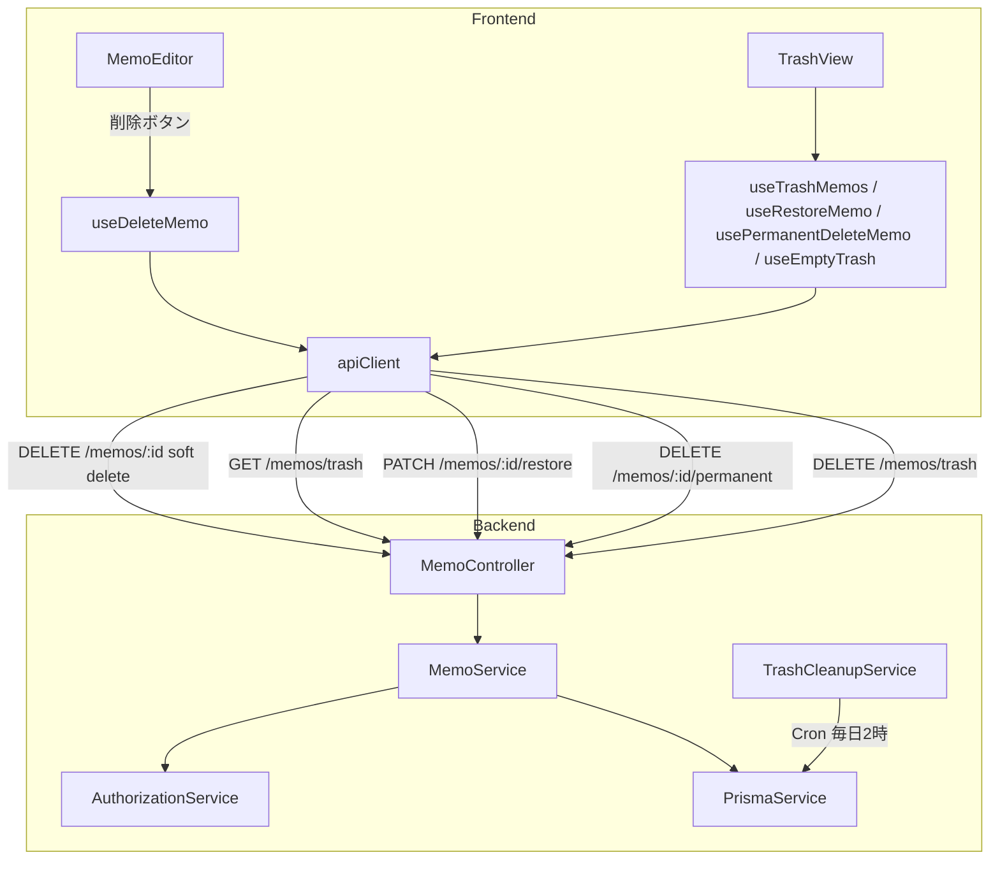
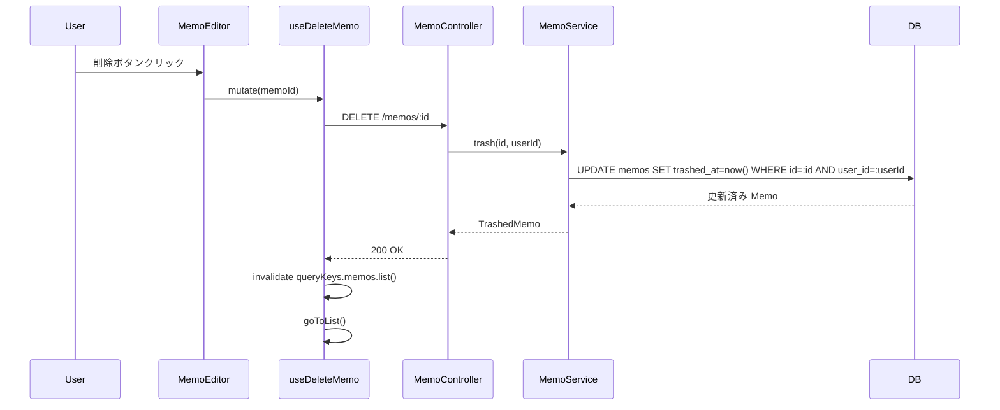
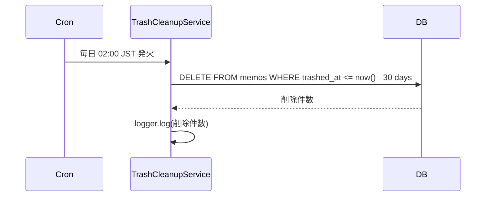

# Design Document: trash

## Overview

`MemoEditor` の削除ボタンによるメモ削除を Soft Delete に変更し、ゴミ箱機能を追加する。ゴミ箱はサイドバーからアクセス可能な専用ビューで、一覧表示・復元・完全削除・一括削除を提供する。ゴミ箱に移動してから30日経過したメモはバックグラウンドスケジューラーが自動的に完全削除する。

### Goals

- 誤削除メモを30日以内に復元できるセーフティネットを提供する
- `DELETE /memos/:id` のセマンティクスを soft delete に変更し、フロントエンドの `useDeleteMemo` を変更不要にする
- 自動削除でゴミ箱肥大化を防ぐ

### Non-Goals

- 削除通知・メール通知
- ゴミ箱保持期間のユーザー設定化
- ノートブック・タグのゴミ箱機能

---

## Requirements Traceability

| Requirement | Summary                     | Components                                                            | Flows             |
| ----------- | --------------------------- | --------------------------------------------------------------------- | ----------------- |
| 1.1〜1.4    | Soft Delete・フィルター除外 | `MemoService.trash()`, `Memo.trashedAt`                               | Soft Delete Flow  |
| 2.1〜2.4    | ゴミ箱一覧表示              | `GET /memos/trash`, `useTrashMemos`, `TrashView`                      | —                 |
| 3.1〜3.3    | 復元                        | `MemoService.restore()`, `PATCH /memos/:id/restore`, `useRestoreMemo` | —                 |
| 4.1〜4.3    | 完全削除・一括削除          | `MemoService.permanentDelete()`, `MemoService.emptyTrash()`           | —                 |
| 5.1〜5.2    | 自動削除                    | `TrashCleanupService`, `@nestjs/schedule`                             | Auto-Cleanup Flow |
| 6.1〜6.3    | アクセス制御                | `AuthorizationService`, `JwtAuthGuard`                                | —                 |

---

## Architecture

### Existing Architecture Analysis

- `MemoService` は `BaseOwnableService<MemoWithRelations>` を継承し、`remove()` で hard delete を実行
- `DELETE /memos/:id` は `MemoService.remove()` を呼び出す（変更: soft delete に置き換え）
- 全 `findMany` クエリは `{ userId }` でフィルターしており、`trashedAt: null` 条件を追加する必要がある
- フロントエンドは `useDeleteMemo` → `apiClient.deleteMemo(id)` → `DELETE /memos/:id` のパスで削除

### Architecture Pattern & Boundary Map



- **選択パターン**: 既存 memo ドメインへの Extension。新規モジュールは `TrashCleanupService` のみ
- **Steering 準拠**: サーバーデータは React Query のみ管理。Zustand は `ViewType` に `'trash'` を追加するのみ

### Technology Stack

| Layer       | Choice / Version              | Role                                       |
| ----------- | ----------------------------- | ------------------------------------------ |
| Backend     | NestJS 11 + Prisma            | `MemoService` 拡張、新 API エンドポイント  |
| Scheduler   | `@nestjs/schedule` (新規追加) | 30日自動削除 Cron                          |
| Database    | PostgreSQL (Prisma migration) | `Memo` に `trashedAt DateTime?` カラム追加 |
| Frontend    | React Query                   | ゴミ箱専用クエリ・ミューテーションフック   |
| Frontend UI | React 19 + Tailwind CSS       | `TrashView` コンポーネント                 |

---

## System Flows

### Soft Delete Flow



### Auto-Cleanup Flow



---

## Components and Interfaces

| Component                | Layer             | Intent                                                       | Req Coverage                                     | Key Dependencies                                      |
| ------------------------ | ----------------- | ------------------------------------------------------------ | ------------------------------------------------ | ----------------------------------------------------- |
| `Memo.trashedAt` (DB)    | Data              | Soft delete フラグ                                           | 1.1〜1.4                                         | Prisma migration                                      |
| `MemoService` (拡張)     | Backend Service   | trash / restore / permanentDelete / emptyTrash / findTrashed | 1.1〜1.4, 2.1〜2.4, 3.1〜3.3, 4.1〜4.3, 6.1〜6.2 | PrismaService, AuthorizationService                   |
| `MemoController` (拡張)  | Backend API       | 新エンドポイント追加                                         | 全要件                                           | MemoService, JwtAuthGuard                             |
| `TrashCleanupService`    | Backend Scheduler | 30日経過メモの自動削除                                       | 5.1〜5.2                                         | PrismaService, @nestjs/schedule                       |
| `useTrashMemos`          | Frontend Hook     | ゴミ箱一覧クエリ                                             | 2.1〜2.4                                         | apiClient, queryKeys                                  |
| `useRestoreMemo`         | Frontend Hook     | 復元ミューテーション                                         | 3.1〜3.3                                         | apiClient, queryClient                                |
| `usePermanentDeleteMemo` | Frontend Hook     | 完全削除ミューテーション                                     | 4.1〜4.2                                         | apiClient, queryClient                                |
| `useEmptyTrash`          | Frontend Hook     | ゴミ箱一括削除ミューテーション                               | 4.2〜4.3                                         | apiClient, queryClient                                |
| `TrashView`              | Frontend UI       | ゴミ箱一覧・操作UI                                           | 2.1〜2.4, 3.1, 4.1〜4.2                          | useTrashMemos, useRestoreMemo, usePermanentDeleteMemo |

### Backend Layer

#### `MemoService`（拡張）

| Field        | Detail                                                                                                                                     |
| ------------ | ------------------------------------------------------------------------------------------------------------------------------------------ |
| Intent       | trash / restore / permanentDelete / emptyTrash / findTrashed の5メソッドを追加し、既存 findAll 系に `trashedAt: null` フィルターを付与する |
| Requirements | 1.1, 1.2, 1.3, 1.4, 2.1, 3.1, 3.2, 3.3, 4.1, 4.2, 6.1, 6.2                                                                                 |

**Responsibilities & Constraints**

- `remove()` の呼び出しを `trash()` に置き換えて soft delete を実現する
- `findAll` / `findAllPaginated` / `search` / `searchPaginated` の `where` 句に `trashedAt: null` を追加する
- ゴミ箱内メモへの操作（restore / permanentDelete）では `findOneTrashed()` で所有権を検証する（通常の `findOne` はゴミ箱メモを返さないため専用メソッドが必要）

**Contracts**: Service [x] / API [ ] / Batch [ ] / State [ ]

##### Service Interface

```typescript
interface MemoTrashService {
	/** メモをゴミ箱に移動する。trashedAt を現在時刻に設定 */
	trash(id: string, userId: string): Promise<MemoWithRelations>;

	/** ゴミ箱内メモを復元する。trashedAt を null に設定 */
	restore(id: string, userId: string): Promise<MemoWithRelations>;

	/** ゴミ箱内メモを完全削除する */
	permanentDelete(id: string, userId: string): Promise<MemoWithRelations>;

	/** ユーザーのゴミ箱を空にする（全メモを完全削除） */
	emptyTrash(userId: string): Promise<Prisma.BatchPayload>;

	/** ゴミ箱内メモ一覧を取得する */
	findTrashed(userId: string): Promise<MemoWithRelations[]>;

	/** ゴミ箱内メモを1件取得（所有者検証込み） */
	findOneTrashed(id: string, userId: string): Promise<MemoWithRelations>;
}
```

- Preconditions: `trash()` / `restore()` / `permanentDelete()` は所有者検証を行う
- Postconditions: `trash()` 後、メモは通常一覧に表示されない。`restore()` 後、メモは通常一覧に表示される

#### `MemoController`（拡張）

| Field        | Detail                                                                     |
| ------------ | -------------------------------------------------------------------------- |
| Intent       | ゴミ箱操作の5エンドポイントを追加し、既存 DELETE を soft delete に変更する |
| Requirements | 1.1, 2.1, 3.1, 4.1, 4.2, 6.1, 6.2, 6.3                                     |

**Contracts**: API [x]

##### API Contract

| Method | Endpoint             | Request | Response              | Errors        |
| ------ | -------------------- | ------- | --------------------- | ------------- |
| DELETE | /memos/:id           | —       | `TrashedMemo`         | 401, 403, 404 |
| GET    | /memos/trash         | —       | `MemoWithRelations[]` | 401           |
| PATCH  | /memos/:id/restore   | —       | `MemoWithRelations`   | 401, 403, 404 |
| DELETE | /memos/:id/permanent | —       | `MemoWithRelations`   | 401, 403, 404 |
| DELETE | /memos/trash         | —       | `{ count: number }`   | 401           |

> `DELETE /memos/:id` は soft delete（trashedAt を設定）に変更。complete delete は `DELETE /memos/:id/permanent`。

#### `TrashCleanupService`

| Field        | Detail                                                 |
| ------------ | ------------------------------------------------------ |
| Intent       | 30日以上前にゴミ箱移動されたメモを毎日自動完全削除する |
| Requirements | 5.1, 5.2                                               |

**Contracts**: Batch [x]

##### Batch / Job Contract

- Trigger: `@Cron('0 2 * * *')` — 毎日 JST 02:00 (UTC 17:00)
- Input: なし（DB全ユーザーの `trashedAt <= now() - 30日` のメモを対象）
- Output: 削除件数を `logger.log` に出力
- Idempotency & recovery: `deleteMany` は冪等。再実行しても追加削除は発生しない

**Implementation Notes**

- 新規パッケージ `@nestjs/schedule` を `backend/package.json` に追加し `AppModule` で `ScheduleModule.forRoot()` を登録する
- `MemoModule` に `TrashCleanupService` を `providers` として追加する

### Frontend Layer

#### `useTrashMemos` / `useRestoreMemo` / `usePermanentDeleteMemo` / `useEmptyTrash`

| Field        | Detail                                                           |
| ------------ | ---------------------------------------------------------------- |
| Intent       | ゴミ箱専用の React Query フックを `useMemoQueries.ts` に追加する |
| Requirements | 2.1〜2.4, 3.1〜3.3, 4.1〜4.3                                     |

**Contracts**: State [x]

##### State Management

```typescript
// useMemoQueries.ts に追加するフック群

/** ゴミ箱メモ一覧 */
export const useTrashMemos = () =>
	useQuery({
		queryKey: queryKeys.memos.trash(),
		queryFn: () => apiClient.getTrashMemos(),
		...ENTITY_CACHE_CONFIG.memos.list,
	});

/** 復元 */
export const useRestoreMemo = () => {
	const queryClient = useQueryClient();
	return useMutation({
		mutationFn: (id: string) => apiClient.restoreMemo(id),
		onSuccess: () => {
			queryClient.invalidateQueries({ queryKey: queryKeys.memos.all });
		},
	});
};

/** 完全削除 */
export const usePermanentDeleteMemo = () => {
	const queryClient = useQueryClient();
	return useMutation({
		mutationFn: (id: string) => apiClient.permanentDeleteMemo(id),
		onSuccess: () => {
			queryClient.invalidateQueries({ queryKey: queryKeys.memos.trash() });
		},
	});
};

/** ゴミ箱を空にする */
export const useEmptyTrash = () => {
	const queryClient = useQueryClient();
	return useMutation({
		mutationFn: () => apiClient.emptyTrash(),
		onSuccess: () => {
			queryClient.invalidateQueries({ queryKey: queryKeys.memos.trash() });
		},
	});
};
```

**Implementation Notes**

- `queryKeys.memos` に `trash: () => [...queryKeys.memos.all, 'trash'] as const` を追加する
- `apiClient`（`utils/api.ts`）に `getTrashMemos / restoreMemo / permanentDeleteMemo / emptyTrash` を追加する

#### `TrashView`

| Field        | Detail                                          |
| ------------ | ----------------------------------------------- |
| Intent       | ゴミ箱内メモの一覧・復元・完全削除・一括削除 UI |
| Requirements | 2.1〜2.4, 3.1, 4.1〜4.3                         |

**Contracts**: State [x]

**Responsibilities & Constraints**

- `useTrashMemos` でメモ一覧を取得し、各アイテムに「復元」「完全削除」ボタンを表示する
- ヘッダーに「ゴミ箱を空にする」ボタンを配置する（ゴミ箱が空のときは無効化）
- 各メモには削除日時と自動削除までの残日数（`Math.max(0, 30 - daysSinceTrashed)`）を表示する
- `window.confirm` は使用しない（audit C-1 の方針）。完全削除は確認なしで実行するか、インラインの確認 UI を使用する

**Implementation Notes**

- `ViewType` に `'trash'` を追加し、`useViewStore` に `goToTrash()` ナビゲーションヘルパーを追加する
- サイドバーコンポーネントにゴミ箱リンクを追加する
- 表示場所: `components/memo/TrashView.tsx`（既存パターン準拠）

---

## Data Models

### Domain Model

`Memo` エンティティに `trashedAt: DateTime | null` を追加する。`null` = 通常メモ、非 null = ゴミ箱。

### Physical Data Model

```prisma
model Memo {
  id         String    @id @default(cuid())
  title      String    @db.VarChar(100)
  content    String
  createdAt  DateTime  @default(now())
  updatedAt  DateTime  @updatedAt
  trashedAt  DateTime? @map("trashed_at")   // 追加: null = 通常, 非null = ゴミ箱
  userId     String    @map("user_id")
  notebookId String?   @map("notebook_id")
  memoTags   MemoTag[]
  notebook   Notebook? @relation(fields: [notebookId], references: [id])
  user       User      @relation(fields: [userId], references: [id], onDelete: Cascade)

  @@map("memos")
}
```

**インデックス**: `trashedAt` 単体のインデックスは不要（ユーザー単位・クリーンアップはフルスキャンで許容範囲）。

### Data Contracts & Integration

フロントエンドの型 `Memo`（`frontend/src/types/memo.ts`）に `trashedAt: string | null` を追加する。

---

## Error Handling

### Error Strategy

- 404: ゴミ箱内に存在しないメモへの操作 → `NotFoundException`
- 403: 他ユーザーのメモへの操作 → `ForbiddenException`（既存 `AuthorizationService` が処理）
- UI: 完全削除は操作後即時リストから消える。エラー時は logger でのみ記録し、alert は使用しない

### Error Categories and Responses

| エラー           | 条件                      | 対応                      |
| ---------------- | ------------------------- | ------------------------- |
| 404 Not Found    | ゴミ箱に存在しないメモ ID | `NotFoundException`       |
| 403 Forbidden    | 他ユーザーのメモ操作      | `ForbiddenException`      |
| 401 Unauthorized | 未認証                    | `JwtAuthGuard` が自動処理 |

---

## Testing Strategy

### Unit Tests（Backend）

- `MemoService.trash()` で `trashedAt` が設定されること
- `MemoService.restore()` で `trashedAt` が null に戻ること
- `MemoService.findAll()` がゴミ箱メモを返さないこと
- `TrashCleanupService` が30日以上前のメモのみ削除すること

### Integration Tests（Backend）

- `DELETE /memos/:id` でメモが通常一覧から消え、ゴミ箱一覧に表示されること
- `PATCH /memos/:id/restore` で通常一覧に戻ること
- 他ユーザーのメモへの操作で 403 を返すこと

### Unit Tests（Frontend）

- `TrashView` がゴミ箱メモの残日数を正しく表示すること（Jest fake timers）
