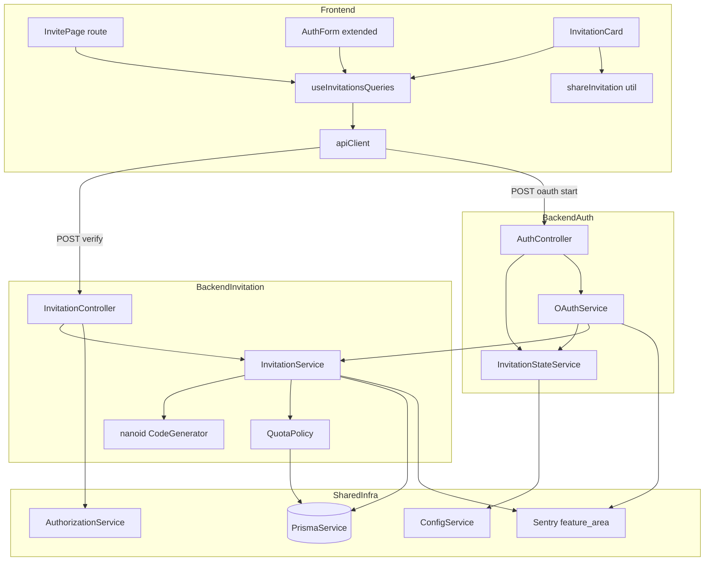
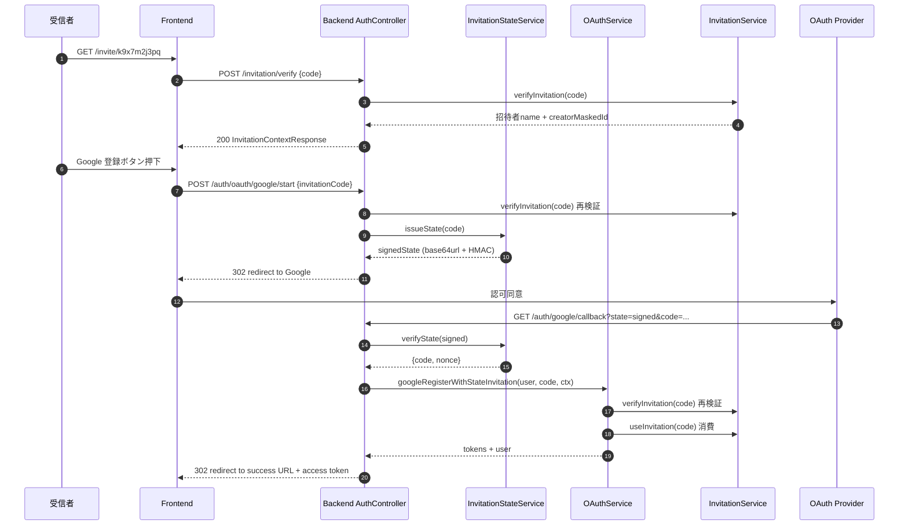
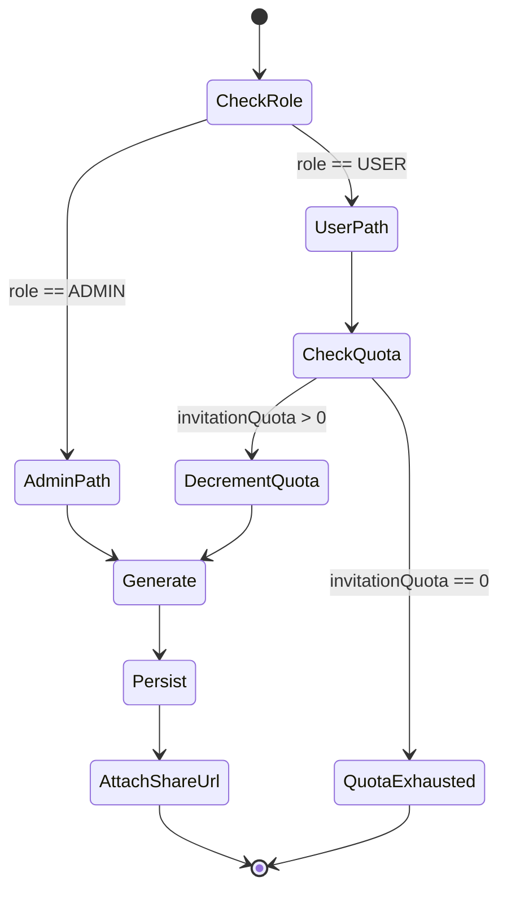
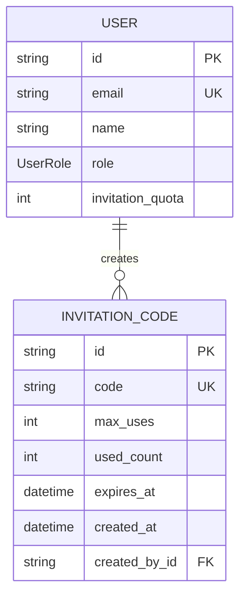
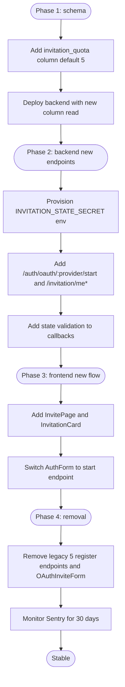

# Technical Design — viral-invitation

---

## Overview

**Purpose**: 招待された未登録ユーザーが招待 URL から prefill された登録画面に直行し、OAuth 認可前にコード検証を完了した上で「○○さんから招待されました」の文脈で登録できる新フロー一式と、既存ユーザーが Settings から Web Share でリンクを共有できる UI を提供する。

**Users**: 未登録の招待受信者と、既存ユーザー（USER/ADMIN ロール双方）。受信者は `/invite/:code` 経由で prefill された登録 UI を、既存ユーザーは Settings 画面で `invitationQuota` 残数の確認・新規発行・共有を行う。

**Impact**: 招待コードは 32 文字 hex から nanoid no-look-alike 10 文字に短縮され、`User.invitationQuota` カラムが追加される。OAuth の往復順序が「コード検証 → 認可 → コールバック登録」に逆転し、旧 `/auth/{provider}/register-with-invitation` 5 本と `INVITATION_REQUIRED` エラー経路は削除される。

### Goals

- 招待 URL 1 回タップで prefill 登録に到達する導線を 5 OAuth プロバイダ全てに統一適用する
- OAuth 認可後にゼロ価値離脱する状態をリリース日に解消する（Sentry 旧経路ヒット 0 件を維持）
- 一般ユーザーが管理者を介さず招待コードを発行・共有できる `invitationQuota` 体系を導入する

### Non-Goals

- メール認証フローの実機能化（`emailVerified` カラムの実運用は別 spec）
- ウェイトリスト・招待実績ダッシュボード・招待ランキング/報酬機能
- 既存 32 文字 hex コードの DB クリーンアップ（受理は継続）
- `User.invitationQuota` の管理画面からの個別編集 UI（将来 spec で検討）

---

## Architecture

### Existing Architecture Analysis

| 項目                       | 現状                                                                                                                                 | 本仕様での扱い                                                  |
| -------------------------- | ------------------------------------------------------------------------------------------------------------------------------------ | --------------------------------------------------------------- |
| `invitation` ドメイン      | `InvitationService` / `InvitationController` / `InvitationCode` モデルが完成。ADMIN 限定 CRUD                                        | 同モジュール内で拡張、新規モジュールは作らない                  |
| `auth` ドメイン            | `AuthService` / `JwtTokenService` / `OAuthService` の 3 分割。5 プロバイダ Strategy + 旧 `register-with-invitation` 5 エンドポイント | 旧 5 エンドポイント削除、コールバックに state 検証を追加        |
| 認証ガード                 | グローバル JWT Guard + `@Public()` opt-out                                                                                           | 受信者向け新エンドポイントは `@Public()`、Settings 系は既定保護 |
| 所有権チェック             | `AuthorizationService.checkOwnership()`                                                                                              | 自分の招待コード操作はこれを経由                                |
| エラー体系                 | `ERROR_CODES.INVITATION` の 4 コード + `throwBadRequest` ヘルパー                                                                    | `QUOTA_EXHAUSTED` を追加、フロントを `code` ベース判定に統一    |
| サーバ状態                 | React Query 単一の真実の源泉、`apiClient`（`utils/api.ts`）経由のみ                                                                  | 新フックは `useInvitationsQueries.ts` に集約                    |
| Sentry `feature_area` 契約 | enum 値 `invitation` が定義済み、URL prefix `/invitation` で自動付与                                                                 | 新エンドポイントも `/invitation` prefix に揃え自動分類          |

### Architecture Pattern & Boundary Map

採用パターンは **ハイブリッド（既存ドメイン拡張 + 新規ヘルパー切り出し + フロント独立ページ）**。背景の代替案検討と選定理由は `research.md` を参照。



**Architecture Integration**:

- Selected pattern: **Domain-aligned Hybrid** — 既存 `invitation` / `auth` ドメイン内拡張に絞り、CSRF 耐性が必要な OAuth state 引き継ぎだけを `InvitationStateService` として切り出す
- Domain/feature boundaries: 招待コードの生成・検証・quota 操作は `invitation` ドメインに閉じ、`OAuthService` は state の発行・検証を `InvitationStateService` に委譲することで責務を肥大化させない
- Existing patterns preserved: 1 ドメイン = 1 モジュール、`AuthorizationService.checkOwnership()` による所有権チェック、`apiClient` 経由通信、`@Public()` opt-out、Sentry `feature_area` 自動付与
- New components rationale: HMAC 署名 state は OAuth 5 プロバイダ共通で必要、フロントは prefill 専用 `/invite/:code` ページで `AuthForm` の責務肥大を回避、`InvitationCard` は Settings 画面の友達招待 UI を独立コンポーネント化
- Steering compliance: `structure.md`（ドメインモジュール）、`tech.md`（React Query 真実の源泉、Sentry PII ポリシー、グローバル JWT Guard）、`product.md`（招待制アクセスの価値訴求）と一致

### Technology Stack

| Layer                    | Choice / Version                                                                                  | Role in Feature                                                                | Notes                                                          |
| ------------------------ | ------------------------------------------------------------------------------------------------- | ------------------------------------------------------------------------------ | -------------------------------------------------------------- |
| Frontend                 | React 19 + Vite 6 + react-router v7 + Tailwind 3                                                  | `/invite/:code` ページ、`AuthForm` 改修、Settings の `InvitationCard`          | 既存スタック内、新規依存なし                                   |
| Frontend (state)         | `@tanstack/react-query` 5.x                                                                       | `useInvitationsQueries.ts`（quota 残数 / 自分の招待一覧 / 検証 / 作成）        | サーバ状態は React Query、Zustand へのコピー禁止               |
| Backend (web)            | NestJS 11 + passport 0.7 + passport-google-oauth20 / github2 / line-auth / apple / twitter-oauth2 | OAuth 5 プロバイダ統合、JWT Guard、Throttler                                   | 既存。`state` パラメータを自前 HMAC で運用                     |
| Backend (id 生成)        | `nanoid` 5.x（`customAlphabet`）                                                                  | 招待コード生成（no-look-alike 49 文字 × 10 文字長）                            | **新規依存追加**。既定 alphabet の代わりに専用 alphabet を使用 |
| Backend (署名)           | Node.js 標準 `crypto`（HMAC-SHA256, `timingSafeEqual`）                                           | OAuth state の HMAC 署名・検証                                                 | 追加依存なし。鍵は `INVITATION_STATE_SECRET`（env 新設）に分離 |
| Data / Storage           | PostgreSQL（Supabase 本番 / Docker ローカル）+ Prisma 6                                           | `User.invitationQuota` 追加、`InvitationCode.code` は既存 `VarChar(50)` を流用 | マイグレーション 1 本（カラム追加 + 既存ユーザー初期値）       |
| Infrastructure / Runtime | Vercel（FE） + Google Cloud Run（BE）                                                             | 既存                                                                           | 新規環境変数 `INVITATION_STATE_SECRET` を両環境に追加          |

詳細な選定経緯（passport `store` オプション比較、nanoid 長さ・衝突確率、Web Share API ブラウザ対応）は `research.md` を参照。

---

## System Flows

### Sequence: 招待 URL → OAuth 順序逆転登録



検証は計 3 回実行する（フロント表示直前 / OAuth 開始直前 / コールバック直後）。冗長に見えるが、**フロント検証は表示専用、開始直前検証は離脱防止、コールバック検証は state 改ざん耐性**を担うため省略しない。state 検証失敗時は OAuth コールバック内で `INVALID_CODE` を返却し、フロントを `/invite/:code?error=invalid_state` にリダイレクトする。

### Process: 招待コード発行と quota 減算



`DecrementQuota → Generate → Persist` は同一 Prisma トランザクション内で行い、quota 残数と発行レコードの整合性を保つ。

---

## Requirements Traceability

| Requirement | Summary                                           | Components                                                                  | Interfaces                                                          | Flows                |
| ----------- | ------------------------------------------------- | --------------------------------------------------------------------------- | ------------------------------------------------------------------- | -------------------- |
| 1.1         | `/invite/:code` 公開ルート                        | `InvitePage`, `App.tsx` ルーティング                                        | `GET /invitation/verify-context`                                    | URL → prefill        |
| 1.2         | prefill + 招待者名表示                            | `InvitePage`, `AuthForm`, `useInvitationsQueries`                           | `InvitationContextResponse`                                         | URL → prefill        |
| 1.3         | 無効/期限/上限のエラー区別                        | `InvitePage`, `InvitationErrorBanner`                                       | `InvitationFailureResponse`（`code` 4 種）                          | URL → prefill        |
| 1.4         | 認証済みリダイレクト                              | `InvitePage`                                                                | `useAuthGuard()` 既存                                               | URL → prefill        |
| 1.5         | コード入力欄を編集可能のまま残す                  | `AuthForm`                                                                  | -                                                                   | URL → prefill        |
| 2.1         | nanoid 8〜10 文字統一                             | `InvitationService`, `CodeGenerator`                                        | -                                                                   | 発行                 |
| 2.2         | 紛らわしい文字除外 alphabet                       | `CodeGenerator`                                                             | -                                                                   | 発行                 |
| 2.3         | 旧 32 文字 hex の後方互換                         | `InvitationService.verifyInvitation`, `InvitationCode.code` VarChar(50)     | -                                                                   | 検証                 |
| 2.4         | 入力欄属性                                        | `AuthForm`                                                                  | -                                                                   | prefill              |
| 2.5         | 共有用絶対 URL レスポンス                         | `InvitationController`, `ConfigService.frontendUrl`                         | `InvitationWithShareUrl.shareUrl`                                   | 発行                 |
| 3.1         | OAuth 開始前検証                                  | `AuthController`, `InvitationService`                                       | `POST /auth/oauth/:provider/start`                                  | OAuth 順序逆転       |
| 3.2         | 検証失敗で OAuth 開始しない                       | `AuthController`                                                            | `InvitationFailureResponse`                                         | OAuth 順序逆転       |
| 3.3         | state パラメータでコード引き継ぎ                  | `InvitationStateService`, 各 `*Strategy`                                    | `signedState` 文字列                                                | OAuth 順序逆転       |
| 3.4         | コールバックで再検証 + 消費                       | `OAuthService.*WithStateInvitation`                                         | -                                                                   | OAuth 順序逆転       |
| 3.5         | ゼロ価値離脱の不在保証                            | `AuthController`, Sentry `feature_area: invitation`                         | -                                                                   | OAuth 順序逆転       |
| 3.6         | 旧フロー削除                                      | `AuthController`, `OAuthService.handleOAuthLogin`                           | 旧 5 `register-with-invitation` 廃止                                | OAuth 順序逆転       |
| 4.1         | `User.invitationQuota` カラム                     | `Prisma User` モデル                                                        | -                                                                   | 発行                 |
| 4.2         | 既存ユーザーへの初期付与                          | Prisma マイグレーション                                                     | -                                                                   | 発行                 |
| 4.3         | quota 1 以上で発行可                              | `QuotaPolicy`, `InvitationService.createForUser`                            | `POST /invitation/me`                                               | 発行                 |
| 4.4         | quota 0 で `QUOTA_EXHAUSTED`                      | `QuotaPolicy`                                                               | `ERROR_CODES.INVITATION.QUOTA_EXHAUSTED`                            | 発行                 |
| 4.5         | ADMIN 無制限                                      | `QuotaPolicy`                                                               | -                                                                   | 発行                 |
| 4.6         | quota 残数 + 自分の招待一覧取得                   | `InvitationController`, `InvitationService.getMyInvitations`                | `GET /invitation/me`, `GET /invitation/me/quota`                    | Settings 表示        |
| 4.7         | 所有権チェック                                    | `AuthorizationService.checkOwnership`                                       | -                                                                   | Settings 表示 / 削除 |
| 5.1         | quota 残数可視化                                  | `InvitationCard`                                                            | -                                                                   | Settings 表示        |
| 5.2         | 招待リンク発行                                    | `InvitationCard`, `useCreateMyInvitation`                                   | `POST /invitation/me`                                               | Settings 発行        |
| 5.3         | Web Share API 対応                                | `shareInvitation` util                                                      | `navigator.share`                                                   | Settings 共有        |
| 5.4         | clipboard フォールバック                          | `shareInvitation` util                                                      | `navigator.clipboard.writeText`                                     | Settings 共有        |
| 5.5         | 発行済み一覧と使用状況                            | `InvitationCard`, `useMyInvitations`                                        | `InvitationWithShareUrl[]`                                          | Settings 表示        |
| 5.6         | quota 0 で発行ボタン無効化                        | `InvitationCard`                                                            | -                                                                   | Settings 発行        |
| 6.1         | 招待者表示名表示                                  | `InvitePage`, `InvitationContextResponse`                                   | -                                                                   | URL → prefill        |
| 6.2         | 招待者 name + マスク識別子のみ返却                | `InvitationService.verifyContext`                                           | `InvitationContextResponse`                                         | URL → prefill        |
| 6.3         | name null 時のフォールバック                      | `InvitePage`                                                                | -                                                                   | URL → prefill        |
| 6.4         | email 等の機微情報を含めない（PII）               | `InvitationContextResponse` 設計                                            | -                                                                   | URL → prefill        |
| 7.1         | 失敗理由 4 種を構造化エラーコードで返却           | `ERROR_CODES.INVITATION`, `InvitationService`                               | `INVALID_CODE` / `EXPIRED` / `MAX_USES_REACHED` / `QUOTA_EXHAUSTED` | 検証 / 発行          |
| 7.2         | フロント分岐をコード判定に統一                    | `useInvitationsQueries`, `InvitePage`, `AuthForm`                           | `ApiError.code`                                                     | 検証                 |
| 7.3         | 各コードに対応した日本語メッセージ                | `frontend/src/constants/invitationErrorMessages.ts`                         | -                                                                   | 検証                 |
| 7.4         | 文字列マッチ撤去 + Sentry 失敗イベント記録        | `AuthController.handleOAuthCallback`, Sentry tag `feature_area: invitation` | -                                                                   | 検証 / OAuth         |
| 8.1         | 登録後の自動ログイン保証                          | `AuthController`, `OAuthService.*WithStateInvitation`                       | -                                                                   | 登録完了後           |
| 8.2         | 再ログイン文言の排除と遷移先                      | `AuthForm`, `InvitePage`                                                    | -                                                                   | 登録完了後           |
| 8.3         | 既存「Registration successful! ... login...」削除 | `frontend/src/components/auth/EmailAuthForm.tsx` 文言                       | -                                                                   | 登録完了後           |
| 9.1         | 管理者メール例外維持                              | `OAuthService.handleOAuthLogin`（admin 分岐）                               | -                                                                   | OAuth ログイン       |
| 9.2         | 5 プロバイダ全てで OAuth 順序逆転適用             | `AuthController` の 5 start / 5 callback                                    | -                                                                   | OAuth 順序逆転       |
| 9.3         | 通常/キャンペーン区別維持                         | `InvitationService.createInvitation`（ADMIN 経路、`maxUses` 可変）          | -                                                                   | 発行                 |
| 9.4         | マイグレーション時に ADMIN へ quota 加算しない    | Prisma マイグレーション seed                                                | -                                                                   | マイグレーション     |

---

## Components and Interfaces

| Component                     | Domain/Layer        | Intent                                                                                                              | Req Coverage                      | Key Dependencies (P0/P1)                                                                                    | Contracts      |
| ----------------------------- | ------------------- | ------------------------------------------------------------------------------------------------------------------- | --------------------------------- | ----------------------------------------------------------------------------------------------------------- | -------------- |
| `InvitationService`           | Backend / Domain    | コード生成・検証・消費 + quota 操作の単一権威                                                                       | 2.1–2.3, 2.5, 4.3–4.7, 6.2, 7.1   | `PrismaService` (P0), `CodeGenerator` (P0), `QuotaPolicy` (P0)                                              | Service, State |
| `CodeGenerator`               | Backend / Util      | nanoid no-look-alike 10 文字を生成                                                                                  | 2.1, 2.2                          | `nanoid` (P0)                                                                                               | Service        |
| `QuotaPolicy`                 | Backend / Util      | ロール別の発行可否判定と quota 減算                                                                                 | 4.3–4.5, 9.4                      | `PrismaService` (P0)                                                                                        | Service        |
| `InvitationController`        | Backend / API       | 招待 CRUD + 受信者向け検証 API + 自分用 quota / 一覧 API                                                            | 1.3, 2.5, 4.6, 4.7, 5.5, 6.2, 6.4 | `InvitationService` (P0), `AuthorizationService` (P0), `ConfigService` (P1)                                 | API            |
| `InvitationStateService`      | Backend / Auth Util | OAuth state を HMAC 署名・検証し招待コードを安全に往復させる                                                        | 3.3, 3.4                          | `ConfigService` (P0), `crypto` (P0)                                                                         | Service        |
| `OAuthService` (改修)         | Backend / Domain    | コールバックで state 検証 + 招待コード消費 + ユーザー作成 + 自動ログイン                                            | 3.4, 3.5, 8.1, 9.1, 9.2           | `InvitationService` (P0), `InvitationStateService` (P0), `JwtTokenService` (P0), `RefreshTokenService` (P0) | Service        |
| `AuthController` (改修)       | Backend / API       | `/auth/oauth/:provider/start` 新設、旧 `register-with-invitation` 5 本削除、コールバックで state 検証経路に差し替え | 3.1, 3.2, 3.6, 7.4, 9.2           | `OAuthService` (P0), `InvitationService` (P0), `ConfigService` (P0)                                         | API            |
| `InvitePage`                  | Frontend / Page     | `/invite/:code` ルートで context 表示 + prefill + エラー分岐                                                        | 1.1–1.5, 6.1, 6.3                 | `useInvitationContext` (P0), `AuthForm` (P0)                                                                | UI             |
| `AuthForm`（改修）            | Frontend / UI       | 既存のメール/OAuth 登録 UI を新フローに統合（state 引き継ぎ・文言・属性）                                           | 1.2, 1.5, 2.4, 7.2, 8.2, 8.3      | `useInvitationsQueries` (P0), `apiClient` (P0)                                                              | UI             |
| `InvitationCard`              | Frontend / Settings | Settings 内の「友達を招待」セクション全体                                                                           | 4.6, 5.1–5.6                      | `useMyInvitations` (P0), `useCreateMyInvitation` (P0), `shareInvitation` (P0)                               | UI             |
| `useInvitationsQueries`       | Frontend / Hooks    | quota / 自分の招待 / context 検証 / 作成・削除を集約する React Query フック群                                       | 1.2, 4.6, 5.2, 5.5, 7.2           | `apiClient` (P0)                                                                                            | State          |
| `shareInvitation` util        | Frontend / Util     | Web Share API → clipboard の 2 段階フォールバック                                                                   | 5.3, 5.4                          | `navigator.share`, `navigator.clipboard`                                                                    | Service        |
| `invitationErrorMessages`     | Frontend / Const    | エラーコード → 日本語メッセージのマッピング                                                                         | 7.3                               | -                                                                                                           | State          |
| Prisma `User.invitationQuota` | Data / Schema       | quota 残数の永続化                                                                                                  | 4.1, 4.2, 9.4                     | Prisma マイグレーション                                                                                     | State          |

UI のみで新境界を持たない `InvitePage` / `AuthForm`（改修） / `InvitationCard` は Implementation Notes で要点のみ補足し、フルブロックは新規ロジック境界を持つ Hook / Service / API に限定する。

---

### Backend / Invitation ドメイン

#### `InvitationService`

| Field        | Detail                                                          |
| ------------ | --------------------------------------------------------------- |
| Intent       | 招待コードの生成・検証・消費・所有別取得と quota 連携の単一権威 |
| Requirements | 2.1, 2.2, 2.3, 2.5, 4.3, 4.4, 4.6, 4.7, 6.2, 7.1, 9.3           |

**Responsibilities & Constraints**

- 招待コード生成は `CodeGenerator` のみに委譲し、内部で `randomBytes` 系を使わない
- 発行・quota 減算は単一トランザクションで実行し、整合性違反を排除
- 検証ロジックはコード長に依存せず、旧 32 文字 hex を含む全形式を受理
- 失敗時は `throwBadRequest(ERROR_CODES.INVITATION.*)` を通じて構造化エラーを送出
- PII（email）はレスポンス DTO に含めず、`name` と `maskedCreatorId` のみ公開

**Dependencies**

- Inbound: `InvitationController` — CRUD・検証・自分の招待操作（P0）
- Inbound: `OAuthService` — コールバックでの再検証 + 消費（P0）
- Outbound: `PrismaService` — 永続化（P0）
- Outbound: `CodeGenerator` — コード生成（P0）
- Outbound: `QuotaPolicy` — quota 残数評価と減算（P0）
- External: `nanoid` — `customAlphabet`（P0）

**Contracts**: Service [x] / API [ ] / Event [ ] / Batch [ ] / State [x]

##### Service Interface

```typescript
export type InvitationCreator = { id: string; name: string | null; maskedId: string };

export interface InvitationWithShareUrl {
	id: string;
	code: string;
	maxUses: number;
	usedCount: number;
	expiresAt: Date | null;
	createdAt: Date;
	shareUrl: string;
}

export interface InvitationContext {
	code: string;
	status: 'valid';
	creator: InvitationCreator;
	expiresAt: Date | null;
	usesRemaining: number;
}

export interface UserQuotaSnapshot {
	invitationQuota: number;
	unlimited: boolean;
	role: 'USER' | 'ADMIN';
}

export interface InvitationService {
	verifyInvitation(code: string): Promise<InvitationContext>;
	useInvitation(code: string): Promise<void>;
	createForUser(actor: { id: string; role: 'USER' | 'ADMIN' }): Promise<InvitationWithShareUrl>;
	createForAdmin(dto: CreateInvitationDto, adminId: string): Promise<InvitationWithShareUrl>;
	getMyInvitations(userId: string): Promise<InvitationWithShareUrl[]>;
	getMyQuota(userId: string): Promise<UserQuotaSnapshot>;
	deleteMyInvitation(id: string, ownerId: string): Promise<void>;
}
```

- Preconditions: `verifyInvitation` は引数が文字列で非空であること。`createForUser` は actor 認証済みであること。
- Postconditions: `createForUser` は USER ロール時に `invitationQuota` を 1 減算し、ADMIN 時は減算しない。`useInvitation` は `usedCount` を 1 増加させ、`maxUses` 超過後は再呼び出しで `MAX_USES_REACHED` を送出。
- Invariants: `usedCount <= maxUses` を常に保つ。`invitationQuota >= 0` を保証。

**Implementation Notes**

- Integration: `OAuthService.googleRegisterWithStateInvitation` 等の新メソッド経由で再検証 → 消費を呼び出す。旧 `handleOAuthRegistrationWithInvitation` は削除前に新パス呼び出しに置換。
- Validation: `verifyInvitation` 失敗時の throw は `ERROR_CODES.INVITATION.{INVALID_CODE | EXPIRED | MAX_USES_REACHED}` に統一。`createForUser` で quota 不足は `QUOTA_EXHAUSTED`。
- Risks: トランザクション内で `findUnique → update` を行うため Prisma の interactive transaction を使用。同一ユーザーから並行発行リクエストが来た場合の race condition は `update` の `where: { id, invitationQuota: { gt: 0 } }` 条件で楽観ロック相当を実現。

#### `CodeGenerator`

| Field        | Detail                                                               |
| ------------ | -------------------------------------------------------------------- |
| Intent       | nanoid no-look-alike alphabet による短くて読みやすい招待コードを生成 |
| Requirements | 2.1, 2.2                                                             |

**Responsibilities & Constraints**

- alphabet は `346789ABCDEFGHJKLMNPQRTUVWXYabcdefghijkmnpqrtuvwxy`（49 文字、`0/O/1/I/l/L/2/Z/5/S/_/-` 除外）
- 長さは 10 固定（49^10 ≈ 7.98 × 10^16 ≈ 約 8 京通り）
- 衝突判定責任は持たない（unique 違反はサービス層でリトライ）

**Dependencies**

- Outbound: `nanoid` `customAlphabet`（P0、新規依存追加）

**Contracts**: Service [x]

##### Service Interface

```typescript
export interface CodeGenerator {
	generate(): string;
	isLegacyFormat(code: string): boolean;
}
```

- Postconditions: 戻り値は長さ 10、alphabet 内文字のみで構成。`isLegacyFormat` は `/^[0-9A-F]{32}$/` を満たす場合 true（Sentry タグ `invitation_code_format` 用）。

**Implementation Notes**

- Integration: `InvitationService` から `generate()` を呼ぶ。テスト容易化のため interface を InjectionToken（`CODE_GENERATOR`）で提供し、テストでは固定値を返す Mock を注入。
- Validation: ライブラリ単体テストでカバーされるため独自テストは alphabet 範囲のスポットチェックに限定。
- Risks: 衝突時の Prisma unique violation はサービス層で最大 3 回までリトライ（指数バックオフ不要、確率実質ゼロのため安全弁）。

#### `QuotaPolicy`

| Field        | Detail                                                                                        |
| ------------ | --------------------------------------------------------------------------------------------- |
| Intent       | ロール別の発行可否判定と quota 減算を関数として独立させ、`InvitationService` を肥大化させない |
| Requirements | 4.3, 4.4, 4.5, 9.4                                                                            |

**Responsibilities & Constraints**

- ADMIN ロールは quota を参照しない（無制限扱い）
- USER ロールは `invitationQuota > 0` のときのみ発行許可
- 減算は Prisma の `update` 内で `where: { id, role: 'USER', invitationQuota: { gt: 0 } }` を使い、競合時は 0 件更新で検知

**Dependencies**

- Outbound: `PrismaService`（P0）

**Contracts**: Service [x]

##### Service Interface

```typescript
export interface QuotaDecisionAllowed {
	allowed: true;
	consumed: boolean;
}
export interface QuotaDecisionDenied {
	allowed: false;
	code: 'QUOTA_EXHAUSTED';
}
export type QuotaDecision = QuotaDecisionAllowed | QuotaDecisionDenied;

export interface QuotaPolicy {
	evaluateAndConsume(
		tx: PrismaTransactionClient,
		actor: { id: string; role: 'USER' | 'ADMIN' },
	): Promise<QuotaDecision>;
}
```

- Postconditions: 戻り値が `allowed === true && consumed === true` の場合のみ `User.invitationQuota` が 1 減算済み。`consumed === false` は ADMIN 経路。
- Invariants: `invitationQuota` は決して負にならない。

**Implementation Notes**

- Integration: `InvitationService.createForUser` のトランザクション中で呼び、`denied` ならトランザクションを中断して `QUOTA_EXHAUSTED` を throw。
- Validation: マイグレーション直後の ADMIN ユーザーは `invitationQuota=5` を持つが評価関数では参照されないため不整合は発生しない。
- Risks: ロール降格（ADMIN → USER）時の quota 0 落ちは設計上の許容ケース。運用ドキュメントに記載予定（仕様外）。

#### `InvitationController`

| Field        | Detail                                                                 |
| ------------ | ---------------------------------------------------------------------- |
| Intent       | 受信者向け検証 API と自分用招待操作 API を提供。ADMIN 既存ルートは維持 |
| Requirements | 1.3, 2.5, 4.6, 4.7, 5.5, 6.2, 6.4, 9.3                                 |

**Responsibilities & Constraints**

- `/invitation/me*` は JWT 必須、`/invitation/verify-context` は `@Public()`
- レスポンス DTO に email を含めない（PII ポリシー遵守）
- 自分の招待操作は `AuthorizationService.checkOwnership()` 経由で所有権チェック

**Dependencies**

- Inbound: `apiClient` / Web ブラウザ（P0）
- Outbound: `InvitationService`（P0）
- Outbound: `AuthorizationService`（P0）
- Outbound: `ConfigService.frontendUrl`（P1、shareUrl 生成）

**Contracts**: Service [ ] / API [x] / Event [ ] / Batch [ ] / State [ ]

##### API Contract

| Method | Endpoint                        | Request               | Response                           | Errors                                              |
| ------ | ------------------------------- | --------------------- | ---------------------------------- | --------------------------------------------------- |
| POST   | `/invitation/verify-context`    | `{ code: string }`    | `InvitationContextResponse`        | 400 `INVALID_CODE` / `EXPIRED` / `MAX_USES_REACHED` |
| POST   | `/invitation/me`                | -                     | `InvitationWithShareUrlResponse`   | 400 `QUOTA_EXHAUSTED`, 401                          |
| GET    | `/invitation/me`                | -                     | `InvitationWithShareUrlResponse[]` | 401                                                 |
| GET    | `/invitation/me/quota`          | -                     | `UserQuotaResponse`                | 401                                                 |
| DELETE | `/invitation/me/:id`            | -                     | `204 No Content`                   | 401, 403 `NOT_OWNER`, 404 `NOT_FOUND`               |
| POST   | `/invitation` (既存、ADMIN)     | `CreateInvitationDto` | `InvitationWithShareUrlResponse`   | 401, 403 `ADMIN_ONLY`                               |
| POST   | `/invitation/verify` (既存)     | `VerifyInvitationDto` | `InvitationCode`（互換維持）       | 400 (上記 INV 系)                                   |
| GET    | `/invitation` (既存、ADMIN)     | -                     | `InvitationCode[]`                 | 401, 403 `ADMIN_ONLY`                               |
| DELETE | `/invitation/:id` (既存、ADMIN) | -                     | `204`                              | 401, 403 `ADMIN_ONLY`, 404                          |

**Implementation Notes**

- Integration: `POST /invitation/verify` は旧フロー削除後も互換維持のため残置（クライアントは新 `verify-context` に移行、削除タイミングは別 spec）。
- Validation: `class-validator` で `code` の長さ・形式を検証（最大長 50、英数字のみ）。
- Risks: `verify-context` は未認証で叩けるため Throttler 適用（`@Throttle({ default: { limit: 30, ttl: 60_000 } })`）し、招待コードブルートフォース耐性を担保。

---

### Backend / Auth ドメイン

#### `InvitationStateService`

| Field        | Detail                                                           |
| ------------ | ---------------------------------------------------------------- |
| Intent       | OAuth state パラメータに招待コードを HMAC 署名で安全に往復させる |
| Requirements | 3.3, 3.4                                                         |

**Responsibilities & Constraints**

- ペイロード構造: `{ code: string; nonce: string; iat: number; provider: 'google'|'github'|'line'|'apple'|'x' }`
- 署名: HMAC-SHA256（鍵は `INVITATION_STATE_SECRET` env、未設定時は起動拒否）
- 検証: `crypto.timingSafeEqual` でタイミング攻撃耐性、`iat` 経過 10 分超は失効
- `nonce` は 16 byte hex を `crypto.randomBytes` で生成。CSRF nonce として state ペイロード内に内包

**Dependencies**

- Outbound: Node.js 標準 `crypto`（P0）
- Outbound: `ConfigService`（P0、シークレット読み出し）

**Contracts**: Service [x]

##### Service Interface

```typescript
export type OAuthProvider = 'google' | 'github' | 'line' | 'apple' | 'x';

export interface InvitationStatePayload {
	code: string;
	provider: OAuthProvider;
	nonce: string;
	iat: number;
}

export interface InvitationStateService {
	issueState(code: string, provider: OAuthProvider): string;
	verifyState(signedState: string, expectedProvider: OAuthProvider): InvitationStatePayload;
}
```

- Preconditions: `issueState` は事前に `InvitationService.verifyInvitation(code)` が成功していること。
- Postconditions: 戻り値は `<base64url(payload)>.<base64url(signature)>` 形式の単一文字列。`verifyState` は署名・有効期限・provider 一致を検証し、いずれか失敗時は `ERROR_CODES.INVITATION.INVALID_CODE` を throw。
- Invariants: 同じ秘密鍵で生成された state のみが検証を通る。鍵ローテーション時は旧鍵での検証期間を別 spec で扱う。

**Implementation Notes**

- Integration: `AuthController.startOAuth` で発行、各 OAuth コールバックハンドラ冒頭で検証。passport-oauth2 の `state: true` は使用しない（state 文字列は自前で管理）。
- Validation: unit test で「改ざんペイロード」「期限切れ」「provider 不一致」「base64 不正」の 4 ケースを網羅。
- Risks: 鍵漏洩時は全 state が偽造可能になるため、`INVITATION_STATE_SECRET` を `JWT_SECRET` と分離し、Secret Manager（Cloud Run）/ Vercel env で個別管理。

#### `OAuthService`（改修）

| Field        | Detail                                                                                          |
| ------------ | ----------------------------------------------------------------------------------------------- |
| Intent       | 既存ログイン経路を維持しつつ、state 由来の招待コードによる新規ユーザー作成 + 自動ログインを追加 |
| Requirements | 3.4, 3.5, 8.1, 9.1, 9.2                                                                         |

**Responsibilities & Constraints**

- 既存 `handleOAuthLogin` の admin email 例外分岐は維持
- `INVITATION_REQUIRED` throw を **削除**（新フローでは到達不能）
- 新規メソッド `*RegisterWithStateInvitation`（5 プロバイダ分）を追加し、state 検証済みコードを引数で受領
- 旧 `handleOAuthRegistrationWithInvitation` および `*RegisterWithInvitation` 5 本は削除

**Dependencies**

- Outbound: `InvitationService`（P0、再検証 + 消費）
- Outbound: `InvitationStateService`（P0、callback 入口で検証）
- Outbound: `JwtTokenService` / `RefreshTokenService`（P0、自動ログイン）

**Contracts**: Service [x]

##### Service Interface（追加分のみ）

```typescript
export interface OAuthRegisterArgs<TUser> {
	oauthUser: TUser;
	invitationCode: string;
	ctx: AuthRequestContext;
}

export interface OAuthServiceAdditions {
	googleRegisterWithStateInvitation(
		args: OAuthRegisterArgs<GoogleStrategyUser>,
	): Promise<OAuthLoginResult>;
	githubRegisterWithStateInvitation(
		args: OAuthRegisterArgs<GitHubStrategyUser>,
	): Promise<OAuthLoginResult>;
	lineRegisterWithStateInvitation(
		args: OAuthRegisterArgs<LineStrategyUser>,
	): Promise<OAuthLoginResult>;
	appleRegisterWithStateInvitation(
		args: OAuthRegisterArgs<AppleStrategyUser> & { fallbackEmail?: string },
	): Promise<OAuthLoginResult>;
	xRegisterWithStateInvitation(args: OAuthRegisterArgs<XStrategyUser>): Promise<OAuthLoginResult>;
}
```

- Preconditions: `invitationCode` は `InvitationStateService.verifyState` を通過済みであること。
- Postconditions: ユーザー作成 → `useInvitation` → アクセストークン発行 + refresh cookie 発行（自動ログイン）まで一括完了。
- Invariants: 戻り値 `user.role` は admin email なら `ADMIN`、それ以外は `USER` 固定。

**Implementation Notes**

- Integration: 旧メソッドは段階削除でなく同 PR で除去。共有ロジック（ユーザー作成 + 消費 + トークン発行）は private helper `consumeAndIssue()` に集約。
- Validation: `oauth.service.spec.ts` を新フロー前提に書き換え、admin email 例外・既存ユーザーの再ログイン・state 経由新規作成の 3 系統を網羅。
- Risks: 5 プロバイダの strategy 側で `state` を取り出す経路差異あり。passport は `req.query.state` をデフォルトで callback に渡すため、`AuthController` 側で `req.query.state` を読み取り `InvitationStateService.verifyState` に渡す統一実装で対応。

#### `AuthController`（改修）

| Field        | Detail                                                                                         |
| ------------ | ---------------------------------------------------------------------------------------------- |
| Intent       | OAuth 開始エンドポイント新設、コールバックを state 検証経路に差し替え、旧 5 エンドポイント削除 |
| Requirements | 3.1, 3.2, 3.6, 7.4, 9.2                                                                        |

**Responsibilities & Constraints**

- 新規: `POST /auth/oauth/:provider/start`（5 プロバイダ共通、`@Public()`）— `invitationCode` を受領 → `InvitationService.verifyInvitation` → `InvitationStateService.issueState` → passport `authenticate` の `state` オプションに渡して 302 redirect
- 各 `*/callback` ハンドラ: `req.query.state` を取得 → `InvitationStateService.verifyState` → 成功時 `OAuthService.*RegisterWithStateInvitation`、state 不在時は既存 `*Login`（admin email 例外を残す）
- 旧 `*/register-with-invitation` 5 エンドポイントは **削除**。`generateInvitationRequiredUrl` の呼び出しも撤去
- `errorMessage.includes('invitation code')` 判定撤去、エラー時は state を含む `?error=invalid_state` 等を frontend URL に付与

**Dependencies**

- Inbound: フロント（`apiClient`）/ OAuth プロバイダ（P0）
- Outbound: `OAuthService`（P0）
- Outbound: `InvitationService`（P0、開始前検証）
- Outbound: `InvitationStateService`（P0、state 発行・検証）
- Outbound: `ConfigService`（P0、リダイレクト URL 組み立て）

**Contracts**: API [x]

##### API Contract（追加・変更分のみ）

| Method | Endpoint                                        | Request                      | Response                                           | Errors                                                                  |
| ------ | ----------------------------------------------- | ---------------------------- | -------------------------------------------------- | ----------------------------------------------------------------------- |
| POST   | `/auth/oauth/:provider/start`                   | `{ invitationCode: string }` | `{ authorizationUrl: string }` または 302 redirect | 400 `INVALID_CODE` / `EXPIRED` / `MAX_USES_REACHED` / `INVALID_PAYLOAD` |
| GET    | `/auth/google/callback` (改修)                  | `?state=<signed>&code=...`   | 302 redirect to FE success URL + access token      | 302 to `/invite/:code?error=invalid_state` (state 検証失敗時)           |
| GET    | `/auth/github/callback` (改修)                  | 同上                         | 同上                                               | 同上                                                                    |
| GET    | `/auth/line/callback` (改修)                    | 同上                         | 同上                                               | 同上                                                                    |
| POST   | `/auth/apple/callback` (改修)                   | 同上 + apple 固有 form_post  | 同上                                               | 同上                                                                    |
| GET    | `/auth/x/callback` (改修)                       | 同上                         | 同上                                               | 同上                                                                    |
| —      | `/auth/{provider}/register-with-invitation` × 5 | -                            | -                                                  | **削除**                                                                |

**Implementation Notes**

- Integration: state 未付与の callback は「既存ユーザーログイン」または「admin email 新規作成」の既存経路を維持。`InvitationStateService.verifyState` を呼ぶ前に `req.query.state` の有無で分岐する小さなディスパッチャを `handleOAuthCallback` に追加。
- Validation: `auth.controller.spec.ts` を全面的に書き換え（5 プロバイダ × 新フロー × 旧フロー削除確認）。`auth.controller.public-audit.spec.ts` の `/auth/oauth/:provider/start` 公開判定を追加。
- Risks: passport-apple は `POST /auth/apple/callback` の form_post を使うため、`req.body.state` から state を取得する分岐を追加。

---

### Frontend / Pages & Components

#### `InvitePage`（Summary-only）

- Route: `/invite/:code`
- 振る舞い: マウント時に `useInvitationContext({ code })` を実行 → 成功時に `AuthForm` を `prefilledInvitationCode` と `inviterContext` 付きで描画、エラー時は `InvitationErrorBanner` を表示
- 認証済みユーザーは `useEffect` で `/` にリダイレクト（Req 1.4）
- 招待者 name が null の場合は「あるユーザーから招待されました」を表示（Req 6.3）

Implementation Note: `useInvitationContext` のエラーコード（`INVALID_CODE` / `EXPIRED` / `MAX_USES_REACHED`）ごとに `invitationErrorMessages` から日本語文言を引いて表示。`AuthForm` には新 props `prefilledInvitationCode: string` `inviterContext: InvitationContextResponse | null` を追加。

#### `AuthForm`（Summary-only / 改修）

- 既存責務: メール/パスワード + OAuth ボタン 5 種。Settings からのリンクシェアではなく **登録専用 UI**
- 改修点:
  - 招待コード入力欄に `autoCapitalize="off"` / `autoComplete="off"` / `inputMode="text"` / `spellCheck={false}` を付与（Req 2.4）
  - prefill 時もユーザー編集を許容（Req 1.5）
  - OAuth ボタン押下時に `POST /auth/oauth/:provider/start` を呼び、200 で返却された `authorizationUrl` に `window.location.assign` で遷移
  - 失敗時はエラーコードで分岐し `invitationErrorMessages` から文言取得（Req 7.2, 7.3）
  - `EmailAuthForm` の「Registration successful! You can now login...」文言を削除し、登録成功後は `useNavigation` 経由でホームへ遷移（Req 8.2, 8.3）
- 削除: `OAuthInviteForm.tsx`、`pending{Provider}User` の sessionStorage 操作、`?error=invitation_required` ハンドラ

#### `InvitationCard`（Settings 内、Summary-only）

- 表示: quota 残数バッジ（`X / 5`）、発行ボタン、発行済み一覧（コード + 使用状況 + 発行日 + 共有ボタン + 削除）
- 振る舞い: 発行ボタン押下で `useCreateMyInvitation` mutate → 新規発行レコードが一覧の先頭に追加 + `shareInvitation(shareUrl)` を呼ぶオプションを提示
- 無効化: quota 0 かつ USER の場合は発行ボタンを `disabled` + ツールチップ表示
- 場所: `frontend/src/components/settings/SettingsPage.tsx` 内の新規セクション

Implementation Note: 既存 ADMIN 用 `InvitationManager.tsx` は ADMIN 画面に残置。`InvitationCard` は一般ユーザー向け簡易 UI として独立させる。

#### `useInvitationsQueries`（Hook 集約）

| Field        | Detail                                                                             |
| ------------ | ---------------------------------------------------------------------------------- |
| Intent       | 招待関連の React Query を 1 ファイルに集約し、`apiClient` 呼び出しの単一窓口を提供 |
| Requirements | 1.2, 4.6, 5.2, 5.5, 7.2                                                            |

**Responsibilities & Constraints**

- `queryKeys.invitations.*` をキーとして使い、`constants/queryKeys.ts` を拡張
- `useInvitationContext` は `enabled: !!code` で制御、エラーは React Query の `error` として伝播し UI で `code` ベース分岐
- mutation 成功時は対応する query を `invalidateQueries`

**Dependencies**

- Outbound: `apiClient`（P0）

**Contracts**: State [x] / Service [x]

##### Service Interface

```typescript
export interface UseInvitationContextResult {
	data: InvitationContextResponse | undefined;
	error: ApiError | null;
	isPending: boolean;
}

export interface InvitationsQueriesHooks {
	useInvitationContext(input: { code: string }): UseInvitationContextResult;
	useMyInvitations(): UseQueryResult<InvitationWithShareUrlResponse[], ApiError>;
	useMyInvitationQuota(): UseQueryResult<UserQuotaResponse, ApiError>;
	useCreateMyInvitation(): UseMutationResult<InvitationWithShareUrlResponse, ApiError, void>;
	useDeleteMyInvitation(): UseMutationResult<void, ApiError, { id: string }>;
	useStartOAuthRegistration(): UseMutationResult<
		{ authorizationUrl: string },
		ApiError,
		{ provider: OAuthProvider; invitationCode: string }
	>;
}
```

**Implementation Notes**

- Integration: `apiClient` に対応メソッド（`verifyInvitationContext`、`createMyInvitation`、`getMyInvitations`、`getMyInvitationQuota`、`deleteMyInvitation`、`startOAuthRegistration`）を追加。
- Validation: `ApiError` 型を `{ code: ErrorCode; message: string; statusCode: number }` で統一し、`apiClient` 側でレスポンスから抽出。
- Risks: `useInvitationContext` の retry は `retry: false` 固定（無効コードでリトライしない）。

#### `shareInvitation` util

| Field        | Detail                                                                              |
| ------------ | ----------------------------------------------------------------------------------- |
| Intent       | Web Share API → clipboard の 2 段階フォールバックで OS ネイティブ共有とコピーを両立 |
| Requirements | 5.3, 5.4                                                                            |

**Responsibilities & Constraints**

- 戻り値は `{ method: 'web-share' | 'clipboard' | 'failed'; error?: Error }`
- `navigator.canShare` が利用可能なら呼び出して share 可否を判定、不可なら clipboard fallback
- `navigator.share` の AbortError（ユーザーキャンセル）は失敗扱いにせず `{ method: 'web-share', cancelled: true }` を返す

**Contracts**: Service [x]

##### Service Interface

```typescript
export interface ShareInvitationInput {
	shareUrl: string;
	inviterName: string | null;
}

export type ShareInvitationResult =
	| { method: 'web-share'; cancelled?: boolean }
	| { method: 'clipboard' }
	| { method: 'failed'; error: Error };

export function shareInvitation(input: ShareInvitationInput): Promise<ShareInvitationResult>;
```

**Implementation Notes**

- Integration: `InvitationCard` から共有ボタンクリック時に呼び出し、戻り値の method に応じて toast 表示。
- Validation: jsdom 環境では `navigator.share` 未定義 → clipboard fallback を unit test で確認。
- Risks: HTTPS でない場合は両 API ともに失敗し `'failed'` を返す。ローカル開発は `localhost` で動作するため影響なし。

---

### Frontend / Constants

#### `invitationErrorMessages`（Summary-only）

- 役割: `ErrorCode` → 日本語文言マッピング
- 例:
  - `INV001 (INVALID_CODE)` → 「招待コードが無効です」
  - `INV002 (EXPIRED)` → 「招待コードの有効期限が切れています」
  - `INV003 (MAX_USES_REACHED)` → 「招待コードの使用上限に達しました」
  - `INV005 (QUOTA_EXHAUSTED)` → 「招待枠を使い切りました」
- 場所: `frontend/src/constants/invitationErrorMessages.ts`

Implementation Note: Sentry breadcrumb 用に英語キー（`feature_area: invitation`, `invitation_failure_code: INV001`）と分離して、表示用は日本語のみ。

---

## Data Models

### Domain Model

- **Aggregate**: `User` を起点に `InvitationCode[]` を所有する集約
- **不変条件**:
  - `invitationQuota >= 0`（DB レベル CHECK は実装簡素化のため省略、アプリ層で保証）
  - `InvitationCode.usedCount <= maxUses`
  - `InvitationCode.code` は globally unique（既存制約継承）
- **Domain Events**: 本仕様では発行せず（既存通り）

### Logical Data Model



- `User.invitationQuota`: 既存ユーザーは Prisma マイグレーションで `5` に初期化（ADMIN にも 5 付与するが評価関数で無視）
- `InvitationCode.code`: 既存 `VarChar(50)` を流用、旧 32 文字 hex と新 10 文字 nanoid を共存させる
- 参照整合: `InvitationCode.createdById → User.id` は既存 `onDelete: Cascade`

### Physical Data Model

**Prisma スキーマ変更（`backend/prisma/schema.prisma`）**:

```prisma
model User {
  // 既存フィールド...
  invitationQuota Int @default(5) @map("invitation_quota")
  // 既存リレーション...
}
```

**マイグレーション内容**:

1. `ALTER TABLE users ADD COLUMN invitation_quota INTEGER NOT NULL DEFAULT 5`
2. 既存レコードはデフォルト値で自動初期化（追加 UPDATE 不要）
3. 既存 indexes・FK は変更なし

**インデックス**: 追加不要（quota は常に user_id 単位の点取得）。

### Data Contracts & Integration

**API Data Transfer（新規・拡張のみ）**:

```typescript
export interface InvitationContextResponse {
	code: string;
	status: 'valid';
	creator: { name: string | null; maskedId: string }; // email は含まない
	expiresAt: string | null; // ISO8601
	usesRemaining: number;
}

export interface InvitationWithShareUrlResponse {
	id: string;
	code: string;
	shareUrl: string; // {FRONTEND_URL}/invite/{code}
	maxUses: number;
	usedCount: number;
	expiresAt: string | null;
	createdAt: string;
}

export interface UserQuotaResponse {
	invitationQuota: number;
	unlimited: boolean; // role==ADMIN なら true
	role: 'USER' | 'ADMIN';
}

export interface ApiError {
	code: ErrorCode;
	message: string;
	statusCode: number;
}
```

**バリデーション**:

- `code`: 文字長 8–50、`/^[0-9A-Za-z]+$/`（hex と nanoid alphabet 双方を包含）
- `invitationCode` フィールド名は既存 DTO 命名規約に従い変更なし

**シリアライゼーション**: JSON（既存 NestJS デフォルト）。

---

## Error Handling

### Error Strategy

- **構造化エラー一元化**: `ERROR_CODES.INVITATION` に `QUOTA_EXHAUSTED = 'INV005'` を追加。バックエンドは `throwBadRequest(ERROR_CODES.INVITATION.*)` のみで失敗を表現し、`AppExceptionFilter` がレスポンスに `{ code, message, statusCode }` 形式で乗せる
- **フロントエンドの判定**: `apiClient` で `error.response.data.code` を抽出して `ApiError.code` に格納、`error.message` 文字列マッチは禁止
- **Sentry 連携**: 既存の URL prefix 自動付与で `feature_area: invitation` が付くため追加実装不要。OAuth コールバックの state 検証失敗は手動で `Sentry.captureMessage('invitation_state_invalid', { tags: { feature_area: 'invitation' } })` を呼び、後追い調査可能にする

### Error Categories and Responses

- **User Errors (400)**: `INVALID_CODE` / `EXPIRED` / `MAX_USES_REACHED` / `QUOTA_EXHAUSTED` → `InvitePage` / `AuthForm` / `InvitationCard` で `invitationErrorMessages` から日本語文言を表示
- **User Errors (401/403)**: 自分の招待操作で他人 ID を指定 → `AuthorizationService` が `NOT_OWNER` を throw、Settings UI は「権限がありません」を表示
- **System Errors (500)**: DB 接続失敗等 → 既存 `AppExceptionFilter` で `INTERNAL_ERROR` 整形、Sentry に `feature_area: invitation` で記録
- **OAuth コールバック例外**: state 検証失敗 → `/invite/:code?error=invalid_state` にリダイレクト（フロントで再検証導線提示）

### Monitoring

- Sentry: 既存 `feature_area: invitation` タグで自動分類。`route` タグで `/invite/:code` 系も自動付与。新規追加ロギング:
  - `OAuthService.*RegisterWithStateInvitation` 例外: `invitation_failure_code: <code>`
  - state 検証失敗: `invitation_state_invalid` イベント
- KPI: 旧フロー削除後 30 日間、`auth.controller.handleOAuthCallback` 内の旧経路ヒットが 0 件であることを Sentry で確認

---

## Testing Strategy

### Unit Tests

- `CodeGenerator.generate()`: 100 回呼び出して長さ 10・alphabet 範囲内・重複なしを確認
- `QuotaPolicy.evaluateAndConsume()`: USER quota>0 / USER quota==0 / ADMIN の 3 ケースで `QuotaDecision` を検証
- `InvitationStateService.issueState/verifyState`: 正常往復・改ざんペイロード・期限切れ・provider 不一致の 4 ケース
- `InvitationService.createForUser`: トランザクション内での quota 減算と発行レコード作成の整合性
- `shareInvitation`: `navigator.share` あり / なし / AbortError の 3 経路

### Integration Tests

- `POST /invitation/me`: USER ロール quota 5 → 1 減算、quota 0 → `QUOTA_EXHAUSTED`、ADMIN → quota 不変
- `POST /auth/oauth/google/start` → mock passport → callback → 新規ユーザー作成 + cookie 発行のエンドツーエンド
- `GET /auth/google/callback` で state 改ざん → `?error=invalid_state` リダイレクト
- 旧 `/auth/google/register-with-invitation` への POST → 404（削除確認）

### E2E/UI Tests

- `/invite/{code}` を踏む → 招待者名表示 → メール登録完了 → ホーム遷移（自動ログイン文言表示なし）
- Settings の「友達を招待」→ 発行 → Web Share / clipboard どちらかが起動
- quota 0 USER の Settings で発行ボタンが disabled

### Performance / Load

- `InvitationStateService.verifyState` は HMAC 演算のみで O(1)、callback 当たり追加レイテンシ ~1 ms 想定。ベンチ不要
- `verify-context` は Throttler `30/min` 適用でブルートフォース耐性確保

---

## Security Considerations

- **OAuth state CSRF**: HMAC 署名 + 10 分有効期限 + provider 一致チェックの 3 軸で防御。passport-oauth2 の `state: true` は使用せず、自前 state のみ
- **PII**: `InvitationContextResponse` に email / OAuth provider id を含めない。`maskedId` は cuid 先頭 4 文字 + `***` の安全な短縮表現
- **Throttler**: `verify-context` / `start` に Throttler 適用（30/min/IP）でブルートフォース・state 列挙耐性
- **シークレット管理**: `INVITATION_STATE_SECRET` を `JWT_SECRET` から分離し、Cloud Run Secret Manager / Vercel env で個別管理。`.env.example` に追記、未設定時は起動拒否
- **PII ポリシー整合**: Sentry 既存スクラバ規約に従い、招待コード自体を Sentry イベント本文に含めず、`invitation_failure_code` タグのみで記録（コード文字列はスクラバ対象）

---

## Performance & Scalability

- **追加クエリ**: 1 回の招待発行で `User.findUnique → User.update → InvitationCode.create` の 3 クエリ（既存比 +2）。同一トランザクションで実行
- **state 検証**: HMAC-SHA256 1 回 / callback、約 1 ms 想定。Cloud Run 1 インスタンスで 1000 req/s 以上の処理能力
- **キャッシュ**: 招待コードは個別検索のため Redis 等のキャッシュ層は不要
- **水平スケール**: ステートレス state により Cloud Run 複数インスタンス・将来のオートスケールで追加対応不要

---

## Migration Strategy



**ロールバック基準**:

- Phase 2 で `verify-context` の 5xx 率が 1% を超えた場合 → backend ロールバック、フロントは旧フローのまま
- Phase 3 で 24 時間以内に新規 OAuth 登録成功数が直前比 50% 未満なら → フロントロールバック（バックエンドは旧経路を残置していないため、旧フロントから新エンドポイント呼び出しを許容する暫定対応）

**検証チェックポイント**:

- 各 phase 完了時に `npx prisma migrate status`、Sentry の `feature_area: invitation` エラー件数、新エンドポイントの 200/400/500 比率を確認

---

## Supporting References

- 設計判断の詳細経緯（passport `store` オプション比較、HMAC ステートレス state 採用根拠、nanoid 長さ衝突確率、Web Share API ブラウザマトリクス、旧フロー削除の段階評価）は `.kiro/specs/viral-invitation/research.md` を参照
- 既存ドメインの現状調査（`InvitationService` の現行メソッド、`OAuthService` の admin email 例外、ERROR_CODES 体系）は `.kiro/specs/viral-invitation/gap-analysis.md` を参照
- Sentry タグ契約・PII ポリシー・グローバル JWT Guard の運用ルールは `.kiro/steering/tech.md` を参照
