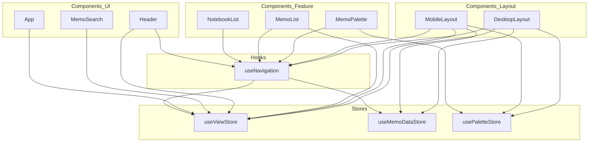
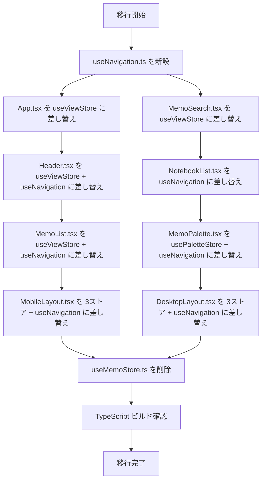

# Design Document: zustand-react-query-separation

## Overview

本機能は、Zustand ストア分割の完結フェーズとして、後方互換ラッパー `useMemoStore` を廃止し、全コンポーネントが `useViewStore`・`useMemoDataStore`・`usePaletteStore` および新設 `useNavigation` フックを直接利用する状態に移行する。

`useMemoStore` はストア分割時に一時的に作成された統合ラッパーであり、8 つのコンポーネントが依然としてこれを経由している。廃止することで、各コンポーネントの依存関係が明示的になり、間接層による認知負荷が解消される。

**Impact**: `frontend/src/stores/useMemoStore.ts` を削除し、8 つのコンポーネントの import を個別ストア・`useNavigation` に差し替える。バックエンド・DB・APIへの変更はない。

### Goals

- `useMemoStore` への依存を全コンポーネントから除去し、ファイル自体を削除する
- クロスストア複合ナビゲーションアクションを `useNavigation` フックに集約し、DRY を維持する
- React Query（サーバー状態）と Zustand（UI状態）の責務境界を設計レベルで明文化する

### Non-Goals

- Zustand 個別ストアの内部実装の変更
- React Query フックや API クライアントの変更
- テストフレームワークの導入（別 spec 対象）
- ストア統合・追加機能の実装

---

## Requirements Traceability

| Requirement | Summary                                             | Components                                      | Interfaces                  | Flows          |
| ----------- | --------------------------------------------------- | ----------------------------------------------- | --------------------------- | -------------- |
| 1.1         | ビルドが useMemoStore なしで成功する                | 全 8 コンポーネント                             | —                           | Migration Flow |
| 1.2         | 8 ファイルの import 差し替え                        | 全 8 コンポーネント                             | useNavigation, 個別ストア   | —              |
| 1.3         | 最小依存の原則（不要ストアを import しない）        | 全 8 コンポーネント                             | —                           | —              |
| 1.4         | 移行後の挙動が移行前と同一                          | 全 8 コンポーネント                             | useNavigation               | —              |
| 2.1         | useMemoStore.ts ファイルを削除                      | useMemoStore（削除対象）                        | —                           | —              |
| 2.2         | TS コンパイルエラーなし                             | 全 8 コンポーネント                             | —                           | —              |
| 2.3         | 再エクスポートへの依存がない                        | 全 8 コンポーネント                             | —                           | —              |
| 3.1         | 各ストアはサーバーデータを保持しない                | useViewStore, useMemoDataStore, usePaletteStore | State contract              | —              |
| 3.2         | サーバーデータのコピー・同期処理なし                | 全コンポーネント                                | —                           | —              |
| 3.3         | サーバーデータは React Query フックのみ経由         | 全コンポーネント                                | useMemoQueries 等           | —              |
| 3.4         | selectedMemoId は Zustand、データ取得は React Query | useMemoDataStore, useMemoQueries                | State + Query contract      | —              |
| 4.1         | TypeScript strict mode でコンパイル通過             | 全コンポーネント + useNavigation                | —                           | —              |
| 4.2         | 個別ストアの型をそのまま使用                        | useNavigation                                   | NavigationActions interface | —              |
| 4.3         | any 型の新規導入なし                                | useNavigation                                   | —                           | —              |

---

## Architecture

### Existing Architecture Analysis

現在の構造：`useMemoStore` が `useViewStore`・`useMemoDataStore`・`usePaletteStore` の 3 ストアを統合するラッパーとして機能しており、8 コンポーネントがこれを経由している。

移行後の構造：コンポーネントは必要なストアとフックを直接 import し、`useMemoStore` というラッパー層を完全に排除する。クロスストア複合アクションは `useNavigation` フックに集約する。

### Architecture Pattern & Boundary Map



**Architecture Integration**:

- **Selected pattern**: カスタムフックによる複合アクション集約（Composition Hook パターン）
- **Domain/feature boundaries**: ナビゲーション操作（複数ストアまたぐ） vs 状態読み書き（単一ストア）で責務を分離
- **Existing patterns preserved**: `hooks/use{Domain}Queries.ts` の命名・配置規則に `useNavigation` を追従させる
- **New components rationale**: `useNavigation` は複合アクションの重複排除と一貫性確保のために新設する（既存ストアの変更を最小化）
- **Steering compliance**: React Query をサーバー状態の唯一の真実の源泉とし、Zustand は UI 状態のみ管理するという技術方針を維持

### Technology Stack

| Layer          | Choice / Version        | Role in Feature                     | Notes                     |
| -------------- | ----------------------- | ----------------------------------- | ------------------------- |
| Frontend State | Zustand（既存）         | UI・ナビゲーション状態管理          | ストア内部実装の変更なし  |
| Frontend Hooks | React 19 カスタムフック | 複合アクション集約（useNavigation） | 新規ファイル 1 つのみ追加 |
| Frontend Types | TypeScript strict mode  | NavigationActions 型定義            | any 禁止を維持            |

---

## System Flows

### Migration Flow（移行フロー）



`useNavigation` を最初に新設することで、依存コンポーネントの移行中も常にビルドが通る状態を維持できる。

---

## Components and Interfaces

### コンポーネント一覧

| Component         | Domain/Layer       | Intent                             | Req Coverage                 | Key Dependencies                                                                   | Contracts |
| ----------------- | ------------------ | ---------------------------------- | ---------------------------- | ---------------------------------------------------------------------------------- | --------- |
| useNavigation     | Hooks              | 複合ナビゲーションアクションの集約 | 1.1〜1.4, 2.1〜2.3, 4.1〜4.3 | useViewStore (P0), useMemoDataStore (P0)                                           | State     |
| useMemoStore      | Stores（削除対象） | 後方互換ラッパー（廃止）           | 2.1, 2.2, 2.3                | —                                                                                  | —         |
| App.tsx           | UI                 | isMobile 状態の読み書き            | 1.1, 1.2, 1.3                | useViewStore (P0)                                                                  | —         |
| Header.tsx        | UI                 | ナビゲーションバー                 | 1.1, 1.2, 1.3, 1.4           | useViewStore (P0), useNavigation (P0)                                              | —         |
| MemoSearch.tsx    | UI                 | 検索クエリの読み書き               | 1.1, 1.2, 1.3                | useViewStore (P0)                                                                  | —         |
| NotebookList.tsx  | Feature            | ノートブック一覧とナビゲーション   | 1.1, 1.2, 1.3, 1.4           | useNavigation (P0)                                                                 | —         |
| MemoList.tsx      | Feature            | メモ一覧と選択                     | 1.1, 1.2, 1.3, 1.4           | useViewStore (P0), useNavigation (P0)                                              | —         |
| MemoPalette.tsx   | Feature            | コマンドパレット                   | 1.1, 1.2, 1.3, 1.4           | usePaletteStore (P0), useNavigation (P0)                                           | —         |
| MobileLayout.tsx  | Layout             | モバイル画面レイアウト             | 1.1, 1.2, 1.3, 1.4           | useViewStore (P0), useMemoDataStore (P0), usePaletteStore (P0), useNavigation (P0) | —         |
| DesktopLayout.tsx | Layout             | デスクトップ画面レイアウト         | 1.1, 1.2, 1.3, 1.4           | useViewStore (P0), useMemoDataStore (P0), usePaletteStore (P0), useNavigation (P0) | —         |

---

### Hooks Layer

#### useNavigation

| Field        | Detail                                                                                                                          |
| ------------ | ------------------------------------------------------------------------------------------------------------------------------- |
| Intent       | `useViewStore` と `useMemoDataStore` をまたぐ複合ナビゲーションアクションを提供し、コンポーネントからの直接呼び出しを可能にする |
| Requirements | 1.1, 1.2, 1.3, 1.4, 2.3, 4.1, 4.2, 4.3                                                                                          |

**Responsibilities & Constraints**

- `useViewStore` と `useMemoDataStore` の両方を更新するナビゲーションアクションのみを提供する
- 状態の読み取りは提供しない（状態読み取りはコンポーネントが個別ストアを直接使用する）
- サーバーデータ（メモ・ノートブック等の API レスポンス）を引数に受け取る場合でも、ストアに保持しない（`goToEdit(memo)` は `memo.id` のみを `useMemoDataStore` に保存する）

**Dependencies**

- Inbound: `MobileLayout`, `DesktopLayout`, `Header`, `NotebookList`, `MemoList`, `MemoPalette` — ナビゲーションアクションの呼び出し元 (P0)
- Outbound: `useViewStore` — 表示状態・ナビゲーション状態の更新 (P0)
- Outbound: `useMemoDataStore` — 選択 ID のリセット・更新 (P0)

**Contracts**: State [x]

##### State Management

```typescript
import type { Memo } from '../types/memo';

interface NavigationActions {
  goToEdit: (memo: Memo) => void;
  goToList: () => void;
  goToMemoCreate: () => void;
  goToNotebookCreate: () => void;
  goToNotebookEdit: (id: string) => void;
  goToNotebookList: () => void;
  goToMemosForNotebook: (filter: 'ALL' | 'INBOX' | string) => void;
  goToTags: () => void;
  goToTrash: () => void;
}

export const useNavigation = (): NavigationActions
```

各アクションの仕様（事前条件・事後条件）：

| Action                         | useViewStore への変更                                                                    | useMemoDataStore への変更                        |
| ------------------------------ | ---------------------------------------------------------------------------------------- | ------------------------------------------------ |
| `goToEdit(memo)`               | `currentObject='memo'`, `currentView='edit'`, `isEditing=true`                           | `selectedMemoId=memo.id`                         |
| `goToList()`                   | `currentObject='memo'`, `currentView='list'`, `isEditing=false`                          | `selectedMemoId=null`                            |
| `goToMemoCreate()`             | `currentObject='memo'`, `currentView='create'`, `isEditing=true`                         | `selectedMemoId=null`                            |
| `goToNotebookCreate()`         | `currentObject='notebook'`, `currentView='create'`, `isEditing=true`                     | `selectedMemoId=null`, `selectedNotebookId=null` |
| `goToNotebookEdit(id)`         | `currentObject='notebook'`, `currentView='edit'`, `isEditing=true`                       | `selectedMemoId=null`, `selectedNotebookId=id`   |
| `goToNotebookList()`           | `currentObject='notebook'`, `currentView='list'`, `isEditing=false`                      | `selectedMemoId=null`, `selectedNotebookId=null` |
| `goToMemosForNotebook(filter)` | `currentObject='memo'`, `currentView='list'`, `isEditing=false`, `notebookFilter=filter` | `selectedMemoId=null`                            |
| `goToTags()`                   | `currentObject='tag'`, `currentView='list'`, `isEditing=false`                           | `selectedMemoId=null`                            |
| `goToTrash()`                  | `currentObject='memo'`, `currentView='trash'`, `isEditing=false`                         | `selectedMemoId=null`                            |

- **Preconditions**: 各アクションは常に呼び出し可能（事前条件なし）
- **Postconditions**: `useViewStore` および `useMemoDataStore` の状態が上記テーブルの通りに更新される
- **Invariants**: サーバーデータをストアに保持しない。`memo.id`（文字列）のみを保存する

**Implementation Notes**

- `useViewStore` の既存メソッド（`goToList`, `goToMemoCreate` 等）を内部で利用し、`useMemoDataStore` の setter を追加で呼ぶ構造にする
- 既存の `useViewStore` 内の `goToList` 等は残留させる（他のフックや将来の利用者が `useViewStore` を直接使う可能性があるため変更しない）
- ファイルパス: `frontend/src/hooks/useNavigation.ts`

---

### Components: 差し替え仕様

各コンポーネントは新規ロジックを持たない。import の差し替えのみ行う。

#### App.tsx（useViewStore のみ）

`useMemoStore` から `useViewStore` へ：

- 削除: `import { useMemoStore } from './stores/useMemoStore'`
- 追加: `import { useViewStore } from './stores/useViewStore'`
- 変更: `const { isMobile, setIsMobile } = useMemoStore()` → `const { isMobile, setIsMobile } = useViewStore()`

#### MemoSearch.tsx（useViewStore のみ）

- 削除: `useMemoStore` import
- 追加: `useViewStore` import
- 変更: `{ searchQuery, setSearchQuery } = useMemoStore()` → `useViewStore()`

#### Header.tsx（useViewStore + useNavigation）

- 削除: `useMemoStore` import
- 追加: `useViewStore` import、`useNavigation` import
- 変更: `{ currentView, currentObject, goToList, goToTags, goToNotebookList, goToTrash } = useMemoStore()` → 状態は `useViewStore()`、アクションは `useNavigation()`

#### NotebookList.tsx（useNavigation のみ）

- 削除: `useMemoStore` import
- 追加: `useNavigation` import
- 変更: `{ goToMemosForNotebook, goToNotebookEdit, goToNotebookCreate } = useMemoStore()` → `useNavigation()`

#### MemoList.tsx（useViewStore + useNavigation）

- 削除: `useMemoStore` import
- 追加: `useViewStore` import、`useNavigation` import
- 変更: `{ notebookFilter, goToEdit } = useMemoStore()` → `notebookFilter` は `useViewStore()`、`goToEdit` は `useNavigation()`

#### MemoPalette.tsx（usePaletteStore + useNavigation）

- 削除: `useMemoStore` import
- 追加: `usePaletteStore` import、`useNavigation` import
- 変更: `{ goToEdit, paletteNotebookFilter } = useMemoStore()` → `paletteNotebookFilter` は `usePaletteStore()`、`goToEdit` は `useNavigation()`

#### MobileLayout.tsx（useViewStore + useMemoDataStore + usePaletteStore + useNavigation）

- 削除: `useMemoStore` import
- 追加: `useViewStore`, `useMemoDataStore`, `usePaletteStore`, `useNavigation` の各 import
- 変更: デストラクチャリングを各ストア・フックから取得するよう分割

#### DesktopLayout.tsx（useViewStore + useMemoDataStore + usePaletteStore + useNavigation）

- MobileLayout.tsx と同一パターン

---

### Stores Layer（既存・変更なし）

既存の `useViewStore`・`useMemoDataStore`・`usePaletteStore` の内部実装は変更しない。`useMemoStore.ts` のみ削除する。

---

## Zustand / React Query 責務境界（Req 3）

本機能は責務境界の変更を行わない。移行後も以下の不変条件を維持する：

| 状態の種類                                 | 管理場所                           | 例                                     |
| ------------------------------------------ | ---------------------------------- | -------------------------------------- |
| サーバーデータ（メモ・ノートブック・タグ） | React Query（`useMemoQueries` 等） | `useMemos()`, `useNotebooks()`         |
| 選択中 ID（UIの文脈）                      | Zustand（`useMemoDataStore`）      | `selectedMemoId`, `selectedNotebookId` |
| 表示モード・ナビゲーション状態             | Zustand（`useViewStore`）          | `currentView`, `notebookFilter`        |
| パレット状態                               | Zustand（`usePaletteStore`）       | `paletteOpen`, `paletteMode`           |

`useMemoDataStore.selectedMemoId` に ID が保存された後、そのメモのデータを取得する場合は `useMemo(selectedMemoId)` という React Query フックを経由する（`MobileLayout`, `DesktopLayout` で既に実装済み）。

---

## Error Handling

### Error Strategy

本機能はリファクタリングのため、エラーハンドリングのロジック変更はない。型エラーは TypeScript コンパイルが検出する。

- 移行中に `useMemoStore` への参照が残っている場合: `Module not found` コンパイルエラーとして検出され、実行前に気づける
- アクション仕様の誤実装（状態更新漏れ等）: 目視確認 + 手動動作確認で検出

---

## Testing Strategy

### Unit Tests

フロントエンドにテストフレームワークは未導入のため、以下を手動確認の基準とする（将来のテスト追加時の指針）：

1. `useNavigation.goToEdit(memo)` 呼び出し後、`useViewStore` と `useMemoDataStore` の状態が期待値通りに更新されること
2. `useNavigation.goToList()` 呼び出し後、`selectedMemoId` が `null` になること
3. `useNavigation.goToNotebookEdit(id)` 呼び出し後、`selectedNotebookId` が `id` になること

### Integration Tests（手動動作確認）

1. メモ一覧からメモをクリックして編集画面に遷移できること
2. ヘッダーの各ナビゲーションボタンが正しく画面遷移すること
3. コマンドパレット（Cmd+K）でメモを選択して編集画面に遷移できること
4. ノートブック一覧からノートブックをクリックしてメモ一覧に遷移できること
5. モバイル・デスクトップ両レイアウトで上記が動作すること

### Build Verification

```bash
cd frontend && npm run build
```

TypeScript コンパイルエラーがないことが移行完了の客観的証明となる。

---

## Migration Strategy

1. **Phase 1: `useNavigation.ts` の新設**（他の変更なし）
   - ビルドが通ることを確認してから次フェーズへ

2. **Phase 2: 単純移行コンポーネント（useViewStore のみ）**
   - `App.tsx`, `MemoSearch.tsx` を移行
   - ビルド確認

3. **Phase 3: 複合移行コンポーネント**
   - `Header.tsx`, `NotebookList.tsx`, `MemoList.tsx`, `MemoPalette.tsx` を移行
   - ビルド確認

4. **Phase 4: レイアウトコンポーネント**
   - `MobileLayout.tsx`, `DesktopLayout.tsx` を移行
   - ビルド確認

5. **Phase 5: `useMemoStore.ts` の削除**
   - ビルドが通ることで移行完了を確認

**Rollback**: 各フェーズは独立した git コミットとして管理し、問題発生時は該当コミットを revert する。
